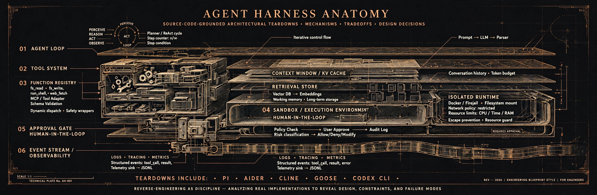

# Agent Harness Anatomy

Rigorous, source-grounded architecture teardowns of AI agent harnesses —
18 teardowns and counting, from pi and aider to Grok Build and Harness².
Every behavioral claim is pinned to verifiable source code; no product-review prose.

Companion repo to the Substack series.

By **David P. S. Marques** — [LinkedIn](https://ca.linkedin.com/in/dpsmarques) ·
[Substack](https://agentharnessanatomy.substack.com) ·
[Site](https://dpsm.github.io/agent-harness-anatomy/)

## Articles

| # | Harness | Article | Substack |
|---|---|---|---|
| 1 | pi (v1.0.2) | [pi/article.md](pi/article.md) | [Read on Substack](https://agentharnessanatomy.substack.com/p/pi-the-minimalist-terminal-harness) |
| 2 | aider (v0.86.2) | [aider/article.md](aider/article.md) | [Read on Substack](https://agentharnessanatomy.substack.com/p/aider-the-pair-programmer-that-parses) |
| 3 | Cline (v4.1.22) | [cline/article.md](cline/article.md) | [Read on Substack](https://agentharnessanatomy.substack.com/p/cline-the-approval-gated-ide-resident) |
| 4 | Goose (v1.53.0) | [goose/article.md](goose/article.md) | [Read on Substack](https://agentharnessanatomy.substack.com/p/goose-the-mcp-native-agent-that-asks) |
| 5 | Codex CLI (rust-v0.160.0) | [codex/article.md](codex/article.md) | [Read on Substack](https://agentharnessanatomy.substack.com/p/codex-cli-the-sandbox-first-agent) |
| 6 | OpenHands (v1.53.0) | [openhands/article.md](openhands/article.md) | forthcoming |
| 7 | OpenCode (v1.18.34) | [opencode/article.md](opencode/article.md) | forthcoming |
| 8 | Hermes Agent (v2026.9.24) | [hermes/article.md](hermes/article.md) | [Read on Substack](https://agentharnessanatomy.substack.com/p/hermes-agent-the-self-improving-agent) |
| 9 | OpenClaw (v2026.9.9) | [openclaw/article.md](openclaw/article.md) | forthcoming |
| 10 | Gemini CLI (v0.63.0) | [gemini-cli/article.md](gemini-cli/article.md) | forthcoming |
| 11 | SWE-agent (v1.1.0) | [swe-agent/article.md](swe-agent/article.md) | forthcoming |
| 12 | Qwen Code (v0.25.0) | [qwen-code/article.md](qwen-code/article.md) | forthcoming |
| 13 | Darwin Gödel Machine (a565fd2) | [dgm/article.md](dgm/article.md) | forthcoming |
| 14 | Autohand Code CLI (v0.9.8) | [autohand/article.md](autohand/article.md) | forthcoming |
| 15 | DeepSeek Harness (dsh-v0.2.1-alpha.3) | [deepseek-harness/article.md](deepseek-harness/article.md) | [Read on Substack](https://agentharnessanatomy.substack.com/p/deepseek-harness-dsh-the-harness) |
| 16 | Deep Agents (deepagents==0.7.25) | [deepagents/article.md](deepagents/article.md) | [Read on Substack](https://agentharnessanatomy.substack.com/p/deep-agents-the-harness-that-is-a) |
| 17 | Grok Build (2bdd1d6) | [grok-build/article.md](grok-build/article.md) | [Read on Substack](https://agentharnessanatomy.substack.com/p/grok-build-the-harness-whose-control) |
| 18 | Harness² (1cfe254) | [harness2/article.md](harness2/article.md) | [Read on Substack](https://agentharnessanatomy.substack.com/p/harness-the-harness-is-the-thing) |

## Embedded Harness Anatomy

A companion series under [`embedded/`](embedded/) — top-down dissections of
agent harnesses that run on milliwatts, adapted for event-driven systems under
physical constraints.

| # | Harness | Article | Trace |
|---|---------|---------|-------|
| E1 | ESP-Claw (v0.1.0) | [embedded/esp-claw/article.md](embedded/esp-claw/article.md) | [Follow one sensor event](embedded/esp-claw/trace.html) |
| E2 | MimiClaw (v0.1.1) | [embedded/mimiclaw/article.md](embedded/mimiclaw/article.md) | [Follow one message](embedded/mimiclaw/trace.html) |

## What's here

- `<harness>/article.md` — the full article text with evidence endnotes
- `<harness>/figures/` — static figures (SVG + PNG) used in the articles
- `<harness>/diagrams/` — data behind the interactive diagrams
- `diagrams/template.html` — the interactive diagram viewer
- [comparison-matrix.md](comparison-matrix.md) — the running ten-dimension
  comparison, one column per harness

## Interactive diagrams

Each harness ships a JSON diagram spec plus a trace-step file under
`<harness>/diagrams/`. Open `diagrams/template.html` in a browser (served
over HTTP, e.g. via GitHub Pages) and point it at the JSON to explore the
architecture interactively: pan, zoom, click nodes for module references.

## Grounding

Every article pins a release tag and commit SHA up front, and every
behavioral claim carries a footnote to a line-level permalink in that
pinned tree. Claims are graded VERIFIED (source), DOCS (documentation),
or INFERRED (reasoned from source) — the grade travels with the claim.
