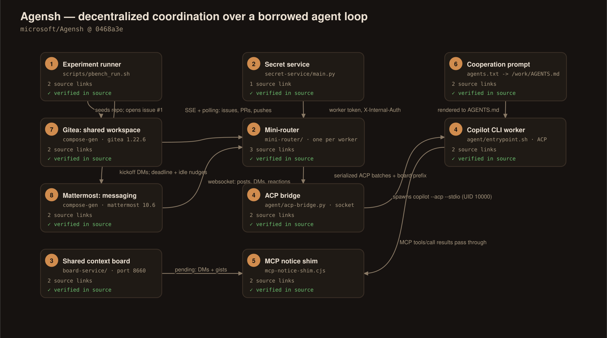
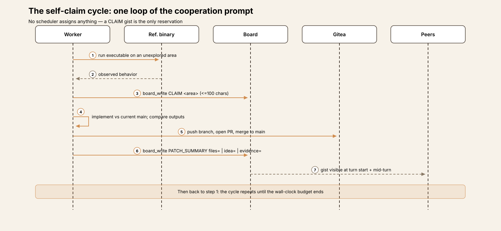
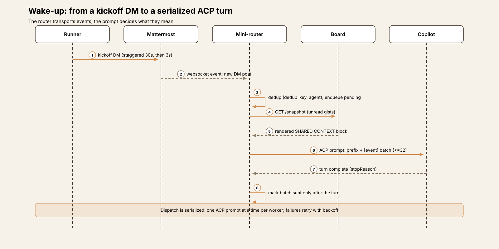
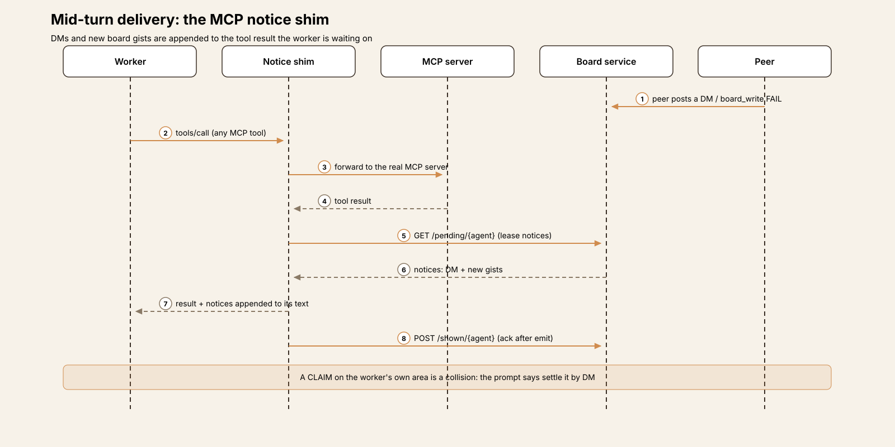
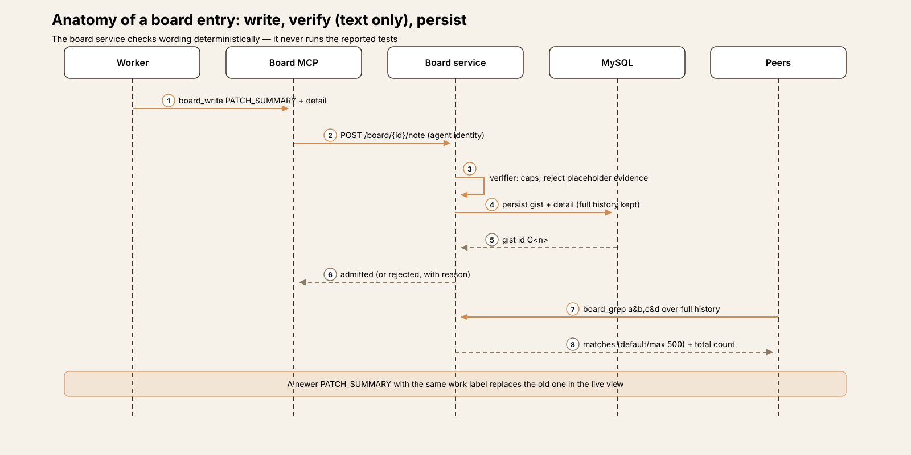
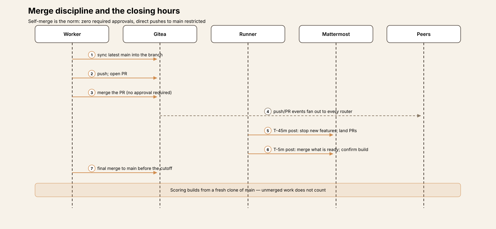

# Agent Harness Anatomy #19: Agensh — the orchestrator is a prompt

> **Series:** Agent Harness Anatomy — top-down dissections of real agent harnesses, grounded in verifiable source code. Every behavioral claim below carries a footnote to a pinned GitHub permalink; the full evidence lives in the endnotes.

## Version block

- **Repo:** [microsoft/Agensh](https://github.com/microsoft/Agensh)
- **Pinned:** tag `v1.0`, commit `0468a3e6a58b51dc2b84871fcaa0df22b0d1033e` (2026-10-23) — the repository's only tag and only commit at the pin; the code was open-sourced on 2026-10-24. It is the release accompanying a research report (Zhan et al., "Agensh: Scaling Organizational Intelligence to 1,024 Agents", arXiv:2609.26781).
- **Language:** a polyglot operations stack rather than a single package — TypeScript (the per-worker router, ≈2,200 lines), Python (the board service, the ACP bridge, the launch and scoring scripts, ≈4,600 lines), Bash (provisioning and the experiment runner), plus Docker Compose generation. The cooperation logic itself is an 85-line prompt file.
- **License:** MIT
- **Claim under test:** a decentralized, self-organized multi-agent harness with *no central orchestrator*: workers discover and claim sub-tasks, share findings, verify results and merge progress asynchronously, coordinating through a shared workspace, a messaging interface and a shared context board, on top of a borrowed single-agent harness.

Two framing notes before the dissection. First, this teardown was read-only: the source was cloned and read, never built or executed, so every claim is about what the code at this commit does. Second, Agensh inverts the shape of every previous entry in this series. Those harnesses put the agent loop in code and the instructions in prompts. Agensh puts the *multi-agent* loop in a prompt and keeps only transport, shared state and supervision in code. The repository says this about itself, in the prompt directory's README: "Cooperation is defined by these prompts; the router transports service events and context between native Copilot turns."[^1] The single-agent loop — the turns themselves — is not Agensh's at all: it is GitHub Copilot CLI, pinned, driven over ACP (the Agent Client Protocol). What Agensh contributes is everything *between* the workers: how a task reaches them, how they divide it without being assigned anything, how a finding in one worker's turn becomes an interruption in another's, and how merged code accumulates into a result.

## The mental model

Hold three layers apart, because the code keeps them apart.

**The cooperation loop is text.** `prompts/agents.txt` is rendered into each worker's `AGENTS.md`. It names the three shared services, states the team norm ("all equal. You claim what to build, you build it, you merge it, and you choose the next thing"), and defines a six-step work cycle: observe the reference, announce a `CLAIM`, build, verify against the reference, push and merge, publish a `PATCH_SUMMARY`, repeat.[^2] No scheduler, planner, task queue or leader exists anywhere in the codebase. Decomposition is emergent: the runner opens one task issue with no assignee, and each worker opens its own issues for the areas it takes.[^3]

**The substrate is three ordinary team tools, self-hosted.** A Gitea instance is the shared workspace (one repository; pull requests carry the work; `main` is the integration point). A Mattermost instance is the messaging interface (one task channel plus direct messages). A small FastAPI service — the *shared context board*, its design adapted from DeLM — is the team's shared memory: an append-only log of short, typed, verified-wording notes. All three run as services in a generated Docker Compose stack, alongside MySQL, an nginx edge, a bootstrap and a secret service.[^4]

**Each worker is a pair of containers.** One runs the agent: a supervisor (`entrypoint.sh` + `acp-bridge.py`) around a stock Copilot CLI session speaking ACP. The other is the *mini-router*, a TypeScript sidecar that listens to Gitea and Mattermost, queues what happens in a MySQL event store, and turns that activity into ACP prompts — one at a time, with the current board contents prepended. The team's size is a generator parameter: the Compose generator emits one worker/router pair per agent against the shared services.[^5] The defaults in the reproduction guide are 8 workers, six hours per task, one fixed model at high reasoning effort.[^6]

The scaling results reported by the authors — teams up to 1,024 agents, and the pass-rate improvements quoted in the README — are vendor-reported results from the paper's environment. They are flagged as unverified wherever they appear below; the released artifact is the *single-node* team setup plus a standalone single-agent baseline, and the reproduction guide itself documents ways in which a release run differs from the historical experiment.[^7]

## Component map

| Component | Lines | Role |
|---|---|---|
| `prompts/agents.txt` + briefs | 85 + | The cooperation loop: identity, substrates, board discipline, event semantics, the six-step work cycle |
| `mini-router/src/` (TypeScript) | ≈2,200 | Per-worker event plane: Gitea/Mattermost listeners, MySQL event store, serialized ACP dispatcher, board client |
| `mini-router/mcp-notice-shim.cjs` | 154 | Wraps every infrastructure MCP server; appends leased DMs and board gists to `tools/call` results, mid-turn |
| `board-service/` (Python/FastAPI) | ≈1,750 | The shared context board: typed gists, deterministic verifier, claims with expiry, snapshots, boolean grep, unfold |
| `agent/` (Bash + Python) | ≈560 | Worker provisioning (`entrypoint.sh`) and the ACP bridge supervising the Copilot child |
| `agent/config/` | — | The MCP server template (gitea / mattermost / board) and the 60-entry MCP tool deny list |
| `scripts/pbench_run.sh` + launchers | 692 + | The experiment runner: seeding, the unassigned task issue, staggered wake-up, deadline posts, the idle watchdog |
| `tools/gen-compose-prod.py` | 387 | Generates the team stack: shared services plus one worker/router pair per agent |
| `secret-service/` (Python) | 98 | Serves bootstrap-issued per-worker tokens to routers, behind an internal-auth header |
| `scripts/acp_driver.py` | 466 | The standalone single-agent baseline driver: the same ACP session shape, no team |

## The core loop

The loop that coordinates the team is worth quoting in structure, because there is so little machinery underneath it. The prompt's work cycle, verbatim in outline:[^2]

1. Run the reference program to observe the unexplored areas to build.
2. Announce the area being taken as a `CLAIM` on the shared context board.
3. Implement against current `main` (under a memory limit the prompt specifies).
4. Check the work by running the reference and the build on the same inputs and comparing.
5. Push, open a PR, and merge to `main`; if the merge is refused, merge the latest `main` into the branch, re-check, and push again.
6. Publish a `PATCH_SUMMARY` (`files= | idea= | evidence=`), then go back to 1.

Three properties of this loop are easy to miss. First, **claiming is the only coordination primitive, and it is soft.** A `CLAIM` is a board gist, not a lock: claims expire after one hour, and the prompt treats a collision as a social event — "a collision; settle it by direct message" — because a DM is the one channel that reaches a peer inside their current turn.[^8][^9] Second, **the loop has no completion condition of its own.** It repeats until the wall-clock budget ends; the runner's deadline posts at T-45 and T-5 minutes are what bend the team's behavior from building toward landing.[^10] Third, **nothing in the loop is enforced by code.** A worker that never posts a CLAIM still receives events, still merges. The code-side pressure is deliberately thin: after any turn in which a worker published no board entry, the dispatcher sends one extra prompt — a "forced-write nudge" — asking it to publish what it established, or to refresh its CLAIM.[^11]

**Self-selection starts at the top.** The runner opens the task as Gitea issue #1 with, in its own log line, "no assignee; peers self-select", and the task brief tells the team there is no one to ask: "This is FULLY autonomous: there is NO human to ask. Define requirements, split the work, decide, and ship by yourselves."[^3][^12] Who works on what is decided by whoever posts the first CLAIM for an area and holds it — a convention carried entirely by the prompt text and the board's expiry rule.

## One task, end to end

A concrete pass: a ProgramBench task (rebuild a reference program from observation; the released configuration's default shape — 8 workers, six hours), from launch to cutoff.

1. **Provisioning.** The profile generator renders the Compose stack; bootstrap creates the Gitea organization, the worker accounts, the Mattermost team and channel, and the board membership; the secret service holds each worker's tokens. Each worker container renders its `AGENTS.md` from `agents.txt` — name, team size and brief substituted — writes its git credentials and MCP config, probes that its home directory can host Copilot's SQLite session store, and starts the ACP bridge.[^13][^14]
2. **Seeding and the task issue.** The runner pushes the task's cleanroom workspace as the seed commit, then opens issue #1 containing the task brief — no assignee.[^3]
3. **Staggered wake-up.** The runner starts worker/router pairs and sends each worker a kickoff DM: 30 seconds apart for the first 120 workers, then 3 seconds apart, with a settle wait per container. The ramp is charged against the same six-hour budget, a cost the reproduction guide states plainly.[^15]
4. **The first turn.** A worker's router has ingested the DM as an event. The dispatcher claims the pending batch, fetches the board snapshot, and sends one ACP prompt: the `==== SHARED CONTEXT ====` block first, then the `[event]` summary. The worker reads issue #1, runs the reference binary, and posts its first `CLAIM`.[^16][^17]
5. **Division of labor emerges.** Peers wake into a board that already has claims on it; the prompt tells them to pick a different angle. Workers open their own Gitea issues for their areas, implement in parallel without syncing ("You do not need to sync code with others during implementation"), and publish `FACT` / `OBSERVED` / `FAIL` gists as they establish things.[^2][^18]
6. **Mid-turn correction.** A worker falsifies a hypothesis and posts a `FAIL`. Every peer whose shim next returns a tool result sees that `FAIL` appended to it, inside the turn they are already in; the prompt's rule is "stop if you are doing that thing." A peer about to edit the same files gets a DM instead — the collision channel.[^9][^19]
7. **Merge and publish.** A worker finishes an area: syncs `main`, pushes, opens a PR, merges it (no approval is required), and posts the `PATCH_SUMMARY`. The merge event fans out through every other worker's router and arrives as queued `[event]` summaries at their next turn boundaries.[^20][^21]
8. **The closing hours.** At T-45 minutes the runner posts to the channel: stop new features, land the open PRs — "work that is not merged does not count." At T-5: merge anything ready and confirm the build. At the cutoff the runner exports committed `main` HEAD — the artifact that gets scored, built fresh from a clone, root `compile.sh` and all.[^10][^22]

## The event plane: one router per worker

The mini-router is where Agensh's code concentrates, and its own header states the division of labor: "The router delivers activity; the agent prompt defines how agents cooperate."[^23] Two listeners normalize service activity into unified events — Gitea over SSE (with polling), Mattermost over a WebSocket — and ingest them into a MySQL event store. The same Gitea push therefore lands once *per worker*, deduplicated per agent by a `(dedup_key, agent)` unique key; each worker has its own queue, its own cursors, and its own delivery state.[^24][^25]

**Turns are serialized and acknowledged late.** The dispatcher claims batches of up to 32 pending events, marks them `sending`, and issues exactly one ACP prompt at a time for its worker. Before the prompt it renders the board snapshot as a prefix; the ACP channel attaches that prefix to this prompt only and clears it afterwards, so shared context cannot leak from one turn into the next.[^16][^26] The batch is marked sent only *after* the turn completes; a failed prompt puts its events into a retry state with backoff, a sweeper re-dispatches them, and a router restart recovers any rows left in `sending` back to pending.[^27] The session itself survives the router: the Copilot session id is persisted in the store and reloaded on reconnect.[^28]

**Two delivery speeds.** Queued events arrive at turn boundaries, rendered as compact `[event]` blocks (id, source, kind, age, summary — "It reports facts; deciding what to do about them is yours").[^18] Urgent items travel faster, through a different mechanism entirely: every infrastructure MCP server the worker talks to is launched through the *notice shim*, a small Node wrapper. Each time a `tools/call` result passes back through the shim, the shim leases new direct-message posts and unread peer gists from the board service, appends them to the result's text, and only then acknowledges them as shown.[^19][^29] The dispatcher later retires the corresponding queue rows (`claimShown`), so a notice delivered mid-turn is not delivered twice.[^30] Group-channel traffic is deliberately *not* urgent: it waits for a turn boundary, and backlogs beyond 32 messages are spilled to JSONL files with the newest 32 kept inline.[^31]

## The shared context board

The board is the team's only shared memory, and it is engineered to stay short. A gist is one of five types — `FACT`, `OBSERVED`, `FAIL`, `CLAIM`, `PATCH_SUMMARY` — with content capped at 100 characters (300 for a patch summary); anything longer goes into an uncapped `detail` field behind the gist's `G<n>` label, retrievable with `board_unfold`.[^32] The prompt assigns the types their semantics, including the value ordering: a `FAIL` — "a hypothesis you falsified (the highest-value entry: it stops peers spending budget on it)".[^18]

The service behind it (FastAPI over MySQL) maintains two views. The *live view* holds at most the newest 2,000 entries and applies the board's editorial rules; MySQL retains everything, and `board_grep` searches the full history with a small boolean grammar (`,` is OR, `&` is AND, parentheses allowed), returning at most 500 matches plus the total count.[^32][^33] The editorial rules are the interesting part:

- **Claims expire.** A `CLAIM` carries a TTL (one hour by default) and drops out of live reads and turn-start snapshots when it lapses — a stale claim stops reserving its area.[^8]
- **Patch summaries supersede.** A new `PATCH_SUMMARY` from an author with the same work label replaces their earlier one in the live view, preserving the original timestamp.[^34]
- **Failure invalidates.** A `FAIL` from an author invalidates that author's latest matching patch summary in the live view, marking it with the failing content.[^34]
- **"Verified" is a wording check.** A patch summary counts as a verified checkpoint only if its `evidence=` field uses solid-evidence wording and avoids weak-evidence words; separately, the write path rejects patch summaries whose evidence is placeholder text ("tbd", "pending", "unverified", "should work", …). The service README is explicit about the limit: it "checks text deterministically, without running the verification commands an agent reports."[^35][^36]

Delivery mirrors the event plane's two speeds: `GET /snapshot` returns a viewer's unread gists across its boards and advances its cursors (the dispatcher's turn-start prefix), while `GET /pending/{agent}` leases urgent notices to the shim and `POST /shown/{agent}` records what was actually emitted.[^37]

## The adapter layer: a borrowed loop, over ACP

Agensh's worker is a stock single-agent harness with its surroundings replaced. The entrypoint is explicit that this release supports exactly one kind — `AGENT_KIND=copilot`, anything else is a fatal startup error — and Copilot itself is pinned (1.0.70 in this release).[^14][^38] What the entrypoint builds around it:

- **Instructions:** `agents.txt` is rendered with the worker's name, team size and the task brief into `/work/AGENTS.md` (and copied to `CLAUDE.md`).[^13]
- **Tools:** `.mcp.json` is rendered from a template defining three stdio MCP servers — `gitea`, `mattermost`, `board` — every one launched through the notice shim; the board server is removed from the config if no board URL is configured.[^39]
- **Launch posture:** Copilot runs with `--acp --stdio`, `--no-ask-user`, `--no-remote`, `--disable-builtin-mcps`, and the two exclusions that keep the team the only multi-agent mechanism: `--excluded-tools=task --excluded-tools=list_agents` — a worker may not spawn subagents of its own.[^40]
- **Environment:** provider settings are translated from the launcher's names into Copilot's OpenAI-provider configuration, offline mode is forced, and GitHub tokens are unset so the only credentials in play are the per-worker Gitea/Mattermost ones the entrypoint installed.[^41]

The bridge between router and session is deliberately small: `acp-bridge.py` serves one Unix-socket ACP connection at a time and spawns the Copilot child as UID/GID 10000 — it refuses to run the child as root.[^42] A replacement connection waits for the previous child's cleanup. On disconnect, the bridge first asks Copilot to cancel natively (`session/cancel`) and waits for the cancellation to settle before tearing down the process group — tools get a chance to stop cleanly rather than being killed mid-write.[^43] On shutdown it seals the worker's HOME and workspace — including `.git` and ignored files — into an archive whose manifest only becomes complete once the size and checksum are recorded, and the launcher checks those manifests before cleaning up.[^44]

The seam is genuinely narrow — ACP for turns, a rendered `AGENTS.md` for instructions, an MCP config for tools — but only the Copilot implementation of it ships. The standalone baseline uses the same seam from the other side: `scripts/acp_driver.py` drives one Copilot session directly (resume-while-time-remains, silence recovery), which is what makes the 1-agent condition comparable to a team run.[^45]

## Tools, approvals and containment

**Tools.** Beyond the three MCP servers, the prompt is permissive: "MCP, git CLI, shell, curl, writing files — whatever is at hand is fine. If the tool you have is not enough, look for one; if there is none, build one."[^2] The MCP surface is then *subtracted* from: a 60-entry deny list names Gitea operations (repository, branch, tag and release management, file writes through the API, wiki, actions and milestone administration) and Mattermost operations (channel and bookmark management, file upload, message editing and deletion, pinning). Each entry is applied twice — as a Copilot permission denial and as a model-visible exclusion — so the tools are neither callable nor advertised.[^46] The effect is a routing decision: code reaches `main` through git and PRs, not through the Gitea file API, and the channel stays a conversation rather than a file store.

**Approvals.** There are none at runtime, by design: `--no-ask-user`, no human in the loop, and on the Gitea side the bootstrap allows PR merges with **zero required approvals**, restricts direct pushes to `main`, and disables the CI merge gate.[^21] Self-merge is not an oversight in this design; it is the integration mechanism the prompt's step 5 assumes. The guardrails that exist are the subtractive tool list above, per-worker credentials, and the board's membership checks (a worker can only read and write boards it belongs to; the operator identity is separate).[^37]

**Containment (the benchmark condition).** The released experiments run offline: worker networks restrict external access to model egress, prompts and briefs forbid fetching the original source, and the reference binary is mounted root-owned with mode 0111 — workers can execute it to observe behavior and cannot read its bytes.[^38][^47] Workers run as UID/GID 10000 with a 64 GiB memory ceiling (routers 8 GiB); tokens reach routers only from the secret service, gated by an internal-auth header, with the token-name path checked against traversal.[^48]

## The runner's hand: the only central code that touches behavior

The runner never assigns work, but it shapes the run in four ways, all worth naming because they are easy to mistake for emergence when reading results:

- **Wake-up ramp.** Workers are started and kicked off one at a time (30-second spacing for the first 120, then 3-second spacing, plus a per-container settle wait), and the ramp is charged to the shared wall-clock budget — at large team sizes, later workers necessarily get less working time than earlier ones.[^15]
- **Deadline posts.** Channel messages at T-45 and T-5 minutes switch the team's objective from coverage to landing; they are runner code, rendered from prompt files like everything else.[^10]
- **The idle watchdog.** Every 60 seconds the runner checks each worker's last activity; a worker idle for 600 seconds receives the `idle.txt` nudge by DM (with a channel fallback), unless its event queue is non-empty — in which case the queue, not the watchdog, is expected to wake it.[^49]
- **The forced-write nudge.** Covered above: a turn that produced no board entry earns one extra dispatcher prompt. Publication discipline is the one loop behavior the code actively reinforces.[^11]

## Scaling claims, as reported (unverified)

The README reports the headline experiment: on the five hardest ProgramBench tasks (GPT-5.6-sol, high reasoning effort, six-hour budget, no Internet), the mean final test-pass rate rose from 19.31% with 1 agent to 28.78% with 128 agents, and on Pandoc from 33.89% (1 agent) to 50.94% (128) and 55.06% (1,024); a later model is reported to take Pandoc from 56.19% (1 agent) to 79.59% (32 agents).[^7] These are the authors' reported results. This teardown did not run the system, and three facts from the release itself bound how the numbers should be read: the released code is the single-node setup; the reproduction guide notes the historical experiment seeded a different cleanroom build ("its binary differs from v6 even when version strings match") and that infrastructure updates mean "a new release run should record its own revision rather than claim exact historical reproduction"; and the wake-up ramp is charged against the same budget the pass rates are measured under.[^50]

## Extensions

- **Team size** is the primary dial: `PBENCH_WORKERS_PER_TEAM` feeds the Compose generator, which emits one worker/router pair per agent; the reproduction default is 8, the generator's own fallback is 16.[^5][^6]
- **Tasks** are ProgramBench task IDs chosen in the profile generator; the runner takes an ordered list, each task with its own hour budget, and the guide warns the generator, image builder and launcher have different built-in task lists — `TASKS` must be set explicitly and kept consistent.[^51]
- **The prompt set is configuration, and measured configuration.** Kickoff, idle and deadline texts and the briefs are files; the guide cautions that changing continuation or idle prompt policy "create[s] a different experimental condition", which is the correct way to treat the loop that runs the team.[^52]
- **Model and gateway** are environment-configured (default `gpt-5.6-sol`, high reasoning effort, a 272,000-token prompt window), and the launch scripts verify the recorded model settings before starting.[^6]
- **A different single-agent harness** would need an ACP-speaking entrypoint and bridge pair plus the rendered instructions and MCP config; the seam exists, but only the Copilot adapter is implemented in this release.[^14]

## Observations

- **The orchestrator is a prompt, and the repo knows it.** The most load-bearing file in the system is 85 lines of prose. Everything else — listeners, queues, leases, archives — is transport and record-keeping around it. That is a deliberate, documented design position ("Cooperation is defined by these prompts"), and it makes the system's behavior unusually legible: to know how the team coordinates, you read one file.
- **Urgency is a routing property, not a prompt property.** The design distinguishes what may interrupt a turn (DMs, new board gists — delivered by appending to a tool result the worker is already waiting on) from what must wait (group messages, service events — batched at turn boundaries). The prompt then assigns meaning to the fast lane: a `FAIL` means stop, a same-area `CLAIM` means negotiate. The mechanism and the norm are in different layers, and each is simple.
- **The board's editorial rules do quiet load-bearing work.** Expiring claims, superseding patch summaries, and failure-invalidated checkpoints keep a 2,000-entry shared memory from filling with stale reservations and superseded claims of success — the failure modes a naive append-only log would accumulate over a six-hour run.
- **Coordination quality is bounded by wording checks.** The board can tell that a patch summary's evidence *sounds* verified; it cannot tell that the verification happened. The service states this limit itself, but it means the team's shared picture of what is done rests, in the end, on the same kind of prompt-level discipline as everything else here.
- **The single-agent baseline is the same harness minus the team.** Because the standalone driver speaks the same ACP seam to the same Copilot configuration, the comparison the paper draws (1 agent vs N) is a comparison of coordination layers, not of agent stacks — a cleaner experimental design than most multi-agent releases offer.

## Tradeoffs

- **Soft claims can collide, and collisions cost turns.** Two workers can claim the same area before either sees the other's gist; the resolution is a DM conversation, paid for in working turns. The design accepts this as the price of having no arbiter — and the price grows with team size, because the board's live view and the mid-turn lane have finite bandwidth.
- **Coordination bandwidth is capped by construction.** Gists are 100 characters, the live board holds 2,000 entries, group backlogs truncate to 32 inline messages, and event batches cap at 32. Each cap is a reasonable defense against context flooding; together they mean a very large team's shared picture is necessarily lossy.
- **Prompt-carried discipline has no enforcement gradient.** A worker that ignores the board, skips verification, or merges carelessly breaks no rule the code can detect. The only reinforcements are nudges (forced-write, idle). For a benchmark harness this is a coherent choice; it is also the first thing a production adaptation would have to revisit.
- **Self-merge with zero approvals optimizes for landing rate.** Combined with a grader that builds from `main`, it makes integration continuous and removes review bottlenecks — and removes review. A bad merge is every peer's problem at their next sync, discovered through events, not gates.
- **The ramp taxes the largest teams most.** Because startup is staggered and charged to the shared budget, the marginal worker in a very large team starts latest and works least — a real, documented property of the released runner that any reading of the scaling curve should keep in view.
- **One adapter, one benchmark family.** The release hard-fails on any agent kind but Copilot, and the shipped prompts and briefs are ProgramBench-shaped (a reference binary, a `compile.sh` contract). The architecture generalizes further than the artifact does.

## Comparison matrix row

| # | Dimension | Agensh (v1.0) |
|---|---|---|
| 1 | Agent loop | Two nested loops: the borrowed single-agent loop (Copilot CLI turns over ACP) inside a prompt-carried cooperation loop — observe -> CLAIM -> build -> verify -> push/PR/self-merge -> PATCH_SUMMARY -> repeat; no scheduler or assignment in code; termination is the wall-clock budget, bent by runner deadline posts (T-45m, T-5m) and an idle watchdog |
| 2 | Tool system | Copilot's native shell/file tools + git CLI + curl, plus three stdio MCP servers (Gitea, Mattermost, board) all wrapped by the notice shim; a 60-entry MCP deny list (permission denial + model-visible exclusion) fences repo/file/channel administration; Copilot's own subagent tools (`task`, `list_agents`) are excluded — the team is the subagent mechanism |
| 3 | Model providers | Whatever the borrowed harness serves: this release is Copilot-only (`AGENT_KIND=copilot` or fatal), Copilot pinned at 1.0.70, provider reached through a gateway (defaults: `gpt-5.6-sol`, high reasoning effort, 272k prompt window, Responses API); launcher translates its model env names into Copilot's OpenAI-provider config |
| 4 | Prompt construction | One rendered file: `agents.txt` (identity, substrates, board discipline, event semantics, work cycle) + task brief -> `/work/AGENTS.md`; per turn, the dispatcher prepends a board snapshot (`==== SHARED CONTEXT ====`) as a single-use ACP prompt prefix; urgent notices are appended to tool results mid-turn by the shim |
| 5 | Memory/session | Team memory is the board: typed gists (FACT/OBSERVED/FAIL/CLAIM/PATCH_SUMMARY, 100/300-char caps, detail behind `G<n>` unfold), 2,000-entry live view over a fully retained MySQL history with boolean grep; claims expire (1h), patch summaries supersede, FAIL invalidates; individual memory is the persisted Copilot session (id stored in MySQL) plus the archived HOME/workspace; nothing carries across tasks |
| 6 | Reasoning/planning | No planner: decomposition is emergent self-selection — the task issue is opened unassigned, workers open their own issues and reserve areas with expiring CLAIM gists, collisions are settled by DM; verification is prompt-prescribed (run reference and build on the same inputs, compare) and its board-side "verified" status is a wording check, not an executed test |
| 7 | Extensibility | Team size as a Compose-generator parameter (one worker/router pair per agent); tasks as ProgramBench IDs; the whole prompt set (agents/brief/kickoff/idle/deadline) is file configuration treated as part of the measured apparatus; a new single-agent harness would need an ACP entrypoint/bridge pair — only Copilot ships |
| 8 | Interfaces | No interactive UI for the team itself: Gitea (repo/PRs/issues), Mattermost (channel + DMs), the board's HTTP/MCP surface, and the runner's CLI/Make lifecycle (`make up PROFILE=...`); operators watch the same Gitea/Mattermost the agents use; results are exported as committed `main` HEAD plus sealed per-worker shutdown archives |
| 9 | Failure handling | Event delivery is durable: per-agent dedup, batches acknowledged only after the turn completes, failed prompts retry with backoff, stuck `sending` rows recovered on restart, session reloaded by id; bridge disconnects use native `session/cancel` with a settle wait before teardown; a turn with no board publication earns a forced-write nudge; shutdown archives are checksum-manifested and checked before cleanup |
| 10 | Security model | No runtime approvals (`--no-ask-user`) and zero-approval self-merge by design; guardrails are subtractive (60-entry MCP deny list) and credential-scoped (per-worker tokens served by an auth-gated secret service, board membership checks, workers as UID/GID 10000, bridge refuses a root child); the benchmark condition adds offline worker networks (model egress only) and an execute-only (mode 0111) reference binary |

## Endnotes

All notes are pinned permalinks into the source tree at `0468a3e6a58b51dc2b84871fcaa0df22b0d1033e`; quoted text is verbatim from that tree unless marked otherwise.

[^1]: [`prompts/README.md#L23-L24`](https://github.com/microsoft/Agensh/blob/0468a3e6a58b51dc2b84871fcaa0df22b0d1033e/prompts/README.md#L23-L24) — "Cooperation is defined by these prompts; the router transports service events and context between native Copilot turns."
[^2]: [`prompts/agents.txt#L68-L79`](https://github.com/microsoft/Agensh/blob/0468a3e6a58b51dc2b84871fcaa0df22b0d1033e/prompts/agents.txt#L68-L79) — "The work cycle. Each step is finished by the person doing it." Steps 1–6, ending: "then go back to 1."
[^3]: [`scripts/pbench_run.sh#L415-L422`](https://github.com/microsoft/Agensh/blob/0468a3e6a58b51dc2b84871fcaa0df22b0d1033e/scripts/pbench_run.sh#L415-L422) — `log "opening task issue (no assignee; peers self-select)"`, then the issue is created through the Gitea API.
[^4]: [`tools/gen-compose-prod.py#L71-L76`](https://github.com/microsoft/Agensh/blob/0468a3e6a58b51dc2b84871fcaa0df22b0d1033e/tools/gen-compose-prod.py#L71-L76), [`tools/gen-compose-prod.py#L265-L274`](https://github.com/microsoft/Agensh/blob/0468a3e6a58b51dc2b84871fcaa0df22b0d1033e/tools/gen-compose-prod.py#L265-L274), [`tools/gen-compose-prod.py#L295-L302`](https://github.com/microsoft/Agensh/blob/0468a3e6a58b51dc2b84871fcaa0df22b0d1033e/tools/gen-compose-prod.py#L295-L302) — the generated stack's gitea (1.22.6), mattermost (team-edition 10.6) and board-service definitions.
[^5]: [`tools/gen-compose-prod.py#L7-L9`](https://github.com/microsoft/Agensh/blob/0468a3e6a58b51dc2b84871fcaa0df22b0d1033e/tools/gen-compose-prod.py#L7-L9) — `WORKERS_PER_TEAM` from the environment; `ALL_AGENTS = [worker1..workerN]` — "Emit the team Compose base to stdout, expanding one worker/router pair per agent."
[^6]: [`REPRODUCE.md#L10-L11`](https://github.com/microsoft/Agensh/blob/0468a3e6a58b51dc2b84871fcaa0df22b0d1033e/REPRODUCE.md#L10-L11) — "The defaults are 8 workers, 6 hours per task, `gpt-5.6-sol`, high reasoning effort, the Responses API and a 272,000-token prompt window."
[^7]: [`README.md#L26-L40`](https://github.com/microsoft/Agensh/blob/0468a3e6a58b51dc2b84871fcaa0df22b0d1033e/README.md#L26-L40) — the vendor-reported ProgramBench results (1 vs 128 vs 1,024 agents). Reported by the authors; not verified by this teardown.
[^8]: [`board-service/shared_lessons.py#L14-L23`](https://github.com/microsoft/Agensh/blob/0468a3e6a58b51dc2b84871fcaa0df22b0d1033e/board-service/shared_lessons.py#L14-L23) — `VALID_TYPES`, `MAX_CONTENT_CHARS = 100`, `MAX_PATCH_SUMMARY_CHARS = 300`, `MAX_BOARD_ENTRIES = 2000`, `DEFAULT_CLAIM_TTL_SECONDS = 3600`.
[^9]: [`prompts/agents.txt#L57-L66`](https://github.com/microsoft/Agensh/blob/0468a3e6a58b51dc2b84871fcaa0df22b0d1033e/prompts/agents.txt#L57-L66) — mid-turn semantics: "`FAIL` — stop if you are doing that thing… `CLAIM` on what you are building — a collision; settle it by direct message."
[^10]: [`scripts/pbench_run.sh#L334-L352`](https://github.com/microsoft/Agensh/blob/0468a3e6a58b51dc2b84871fcaa0df22b0d1033e/scripts/pbench_run.sh#L334-L352) — `deadline_reminder_loop`: channel posts of `deadline-45m.txt` and `deadline-5m.txt`, timed against the remaining budget.
[^11]: [`mini-router/src/dispatcher.ts#L154-L172`](https://github.com/microsoft/Agensh/blob/0468a3e6a58b51dc2b84871fcaa0df22b0d1033e/mini-router/src/dispatcher.ts#L154-L172) — after a delivered turn, if the worker's latest own gist did not advance: "sending forced-write nudge" via `board.buildForcedWriteNudge()`.
[^12]: [`prompts/task-brief.txt#L12-L13`](https://github.com/microsoft/Agensh/blob/0468a3e6a58b51dc2b84871fcaa0df22b0d1033e/prompts/task-brief.txt#L12-L13) — "This is FULLY autonomous: there is NO human to ask. Define requirements, split the work, decide, and ship by yourselves."
[^13]: [`agent/entrypoint.sh#L122-L126`](https://github.com/microsoft/Agensh/blob/0468a3e6a58b51dc2b84871fcaa0df22b0d1033e/agent/entrypoint.sh#L122-L126) — `envsubst < agents.md > /work/AGENTS.md`, copied to `CLAUDE.md`; the MCP template is rendered alongside.
[^14]: [`agent/entrypoint.sh#L14`](https://github.com/microsoft/Agensh/blob/0468a3e6a58b51dc2b84871fcaa0df22b0d1033e/agent/entrypoint.sh#L14) — "this release supports AGENT_KIND=copilot only" (fatal otherwise); [`REPRODUCE.md#L428-L429`](https://github.com/microsoft/Agensh/blob/0468a3e6a58b51dc2b84871fcaa0df22b0d1033e/REPRODUCE.md#L428-L429) — "This release pins Copilot 1.0.70 and Mattermost MCP 0.5.1."
[^15]: [`REPRODUCE.md#L398-L405`](https://github.com/microsoft/Agensh/blob/0468a3e6a58b51dc2b84871fcaa0df22b0d1033e/REPRODUCE.md#L398-L405) — "The team budget includes staggered startup. The default ramp targets 30 seconds per worker for the first 120 workers, then 3 seconds… The ramp can overrun the budget"; the stagger switch itself is `wake_stagger_for` in `scripts/pbench_run.sh#L354-L365`.
[^16]: [`mini-router/src/board_client.ts#L26-L40`](https://github.com/microsoft/Agensh/blob/0468a3e6a58b51dc2b84871fcaa0df22b0d1033e/mini-router/src/board_client.ts#L26-L40) — `renderForPrompt`: the snapshot rendered under the header `==== SHARED CONTEXT ====`.
[^17]: [`mini-router/src/dispatcher.ts#L2-L4`](https://github.com/microsoft/Agensh/blob/0468a3e6a58b51dc2b84871fcaa0df22b0d1033e/mini-router/src/dispatcher.ts#L2-L4) — "Serialize queued events into worker turns, adding fresh board context first. Delivery is acknowledged after a completed turn; failed prompts enter retry."
[^18]: [`prompts/agents.txt#L21-L33`](https://github.com/microsoft/Agensh/blob/0468a3e6a58b51dc2b84871fcaa0df22b0d1033e/prompts/agents.txt#L21-L33) — the board paragraph: publish "the moment you establish something"; `FAIL` as "the highest-value entry"; "Do not re-derive a peer's `FACT`, and do not retry something recorded as `FAIL`"; the `board_grep` boolean grammar.
[^19]: [`mini-router/mcp-notice-shim.cjs#L3-L5`](https://github.com/microsoft/Agensh/blob/0468a3e6a58b51dc2b84871fcaa0df22b0d1033e/mini-router/mcp-notice-shim.cjs#L3-L5) — "Wrap an infrastructure MCP server and append DMs and fresh board gists to tools/call results. Leases coordinate concurrent wrappers for one worker."
[^20]: [`prompts/agents.txt#L35-L40`](https://github.com/microsoft/Agensh/blob/0468a3e6a58b51dc2b84871fcaa0df22b0d1033e/prompts/agents.txt#L35-L40) — "all equal. You claim what to build, you build it, you merge it, and you choose the next thing… sync your codebase with the latest `main` branch before merging."
[^21]: [`REPRODUCE.md#L422-L424`](https://github.com/microsoft/Agensh/blob/0468a3e6a58b51dc2b84871fcaa0df22b0d1033e/REPRODUCE.md#L422-L424) — "Bootstrap allows PR merges with zero required approvals while restricting direct pushes to main; the CI merge gate is disabled."
[^22]: [`prompts/pbench-brief.txt#L20-L25`](https://github.com/microsoft/Agensh/blob/0468a3e6a58b51dc2b84871fcaa0df22b0d1033e/prompts/pbench-brief.txt#L20-L25) — the hard delivery constraint: the evaluator unpacks the repo, deletes any committed `./executable`, runs root `compile.sh` and tests the produced binary; "No root-directory compile.sh = 0 points."
[^23]: [`mini-router/src/main.ts#L2-L3`](https://github.com/microsoft/Agensh/blob/0468a3e6a58b51dc2b84871fcaa0df22b0d1033e/mini-router/src/main.ts#L2-L3) — "Wire one worker's durable event queue, service listeners and ACP dispatcher. The router delivers activity; the agent prompt defines how agents cooperate."
[^24]: [`mini-router/src/state.ts#L54-L56`](https://github.com/microsoft/Agensh/blob/0468a3e6a58b51dc2b84871fcaa0df22b0d1033e/mini-router/src/state.ts#L54-L56) — the event table's `UNIQUE KEY uk_dedup_agent (dedup_key, agent)` and the retry index.
[^25]: [`mini-router/src/listeners/gitea/listener.ts#L29`](https://github.com/microsoft/Agensh/blob/0468a3e6a58b51dc2b84871fcaa0df22b0d1033e/mini-router/src/listeners/gitea/listener.ts#L29), [`mini-router/src/listeners/mattermost/listener.ts#L19`](https://github.com/microsoft/Agensh/blob/0468a3e6a58b51dc2b84871fcaa0df22b0d1033e/mini-router/src/listeners/mattermost/listener.ts#L19) — the two listener classes the router wires up in `main.ts`.
[^26]: [`mini-router/src/acp_socket_channel.ts#L51-L55`](https://github.com/microsoft/Agensh/blob/0468a3e6a58b51dc2b84871fcaa0df22b0d1033e/mini-router/src/acp_socket_channel.ts#L51-L55) — "Shared context belongs to this prompt and must not leak into the next turn": the prefix is prepended once and cleared.
[^27]: [`mini-router/src/main.ts#L94-L95`](https://github.com/microsoft/Agensh/blob/0468a3e6a58b51dc2b84871fcaa0df22b0d1033e/mini-router/src/main.ts#L94-L95) — "A router restart may interrupt a turn before its delivery is acknowledged": interrupted `sending` rows are recovered to pending; the retry sweeper loop is at `main.ts#L226-L251`.
[^28]: [`mini-router/src/acp_socket_channel.ts#L15-L20`](https://github.com/microsoft/Agensh/blob/0468a3e6a58b51dc2b84871fcaa0df22b0d1033e/mini-router/src/acp_socket_channel.ts#L15-L20) — the channel's `sessionStore` seam; `main.ts` binds it to the store key `acp_session_id:copilot`.
[^29]: [`mini-router/mcp-notice-shim.cjs#L138-L154`](https://github.com/microsoft/Agensh/blob/0468a3e6a58b51dc2b84871fcaa0df22b0d1033e/mini-router/mcp-notice-shim.cjs#L138-L154) — on a `tools/call` response: fetch pending notices, append them to the result text, emit, and "Acknowledge only after emitting the augmented result; failures can redeliver."
[^30]: [`mini-router/src/dispatcher.ts#L52-L68`](https://github.com/microsoft/Agensh/blob/0468a3e6a58b51dc2b84871fcaa0df22b0d1033e/mini-router/src/dispatcher.ts#L52-L68) — batches of 32 from `nextPendingBatch`; "Retire DMs already appended to an MCP result by the mid-turn notice shim" via `claimShown`.
[^31]: [`mini-router/README.md#L25-L27`](https://github.com/microsoft/Agensh/blob/0468a3e6a58b51dc2b84871fcaa0df22b0d1033e/mini-router/README.md#L25-L27) — "Group messages wait for a turn boundary. Backlogs larger than 32 messages are saved as complete JSONL files… with the newest 32 kept inline."
[^32]: [`board-service/mcp.cjs#L94-L116`](https://github.com/microsoft/Agensh/blob/0468a3e6a58b51dc2b84871fcaa0df22b0d1033e/board-service/mcp.cjs#L94-L116) — the `board_write` tool definition as the agent sees it: types, caps, the PATCH_SUMMARY format, and `detail` stored behind the gist for `board_unfold`.
[^33]: [`board-service/main.py#L536-L545`](https://github.com/microsoft/Agensh/blob/0468a3e6a58b51dc2b84871fcaa0df22b0d1033e/board-service/main.py#L536-L545) — `GET /board/{board_id}/grep` over persisted history; the default/max window (500) and grammar are set at `main.py#L38-L40`.
[^34]: [`board-service/shared_lessons.py#L110-L145`](https://github.com/microsoft/Agensh/blob/0468a3e6a58b51dc2b84871fcaa0df22b0d1033e/board-service/shared_lessons.py#L110-L145) — in `_admit`: "A local counterexample invalidates that author's latest matching patch", and a same-label PATCH_SUMMARY replaces the recent candidate "while preserving its initial timestamp."
[^35]: [`board-service/verifier.py#L1-L3`](https://github.com/microsoft/Agensh/blob/0468a3e6a58b51dc2b84871fcaa0df22b0d1033e/board-service/verifier.py#L1-L3) — "Normalize and cap board gists, rejecting patch summaries with placeholder evidence. Verification is a deterministic text check; it does not execute the claimed tests"; the check itself is `verify_note` at `verifier.py#L46-L56`.
[^36]: [`board-service/README.md#L6-L9`](https://github.com/microsoft/Agensh/blob/0468a3e6a58b51dc2b84871fcaa0df22b0d1033e/board-service/README.md#L6-L9) — "Every admitted gist is appended to MySQL; a recent in-memory view supports prompt delivery. The service checks text deterministically, without running the verification commands an agent reports."
[^37]: [`board-service/main.py#L342-L345`](https://github.com/microsoft/Agensh/blob/0468a3e6a58b51dc2b84871fcaa0df22b0d1033e/board-service/main.py#L342-L345), [`board-service/main.py#L653-L660`](https://github.com/microsoft/Agensh/blob/0468a3e6a58b51dc2b84871fcaa0df22b0d1033e/board-service/main.py#L653-L660), [`board-service/main.py#L468-L475`](https://github.com/microsoft/Agensh/blob/0468a3e6a58b51dc2b84871fcaa0df22b0d1033e/board-service/main.py#L468-L475) — `GET /pending/{agent}` (leased notices), `GET /snapshot` (unread gists, advancing cursors), and `POST /board/{board_id}/note` behind the membership check in `_authorize`.
[^38]: [`REPRODUCE.md#L436-L437`](https://github.com/microsoft/Agensh/blob/0468a3e6a58b51dc2b84871fcaa0df22b0d1033e/REPRODUCE.md#L436-L437) — "Workers run as UID/GID 10000 and can execute the root-owned, mode-0111 reference at `/opt/pbench/executable` without reading its bytes. Worker networks restrict external access to model egress."
[^39]: [`agent/config/mcp.json.tmpl#L3-L10`](https://github.com/microsoft/Agensh/blob/0468a3e6a58b51dc2b84871fcaa0df22b0d1033e/agent/config/mcp.json.tmpl#L3-L10), [`agent/config/mcp.json.tmpl#L41-L58`](https://github.com/microsoft/Agensh/blob/0468a3e6a58b51dc2b84871fcaa0df22b0d1033e/agent/config/mcp.json.tmpl#L41-L58) — the gitea and board MCP server definitions; every server command runs through `/opt/mcp-notice-shim.cjs`.
[^40]: [`agent/entrypoint.sh#L187-L195`](https://github.com/microsoft/Agensh/blob/0468a3e6a58b51dc2b84871fcaa0df22b0d1033e/agent/entrypoint.sh#L187-L195) — `COPILOT_ARGS`: `--excluded-tools=task --excluded-tools=list_agents --acp --stdio --no-auto-login --no-auto-update --no-remote --disable-builtin-mcps --additional-mcp-config=@/work/.mcp.json --no-ask-user`.
[^41]: [`agent/entrypoint.sh#L150-L160`](https://github.com/microsoft/Agensh/blob/0468a3e6a58b51dc2b84871fcaa0df22b0d1033e/agent/entrypoint.sh#L150-L160) — the provider translation ("Translate the launcher's legacy ANTHROPIC_* names to Copilot's OpenAI provider"), `COPILOT_OFFLINE=true`, `COPILOT_AUTO_UPDATE=false`.
[^42]: [`agent/acp-bridge.py#L2-L3`](https://github.com/microsoft/Agensh/blob/0468a3e6a58b51dc2b84871fcaa0df22b0d1033e/agent/acp-bridge.py#L2-L3) — "Bridge one Unix-socket ACP connection at a time to a non-root Copilot process. Disconnects cancel active prompts; shutdown saves the worker's HOME and /work"; the non-root check is at `acp-bridge.py#L24`.
[^43]: [`agent/acp-bridge.py#L143-L162`](https://github.com/microsoft/Agensh/blob/0468a3e6a58b51dc2b84871fcaa0df22b0d1033e/agent/acp-bridge.py#L143-L162) — on disconnect, pending sessions get a native `session/cancel`; "Let Copilot settle native cancellation before terminating its tools", with an 8-second settle wait.
[^44]: [`agent/README.md#L20-L26`](https://github.com/microsoft/Agensh/blob/0468a3e6a58b51dc2b84871fcaa0df22b0d1033e/agent/README.md#L20-L26) — shutdown writes `shutdown/<boot-id>/state.tar.gz` with HOME and the complete workspace; "A manifest becomes complete only after the archive is sealed and its size/checksum recorded. The launcher checks these manifests before automatic cleanup."
[^45]: [`scripts/acp_driver.py#L1-L4`](https://github.com/microsoft/Agensh/blob/0468a3e6a58b51dc2b84871fcaa0df22b0d1033e/scripts/acp_driver.py#L1-L4) — "Drive a standalone Copilot session through the container's stdio/socket adapter. Resume completed turns while more than 60 seconds remain… Reload sessions after transport/watchdog failures."
[^46]: [`agent/entrypoint.sh#L201-L208`](https://github.com/microsoft/Agensh/blob/0468a3e6a58b51dc2b84871fcaa0df22b0d1033e/agent/entrypoint.sh#L201-L208) — "Apply both permission denials and model-visible exclusions for each MCP rule": every entry of `copilot-deny-tools.json` (60 selectors) becomes a `--deny-tool` flag and an `--excluded-tools` entry.
[^47]: [`prompts/pbench-brief.txt#L13-L19`](https://github.com/microsoft/Agensh/blob/0468a3e6a58b51dc2b84871fcaa0df22b0d1033e/prompts/pbench-brief.txt#L13-L19) — the iron rules: fully autonomous; no Internet ("the whole cluster is offline"); the reference binary "is `root:root 0111`… do not try to decompile or dump it".
[^48]: [`secret-service/main.py#L2-L3`](https://github.com/microsoft/Agensh/blob/0468a3e6a58b51dc2b84871fcaa0df22b0d1033e/secret-service/main.py#L2-L3) — "Serve bootstrap-issued worker tokens to routers on the private service network. Token reads require X-Internal-Auth."
[^49]: [`REPRODUCE.md#L407-L408`](https://github.com/microsoft/Agensh/blob/0468a3e6a58b51dc2b84871fcaa0df22b0d1033e/REPRODUCE.md#L407-L408) — "The team idle watchdog nudges workers after 600 seconds of inactivity, checked every 60 seconds"; the watchdog's queue-aware nudge logic is `watchdog_consider` in `scripts/pbench_run.sh#L497-L523`.
[^50]: [`REPRODUCE.md#L429-L434`](https://github.com/microsoft/Agensh/blob/0468a3e6a58b51dc2b84871fcaa0df22b0d1033e/REPRODUCE.md#L429-L434) — the release-differences note: infrastructure updates since the historical experiment, the v6 cleanroom vs the older seeded reference ("its binary differs… even when version strings match"), and the instruction to record a new run's own revision rather than claim exact historical reproduction.
[^51]: [`REPRODUCE.md#L74-L76`](https://github.com/microsoft/Agensh/blob/0468a3e6a58b51dc2b84871fcaa0df22b0d1033e/REPRODUCE.md#L74-L76) — "Set `TASKS` explicitly: the generator, image builder and launcher have different built-in task lists."
[^52]: [`REPRODUCE.md#L443-L444`](https://github.com/microsoft/Agensh/blob/0468a3e6a58b51dc2b84871fcaa0df22b0d1033e/REPRODUCE.md#L443-L444) — "Keep prompts fixed; changes to continuation or idle policy create a different experimental condition."
