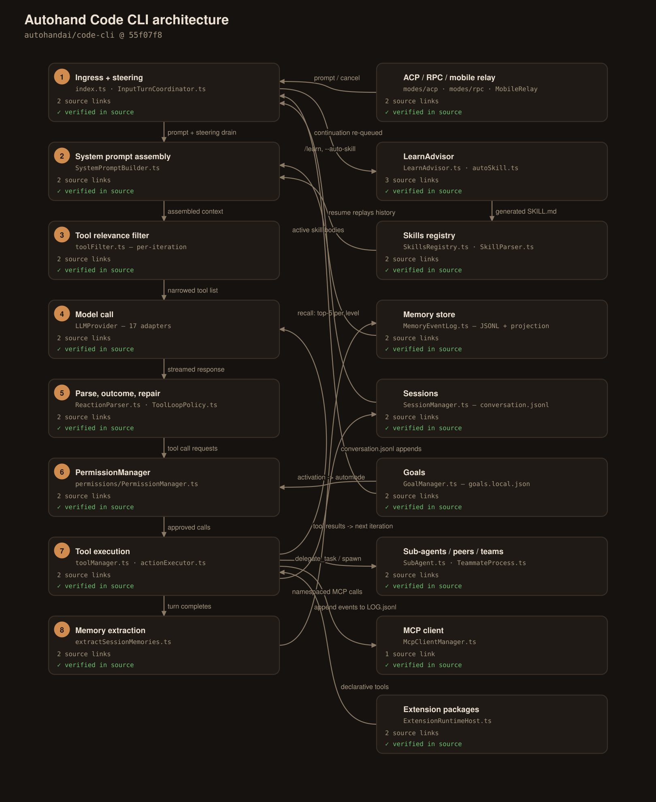
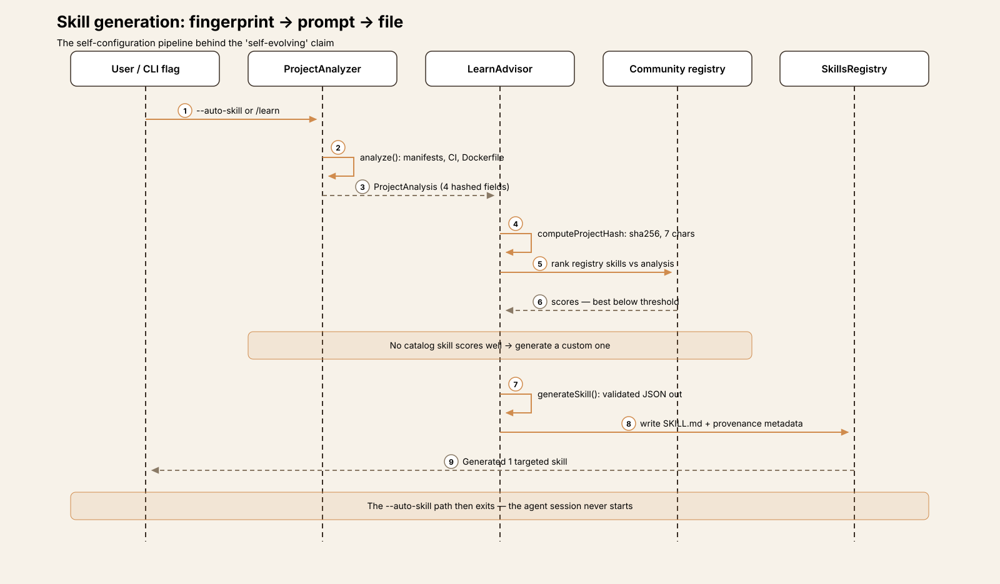
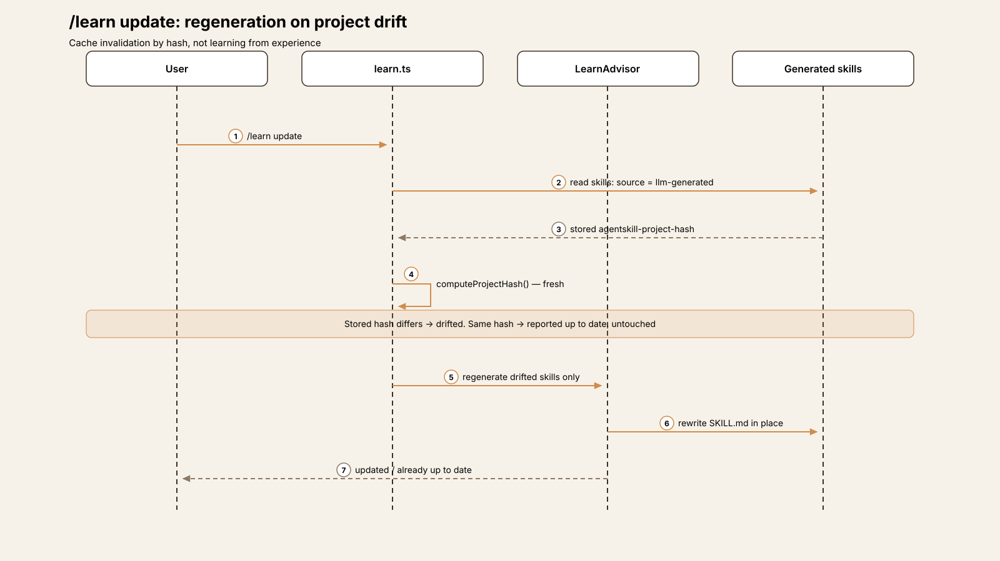
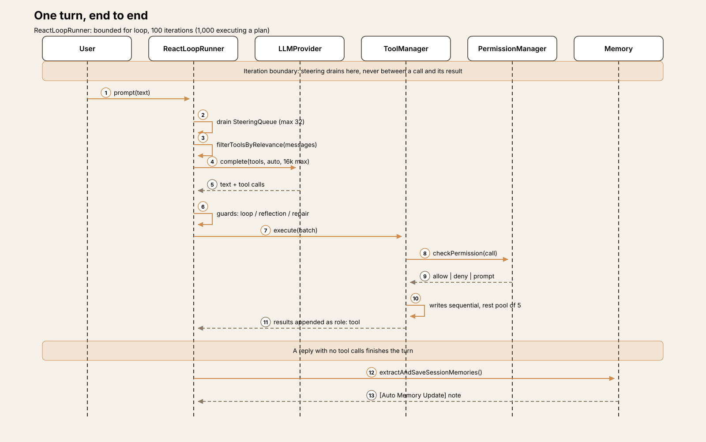
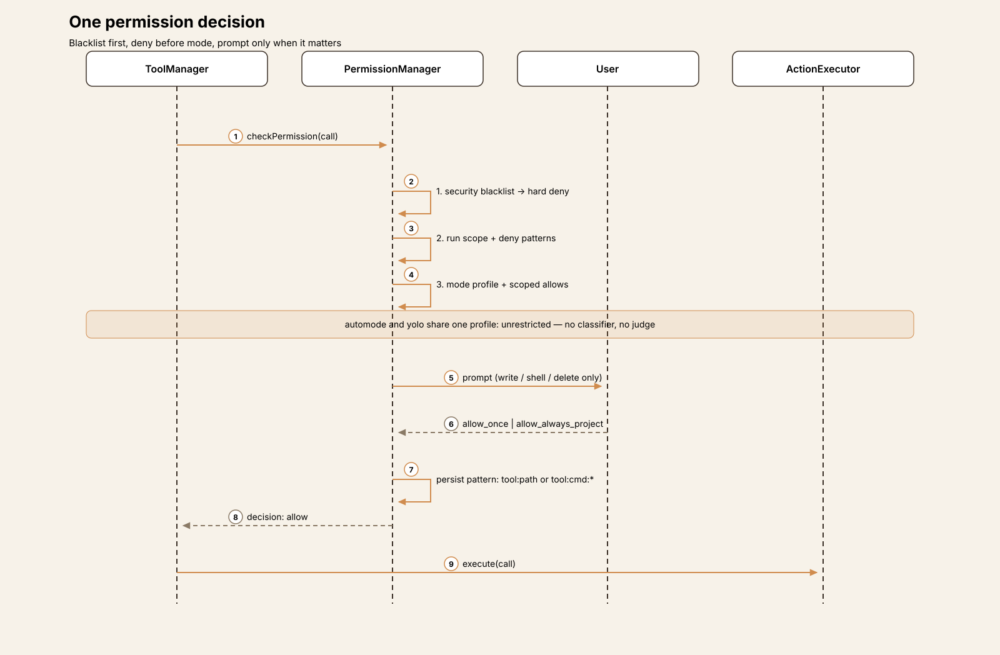
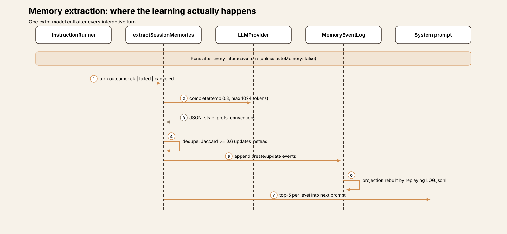

# Agent Harness Anatomy #14: Autohand Code CLI — the harness that rewrites its own skills

> **Series:** Agent Harness Anatomy — top-down dissections of real agent harnesses, grounded in verifiable source code. Every behavioral claim below carries a footnote to a pinned GitHub permalink; the full evidence lives in the endnotes.

## Version block

- **Repo:** [autohandai/code-cli](https://github.com/autohandai/code-cli)
- **Pinned:** tag `v0.9.8` → `55f07f8112d3d53739c4c45d7c19d73772e645d7` (2026-09-22)
- **Language:** TypeScript on Bun (702 `.ts`/`.tsx` files, ~207k LOC in `src/`; Ink + React TUI)
- **License:** Apache-2.0
- **Claim under test:** "self evolving coding agent" — skills that generate and update themselves

## The mental model

Autohand's headline claim is that it *evolves*: it generates its own skills. The mechanism is real, complete, and narrower than the word suggests — and pinning down exactly what it does is the most instructive way into this harness.

There is no learning from experience anywhere in the skill system. What exists is a three-step pipeline: **fingerprint the project, prompt a model, write a file.** A deterministic analyzer walks the workspace — `package.json`, `requirements.txt`, `Cargo.toml`, `go.mod`, CI configs, a Dockerfile — and reduces the project to four fields: languages, frameworks, patterns, package manager.[^1] Those four fields are hashed (a 7-character SHA-256 prefix).[^2] An LLM advisor then either ranks community-registry skills against that fingerprint or, when nothing scores well, generates a custom skill as validated JSON, which is written to disk as a `SKILL.md` with provenance metadata stamped into its frontmatter: source `llm-generated`, the project hash it was generated from, a timestamp.[^3] Later, `/learn update` recomputes the hash; if your project has drifted — you swapped a framework, adopted a test runner — the stale generated skills are regenerated in place. If the hash matches, nothing happens.[^4]

So the "evolution" signal is *project drift*, not agent experience. Swap React for Vue and Autohand rewrites its own skills. Accumulate a year of sessions, corrections, and hard-won workflow habits, and the skill set changes not at all — no transcript, tool-call history, or outcome ever enters the generation prompt.[^5] Every trigger is explicit, too: a `--auto-skill` flag, a `/learn` command, an RPC method. Nothing generates or updates a skill at session end, and the agent itself has no tool that authors one.[^6]

The harness *does* learn from experience — just in a different subsystem, writing a different artifact. After every interactive turn, a reflection call extracts preferences and conventions from the session into a persistent memory store (§Memory). Autohand's architecture thus splits "learning" in two: **skills are generated from what your project is; memories are extracted from what you did.** The marketing merges them. The code doesn't.

Everything else in this very large harness — 131 default tools, a four-scope permission engine, feature-flagged goals, OS-process teammates, a phone relay — is in service of a conventional, if maximalist, terminal coding agent. The sections below walk it axis by axis.

## The self-evolution mechanism, end to end

**Analysis.** `ProjectAnalyzer` (`src/skills/autoSkill.ts`) is deliberately simple: dependency-name lookups against fixed framework tables, file-existence checks, a shallow directory walk. It cannot be wrong in interesting ways because it asserts so little — but that also bounds what a generated skill can know: the stack, never the codebase's content or the team's habits.[^1]

**Advisory.** `LearnAdvisor` makes two kinds of LLM calls, both structured-JSON with hard validation and safe empty fallbacks. Phase 1 ranks the community registry against the analysis and audits installed skills as `redundant`, `outdated`, or `conflicting`. Phase 2 generates: the prompt is the analysis summary plus a gap analysis plus the three closest registry near-misses.[^7] The generated skill passes through the same door as every other skill — same parser, same frontmatter, same activation paths — distinguished only by its metadata block.[^8]

**Regeneration.** The metadata is what makes `/learn update` possible: the stored hash is compared against a fresh one, and only drifted skills are rewritten.[^4] It is a cache-invalidation design, not a learning loop — closer to how a build system decides what to rebuild than to how an agent improves. That is not a criticism of the engineering, which is tidy. It is a correction to the noun: this is *self-configuration*, keyed to the project. The one genuinely experience-driven mechanism in the product is memory extraction, and it never touches skills.

One more calibration: the README's sample output for `--auto-skill` shows three skills being generated. That output comes from an older generator (`generateAutoSkills`, whose prompt demands exactly three skills from eight fixed categories) that has **no callers left** at this pin. The live path generates exactly one targeted skill — and then exits; the agent session never starts.[^9]

## Package map

Single-package TypeScript; the agent core is split across ~48 modules in `src/core/agent/`.

| Module | Role |
|---|---|
| `src/index.ts` | Commander entry (3,083 lines); mode dispatch: interactive / RPC / ACP / teammate |
| `src/core/agent/ReactLoopRunner.ts` | THE loop |
| `src/core/agent/ToolLoopPolicy.ts` | Loop guard, reflection guard |
| `src/core/toolManager.ts` | Tool registry + pre-flight (~3,400 lines); `actionExecutor.ts` implements |
| `src/core/toolFilter.ts` | Per-iteration tool relevance filtering |
| `src/skills/` | Registry, parser, `autoSkill.ts`, `LearnAdvisor.ts`, community installer + scanner |
| `src/permissions/PermissionManager.ts` | Four-scope permission engine |
| `src/memory/` | Event-sourced memory: log, projection, summary tree, extraction |
| `src/goals/` | Goal store, queue, completion receipts |
| `src/modes/` | ACP + RPC adapters, plan mode, pipe/command modes |
| `src/extensions/` | Extension packages: manifest, registry, trusted runtime host |

## The core loop

`runAgentReactLoop` is a plain bounded `for` loop — no event machinery — with a dependency-bag host assembled by `AutohandAgent`.[^10] The cap is 100 iterations by default, 1,000 while executing an accepted plan; exhaustion is soft (a summary call, then `{status: 'incomplete'}`).[^11] There is no "done" tool: the model finishes by answering without tool calls. Run budgets (requests, tokens, duration) exist but are **opt-in** — unset, they impose nothing; the iteration count is the only default bound.[^12]

What fills the loop is repair machinery, the most distinctive mass in the codebase:

- **Loop guard** — an identical call signature six times, or an identical call *and result* three times, forces a final answer; two further violations abort the run.[^13]
- **Reflection guard** — models on the text protocol must emit a `reflection` field or a substantive `thought` before calling more tools; native-function-calling providers are exempt.[^13]
- **Deferred-action repair** — a heuristic classifier catches replies that *announce* work without calling a tool ("I'll now edit…") and pushes back: a note, then one tool-free recovery turn, then abort.[^14]
- **Truncation recovery** — length-cut responses are preserved and retried with a "be concise" note; three in a row aborts.[^15]

Steering is disciplined: user messages typed mid-turn enter a bounded queue (32 messages) drained **only at iteration boundaries** — never between a tool call and its result, by explicit design comment. ESC aborts through an `AbortController` threaded into both the model call and tool execution.[^16] A session-level wrapper retries whole loop failures up to three times with a continuation message.

Delegation comes in three shapes that should not be conflated. Sub-agents run a **separate, simplified copy of the loop** (hard cap: 10 iterations, shared guards and budget, no MCP tools), nestable to depth 3. Peers are cross-*session* messaging — no loop at all. Teams are separate OS processes running the full CLI, coordinated over JSON-RPC on stdio, capped at five.[^17]

## One turn, end to end

1. Drain the steering queue; run the peer boundary hook.
2. Filter the tool list for this iteration (§Tools); if a plan is being drafted, intersect with the read-only set.
3. Compact context if the tiers demand it (70% compress / 80% summarize / 90% crop).
4. Call the model (native tools, `toolChoice: 'auto'`, 16k max output tokens); record usage against the budget.
5. Parse the response — native tool calls first, else the text protocol (§Tools). Classify the turn outcome; run the repair machinery if it misbehaves.
6. Pre-flight each call (name repair, plan gate, permission check, hooks), then execute: writes and shell sequentially, the rest in a pool of five.
7. Append results as tool messages; check mid-turn compaction; loop.
8. On finish: flush any pending memory reflection (§Memory) — one extra model call that may write new memory entries and note them back into the conversation.

## Tools

The default registry holds **131 tool definitions** — file/edit, some 45 `git_*` tools, browser, web, memory, delegation, teams, tasks, cron, MCP discovery — defined in a hand-rolled JSON-Schema subset and normalized to OpenAI function shape at send time.[^18] Goal tools (+11) appear only when the goal feature is enabled; plan tools exist only during the planning phase; a 20-tool browser set is swapped in, not added, for browser clients.

131 schemas never reach the model at once. A session-level filter drops policy-excluded tools, the permission layer removes ones the user has barred from advertising, and then, **per iteration**, a relevance filter keeps an "always" core (read, grep, search, todo, plan) plus categories triggered by keywords in recent messages and by tools already used.[^19] Tools with no category — which is to say, all MCP and agent-created tools — survive only if their name or a long description token literally appears in recent text. There is no deferred schema loading in the Anthropic sense; the `tool_search` tool is the discovery analogue, returning descriptions as a tool result.

Emission is dual-protocol. Providers reporting native tool calling get schemas; the rest get **no schemas at all** and must answer in a text protocol — `[TOOL_CALL]` blocks, `<tool_call>` XML, or a JSON payload of `{thought, reflection, toolCalls, finalResponse}` — parsed in that precedence order.[^20] Much of the loop's repair machinery exists to keep this second protocol honest.

MCP is supported over stdio/HTTP/SSE with namespaced tools (`mcp__<server>__<tool>`), re-registered wholesale whenever servers sync; per-property schema detail is flattened away in the mapping, and MCP tools are marked as never requiring approval.[^21] Separately, the agent can **author its own tools** at runtime: `create_meta_tool` takes a name, schema, and a shell handler (≤2,000 chars), screens the handler against a dangerous-pattern blocklist (`curl|sh`, `rm /`, reverse shells), dedupes by fingerprint and name similarity, and persists the result as a user- or project-scoped tool.[^22]

There is no single cap on tool output returned to the model; results are appended verbatim. Caps are per-path — `read_file` stops at 2,000 lines or 128 KiB, meta-tool output at 200k characters.[^23]

## Approvals and modes

The permission engine merges four scopes at check time — session, project, user, extension policies — plus a per-run `--allowed-tools`/`--disallowed-tools` scope that is never persisted and cannot be widened by any allowlist.[^24] Each call is decided in a fixed order, and the first step matters most: an **unbypassable security blacklist** — `.env*`, `.git/config`, SSH keys, cloud credentials, `sudo`, `rm -rf /`, `curl … | sh` — is a hard deny in every mode, under every allowlist.[^25] Deny patterns and deny lists are likewise consulted *before* the mode is, so they still bite in YOLO. Only then do mode, scoped allows, and custom rules apply, with a fail-closed disposition: an unrecognized decision denies; the default decision prompts — though a prompt only actually appears for write/shell/delete-category tools or ones flagged `requiresApproval`, so a read-only tool with a default decision runs silently.[^26]

Approvals are patterns, and they persist: `allow_always_project` writes an exact `tool:command+args` (or `tool:path`) pattern to the project's settings file; prefix approvals generalize to `tool:<first-token>:*`. One legacy path is more generous than the UI suggests — it adds a directory wildcard (`tool:<dirname>/*`) to path approvals automatically.[^27] Repo-supplied hooks and MCP servers, separately, don't run until the workspace is trusted for their *exact content* — a hash of the config; change the config, get re-prompted.[^28]

The four interaction modes (Shift+Tab) are where names and machinery diverge:

- **default** — the baseline above.
- **plan** — writes are blocked *in code*, twice: the advertised tool list is intersected with a read-only set, and execution rejects anything outside it. Plans are markdown files; accepting one lifts the iteration cap to 1,000. (§Observations for the accept options that don't do what they say.)
- **automode** — the surprise: its permission profile is **identical to YOLO's** (`unrestricted`). There is no per-call classifier or AI judge anywhere in this mode. What "auto" actually buys is *continuation* — with a goal active, the harness re-queues a "keep working" instruction after every successful turn.[^29]
- **yolo** — the same unrestricted profile plus auto-yes; only the blacklist, run scope, and deny rules still stop a call, and they stop it as a deny, never a prompt.

The standalone `--auto-mode` is a different animal entirely: a Ralph-style outer loop (50 iterations / 120 minutes / $10 by default) in a git worktree with checkpoint commits and circuit breakers, completing when the output contains the string `DONE`.[^30]

## Memory: where the learning actually happens

Memory is two-level (`user` in `~/.autohand/memory/`, `project` in `<ws>/.autohand/memory/`) and **event-sourced**: the canonical store is an append-only JSONL log of `create|update|delete` events; the per-entry JSON files readers see are a materialized projection, rebuilt by replaying the log, so deleted entries can't resurrect. Writes dedupe by token similarity (≥0.6 updates instead of creating).[^31]

Extraction is the experience loop the skills headline promises. After every interactive turn, the harness fires one extra call on the session's own model: given the turn and its outcome (succeeded, failed, canceled — each with its own guidance), extract coding style, tool preferences, workflow habits, project conventions, in 1–2 sentences each, tagged `user` or `project`.[^32] It also runs on `/clear`, `/new`, and protocol-session close, and can be disabled (`autoMemory: false`); bare, ephemeral, and one-shot runs skip it. Saved items are announced back into the live conversation as an `[Auto Memory Update]` note.

Recall is lexical — no embeddings anywhere in the subsystem. The system prompt carries up to five entries per level; beyond that, a summary tree takes over, and its summaries are *extractive* ("12 memories: <first> … <last>"), not model-written. The `recall_memory` tool scores by phrase/token/tag matches plus recency decay.[^33] A separate aggregation turns skill/command usage events into a "learned project capabilities" ranking — statistics about what you use, surfaced as context, feeding nothing else.

Sessions are plain files: `~/.autohand/sessions/<id>/` holds `metadata.json`, `conversation.jsonl`, and `state.json`. Resume replays *all* stored messages into the model's conversation, fork truncates at the Nth user message, and a failed resume silently falls back to a fresh session.[^34]

## Goals

Goals are feature-flagged (`slash_goal`) and stored as one JSON file per workspace: one active goal per session, a shared FIFO queue, completed history, every write mirrored to a backup.[^35] A goal is an objective (≤80k chars) with up to 20 acceptance criteria and optional token/time budgets. Creating one does two things: queues a continuation instruction — "Active goal: … Continue working toward this persistent goal until it is complete, blocked, …" — and, quietly, **switches the session into automode**, i.e. the unrestricted permission profile, unless you've opted out.[^36] The continuation re-fires after every successful turn; budgets are accounted per turn and crossing one freezes the goal until raised.

Completion is the model's own call. `update_goal(status: 'complete')` is validated deterministically: wrap-up floors (minimum tokens/time) must be met, and if acceptance criteria exist, the model must supply exactly one evidence check per criterion, all `passed`, or the call throws. The stored receipt is stamped `provenance: 'reported'` — and the system prompt says the quiet part itself: "Receipts record reported evidence, not independent verification." With no criteria, no evidence is required at all: the model's assertion completes the goal.[^37] Templates for reusable goals live in a `.pi-goals/` directory — a convention borrowed from the pi ecosystem.

## Skills and extensions

A skill is a directory with a `SKILL.md`: frontmatter (`name`, `description` ≤1,024 chars, optional `allowed-tools`) plus a Markdown body.[^38] Thirteen ship built in. Discovery is aggressively cross-vendor — Autohand reads Codex, Claude, and generic agent skill directories at user level, and some forty third-party project directories (`.goose/skills`, `.hermes/skills`, `.pi/skills`, `.qwen/skills`, …), with its own `.autohand/skills` winning collisions.[^8] Activation is by `$name` mention (body appended to that turn's prompt), by the agent's `skill` tool, or by intent auto-injection (brainstorm in plan mode, systematic-debugging on failure signals); every request then carries active skills' full bodies in the system prompt.

Community skills install from a GitHub registry repo (with an Autohand API alongside for suggestions and backup/sync) through a regex security scanner: points deducted per suspicious pattern (`curl|bash` −20, `.ssh/id_rsa` −15), blocked below 30, warn-and-proceed below 50, interactive override allowed. The scanner runs **only on registry installs** — skills already on disk, from any vendor directory, load unscanned.[^39]

Extensions are the heavier surface: manifest packages (`autohand.extension.json`, strict Zod) contributing declarative shell-template tools, agents, skills — and optionally a trusted runtime: JavaScript loaded **in-process, unsandboxed, with the CLI's own OS access**, gated by an install-time `--trust` flag, able to register commands, views, keybindings, CLI flags, hooks, providers, and permission policies (short of changing the permission mode itself).[^40]

## Interfaces

Ingress is broad. The Ink TUI is the primary surface; one-shot (`-p`) and pipe modes cover scripting, with an `--output-schema` option that forces a schema-valid JSON final answer.[^41] ACP is implemented in-process over ndJSON stdio — prompt/cancel/modes/models/session list-resume-fork, approvals proxied to the editor client — so Zed and JetBrains need no plugin from this project.[^42] The RPC mode is a JSON-RPC 2.0 stdio server of ~90 methods serving the (external) VS Code extension and the SDKs; notably, **no SDK ships in this repo** — the TypeScript/Go/Python/Java/Swift packages live elsewhere, on top of this protocol.[^43] A mobile relay pairs the desktop session to Autohand's cloud so a phone can steer turns, approve previews, and change models. Providers number 17 behind one interface (default: OpenRouter), from bespoke Anthropic/Bedrock/Vertex adapters to thin wrappers over a shared OpenAI-compatible client, plus local Ollama, llama.cpp, and MLX.[^44]

## Observations

**The installer claims the `agent` command name — on other tools' turf.** The Unix installer, the PowerShell installer, and the generated Homebrew formula all scan the user's PATH and, wherever a command named `agent` *already exists* in a writable directory, delete it and replace it with a link to Autohand (Windows deletes `agent.com/.exe/.bat/.cmd`, directories included, and substitutes a shim). Two qualifications keep the fact precise: nothing is planted where no `agent` exists, and only user-writable directories are touched. But there is no prompt, no confirmation, and no opt-out flag in the claiming code; the in-code comment is candid that the generic name is contested by other AI CLIs and should be "reclaimed". The npm postinstall and the local-build installer do not do this.[^45]

**A closed-source daemon rides along.** Every release bundle includes `ahtraces`, a trace-monitoring binary whose source is a separate private repository (the local-build script calls it "Missing private ahtraces checkout"); CI fetches it at a pinned SHA and compiles it into the archives. The installer's checksum verification covers the bundle, not the binary individually. In its favor, the default state is genuinely inert: monitoring requires a stored consent record *and* an enabled flag, startup doesn't even spawn the process without them, and onboarding offers "Disabled (recommended default)" first. Consent tiers run from a local metadata index to cloud sync of "bounded, redacted message and tool parts". Two wrinkles: the quick `--traces-on` path selects the cloud-metadata tier — the local-only tier isn't offered there — and what the daemon watches, when enabled, is the session files of **19 harnesses**, Autohand's competitors included.[^46]

**Docs-vs-code, three more.** The docs describe `--auto-skill` as finding, installing, and activating community skills before the agent starts; the code generates one custom skill and exits (§The self-evolution mechanism).[^9] Plan mode's accept dialog offers `auto_accept` / `clear_context_auto_accept`, but the auto-accept flag is only ever logged — execution still prompts under baseline rules unless separately in yes/unrestricted mode.[^47] And "session" permissions, despite the name, persist to a project file and survive restarts.[^27]

**Declared constraints that aren't enforced.** A skill's `allowed-tools` frontmatter is parsed, validated, and displayed — and never applied as a filter when the skill activates.[^38] A harness that sells provenance for its generated skills might be expected to honor the tool restrictions those skills declare.

## Tradeoffs

Read generously, Autohand's thesis is that a harness should *persist* things: skills as files, memories as an event log, goals as JSON, plans as markdown — all inspectable, all diff-able, all portable across the many surfaces (TUI, ACP, RPC, mobile) that read them. The self-configuration pipeline is the cleanest expression of it: a fingerprint, a prompt, an artifact with provenance, and invalidation by hash. Read strictly, the same instinct produces the sprawl: 131 tools narrowed by keyword heuristics, four permission scopes plus a run scope plus extension policies, three delegation mechanisms, two auto-modes with different meanings, and a repair apparatus in the loop whose size is itself a finding — much of it exists to keep a dual emission protocol (native calls *and* a text fallback) from misbehaving, a tax providers with universal native calling wouldn't impose.

The sharpest single design decision is the automode/yolo identity: two mode names, one unrestricted profile, differentiated only by a goal-continuation behavior that itself escalates privileges on goal creation. In a harness whose blacklist and deny-ordering are genuinely careful, the mode *labels* are the least careful part.

## Comparison matrix row

| # | Dimension | Autohand Code CLI (v0.9.8) |
|---|---|---|
| 1 | Agent loop | Bounded `for` loop, 100 iterations (1,000 executing a plan); model-declared finish; loop/reflection/deferred-action/truncation repair machinery; steering at iteration boundaries only |
| 2 | Tool system | 131 defaults in a hand-rolled schema subset; per-iteration keyword-relevance filtering; MCP (namespaced, flattened schemas); agent-authored meta-tools with handler blocklist |
| 3 | Model providers | 17 behind one `LLMProvider` interface; OpenRouter default; capability flag switches native vs text emission protocol |
| 4 | Prompt construction | System prompt rebuilt per request incl. memory block, skill catalog + active skill bodies, learned-capabilities summary; context tiers 70/80/90% compress/summarize/crop |
| 5 | Memory/session | Event-sourced JSONL memory (user+project), LLM extraction after every interactive turn, lexical recall, extractive summary tree; sessions as JSONL dirs with full replay resume |
| 6 | Reasoning/planning | Plan mode with code-enforced read-only set; goals with continuation loop and self-attested completion; sub-agent loop copy (cap 10, depth 3); OS-process teams (≤5) |
| 7 | Extensibility | Cross-vendor skills (SKILL.md) incl. LLM-generated; community registry + regex scanner (install-path only); extension packages with in-process trusted runtimes; hooks at fixed events |
| 8 | Interfaces | Ink TUI; one-shot/pipe CLI with JSON-schema output; ACP (in-process, ndJSON); JSON-RPC stdio for VS Code/external SDKs; cloud mobile relay |
| 9 | Failure handling | Provider retries; session-level retry ≤3 with continuation; context-overflow crop-and-continue; per-tool failure guard (2 strikes); soft iteration-limit summary |
| 10 | Security model | Unbypassable security blacklist first; layered pattern scopes; fail-closed disposition; workspace trust by config hash; no sandbox (trusted extension runtimes run in-process) |

## Endnotes

All notes are VERIFIED against `v0.9.8` (`55f07f8112d3d53739c4c45d7c19d73772e645d7`) unless marked otherwise. `GH` = `https://github.com/autohandai/code-cli/blob/55f07f8112d3d53739c4c45d7c19d73772e645d7/`.

[^1]: `ProjectAnalyzer` at [GH…/src/skills/autoSkill.ts#L160](https://github.com/autohandai/code-cli/blob/55f07f8112d3d53739c4c45d7c19d73772e645d7/src/skills/autoSkill.ts#L160); `analyze()` at L169: `package.json` dependency tables (`JS_FRAMEWORKS`/`PYTHON_FRAMEWORKS`, L120-L150), `requirements.txt`, `pyproject.toml`, `Cargo.toml`, `go.mod`, `.github/workflows`, `Dockerfile`, `**/migrations/**`. No file *contents* beyond manifests are read.

[^2]: `computeProjectHash` at [GH…/src/skills/communityInstaller.ts#L254](https://github.com/autohandai/code-cli/blob/55f07f8112d3d53739c4c45d7c19d73772e645d7/src/skills/communityInstaller.ts#L254): sha256 of `JSON.stringify({languages, frameworks, patterns, packageManager})` (each sorted), `.slice(0, 7)`; comment at L250-L253 states dependencies are excluded on purpose.

[^3]: `runAutoSkillGeneration` at [GH…/src/skills/autoSkill.ts#L599-L686](https://github.com/autohandai/code-cli/blob/55f07f8112d3d53739c4c45d7c19d73772e645d7/src/skills/autoSkill.ts#L599-L686): skills dir `<workspace>/.autohand/skills` (L646; `PROJECT_DIR_NAME = '.autohand'`, `src/constants.ts:167`), SKILL.md written at L665. Metadata injection: `injectGeneratedMetadata` at [GH…/src/skills/communityInstaller.ts#L268](https://github.com/autohandai/code-cli/blob/55f07f8112d3d53739c4c45d7c19d73772e645d7/src/skills/communityInstaller.ts#L268) stamps `agentskill-slug`, `agentskill-source: llm-generated`, `agentskill-generated-at`, `agentskill-project-hash`.

[^4]: `handleLearnUpdate` at [GH…/src/commands/learn.ts#L309](https://github.com/autohandai/code-cli/blob/55f07f8112d3d53739c4c45d7c19d73772e645d7/src/commands/learn.ts#L309): filters `metadata['agentskill-source'] === 'llm-generated'`, compares stored `agentskill-project-hash` to a fresh `computeProjectHash`, regenerates only mismatches, rewrites at the skill's existing path.

[^5]: Generation prompt inputs: `buildLearnGenerationUserPrompt` at [GH…/src/skills/learnPrompts.ts#L195](https://github.com/autohandai/code-cli/blob/55f07f8112d3d53739c4c45d7c19d73772e645d7/src/skills/learnPrompts.ts#L195) = `buildSkillGenerationPrompt(analysis)` (autoSkill.ts:468: project name, platform, languages, frameworks, patterns, package manager, hasGit/hasTests/hasCI, top-30 dependencies, tool catalog) + gap analysis + top-3 low-scoring registry skills. Negative finding: no session, transcript, or history type appears in `LearnAdvisor`'s inputs (`src/skills/LearnAdvisor.ts` constructor takes only an `LLMProvider`).

[^6]: Trigger inventory: `--auto-skill` flag at [GH…/src/index.ts#L405](https://github.com/autohandai/code-cli/blob/55f07f8112d3d53739c4c45d7c19d73772e645d7/src/index.ts#L405), handler L1937-L1955 (calls `runAutoSkillGeneration`, then `return`); `--learn`/`--learn-update` at L406, L568-L580, L2404+; `/learn` in `src/commands/learn.ts`; RPC in `src/modes/rpc/adapter.ts:2511-2597`. Negative findings: grep for `LearnAdvisor` over `src/` returns only `commands/learn.ts`, `commands/skills.ts` (client variant), and the RPC adapter — nothing in the loop or session lifecycle; the model-facing skill tools are `skill` (toolManager.ts:1427), `find_agent_skills` (:1614), `install_agent_skill` (:1627) — none authors content.

[^7]: `LearnAdvisor.analyze` at [GH…/src/skills/LearnAdvisor.ts#L67](https://github.com/autohandai/code-cli/blob/55f07f8112d3d53739c4c45d7c19d73772e645d7/src/skills/LearnAdvisor.ts#L67) (audit statuses restricted to `redundant|outdated|conflicting`, L45); `generateSkill` at L142 (JSON validated field-by-field, name normalized by `toKebabCase`, L32-L42). Both return safe fallbacks on any error.

[^8]: Skill format/precedence: frontmatter type [GH…/src/skills/types.ts#L31-L44](https://github.com/autohandai/code-cli/blob/55f07f8112d3d53739c4c45d7c19d73772e645d7/src/skills/types.ts#L31-L44), constraints L104-L148; parser `src/skills/SkillParser.ts:48-95`; source union (11 values, "later sources win") types.ts:14-26; locations in `src/constants.ts` (`getUserSkillLocations`/`getProjectSkillLocations`, incl. `THIRD_PARTY_PROJECT_SKILL_DIRS`); 13 builtins under `src/skills/builtin/*/SKILL.md` (counted at the pin). Generated skills register as source `autohand-project` via the same discovery.

[^9]: `generateAutoSkills` at [GH…/src/skills/autoSkill.ts#L556](https://github.com/autohandai/code-cli/blob/55f07f8112d3d53739c4c45d7c19d73772e645d7/src/skills/autoSkill.ts#L556) (system prompt at L515 demands "exactly 3 skills"). Negative finding: grep for `generateAutoSkills` over `src/` outside `autoSkill.ts` returns zero callers. README sample output (README.md §"Auto-Skill Generation", L295-L307) shows 3 skills; the live path prints "Generated 1 targeted skill" (autoSkill.ts:683 area). `docs/agent-skills.md` §"Auto-Skill Bootstrap" describes install-and-activate behavior not present in the `--auto-skill` handler (index.ts:1937-1955). DOCS vs VERIFIED code.

[^10]: `runAgentReactLoop` at [GH…/src/core/agent/ReactLoopRunner.ts#L472](https://github.com/autohandai/code-cli/blob/55f07f8112d3d53739c4c45d7c19d73772e645d7/src/core/agent/ReactLoopRunner.ts#L472), loop `for (let iteration = 0; …)` at L634; host assembly in `src/core/agent.ts:1304-1325`.

[^11]: Cap at ReactLoopRunner.ts:488-491 (`isExecutingPlan ? 1000 : config.agent?.maxIterations ?? 100`); exhaustion path ~L1569-L1582 (summary call, `reason: 'iteration_limit'`). Finish: `TurnOutcome.type === 'finish'`, `src/core/agent/TurnOutcomeEvaluator.ts:132-136`.

[^12]: `RunBudget.fromSettings` returns `undefined` when no limit is set, [GH…/src/core/agent/RunBudget.ts#L322-L335](https://github.com/autohandai/code-cli/blob/55f07f8112d3d53739c4c45d7c19d73772e645d7/src/core/agent/RunBudget.ts#L322-L335); checked pre-flight at ReactLoopRunner.ts:763-764.

[^13]: `ToolLoopGuard` (identical signature limit 6, call+result limit 3, post-force violations 2) at [GH…/src/core/agent/ToolLoopPolicy.ts#L79-L93](https://github.com/autohandai/code-cli/blob/55f07f8112d3d53739c4c45d7c19d73772e645d7/src/core/agent/ToolLoopPolicy.ts#L79-L93); `ToolReflectionGuard` at L173 (reflection-field / >50-char thought rule L216-L228; skipped when `supportsNativeToolCalling`).

[^14]: `DEFAULT_RESPONSE_COMPLETION_HOOKS` and the `invalid_deferred_action` classification at [GH…/src/core/agent/ResponseCompletionClassifier.ts#L351-L356](https://github.com/autohandai/code-cli/blob/55f07f8112d3d53739c4c45d7c19d73772e645d7/src/core/agent/ResponseCompletionClassifier.ts#L351-L356); `MAX_TOOL_FREE_RECOVERIES = 2` at ReactLoopRunner.ts:77.

[^15]: `TruncationRecoveryTracker`, `MAX_CONSECUTIVE_TRUNCATION_REPAIRS = 3` at [GH…/src/core/agent/TruncationRecovery.ts#L426-L438](https://github.com/autohandai/code-cli/blob/55f07f8112d3d53739c4c45d7c19d73772e645d7/src/core/agent/TruncationRecovery.ts#L426-L438).

[^16]: `SteeringQueue` bounds (`MAX_STEERING_MESSAGES = 32`, `MAX_STEERING_MESSAGE_LENGTH = 8_000`) at [GH…/src/core/agent/SteeringQueue.ts#L388-L389](https://github.com/autohandai/code-cli/blob/55f07f8112d3d53739c4c45d7c19d73772e645d7/src/core/agent/SteeringQueue.ts#L388-L389); drain-at-boundary comment and code at ReactLoopRunner.ts:617-640; abort wiring in `src/core/agent/InputTurnCoordinator.ts:70,314`.

[^17]: Sub-agents: `SubAgent.runTask` (own loop, `maxIterations = 10`) at [GH…/src/core/agents/SubAgent.ts#L365-L391](https://github.com/autohandai/code-cli/blob/55f07f8112d3d53739c4c45d7c19d73772e645d7/src/core/agents/SubAgent.ts#L365-L391); `DEFAULT_MAX_DEPTH = 3`, `src/core/agents/AgentDelegator.ts:22`; no MCP tools for sub-agents (SubAgent.ts ~L183). Peers: `src/core/agent/AgentPeerRuntime.ts:22` (messaging only; tools filtered unless `config.sessions.communication.enabled`, AgentDependencyComposer.ts:400-401). Teams: `spawn()` of the CLI binary with JSON-RPC over stdio, `src/core/teams/TeammateProcess.ts:134-149`; cap `maxTeammates ?? 5`, `src/core/teams/TeamManager.ts:104`.

[^18]: `ToolDefinition`/`ToolParameter` at [GH…/src/core/toolManager.ts#L76-L127](https://github.com/autohandai/code-cli/blob/55f07f8112d3d53739c4c45d7c19d73772e645d7/src/core/toolManager.ts#L76-L127); `DEFAULT_TOOL_DEFINITIONS` at L425 — 127 literal `name:` entries counted at the pin, +4 via `...PEER_TOOL_DEFINITIONS` = 131; `GOAL_TOOL_DEFINITIONS` (11) at L303; browser set (20) at L2164; `toFunctionDefinition` at L2614.

[^19]: `filterToolsByRelevance` / `detectRelevantCategories` at [GH…/src/core/toolFilter.ts#L733-L800](https://github.com/autohandai/code-cli/blob/55f07f8112d3d53739c4c45d7c19d73772e645d7/src/core/toolFilter.ts#L733-L800) (`always` category L432-L450; uncategorized tools survive only via `matchesToolByText`, L714-L728); invoked per iteration at ReactLoopRunner.ts:646. Permission advertising filter: `src/permissions/toolAdvertising.ts:15-30`.

[^20]: `ReactionParser.parseAssistantResponse` precedence at [GH…/src/core/agent/ReactionParser.ts#L60-L118](https://github.com/autohandai/code-cli/blob/55f07f8112d3d53739c4c45d7c19d73772e645d7/src/core/agent/ReactionParser.ts#L60-L118); capability gate and "no schemas are sent" behavior at ReactLoopRunner.ts:527-531.

[^21]: `McpClientManager` namespacing at [GH…/src/mcp/McpClientManager.ts#L759-L760](https://github.com/autohandai/code-cli/blob/55f07f8112d3d53739c4c45d7c19d73772e645d7/src/mcp/McpClientManager.ts#L759-L760); sync into the registry (flattened properties, `requiresApproval: false`) in `src/core/agent.ts:600-622` and `toolManager.ts:2545-2552`.

[^22]: `create_meta_tool` at toolManager.ts:1258 → `MetaToolService.createMetaTool`, [GH…/src/core/metaTools/MetaToolService.ts#L69](https://github.com/autohandai/code-cli/blob/55f07f8112d3d53739c4c45d7c19d73772e645d7/src/core/metaTools/MetaToolService.ts#L69); handler blocklist at `src/core/metaTools/safety.ts:225-253`; similarity threshold 0.75; persistence via `src/core/toolsRegistry.ts:76`.

[^23]: Verbatim append of tool results at ReactLoopRunner.ts ~L1334; `read_file` caps (`READ_FILE_MAX_LINES = 2_000`, `READ_FILE_MAX_BYTES = 128*1024`) at `src/core/actionExecutor.ts:250-252`; meta-tool output cap 200,000 chars at actionExecutor.ts:4237-4243.

[^24]: Scope merge at [GH…/src/permissions/PermissionManager.ts#L182-L310](https://github.com/autohandai/code-cli/blob/55f07f8112d3d53739c4c45d7c19d73772e645d7/src/permissions/PermissionManager.ts#L182-L310); run scope never persisted / cannot be widened: `src/permissions/runToolScope.ts:1-56`.

[^25]: `DEFAULT_SECURITY_BLACKLIST` at PermissionManager.ts:38-180, checked first at L318-L322 and again at L700-L701.

[^26]: Disposition collapse (`default` → prompt, unknown → deny) at [GH…/src/permissions/types.ts#L92-L124](https://github.com/autohandai/code-cli/blob/55f07f8112d3d53739c4c45d7c19d73772e645d7/src/permissions/types.ts#L92-L124); `shouldPromptForToolPermission` at toolManager.ts:66-75.

[^27]: `applyPromptDecision` at PermissionManager.ts:487+; exact patterns via `contextToPattern` at L574+; legacy `recordDecision` directory-wildcard behavior at L430+. Storage files: `.autohand/session-permissions.json` (session scope — persists across runs), `.autohand/settings.local.json` (project), global `config.json` (user).

[^28]: `src/permissions/workspaceTrust.ts:1-113`: SHA-256 over canonical JSON of `{hooks, mcpServers}`; store `~/.autohand/trusted-workspaces.json`.

[^29]: Mode sequence and profile mapping at [GH…/src/core/agent/InteractionModeController.ts#L7-L12](https://github.com/autohandai/code-cli/blob/55f07f8112d3d53739c4c45d7c19d73772e645d7/src/core/agent/InteractionModeController.ts#L7-L12) and L56-L88 (yolo **and automode** → `unrestricted`); continuation via `PostTurnActionCoordinator.resolveActiveGoalContinuation`. Plan-mode gates: ReactLoopRunner.ts ~L654-L665 (advertising) and toolManager.ts:2693-2700 (execution); read-only set `src/modes/planMode/PlanModeManager.ts:16-48`.

[^30]: `AutomodeManager` defaults at [GH…/src/core/AutomodeManager.ts#L34-L46](https://github.com/autohandai/code-cli/blob/55f07f8112d3d53739c4c45d7c19d73772e645d7/src/core/AutomodeManager.ts#L34-L46) (`maxIterations: 50`, `maxRuntime: 120min`, `maxCost: $10`, `completionPromise: 'DONE'`, `useWorktree: true`); agent built with `yes: true` only.

[^31]: Event log format and ops at [GH…/src/memory/MemoryEventLog.ts#L21-L24](https://github.com/autohandai/code-cli/blob/55f07f8112d3d53739c4c45d7c19d73772e645d7/src/memory/MemoryEventLog.ts#L21-L24); projection rebuild in `src/memory/MemoryProjection.ts:24-67`; dedup threshold `SIMILARITY_THRESHOLD = 0.6` at `src/memory/MemoryManager.ts:28`, applied L93-L120; ID derivation L546-L548.

[^32]: `EXTRACTION_PROMPT` at [GH…/src/memory/extractSessionMemories.ts#L63-L79](https://github.com/autohandai/code-cli/blob/55f07f8112d3d53739c4c45d7c19d73772e645d7/src/memory/extractSessionMemories.ts#L63-L79); `extractAndSaveSessionMemories` at L155 (session's own provider, `temperature: 0.3, maxTokens: 1024`). Per-turn trigger: `src/core/agent/InstructionRunner.ts:811-823` → `src/core/agent.ts:871` (`shouldRunTurnMemoryReflection` gates on `config.agent.autoMemory !== false`, skips bare/ephemeral/command mode). `/clear`|`/new` trigger: `src/commands/clear.ts:40-57`.

[^33]: `getContextMemories` at MemoryManager.ts:392+, injected by `src/core/agent/SystemPromptBuilder.ts:155,426` under `## User Preferences & Memory`; summary-tree format at `src/memory/MemorySummaryTree.ts:83-88` (extractive, ≤320 chars); `recall()` lexical scoring at MemoryManager.ts ~L470-L540. Negative finding: grep for `embedding|vector` over `src/memory/` returns no recall-path hits.

[^34]: Session layout and append at [GH…/src/session/SessionManager.ts#L104-L180](https://github.com/autohandai/code-cli/blob/55f07f8112d3d53739c4c45d7c19d73772e645d7/src/session/SessionManager.ts#L104-L180); resume in `src/startup/resumeCommand.ts:20-61` and `src/core/agent/AgentLifecycleRunner.ts:1342+` (full replay; failure → fresh session fallback ~L1423).

[^35]: Goal store path `<ws>/.autohand/goals.local.json` at [GH…/src/goals/GoalManager.ts#L31](https://github.com/autohandai/code-cli/blob/55f07f8112d3d53739c4c45d7c19d73772e645d7/src/goals/GoalManager.ts#L31) (also L837-L838); snapshot/backup in `src/goals/GoalSnapshotStore.ts:41-60`; feature flag `src/goals/feature.ts:9-25`; data model `src/goals/types.ts:44-62`.

[^36]: Continuation instruction text at GoalManager.ts:55-62; activation side effect at [GH…/src/core/agent/GoalActivation.ts#L14-L17](https://github.com/autohandai/code-cli/blob/55f07f8112d3d53739c4c45d7c19d73772e645d7/src/core/agent/GoalActivation.ts#L14-L17) (`activateGoalAutoMode` → mode `automode` unless non-interactive or `dualAutoMode === false`); per-turn usage recording at InstructionRunner.ts:779.

[^37]: Completion validation at GoalManager.ts:405-435 and [GH…/src/goals/GoalCompletion.ts#L38-L52](https://github.com/autohandai/code-cli/blob/55f07f8112d3d53739c4c45d7c19d73772e645d7/src/goals/GoalCompletion.ts#L38-L52) (`floorMet` floors; per-criterion evidence checks; receipt `provenance: 'reported'`); the disclaimer is in the system prompt itself, `src/core/agent/SystemPromptBuilder.ts:119`.

[^38]: Frontmatter/constraints as [^8]. `allowed-tools` non-enforcement: negative finding — grep for consumers of the parsed `'allowed-tools'` field over `src/` returns only display (`src/core/agent/AgentCommandRuntime.ts:754`), backup, and metadata paths; no activation-time filter exists.

[^39]: Registry defaults (`autohandai/community-skills`, raw `registry.json`, 24 h cache) at [GH…/src/skills/GitHubRegistryFetcher.ts#L20-L48](https://github.com/autohandai/code-cli/blob/55f07f8112d3d53739c4c45d7c19d73772e645d7/src/skills/GitHubRegistryFetcher.ts#L20-L48); install pipeline `installSkillWithSecurity` at `src/skills/communityInstaller.ts:62-190`; scanner scoring at [GH…/src/skills/SkillSecurityScanner.ts#L36-L116](https://github.com/autohandai/code-cli/blob/55f07f8112d3d53739c4c45d7c19d73772e645d7/src/skills/SkillSecurityScanner.ts#L36-L116) (`safe ≥ 50`, `blocked < 30`). Negative finding: `SkillSecurityScanner` is instantiated only at communityInstaller.ts:119 — the local discovery/load path never scans.

[^40]: Manifest rules at [GH…/src/extensions/manifest.ts#L12-L15](https://github.com/autohandai/code-cli/blob/55f07f8112d3d53739c4c45d7c19d73772e645d7/src/extensions/manifest.ts#L12-L15) and L160-L245; strict schema at `src/extensions/schema.ts:45-62`; runtime API surface at `src/extensions/ExtensionRuntimeHost.ts:120-165` (dynamic `import()`, in-process, trust-gated; validation never imports runtime code).

[^41]: Root signature and flags at [GH…/src/index.ts#L378-L467](https://github.com/autohandai/code-cli/blob/55f07f8112d3d53739c4c45d7c19d73772e645d7/src/index.ts#L378-L467); output schema enforcement in `src/modes/outputSchema.ts`; pipe composition in `src/modes/pipeMode.ts` / `src/index.ts:1962-2012`.

[^42]: ACP entry (`ndJsonStream` + `AgentSideConnection` from `@agentclientprotocol/sdk`) at [GH…/src/modes/acp/index.ts#L36-L100](https://github.com/autohandai/code-cli/blob/55f07f8112d3d53739c4c45d7c19d73772e645d7/src/modes/acp/index.ts#L36-L100); adapter methods in `src/modes/acp/adapter.ts` (`initialize` :607, `prompt` :696, `cancel` :932, session list/resume/fork/load :1042-1236); client-proxied approvals in `src/modes/acp/permissions.ts:29,79`.

[^43]: RPC header and entry at [GH…/src/modes/rpc/index.ts#L1-L6](https://github.com/autohandai/code-cli/blob/55f07f8112d3d53739c4c45d7c19d73772e645d7/src/modes/rpc/index.ts#L1-L6) (`runRpcMode` :478); method table `src/modes/rpc/types.ts:202-294`. SDK absence: `package.json` `files` lists only `dist`, assets, schema, extension examples/docs; the repo's own gap analysis concedes no public typed client library ships from this repo (`docs/CODEX_FEATURE_GAPS.md:171-173`, DOCS).

[^44]: Provider contract at [GH…/src/providers/LLMProvider.ts#L20-L53](https://github.com/autohandai/code-cli/blob/55f07f8112d3d53739c4c45d7c19d73772e645d7/src/providers/LLMProvider.ts#L20-L53); factory (default `openrouter`, `UnconfiguredProvider` fallback) at `src/providers/ProviderFactory.ts:75-290`; built-in name union (17) at `src/types.ts:40`.

[^45]: Unix claiming: `claim_agent_alias_path_wide()` at [GH…/install.sh#L430-L470](https://github.com/autohandai/code-cli/blob/55f07f8112d3d53739c4c45d7c19d73772e645d7/install.sh#L430-L470) (rationale comment L431-L436; unconditional call L257; `rm -f` at L465; writable/existing-entry guards L455-L463). Windows: `Claim-PathWideAgentAlias` at `install.ps1:523-569`, collision names (`agent.com/.exe/.bat/.cmd`) L728. Homebrew: checked-in `homebrew/autohand.rb` is a legacy stub without the behavior; the generated production formula has it in `post_install`, `.github/render-homebrew-formula.mjs:69-90`, asserted by `tests/homebrew.spec.ts:115-119`. Negative findings: `package.json` `postinstall` (L41) and `install-local.sh` contain no PATH scan and no foreign-`agent` handling.

[^46]: Private-source evidence: `install-local.sh:72-84` ("Missing private ahtraces checkout"); pinned SHA file `.github/ahtraces-ref` (`ee9ca7ce5a7445672d4f955e6cc85e889b126f50`); CI checkout/compile/ bundle at `.github/workflows/release.yml:244-302,460-483`. Consent gate (`consentVersion === 1 && enabled === true`) at [GH…/src/integrations/ahtraces/consent.ts#L4-L18](https://github.com/autohandai/code-cli/blob/55f07f8112d3d53739c4c45d7c19d73772e645d7/src/integrations/ahtraces/consent.ts#L4-L18); no-spawn short-circuit and settings handoff (authToken only when `cloudSync`) at `src/integrations/ahtraces/client.ts:175-250`; onboarding default at `src/integrations/ahtraces/consentPrompt.ts:12-30` ("Disabled (recommended default)"); cloud-tier descriptions at L21-L30 are the vendor's own strings for closed-binary behavior (DOCS). `--traces-on` → `cloud-metadata` mapping at `src/integrations/ahtraces/preferences.ts:11`. Watched harnesses (19) at `src/integrations/ahtraces/workMap.ts:8-11`; aggregate-only Work Map schema at L126-L133.

[^47]: Accept modal options at `src/modes/planMode/PlanModeManager.ts:217-261`; the flag's only consumer is a log statement at `src/core/agent/AgentCommandRuntime.ts:586-588`. Negative finding: grep for `autoAcceptEdits` over `src/` returns no PermissionManager wiring.
