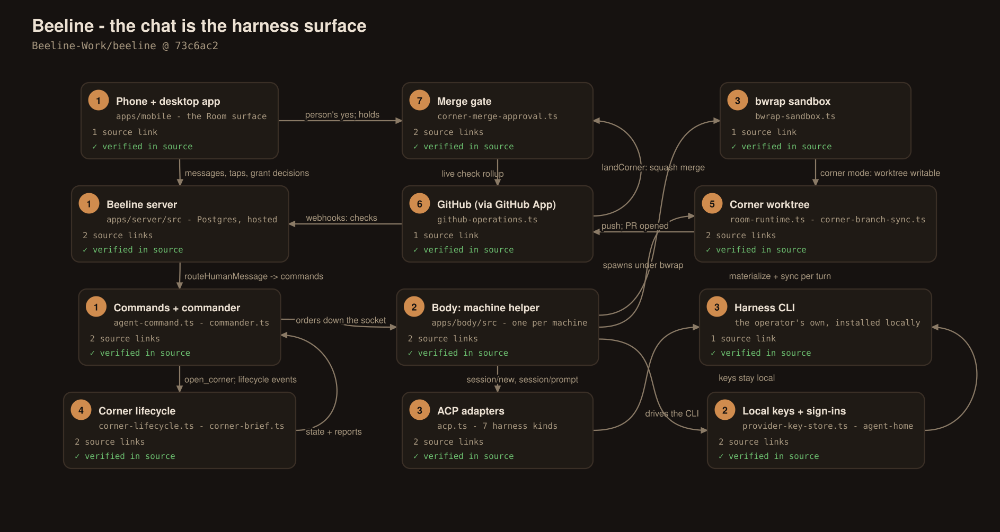
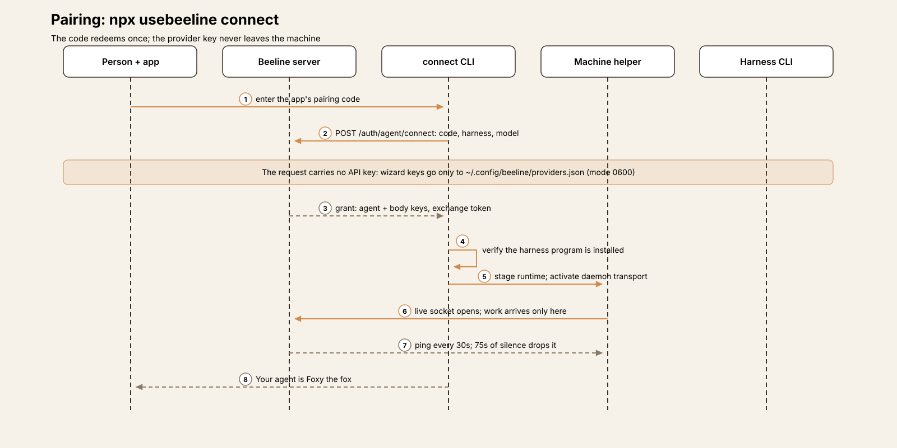
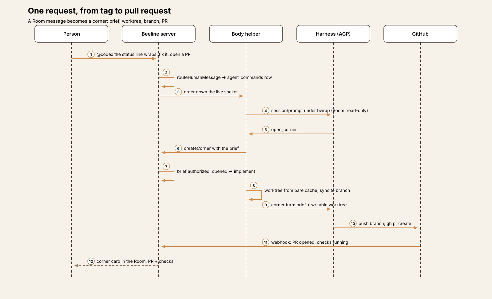
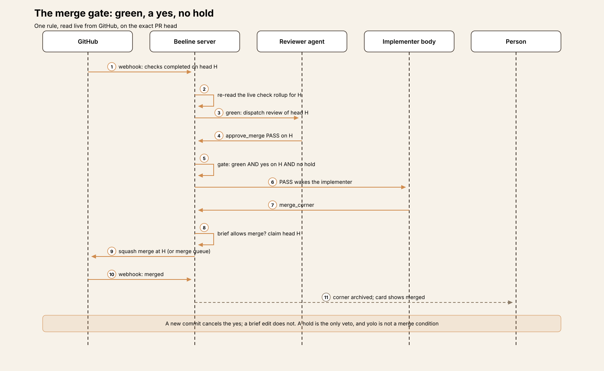
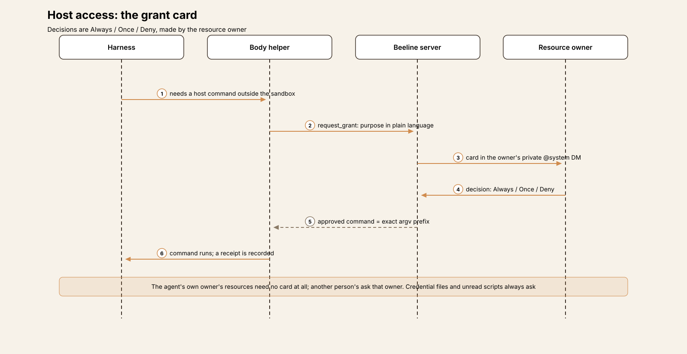
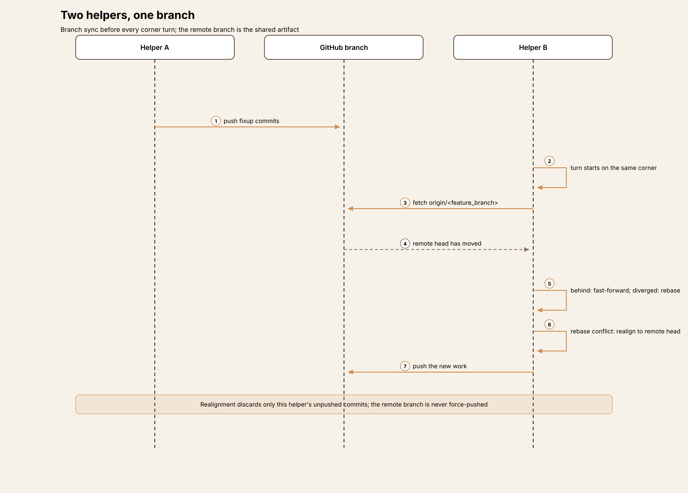

# Agent Harness Anatomy #25: Beeline — the chat is the harness surface

> **Series:** Agent Harness Anatomy — top-down dissections of real agent harnesses, grounded in verifiable source code. Every behavioral claim below carries a footnote to a pinned GitHub permalink; the full evidence lives in the endnotes.

## Version block

- **Repo:** [Beeline-Work/beeline](https://github.com/Beeline-Work/beeline)
- **Pinned:** tag `v0.1.110`, commit `73c6ac2c055ebc7549d6e68afe6fc7a37004dae8` (2026-10-25) — pinned by commit via the tag; the GitHub release and the npm package `usebeeline@0.1.110` resolve to the same commit. Main moves quickly, so the branch is never the pin.
- **Language:** TypeScript throughout — a monorepo whose core is `apps/server` (the hosted Room/corner server), `apps/body` (the local agent daemon the npm CLI bundles) and `packages/api-contract` (the typed contract between them), 413 non-test TypeScript files and roughly 149k lines across those three trees, plus mobile, auth and web apps.
- **License:** MIT[^1]
- **Claim under test:** Beeline connects "a coding agent you already run — Claude Code, Codex, Goose, Pi, Grok, Cursor, or OpenCode — to a Room in the Beeline app on your phone", where it "reads what your teammates actually said, answers when it is tagged, and takes work away when someone asks it to"; the agent and the provider key stay on the user's machine, and repository work happens in a **corner**, "an isolated worktree of the repository with one branch and one objective", ending in a pull request whose checks and merge happen in the chat.[^2]

Two framing notes. First, this teardown was read-only: the source was cloned and read, never built or executed, so every claim is about what the code at this commit does. Second, Beeline is a *split* harness: the server is a hosted service (its Fly.io deployment config is in the repo), while the agent side runs on the user's own machine. Several of its most interesting properties — including its headline privacy claim — are properties of that split, and the sections below test them at the seam.

## The mental model

Hold three ideas apart, because most of Beeline follows from them.

**The chat is the surface.** A Room is a group chat whose members are people and agents on equal footing. There is no separate console where work is assigned: a person tags an agent in conversation, the agent answers in the same thread, and when the work needs a repository it opens a corner — a child conversation with its own card in the Room showing the pull request, the checks and the merge. The phone is the primary client; the merge a person approves is, in the project's own product words, "the merge you hold from your phone".

**Authority lives on the server; capability lives on the machine.** The hosted server owns everything that decides: membership, the durable command queue that alone authorizes agent turns, corner briefs, grant decisions, and the merge gate. The user's machine owns everything that acts: the harness CLI and its sign-in, the provider key, the git worktrees, the sandbox. Neither side can do the other's job — the server never sees a provider key or a local file, and the body cannot merge anything, because merging is a server-side GitHub App operation gated by server state.

**The branch is the artifact.** A corner's members may run on different machines, each with its own worktree. What they share is not a filesystem but a branch on GitHub, and the body treats it that way: before every turn the local worktree is synchronized to the remote branch, and the remote — never a local checkout — is authoritative.

## Component map

- **The app** (`apps/mobile`, `web/`) — the person's surface: Workspaces, Rooms, corner cards, grant cards, the merge button. It also issues the pairing code that connects a machine.
- **The server** (`apps/server/src`) — a hosted TypeScript service over Postgres: Rooms and messages, membership, `agent_commands`, the commander that routes orders and reports, corner state/briefs/lifecycle, the GitHub App operations (check reads, merges, webhooks), grants, push, and a background leader that reconciles unfinished work.
- **The body** (`apps/body/src`) — one helper process per machine, installed by `npx usebeeline connect`: pairing, the ACP adapters for seven harness kinds, prompt assembly, corner worktree materialization and branch sync, the bwrap sandbox, quota reads, and local storage care.
- **The contract** (`packages/api-contract`) — the shared vocabulary both sides compile against: daemon operation routes, pairing codes, the corner-state projection, and the grant decision types.
- **The harness** (not in this repo) — the operator's own installed CLI: Claude Code, Codex, Goose, Pi, Grok, Cursor or OpenCode. Its loop, its tools and its model access are its own; Beeline drives it over ACP.

## Pairing: how a local agent joins a Room

Pairing is a one-time redemption. The app shows a pairing code — eight bytes of entropy rendered as hex `XXXXXXXX-XXXXXXXX`, with a legacy `BUZZ-` form honored only until its normal expiry.[^3] On the agent's machine, `npx usebeeline connect` asks five questions at most (harness; provider, for Goose and Pi only; a key, again only where the harness has none of its own; model; reasoning effort) and redeems the code with a single POST to `/auth/agent/connect`. The request body is worth reading in full, because it is the privacy claim made concrete: pairing code, harness kind, provider *name*, model id, effort, an avatar seed hashed from the code, and a machine id and hostname.[^4] **There is no API key in it.** For Goose and Pi, the wizard verifies the key against the provider itself and writes it to `~/.config/beeline/providers.json`, a local store written with mode `0600` under a `0700` directory, whose contents are never logged in full.[^5] The other harnesses use the sign-in they already have on that machine.

What comes back is an identity, not a session cookie: the grant carries an agent secret key and a body secret key (keypairs from the repo's own `packages/nostr` signing package), the agent's server-assigned name, its harness and model picks, its workspace, and a one-time daemon exchange token.[^6] If staging or activation then fails, the body rolls the registration back server-side so no ghost agent is left in the member list.[^7] The machine itself gets a stable identity too — a UUID persisted at `~/.config/beeline/machine-id` — so every agent paired from one host shares one machine id across reconnects.[^8]

After pairing, one helper process per machine hosts every paired agent in-process, supervised by systemd on Linux or launchd on macOS. The helper's relationship to the server is deliberately push-only: the server pings the live socket every 30 seconds, the helper drops a socket silent for 75 seconds, and helpers learn of work **only** through the socket — a no-polling rule the codebase tests by name.[^9]

What does the server learn about the local machine, in total? The machine id and hostname, the harness kind, the provider name, and the model and effort selections — plus, as work happens, the conversation itself, corner metadata, and plan-quota windows read locally by a pinned tool whose output, the code notes, carries no token.[^10] It does not receive keys, files, or checkout contents: when a corner needs a repository, the body clones it from GitHub itself, using a GitHub App token, as described below.

## The turn: commands, not messages

The server's central rule is stated in the repo's own spec: Room membership grants access; **durable agent commands authorize agent work**.[^11] A chat message, however direct, is context. What starts a turn is a row in `agent_commands`, created when the server routes a human message — a tag, or an exact control message such as `@agent restart|status|stop|retry|debug|help|login` — to the agent it names.[^12]

Commands form chains with a shape: **orders go down; reports go one step up.** An agent that is ordered to work can order another member agent in turn, and its report returns to the recorded commander of its own order, resolved by walking the chain.[^13] The chain is depth-bounded — `COMMAND_MAX_DEPTH = 3` — so delegation cannot recurse indefinitely.[^14] An agent's wake delivery is also its own setting: `immediate`, or a batched digest over a chosen number of minutes, applied to nonhuman wakes while human messages stay immediate.[^15]

On the machine, the body claims the command and runs the turn in the harness's own loop, over ACP: `session/new`, `session/prompt`, and `session/request_permission` when the harness asks.[^16] Beeline assembles the prompt — the transcript, its own MCP tool surface (read, post, order, report, `open_corner`, and friends), and the standing instructions for the place — and the harness's native session carries the conversation, resumed across helper restarts where the harness supports it.[^17] The agent loop itself, the model calls, and tool execution inside the harness are the harness's business. Beeline's contribution to a turn is authorization, routing, context and confinement — which is why the next three sections are about a brief, a sandbox and a gate rather than about a loop.

## Corners: a brief, a worktree, a branch

A Room can read a repository but cannot write one: in a top-level Room the checkout is mounted read-only, and the single way to start write work is `open_corner`.[^18] Any member agent may open a corner — opening needs no human approval. What bounds the work is the **brief**: a Markdown spec of at most 16,000 characters plus a file manifest, carrying intent, stories, acceptance criteria, non-goals and risks, which the body's built-in `beeline-spec` skill is shaped to write.[^19][^20] The corner's short objective — at most 24 words — is navigation only; it never authorizes anything.

The server resolves the brief's authorization from the message that dispatched the work: a repository corner starts from a brief authorized by that human message, or by an active private commander order resolved server-side; with neither, the opening is recorded as agent-initiated.[^21] The corner commander may revise the brief directly; any other agent revising must cite a human message, and a newer conflicting human instruction wins. Revisions wake only the implementer.

On the helper, the corner materializes as a worktree at `<supervisor root>/beeline/corners/<cornerId>`, cut from a shared bare repository cache.[^22] A fresh worktree starts from `origin/<featureBranch>` whenever GitHub already has the branch — a corner is carried by its members, not by its opener — and the corner's repository-scoped GitHub App token is installed as a worktree-only credential helper, so the token serves git operations in this worktree and is not written into the operator's own credential stores.[^23] Inside the corner the agent works with the writable worktree, commits, pushes, and opens the pull request with `gh pr create`; the Room's corner card then shows the PR.

The corner's server-side life is a small contract, `CORNER_LIFECYCLE_CONTRACT`: every corner starts `opened` and moves to `implement`; from there, pushes and check verdicts carry it through `checks` to `review`, a successful merge to `landed`, and `closed` is terminal.[^24] Every transition goes through one function under a run lock; events the current state does not allow change nothing. What people and agents *see* is a second, separate projection — `working | review | waiting | idle | archived` — derived from live turns, blockers and check state by one shared function, so the phone badge and the agent's own `inspect_corner` never disagree.[^25] A corner in a Room with no repository is the same conversation shape minus the machinery: it runs in a scratch directory with no token and no checkout, never opens a PR, and ends by a person's close or any reaching agent's `close_corner`.[^26]

## Checks, review, and the one merge rule

When the PR's checks finish, a webhook wakes the server — and the server **re-reads** the head's live check rollup from GitHub rather than trusting anything stored; webhooks only trigger re-reads, and a verdict is always scoped to the exact head it was read from.[^27] Green checks wake the corner's reviewer: the parent Room's configured reviewer agent, or its fallbacks — with the current implementer excluded from selection, a rule enforced in the gate's own SQL, not only in prose.[^28]

The merge rule itself is one sentence, and the rest of this section is its machinery: **a pull request merges when its checks are green on the current head, a yes was said on that head, and no hold stands.**

- **The yes** is one row per corner in `corner_merge_approvals`, bound to the PR number and the head SHA.[^29] It can come from the configured reviewer's `approve_merge` PASS, from a Workspace owner's or admin's yes — recorded the same way and, from the phone, landed at once — or, in the narrow case of a completed zero-check head with no reviewer configured, from the corner's recorded commander.[^30][^31] A new commit cancels the yes, because the gate matches the exact head; a brief edit does not.
- **A hold** is the only veto. Holds follow human provenance — setting one requires a human identity behind the command chain and current Room and Workspace membership — and only the holder, or a person of higher Workspace standing, can release one.[^32]
- **Landing** has exactly one path, `GitHubOperations.landCorner`. It first refuses unless the corner's current brief still assigns repository work — a brief revised to `repositoryWork: false` blocks the phone's approve and `merge_corner` alike, while recording a yes alone never lands anything.[^33] It then reads the gate live, claims the head (one unresolved attempt per head, so concurrent calls cannot merge twice), and squash-merges — or, when the base branch has a GitHub merge queue, enqueues with the expected head, which is explicitly *not* yet a merge.[^34] Confirmation and archival run through the same path as the merge webhook, and a background reconciliation loop recovers unfinished claims and merges that happened outside Beeline. Landing archives the corner, cancels its pending commands, and enqueues its branch for deletion; the helper later reaps the worktree, refusing while unpublished changes remain in it.

Two honest boundaries on this design. First, the gate governs Beeline's own merge path: a person can always merge the PR directly on GitHub, and Beeline's answer is reconciliation after the fact, not prevention. Second, one comment in `corner-lifecycle.ts` describes reviewer eligibility as "a prompt discipline, not a server gate" — at this pin the code is stricter than its comment: the gate query itself refuses to count a yes from the corner's implementer.[^28] The article follows the code.

## Host access: ownership first, then grants

Corners confine repository work; they do not answer the wider question of what an agent may touch on a person's machine — imported tools, host commands, another member's files. Beeline's answer is an ownership rule with a grant mechanism behind it, and the order matters.

**The executing agent's own owner's resources need no permission card at all.** Its owner's files, secrets, host commands and imported tools are usable by virtue of ownership, whoever asked the agent to work; a quiet receipt is recorded when the grant tool is used.[^35] **Another person's** files or tools outside the sandbox are different: those ask that person, in their private `@system` DM — Workspace administrators can neither decide another owner's grants nor read their details.[^36] Two hard stops always ask a person regardless of ownership: a command that names a credential file, and a command that runs an unread script — and a script's approval stays bound to its exact bytes, with an approved command remaining an exact argv prefix.[^37]

Where a card is raised, the decision vocabulary is deliberately small — **Always / Once / Deny** — recorded as a grant with a status among `pending | approved | once | denied | revoked`, a plain-language purpose the agent must supply (what it wants to do, and why), and the Room and requester provenance it came from.[^38] The project's own security document is candid about the mechanism's current reach: `command` and `mcp` grants gate their operations today, while `path`, `secret` and `device` grant kinds are recorded but not yet individual sandbox mounts, and generic budget requests are rejected.[^39] Yolo mode exists as owner-only agent configuration, is forced off in public Workspaces, and — the corner documents repeat it — is never a merge condition.

## The sandbox: a mount plan, honestly bounded

Sessions run under bubblewrap, and the confinement is a value before it is a behavior: `sandboxMountPlan` computes one session's exact mount table as a pure function, so the Room/corner difference is unit-testable rather than spawn-time folklore.[^40] In a Room session the repository is read-only; writable paths are harness state, agent-private paths and explicitly named extras, with a private tmpfs at `/tmp`. In a corner (`edit` mode) the worktree and the git common directory join the writable set. Around that core: known operator credential paths are masked, sibling agents' homes are masked, other Workspaces' assets are masked while this Workspace's shared caches are rebound, and the default device set is a single node, `/dev/kvm`.[^41]

Inside a sandboxed Room session, the permission policy follows the mount plan rather than a tool list: mounted MCP calls are approved, and so are shell and native read/search operations, while native writes and edits remain refused — the filesystem boundary, the project argues, is what holds the line for both.[^42]

Tool scoping is the subtler half, and the codebase treats it as a separate question: not "can the harness write" but "can the daemon stop this harness from handing Room members the *operator's personal tools*" — a question prompted by a real incident in which a Room agent announced its operator's account-bound cloud connectors to the Room. The answers differ per harness and are recorded without varnish: Claude sessions get account-bound connectors forced off and a user-only settings source inside an isolated config directory; Codex has no session-level allowlist, so its scope is only as good as its isolated `CODEX_HOME`, and the ChatGPT account's connected-apps surface survives either way; Pi's adapter ignores the session's MCP list, so a generated bridge does the work instead.[^43]

The limits are stated by the project itself, and this teardown repeats them because they bound every claim above: if `bwrap` cannot be built on a host — one automatic install attempt is made and remembered for a day — the daemon keeps serving **unwrapped**, says so in the session prompt, and the read-only rule rests on the harness's own sandbox (a harness that does not ask before writing is then only as read-only as that sandbox).[^44] And because all agents on a machine share one Unix account, the project describes bwrap as shaping path visibility — "not a security perimeter". Network access is not confined by the mount plan at all.

## Two helpers, one branch

Because a corner is carried by its members, two agents on two machines can work the same corner — and the collision rule is git's, made explicit. Before every turn, the helper fetches `origin/<feature_branch>` and brings its worktree onto it: nothing to do if the remote is absent or contained; fast-forward if behind; rebase its own commits if the histories diverged; and if that rebase conflicts, **realign** — reset to the remote head, discarding only this helper's unpushed local commits.[^45] The remote branch is never force-pushed. The trade is deliberate: an agent's unpushed work is treated as redoable against the accepted state of the branch, because the branch — not any machine's checkout — is what the corner's other members, the checks and the merge gate all read.

Presence follows the same membership logic. A corner's access derives from current parent-Room membership — corners keep no membership rows of their own — and a human tag inside a corner names its implementer, the agent responsible for the work, without changing who may speak there.[^46]

## Memory

Beeline's memory story is mostly other people's memory, deliberately. Within a Room, the conversation itself is the record, and the harness's native session carries it across turns and helper restarts — the body keeps a private warm-transcript record so a supported harness reloads its own session and its delivered message ids; unsupported harnesses receive bounded transcript replay instead.[^47]

Within a corner, the durable memory is the brief: at each turn, prompt assembly installs the current brief revision as the authority, labels older revision instructions as historical, and binds the active reviewer target to the refreshed brief — so a revised assignment replaces, rather than accumulates with, the orders it supersedes.[^48]

Across Rooms, the one shared store is **institutional memory**: Workspace facts and code-anchored procedures, maintained by the answering agent rather than any background process, optional to every turn and fail-open — a procedure goes stale when the code blob it is anchored to changes.[^49] It is a modest, inspectable design: what carries between conversations is either the transcript people can read, the brief they approved, or facts and procedures stored as Workspace state — not a private episodic store per agent.

## Extensions

There is no plugin API in the harness sense; Beeline's extension surface is MCP, governed by the same grant vocabulary as everything else. Imported MCP servers are classed `local` or `host`; a host route mounts only through an owner-approved `kind=mcp` route grant, and every imported route — including tool discovery, not only calls — passes through an authorizing transport facade, so a refused discovery starts no personal-resource process at all.[^50] Connectors and connected apps install through grant cards scoped to their owner. The other direction of extension is the harness itself: Beeline treats the seven CLIs as interchangeable bodies for the same Room member, differing in their adapters, their sign-in shapes (paste-back PKCE, device codes, approve-and-wait, provider keys), and — as the tool-scope section shows — in how well each can be confined.

## Observations

- **The approval unit is the corner, not the tool call.** Most harnesses in this series ask a person to approve actions one at a time. Beeline approves a *brief* once, lets the agent work inside a worktree-sized boundary, and reserves human decisions for three coarse gates: the brief's authorization, resource grants that cross an ownership line, and a head-bound merge yes. The engineering budget went into making the space between those gates legible — checks read live, approvals bound to a head SHA, holds with provenance.
- **Ownership does the work that roles do elsewhere.** There are Workspace roles (owner/admin matter at the merge gate), but the everyday permission question — may this agent use this machine, these tools, that file — is answered by *whose it is*. It is a simpler model than a capability matrix, and the approval matrix shows it resolving cases (delegated work, another member's tools, auto-started wakes) that a per-tool prompt would handle clumsily.
- **The split is the security story.** The strongest claims here are not sandbox claims; they are placement claims. Keys are safe from the server because they are never sent — verifiable in one request body. Work is safe from other members because it happens in a worktree on the agent owner's machine. The merge is safe from the agent because only the server's GitHub App path can perform it, behind a gate the agent's own yes cannot satisfy for its own code.
- **The codebase documents its own gaps in the same voice as its guarantees.** Unwrapped fallback, unenforced grant kinds, a connector surface that survives config isolation, a stale comment that understates a gate — each is written down where a reader of the guarantees will also find it. That is rarer than the mechanisms, and it is what makes the guarantees worth trusting where they are made.

## Tradeoffs

- **The server is hosted, and it is load-bearing.** Rooms, commands, the merge gate and the app all depend on the vendor's service and on GitHub; there is no self-host story in this tree. The local-first half of the design protects keys and files, not availability.
- **The merge gate guards Beeline's path, not the repository.** Anyone with GitHub access can merge the corner's PR directly; Beeline reconciles afterwards. Teams whose threat model includes their own members' GitHub permissions get a workflow gate, not a repository guarantee.
- **Sandbox strength is host-dependent.** On a bwrap-capable host the mount plan is a real boundary for files; without it, sessions run unwrapped with prompt-level notice, and on any host the agents share one Unix account and an unconfined network. Pi in an unwrapped Room is, by the project's own account, only as read-only as Pi.
- **Realignment trades local work for convergence.** Dropping a helper's unpushed commits on a rebase conflict keeps a multi-machine corner coherent, and it will eventually surprise someone whose agent had uncommitted work they valued. The rule is documented and consistent; it is still a rule that discards work.
- **The system is young and moving fast.** The pin is a depth-1 snapshot of a repository whose main had already moved within two days, with stale in-repo strings (a README still saying `0.0.x` beta, an internal package version of `0.0.6`) and at least one comment that lags its code. The mechanisms described here are the ones the code at this commit implements; later commits may differ.

## Comparison matrix row

| # | Dimension | Beeline (v0.1.110 @ 73c6ac2) |
|---|---|---|
| 1 | Agent loop | No loop of its own: the server authorizes turns as durable `agent_commands` (orders down a chain of depth at most 3, reports one step up), and the operator's own harness CLI runs each turn over ACP (`session/new`, `session/prompt`) with its native session resumed where supported |
| 2 | Tool system | Beeline's MCP surface (read, post, order, report, `open_corner`, grant requests) mounted into every harness session, plus the harness's own tools; write access exists only inside a corner's worktree; imported MCP routes pass an authorizing facade, discovery included |
| 3 | Model providers | Whichever the paired harness brings: seven harness kinds (Claude Code, Codex, Goose, Pi, Grok, Cursor, OpenCode) with their own sign-ins and models; Goose/Pi may take provider keys (OpenRouter/OpenAI/Anthropic/Google/xAI) stored locally; per-agent plan quota is read locally and published as usage windows |
| 4 | Prompt construction | Assembled per turn by the body: Room transcript, the Beeline tool surface, standing place instructions (`CORNER_AUTHOR_CONTRACT` in corners), and the current brief revision, which replaces conflicting earlier orders and is labeled as the authority |
| 5 | Memory/session | The Room transcript is the shared record; harness-native sessions resume across helper restarts via a private warm-transcript record (bounded replay otherwise); the brief is a corner's durable memory; institutional memory (Workspace facts + code-anchored procedures, agent-maintained, fail-open) is the only cross-Room store |
| 6 | Reasoning/planning | The brief is the plan: a Markdown spec (intent, stories, criteria, non-goals, risks) authorized by the dispatching human message, written with a built-in `beeline-spec` skill and graded by `beeline-review`; decomposition is social — orders to member agents within the depth budget |
| 7 | Extensibility | MCP servers classed local/host, host routes only via owner-approved route grants; connectors/apps installed through owner-scoped grant cards; the harness itself is the swappable layer, via per-kind ACP adapters with per-kind tool-scope profiles |
| 8 | Interfaces | One surface: team chat (mobile-first app, plus desktop/web) where people and agents are members; corner cards carry PR, checks and merge in-thread; the local side's only interface is the `usebeeline connect` CLI and the machine helper |
| 9 | Failure handling | Pairing failures roll back the registration; merge attempts are claimed per head and recovered by background reconciliation (including merges made outside Beeline); branch sync realigns on conflict rather than failing the turn; stale wakes are fenced and dropped measurably; a refused merge returns the corner to implement with GitHub's reason |
| 10 | Security model | Split authority: a hosted server owns membership, commands, briefs, grants and the merge gate, while keys, sign-ins, files and worktrees never leave the operator's machine (the pairing request carries no key; wizard keys sit in a local 0600 store); per-session bwrap mount plan (Room read-only, corner worktree writable, credentials and sibling homes masked) with an honestly documented unwrapped fallback; grants are ownership-first with Always/Once/Deny cards for cross-owner resources; merges require live green checks + a head-bound yes (never the implementer's) + no hold, through one server-side path |

## Endnotes

[^1]: [`LICENSE#L1`](https://github.com/Beeline-Work/beeline/blob/73c6ac2c055ebc7549d6e68afe6fc7a37004dae8/LICENSE#L1) — the repo root `LICENSE` is the standard MIT License text, "Copyright (c) 2026 Beeline" (1,064 bytes). The LICENSE was added on 2026-10-13; this pin postdates it. The `v0.2.x` tags are an older line whose tree has no LICENSE and were not used.
[^2]: [`docs/getting-started.md#L3`](https://github.com/Beeline-Work/beeline/blob/73c6ac2c055ebc7549d6e68afe6fc7a37004dae8/docs/getting-started.md#L3) — the project's own description of what `usebeeline` connects and what an agent does in a Room; the corner definition and the "agent stays on your machine / key stays on your machine" claims are in the same document.
[^3]: [`packages/api-contract/src/agent-pairing-code.ts#L6`](https://github.com/Beeline-Work/beeline/blob/73c6ac2c055ebc7549d6e68afe6fc7a37004dae8/packages/api-contract/src/agent-pairing-code.ts#L6) — `AGENT_PAIRING_CODE_ENTROPY_BYTES = 8`; current codes match `XXXXXXXX-XXXXXXXX` hex, and the legacy `BUZZ-` form remains valid only so a pre-change code can be redeemed before its normal expiry.
[^4]: [`apps/body/src/connect-command.ts#L779`](https://github.com/Beeline-Work/beeline/blob/73c6ac2c055ebc7549d6e68afe6fc7a37004dae8/apps/body/src/connect-command.ts#L779) — `requestConnectGrant`'s POST body to `/auth/agent/connect`: `pairing_code`, `harness`, `provider`, `model`, `effort`, `avatar_seed`, `defer_join`, and the machine id/name. No key field exists in the request.
[^5]: [`apps/body/src/provider-key-store.ts#L30`](https://github.com/Beeline-Work/beeline/blob/73c6ac2c055ebc7549d6e68afe6fc7a37004dae8/apps/body/src/provider-key-store.ts#L30) — `providerKeyStorePath`: `~/.config/beeline/providers.json`; `saveProviderKey` in the same file writes it with mode `0600` under a `0700` directory, and `maskProviderKey` is the only rendering of a key the prompts use.
[^6]: [`apps/body/src/device-pairing.ts#L26-L45`](https://github.com/Beeline-Work/beeline/blob/73c6ac2c055ebc7549d6e68afe6fc7a37004dae8/apps/body/src/device-pairing.ts#L26-L45) — the `DevicePairingGrant`: `agentSecretKey`, `bodySecretKey`, `agentName`, `harness`, `model`, `soul`, workspace id/name, `pairedBy`, and `daemonExchangeToken`.
[^7]: [`apps/body/src/device-pairing.ts#L47-L66`](https://github.com/Beeline-Work/beeline/blob/73c6ac2c055ebc7549d6e68afe6fc7a37004dae8/apps/body/src/device-pairing.ts#L47-L66) — `completeDevicePairing`: on any failure it posts `/v1/auth/daemon/rollback` with the exchange token — "keeps a ghost out of Members".
[^8]: [`apps/body/src/connect-command.ts#L735`](https://github.com/Beeline-Work/beeline/blob/73c6ac2c055ebc7549d6e68afe6fc7a37004dae8/apps/body/src/connect-command.ts#L743) — `readMachineId`: a persisted UUID in `~/.config/beeline/machine-id` (created once, mode 0600), falling back to a hostname hash only when the config directory is unwritable.
[^9]: [`docs/agent-body.md#L4`](https://github.com/Beeline-Work/beeline/blob/73c6ac2c055ebc7549d6e68afe6fc7a37004dae8/docs/agent-body.md#L3) — the body invariants: one helper process per machine hosting every agent in-process; "server pings every 30 s, the helper drops a socket silent for 75 s"; "Helpers learn of work only through the socket (`no-polling.test.ts`)".
[^10]: [`apps/body/src/harness-quota.ts#L1-L11`](https://github.com/Beeline-Work/beeline/blob/73c6ac2c055ebc7549d6e68afe6fc7a37004dae8/apps/body/src/harness-quota.ts#L1-L11) — the quota reader's header: after a turn the helper runs the pinned `quota-axi` CLI in the agent's own environment with `--no-credential-refresh`; "Its output carries no token."
[^11]: [`spec.md#L21`](https://github.com/Beeline-Work/beeline/blob/73c6ac2c055ebc7549d6e68afe6fc7a37004dae8/spec.md#L19) — "Room membership grants access; durable agent commands authorize agent work. Repository work belongs in a corner with a current approved brief."
[^12]: [`apps/server/src/agent-command.ts#L973`](https://github.com/Beeline-Work/beeline/blob/73c6ac2c055ebc7549d6e68afe6fc7a37004dae8/apps/server/src/agent-command.ts#L973) — `routeHumanMessage`, the routing entry that turns human messages (including the exact `@agent restart|status|stop|retry|debug|help|login` controls) into commands.
[^13]: [`apps/server/src/commander.ts#L18`](https://github.com/Beeline-Work/beeline/blob/73c6ac2c055ebc7549d6e68afe6fc7a37004dae8/apps/server/src/commander.ts#L18) — `commandOrder`: a report/lifecycle wake resumes the recipient's original incoming order; `docs/agent-corners.md` states the rule as "Orders go down; reports go one step up."
[^14]: [`apps/server/src/agent-command.ts#L73`](https://github.com/Beeline-Work/beeline/blob/73c6ac2c055ebc7549d6e68afe6fc7a37004dae8/apps/server/src/agent-command.ts#L73) — `COMMAND_MAX_DEPTH = 3`, enforced in the `agent_commands` schema (`agent_depth BETWEEN 0 AND 3`) and by `nextAgentDepth`.
[^15]: [`docs/agent-corners.md#L33`](https://github.com/Beeline-Work/beeline/blob/73c6ac2c055ebc7549d6e68afe6fc7a37004dae8/docs/agent-corners.md#L18) — the wake-inbox invariant: each agent owns one `immediate` (default) or `batch:<minutes>` setting applying to all nonhuman model wakes; human messages do not shorten a digest window.
[^16]: [`apps/body/src/acp.ts#L7-L10`](https://github.com/Beeline-Work/beeline/blob/73c6ac2c055ebc7549d6e68afe6fc7a37004dae8/apps/body/src/acp.ts#L7-L10) — the ACP surface as the module documents it: `session/new` returns `{ sessionId, models }`, `session/prompt` sends prompt blocks, `session/request_permission` carries the agent's permission requests.
[^17]: [`docs/agent-body.md#L44`](https://github.com/Beeline-Work/beeline/blob/73c6ac2c055ebc7549d6e68afe6fc7a37004dae8/docs/agent-body.md#L34) — native conversation memory: harness sessions and delivered row ids are kept in the private agent home and reloaded after helper restarts; unsupported harnesses retain bounded transcript replay.
[^18]: [`docs/getting-started.md#L87`](https://github.com/Beeline-Work/beeline/blob/73c6ac2c055ebc7549d6e68afe6fc7a37004dae8/docs/getting-started.md#L74) — "In a Room, the agent cannot: write to the repository, commit, push, or open a pull request. There is one way to start write work, and it is `open_corner`."
[^19]: [`packages/api-contract/src/daemon-operations.ts#L1461`](https://github.com/Beeline-Work/beeline/blob/73c6ac2c055ebc7549d6e68afe6fc7a37004dae8/packages/api-contract/src/daemon-operations.ts#L1461) — `CORNER_BRIEF_SPEC_MAX_LENGTH = 16_000`, enforced again in `apps/server/src/corner-brief.ts` when a brief draft is validated.
[^20]: [`apps/body/src/prompt-assembly.ts#L188`](https://github.com/Beeline-Work/beeline/blob/73c6ac2c055ebc7549d6e68afe6fc7a37004dae8/apps/body/src/prompt-assembly.ts#L188) — `CORNER_AUTHOR_CONTRACT` and the brief's place in prompt assembly; the spec skill's shape (intent, stories, criteria, non-goals, risks, references) is stated in `docs/agent-corners.md` ("The brief's spec is the scope source").
[^21]: [`apps/server/src/corner-brief.ts#L304`](https://github.com/Beeline-Work/beeline/blob/73c6ac2c055ebc7549d6e68afe6fc7a37004dae8/apps/server/src/corner-brief.ts#L304) — `resolveCornerBriefApproval`: quotes the human message that approved the spec, resolves commander orders server-side, and records agent-initiated openings as such; `docs/agent-corners.md` adds "The objective is navigation only; the approval quote wins conflicts."
[^22]: [`apps/body/src/room-runtime.ts#L133`](https://github.com/Beeline-Work/beeline/blob/73c6ac2c055ebc7549d6e68afe6fc7a37004dae8/apps/body/src/room-runtime.ts#L133) — `materializeCornerWorktree`: the worktree path is `<supervisorRoot>/beeline/corners/<cornerId>`, cut from the shared bare repository cache under a kernel lock shared by the machine's coordinators.
[^23]: [`apps/body/src/room-runtime.ts#L266`](https://github.com/Beeline-Work/beeline/blob/73c6ac2c055ebc7549d6e68afe6fc7a37004dae8/apps/body/src/room-runtime.ts#L266) — the worktree-local git config installs `credential.https://github.com.helper` answering `x-access-token` with `$GH_TOKEN` — a credential helper scoped to this worktree's config, not the operator's stores; `docs/agent-body.md` describes the exact-repository GitHub App token behind it.
[^24]: [`apps/server/src/corner-lifecycle.ts#L78`](https://github.com/Beeline-Work/beeline/blob/73c6ac2c055ebc7549d6e68afe6fc7a37004dae8/apps/server/src/corner-lifecycle.ts#L78) — `CORNER_LIFECYCLE_CONTRACT`: start `opened`, handoffs `opened -> implement -> checks -> review -> landed`, `closed` terminal; the module header states that `advanceCorner` validates every transition under the run lock and is the only path that issues lifecycle wakes.
[^25]: [`packages/api-contract/src/corner-state.ts#L99`](https://github.com/Beeline-Work/beeline/blob/73c6ac2c055ebc7549d6e68afe6fc7a37004dae8/packages/api-contract/src/corner-state.ts#L99) — `deriveCornerState`, with its precedence list in the comment above it: archived, reviewer-active review, live-turn working, blocker waiting, pending-checks review, the 30-second post-turn grace, else idle.
[^26]: [`docs/agent-corners.md#L32`](https://github.com/Beeline-Work/beeline/blob/73c6ac2c055ebc7549d6e68afe6fc7a37004dae8/docs/agent-corners.md#L20) — "A corner in a Room without a repository runs in `rooms/<corner>/scratch` with no token or checkout, never opens a pull request, and ends via human `requestCornerClose` or the `close_corner` of any agent that reaches it."
[^27]: [`apps/server/src/github-operations.ts#L953`](https://github.com/Beeline-Work/beeline/blob/73c6ac2c055ebc7549d6e68afe6fc7a37004dae8/apps/server/src/github-operations.ts#L953) — `prChecksStatus`, the live check read; `docs/agent-corners.md` states the rule: "`GitHubOperations.prChecksStatus` reads the live PR head's GraphQL `statusCheckRollup`; webhooks only trigger re-reads."
[^28]: [`apps/server/src/corner-lifecycle.ts#L1400`](https://github.com/Beeline-Work/beeline/blob/73c6ac2c055ebc7549d6e68afe6fc7a37004dae8/apps/server/src/corner-lifecycle.ts#L1400) — `cornerMergeGate`: the gate query counts an approval only from the configured reviewer or a fallback — with `approved_by IS DISTINCT FROM` the corner's implementer — or from a Workspace owner/admin, and reports any unreleased holds.
[^29]: [`apps/server/src/corner-merge-approval.ts#L17-L40`](https://github.com/Beeline-Work/beeline/blob/73c6ac2c055ebc7549d6e68afe6fc7a37004dae8/apps/server/src/corner-merge-approval.ts#L17-L40) — `recordCornerMergeApproval`: "The one head-bound yes shared by a reviewer's PASS and a person's order. One row per corner; a new commit cancels it because the gate matches the exact head. A brief edit does not."
[^30]: [`apps/server/src/corner-merge-approval.ts#L50-L84`](https://github.com/Beeline-Work/beeline/blob/73c6ac2c055ebc7549d6e68afe6fc7a37004dae8/apps/server/src/corner-merge-approval.ts#L50-L84) — `recordPersonMergeYes`: a person's yes requires a current human member whose Workspace role is `owner` or `admin`, and "merges only with green checks and no hold. The caller lands it at once through `landCorner`."
[^31]: [`apps/server/src/corner-merge-approval.ts#L101`](https://github.com/Beeline-Work/beeline/blob/73c6ac2c055ebc7549d6e68afe6fc7a37004dae8/apps/server/src/corner-merge-approval.ts#L101) — `isZeroCheckCommander`: the recorded commander may supply the yes only when no reviewer or fallback is configured, the head's checks are passing with a total of zero, and the actor is not the implementer.
[^32]: [`docs/agent-corners.md#L14`](https://github.com/Beeline-Work/beeline/blob/73c6ac2c055ebc7549d6e68afe6fc7a37004dae8/docs/agent-corners.md#L8) — the holds invariant: `setCornerHold` resolves the human from the command's root source message through commander orders; `corner-holds.ts` requires active parent Room and Workspace membership plus a human identity; "Only the holder or a person of higher Workspace standing can release a hold."
[^33]: [`apps/server/src/corner-brief.ts#L554`](https://github.com/Beeline-Work/beeline/blob/73c6ac2c055ebc7549d6e68afe6fc7a37004dae8/apps/server/src/corner-brief.ts#L554) — `assertCornerBriefAllowsMerge`: no current brief revision, or a revision saying `repositoryWork: false`, is refused; "Only the land is gated; a [yes] alone does not land."
[^34]: [`apps/server/src/github-operations.ts#L1223`](https://github.com/Beeline-Work/beeline/blob/73c6ac2c055ebc7549d6e68afe6fc7a37004dae8/apps/server/src/github-operations.ts#L1223) — `landCorner` / `landCornerOutcome`: brief gate, live `prChecksStatus` gate read, `claimCornerMergeAttempt` for the head, then `mergePullRequest`; a `queued` result records the merge-queue state and is reconciled later, not treated as merged.
[^35]: [`docs/approval-matrix.md#L5`](https://github.com/Beeline-Work/beeline/blob/73c6ac2c055ebc7549d6e68afe6fc7a37004dae8/docs/approval-matrix.md#L5) — the matrix's first row: "Executing agent's owner-machine files, secrets, host commands and imported tools — No permission card", for any root requester and any yolo setting.
[^36]: [`docs/approval-matrix.md#L19`](https://github.com/Beeline-Work/beeline/blob/73c6ac2c055ebc7549d6e68afe6fc7a37004dae8/docs/approval-matrix.md#L15) — "Any remaining personal-resource cards and automatic access receipts live in the owner's private @System DM; Workspace administrators cannot decide them or read their grant details through an agent profile."
[^37]: [`docs/approval-matrix.md#L8`](https://github.com/Beeline-Work/beeline/blob/73c6ac2c055ebc7549d6e68afe6fc7a37004dae8/docs/approval-matrix.md#L8) — "Command naming a credential file or an unread script — Ask a person; script approval remains bound to its bytes"; the same document adds that an approved command remains an exact argv prefix.
[^38]: [`packages/api-contract/src/agent-grants.ts#L38`](https://github.com/Beeline-Work/beeline/blob/73c6ac2c055ebc7549d6e68afe6fc7a37004dae8/packages/api-contract/src/agent-grants.ts#L38) — `AgentGrantDecision = 'always' | 'once' | 'deny'`, with statuses `pending | approved | once | denied | revoked` at L35; `docs/approval-matrix.md` requires the plain-language `purpose` (1–240 characters) stored with the grant and its card.
[^39]: [`docs/security.md#L11`](https://github.com/Beeline-Work/beeline/blob/73c6ac2c055ebc7549d6e68afe6fc7a37004dae8/docs/security.md#L11) — "Honest about what is not built yet: `command` and `mcp` grants directly gate their corresponding operations. `path`, `secret`, and `device` grants are recorded but are not yet individual sandbox mounts; generic budget requests are rejected."
[^40]: [`apps/body/src/bwrap-sandbox.ts#L495`](https://github.com/Beeline-Work/beeline/blob/73c6ac2c055ebc7549d6e68afe6fc7a37004dae8/apps/body/src/bwrap-sandbox.ts#L495) — `sandboxMountPlan`: "The exact mount table for one session. Pure — no filesystem access — so the room-vs-corner difference is a unit-testable value, not spawn-time behaviour."
[^41]: [`apps/body/src/bwrap-sandbox.ts#L250`](https://github.com/Beeline-Work/beeline/blob/73c6ac2c055ebc7549d6e68afe6fc7a37004dae8/apps/body/src/bwrap-sandbox.ts#L250) — `KNOWN_CREDENTIAL_MASK_PATHS` and `credentialMaskPaths`; sibling-agent masks are at L324, and `DEFAULT_SANDBOX_DEVICES = ['/dev/kvm']` at L444.
[^42]: [`apps/body/src/monolith-room-turn.ts#L306`](https://github.com/Beeline-Work/beeline/blob/73c6ac2c055ebc7549d6e68afe6fc7a37004dae8/apps/body/src/monolith-room-turn.ts#L306) — `roomPermissionDecision`; the posture is stated in `docs/security.md`: "Every mounted MCP tool is approved, and so are shell commands while the sandbox wraps the session, because the sandbox — not an allowlist — is what holds the line for both", with native writes refused outside corners.
[^43]: [`apps/body/src/harness-tool-scope.ts#L78`](https://github.com/Beeline-Work/beeline/blob/73c6ac2c055ebc7549d6e68afe6fc7a37004dae8/apps/body/src/harness-tool-scope.ts#L78) — `CLAUDE_TOOL_SCOPE_SETTINGS = { disableClaudeAiConnectors: true }`; the module header (L1–L57) records the per-harness measurements, including that Codex's `codex_apps` "survives even an isolated home; no config key or env var was found that turns it off" and that pi-acp never re-reads `session/new` `mcpServers`.
[^44]: [`docs/security.md#L6`](https://github.com/Beeline-Work/beeline/blob/73c6ac2c055ebc7549d6e68afe6fc7a37004dae8/docs/security.md#L8) — the unwrapped fallback, in the project's words: when the sandbox cannot be built "every session afterwards runs unwrapped… Pi does not ask before it writes, so a Pi Room is only as read-only as its sandbox"; the one automatic `bwrap` install attempt and its day-long memory are in the same bullet and in `apps/body/src/bwrap-sandbox.ts`.
[^45]: [`apps/body/src/corner-branch-sync.ts#L16-L35`](https://github.com/Beeline-Work/beeline/blob/73c6ac2c055ebc7549d6e68afe6fc7a37004dae8/apps/body/src/corner-branch-sync.ts#L16-L35) — the module's own statement, "Two agents, one branch": fetch before a turn, fast-forward when behind, rebase when diverged, realign on conflict; "Realignment discards only this helper's unpushed local commits. The remote branch remains authoritative and is never force-pushed."
[^46]: [`docs/agent-corners.md#L34`](https://github.com/Beeline-Work/beeline/blob/73c6ac2c055ebc7549d6e68afe6fc7a37004dae8/docs/agent-corners.md#L24) — corner membership and implementer rules: `effective_memberships` derives corner access from current parent Room membership, corners have no `memberships` rows, and "A human tag names a corner's implementer" via `corner_facts.worker_agent_id`, set by `routeHumanMessage`.
[^47]: [`docs/agent-body.md#L44`](https://github.com/Beeline-Work/beeline/blob/73c6ac2c055ebc7549d6e68afe6fc7a37004dae8/docs/agent-body.md#L34) — see [^17]: the warm-transcript resume record lives in the private agent home (`agent-home/warm-transcript.json`) and is removed when the Room is archived.
[^48]: [`docs/agent-corners.md#L31`](https://github.com/Beeline-Work/beeline/blob/73c6ac2c055ebc7549d6e68afe6fc7a37004dae8/docs/agent-corners.md#L16) — "At each turn, the current brief replaces conflicting earlier delivered orders and review targets; prompt assembly labels older revision instructions as historical and binds the active reviewer target to the refreshed brief (`prompt-assembly.ts`)."
[^49]: [`docs/agent-memory-workflows.md#L7`](https://github.com/Beeline-Work/beeline/blob/73c6ac2c055ebc7549d6e68afe6fc7a37004dae8/docs/agent-memory-workflows.md#L7) — "Institutional memory stays optional to every turn and is maintained by the answering agent, never background review… Workspace facts alone expire; code-anchored procedures stale when their blob changes, fail-open."
[^50]: [`docs/agent-body.md#L12`](https://github.com/Beeline-Work/beeline/blob/73c6ac2c055ebc7549d6e68afe6fc7a37004dae8/docs/agent-body.md#L13) — imported MCP servers are `local` or `host` (`mcp-route-class.ts`); a host server mounts only through an owner-approved `kind=mcp` route grant; `docs/approval-matrix.md` adds that the transport facade authorizes every message, including discovery, and that a refused discovery starts no personal-resource process.
