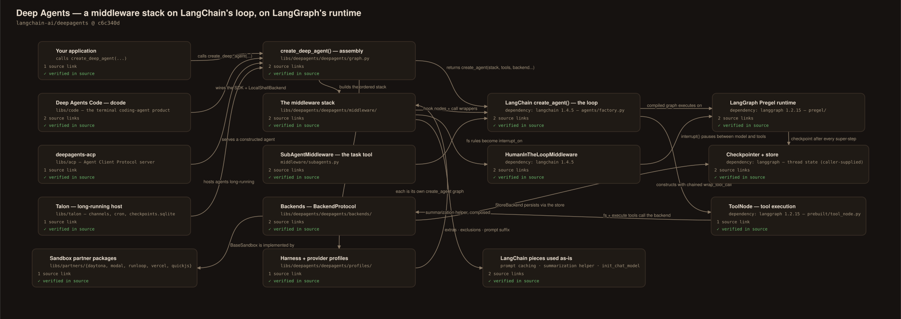
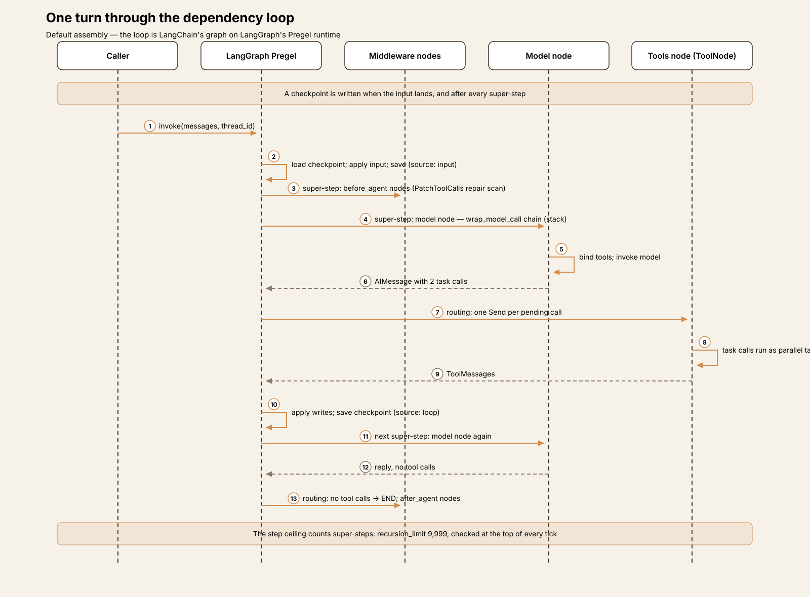
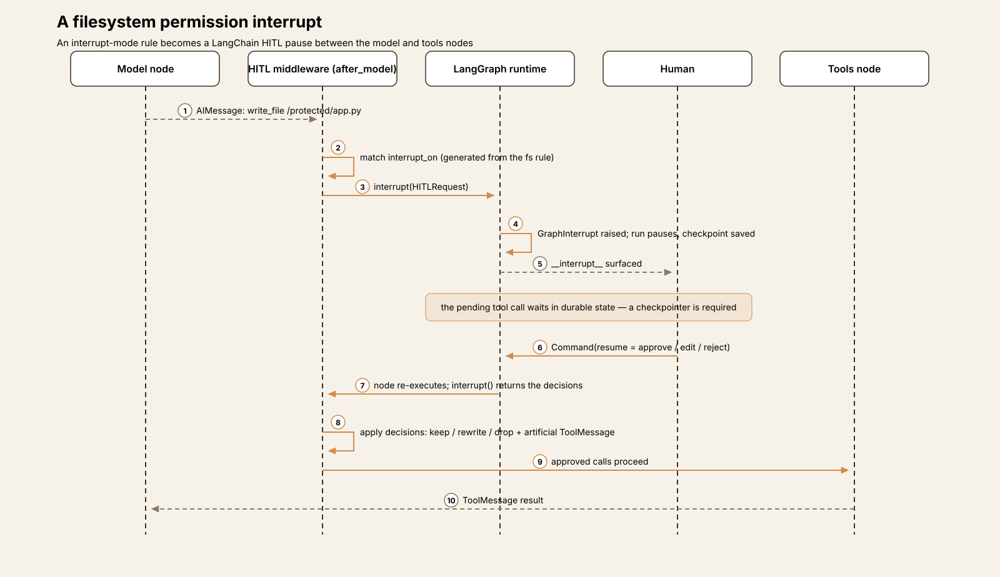
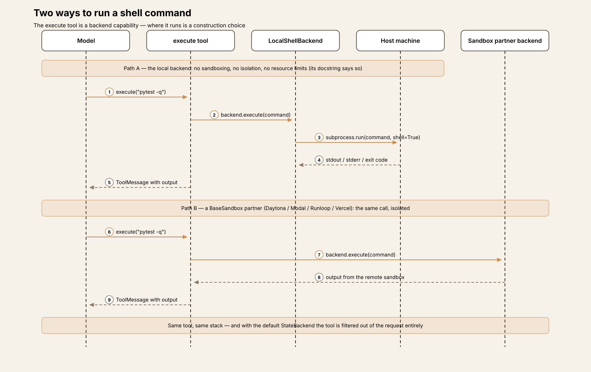
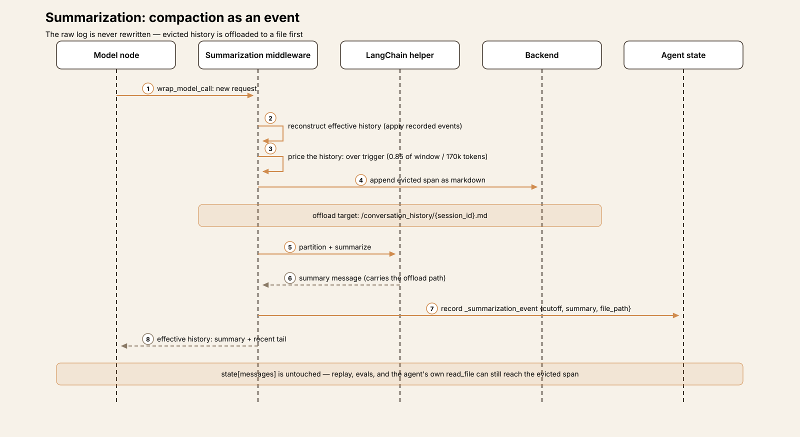
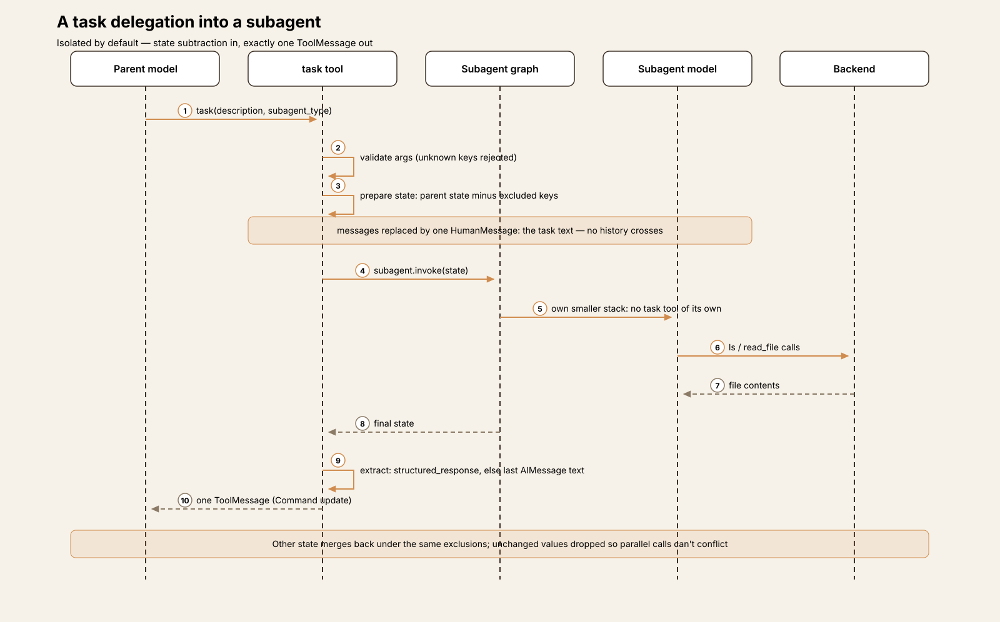

# Agent Harness Anatomy #16: Deep Agents — the harness that is a middleware stack, not a loop

> **Series:** Agent Harness Anatomy — top-down dissections of real agent harnesses, grounded in verifiable source code. Every behavioral claim below carries a footnote to a pinned GitHub permalink; the full evidence lives in the endnotes.

## Version block

- **Repo:** [langchain-ai/deepagents](https://github.com/langchain-ai/deepagents)
- **Pinned:** tag `deepagents==0.7.25` → `c6c340d47d2013a2e7b7230698f73977b7de6756` (released 2026-10-14)
- **Language:** Python ≥3.11 — the core package is 30,088 LOC (its test suite is another 64,433), inside a monorepo that also ships a terminal coding app, an ACP server, an experimental long-running host, and partner sandbox packages
- **License:** MIT
- **Claim under test:** "The batteries-included agent harness" — an opinionated agent that runs out of the box, built on LangGraph

A note on the pin, and on what kind of object this is. Every previous teardown in this series dissected a program: a loop you could point at. Deep Agents is a *library*, and its defining decision is that it does not contain the loop at all. `create_deep_agent()` assembles configuration — middleware, backends, subagents, a prompt — and hands it to LangChain's `create_agent()`, which builds the loop on LangGraph. So this teardown reads two things at once: the code in this repo, and the boundary between that code and its two dependencies. And because the loop is the one mechanism a reader cannot understand from this repo alone, it also reads the dependency source itself — LangChain and LangGraph, each pinned separately (langchain 1.4.5 and langgraph 1.2.15, the versions this pin resolves against; see the endnotes preamble). Where a mechanism belongs to LangChain or LangGraph, the article says so and the endnote names the repo it points into; nothing below attributes dependency code to this repo.

The repo is a release-please monorepo in which each package versions independently. The pin is the core package's release: `libs/deepagents/pyproject.toml` declares version 0.7.25, and the tag names exactly that package. The sibling packages sit at the same commit and are covered as interfaces, not as the pinned artifact.

## The mental model

Hold one sentence and the rest follows: **Deep Agents is an ordered stack of middleware around someone else's loop, plus a pluggable backend that decides where files and shell commands live.**

The project's own architecture document draws the three layers plainly: LangGraph is the runtime (state, checkpoints, streaming, interrupts); LangChain's `create_agent()` is the agent abstraction that builds the loop; Deep Agents "is an opinionated harness *on top of* `create_agent()`. It does not introduce a new runtime."[^1] Reading `create_deep_agent()` bears this out completely — it is 700 lines of assembly that end in a `create_agent(...)` call.[^2] There is no turn loop anywhere in the package to summarize, because there is no turn loop in the package.

What the package contributes instead is a default *stack*. In order: a filesystem middleware that provides the file and shell tools; a subagent middleware that provides delegation; a summarization middleware that manages context; a repair middleware for interrupted runs; optionally skills, memory, and human-in-the-loop middleware; and per-model "harness profiles" that adjust the stack for a specific provider's model. Every entry is a LangChain `AgentMiddleware` — the hook machinery (`before_agent`, `wrap_model_call`, `wrap_tool_call`) is LangChain's — but the middleware classes themselves, and the order they're assembled in, are this repo's design.[^3]

The second load-bearing decision is the **backend**. One protocol object decides where the agent's files live (in graph state, in a LangGraph store, on real disk), whether shell execution exists at all, and where evicted context is offloaded. Swap the backend and the same agent goes from an ephemeral in-memory workspace to a real directory to a remote sandbox — the security story of the whole system is, in the end, a statement about which backend the application wired in (T3).

And the third: **subagents by state subtraction.** A delegated agent is a fresh graph whose initial state is the parent's state *minus* a curated set of keys, with the message history replaced by a single task description. Isolation is not a sandbox or a separate process; it is a filter applied to a dictionary (T5).

## How the stack is put together

**Assembly.** `create_deep_agent()` (in `graph.py`) resolves the model — a `"provider:model"` string goes through LangChain's `init_chat_model`, with provider-profile adjustments[^4] — resolves the harness profile for that model, takes the caller's backend or defaults to `StateBackend()`, processes subagent specs, builds the middleware stack, composes the system prompt (caller text plus the profile's suffix; the authored base prompt earlier versions shipped is now deprecated legacy), and returns LangChain's graph with two pieces of configuration stamped on: a recursion limit of 9,999 and run metadata tagging the integration as `deepagents` for tracing.[^5]

**The stack, concretely.** The main-agent stack is built in one list and a series of appends:[^6]

1. `FilesystemMiddleware` — tools, permissions, eviction
2. `SubAgentMiddleware` — the `task` tool (present whenever subagents exist; a default general-purpose subagent is auto-added, so in practice always)
3. Summarization middleware (Deep Agents' own, §Memory)
4. `PatchToolCallsMiddleware` — dangling-call repair
5. Harness-profile extra middleware for the model, then `SkillsMiddleware` if `skills=` was passed
6. Prompt-caching middleware (LangChain's Anthropic caching middleware, plus Bedrock/Fireworks variants when those packages are installed)[^7]
7. `MemoryMiddleware` if `memory=` was passed, then LangChain's `HumanInTheLoopMiddleware` if any interrupt configuration exists, then `UnsupportedContentMiddleware`

**Customization is stack surgery, by name.** A caller-supplied middleware whose `.name` matches a default *replaces it in place*, preserving order; a new one is inserted after the core scaffolding, ahead of the profile/memory tail.[^8] Harness profiles can go further — adding middleware, overriding tool descriptions, appending prompt text, and *excluding* tools or middleware — with two guardrails. First, `FilesystemMiddleware` and `SubAgentMiddleware` are protected scaffolding: a profile that tries to exclude either fails construction with a `ValueError`, because removing them "silently breaks core features" — the filesystem middleware also carries the permission enforcement, which the code names a security guarantee.[^9] Second, every exclusion entry must match something in the assembled stacks, or construction fails — a typo'd exclusion is an error, not a no-op. Tool exclusion runs dead last, in a dedicated middleware appended after all caller middleware, so an excluded tool cannot be restored by a caller's request wrapper.[^10]

**Subagents get a smaller stack** — filesystem, summarization, patch, profile extras, skills, prompt caching; memory only for forks — and, notably, no `SubAgentMiddleware`: a subagent does not receive a `task` tool of its own (T5).[^11]

## Package map

The core package concentrates in three directories, exactly as the project's architecture doc says.

| Path | Role |
|---|---|
| `libs/deepagents/deepagents/graph.py` | `create_deep_agent()` — assembly only; `DeepAgentState` |
| `libs/deepagents/deepagents/middleware/` | The stack: filesystem, subagents, summarization, skills, memory, patch-tool-calls, plus helpers (eviction, blob offload, prompt caching, tool exclusion, fs-interrupt glue) and opt-ins (`rubric`, async subagents) |
| `libs/deepagents/deepagents/backends/` | `BackendProtocol` + State / Store / Filesystem / LocalShell / Composite / ContextHub backends and the `BaseSandbox` base class |
| `libs/deepagents/deepagents/profiles/` | Per-model harness profiles (Anthropic Sonnet/Opus/Haiku, OpenAI Codex, NVIDIA Nemotron built in) and provider profiles; public registration functions |
| `libs/code/` | Deep Agents Code (`dcode`) — the terminal coding-agent product built on the SDK |
| `libs/acp/` | `deepagents-acp` — an Agent Client Protocol server |
| `libs/talon/` | Experimental host for long-running agents (messaging channels, cron) |
| `libs/partners/` | Sandbox backend packages: Daytona, Modal, Runloop, Vercel, QuickJS |

## The core loop

There is no loop in this repo to write up — the loop is LangChain's `create_agent` graph executing on LangGraph, and this repo's docs describe it in one sentence: the runtime drives turns in which the model receives the history, the prompt, and the tools, and the loop continues until the model produces a final response.[^1] But a teardown that stopped there would leave the harness's most important behavior undescribed, so this section reads the loop where it actually lives: in the two dependencies, pinned at langchain 1.4.5 and langgraph 1.2.15 (notes 50+). What this repo contributes *around* that loop follows after.

**The graph LangChain builds.** `create_agent` is a factory that compiles a LangGraph `StateGraph` with two working nodes. The `model` node builds a `ModelRequest` from state, passes it through the chained `wrap_model_call` handlers — which is where Deep Agents' request-time middleware (capability filtering, summarization's history reconstruction) actually runs — and invokes the model with the request's tools bound. The `tools` node is LangGraph's prebuilt `ToolNode`, constructed with the caller and middleware tools and the chained `wrap_tool_call` wrappers.[^50] Every middleware hook of the state kind — `before_agent`, `before_model`, `after_model`, `after_agent` — becomes a graph node of its own, chained around the two: the run enters through the first `before_agent` node, each turn enters through the first `before_model` node and leaves through the first `after_model` node, and the run exits through the last `after_agent` node.[^52] The loop is closed by two routing functions. After the model: a response with no tool calls routes to `END` — the code comments this "the classic exit condition for an agent loop" — while pending tool calls fan out as one `Send` per call into the tools node, so a batch of independent calls becomes parallel tasks. After the tools: unless every executed tool said `return_direct` or a structured-output tool ran, control returns to the loop entry and the model sees the results.[^51]

One question this series asks every harness — *what runs beneath the stack you can see?* — has a clean answer here: **`create_agent` adds no middleware of its own.** The stack Deep Agents assembles is the whole stack; the factory's only additions are inside its nodes (the model node first repairs tool calls whose arguments are invalid JSON, a small per-call pass; structured-output parsing wraps the response) and in the config it stamps — which is where the step ceiling comes from.[^55]

**The runtime underneath: super-steps and checkpoints.** LangGraph executes the graph in Pregel super-steps. Each iteration prepares the tasks whose input channels the previous step updated, runs them concurrently, then merges their writes into the state channels through each channel's reducer — and **saves a checkpoint**. A checkpoint is written when the run's input is applied, and again after *every* super-step: the model call, the tool batch, and each middleware hook node each land in their own checkpoint when a checkpointer is configured. Persistence timing is a per-run durability setting (asynchronous by default; a synchronous mode waits for each checkpoint write before proceeding).[^53] Two consequences are worth holding onto. First, "resume" in this stack is not a feature layered on top — it is the runtime's normal state after any step, which is why interrupted runs and HITL pauses (below) are cheap here. Second, with no checkpointer configured — the default assembly — none of this is written anywhere: the same loop runs purely in memory, and the checkpoints exist only as the loop's internal bookkeeping.

**A step ceiling, set very high — counted in super-steps.** The one run budget in the assembly is `recursion_limit: 9_999`, and the dependency read shows it has two authors: LangChain's factory stamps `9_999` onto every graph it compiles, and Deep Agents' `.with_config` stamps the same value again while replacing the tracing metadata with its own.[^55] Nothing in either package counts turns, tokens, or cost as a stop condition. What the number counts is **super-steps**: at run start the runtime sets a stop line at the current checkpoint step plus the limit, and each super-step consumes one. A single conversational turn consumes several — the `model` node is one step, a parallel batch of tool calls shares one step, each `before_model` / `after_model` hook node on the path is a step of its own — so 9,999 steps buys on the order of thousands of model calls. Enforcement is equally specific: when the step count passes the stop line, the loop stops scheduling work, and the driver raises `GraphRecursionError` — but only if no stop condition was reached; a run that routes to `END` on its final allowed step completes normally. A resumed thread keeps counting from its checkpoint's step rather than restarting at zero.[^54] Read precisely, then: 9,999 is a ceiling on graph execution measured in runtime steps, best understood as a guardrail against pathological graphs rather than a budget — for scale, the sibling Talon host defaults its per-invocation limit to 500.[^12]

**A state shape tuned for long threads.** `DeepAgentState` moves the `messages` channel onto a LangGraph `DeltaChannel` with a locally written reducer (adapted, per its header comment, from a LangGraph PR), so checkpoint growth across a long thread is linear rather than quadratic; the `files` channel gets the same treatment.[^13] The channel type is LangGraph's; the reducer and the decision to use it are this repo's.

**Repair of interrupted runs.** When a run is cancelled or interrupted mid-tool-call, the history it leaves behind contains an assistant message whose tool calls have no results — a shape model APIs reject. `PatchToolCallsMiddleware` runs before the agent starts and repairs exactly that: each dangling call gets a synthetic error result ("did not complete - no result was recorded. It may have been cancelled or interrupted."), and the history is rewritten in one pass.[^14] Abandonment — a run simply never resumed — is otherwise the checkpointer's concern: with a LangGraph checkpointer configured, the thread's state waits; without one, nothing persists to resume (T4).

## One turn, end to end

The default assembly — `create_deep_agent(model=..., checkpointer=...)`, default `StateBackend`, no skills or memory configured. The task: *"Survey the Markdown files in /docs and write a combined summary to /summary.md."*

1. **Invoke.** The caller invokes the graph with the user's message and a `thread_id`. LangGraph loads the thread's checkpoint (empty on a fresh thread), applies the input, and writes an input checkpoint.[^53] The graph's entry path runs the `before_agent` hook nodes first:[^52] `PatchToolCallsMiddleware` scans the history for dangling tool calls — none on a fresh thread — and returns without changes. (Skills and memory middleware are absent entirely: they are only installed when the caller passes `skills=` / `memory=`.)
2. **The first request is assembled by the stack.** The `wrap_model_call` chain runs in stack order. The summarization middleware reconstructs the effective history (no summarization events exist yet) and prices the request — far below its trigger. The filesystem middleware filters the tool list against the backend's capabilities: `StateBackend` cannot execute commands, so the `execute` tool is dropped from this request and the shell guidance goes with it.[^15] The subagent middleware appends its guidance, and the `task` tool's description lists the one available agent type: `general-purpose`.
3. **The model delegates.** Its first response carries two `task` calls in a single message — one for `/docs/api`, one for `/docs/guides`. The routing edge after the model emits one `Send` per pending call,[^51] so the two calls execute as parallel tasks inside a single super-step of the tools node — the parallel batching the tool description instructs the model to use for independent work.[^16][^58]
4. **Inside a subagent.** Each invocation builds the subagent's starting state by subtraction: the parent's state minus the excluded keys (messages, todos, structured response, skill state, private middleware fields), with `messages` replaced by a single human message — the task text.[^17] The subagent runs its own smaller stack (no `task` tool of its own) and works the problem with `ls` and `read_file`. It never sees the parent's conversation, the other subagent, or the user's original wording beyond what the task text carried.
5. **One message comes back.** Each subagent's final assistant message becomes a single `ToolMessage` on the parent, delivered as a state update; any other state the subagent produced merges back under the same exclusion rules, with unchanged values dropped so parallel calls can't conflict.[^18] The parent now holds two survey reports — and none of the subagents' intermediate reads.
6. **The parent writes.** The model calls `write_file` for `/summary.md`. The filesystem middleware checks its permission rules (none configured → allow) and the `StateBackend` writes the content into the `files` state channel through LangGraph's internal read/send mechanism;[^19] when the super-step ends, the writes merge into the channels and a checkpoint recording them is saved.[^53]
7. **A verification read, and an eviction.** Checking one claim, the model reads a large generated index file under `/docs` itself. The result crosses the eviction threshold (20,000 tokens by default), so the filesystem middleware's `wrap_tool_call` writes the full text to `/large_tool_results/` in the backend and the model receives a truncated preview with the path — retrievable with `read_file`, but no longer riding in every subsequent request.[^20] At the next model call the summarization middleware prices the history again: still below its trigger, so no summarization event is recorded.
8. **Finish.** The model replies with the summary and no tool calls; the routing edge sends a tool-call-free response to `END`,[^51] the `after_agent` hook nodes run on the exit path,[^52] and the final super-step's checkpoint — messages and files channels together — is the thread's resting state.[^53] `/summary.md` now exists *inside that thread's state*: a second thread, or the same process tomorrow without the checkpointer, starts with an empty filesystem. That ephemerality is the default assembly's honest nature, and §Memory returns to it.

## Tools

The built-in surface comes from two middleware. `FilesystemMiddleware` constructs eight tools — `ls`, `read_file`, `write_file`, `edit_file`, `delete`, `glob`, `grep`, `execute` — and `SubAgentMiddleware` adds `task`.[^21] A caller can narrow the filesystem set with an allowlist at construction (with `read_file` mandatory); allowlisted-out tools are never constructed, not merely hidden. The `execute` tool is doubly conditional: it is constructed, but each model request filters it out unless the resolved backend implements the execution protocol — and if a call somehow reaches it on a non-execution backend, it returns a descriptive error message rather than raising.[^15]

Caller tools are added verbatim, and harness profiles can hide any tool by name through `excluded_tools`, enforced per-request by the exclusion middleware that runs last in the stack.[^10] There is **no tool-search or deferred-loading mechanism** in the core package: visibility is decided at construction and at request-assembly time, never retrieved at run time. Deep Agents and dsh arrive at the same answer — the surface is an editorial decision — by different machinery: composition YAML there, middleware construction here.

**The planning tool that isn't there.** The description most associated with this project — a planning tool, a filesystem, and sub-agents, the trio from its original write-ups — is one-third out of date at this pin. A repository-wide search finds `write_todos` in exactly one place in the core package: the **OpenAI Codex harness profile**, which adds LangChain's `TodoListMiddleware` because that model's profile prompt tells it to reconcile TODO items.[^22] The current README feature list and the package description don't claim a planning tool, and the default stack doesn't contain one. Planning, where it exists, is a per-model profile decision — which is itself a tidy illustration of what harness profiles are for. It is also the kind of drift that propagates: anyone describing the harness from its reputation rather than its stack will describe a `create_deep_agent()` call that this code does not build.

**MCP — by adapter, not by client.** The core package contains no MCP client (the string appears once, in a comment about generated tool names in the skills module). The README's "any MCP server" resolves through the ecosystem: MCP tools are produced by the separate `langchain-mcp-adapters` package and passed in as ordinary `tools=`. The sibling apps do their own loading — Talon reads `~/.deepagents/.mcp.json`, the Code app has its own extension system — but the harness itself is MCP-agnostic.[^23]

## Approvals and the sandbox

**Permissions fence the file tools.** A caller can pass `permissions=` — a list of `FilesystemPermission` rules, each pairing operations (`read`/`write`) with glob path patterns and a mode: `allow`, `deny`, or `interrupt`. Rules evaluate in declaration order, first match wins, default allow.[^24] Enforcement lives inside each built-in tool rather than in a wrapper, and it is thorough in two ways worth crediting: with a real-filesystem backend, a rule is matched against both the requested path *and* its symlink-resolved target, so a link can't walk a call around a deny; and the bulk tools' *results* are filtered, so `ls`, `glob`, and `grep` never leak the existence of denied paths back to the model.[^25]

**Interrupts are generated, then delegated.** An `interrupt`-mode rule doesn't pause anything by itself. At assembly time, glue code converts the rules into an `interrupt_on` configuration for LangChain's `HumanInTheLoopMiddleware`, with a per-tool predicate that understands each tool's path scope — exact-path tools fire on a match; the bulk tools fire whenever their search subtree *could* intersect an interrupt rule, and a pathless bulk call fires unconditionally, because it can touch anything.[^26] The caller's own `interrupt_on=` entries merge with (and win over) the generated ones.[^27] The middleware class, the pause/resume mechanics, and the approve/edit/reject decision vocabulary are LangChain's and LangGraph's — Deep Agents' contribution is the wiring that lets a filesystem policy produce them. In the dependency source, the flow runs through the middleware's `after_model` hook: it scans the model's pending tool calls against `interrupt_on`, assembles one review request, and calls LangGraph's `interrupt()`, which raises a resumable exception that pauses the graph *between the model and tools nodes* — with the post-model checkpoint already written, so the pending calls wait in durable state.[^57] Resuming is a fresh invocation carrying the decisions; the paused node re-executes from its start and `interrupt()` returns the decisions in place of raising, matched by order.[^56] A checkpointer is required for any of it to work, and the requirement is documented on the fields that need it.

**The sandbox is a backend choice, and the default has no shell.** Execution capability is a protocol refinement: `SandboxBackendProtocol` extends the file protocol with `execute`. The core package ships no sandbox implementation. Its local execution backend, `LocalShellBackend`, runs commands with `subprocess.run(..., shell=True)` directly on the host, and its class docstring is an extended, explicit warning — no sandboxing, no process isolation, no resource limits, with human-in-the-loop named as the recommended safeguard.[^28] Real isolation lives one layer out: the abstract `BaseSandbox` in this repo is implemented by the partner packages (Daytona, Modal, Runloop, Vercel) and by a LangSmith-hosted sandbox backend.[^29] The path-jail on the plain `FilesystemBackend` is similarly honest: `virtual_mode` blocks traversal outside the root and the docs state it "does not provide sandboxing or process isolation."[^30]

**And the permission system's stated limit.** The file-tool rules stop at the shell. Combining `permissions=` with an execution-capable backend raises `NotImplementedError` at construction: "Tool-level permissions for the execute tool are not implemented."[^31] So in an assembly with shell access, the most powerful tool in the surface is governed by exactly two things — the choice of backend, and a HITL interrupt on `execute` if the caller configured one. The refusal to combine the two silently is the creditable behavior; the gap it names is structural.

### What leaves the machine

Very little, by default. `langsmith` is a hard dependency, and assembly stamps each run's metadata (`ls_integration: deepagents`, plus the package version) so that *if* LangSmith tracing is enabled — an environment-level, dependency-side switch — runs and subagent runs attribute correctly.[^32] A search of the core package finds no other telemetry or analytics calls. Hosted backends (`ContextHubBackend`, the LangSmith sandbox, the partner sandboxes) move file contents and commands to their services, but only in assemblies a caller explicitly wires that way.

## Memory and sessions

**Sessions are LangGraph's; this repo tunes the channels.** Conversation state, checkpoints, and streaming belong to the runtime; `create_deep_agent` passes `checkpointer` and `store` straight through to `create_agent`.[^2] The repo's own state contributions are the two `DeltaChannel` wirings (messages and files) that keep checkpoint growth linear on long threads.[^13]

**Summarization is an event, not a rewrite.** The default stack's summarization middleware is Deep Agents' own class, and its relationship to LangChain's is precise: it *composes* LangChain's `SummarizationMiddleware` as an internal helper for partitioning and summary generation — reusing LangChain's summary prompt with one addendum spliced in — and builds the file-aware behavior around it.[^33] When the trigger fires, the middleware does not delete anything. It first appends the evicted span, as markdown, to `/conversation_history/{session_id}.md` on the configured backend; it generates the summary; and it records a private `_summarization_event` — cutoff index, summary message, file path — in state.[^34] Every later model call reconstructs the *effective* history by applying the recorded events to the intact message log. The summary message carries the offload path, so the agent can `read_file` its own evicted history if a detail matters. The factory that builds it documents the contrast itself: LangChain's middleware rewrites state and drops evicted messages with no recovery path; this one preserves the raw log for replay, evals, and sharing with the on-demand compaction tool.[^35]

Defaults are model-aware: if the model's profile exposes `max_input_tokens`, summarization triggers at 85% of the window and keeps the most recent 10%; otherwise it triggers at 170,000 tokens and keeps 6 messages.[^36] Two cheaper mechanisms run ahead of it. Large tool-call *arguments* in older messages (the classic case: a huge `write_file` body) are truncated at a lower threshold, which often reclaims enough to skip summarizing entirely. And if a provider rejects a request as over-budget anyway, the middleware summarizes and retries once smaller; a request that cannot be reduced raises a `ContextOverflowError` rather than looping. A model-callable `compact_conversation` tool exists for on-demand compaction, but it is not in the default stack — callers compose it themselves.[^37]

**Large results are evicted to the backend, not truncated away.** Independently of summarization, the filesystem middleware intercepts every tool result on its way into state: anything over 20,000 tokens (the default `tool_token_limit_before_evict`) is written to `/large_tool_results/` and replaced by a preview plus pointer. Oversized human messages get the same treatment at 50,000 tokens, into `/conversation_history/`.[^20] A small guard rides along: two file mutations to the same path inside one model response are rejected, since parallel writes to one path have no coherent order.[^38]

**Long-term memory is files, loaded into the prompt.** When `memory=` is passed, `MemoryMiddleware` loads the listed `AGENTS.md`-style files from the backend once, at the start of a run, and injects their contents into the system prompt inside an `<agent_memory>` block on every model call.[^39] There is no separate memory database and no dedicated write path — the files live in the same backend as everything else, and the agent updates them with the ordinary `write_file` / `edit_file` tools. Whether those updates outlive the thread is, again, the backend's decision.

**Persistence, stated plainly.** The default assembly persists nothing across threads: files live in graph state (thread-scoped by construction), and no checkpointer is configured unless the caller passes one.[^40] Cross-session recall is available — a LangGraph store behind `StoreBackend`, an on-disk `FilesystemBackend`, prefix routing via `CompositeBackend` — but every durable variant is caller-supplied plumbing. "Persistent memory" in the feature list describes the ceiling of the assembly, not its floor. For a library, that is a coherent place to draw the line; it is also the single most likely place for a reader of the feature list to overestimate what `create_deep_agent()` alone gives them.

## Extensions

**Middleware is the extension API.** Everything in T2 applies to authors: write a LangChain `AgentMiddleware`, pass it in `middleware=`, and it replaces a same-named default in place or slots in after the core scaffolding. Middleware can add tools, state fields (with `PrivateStateAttr` keeping them out of subagent state), prompt fragments, and request/response rewriting — the same machinery the built-ins use, with no second-class plugin tier.[^8]

**Harness profiles tune per model.** A `HarnessProfile` bundles prompt suffixes, tool-description overrides, extra middleware, and tool/middleware exclusions for a model family; profiles for several Anthropic models, OpenAI's Codex models, and NVIDIA's Nemotron ship in the repo, and registration functions for harness and provider profiles are public API.[^41] The Codex profile is the one carrying `write_todos` (T2) — a behavior that makes sense for one model's prompting style, delivered as profile data rather than a harness-wide default.

**Skills follow the Agent Skills pattern.** With `skills=` passed, `SkillsMiddleware` loads skill directories from backend sources: each is a `SKILL.md` whose YAML frontmatter (name, description, optional allowed tools) is parsed into metadata that goes into the system prompt, while the body is read on demand with `read_file` — progressive disclosure. Reading a skill can disclose skill-scoped tools for the rest of the run, and a caller can force the issue with `pinned_skills` in state, which appends named skills' full bodies to the conversation before the next model call.[^42]

**Subagents come in three forms.** Declarative specs (name, description, and optional model, tools, middleware, prompt, permissions, skills, response format) are compiled through the same `create_agent` path with the smaller stack. A `CompiledSubAgent` hands the middleware any pre-built LangGraph runnable, used as-is. An `AsyncSubAgent` points at an agent deployed on LangGraph Platform and is driven through start/check/update/cancel/list tools rather than the blocking `task` call — delegation to a remote, long-running agent.[^43] One more opt-in deserves a line: `RubricMiddleware` runs a separate grader sub-agent against the transcript and resumes the loop until the grader reports the rubric satisfied or an iteration cap is hit — self-evaluation as middleware, not in the default stack.[^44]

**Backends are the deepest extension point.** Implementing `BackendProtocol` (files) or `SandboxBackendProtocol` (files + execute) reroutes the agent's entire material world — every tool, offload path, skill source, and memory file resolves through it — without touching the stack. The partner packages are exactly this: five small adapters over one protocol.[^29]

## Interfaces

- **The library** is the interface: `create_deep_agent()` and the exported middleware, backend, and profile classes. The returned graph's invoke/stream APIs are LangGraph's.[^45]
- **Deep Agents Code (`libs/code`)** is the batteries-included *product*: a terminal coding agent (`dcode`) split into a terminal client and an agent-server process, with a TUI and a headless mode over the same runtime, layered user/project/session configuration, and its own tools, skills, hooks, and threat model. It wires the SDK with a composite backend over `LocalShellBackend` — which is to say, the product chooses host shell access and builds its approval flow on top. It versions and releases separately from the SDK (0.1.x against the SDK's 0.7.x).[^46]
- **`deepagents-acp` (`libs/acp`)** serves a deep agent over the Agent Client Protocol — JSON-RPC over stdio, via the `acp` Python SDK — for editor integration.[^47]
- **Talon (`libs/talon`)** is an experimental host for agents that stay alive: channel adapters for WhatsApp, Telegram, Discord, and Slack, a persistent cron scheduler, MCP tool loading, and LangGraph checkpoints persisted in a local SQLite file. Its README is frank that production-grade approval policy and multi-tenant boundaries are not yet implemented.[^12]
- **`libs/evals`** is the project's own evaluation harness for the SDK — part of the development surface, not a user interface.

## Observations

**The reuse rule, and its one deliberate exception.** Almost everything LangChain provides, Deep Agents uses as-is: the loop, the HITL middleware, the prompt-caching middleware, the todo middleware (in a profile). Exactly one LangChain component is re-implemented instead — summarization — and the factory's docstring enumerates why: backend offload of evicted history, argument truncation, overflow recovery, and a non-mutating event model where LangChain's version rewrites state and discards what it evicts.[^35] The exception clarifies the rule: the project's authors re-implement when the behavior they need is about *files*, because files are the thing LangChain's abstractions don't know about and theirs do.

**Isolation by subtraction is elegant, and its seams show in the bookkeeping.** The subagent state filter is one set of excluded keys; around it sits a small apparatus of correctness rules — private-field stripping, unchanged-value dropping so parallel calls don't collide on reducer-less keys, fork-specific exclusions, a preamble teaching the fork not to re-delegate, a refusal returned at call time. None of it is incidental; each rule reads like the scar of a specific failure mode. The design's simplicity is real, and so is the care required to keep shared mutable state honest when "isolation" means "the same dictionary, filtered."

**The `task` tool validates like a product, not a library.** Its schema rejects unknown argument keys with an error naming the key — because, the code explains, models were observed putting the real instructions under an invented key such as `prompt`, having them silently ignored, and reporting success on an under-specified run.[^48] A validation error goes back to the model as a tool error it can correct. Small, opinionated, and exactly the kind of detail a harness accumulates from watching models fail.

**Fork mode is the honest way to ship an experiment.** Conversation-inheriting subagents cut against the feature the README advertises (isolated context), and the code treats them accordingly: an experimental flag in the spec, a beta warning at construction, inheritance rules spelled out in the type's docstring, skills forbidden under fork because they would diverge from the parent's, and recursion refused at runtime rather than by hiding the tool — the refusal text tells the fork to complete the task itself.[^49]

## Tradeoffs

Building the harness as a stack on a borrowed loop buys leverage and gives up custody. The leverage is visible everywhere in this teardown: LangGraph's checkpointing, interrupts, and streaming; LangChain's middleware ecosystem, model coverage, and HITL semantics — all inherited, none re-implemented, and the package's own code stays focused on the pieces that are actually its opinion (filesystem, delegation, context, profiles). The test suite being twice the size of the source suggests the team spends the saved effort on behavior rather than plumbing.

The custody cost is that the harness's most important behaviors are not in the harness. Turn semantics, tool-call execution, interrupt mechanics, and the middleware hook contract are all dependency decisions, versioned on LangChain's release train (the package pins `langchain>=1.4.5,<2.0.0`), and a reader who wants to know *exactly* what happens on the tenth turn of a run must leave this repo — this teardown's loop section does exactly that, against separately pinned dependency source, and the boundary it draws is the honest summary of the design: everything about the tenth turn is LangGraph super-steps and LangChain routing; everything about *why* the tenth turn looks the way it does is the stack Deep Agents assembled. The assembly also hides in the other direction: features that read as defaults in the feature list — skills, memory, approvals — are conditional appends to the stack, present only when the caller asked, and the durable configurations are all opt-in. What `create_deep_agent()` builds out of the box is deliberately lighter than its own brochure: an ephemeral, shell-less agent with excellent context hygiene. Whether that is the right default is a judgment about libraries — they should be safe and small by default, and composable up to the brochure. By that standard the assembly is well judged; the brochure could say "assembly required" a little louder.

The through-line, set against the rest of this series: most harnesses own their loop and rent their runtime services; Deep Agents inverts it, renting the loop and owning the opinions. The inversion is the design.

## Comparison matrix row

| # | Dimension | Deep Agents (deepagents==0.7.25) |
|---|---|---|
| 1 | Agent loop | LangChain `create_agent` graph on LangGraph — **no loop in this repo**; model/tools nodes with per-hook middleware nodes; turns until the model stops calling tools (routing edge → END); execution in Pregel super-steps with a checkpoint after every step; only budget is `recursion_limit: 9_999` super-steps (stamped by LangChain's factory, re-stamped by Deep Agents; enforced as `GraphRecursionError` only when no stop condition is reached); `DeepAgentState` puts messages on a `DeltaChannel` (linear checkpoint growth); `PatchToolCallsMiddleware` repairs dangling tool calls left by interrupted runs |
| 2 | Tool system | Middleware-provided: fs tools (`ls`/`read_file`/`write_file`/`edit_file`/`delete`/`glob`/`grep`) + `execute` (execution-capable backends only, filtered per request) + `task` delegation; caller tools verbatim; no tool search — visibility by construction allowlists, capability filtering, and profile `excluded_tools`; MCP via external adapters as ordinary tools |
| 3 | Model providers | Any LangChain chat model via `init_chat_model` (`provider:model` strings); per-model harness profiles (Anthropic, OpenAI Codex, NVIDIA built in) and provider profiles; default model `claude-sonnet-4-6` is a deprecated fallback |
| 4 | Prompt construction | Caller prompt + harness-profile suffix (the authored base prompt is deprecated); middleware fragments appended per request — subagent roster in the `task` description, skills metadata, memory contents under `<agent_memory>`; LangChain prompt-caching middleware preserves the prefix |
| 5 | Memory/session | LangGraph checkpoints (caller-supplied checkpointer; none by default); files in a `DeltaChannel` state channel (`StateBackend`, thread-scoped) or Store/Filesystem/Composite backends; non-mutating summarization events with evicted history offloaded to `/conversation_history/*.md`; tool results evicted at 20k tokens; `AGENTS.md`-style memory files injected when `memory=` is passed |
| 6 | Reasoning/planning | No planner and no todo tool in the default stack — `write_todos` exists only in the Codex model profile (LangChain `TodoListMiddleware`); decomposition is by subagent delegation; optional `RubricMiddleware` grades the transcript with a grader sub-agent until satisfied or capped |
| 7 | Extensibility | LangChain middleware API: replace-by-name stack surgery, profile exclusions with protected scaffolding, custom backends via `BackendProtocol`, declarative / compiled / remote (LangGraph Platform) subagents, Agent Skills with progressive disclosure, public profile registration |
| 8 | Interfaces | Library first (a LangGraph compiled graph; invoke/stream are the runtime's); sibling packages: Deep Agents Code terminal app (`dcode`, client/server, TUI + headless), `deepagents-acp` server, Talon long-running host (messaging channels + cron), evals |
| 9 | Failure handling | Dangling-tool-call repair on resume; summarization fallback on provider context-overflow (one smaller retry, then `ContextOverflowError`); construction-time failures for invalid assemblies (protected-middleware exclusion, permissions+execution `NotImplementedError`, duplicate subagent names, `task`-argument validation); history-offload failure degrades to an unrecoverable summary with a warning |
| 10 | Security model | The backend is the boundary: default `StateBackend` cannot execute; `LocalShellBackend` runs host commands via `shell=True`, unsandboxed, under extensive docstring warnings; real isolation via `BaseSandbox` partner backends; first-match glob permission rules (allow/deny/interrupt) fence the built-in fs tools incl. symlink-resolved paths and filtered listings — and do not cover `execute`; HITL is LangChain's middleware, wired from `interrupt_on` + permission rules |

## Endnotes

All notes are VERIFIED against the pin they name. Deep Agents notes use `GH` = `https://github.com/langchain-ai/deepagents/blob/c6c340d47d2013a2e7b7230698f73977b7de6756/` (tag `deepagents==0.7.25`). Dependency-loop notes (50 and up) name their repo in the note text and permalink into it at its own pin: **langchain** tag `langchain==1.4.5` → `f2bf626ccee0a0e88d560706d4fdad35e43116e5` (the release current when deepagents 0.7.25 was published; deepagents requires `langchain>=1.4.5,<2.0.0`), and **langgraph** tag `1.2.15` → `08a345637fb2bd499f69c90056a22c478a468817` (the latest core release inside langchain 1.4.5's `langgraph>=1.2.11,<1.3.0` requirement).

[^1]: The three-layer framing, in the project's words: [GH…/libs/ARCHITECTURE.md](https://github.com/langchain-ai/deepagents/blob/c6c340d47d2013a2e7b7230698f73977b7de6756/libs/ARCHITECTURE.md) — "Deep Agents is an opinionated harness *on top of* `create_agent()`. It does not introduce a new runtime"; LangGraph "runs the agent as a graph," LangChain "builds the loop that calls the model, executes tools, and repeats until the model finishes." The repo's `AGENTS.md` agrees: "Deep Agents delegates graph assembly to LangChain's `create_agent`."

[^2]: `create_deep_agent` ends in LangChain's factory: [GH…/libs/deepagents/deepagents/graph.py#L989-L1010](https://github.com/langchain-ai/deepagents/blob/c6c340d47d2013a2e7b7230698f73977b7de6756/libs/deepagents/deepagents/graph.py#L989-L1010) — `return create_agent(model, system_prompt=..., tools=..., middleware=deepagent_middleware, ..., checkpointer=checkpointer, store=store, state_schema=...).with_config({...})`. The function itself starts at [graph.py#L277](https://github.com/langchain-ai/deepagents/blob/c6c340d47d2013a2e7b7230698f73977b7de6756/libs/deepagents/deepagents/graph.py#L277); checkpointer and store pass straight through.

[^3]: The middleware base types are LangChain's: `graph.py` imports `AgentMiddleware`, `HumanInTheLoopMiddleware`, and `InterruptOnConfig` from `langchain.agents.middleware` ([GH…/libs/deepagents/deepagents/graph.py#L16-L36](https://github.com/langchain-ai/deepagents/blob/c6c340d47d2013a2e7b7230698f73977b7de6756/libs/deepagents/deepagents/graph.py#L16-L36)). The stack's classes are defined under `libs/deepagents/deepagents/middleware/`.

[^4]: Model resolution: [GH…/libs/deepagents/deepagents/graph.py#L630-L631](https://github.com/langchain-ai/deepagents/blob/c6c340d47d2013a2e7b7230698f73977b7de6756/libs/deepagents/deepagents/graph.py#L630-L631) (`resolve_model` then `_harness_profile_for_model`); `resolve_model` composes LangChain's `init_chat_model` with provider-profile kwargs at [GH…/libs/deepagents/deepagents/_models.py#L35-L57](https://github.com/langchain-ai/deepagents/blob/c6c340d47d2013a2e7b7230698f73977b7de6756/libs/deepagents/deepagents/_models.py#L35-L57).

[^5]: The stamped configuration: [GH…/libs/deepagents/deepagents/graph.py#L1004-L1010](https://github.com/langchain-ai/deepagents/blob/c6c340d47d2013a2e7b7230698f73977b7de6756/libs/deepagents/deepagents/graph.py#L1004-L1010) — `"recursion_limit": 9_999` and metadata `{"ls_integration": "deepagents", "lc_versions": {...}, "lc_agent_name": name}`.

[^6]: Main stack assembly: [GH…/libs/deepagents/deepagents/graph.py#L889-L972](https://github.com/langchain-ai/deepagents/blob/c6c340d47d2013a2e7b7230698f73977b7de6756/libs/deepagents/deepagents/graph.py#L889-L972) — the base list (`FilesystemMiddleware` at L890, `SubAgentMiddleware` at L898-L909, summarization + `PatchToolCallsMiddleware` at L912-L913), `AsyncSubAgentMiddleware` at L920, profile extras, `SkillsMiddleware` at L934, prompt caching at L935, `MemoryMiddleware` at L940, `HumanInTheLoopMiddleware` appended at L951 only when the merged `interrupt_on` is non-empty, `UnsupportedContentMiddleware` at L952.

[^7]: Prompt caching is appended by this repo's helper but the classes are LangChain's: [GH…/libs/deepagents/deepagents/middleware/_prompt_caching.py#L41-L50](https://github.com/langchain-ai/deepagents/blob/c6c340d47d2013a2e7b7230698f73977b7de6756/libs/deepagents/deepagents/middleware/_prompt_caching.py#L41-L50) appends `AnthropicPromptCachingMiddleware` (from `langchain_anthropic.middleware`) unconditionally and Bedrock/Fireworks variants when importable, all with `unsupported_model_behavior="ignore"`.

[^8]: Name-based merge: [GH…/libs/deepagents/deepagents/graph.py#L210-L240](https://github.com/langchain-ai/deepagents/blob/c6c340d47d2013a2e7b7230698f73977b7de6756/libs/deepagents/deepagents/graph.py#L210-L240) (`_apply_custom_middleware`: same name → replace in place; new → inserted after the last core-stack member, ahead of the tail).

[^9]: Protected scaffolding: [GH…/libs/deepagents/deepagents/graph.py#L247-L260](https://github.com/langchain-ai/deepagents/blob/c6c340d47d2013a2e7b7230698f73977b7de6756/libs/deepagents/deepagents/graph.py#L247-L260) — `_REQUIRED_MIDDLEWARE` pairs `FilesystemMiddleware` and `SubAgentMiddleware`; the comment states removing either "silently breaks core features" and calls the filesystem middleware's permission enforcement "a security guarantee." Excluding one raises `ValueError` (`_excluded_middleware.py`, applied at graph.py L633 and after stack assembly).

[^10]: Tool exclusion last: [GH…/libs/deepagents/deepagents/graph.py#L969](https://github.com/langchain-ai/deepagents/blob/c6c340d47d2013a2e7b7230698f73977b7de6756/libs/deepagents/deepagents/graph.py#L969) appends `_ToolExclusionMiddleware` after caller middleware, with the comment that excluded names "cannot be restored by a custom wrap_model_call."

[^11]: Subagent stacks: declarative specs at [GH…/libs/deepagents/deepagents/graph.py#L719-L738](https://github.com/langchain-ai/deepagents/blob/c6c340d47d2013a2e7b7230698f73977b7de6756/libs/deepagents/deepagents/graph.py#L719-L738) (`FilesystemMiddleware`, summarization, `PatchToolCallsMiddleware`, profile extras, optional skills, prompt caching, memory for forks at L738); the general-purpose subagent's at [graph.py#L825-L860](https://github.com/langchain-ai/deepagents/blob/c6c340d47d2013a2e7b7230698f73977b7de6756/libs/deepagents/deepagents/graph.py#L825-L860). Neither includes `SubAgentMiddleware`.

[^12]: Talon's defaults: [GH…/libs/talon/README.md](https://github.com/langchain-ai/deepagents/blob/c6c340d47d2013a2e7b7230698f73977b7de6756/libs/talon/README.md) — "The per-invocation graph recursion limit defaults to `500`"; checkpoints persist in `checkpoints.sqlite`; the same README states Talon "does not yet implement production-grade security controls such as complete human-in-the-loop (HITL) approval policy... or multi-tenant boundaries" and is experimental/alpha.

[^13]: `DeepAgentState`: [GH…/libs/deepagents/deepagents/graph.py#L74-L77](https://github.com/langchain-ai/deepagents/blob/c6c340d47d2013a2e7b7230698f73977b7de6756/libs/deepagents/deepagents/graph.py#L74-L77) — docstring "AgentState with `DeltaChannel` on messages to reduce checkpoint growth from O(N²) to O(N)", `snapshot_frequency=50`. The reducer: [GH…/libs/deepagents/deepagents/_messages_reducer.py#L31](https://github.com/langchain-ai/deepagents/blob/c6c340d47d2013a2e7b7230698f73977b7de6756/libs/deepagents/deepagents/_messages_reducer.py#L31), header noting it is adapted from LangGraph's `_messages_delta_reducer` (PR #7729). The `files` channel: [GH…/libs/deepagents/deepagents/middleware/filesystem.py#L1297-L1302](https://github.com/langchain-ai/deepagents/blob/c6c340d47d2013a2e7b7230698f73977b7de6756/libs/deepagents/deepagents/middleware/filesystem.py#L1297-L1302).

[^14]: Dangling-call repair: [GH…/libs/deepagents/deepagents/middleware/patch_tool_calls.py#L15-L60](https://github.com/langchain-ai/deepagents/blob/c6c340d47d2013a2e7b7230698f73977b7de6756/libs/deepagents/deepagents/middleware/patch_tool_calls.py#L15-L60) — `before_agent` collects answered tool-call ids, appends synthetic error `ToolMessage`s for unanswered ones ("did not complete - no result was recorded. It may have been cancelled or interrupted."), and returns the history rewritten via `RemoveMessage(id=REMOVE_ALL_MESSAGES)`.

[^15]: Capability filtering per request: [GH…/libs/deepagents/deepagents/middleware/filesystem.py#L3027-L3052](https://github.com/langchain-ai/deepagents/blob/c6c340d47d2013a2e7b7230698f73977b7de6756/libs/deepagents/deepagents/middleware/filesystem.py#L3027-L3052) computes unsupported tools from the resolved backend (`supports_execution`), applied in `_filter_unsupported_tools_and_apply_prompt` at [filesystem.py#L3333](https://github.com/langchain-ai/deepagents/blob/c6c340d47d2013a2e7b7230698f73977b7de6756/libs/deepagents/deepagents/middleware/filesystem.py#L3333). The `execute` tool's own graceful error for non-execution backends is in `_create_execute_tool` (same file, sync wrapper).

[^16]: The `task` tool and its guidance: [GH…/libs/deepagents/deepagents/middleware/subagents.py#L471-L498](https://github.com/langchain-ai/deepagents/blob/c6c340d47d2013a2e7b7230698f73977b7de6756/libs/deepagents/deepagents/middleware/subagents.py#L471-L498) (`TASK_TOOL_DESCRIPTION`: "Launch multiple agents concurrently when their tasks are independent, using a single message with multiple tool calls"). Parallel execution of multiple tool calls in one response is LangChain/LangGraph tool-node behavior (dependency).

[^17]: State subtraction: [GH…/libs/deepagents/deepagents/middleware/subagents.py#L782-L843](https://github.com/langchain-ai/deepagents/blob/c6c340d47d2013a2e7b7230698f73977b7de6756/libs/deepagents/deepagents/middleware/subagents.py#L782-L843) (`_validate_and_prepare_state`); the excluded set is `_EXCLUDED_STATE_KEYS` at [subagents.py#L382-L408](https://github.com/langchain-ai/deepagents/blob/c6c340d47d2013a2e7b7230698f73977b7de6756/libs/deepagents/deepagents/middleware/subagents.py#L382-L408) — `messages`, `todos`, `structured_response`, `skills_metadata`, `pinned_skills`, skill-disclosure and rubric keys — plus caller `PrivateStateAttr` keys (collected at graph.py L972). Invocation is the nested `subagent.invoke(...)` inside the tool handler at [subagents.py#L816-L875](https://github.com/langchain-ai/deepagents/blob/c6c340d47d2013a2e7b7230698f73977b7de6756/libs/deepagents/deepagents/middleware/subagents.py#L816-L875).

[^18]: Result extraction and merge-back: [GH…/libs/deepagents/deepagents/middleware/subagents.py#L725-L778](https://github.com/langchain-ai/deepagents/blob/c6c340d47d2013a2e7b7230698f73977b7de6756/libs/deepagents/deepagents/middleware/subagents.py#L725-L778) (`_return_command_with_state_update`: `structured_response` JSON, else last non-empty `AIMessage` text, wrapped as a `ToolMessage` in a `Command` update; other keys filtered by the exclusion sets). The unchanged-value rule is `_is_unchanged` at [subagents.py#L416](https://github.com/langchain-ai/deepagents/blob/c6c340d47d2013a2e7b7230698f73977b7de6756/libs/deepagents/deepagents/middleware/subagents.py#L416).

[^19]: `StateBackend` mechanics: [GH…/libs/deepagents/deepagents/backends/state.py#L38-L48](https://github.com/langchain-ai/deepagents/blob/c6c340d47d2013a2e7b7230698f73977b7de6756/libs/deepagents/deepagents/backends/state.py#L38-L48) — "Backend that stores files in agent state (ephemeral)... Files persist within a conversation thread but not across threads"; reads/writes go through LangGraph's `CONFIG_KEY_READ` / `CONFIG_KEY_SEND` (same file, helpers at L54-L120).

[^20]: Eviction: defaults `tool_token_limit_before_evict=20000` and `human_message_token_limit_before_evict=50000` at [GH…/libs/deepagents/deepagents/middleware/filesystem.py#L1897-L1898](https://github.com/langchain-ai/deepagents/blob/c6c340d47d2013a2e7b7230698f73977b7de6756/libs/deepagents/deepagents/middleware/filesystem.py#L1897-L1898); interception in `wrap_tool_call` at [filesystem.py#L3821](https://github.com/langchain-ai/deepagents/blob/c6c340d47d2013a2e7b7230698f73977b7de6756/libs/deepagents/deepagents/middleware/filesystem.py#L3821) delegating to `_intercept_large_tool_result` at [filesystem.py#L3730](https://github.com/langchain-ai/deepagents/blob/c6c340d47d2013a2e7b7230698f73977b7de6756/libs/deepagents/deepagents/middleware/filesystem.py#L3730); offload prefixes `/large_tool_results` and `/conversation_history` are set from the backend's artifacts root in the same class's `__init__`.

[^21]: The built-in tool set: `FsToolName` at [GH…/libs/deepagents/deepagents/middleware/filesystem.py#L1607](https://github.com/langchain-ai/deepagents/blob/c6c340d47d2013a2e7b7230698f73977b7de6756/libs/deepagents/deepagents/middleware/filesystem.py#L1607) and the factory tuple at [filesystem.py#L2020-L2029](https://github.com/langchain-ai/deepagents/blob/c6c340d47d2013a2e7b7230698f73977b7de6756/libs/deepagents/deepagents/middleware/filesystem.py#L2020-L2029); construction-time exclusion comment at L2030-L2034 ("omitted here entirely, not just hidden from the model's schema").

[^22]: `write_todos` only in the Codex profile: [GH…/libs/deepagents/deepagents/profiles/harness/_openai_codex.py#L19](https://github.com/langchain-ai/deepagents/blob/c6c340d47d2013a2e7b7230698f73977b7de6756/libs/deepagents/deepagents/profiles/harness/_openai_codex.py#L19) (import from `langchain.agents.middleware`) and [same file #L72-L77](https://github.com/langchain-ai/deepagents/blob/c6c340d47d2013a2e7b7230698f73977b7de6756/libs/deepagents/deepagents/profiles/harness/_openai_codex.py#L72-L77) ("Includes `TodoListMiddleware` (the `write_todos` tool) since the Codex system prompt references reconciling TODO/plan items via `write_todos`"). A search of the core package finds no other `TodoListMiddleware` reference.

[^23]: MCP: no client code in `libs/deepagents/deepagents/` — the only `mcp` matches are a skills-module comment about generated tool names ([GH…/libs/deepagents/deepagents/middleware/skills.py#L180-L194](https://github.com/langchain-ai/deepagents/blob/c6c340d47d2013a2e7b7230698f73977b7de6756/libs/deepagents/deepagents/middleware/skills.py#L180-L194)). Talon's MCP loading from `~/.deepagents/.mcp.json` is described in [GH…/libs/talon/README.md](https://github.com/langchain-ai/deepagents/blob/c6c340d47d2013a2e7b7230698f73977b7de6756/libs/talon/README.md).

[^24]: Permission rules: `FilesystemPermission` at [GH…/libs/deepagents/deepagents/middleware/filesystem.py#L367-L406](https://github.com/langchain-ai/deepagents/blob/c6c340d47d2013a2e7b7230698f73977b7de6756/libs/deepagents/deepagents/middleware/filesystem.py#L367-L406) (operations × paths × `allow`/`deny`/`interrupt`, patterns must be absolute, no `..`); first-match evaluation in `_check_fs_permission` at [filesystem.py#L408-L418](https://github.com/langchain-ai/deepagents/blob/c6c340d47d2013a2e7b7230698f73977b7de6756/libs/deepagents/deepagents/middleware/filesystem.py#L408-L418).

[^25]: Symlink-aware matching and result filtering: `_resolve_real_path` at [GH…/libs/deepagents/deepagents/middleware/filesystem.py#L421-L433](https://github.com/langchain-ai/deepagents/blob/c6c340d47d2013a2e7b7230698f73977b7de6756/libs/deepagents/deepagents/middleware/filesystem.py#L421-L433) (the class docstring at L367-L373 states rules match "both the requested path and its symlink-resolved target; a deny on either blocks the call"); listing/glob/grep filtering helpers at [filesystem.py#L697-L790](https://github.com/langchain-ai/deepagents/blob/c6c340d47d2013a2e7b7230698f73977b7de6756/libs/deepagents/deepagents/middleware/filesystem.py#L697-L790).

[^26]: Permission→interrupt glue: [GH…/libs/deepagents/deepagents/middleware/_fs_interrupt.py#L1-L40](https://github.com/langchain-ai/deepagents/blob/c6c340d47d2013a2e7b7230698f73977b7de6756/libs/deepagents/deepagents/middleware/_fs_interrupt.py#L1-L40) — module docstring ("`FilesystemMiddleware` itself doesn't know about HITL — it only enforces deny rules...") and the exact/bulk scope table `_FS_TOOL_PATH_ARGS`; the bulk-scope comment states a pathless bulk call fires "unconditionally for any interrupt-mode rule, because a pathless bulk call can touch anything."

[^27]: Merge semantics: [GH…/libs/deepagents/deepagents/graph.py#L186-L202](https://github.com/langchain-ai/deepagents/blob/c6c340d47d2013a2e7b7230698f73977b7de6756/libs/deepagents/deepagents/graph.py#L186-L202) (`_merge_fs_interrupt_on`: "User-defined `interrupt_on` entries take precedence over generated filesystem-permission entries"; returns `None` when empty, "allowing `HumanInTheLoopMiddleware` to be omitted"). The middleware class is imported from LangChain at graph.py L17.

[^28]: `LocalShellBackend`: [GH…/libs/deepagents/deepagents/backends/local_shell.py#L27-L107](https://github.com/langchain-ai/deepagents/blob/c6c340d47d2013a2e7b7230698f73977b7de6756/libs/deepagents/deepagents/backends/local_shell.py#L27-L107) (class docstring warnings: "unrestricted shell execution on your local machine", "**No process isolation**", "**No resource limits**", HITL "STRONGLY RECOMMENDED as your primary safeguard"); execution is `subprocess.run(...)` with `shell=True` at [local_shell.py#L304-L309](https://github.com/langchain-ai/deepagents/blob/c6c340d47d2013a2e7b7230698f73977b7de6756/libs/deepagents/deepagents/backends/local_shell.py#L304-L309).

[^29]: Sandbox protocol and base: `SandboxBackendProtocol` at [GH…/libs/deepagents/deepagents/backends/protocol.py#L886](https://github.com/langchain-ai/deepagents/blob/c6c340d47d2013a2e7b7230698f73977b7de6756/libs/deepagents/deepagents/backends/protocol.py#L886); `BaseSandbox` at [GH…/libs/deepagents/deepagents/backends/sandbox.py#L1587](https://github.com/langchain-ai/deepagents/blob/c6c340d47d2013a2e7b7230698f73977b7de6756/libs/deepagents/deepagents/backends/sandbox.py#L1587). Partner implementations live in `libs/partners/{daytona,modal,runloop,vercel,quickjs}`; `LangSmithSandbox` in `libs/deepagents/deepagents/backends/langsmith.py`.

[^30]: `FilesystemBackend` honesty clause: [GH…/libs/deepagents/deepagents/backends/filesystem.py#L132-L135](https://github.com/langchain-ai/deepagents/blob/c6c340d47d2013a2e7b7230698f73977b7de6756/libs/deepagents/deepagents/backends/filesystem.py#L132-L135) — `virtual_mode=True` "blocks path traversal (`..`, `~`) and absolute paths outside `root_dir`, but it does not provide sandboxing or process isolation."

[^31]: Permissions × execution refusal: [GH…/libs/deepagents/deepagents/middleware/filesystem.py#L1974-L1983](https://github.com/langchain-ai/deepagents/blob/c6c340d47d2013a2e7b7230698f73977b7de6756/libs/deepagents/deepagents/middleware/filesystem.py#L1974-L1983) — construction raises `NotImplementedError`: "FilesystemMiddleware does not yet support permissions with backends that provide command execution (SandboxBackendProtocol). Tool-level permissions for the execute tool are not implemented."

[^32]: Tracing attribution: run metadata at [GH…/libs/deepagents/deepagents/graph.py#L1004-L1010](https://github.com/langchain-ai/deepagents/blob/c6c340d47d2013a2e7b7230698f73977b7de6756/libs/deepagents/deepagents/graph.py#L1004-L1010) (see [^5]); subagent tracing context at [GH…/libs/deepagents/deepagents/middleware/subagents.py#L524-L546](https://github.com/langchain-ai/deepagents/blob/c6c340d47d2013a2e7b7230698f73977b7de6756/libs/deepagents/deepagents/middleware/subagents.py#L524-L546) tags `ls_agent_type="subagent"` in LangSmith metadata. `langsmith>=0.14.8` is a direct dependency in `libs/deepagents/pyproject.toml`. Whether tracing is on is controlled by LangSmith's environment configuration (dependency).

[^33]: Summarization composition: [GH…/libs/deepagents/deepagents/middleware/summarization.py#L627](https://github.com/langchain-ai/deepagents/blob/c6c340d47d2013a2e7b7230698f73977b7de6756/libs/deepagents/deepagents/middleware/summarization.py#L627) — `self._lc_helper = LCSummarizationMiddleware(...)` inside `_DeepAgentsSummarizationMiddleware` (class at L523); the prompt is LangChain's `DEFAULT_SUMMARY_PROMPT` with the media-reference addendum spliced before its `<messages>` marker at [summarization.py#L110-L118](https://github.com/langchain-ai/deepagents/blob/c6c340d47d2013a2e7b7230698f73977b7de6756/libs/deepagents/deepagents/middleware/summarization.py#L110-L118).

[^34]: The event model: `SUMMARIZATION_EVENT_KEY = "_summarization_event"` at [GH…/libs/deepagents/deepagents/middleware/summarization.py#L135](https://github.com/langchain-ai/deepagents/blob/c6c340d47d2013a2e7b7230698f73977b7de6756/libs/deepagents/deepagents/middleware/summarization.py#L135), the `SummarizationEvent` shape at L142-L153, private state fields at L198-L211; effective-history reconstruction in `_get_effective_messages` at [summarization.py#L805](https://github.com/langchain-ai/deepagents/blob/c6c340d47d2013a2e7b7230698f73977b7de6756/libs/deepagents/deepagents/middleware/summarization.py#L805); offload in `_offload_to_backend` at [summarization.py#L1227](https://github.com/langchain-ai/deepagents/blob/c6c340d47d2013a2e7b7230698f73977b7de6756/libs/deepagents/deepagents/middleware/summarization.py#L1227), writing markdown under `/conversation_history/{session_id}.md` (module docstring, L34-L42); the summary message embeds the path via `_build_new_messages_with_path` at L772.

[^35]: The factory's own delta list: [GH…/libs/deepagents/deepagents/middleware/summarization.py#L1786-L1822](https://github.com/langchain-ai/deepagents/blob/c6c340d47d2013a2e7b7230698f73977b7de6756/libs/deepagents/deepagents/middleware/summarization.py#L1786-L1822) — "Backend offload of evicted history... LangChain drops evicted messages with no recovery path"; "**Non-mutating message state.** Summarization is tracked in a private `_summarization_event` field... LangChain rewrites it with `RemoveMessage(id=REMOVE_ALL_MESSAGES)`." The factory is `create_summarization_middleware` at L1772.

[^36]: Model-aware defaults: [GH…/libs/deepagents/deepagents/middleware/summarization.py#L262-L307](https://github.com/langchain-ai/deepagents/blob/c6c340d47d2013a2e7b7230698f73977b7de6756/libs/deepagents/deepagents/middleware/summarization.py#L262-L307) (`compute_summarization_defaults`: profile → `trigger=("fraction", 0.85)`, `keep=("fraction", 0.10)`; fallback → `trigger=("tokens", 170000)`, `keep=("messages", 6)`; truncate-args defaults alongside).

[^37]: The on-demand tool: `SummarizationToolMiddleware` at [GH…/libs/deepagents/deepagents/middleware/summarization.py#L1950](https://github.com/langchain-ai/deepagents/blob/c6c340d47d2013a2e7b7230698f73977b7de6756/libs/deepagents/deepagents/middleware/summarization.py#L1950) exposes `compact_conversation` (schema at L131) and composes with the summarization middleware; `create_deep_agent`'s stack (graph.py L889-L972) adds only the automatic middleware. Overflow fallback and budget enforcement are in `wrap_model_call` at [summarization.py#L1487-L1623](https://github.com/langchain-ai/deepagents/blob/c6c340d47d2013a2e7b7230698f73977b7de6756/libs/deepagents/deepagents/middleware/summarization.py#L1487-L1623).

[^38]: Parallel-mutation guard: [GH…/libs/deepagents/deepagents/middleware/filesystem.py#L199-L225](https://github.com/langchain-ai/deepagents/blob/c6c340d47d2013a2e7b7230698f73977b7de6756/libs/deepagents/deepagents/middleware/filesystem.py#L199-L225) — `_parallel_file_mutation_error`: "Error: parallel file mutations to the same path are not allowed."

[^39]: Memory middleware: class at [GH…/libs/deepagents/deepagents/middleware/memory.py#L180](https://github.com/langchain-ai/deepagents/blob/c6c340d47d2013a2e7b7230698f73977b7de6756/libs/deepagents/deepagents/middleware/memory.py#L180) ("Middleware for loading agent memory from `AGENTS.md` files"); loading in `before_agent` at [memory.py#L279](https://github.com/langchain-ai/deepagents/blob/c6c340d47d2013a2e7b7230698f73977b7de6756/libs/deepagents/deepagents/middleware/memory.py#L279); the prompt template opens with `<agent_memory>` at [memory.py#L105](https://github.com/langchain-ai/deepagents/blob/c6c340d47d2013a2e7b7230698f73977b7de6756/libs/deepagents/deepagents/middleware/memory.py#L105). Installed only when `memory=` is passed (graph.py L940).

[^40]: Default backend and pass-through persistence: default `StateBackend()` at [GH…/libs/deepagents/deepagents/graph.py#L653](https://github.com/langchain-ai/deepagents/blob/c6c340d47d2013a2e7b7230698f73977b7de6756/libs/deepagents/deepagents/graph.py#L653); `checkpointer`/`store` forwarded at [graph.py#L989-L1003](https://github.com/langchain-ai/deepagents/blob/c6c340d47d2013a2e7b7230698f73977b7de6756/libs/deepagents/deepagents/graph.py#L989-L1003). Durable backends: `StoreBackend` ([GH…/libs/deepagents/deepagents/backends/store.py#L90](https://github.com/langchain-ai/deepagents/blob/c6c340d47d2013a2e7b7230698f73977b7de6756/libs/deepagents/deepagents/backends/store.py#L90)), `FilesystemBackend`, `CompositeBackend` ([GH…/libs/deepagents/deepagents/backends/composite.py#L228](https://github.com/langchain-ai/deepagents/blob/c6c340d47d2013a2e7b7230698f73977b7de6756/libs/deepagents/deepagents/backends/composite.py#L228)); the protocol itself is `BackendProtocol` at [GH…/libs/deepagents/deepagents/backends/protocol.py#L404](https://github.com/langchain-ai/deepagents/blob/c6c340d47d2013a2e7b7230698f73977b7de6756/libs/deepagents/deepagents/backends/protocol.py#L404).

[^41]: Profiles: `HarnessProfile` / registration API exported from the package root ([GH…/libs/deepagents/deepagents/__init__.py](https://github.com/langchain-ai/deepagents/blob/c6c340d47d2013a2e7b7230698f73977b7de6756/libs/deepagents/deepagents/__init__.py) exports `HarnessProfile`, `register_harness_profile`, `ProviderProfile`, `register_provider_profile`, `GeneralPurposeSubagentProfile`); built-in model profiles live in `libs/deepagents/deepagents/profiles/harness/` (`_anthropic_sonnet_4_6.py`, `_anthropic_opus_4_7.py`, `_anthropic_haiku_4_5.py`, `_openai_codex.py`, `_nvidia_nemotron_3_ultra.py`). Resolution per model at graph.py L631.

[^42]: Skills: module docstring at [GH…/libs/deepagents/deepagents/middleware/skills.py#L1-L50](https://github.com/langchain-ai/deepagents/blob/c6c340d47d2013a2e7b7230698f73977b7de6756/libs/deepagents/deepagents/middleware/skills.py#L1-L50) ("implements Anthropic's agent skills pattern with progressive disclosure"; SKILL.md + YAML frontmatter; later sources override earlier); `SkillsMiddleware` at [skills.py#L916](https://github.com/langchain-ai/deepagents/blob/c6c340d47d2013a2e7b7230698f73977b7de6756/libs/deepagents/deepagents/middleware/skills.py#L916), whose docstring documents `pinned_skills` (named skills' bodies appended as `HumanMessage`s with `lc_source="pinned_skill"`). Skill-scoped tool disclosure is implemented in `middleware/_skill_tools.py`. Installed only when `skills=` is passed (graph.py L934).

[^43]: Subagent forms: declarative `SubAgent` and `CompiledSubAgent` TypedDicts at [GH…/libs/deepagents/deepagents/middleware/subagents.py#L56-L276](https://github.com/langchain-ai/deepagents/blob/c6c340d47d2013a2e7b7230698f73977b7de6756/libs/deepagents/deepagents/middleware/subagents.py#L56-L276); raw specs compiled by `create_sub_agent` at [subagents.py#L553](https://github.com/langchain-ai/deepagents/blob/c6c340d47d2013a2e7b7230698f73977b7de6756/libs/deepagents/deepagents/middleware/subagents.py#L553); the general-purpose default at [subagents.py#L501-L513](https://github.com/langchain-ai/deepagents/blob/c6c340d47d2013a2e7b7230698f73977b7de6756/libs/deepagents/deepagents/middleware/subagents.py#L501-L513), auto-added at graph.py L824-L886. Remote form: `AsyncSubAgent` at [GH…/libs/deepagents/deepagents/middleware/async_subagents.py#L39-L71](https://github.com/langchain-ai/deepagents/blob/c6c340d47d2013a2e7b7230698f73977b7de6756/libs/deepagents/deepagents/middleware/async_subagents.py#L39-L71) ("Compatible with LangGraph Platform / LangSmith Deployment"), middleware class at L919.

[^44]: Rubric grading: [GH…/libs/deepagents/deepagents/middleware/rubric.py#L1-L9](https://github.com/langchain-ai/deepagents/blob/c6c340d47d2013a2e7b7230698f73977b7de6756/libs/deepagents/deepagents/middleware/rubric.py#L1-L9) — a "separate grader sub-agent against the transcript... Grading repeats until the grader returns `satisfied`" or a cap; verdict vocabulary at L67-L94. `RubricMiddleware` is exported from the package root but is not referenced by `graph.py`'s default stack.

[^45]: Public surface: [GH…/libs/deepagents/deepagents/__init__.py](https://github.com/langchain-ai/deepagents/blob/c6c340d47d2013a2e7b7230698f73977b7de6756/libs/deepagents/deepagents/__init__.py) — `create_deep_agent`, `DeepAgentState`, the middleware classes (`FilesystemMiddleware`, `MemoryMiddleware`, `RubricMiddleware`, `SubAgentMiddleware`, `AsyncSubAgentMiddleware`), spec types, and profile registration. The return type is LangGraph's `CompiledStateGraph` (graph.py L296 return annotation).

[^46]: Deep Agents Code: [GH…/libs/code/ARCHITECTURE.md](https://github.com/langchain-ai/deepagents/blob/c6c340d47d2013a2e7b7230698f73977b7de6756/libs/code/ARCHITECTURE.md) — "a prebuilt terminal coding agent built on top of the `deepagents` SDK... a reference implementation"; client/server split, "Headless mode uses the same agent runtime as the interactive UI." SDK wiring at [GH…/libs/code/deepagents_code/agent.py#L14-L15](https://github.com/langchain-ai/deepagents/blob/c6c340d47d2013a2e7b7230698f73977b7de6756/libs/code/deepagents_code/agent.py#L14-L15) (`create_deep_agent`, `CompositeBackend`, `LocalShellBackend` imports) with the backend constructed at L3127-L3133 of the same file.

[^47]: ACP server: [GH…/libs/acp/deepagents_acp/server.py#L10-L31](https://github.com/langchain-ai/deepagents/blob/c6c340d47d2013a2e7b7230698f73977b7de6756/libs/acp/deepagents_acp/server.py#L10-L31) imports the `acp` SDK (`run_agent as run_acp_agent`, schema types) to serve a deep agent over the Agent Client Protocol.

[^48]: `task` argument validation: `TaskToolSchema` at [GH…/libs/deepagents/deepagents/middleware/subagents.py#L433-L471](https://github.com/langchain-ai/deepagents/blob/c6c340d47d2013a2e7b7230698f73977b7de6756/libs/deepagents/deepagents/middleware/subagents.py#L433-L471) — the validator's docstring: "Models sometimes put the real instructions under an invented key (e.g. `prompt`) and leave a short label in `description`. Ignoring the extra key dispatched the subagent with the label alone and reported success; a validation error goes back to the model as a tool error naming the key."

[^49]: Fork fences: `_FORK_TASK_PREAMBLE` at [GH…/libs/deepagents/deepagents/middleware/subagents.py#L345-L356](https://github.com/langchain-ai/deepagents/blob/c6c340d47d2013a2e7b7230698f73977b7de6756/libs/deepagents/deepagents/middleware/subagents.py#L345-L356); fork history construction `_fork_messages` at L358; the refusal string `_FORK_RECURSION_REFUSAL` at [subagents.py#L79-L81](https://github.com/langchain-ai/deepagents/blob/c6c340d47d2013a2e7b7230698f73977b7de6756/libs/deepagents/deepagents/middleware/subagents.py#L79-L81) returned by the `task` handler when the forked-context key is set; the beta warning at [subagents.py#L974](https://github.com/langchain-ai/deepagents/blob/c6c340d47d2013a2e7b7230698f73977b7de6756/libs/deepagents/deepagents/middleware/subagents.py#L974). `SubAgent`'s docstring marks `mode="fork"` "Experimental" and forbids `skills` under it (L56-L179).

[^50]: **langchain** (1.4.5) — the two working nodes: the graph is a `StateGraph` created at [langchain…/libs/langchain_v1/langchain/agents/factory.py#L1237-L1246](https://github.com/langchain-ai/langchain/blob/f2bf626ccee0a0e88d560706d4fdad35e43116e5/libs/langchain_v1/langchain/agents/factory.py#L1237-L1246) (state schemas resolved middleware-first, caller's last, L1227-L1235); the model node is registered at [factory.py#L1611](https://github.com/langchain-ai/langchain/blob/f2bf626ccee0a0e88d560706d4fdad35e43116e5/libs/langchain_v1/langchain/agents/factory.py#L1611) and its handler `model_node` (L1549-L1585) runs the request through the chained `wrap_model_call` handler (handlers chained at L1181-L1202) into `_execute_model_sync`, which binds tools and invokes the model (L1518). The tools node (L1615) is LangGraph's prebuilt `ToolNode` (imported L35), constructed with the chained `wrap_tool_call` wrappers at [factory.py#L1140-L1148](https://github.com/langchain-ai/langchain/blob/f2bf626ccee0a0e88d560706d4fdad35e43116e5/libs/langchain_v1/langchain/agents/factory.py#L1140-L1148).

[^51]: **langchain** (1.4.5) — the routing edges: `_make_model_to_tools_edge` at [langchain…/libs/langchain_v1/langchain/agents/factory.py#L1991-L2043](https://github.com/langchain-ai/langchain/blob/f2bf626ccee0a0e88d560706d4fdad35e43116e5/libs/langchain_v1/langchain/agents/factory.py#L1991-L2043) — "3. If the model hasn't called any tools, exit the loop / this is the classic exit condition for an agent loop" (L2020-L2022); pending calls fan out as `[Send("tools", [tool_call]) for tool_call in pending_tool_calls]` (L2034). `_make_tools_to_model_edge` at [factory.py#L2072-L2113](https://github.com/langchain-ai/langchain/blob/f2bf626ccee0a0e88d560706d4fdad35e43116e5/libs/langchain_v1/langchain/agents/factory.py#L2072-L2113) — `return_direct`/structured-output exits, otherwise back to the loop entry. Both are wired as conditional edges at L1755-L1800.

[^52]: **langchain** (1.4.5) — hooks become nodes: for each middleware overriding a state hook, the factory adds a `{name}.before_agent` / `.before_model` / `.after_model` / `.after_agent` node ([langchain…/libs/langchain_v1/langchain/agents/factory.py#L1620-L1733](https://github.com/langchain-ai/langchain/blob/f2bf626ccee0a0e88d560706d4fdad35e43116e5/libs/langchain_v1/langchain/agents/factory.py#L1620-L1733)); entry/loop-entry/loop-exit/exit resolution and the `START` edge are at [factory.py#L1736-L1743](https://github.com/langchain-ai/langchain/blob/f2bf626ccee0a0e88d560706d4fdad35e43116e5/libs/langchain_v1/langchain/agents/factory.py#L1736-L1743).

[^53]: **langgraph** (1.2.15) — Pregel super-steps and checkpoint cadence: `PregelLoop.tick()` at [langgraph…/libs/langgraph/langgraph/pregel/_loop.py#L633-L720](https://github.com/langchain-ai/langgraph/blob/08a345637fb2bd499f69c90056a22c478a468817/libs/langgraph/langgraph/pregel/_loop.py#L633-L720) prepares the next tasks from updated channels; tasks execute concurrently via `PregelRunner` ([langgraph…/libs/langgraph/langgraph/pregel/_runner.py#L136-L137](https://github.com/langchain-ai/langgraph/blob/08a345637fb2bd499f69c90056a22c478a468817/libs/langgraph/langgraph/pregel/_runner.py#L136-L137)); `after_tick()` at [_loop.py#L720-L786](https://github.com/langchain-ai/langgraph/blob/08a345637fb2bd499f69c90056a22c478a468817/libs/langgraph/langgraph/pregel/_loop.py#L720-L786) applies the tasks' writes to the channels and saves a checkpoint — `self._put_checkpoint({"source": "loop"})` at L786. The input checkpoint (`{"source": "input"}`) is at [_loop.py#L1157](https://github.com/langchain-ai/langgraph/blob/08a345637fb2bd499f69c90056a22c478a468817/libs/langgraph/langgraph/pregel/_loop.py#L1157). Durability defaults to `"async"` ([langgraph…/libs/langgraph/langgraph/pregel/main.py#L2695-L2696](https://github.com/langchain-ai/langgraph/blob/08a345637fb2bd499f69c90056a22c478a468817/libs/langgraph/langgraph/pregel/main.py#L2695-L2696)); `"sync"` waits on the checkpoint future after each tick (main.py L3078-L3079).

[^54]: **langgraph** (1.2.15) — recursion-limit mechanics: at loop start, `self.step = checkpoint_metadata["step"] + 1` and `self.stop = self.step + config["recursion_limit"] + 1` ([langgraph…/libs/langgraph/langgraph/pregel/_loop.py#L1858-L1859](https://github.com/langchain-ai/langgraph/blob/08a345637fb2bd499f69c90056a22c478a468817/libs/langgraph/langgraph/pregel/_loop.py#L1858-L1859); async twin at L2116-L2117); `tick()` checks `if self.step > self.stop` and sets status `"out_of_steps"` (_loop.py L640-L643); the driver converts that status into `GraphRecursionError` — "Recursion limit of {recursion_limit} reached without hitting a stop condition" — at [langgraph…/libs/langgraph/langgraph/pregel/main.py#L3093-L3101](https://github.com/langchain-ai/langgraph/blob/08a345637fb2bd499f69c90056a22c478a468817/libs/langgraph/langgraph/pregel/main.py#L3093-L3101) (async twin L3571-L3579; the exception class is at libs/langgraph/langgraph/errors.py#L68).

[^55]: **langchain** (1.4.5) — what the factory adds itself: the `middleware` parameter defaults to `()` ([langchain…/libs/langchain_v1/langchain/agents/factory.py#L897](https://github.com/langchain-ai/langchain/blob/f2bf626ccee0a0e88d560706d4fdad35e43116e5/libs/langchain_v1/langchain/agents/factory.py#L897)) and is used as passed (middleware tools collected at L1090; only duplicate names are rejected, L1156-L1159) — no default middleware is inserted. The model node's per-call repair is `_patch_invalid_tool_calls` ([factory.py#L692](https://github.com/langchain-ai/langchain/blob/f2bf626ccee0a0e88d560706d4fdad35e43116e5/libs/langchain_v1/langchain/agents/factory.py#L692), called at L1551). The stamped config and compile: [factory.py#L1896-L1926](https://github.com/langchain-ai/langchain/blob/f2bf626ccee0a0e88d560706d4fdad35e43116e5/libs/langchain_v1/langchain/agents/factory.py#L1896-L1926) — comment "Set recursion limit to 9_999" (citing a LangGraph issue), `config = {"recursion_limit": 9_999}`, metadata `ls_integration: "langchain_create_agent"`, then `graph.compile(checkpointer=..., store=...).with_config(config)`. Deep Agents' own `.with_config` ([^5]) then re-stamps the same limit and replaces the integration metadata.

[^56]: **langgraph** (1.2.15) — `interrupt()`: [langgraph…/libs/langgraph/langgraph/types.py#L903](https://github.com/langchain-ai/langgraph/blob/08a345637fb2bd499f69c90056a22c478a468817/libs/langgraph/langgraph/types.py#L903). Its docstring states the contract: the first invocation raises `GraphInterrupt` and surfaces the value; resume uses `Command(resume=...)`; "The graph resumes from the start of the node, **re-executing** all logic"; multiple interrupts are matched to resume values by order; "To use an `interrupt`, you must enable a checkpointer, as the feature relies on persisting the graph state" (L909-L923). The implementation returns the matched resume value from the task scratchpad (L1023-L1041) and otherwise raises `GraphInterrupt` carrying the `Interrupt` (L1043-L1051).

[^57]: **langchain** (1.4.5) — the HITL flow on that primitive: decision vocabulary `Literal["approve", "edit", "reject", "respond"]` at [langchain…/libs/langchain_v1/langchain/agents/middleware/human_in_the_loop.py#L65](https://github.com/langchain-ai/langchain/blob/f2bf626ccee0a0e88d560706d4fdad35e43116e5/libs/langchain_v1/langchain/agents/middleware/human_in_the_loop.py#L65); the class at L240. Its `after_model` hook scans the last `AIMessage`'s tool calls against `interrupt_on` (with `when` predicates), builds one `HITLRequest`, and calls `decisions = interrupt(hitl_request)["decisions"]` ([human_in_the_loop.py#L458-L481](https://github.com/langchain-ai/langchain/blob/f2bf626ccee0a0e88d560706d4fdad35e43116e5/libs/langchain_v1/langchain/agents/middleware/human_in_the_loop.py#L458-L481)); decisions are validated for count (L483-L490) and applied — approved kept, edited rewritten and recorded for `wrap_tool_call` to substitute at execution (L492-L538; `wrap_tool_call` at L644), rejected replaced with artificial `ToolMessage`s.

[^58]: **langgraph** (1.2.15) — the tools node: `ToolNode` at [langgraph…/libs/prebuilt/langgraph/prebuilt/tool_node.py#L630](https://github.com/langchain-ai/langgraph/blob/08a345637fb2bd499f69c90056a22c478a468817/libs/prebuilt/langgraph/prebuilt/tool_node.py#L630); per-call execution in `_run_one` (L1031) → `_execute_tool_sync` (L930), which runs the (factory-chained) `wrap_tool_call` wrappers around the tool. Tool exceptions become error `ToolMessage`s by default (`_default_handle_tool_errors`, L391; default parameter at L761).
