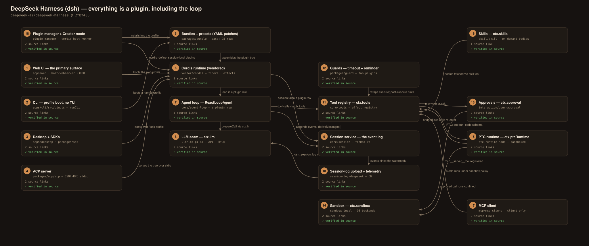
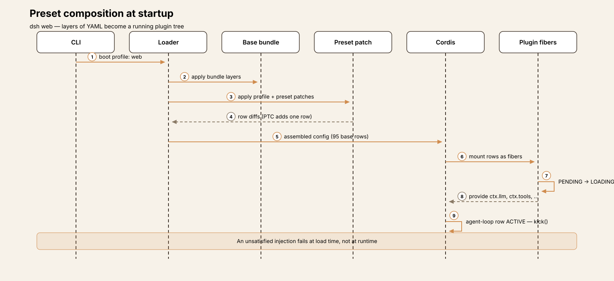
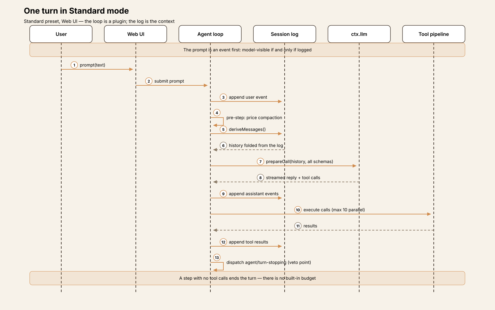
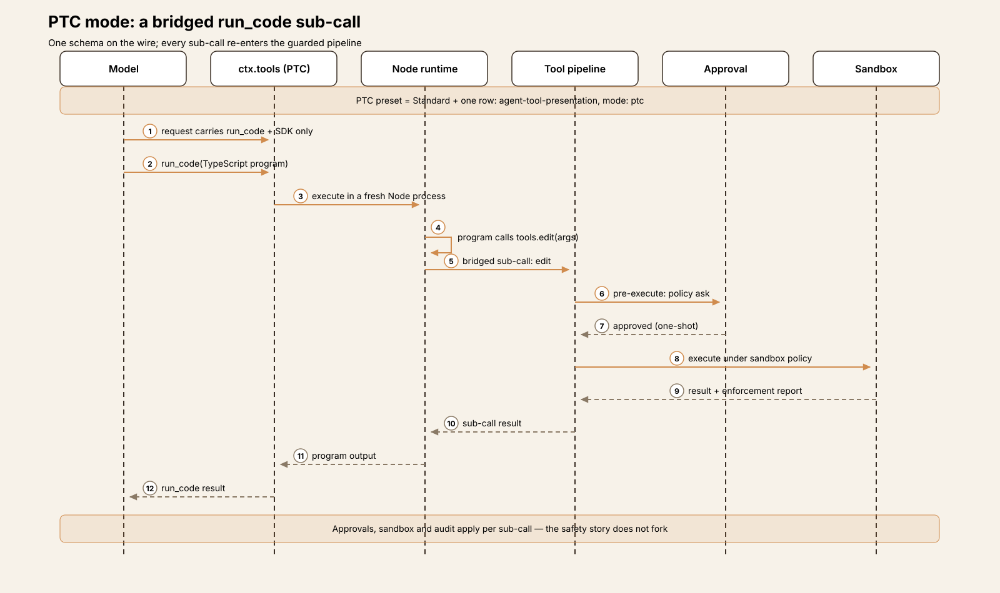
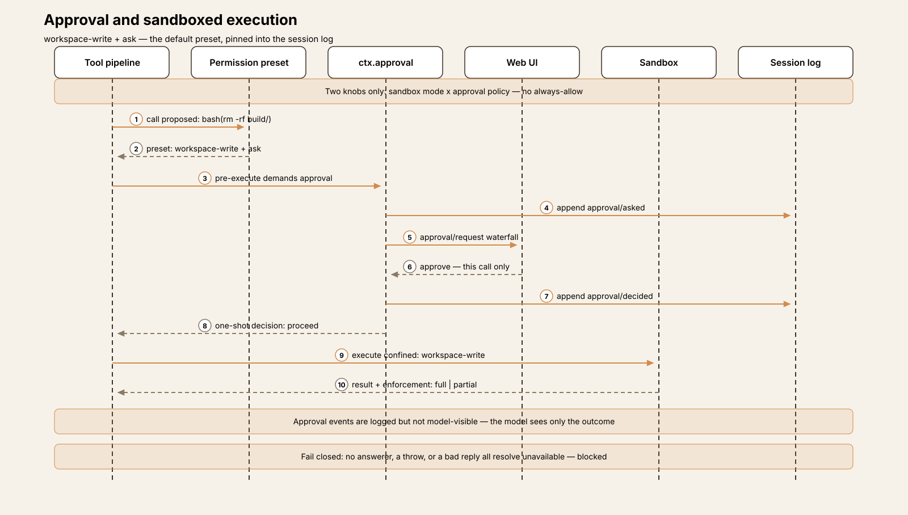
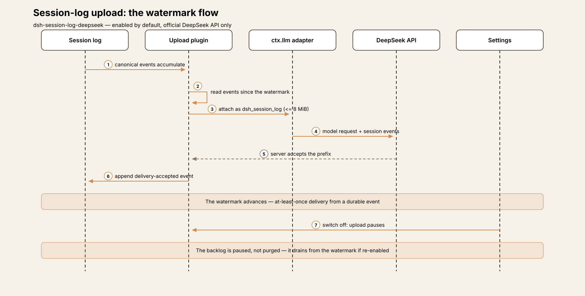

# Agent Harness Anatomy #15: DeepSeek Harness (dsh) — the harness where even the loop is a plugin

> **Series:** Agent Harness Anatomy — top-down dissections of real agent harnesses, grounded in verifiable source code. Every behavioral claim below carries a footnote to a pinned GitHub permalink; the full evidence lives in the endnotes.

## Version block

- **Repo:** [deepseek-ai/deepseek-harness](https://github.com/deepseek-ai/deepseek-harness)
- **Pinned:** tag `dsh-v0.2.1-alpha.3` → `2fbf4359b82fb94c03dcce0b831660d87f12ea5c` (2026-10-14)
- **Language:** TypeScript (ESM) pnpm monorepo — 336 workspace packages, ≈270k LOC of TypeScript/TSX (≈249k excluding tests); plus a Python SDK, a native Landlock launcher, and an Electron desktop app
- **License:** MIT
- **Claim under test:** "DeepSeek Harness: Everything is a Plugin"

A note on the pin itself: this is an alpha tag of a developer preview, released the same day it was pinned. The README warns of compatibility-breaking changes ahead, so read what follows as a snapshot of one composed tree at one commit — the mechanisms are the story, and they are fully present in the source; surface details will drift faster than in any previous teardown in this series.

## The mental model

Most harnesses in this series are plugin systems in the ordinary sense: a fixed core loop, and extension points around it. DeepSeek Harness inverts the relationship. The agent loop is a package (`packages/core/agent-loop`) that a bundle mounts by listing it in a YAML file, alongside the session service, the tools, the sandbox, the approval service, compaction, the Web UI, and everything else. In the base bundle's `cordis.patch.yml`, the loop is two rows — `- id: agent-loop`, `name: '@deepseek-ai/dsh-agent-loop'` — and the session service is another row in the same file.[^1] "Everything is a plugin" is the project's headline claim, and at this pin it is literally true of everything above one small kernel.

That kernel is Cordis, a plugin runtime the project vendors as source rather than taking as a dependency: upstream cordiverse/cordis `packages/core` at v4.0.0-rc.7, rescoped and locally modified (T5).[^2] Around it, `packages/core/*` holds interface definitions — the *seams* (`ctx.llm`, `ctx.tools`, `ctx.sandbox`, `ctx.session`) — and the remaining ~330 packages are providers, tools, guards, surfaces, and policy that a composition mounts into them.

Composition is the product. A running application is a *profile*: a root configuration assembled from layered YAML patch files — bundle patches, the profile's own patch, a home-level patch, `--patch` overlays. The base bundle alone contributes 95 plugin rows in 522 lines.[^3] An *agent preset* is the same mechanism one level down: a YAML declaration mounting a set of plugins in an isolated realm per agent. The four run modes — Standard, PTC ("Code Mode"), Minimal, and Creator — are presets, not code paths. Standard and PTC differ by exactly one plugin row.[^4]

The second load-bearing decision is that **the session log is the context**. A session is an append-only, versioned event log; the model history for every request is *derived* from it at each step boundary rather than held as mutable conversation state.[^5] The project states the invariant in its own conventions document: "Model-visible ⟺ logged — anything that reaches a model request must be reconstructable from the session log; a new model-visible input requires a session event." Approvals, permission choices, compaction summaries, and telemetry watermarks are all events in the same log; everything else in the system is a fold over it.

Hold those two ideas — *the harness is a composed tree of plugins* and *the log is the only state* — and the rest of this teardown is elaboration.

## How the composition is put together

**The plugin contract.** A Cordis plugin is a function `(ctx, config)`, a class constructed with `(ctx, config)`, or an object with `apply(ctx, config)`. Its static side declares a name, a config schema (validated before the plugin starts), the services it requires (`inject` — the plugin loads only while all are available), the services it provides, and intercepts.[^6] Services are properties on the shared context, declared by TypeScript declaration merging; a plugin consumes `ctx.sandbox` and provides `ctx.tools` by name, without either side importing the other.

**Registrations are effects.** Contributions go through `ctx.effect()` / `ctx.on()`, and every registration returns a disposer, so unloading a plugin unwinds exactly what it added.[^7] Event hooks come in serial, parallel, and waterfall flavors; in a waterfall, a listener that returns without calling `next()` has vetoed — this single mechanism underlies both tool pre-execution and approvals (T3). Each plugin's lifecycle is a *fiber* with explicit states (`PENDING → LOADING → ACTIVE → UNLOADING → DISPOSED`, plus `FAILED`), and the kernel is small: 2,696 lines across 9 files in `vendor/cordis/src`.[^8]

The vendored copy is not pristine: `vendor/README.md` logs 24 local modifications, including lifecycle hardening inside the kernel itself (reentrant-disposal fixes in `fiber.ts`), and `vendor/AGENTS.md` requires every divergence to be logged there.[^9] The project has, in effect, adopted its own runtime as a maintained fork — with the discipline of writing the divergences down.

**Composition is conditional.** Patch rows can carry `!!js` expressions in config and in `disabled:` — the base bundle's bash-sandbox row is disabled on win32 by an expression, and its config sets the bash tool's 60-second default timeout.[^10] Profiles live under `$DSH_HOME/profiles/<name>`; with the HMR plugin composed, config edits recompose the tree live, otherwise at restart. The project's working rule keeps the layers honest: "Plugins, not loop changes — new behavior goes on documented extension points; changing `agent-loop` requires updating `docs/architecture.md`."[^11]

## Package map

336 packages across 52 group directories; the groups map almost one-to-one onto capability seams.

| Package group | Role |
|---|---|
| `packages/core/*` | Seam definitions only: agent-loop, tools, session, llm interfaces |
| `packages/bundle/base` | The base composition — 95 plugin rows in `cordis.patch.yml` |
| `packages/bundle/web-app/presets/` | The four agent presets (standard, ptc, minimal, cordis) |
| `packages/interaction/*` | Permission presets; the user-approval service |
| `packages/sandbox/*` | Sandbox contract (`ctx.sandbox`) + local OS backends |
| `packages/session/*` | JSONL log persistence, format migrations, session query, official-API upload |
| `packages/compaction/*` | `compaction-basic`: threshold summarization of the log |
| `packages/guard/*` | `repeat-tool-reminder`, `timeout-policy` |
| `packages/mcp/*` | MCP client + resources (client only — see T5) |
| `packages/skill/*` | Skill registry and providers |
| `packages/ptc-runtime/*` | Code Mode runtimes (Node, experimental Python) |
| `packages/boot/*`, `packages/host/*` | Plugin manager, profile boot, web server |
| `vendor/cordis` | The plugin kernel itself (vendored source, 2,696 lines) |

## The core loop

The loop is `ReactLoopAgent` in `packages/core/agent-loop`. Entry is `kick()`, which runs `while (await this.turn()) {}` — turns continue until one reports it should not.[^12] Inside a turn, an inner step loop repeats: a pre-step claims any queued inbox input (steering), `prepareCall` builds the request through `ctx.llm`, the streamed response is settled into the session log as `assistant/message` / `assistant/attempt` events, tool calls execute, results are logged, and the next step re-derives context from the log. Parallelism inside a step is capped at 10 concurrent tool calls.[^13]

Termination is where this loop departs from every previous teardown in the series. A step ends its turn by returning `completed` (the model called no tools) or `max-tokens` (sticky across steps); a pre-step `reject` yields `blocked`; errors and `AbortSignal` cancellation end the turn from outside. And that is the complete list — **there is no built-in turn or step budget**. The package's own README states it plainly: tool calls and steering keep the turn going, and bounding a run means cancelling it or vetoing from the serial `agent/turn-stopping` hook, dispatched just before a turn ends.[^14] A harness that wants a budget composes one: a plugin that counts steps and vetoes at the hook. The base composition ships two guards, and neither is a budget:

- **Repeat-tool reminder** (`packages/guard/repeat-tool-reminder`) — advisory only. It counts consecutive identical calls (arguments canonicalized) and, at thresholds of 3, 5, and 8, injects a reminder into context via a `tools/post-execute` listener. It never vetoes a call.[^15]
- **Timeout policy** (`packages/guard/timeout-policy`) — wraps `tools/execute` and enforces each tool's declared `timeoutMs`, substituting a `TOOL_TIMEOUT` error result. (The bash tool's own default is 60 s, from the base bundle's config.)[^10]

So the runaway-loop story is: per-tool timeouts bound each call, a reminder nudges a stuck model three times, and beyond that the design trusts cancellation and composed policy. Whether that is confidence or an unfinished edge is a judgment the tradeoffs section returns to; mechanically, it is a deliberate, documented default.

## One turn, end to end

The Standard preset, in the Web UI: *"Add a dark mode toggle to the settings page."*

1. **Session start (already done).** The session was created under the default permission preset — workspace-write sandbox, `ask` approvals — and that choice was pinned into the log as a `permission/preset` event; later settings changes will not rewrite it.[^16]
2. **Pre-step.** The compaction listener prices the pending request against the context window; far below the trigger, it does nothing. Any queued steering input is claimed into the log.[^17]
3. **Context derivation.** `prepareCall` folds the session log into the request: system prompt (including the project's `AGENTS.md` instructions), the derived message history, and — native mode — the schema of *every* tool mounted in this agent's scope. The call goes out through `ctx.llm`.
4. **First response.** The model streams back a short plan and two calls — `read` on the settings page source, `grep` for the theme handling. The response is settled into the log as `assistant/message` / `assistant/attempt` events *before* the calls run, so the log already contains what the model said and asked for.[^5]
5. **Reads execute.** Each call passes the tool pipeline: `tools/pre-execute` waterfall listeners (none veto, none demand approval for these), execution under the session's workspace-write sandbox policy, then `tools/post-execute` listeners. Results are appended to the log; the next step re-derives context from it.
6. **The edit asks.** The model now calls `edit`. Under the `ask` policy this dispatches an `approval/request` waterfall to the composed answerers — here, the Web UI — and waits. The user approves. The approval covers exactly this one request; both the request and the decision are written to the log as `approval/asked` / `approval/decided` events, which are *not* model-visible — the model will see only the tool's outcome.[^18]
7. **The edit lands.** The filesystem tools are fenced in-process by the per-call sandbox mode, and the observation policy's read-before-edit and version guards are satisfied by step 5's reads. The toggle is written.
8. **Verification and finish.** The model calls `bash` to run the typecheck; the timeout-policy guard wraps the call (60 s default). It passes. The model then replies with a summary and no tool calls — the step returns `completed`, the loop dispatches `agent/turn-stopping`, no composed plugin vetoes, and the turn ends. Final state of the turn: the log, from which everything above can be reconstructed.

## Tools

Tools are registered as effects on a scoped registry, `ctx.tools`, by tool packages; the registry is per-agent-scope, so two agents in one process can see different tool sets.[^19] Every call traverses the same pipeline in `packages/core/tools`: `tools/pre-execute` waterfall listeners may veto the call or demand approval (`ask`); execution runs; `tools/post-execute` listeners may amend the context afterwards — the repeat-tool reminder hooks in at exactly this point. The full inventory is a generated document, `docs/tool-catalog.md` at 2,773 lines; the base composition mounts the expected coding set (`bash`, `read`, `write`, `edit`, `glob`, `grep` over a bundled ripgrep, job control, `todo_write`, web search/fetch, `lsp`, scheduling and goal tools, a `subagent` tool with interrupt/list/message controls, MCP resource tools, and more), with further sets conditional on preset and configuration.[^20]

Surface management is the surprise: **there is no tool-search or deferred-loading mechanism**. In native mode, every tool registered in the agent's scope contributes its schema to every request. Visibility is controlled entirely at composition time — by which plugins the preset mounts — never by runtime retrieval. Where other harnesses in this series hide a large registry behind search, dsh's answer is that the registry itself is an editorial decision made in YAML.

The one structural alternative is PTC. The presentation package exposes `ctx.tools.presentAs()`; in PTC mode the request carries a single tool schema, `run_code`, plus a generated SDK describing every registered tool. The model writes a TypeScript program; calls to `tools.<name>(args)` inside it are bridged back into the ordinary pipeline — approvals, sandbox, and audit apply per sub-call, with concurrency bounded by `maxParallelSubCalls`.[^21] Execution goes through a runtime seam (`ctx.ptcRuntime`): the Node provider runs erasable TypeScript in a fresh managed process *under the resolved sandbox policy*, with an optional persistent in-memory REPL new in this alpha; an experimental Python provider runs a CPython subprocess whose README states it has no file confinement.[^22] The composition enforces its own precondition: the PTC preset refuses to mount if no PTC runtime is composed — a load-time failure, not a runtime surprise.

## Approvals and the sandbox

Permissions are two knobs and nothing else: a **sandbox mode** (`read-only`, `workspace-write`, `danger-full-access`) and an **approval policy** (`ask` or `never`), owned by `packages/interaction/permission-presets`. The base bundle configures three named presets from the knobs — `read-only` (read-only + ask), `workspace-write` (workspace-write + ask), and `danger-full-access` (danger-full-access + never).[^23] Fresh sessions default to workspace-write + ask, switchable live via `/permission`; a knob combination matching no preset displays as `custom` — a state you can switch away from, never into.

The approval seam is built to fail closed. Under `ask`, a decision is dispatched as an `approval/request` waterfall to composed answerers (the Web UI and the ACP server each provide one). The dispatch semantics, from the package's own README: no terminal answerer → `unavailable` → **the action is blocked**; a throwing answerer is contained and likewise resolves `unavailable`; a return value outside the vocabulary is normalized to `unavailable`. The `never` policy is enforced inside the service *before* the waterfall runs, so a later-registered listener cannot bypass it. An approval applies to exactly one request — there is no "always allow" in this design.[^24]

The sandbox is a contract (`ctx.sandbox`) with per-call file-effect modes, and it fails closed the same way: if no backend can enforce the requested mode, the call fails with `SANDBOX_UNAVAILABLE` rather than running unconfined. Enforcement completeness is reported per call as `full` or `partial`, and consumers may reject `partial`.[^25] The local backends: on Linux, **bubblewrap first, then Landlock** (the Landlock runner is a launcher built from the repo's `native/system` component) — the bwrap profile gives the command a read-only host root, a fresh `/dev`, and a private PID-namespace `/proc`, with `workspace-write` adding an ephemeral `/tmp` and a writable workspace bind. On macOS, **Seatbelt** via `sandbox-exec`. On Windows, an **ACL restricted-token** rung that reports `partial` — hard links alias across the boundary and reads are unconfined, and the system says so per call instead of rounding up.[^26] After a denial, an escalation ladder lets the model retry the exact call once with `sandbox_permissions` set to the narrowest strictly wider mode, plus a justification; the wider mode requires human approval and applies to that one call only.[^27] The package is explicit about the ceiling: this is *same-world* confinement, sharing the host kernel and filesystem; a container or microVM is a different composition, not a stronger setting of this one.

One experimental layer sits beside approvals, off by default: `packages/experimental/auto-review`. When installed *and* selected, the agent's own provider and model review each pending tool call (PTC inner calls included) against a fixed risk policy. An allow executes the call with Full access sandboxing; a deny falls through to the `ask` path; malformed reviewer output or a technical failure **fails the call** — it never executes. Delegated child agents pin `never`, making a reviewer denial final for them. The reviewer's input is deliberately narrow — fixed policy, cwd, sourced project constraints, filtered sourced history, and the pending action; assistant text, reasoning, and tool results are excluded — and the README says plainly that the layer "can allow unsafe actions, deny useful work, and spend additional tokens."[^28]

Then the boundary the safety story does not cross: **plugins run outside the sandbox**. The plugin manager's README states it directly — "installed Host code executes in-process outside the workspace sandbox."[^29] The `plugin_manager` tool (the model's route to installing plugins) requires `danger-full-access` or a per-call approval, and dependency build scripts need a separate approval that persists by package name. The confinement is real for tool calls; code you install is a different trust decision, and the project documents it as one.

### What leaves the machine

Three flows deserve exact statement, because they differ in their defaults:

1. **Session-log upload to the official API — default ON.** When requests go to the official DeepSeek API, each request carries a `dsh_session_log` field: the canonical session events since the last server-accepted watermark (the longest contiguous run fitting a byte budget, 8 MiB by default; acceptance is at-least-once, recorded in a durable delivery event). It is provider-scoped — a BYOK provider's adapter does not add the field — it is not inserted into model context, and there is a user-facing switch (Web Settings → General). One behavior to know: events recorded while the switch is off are uploaded if it is turned back on — disabling pauses the drain from the watermark rather than purging the backlog.[^30]
2. **OTel session telemetry — feedback-gated.** The base bundle mounts the telemetry plugins in `FEEDBACK_ONLY` mode: a session-log prefix is exported only after explicit user feedback, to a project collector endpoint (overridable by environment variable; any non-empty `DSH_TELEMETRY_DISABLED` opts out entirely). Exports carry an anonymous installation UUID — a random value in `$DSH_HOME/.anonymous-user-id`, no machine or account data, reset by deleting the file.[^31]
3. **Desktop product analytics — default, no user-facing control.** The Desktop app reports selected interactions through the OTel product exporter by default; its package README notes there is no user-facing control for it. Ordinary Web clients never submit these events.[^32]

Set against `SAFETY.md` — an experimental developer preview, no security audit, sandboxing and approvals that "do not guarantee isolation," with advice to use a disposable VM, least privilege, and backups — the code and the document agree.[^33] The sandbox and approvals read as guardrails against agent mistakes; the project says exactly that, and the claim is verifiable in the same tree.

## Memory and sessions

There is one memory system, and it is the session log. The current format version is 4 (`SESSION_FORMAT_VERSION = 4`), and its governance is unusually formal for a preview: a status document records the latest finalized and released versions with their evidence tag, adjacent-only migration packages ship in-tree (`v0-to-v1` through `v3-to-v4`), the reader refuses logs containing unknown *required* event types, and forward compatibility runs through an explicit `ignorable` envelope marker.[^34]

On disk, the JSONL persistence package keeps one directory per session — `<root>/<normalized-cwd>/<encoded-session-id>/session.v4.jsonl[.zstd]` — under `$DSH_HOME/sessions` (`~/.dsh` by default): checksummed Zstandard frames by default, historical generations retained immutably and migrated on open, torn-tail crash recovery, and image bytes in a content-addressed store outside the log.[^35]

**Compaction** is a pre-step listener that prices the pending request through a token meter. The default trigger is `floor(min(W × 0.8, W − O − 65,536))` for context window `W` and output cap `O`. The oldest balanced span is replaced by one LLM-written summary, which later requests receive inside `<compacted-summary>` tags; the newest 16% of `W − O` stays verbatim. An optional tool-result pruner runs first and can make summarization unnecessary; a provider-confirmed `CONTEXT_WINDOW_EXCEEDED` triggers a maximal-reduction retry; `/compact` forces it manually.[^17]

**Cross-session memory, as a built-in store, does not exist.** No package implements one. What exists instead: the session logs themselves, searchable through opt-in session-query tools (`session_search`, `session_event_search`, …) mounted with full-text indexing off; workspace instruction files (`AGENTS.md` / `CLAUDE.md`) loaded per project; and — the documented answer — **memory over MCP**, delegated to third-party servers. The user guide ships three default-off reference configurations (Memorix, the MCP reference memory server, Engram) and is explicit about the division of labor: dsh does not download the server, initialize its database, or choose its embedding provider.[^36] The durable, user-authored knowledge format here is not a memory store at all — it is skills.

## Extensions: the Cordis plugin system

Everything above is the plugin system viewed from one angle or another; this section collects the parts aimed at authors.

**Skills.** `packages/skill/skill` provides the `ctx.skills` registry: providers contribute catalogs (a filesystem provider, runtime registrations from other plugins, remote sources), the registry merges and deduplicates them, and consumers advertise summaries while fetching a skill's full body through the `skill` tool only when invoked — progressive disclosure. Every skill carries an invocation policy (`modelInvocable` / `userInvocable`), keeping the model-facing and human-facing catalogs separate.[^37]

**MCP — client only.** The `packages/mcp/` group contains exactly two packages, `dsh-mcp-client` and `dsh-mcp-resources`. There is no MCP server in the codebase: dsh consumes MCP; it is not exposed by it. The client supports stdio and Streamable HTTP servers, one config entry per server, **none enabled by default**; tools surface as `mcp__<server>__<tool>`. Server instructions join the logged system prompt as literal text; prompt templates are unsupported. For stdio children, the bridge strips ambient variables whose names usually identify credentials, plus all `DSH_*` variables, before launch.[^38]

**Installing plugins.** External plugins are ordinary npm packages declaring a bundle patch, installed into a profile with pnpm semantics — registry specs, git URLs, tarballs, `file:`/`link:` paths. Installation performs a peer-compatibility check before anything downloads, build scripts require separate approval (T3), and failures roll the profile manifest and lockfile back. Management surfaces: the Web sidebar's Plugins page, the gated `plugin_manager` tool, and `dsh plugin --profile <name>`.[^39]

**Creator mode: the harness extends itself at runtime.** The Creator preset (id `cordis`) adds read-only runtime-inspection tools (`cordis_inspect_list` / `cordis_inspect_query`), so the model can see the APIs actually present, and the plugin-manager tools.[^40] Behind them sits the dynamic-plugin runner: `cordis_define` accepts a session-owned, process-local plugin definition from supplied code — the host half executes in a `node:vm` realm with definition evaluation bounded by a 5-second default timeout, the client half in the browser. Definitions disappear on restart; anything persistent goes through the Plugin Manager, with its approvals.[^41]

## Interfaces

There is no interactive terminal UI. The CLI (`apps/cli`) boots named profiles from `$DSH_HOME/profiles/<name>` — `web`, `headless`, `sdk`, `sdk-minimal`, `acp` (the `desktop` name is reserved for the Electron-owned profile) — and otherwise manages plugins and dumps configuration.[^42]

- **Web UI (primary).** `dsh web` boots the web-app bundle; the web server is itself a route-registration plugin over `node:http` (HTTPS optional), binding `http://127.0.0.1:3080` by default and opening the browser on a local launch. The client is a Vite/React app served as static files, talking to the host through a remote gateway.[^43]
- **Desktop.** The Electron app boots the same web profile in-process — same composition, different shell (and the surface carrying T3's product analytics).
- **Headless.** `dsh --profile headless "task"` runs one fresh persisted session: final answer on stdout, reasoning deltas on stderr, exit 0/1; `--json` streams events; `--session-id` resumes.[^44]
- **ACP.** `dsh --profile acp` serves the Agent Client Protocol over JSON-RPC stdio, as an automation surface only: `session/new`, prompt, and option state are supported; `session/load`, deletion, fork, terminals, client filesystem operations, and elicitation are explicitly unsupported. ACP clients are trusted controllers — stdio MCP entries in a session request authorize their absolute commands and environment.[^45]
- **SDK.** A JSON-RPC stdio server (`dsh --profile sdk`) with a TypeScript client, and a Python SDK that launches and drives that profile. Both SDKs "project the loop" — the project requires session and event changes to update both SDKs' expected outputs in the same change.[^46]

## Observations

**The default-on upload is the one default that cuts against the rest of the design.** Everywhere else in the tool path, dsh's defaults are conservative: approvals fail closed, the sandbox refuses rather than runs unconfined, telemetry waits for feedback. The official-API session-log upload is the exception — full canonical session events, attached incrementally to model requests, on unless the user finds the Settings switch, with a backlog that resumes draining if the switch is flipped back.[^30] It is documented, provider-scoped, and watermarked with care; it is also the only default in the system that moves user data first and asks later.

**The auto-reviewer sees the call, not the chain.** The experimental reviewer's input excludes assistant text, reasoning, and tool results by design — a defensible choice (a reviewer that reads tool output can be argued with by that output), with a structural cost: each call is judged in isolation, and a sequence whose risk exists only across calls is invisible to it. That it is off by default, fails closed, and is candidly documented limits the concern; that its *allows* execute at Full access sandboxing sharpens it.[^28]

**Desktop analytics is the least consistent surface in the tree.** The two session-telemetry paths are gated or switchable; the Desktop app's product analytics reports by default with, by its own README's account, no user-facing control.[^32] In a codebase this careful about consent mechanics elsewhere, the gap reads as an unfinished edge rather than a philosophy.

**Partial enforcement, reported as partial.** The Windows sandbox rung is weaker than the Linux and macOS ones — reads unconfined, hard links aliasing across the boundary. What the code does with that fact is the creditable part: enforcement is reported per call as `partial`, and consumers may reject partial enforcement, rather than the difference being rounded up to "sandboxed."[^26]

**Docs-vs-code: the Minimal preset's editor.** Secondary descriptions of Minimal mode call it "bash plus a `str_replace_editor`." At this pin, Minimal's filesystem tool has read/write/edit *disabled* (image reading stays on) beside a one-line persona and a persistent terminal; there is no editor tool in the preset at all. The `str_replace_editor` package exists — as a standalone opt-in no shipped preset mounts; the base bundle's own README notes the default editing tools are `read`/`write`/`edit`.[^47] A small divergence, but the kind that propagates: the modes are YAML, and anyone describing them from prose rather than preset files will eventually describe a harness that doesn't exist.

## Tradeoffs

The composition architecture buys something real. A mode is a diff; a policy is a pair of knobs in a named preset; a new behavior is a plugin on a documented seam rather than a patch to the loop — and because registrations are effects with disposers, all of it can be loaded, unloaded, and recomposed at runtime. The session log buys the complementary property: one artifact to persist, migrate, search, compact, and (where enabled) upload, with every other view a disposable fold over it. A harness whose state is one log and whose behavior is one composed tree is unusually inspectable, and this teardown's evidence base is correspondingly direct: most mechanisms above are stated in the bundle YAML or a package README *and* visible in the code at the same address.

The costs are the mirror images. Composition moves behavior out of code and into 522 lines of layered YAML with embedded `!!js` expressions: what runs is the *result* of a resolution process across bundles, profiles, presets, home patches, and overlays, and reading any one file understates what a given agent actually mounts. The unbounded loop is the same philosophy at the turn level — budgets are policy, policy belongs in composed plugins — which is coherent, and also means an unmodified base composition lets a model call tools until something external stops it. And the preview status is not a footnote: an alpha whose own README promises breaking changes, built on a vendored release-candidate kernel carrying 24 local patches. The most compositional architecture in this series is also, by construction, the one whose next snapshot will differ most from this one.

## Comparison matrix row

| # | Dimension | DeepSeek Harness (dsh) (dsh-v0.2.1-alpha.3) |
|---|---|---|
| 1 | Agent loop | Plugin-mounted `ReactLoopAgent` (`kick()` → turns of re-derive → call → execute steps); context folded from the append-only session log each step; **no built-in turn/step budget** — ends when the model stops calling tools, on abort, or via an `agent/turn-stopping` hook veto; ≤10 parallel calls per step; advisory repeat-tool reminder at 3/5/8 |
| 2 | Tool system | Effect-registered, per-agent-scope registry; `tools/pre-execute` waterfall (veto / ask) + `tools/post-execute` listeners; no tool search — native mode sends every mounted schema; PTC presentation collapses the wire surface to `run_code` + generated SDK, sub-calls re-entering the full guarded pipeline; MCP client-only |
| 3 | Model providers | Provider adapters behind the `ctx.llm` seam; official DeepSeek API or BYOK providers |
| 4 | Prompt construction | Derived per step from the session log under a stated invariant (model-visible ⟺ logged); per-project `AGENTS.md`/`CLAUDE.md` instructions; skill summaries advertised, bodies fetched on invocation; compaction summaries as `<compacted-summary>` |
| 5 | Memory/session | The append-only, versioned (format v4) session event log is the only state; JSONL + checksummed zstd per-session directories under `~/.dsh/sessions`; threshold compaction (≈0.8 × window, newest 16% verbatim); **no built-in cross-session memory** — opt-in session search plus third-party memory over MCP |
| 6 | Reasoning/planning | No separate planner; `todo_write` and goal tools; `subagent` delegation with interrupt/list/send-message controls; `exit_plan_mode`; scheduling tools |
| 7 | Extensibility | Cordis plugins for everything above the kernel — the loop included; function/class/`apply` contract + schema-validated config + inject/provide + effect disposers; layered YAML patch composition (bundles, profiles, presets, overlays); skills with progressive disclosure; npm-installed profile plugins with rollback; Creator-mode runtime plugin definition in a `node:vm` realm |
| 8 | Interfaces | No interactive CLI TUI — a profile-boot CLI (`web` / `headless` / `sdk` / `sdk-minimal` / `acp`); Web UI primary at `127.0.0.1:3080`; Electron desktop boots the web profile; headless one-shot with stdout answer; ACP (automation-only subset); JSON-RPC SDK server with TypeScript and Python SDKs |
| 9 | Failure handling | Fail-closed approvals (answerer failure → blocked) and sandbox (no enforcing backend → `SANDBOX_UNAVAILABLE`); per-tool timeout policy; plugin-install rollback; torn-tail log recovery; maximal-reduction compaction retry on `CONTEXT_WINDOW_EXCEEDED`; composition errors fail at load time |
| 10 | Security model | Two-knob permission presets (sandbox mode × approval policy) pinned per session in the log; per-call OS sandboxing (bubblewrap → Landlock / Seatbelt / Windows ACL) with `full`/`partial` enforcement reported per call; one-call approval-gated escalation ladder; experimental auto-review (off by default, fail-closed); **plugins run in-process outside the sandbox**; session-log upload to the official API default-on (switchable) |

## Endnotes

All notes are VERIFIED against `dsh-v0.2.1-alpha.3` (`2fbf4359b82fb94c03dcce0b831660d87f12ea5c`) unless marked otherwise. `GH` = `https://github.com/deepseek-ai/deepseek-harness/blob/2fbf4359b82fb94c03dcce0b831660d87f12ea5c/`.

[^1]: The loop as a bundle row: [GH…/packages/bundle/base/cordis.patch.yml#L504-L505](https://github.com/deepseek-ai/deepseek-harness/blob/2fbf4359b82fb94c03dcce0b831660d87f12ea5c/packages/bundle/base/cordis.patch.yml#L504-L505) (`- id: agent-loop`, `name: '@deepseek-ai/dsh-agent-loop'`); the session service is the row at [GH…/packages/bundle/base/cordis.patch.yml#L41](https://github.com/deepseek-ai/deepseek-harness/blob/2fbf4359b82fb94c03dcce0b831660d87f12ea5c/packages/bundle/base/cordis.patch.yml#L41) (`@deepseek-ai/dsh-session`).

[^2]: Vendored Cordis: [GH…/vendor/README.md#L17](https://github.com/deepseek-ai/deepseek-harness/blob/2fbf4359b82fb94c03dcce0b831660d87f12ea5c/vendor/README.md#L17) pins `vendor/cordis` to upstream cordiverse/cordis `packages/core` @ `56b3d4f725681cf4556c1a8695a709cc3b6eed74` (upstream v4.0.0-rc.7), rescoped `@deepseek-ai/cordis`, vendored version 4.0.5-alpha.2. Eight more Cordis-ecosystem packages are vendored the same way.

[^3]: The base bundle patch file, [GH…/packages/bundle/base/cordis.patch.yml](https://github.com/deepseek-ai/deepseek-harness/blob/2fbf4359b82fb94c03dcce0b831660d87f12ea5c/packages/bundle/base/cordis.patch.yml): 522 lines, 95 plugin rows, counted at the pin. Profiles and their directories: `apps/cli/README.md` (profiles under `$DSH_HOME/profiles/<name>`).

[^4]: The four presets live in `packages/bundle/web-app/presets/{standard,ptc,minimal,cordis}.patch.yml`. Standard ↔ PTC differ by exactly one row: [GH…/packages/bundle/web-app/presets/ptc.patch.yml#L123-L126](https://github.com/deepseek-ai/deepseek-harness/blob/2fbf4359b82fb94c03dcce0b831660d87f12ea5c/packages/bundle/web-app/presets/ptc.patch.yml#L123-L126) mounts `@deepseek-ai/dsh-agent-tool-presentation` with `mode: ptc`; the standard preset has no such row. ("Creator mode" is the UI name for preset id `cordis`.)

[^5]: Context derivation at the step boundary: [GH…/packages/core/agent-loop/src/agent.ts#L688](https://github.com/deepseek-ai/deepseek-harness/blob/2fbf4359b82fb94c03dcce0b831660d87f12ea5c/packages/core/agent-loop/src/agent.ts#L688) calls `session.deriveMessages()`. The invariant is stated at [GH…/AGENTS.md#L137](https://github.com/deepseek-ai/deepseek-harness/blob/2fbf4359b82fb94c03dcce0b831660d87f12ea5c/AGENTS.md#L137) (Conventions): "**Model-visible ⟺ logged**: anything that reaches a model request must be reconstructable from the session log; a new model-visible input requires a session event."

[^6]: Plugin forms and the `Plugin.Base` contract (`name`, `Config`, `inject`, `provide`, `intercept`): [GH…/vendor/cordis/src/registry.ts#L92-L135](https://github.com/deepseek-ai/deepseek-harness/blob/2fbf4359b82fb94c03dcce0b831660d87f12ea5c/vendor/cordis/src/registry.ts#L92-L135). Config is a Standard Schema validator applied before start: [GH…/vendor/cordis/src/fiber.ts#L50-L53](https://github.com/deepseek-ai/deepseek-harness/blob/2fbf4359b82fb94c03dcce0b831660d87f12ea5c/vendor/cordis/src/fiber.ts#L50-L53).

[^7]: Effects and hook flavors: root `AGENTS.md`, Conventions — contributions go through `ctx.effect()` / `ctx.on()`, every `register()` returns a disposer, and hooks are serial / parallel / waterfall, a waterfall listener returning without `next()` acting as a veto. See [GH…/AGENTS.md#L137](https://github.com/deepseek-ai/deepseek-harness/blob/2fbf4359b82fb94c03dcce0b831660d87f12ea5c/AGENTS.md#L137) (the Conventions block).

[^8]: Fiber states `PENDING → LOADING → ACTIVE → UNLOADING → DISPOSED` (+ `FAILED`): [GH…/vendor/cordis/src/fiber.ts#L140-L153](https://github.com/deepseek-ai/deepseek-harness/blob/2fbf4359b82fb94c03dcce0b831660d87f12ea5c/vendor/cordis/src/fiber.ts#L140-L153). Kernel size: `vendor/cordis/src` totals 2,696 lines across 9 files, counted at the pin.

[^9]: The 24 logged local modifications to vendored Cordis: [GH…/vendor/README.md#L29-L56](https://github.com/deepseek-ai/deepseek-harness/blob/2fbf4359b82fb94c03dcce0b831660d87f12ea5c/vendor/README.md#L29-L56) — including the `fiber.ts` reentrant-disposal hardening (entry #6). `vendor/AGENTS.md` requires every divergence to be logged there.

[^10]: Conditional composition + bash defaults: [GH…/packages/bundle/base/cordis.patch.yml#L249-L254](https://github.com/deepseek-ai/deepseek-harness/blob/2fbf4359b82fb94c03dcce0b831660d87f12ea5c/packages/bundle/base/cordis.patch.yml#L249-L254) — the `bash-sandbox` row is disabled on win32 by a `!!js` expression, and the same row's config carries the bash tool's 60 s default timeout that `timeout-policy` enforces.

[^11]: The project rule at [GH…/AGENTS.md#L138](https://github.com/deepseek-ai/deepseek-harness/blob/2fbf4359b82fb94c03dcce0b831660d87f12ea5c/AGENTS.md#L138): "**Plugins, not loop changes**: new behavior goes on documented extension points; changing `agent-loop` requires updating docs/architecture.md."

[^12]: Loop entry: [GH…/packages/core/agent-loop/src/agent.ts#L252](https://github.com/deepseek-ai/deepseek-harness/blob/2fbf4359b82fb94c03dcce0b831660d87f12ea5c/packages/core/agent-loop/src/agent.ts#L252) — `kick()` runs `while (await this.turn()) {}` (loop head at L258). Tool execution is in the same package's `src/tool-calls.ts`; responses settle into the log as `assistant/message` / `assistant/attempt` events.

[^13]: Step parallelism cap: [GH…/packages/core/agent-loop/src/constants.ts#L6](https://github.com/deepseek-ai/deepseek-harness/blob/2fbf4359b82fb94c03dcce0b831660d87f12ea5c/packages/core/agent-loop/src/constants.ts#L6) — `DEFAULT_MAX_PARALLEL_TOOL_CALLS = 10`.

[^14]: No built-in budget, in the package's own words: [GH…/packages/core/agent-loop/README.md#L220](https://github.com/deepseek-ai/deepseek-harness/blob/2fbf4359b82fb94c03dcce0b831660d87f12ea5c/packages/core/agent-loop/README.md#L220) — "**No built-in turn budget** — tool calls or steering continue the current turn; a policy that bounds runaway turns must cancel from an existing lifecycle extension point such as `agent/turn-stopping`." The hook is dispatched before turn end at [GH…/packages/core/agent-loop/src/agent.ts#L362](https://github.com/deepseek-ai/deepseek-harness/blob/2fbf4359b82fb94c03dcce0b831660d87f12ea5c/packages/core/agent-loop/src/agent.ts#L362).

[^15]: Repeat-tool reminder: thresholds default `[3, 5, 8]` — [GH…/packages/guard/repeat-tool-reminder/src/index.ts#L36-L53](https://github.com/deepseek-ai/deepseek-harness/blob/2fbf4359b82fb94c03dcce0b831660d87f12ea5c/packages/guard/repeat-tool-reminder/src/index.ts#L36-L53). It counts consecutive identical calls with canonicalized arguments and injects its reminder via a `tools/post-execute` listener (package README); no code path in the package vetoes a call.

[^16]: Fresh-session defaults: sandbox default `mode: $DSH_PERMISSION_MODE ?? 'workspace-write'` with `workspaceRoot: process.cwd()` at [GH…/packages/bundle/base/cordis.patch.yml#L243-L247](https://github.com/deepseek-ai/deepseek-harness/blob/2fbf4359b82fb94c03dcce0b831660d87f12ea5c/packages/bundle/base/cordis.patch.yml#L243-L247); approval default (`never` only under `danger-full-access`, otherwise `ask`) at [GH…/packages/bundle/base/cordis.patch.yml#L259-L261](https://github.com/deepseek-ai/deepseek-harness/blob/2fbf4359b82fb94c03dcce0b831660d87f12ea5c/packages/bundle/base/cordis.patch.yml#L259-L261). The chosen pair is pinned into the session log at creation as a `permission/preset` event and switched live via `/permission`.

[^17]: Compaction: [GH…/packages/compaction/compaction-basic/README.md#L62](https://github.com/deepseek-ai/deepseek-harness/blob/2fbf4359b82fb94c03dcce0b831660d87f12ea5c/packages/compaction/compaction-basic/README.md#L62) — default trigger `floor(min(W × 0.8, W − O − 65,536))`, settings table at L66-L73; summary delivered inside `<compacted-summary>` tags with the newest 16% of `W − O` verbatim, optional tool-result pruner first, maximal-reduction retry on a provider-confirmed `CONTEXT_WINDOW_EXCEEDED`. Mounted in the base bundle (`cordis.patch.yml:351-352`).

[^18]: Approval events are in the session event vocabulary — `approval/asked`, `approval/decided` in [GH…/packages/core/session/src/known-event-types.ts](https://github.com/deepseek-ai/deepseek-harness/blob/2fbf4359b82fb94c03dcce0b831660d87f12ea5c/packages/core/session/src/known-event-types.ts) — and are not model-visible: the model sees the tool outcome and the current policy snapshot only.

[^19]: Tool registry and pipeline: `packages/core/tools` — tools register as effects on the scoped `ctx.tools` registry; the pipeline dispatches `tools/pre-execute` waterfall listeners (veto or `ask`), execution, and `tools/post-execute` listeners. Pinned tree: [GH…/packages/core/tools](https://github.com/deepseek-ai/deepseek-harness/tree/2fbf4359b82fb94c03dcce0b831660d87f12ea5c/packages/core/tools).

[^20]: The generated inventory: [GH…/docs/tool-catalog.md](https://github.com/deepseek-ai/deepseek-harness/blob/2fbf4359b82fb94c03dcce0b831660d87f12ea5c/docs/tool-catalog.md) — 2,773 lines at the pin. Conditionally present: `run_code` (PTC only), `cordis_inspect_*` (Creator only), session-query and `terminal_*` tools (opt-in), agent-team tools (experimental, disabled in base).

[^21]: PTC presentation: `packages/core/agent-tool-presentation` exposes `ctx.tools.presentAs()`; in PTC mode the request carries the single `run_code` schema plus a generated SDK of every registered tool, and bridged sub-calls re-enter the ordinary pipeline with concurrency bounded by `maxParallelSubCalls` — see the `run_code` entry in [GH…/docs/tool-catalog.md](https://github.com/deepseek-ai/deepseek-harness/blob/2fbf4359b82fb94c03dcce0b831660d87f12ea5c/docs/tool-catalog.md).

[^22]: PTC runtimes: `packages/ptc-runtime/ptc-runtime` (the `ctx.ptcRuntime` seam), `packages/ptc-runtime/ptc-runtime-node` (fresh managed Node process under the resolved sandbox policy; optional persistent in-memory REPL keyed by `stateOwner`, new in this alpha), and the experimental Python provider, whose package README states its CPython subprocess runs without file confinement. Pinned tree: [GH…/packages/ptc-runtime](https://github.com/deepseek-ai/deepseek-harness/tree/2fbf4359b82fb94c03dcce0b831660d87f12ea5c/packages/ptc-runtime).

[^23]: The three configured presets: [GH…/packages/bundle/base/cordis.patch.yml#L263](https://github.com/deepseek-ai/deepseek-harness/blob/2fbf4359b82fb94c03dcce0b831660d87f12ea5c/packages/bundle/base/cordis.patch.yml#L263) onward configures `read-only`, `workspace-write`, and `danger-full-access` in `packages/interaction/permission-presets`; the package's own defaults are the latter two (its README).

[^24]: Approval dispatch semantics: `packages/interaction/user-approval/README.md`, "Dispatch" — no terminal answerer → `unavailable` → blocked; a throwing answerer is contained and resolves `unavailable`; a non-vocabulary return is normalized to `unavailable`; the `never` policy is enforced inside the service before the waterfall. Pinned file: [GH…/packages/interaction/user-approval/README.md](https://github.com/deepseek-ai/deepseek-harness/blob/2fbf4359b82fb94c03dcce0b831660d87f12ea5c/packages/interaction/user-approval/README.md).

[^25]: Sandbox contract and fail-closed behavior: `packages/sandbox/sandbox/README.md`, "Fail-closed behavior" — if no backend can enforce the requested mode, the call fails with `SANDBOX_UNAVAILABLE`; enforcement completeness (`full` / `partial`) is reported per call and consumers may reject `partial`; the package frames this as same-world confinement. Pinned file: [GH…/packages/sandbox/sandbox/README.md](https://github.com/deepseek-ai/deepseek-harness/blob/2fbf4359b82fb94c03dcce0b831660d87f12ea5c/packages/sandbox/sandbox/README.md).

[^26]: Local backends and their limits: [GH…/packages/sandbox/sandbox-local/README.md#L71-L83](https://github.com/deepseek-ai/deepseek-harness/blob/2fbf4359b82fb94c03dcce0b831660d87f12ea5c/packages/sandbox/sandbox-local/README.md#L71-L83) (runner selection: bubblewrap → Landlock on Linux, Seatbelt on macOS, ACL restricted-token on Windows, the latter reporting `partial`); the bubblewrap profile at [GH…/packages/sandbox/sandbox-local/README.md#L75](https://github.com/deepseek-ai/deepseek-harness/blob/2fbf4359b82fb94c03dcce0b831660d87f12ea5c/packages/sandbox/sandbox-local/README.md#L75); runner limits at L131-L133 of the same file.

[^27]: The escalation ladder: [GH…/packages/sandbox/sandbox/src/escalation.ts](https://github.com/deepseek-ai/deepseek-harness/blob/2fbf4359b82fb94c03dcce0b831660d87f12ea5c/packages/sandbox/sandbox/src/escalation.ts) — one retry of the exact call with `sandbox_permissions` set to the narrowest strictly wider mode plus a `justification`, gated by `ctx.approval`, applying to that call only; narrower or equal targets are rejected without approval.

[^28]: Auto-review: `packages/experimental/auto-review/README.md` — allow → executes with Full access sandboxing; deny → falls to the `ask` path; malformed output or technical failure fails the call; delegated children pin `never`; reviewer input excludes assistant text, reasoning, and tool results; the README's own caution: it "can allow unsafe actions, deny useful work, and spend additional tokens." Pinned file: [GH…/packages/experimental/auto-review/README.md](https://github.com/deepseek-ai/deepseek-harness/blob/2fbf4359b82fb94c03dcce0b831660d87f12ea5c/packages/experimental/auto-review/README.md). Shipped switched off.

[^29]: The plugin boundary, in the project's words: [GH…/packages/boot/plugin-manager/README.md#L31](https://github.com/deepseek-ai/deepseek-harness/blob/2fbf4359b82fb94c03dcce0b831660d87f12ea5c/packages/boot/plugin-manager/README.md#L31) — "installed Host code executes in-process outside the workspace sandbox." The same README covers the `plugin_manager` gating (`danger-full-access` or per-call approval; separate, persistent-by-package approval for dependency build scripts).

[^30]: Session-log upload: mounted in the base bundle at [GH…/packages/bundle/base/cordis.patch.yml#L43-L44](https://github.com/deepseek-ai/deepseek-harness/blob/2fbf4359b82fb94c03dcce0b831660d87f12ea5c/packages/bundle/base/cordis.patch.yml#L43-L44) (`dsh-session-log-deepseek`). Config: `enabled: z.boolean().default(true)` at [GH…/packages/session/session-log-deepseek/src/index.ts#L52](https://github.com/deepseek-ai/deepseek-harness/blob/2fbf4359b82fb94c03dcce0b831660d87f12ea5c/packages/session/session-log-deepseek/src/index.ts#L52), gate at L189 of the same file. The `dsh_session_log` field carries canonical events since the last server-accepted watermark (longest contiguous run within `maxBytes`, default 8 MiB; at-least-once, with a durable delivery-accepted event). The user switch is Web Settings → General ("Upload Session Log when using the official model API"); events recorded while disabled drain from the watermark if re-enabled.

[^31]: OTel telemetry: the base bundle mounts `dsh-otel` + `dsh-session-telemetry-otel` at [GH…/packages/bundle/base/cordis.patch.yml#L202-L237](https://github.com/deepseek-ai/deepseek-harness/blob/2fbf4359b82fb94c03dcce0b831660d87f12ea5c/packages/bundle/base/cordis.patch.yml#L202-L237) with `mode: FEEDBACK_ONLY` by default, exporting to `https://dsh-otel-collector.deepseeksvc.com/v1/logs` (overridable via `DSH_TELEMETRY_OTLP_URL`; any non-empty `DSH_TELEMETRY_DISABLED` opts out). The anonymous identity (`packages/identity/anonymous-user-id`) is a random UUID at `$DSH_HOME/.anonymous-user-id`.

[^32]: Desktop product analytics: `packages/client/product-analytics/README.md` — the Desktop app reports selected interactions through the OTel product exporter by default, with no user-facing control; ordinary Web clients never submit these events. Pinned file: [GH…/packages/client/product-analytics/README.md](https://github.com/deepseek-ai/deepseek-harness/blob/2fbf4359b82fb94c03dcce0b831660d87f12ea5c/packages/client/product-analytics/README.md).

[^33]: [GH…/SAFETY.md](https://github.com/deepseek-ai/deepseek-harness/blob/2fbf4359b82fb94c03dcce0b831660d87f12ea5c/SAFETY.md) (repo root): experimental developer preview, no security audit, sandboxing and approvals "do not guarantee isolation," with advice to use a disposable VM/container, least privilege, and backups.

[^34]: Format version and governance: `SESSION_FORMAT_VERSION = 4` at [GH…/packages/core/session/src/types.ts#L90](https://github.com/deepseek-ai/deepseek-harness/blob/2fbf4359b82fb94c03dcce0b831660d87f12ea5c/packages/core/session/src/types.ts#L90); `docs/session-format-status.md` records latest finalized = 4, latest released = 4 (evidence tag `dsh-v0.2.0-rc.2`); adjacent-only migration packages `session-format-v0-to-v1` … `v3-to-v4` ship in-tree; the `ignorable` forward-compatibility marker is documented in the header of [GH…/packages/core/session/src/known-event-types.ts](https://github.com/deepseek-ai/deepseek-harness/blob/2fbf4359b82fb94c03dcce0b831660d87f12ea5c/packages/core/session/src/known-event-types.ts).

[^35]: On-disk layout: [GH…/packages/session/session-persistence-jsonl/README.md#L55-L73](https://github.com/deepseek-ai/deepseek-harness/blob/2fbf4359b82fb94c03dcce0b831660d87f12ea5c/packages/session/session-persistence-jsonl/README.md#L55-L73) — `<root>/<normalized-cwd>/<encoded-session-id>/session.v4.jsonl[.zstd]`, checksummed Zstandard frames by default, immutable historical generations migrated on open, torn-tail recovery. The root is `dshHomePath('sessions')` ([GH…/packages/bundle/base/cordis.patch.yml#L139-L143](https://github.com/deepseek-ai/deepseek-harness/blob/2fbf4359b82fb94c03dcce0b831660d87f12ea5c/packages/bundle/base/cordis.patch.yml#L139-L143)); image bytes are content-addressed outside the log (`dsh-attachment-local`). `DSH_HOME` defaults to `~/.dsh`.

[^36]: No built-in cross-session memory store — negative finding over `packages/` at the pin. Session query is opt-in: the base bundle mounts `ctx.sessionQuery` with full-text indexing off (`openAt: never`, bundle comment at [GH…/packages/bundle/base/cordis.patch.yml#L151](https://github.com/deepseek-ai/deepseek-harness/blob/2fbf4359b82fb94c03dcce0b831660d87f12ea5c/packages/bundle/base/cordis.patch.yml#L151)). The MCP memory guide, [GH…/docs/user/guide/mcp-memory.md](https://github.com/deepseek-ai/deepseek-harness/blob/2fbf4359b82fb94c03dcce0b831660d87f12ea5c/docs/user/guide/mcp-memory.md), ships the three default-off reference configurations and states dsh does not download the server, initialize its database, or choose its embedding provider.

[^37]: Skills: `packages/skill/skill` provides the `ctx.skills` registry (providers contribute catalogs; the registry merges and deduplicates; bodies load on demand through the `skill` tool); providers include `dsh-skill-filesystem`, runtime registrations via `ctx.skills.register(...)`, and remote sources; invocation policy is `modelInvocable` / `userInvocable` per skill. Pinned tree: [GH…/packages/skill](https://github.com/deepseek-ai/deepseek-harness/tree/2fbf4359b82fb94c03dcce0b831660d87f12ea5c/packages/skill).

[^38]: MCP client only — `packages/mcp/` contains exactly `dsh-mcp-client` and `dsh-mcp-resources` at the pin; no MCP server package exists. Client behavior (stdio + Streamable HTTP, one entry per server, none enabled by default, tools as `mcp__<server>__<tool>`, server instructions as literal system-prompt text, prompt templates unsupported): [GH…/packages/mcp/mcp-client/README.md](https://github.com/deepseek-ai/deepseek-harness/blob/2fbf4359b82fb94c03dcce0b831660d87f12ea5c/packages/mcp/mcp-client/README.md). Stdio environment stripping (credential-named variables plus all `DSH_*`): [GH…/docs/user/guide/mcp-memory.md#L10](https://github.com/deepseek-ai/deepseek-harness/blob/2fbf4359b82fb94c03dcce0b831660d87f12ea5c/docs/user/guide/mcp-memory.md#L10).

[^39]: Plugin installation: [GH…/packages/boot/plugin-manager/README.md#L44-L64](https://github.com/deepseek-ai/deepseek-harness/blob/2fbf4359b82fb94c03dcce0b831660d87f12ea5c/packages/boot/plugin-manager/README.md#L44-L64) — npm packages declaring a bundle patch, installed into a profile with pnpm semantics (registry specs, git URLs, tarballs, `file:`/`link:`), a DSH peer-compatibility check before download, and rollback of the profile manifest and lockfile on failure.

[^40]: The Creator preset's additions: runtime-inspection tools at [GH…/packages/bundle/web-app/presets/cordis.patch.yml#L120-L121](https://github.com/deepseek-ai/deepseek-harness/blob/2fbf4359b82fb94c03dcce0b831660d87f12ea5c/packages/bundle/web-app/presets/cordis.patch.yml#L120-L121) (`dsh-tool-cordis`) and the plugin-manager tools at [GH…/packages/bundle/web-app/presets/cordis.patch.yml#L131-L132](https://github.com/deepseek-ai/deepseek-harness/blob/2fbf4359b82fb94c03dcce0b831660d87f12ea5c/packages/bundle/web-app/presets/cordis.patch.yml#L131-L132) (`@deepseek-ai/dsh-plugin-manager/tools`).

[^41]: Dynamic plugins: `DynamicCordisRunnerService` at [GH…/packages/extensions/cordis-host-runner/src/index.ts#L141](https://github.com/deepseek-ai/deepseek-harness/blob/2fbf4359b82fb94c03dcce0b831660d87f12ea5c/packages/extensions/cordis-host-runner/src/index.ts#L141); `cordis_define` at L167 of the same file; the `node:vm` host realm with `vmTimeoutMs` default 5,000 ms at L147-L150. Definitions are session-owned and process-local; persistence goes through the Plugin Manager.

[^42]: CLI modes: `apps/cli/src/bin.ts` (`runCli`) — profile boot, plugin management, config dump; no interactive terminal UI exists in the CLI. Shipped bundles: `packages/bundle/{base,web-app,headless,sdk-app,sdk-minimal,acp-app}`. Pinned file: [GH…/apps/cli/src/bin.ts](https://github.com/deepseek-ai/deepseek-harness/blob/2fbf4359b82fb94c03dcce0b831660d87f12ea5c/apps/cli/src/bin.ts).

[^43]: Web server: `packages/host/webserver` is a `node:http` route-registration plugin — [GH…/packages/host/webserver/src/index.ts#L11-L13](https://github.com/deepseek-ai/deepseek-harness/blob/2fbf4359b82fb94c03dcce0b831660d87f12ea5c/packages/host/webserver/src/index.ts#L11-L13); the default port resolves as `ctx.webStartup.port ?? 3080` at [GH…/packages/boot/cmdline/src/index.ts#L14](https://github.com/deepseek-ai/deepseek-harness/blob/2fbf4359b82fb94c03dcce0b831660d87f12ea5c/packages/boot/cmdline/src/index.ts#L14), with the default bind stated in the root README (L31). Client ↔ host traffic goes through the Typert Remote gateway (`packages/api/api-gateway`); the client is `apps/web` (Vite/React).

[^44]: Headless profile semantics: [GH…/packages/bundle/headless/README.md](https://github.com/deepseek-ai/deepseek-harness/blob/2fbf4359b82fb94c03dcce0b831660d87f12ea5c/packages/bundle/headless/README.md) — one fresh persisted session per run, final answer on stdout, reasoning deltas on stderr, exit 0/1, `--json` event streaming, `--session-id` resume.

[^45]: ACP scope: [GH…/packages/acp/acp/README.md#L55](https://github.com/deepseek-ai/deepseek-harness/blob/2fbf4359b82fb94c03dcce0b831660d87f12ea5c/packages/acp/acp/README.md#L55) — JSON-RPC stdio, automation-only (supported/unsupported surface listed at L2 and L55 of the same file: no `session/load`, deletion, fork, terminals, client filesystem operations, or elicitation); ACP clients as trusted controllers, whose stdio MCP entries authorize absolute commands and environment, at L80.

[^46]: Both SDKs project the loop: [GH…/AGENTS.md#L161](https://github.com/deepseek-ai/deepseek-harness/blob/2fbf4359b82fb94c03dcce0b831660d87f12ea5c/AGENTS.md#L161) — "**Both SDKs project the loop.** Agent-loop, session-lifecycle, and `SessionEventMap` changes update the TypeScript and Python SDK expected outputs in the same PR." The SDK server is `packages/sdk/{protocol,server,client}`; the Python side is `python/sdk` + `python/sdk-runtime`.

[^47]: Minimal at this pin: the one-line persona at [GH…/packages/bundle/web-app/presets/minimal.patch.yml#L11-L12](https://github.com/deepseek-ai/deepseek-harness/blob/2fbf4359b82fb94c03dcce0b831660d87f12ea5c/packages/bundle/web-app/presets/minimal.patch.yml#L11-L12) (`dsh-persona`); `dsh-tool-fs` with read/write/edit disabled and `readImage: true` at [GH…/packages/bundle/web-app/presets/minimal.patch.yml#L17-L21](https://github.com/deepseek-ai/deepseek-harness/blob/2fbf4359b82fb94c03dcce0b831660d87f12ea5c/packages/bundle/web-app/presets/minimal.patch.yml#L17-L21), beside a persistent bash terminal (`timeoutMs: 300000`). Negative finding: `str_replace_editor` appears in no shipped preset; it is a standalone package, and the base bundle's own README notes default editing is `read`/`write`/`edit`.
