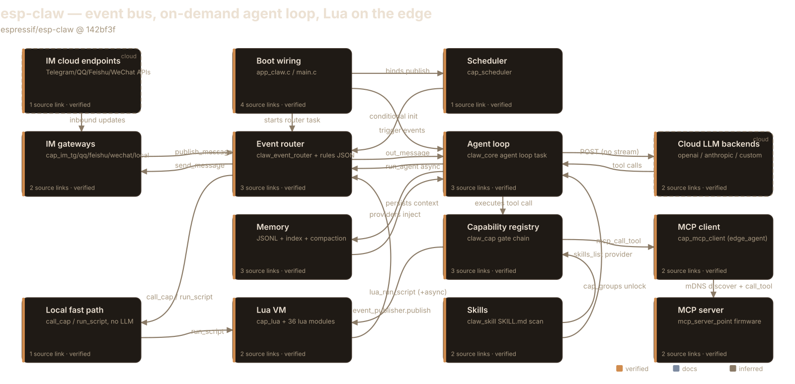
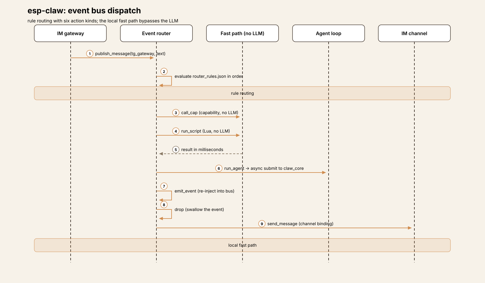
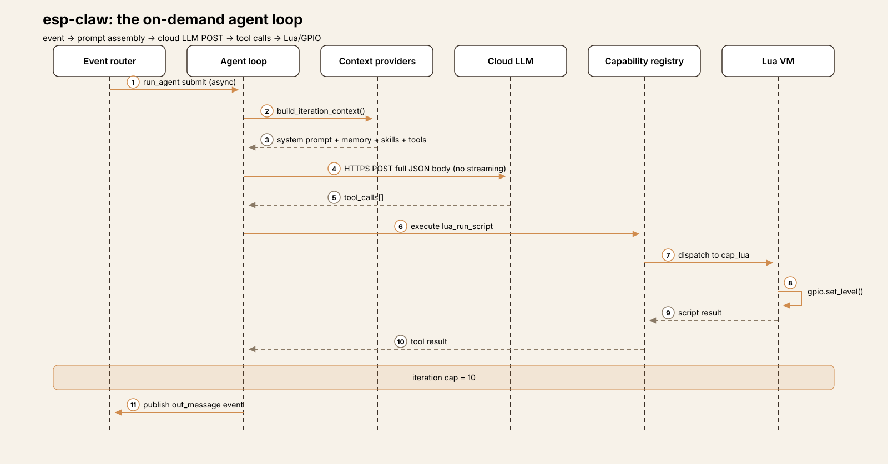
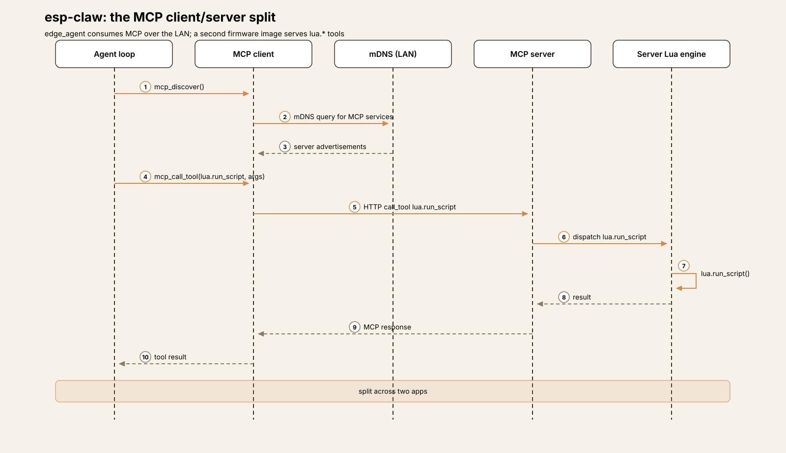
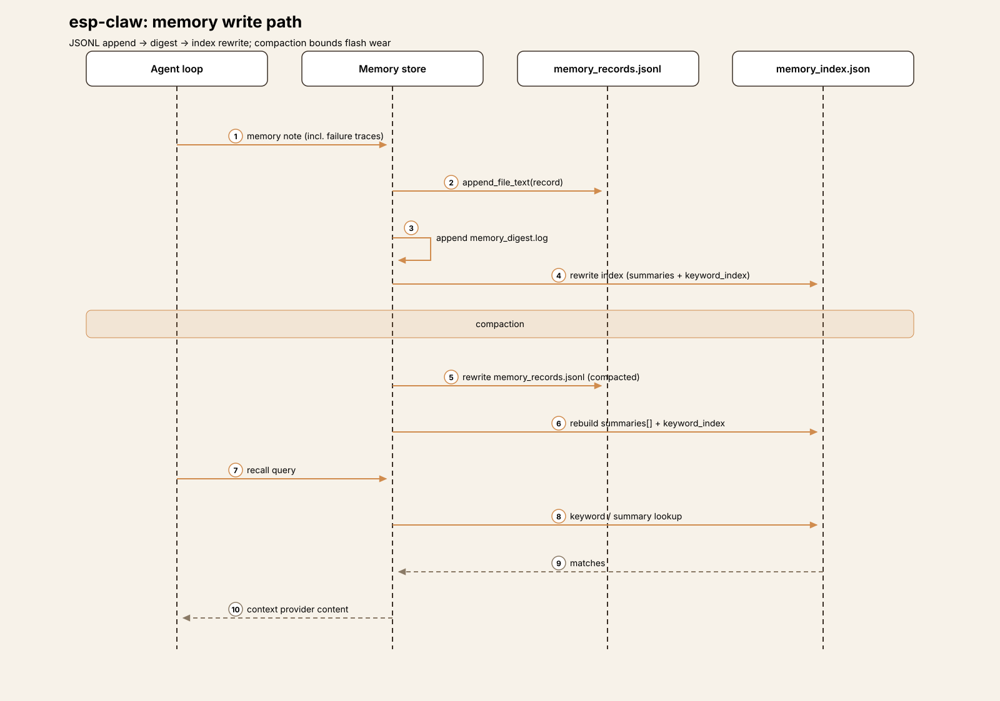
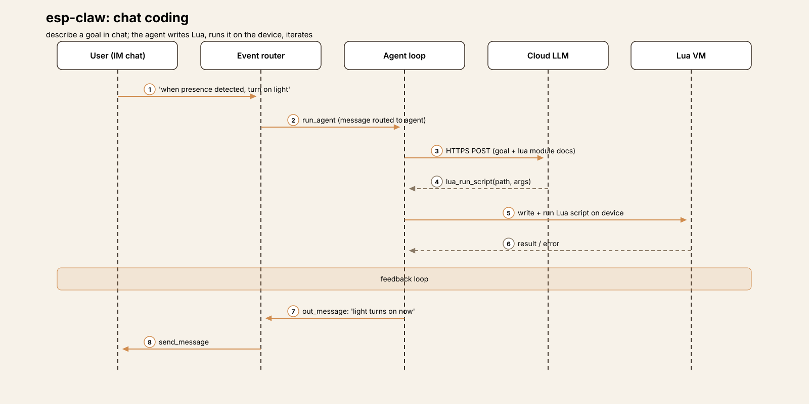

# Embedded Harness Anatomy E1: ESP-Claw — the agent loop that waits for an invitation

> **Series:** Embedded Harness Anatomy — top-down dissections of agent
> harnesses that run on microcontrollers, grounded in verifiable pinned
> firmware. Every behavioral claim below carries a footnote to a pinned
> GitHub permalink; the full evidence lives in the endnotes.

## Version block

- **Repo:** [espressif/esp-claw](https://github.com/espressif/esp-claw)
- **Pinned:** tag `v0.1.0` → `142bf3f318781708700aed51793a12ea47f46150` (2026-06-12)[^1]
- **Language:** C, on ESP-IDF (Espressif's IoT Development Framework —
  the SDK and build system for ESP32 chips). The docs require ESP-IDF
  v5.5.4 to build; the checked-in `sdkconfig.defaults` was generated under
  v5.5.1[^2][^3]
- **License:** Apache-2.0[^2]
- **Claim under test:** the reference design for this series — "Chat
  Coding": defining device behavior through conversation, completing the
  full loop of sensing, reasoning, decision-making, and execution on
  Espressif chips[^4]

Scale, for orientation: the recon surveyed roughly 557 source and doc
files under `components/`, `application/`, and `docs/src/content`. The big
files are `claw_event_router.c` (2,949 lines) and `claw_core_agent_loop.c`
(513 lines) — which already tells you where the complexity lives: the
event bus, then the agent loop[^5].

## Hardware block

ESP-Claw targets four ESP32-family SoCs (systems-on-chip — the
microcontroller plus radio plus memory interfaces on one die), with 30
board definitions in the tree:[^6]

| SoC | Boards | Notes |
|-----|--------|-------|
| ESP32-S3 | 17 | Primary target. Docs require **>= 8 MB flash + >= 8 MB PSRAM**[^7]; recommended board ESP32-S3-DevKitC-1, variant N8R8 (8 MB flash, 8 MB octal PSRAM) |
| ESP32-P4 | 7 | e.g. `esp32_p4_eye`: 16 MB QIO flash, hex SPIRAM clocked at 200 MHz[^8] |
| ESP32-C5 | 5 | e.g. DFRobot FireBeetle 2 C5 display board |
| ESP32-S31 | 1 | `esp32_s31_korvo1` |

Reference boards in the tree include the ESP32-S3-DevKitC-1 (plus N32R16V
and breadboard variants), ESP32-S3-Korvo-1, ESP-BOX-3, M5Stack CoreS3 /
StickS3 / Tab5, DFRobot FireBeetle 2 (S3/P4/C5), LilyGo T-Display S3/P4,
Waveshare ESP32-S3/P4 boards, ESP32-P4-EYE, ESP32-P4-Function-EV, Movecall
boards, and Nologo xingzhi_395[^6].

Flash layout is explicit: the tree ships `partitions_8MB.csv`,
`partitions_16MB.csv`, and `partitions_32MB.csv` partition tables, and the
S3 DevKitC-1 default build uses the 8 MB table[^9]. PSRAM (pseudo-static
RAM — an external RAM chip wired to the SoC, much larger than the
hundreds-of-KB internal SRAM but slower) is load-bearing: the prompt,
the Lua VM, and the TLS buffers all live or die by it. Internal SRAM
size is not stated in the repo's docs — marked [UNVERIFIED][^6].

Two logical filesystem roots are enforced everywhere: a read-only
`/system` (firmware-baked skills, Lua libraries, `.recovery` seed files)
and a writable DATA root (`/fatfs` on internal flash, or an SD card mount
when present) holding skills, router rules, scheduler state, sessions,
memory, and the inbox[^10].

## Harness concepts

A five-line box for embedded readers — the harness ideas this teardown
uses, translated to this device:

- **Turn loop:** there isn't one, as the primary construct. A fast event
  loop routes everything; a *separate* agent loop task runs only when an
  event is routed to it. The LLM is a service the router calls, not the
  driver of the system.
- **Tool dispatch:** the capability registry (`claw_cap`) — named
  descriptors (name, description, JSON input schema, C execute function).
  Before the model ever sees a tool, a six-check eligibility chain decides
  whether it is LLM-visible this session.
- **Approvals:** there are none. No approve/deny step exists anywhere in
  the code. Safety is architectural: per-session tool visibility,
  skill-scoped capability groups, an HTTP allowlist.
- **Memory:** on-chip and file-backed — append-only JSONL records, a
  keyword index, and compaction designed around flash wear, plus
  per-session histories and persona files.
- **Tools that move hardware:** three tiers — model calls C directly,
  model calls a Lua script that touches hardware, or a deterministic
  router rule / Lua callback acts with no LLM in the path at all.

## The mental model

ESP-Claw is a **reactive embedded system first and an agent second**. Every
input — an instant message, a schedule tick, a boot event, a Lua script
publishing an event — lands on an event bus. Router rules, evaluated in
file order, decide what happens next, and the fast paths (`call_cap`,
`run_script`, `send_message`, `drop`) complete in milliseconds with no LLM
involved. Only when a rule says `run_agent` (or the default route catches
an unmatched message) does the on-demand agent loop wake up, make HTTPS
calls to a cloud LLM, and publish its reply back onto the same bus[^11][^12].

The governing tradeoff is latency-shaped: the cloud round-trip takes
seconds, and an embedded device cannot stall its inputs for seconds. So
the architecture splits into two loops with two queues and one bus — a
millisecond local loop that never blocks on the model, and a seconds-long
cloud loop that the router submits to asynchronously and forgets about
until the reply arrives as just another event[^11][^13].

## Event model

The event shape is `claw_event_t`: fixed-size string buffers throughout
(`event_id[48]`, `source_cap[32]`, `chat_id[96]`, …) plus `int64_t
timestamp_ms` and two heap pointers (`text`, `payload_json`). The
embedded constraint is visible in the data structure itself — bounded
stack fields, unbounded content only where it can't be avoided[^14].

Publishing has three entry points: full events, IM-style text events, and
scheduler/boot-style triggers[^15]. Producers verified in code: the IM
gateways (Telegram publishes inbound text as `source_cap="tg_gateway"`,
attachments as `attachment_saved` events)[^15], the scheduler (which
builds events from schedule entries and calls the router's bound publish
function)[^16], Lua scripts (an `event_publisher` module with
`publish`/`publish_message`/`publish_trigger`)[^17], the boot sequence
(`startup`/`boot_completed`)[^18], the router itself (the `emit_event`
action re-injects events), `claw_core` (agent replies), and the
CLI/console and local web gateways[^15].

The router task blocks on a FreeRTOS queue with a 250 ms receive timeout,
skipping cancelled events via a pending-cancellation table; queue length,
task stack size, priority, and core affinity are all
configurable[^19]. Rules live in `router_rules/router_rules.json` on the
DATA root (recovery seed in the firmware image), and **rule order in the
file is evaluation order**[^20]. Match fields are `event_type`,
`event_key`, `source_cap`, `channel`, `chat_id`, `content_type`, and
`text`, with exact or prefix matching; prefix rules left-trim the text
and expose `{{match.remainder}}`, and `{{match.text}}`, `{{match.rule}}`,
and `{{event.*}}` templates render action inputs[^21].

Six action kinds exist:[^21]

| Kind | JSON `type` | Effect |
|------|-------------|--------|
| `CALL_CAP` | `call_cap` | Invoke a capability **without the LLM** |
| `RUN_AGENT` | `run_agent` | Async-submit to `claw_core` |
| `RUN_SCRIPT` | `run_script` | Run a Lua script (no LLM) |
| `SEND_MESSAGE` | `send_message` | Outbound IM via channel binding |
| `EMIT_EVENT` | `emit_event` | Re-inject a new event into the bus |
| `DROP` | `drop` | Swallow the event |

`run_agent` renders the rule's `input_json` against the event context,
builds an agent input with flags `PUBLISH_OUT_MESSAGE |
PUBLISH_STAGE_MESSAGE | SKIP_RESPONSE_QUEUE | USER_INTERRUPT`, and
submits it to the agent manager with a timeout — asynchronously, so the
router moves on immediately and the reply returns later as an
`out_message` event[^22]. When LLM settings are complete, a
`default_route_messages_to_agent` config sends unmatched messages to the
agent automatically[^23].

The seed rules show the idioms: `/session` and `/llm` prefix commands
dispatched straight to capabilities, an `im_any_message_working_reply`
rule that sends an immediate "working on it" reply before any other
handling (the latency UX for a seconds-long cloud loop), and a *disabled*
boot rule that would run a Lua script on startup with no LLM
involved[^24]. Rules are hot-manageable — add, update, delete, list, get
— and `cap_router_mgr` exposes that management surface as LLM-callable
tools, registered LLM-visible by default: the model can rewrite its own
routing[^25].

So "the loop" is actually two loops. The **event loop** drains the queue
and executes rules — millisecond-scale for every path that skips the
LLM, which is the source of the README's "Response can be as fast as
milliseconds" claim[^12]. The **agent loop** is a separate FreeRTOS task
blocking on its own request queue; each request runs the classic LLM
tool-call cycle, and only events whose rule says `run_agent` (or the
default route) ever enter it[^26].

Interrupts exist only as *user* interrupts *within* an in-flight agent
run: an insert queue is drained at four timing points in the loop —
before building iteration context, before the LLM HTTP call, inside an
aborted HTTP call, and after the LLM call before tool execution — so a
new user message (e.g. "Stop") can redirect the current iteration.
Interrupt sources are the CLI and the IM channels[^27].

## One event, end to end

The following is the representative path for a Telegram user typing
"turn on the light", assembled from the documented pieces — each hop
below is pinned, but this is a reconstruction of the flow, not a
recorded trace:

1. **Ingress.** `cap_im_tg` receives the message and publishes an inbound
   text event with `source_cap="tg_gateway"`[^15].
2. **Route.** The router task dequeues it and evaluates rules in file
   order. The seed's working-reply rule fires first ("working on it" goes
   back immediately, buying seconds for the cloud loop)[^24]. No command
   rule matches, so the default route submits the event to the agent with
   `run_agent`[^22][^23].
3. **Agent loop wakes.** `claw_core_agent_loop_task` takes the request off
   its queue[^26]. Context is built: the configured system prompt, plus one
   appended section per context provider (memory profile, long-term
   memory, session history, the skills list, the tool descriptors), plus a
   "Core Request" section carrying the triggering event's text and source
   metadata[^28]. Tools are serialized in OpenAI Responses-API format
   (`name` + `input_schema`)[^29].
4. **LLM call (the slow part).**

   A single blocking HTTPS POST carries the full JSON body — no
   streaming; the whole response is buffered then parsed[^30]. (If the
   LLM token was never configured, the loop short-circuits here with a
   user-facing "LLM API token is not configured…" message rather than
   failing silently[^31].) Mid-run, the loop publishes stage events —
   per-round notes and per-tool-call announcements — so the user sees
   progress like a typing indicator; verbosity is a Kconfig
   choice[^32].
5. **Tool call.** The model calls `lua_run_script`. The seed
   `light_switch` skill tells it exactly how: the script path
   `{CUR_SKILL_DIR}/scripts/led_strip_switch.lua` and the arg schema live
   in the skill's `SKILL.md`, so the model-to-hardware path is
   model -> Lua -> LED strip[^33]. The call executes against the
   capability registry, results are appended, the iteration counter
   increments, and a hard cap of 10 tool iterations bounds the
   loop[^34].
6. **Reply becomes an event.** On finish, the loop builds an `out_message`
   event (`source_cap="claw_core"`, `content_type="text"`, chat session
   policy, `correlation_id` set to the source message id) and publishes
   it back onto the bus; the router's rules `send_message` it through the
   outbound Telegram binding[^35]. **The agent's output is just another
   event.**

If the user sends "Stop" mid-run, the message feeds the insert queue and
is drained at one of the four timing points, redirecting the in-flight
iteration[^27].
## Subsystem inventory

### LLM backends (cloud-only)

**Compute placement: the LLM never runs on the chip.** All three backends
are HTTPS clients: an OpenAI-compatible backend (OpenAI Responses-style
API), an Anthropic backend (Messages API), and a custom backend for
user-supplied shapes[^36]. Presets cover DeepSeek (`deepseek-chat`),
OpenAI (`gpt-4o-mini`), Qwen (`qwen-plus` on the OpenAI-compatible
interface), and Anthropic (`claude-3-5-haiku-latest`), plus a `/llm setup
custom` command for arbitrary URL/model/token triples — all stored in NVS
(non-volatile storage: a small key-value flash partition ESP-IDF reserves
for settings)[^36].

Transport is a single blocking `esp_http_client_perform` POST of the full
JSON body — **no streaming**; the whole response is buffered, then
parsed[^30]. Context growth is bounded by session-size and message-char
limits, not by model context windows: a 4096-char per-message cap, a
150 KB session history size limit, and no token counting or prompt
truncation logic anywhere in `claw_core`[^37]. Whether any backend
enforces a `max-tokens` cap beyond the configurable `max_tokens` field in
the LLM config is [UNVERIFIED][^37].

The agent loop's core cycle: build iteration context -> HTTPS call ->
`tool_call_count == 0` means finalize (stage note, persist, break);
otherwise append the assistant tool-call message, execute each call
against `claw_cap`, append tool results, persist the round, and iterate
up to the 10-iteration cap, after which the loop errors with "cap tool
iteration limit reached"[^34]. Completion observers and context
persistence fire on success; on failure, a failure trace is persisted as
a memory note — **failures become memory**[^34].

### MCP as server AND client — split across two firmware images

The edge_agent app *consumes* MCP: `cap_mcp_client` registers
`mcp_list_tools`, `mcp_call_tool`, and `mcp_discover`, all callable by
the LLM, with discovery done over mDNS (multicast DNS — LAN service
discovery, no central registry) so the on-device agent can call tools on
remote MCP servers, e.g. a PC on the same network[^38].

The *server* side is a separate firmware image. `cap_mcp_server` has no
group registration and does not appear in edge_agent's capability table —
the docs' mention of it in the `app_claw` wiring is stale. Instead,
`application/mcp_server_point/` is its own app, built on
`espressif/mcp-c-sdk ^2.0.0` with HTTP transport and mDNS advertisement,
exposing six `lua.*` tools: `lua.run_script`, `lua.run_script_async`,
`lua.list_async_jobs`, `lua.get_async_job`, `lua.stop_async_job`, and
`lua.stop_all_async_jobs`[^39].

So the "server and client" story is real but spans two firmware images: a
second ESP32 (or the same board reflashed) serves Lua execution over MCP,
and the edge agent consumes it. One curiosity: `cap_mcp_client` is
LLM-invisible by default (it sits in the defaults-OFF group with the IM
groups and session manager), so the model can only reach remote MCP tools
when a session explicitly enables the group[^40].

### Lua scripting — not sandboxed, instruction-counted

Lua is the device's scripting layer and the model's favorite tool: 36
registered `lua_module_*`/`lua_driver_*` modules cover GPIO (direction,
level read/write), ADC, I2C, UART, MCPWM, pulse counters, RMT, touch
thresholds, plus high-level LED strip, button, knob, IMU, magnetometer,
environmental sensor, fuel gauge, camera, vision, audio, display/LVGL,
IR, BLE, and system modules (delay, thread, JSON, storage, HTTP
server)[^41].

Lua is **not language-sandboxed**: the VM is created with
`luaL_newstate()` + `luaL_openlibs()`, so scripts get the full Lua
standard library including `os`, `io`, and `debug`. Containment is by
*execution control*, not language restriction: an instruction-count hook
(`lua_sethook` with `LUA_MASKCOUNT` every 100 instructions) enforces
`timeout_ms` deadlines, and the exec-context pointer lives in the VM's
`LUA_EXTRASPACE` — unreachable from Lua even via `debug.getregistry()` —
so a script cannot disable its own timeout[^42]. JSON argument conversion
is depth-capped at 64 to protect the small Lua task stack[^42]. Async
runs support named jobs, `exclusive` mutex groups (e.g. `'display'`), and
`replace` takeover; hardware exists only through the registered native
modules, file access goes through the `storage` module's DATA-root
helpers, and writable scripts live only under `/fatfs/scripts/`[^42].

Two bridges make Lua a full citizen of the harness: `event_publisher`
lets scripts publish events onto the bus (`publish`, `publish_message`,
`publish_trigger`), and `capability.call(cap_name, payload_json)` lets
Lua invoke any capability — Lua runs as `CLAW_CAP_CALLER_SYSTEM`, so it
can call anything, including `lua_run_script` itself[^43]. Button, knob,
and touch callbacks stay inside the Lua VM (`button.on(...)` plus
`button.dispatch()` polling): local reactive behavior never needs to
round-trip through the event bus, and scripts bridge to the bus via
`event_publisher` only when they want agent or IM
involvement[^41]. `cap_lua` exposes the same engine to the model
(`lua_run_script` sync, `lua_run_script_async`, job list/get/tail/stop),
and the router's `run_script` action invokes it directly — the local fast
path with no LLM[^44].

### Memory: JSONL on flash, compaction for wear

Memory is on-chip and file-backed on the DATA root: `memory_records.jsonl`
(append-only structured records), `memory_index.json` (v3 index:
labeled, ref-counted summaries plus a keyword index), `memory_digest.log`
(append-only op digest), `MEMORY.md` (human-readable, read-only),
`soul.md`/`identity.md`/`user.md` (persona/profile), and per-session
JSONL histories under `sessions/<id>/`[^45].

The write path appends records and the digest, then rewrites the index —
append-only for the hot path, a full index rewrite for the derived
structure[^45]. Compaction is the flash-wear answer: flash (NAND) cells
degrade after roughly 10k–100k write cycles, so storage can't be treated
like a disk, and the design rewrites the records file once accumulated
writes since the last compaction reach a threshold. The exact threshold
value is [UNVERIFIED] — the recon's compaction section was truncated
mid-sentence at `write_changes_since_compact ≥`[^45].

Session history feeds the prompt through a dedicated context provider,
and the provider system caches per-request (`REQUEST_START_ONLY`) so
memory sections are assembled once per agent request, not once per
iteration[^28].

### Channels and ingress

Four IM capability groups — Telegram, QQ, Feishu, WeChat — plus
`cap_im_local` (a web gateway) and the serial CLI/console all publish
inbound text events onto the bus[^46]. Wi-Fi setup is STA (station —
the device joins your access point as a client) plus a SoftAP (software
access point — the device hosts its own network) for browser-based
configuration and offline operation; on Wi-Fi failure the boot sequence
logs and continues, because offline rules and Lua keep running[^18].
Outbound, `send_message` actions route through per-channel bindings —
the agent's `out_message` event is addressed to `target_channel` /
`target_chat_id` and the router delivers it[^35].

### Chat-coding: conversation -> Lua

ESP-Claw's headline idea, and the docs' own term: **Chat Coding**.
"Define device behavior through conversation," in the Vibe Coding
mold — no boilerplate, no compile-flash-debug loop for the common case.
The docs frame it as three principles: intent first, not syntax first
(describe the feature and how the user interacts with it); run first,
refine later (a working script beats a perfect architecture); and keep
the feedback loop, because chat coding is explicitly *not* "ask once and
get a perfect application"[^47].

Mechanically, chat-coding is the model writing Lua into the managed
script root (`/fatfs/scripts/`), invoked through `lua_run_script` /
`lua_run_script_async`, with skills carrying the arg schemas that make
the model's output well-formed (the `light_switch` pattern)[^33][^44].
The same docs page documents the escape hatch that makes the economics
work: router "custom shortcuts" that match an input and execute *without
waking the large model* — faster response and lower power
consumption[^47]. Conversation builds the behavior; deterministic rules
absorb the steady-state traffic.

Cloud skills extend the library at runtime: skills can be fetched and
installed after deployment, and a `skill_builder` component plus an
auto-generated `builtin_lua_modules` skill (Lua module docs and tests
bundled by a generator script) keep the model's picture of the hardware
surface current[^48].

## Extension points and update mechanism

The extension surface is layered by how hot it is:

- **Skills** (hot): `claw_skill` scans `/system/skills/` (firmware-baked)
  and `/fatfs/skills/` (user; wins on id conflict) for `SKILL.md`.
  Front-matter carries `cap_groups` — which capability groups the skill
  unlocks for the model — and `manage_mode` (`readonly` | `runtime`).
  Cloud skills can be fetched and installed at runtime[^48].
- **Router rules** (hot): add/update/delete/list/get over commands or the
  console, and — since `cap_router_mgr` is LLM-visible by default — by
  the model itself[^25].
- **Lua scripts** (hot): dropped into `/fatfs/scripts/`, run sync or as
  named async jobs with mutex groups[^44].
- **Configuration** (warm, needs reboot): NVS holds Wi-Fi, LLM, IM,
  search, and timezone settings; the LLM-visible and enabled capability
  groups are NVS-configurable, and sessions can override
  visibility[^36][^40]. Notably, the agent stack only starts when
  `llm_api_key`, `llm_model`, and `llm_backend_type` are all set —
  otherwise a warning is logged and agent features stay unavailable until
  configured and rebooted[^18].
- **Firmware** (cold): reflash. The documented paths are the web flasher
  and `idf.py flash monitor`; a tree-wide search of the pinned tag found
  no OTA (over-the-air) updater in the app code — `cap_system` exposes a
  restart capability, not an updater[^49]. The `/system/.recovery` seeds
  (router rules, skills) give every fresh flash sane defaults[^10].

## Tradeoffs

**No approval gate — safety is architectural.** Nothing in `claw_cap`,
`claw_core`, or the router implements approve/deny; once a tool is
LLM-visible the model may call it freely, bounded only by the 10-iteration
cap. The full extent of gating is the six-check eligibility chain, the
per-session LLM-visible sets, skill-scoped `cap_groups`, and an HTTP
allowlist[^40]. On a device whose tool calls move servos and write
GPIO pins, that is a deliberate bet: correctness comes from constraining
what the model can *see*, not from asking a human to confirm what it
*does*.

**No sleep modes in the app code.** A tree-wide search found no
deep-sleep or light-sleep API usage in the application or components —
ESP-Claw is an always-on FreeRTOS design: the router task blocks on its
queue with a 250 ms timeout, the agent task blocks on its request queue,
and Wi-Fi stays associated[^50][^19]. The proposal's power-envelope
dimension is the honest gap here: no current-draw numbers (mA) appear in
the repo, so the always-on budget is [UNVERIFIED] — the "lower power
consumption" claim for shortcuts is qualitative[^47].

**Offline means rules-without-LLM.** Wi-Fi failure is logged and the
device continues; the LLM loop short-circuits without a token; and every
rule action except `run_agent` needs no network at all[^18][^31]. The
degraded mode is coherent because the fast path was never the LLM path —
it was the rules and the Lua VM all along.

**Seconds, admitted.** The transport is a single blocking POST with the
entire response buffered — no streaming — so the cloud loop is measured
in seconds, and the architecture says so out loud: the seed "working"
reply, the stage-note events, the Kconfig verbosity switch are all UX
machinery for a slow loop[^30][^32]. The millisecond claim belongs
strictly to the local paths[^12].

**Memory budgets are chars and KB, not tokens.** 4096 chars per message,
150 KB of session history, fixed-size event buffers, no token counting —
context growth is bounded by what fits in RAM, not by what the model
accepts[^37][^14]. And the flash-wear answer is structural (append +
compact) rather than incidental[^45].

**Lua is powerful, not contained.** Full standard library, `os`/`io`/
`debug` included, `capability.call` reaching any capability as SYSTEM —
containment is the instruction-count timeout and the module allowlist, not
the language[^42][^43]. On a device with no MMU-based process isolation,
that is the honest shape of the sandbox: execution control, not language
restriction.
## Comparison row

**1. Compute placement — cloud-only.** The LLM never runs on the chip:
three HTTPS backends (OpenAI-compatible, Anthropic, custom), presets down
to `claude-3-5-haiku-latest` and `gpt-4o-mini`, config in NVS. Everything
downstream — the seconds-long loop, the offline story, the stage-note UX
— follows from this single placement decision[^36][^30].

**2. Power envelope — always-on, unmeasured.** No deep-sleep or
light-sleep API appears in the app code; the design is two FreeRTOS tasks
blocking on queues (the router's receive times out every 250 ms) with
Wi-Fi associated[^50][^19]. No current-draw numbers appear in the repo, so
the always-on budget is [UNVERIFIED] — the "lower power consumption" of
shortcuts is qualitative, and the recon found no mA figures to pin[^47].

**3. Connectivity dependence — degraded by design.** Offline, the device
is rules-without-LLM: router actions, Lua scripts, and the scheduler need
no network; the agent loop short-circuits without a token; Wi-Fi failure
is logged, not fatal[^18][^31]. The graceful part is that the fast path
was never the network path — shortcuts are documented as executing
"without waking the large model"[^47].

**4. Event model — bus first, loop on demand.** The primary construct is
an event bus with ordered rules and six action kinds; the turn loop
exists as a separate task that only runs when routed to, and its output
is just another event on the bus[^21][^13]. Desktop harnesses are turn
loops with interrupts bolted on; here the interrupts (messages, schedule
ticks, boot) *are* the architecture and the loop is the attachment.

**5. Sensor/actuator interface — three tiers to the physical world.**
Model-to-C for native capabilities, model-to-Lua-script for hardware
through 36 registered modules (GPIO, ADC, I2C, touch, LED strip, camera,
BLE…), and deterministic router rules or Lua-local callbacks that skip
the LLM entirely[^41][^44][^33]. Remote tools arrive over mDNS-discovered
MCP, consumed by one firmware image and served by another[^38][^39].

**6. Model footprint — the prompt is the footprint.** No model lives on
device, so there is no quantization story; the footprint question is how
many KB of PSRAM the prompt fits in. The answer is schema: 4096 chars per
message, 150 KB of session history, fixed-size event buffers, no token
counting anywhere[^37][^14].

**7. Memory architecture — JSONL on flash, wear-aware.** Append-only
records plus digest, a rewritten v3 keyword index, per-session histories,
and compaction that rewrites the records file once accumulated writes
cross a threshold — the threshold value itself is [UNVERIFIED], the recon
was truncated mid-sentence at it[^45]. Persona and profile files
(`soul.md`, `identity.md`, `user.md`) ride along in the same tree.

**8. Update mechanism — reflash for firmware, chat for behavior.**
Firmware updates are a reflash (web flasher or `idf.py flash monitor`); no
OTA updater exists in the app code[^49]. Above that cold layer, behavior
is hot: user skills on `/fatfs`, router rules the model itself can
rewrite, Lua scripts dropped into the managed root — and chat-coding,
conversation that compiles down to running Lua, as the genuinely novel
update path[^48][^25][^44][^47].

**9. Real-time constraints — milliseconds local, seconds admitted.**
Router-rule and Lua paths are millisecond-scale (the README's claim);
the cloud loop is seconds, bridged by an immediate working-reply and
mid-run stage notes[^12][^32]. Lua scripts get instruction-count
timeouts, and user interrupts drain at four timing points inside an
in-flight run[^42][^27].

**10. Failure & safety — architecture, not interaction.** No approval
gate; the model is bounded by the 10-iteration cap and by what it can
see, and failure traces are persisted as memory notes[^40][^34]. Lua runs
unsandboxed-as-a-language with execution-control containment, and every
tool call can move real hardware — while API keys sit in NVS flash, the
credential-handling callout this dimension demands[^42][^36].

## What transfers

**What embedded teaches harness design.** The on-demand agent loop is the
big one: desktop harnesses make the LLM the driver and bolt on
interrupts; ESP-Claw makes the event bus the driver and calls the LLM as
a service, which is why its degraded mode is coherent instead of a
special case. Visibility gating as a safety mechanism — constraining what
the model can see rather than asking a human to confirm what it does —
deserves a hearing in desktop harnesses that currently gate everything
through approve/deny dialogs. And failures-as-memory (persist the failure
trace as a note, not just a log line) is a small idea any harness can
steal.

**What harness design teaches embedded.** The capability registry's
eligibility chain shows how to make "which tools exist right now" a
first-class, session-scoped decision instead of a compile-time one. Skills
as capability-scoped packages (front-matter declaring exactly which tool
groups a skill unlocks) are a cleaner extension contract than dropping
scripts in a directory. And the memory subsystem — structured records,
keyword index, wear-aware compaction — is what "logging to flash" grows
up into when an agent has to remember across reboots.

## Endnotes

[^1]: Pinned tag `v0.1.0` (2026-06-12), commit
`142bf3f318781708700aed51793a12ea47f46150`:
<https://github.com/espressif/esp-claw/tree/142bf3f318781708700aed51793a12ea47f46150>
[^2]: C sources under `components/`:
<https://github.com/espressif/esp-claw/blob/142bf3f318781708700aed51793a12ea47f46150/components>;
license: <https://github.com/espressif/esp-claw/blob/142bf3f318781708700aed51793a12ea47f46150/LICENSE>
[^3]: Build docs require ESP-IDF v5.5.4:
<https://github.com/espressif/esp-claw/blob/142bf3f318781708700aed51793a12ea47f46150/docs/src/content/docs/en/reference-project/build-from-source.mdx#L21-L22>;
the checked-in `application/edge_agent/sdkconfig.defaults` header records
generation under ESP-IDF 5.5.1.
[^4]: "ESP-Claw is a Chat Coding AI agent framework for IoT devices… the
full loop of sensing, reasoning, decision-making, and execution locally
on Espressif chips":
<https://github.com/espressif/esp-claw/blob/142bf3f318781708700aed51793a12ea47f46150/docs/src/content/docs/en/tutorial/index.mdx#L16>
[^5]: `claw_event_router.c` (2,949 lines):
<https://github.com/espressif/esp-claw/blob/142bf3f318781708700aed51793a12ea47f46150/components/claw_modules/claw_event_router/src/claw_event_router.c>;
`claw_core_agent_loop.c` (513 lines):
<https://github.com/espressif/esp-claw/blob/142bf3f318781708700aed51793a12ea47f46150/components/claw_modules/claw_core/src/claw_core_agent_loop.c>
[^6]: Board tree (17 ESP32-S3, 7 ESP32-P4, 5 ESP32-C5, 1 ESP32-S31; 30
board definitions total; recommended ESP32-S3-DevKitC-1 variant N8R8;
reference boards listed):
<https://github.com/espressif/esp-claw/tree/142bf3f318781708700aed51793a12ea47f46150/application/edge_agent/boards>.
Internal SRAM size is not stated in the repo — [UNVERIFIED].
[^7]: Minimum 8 MB flash + 8 MB PSRAM for ESP32-S3:
<https://github.com/espressif/esp-claw/blob/142bf3f318781708700aed51793a12ea47f46150/docs/src/content/docs/en/tutorial/bom.mdx>
[^8]: `esp32_p4_eye`: 16 MB QIO flash, hex SPIRAM at 200 MHz:
<https://github.com/espressif/esp-claw/blob/142bf3f318781708700aed51793a12ea47f46150/application/edge_agent/boards/espressif/esp32_p4_eye/sdkconfig.defaults.board>
[^9]: Partition tables `partitions_8MB.csv` / `16MB` / `32MB`; S3
DevKitC-1 default build selects the 8 MB table via
`CONFIG_PARTITION_TABLE_CUSTOM_FILENAME`:
<https://github.com/espressif/esp-claw/blob/142bf3f318781708700aed51793a12ea47f46150/application/edge_agent/partitions_8MB.csv>
[^10]: Runtime path rules (`/system` read-only vs DATA root writable):
<https://github.com/espressif/esp-claw/blob/142bf3f318781708700aed51793a12ea47f46150/AGENTS.md>
[^11]: Router task drains the queue and evaluates rules; `run_agent`
submits asynchronously to the agent manager:
<https://github.com/espressif/esp-claw/blob/142bf3f318781708700aed51793a12ea47f46150/components/claw_modules/claw_event_router/src/claw_event_router.c#L2258-L2285>,
<https://github.com/espressif/esp-claw/blob/142bf3f318781708700aed51793a12ea47f46150/components/claw_modules/claw_event_router/src/claw_event_router.c#L1795>
[^12]: "Response can be as fast as milliseconds" (local paths):
<https://github.com/espressif/esp-claw/blob/142bf3f318781708700aed51793a12ea47f46150/README.md#L63>
[^13]: Separate agent-loop task on its own request queue; agent output
published back as an `out_message` event:
<https://github.com/espressif/esp-claw/blob/142bf3f318781708700aed51793a12ea47f46150/components/claw_modules/claw_core/src/claw_core_agent_loop.c#L136>,
<https://github.com/espressif/esp-claw/blob/142bf3f318781708700aed51793a12ea47f46150/components/claw_modules/claw_core/src/claw_core_events.c#L173>
[^14]: `claw_event_t`, fixed-size buffers:
<https://github.com/espressif/esp-claw/blob/142bf3f318781708700aed51793a12ea47f46150/components/claw_modules/claw_event_router/include/claw_event.h#L15-L34>
[^15]: Publish entry points and the Telegram inbound publisher:
<https://github.com/espressif/esp-claw/blob/142bf3f318781708700aed51793a12ea47f46150/components/claw_modules/claw_event_router/include/claw_event_publisher.h#L20-L26>,
<https://github.com/espressif/esp-claw/blob/142bf3f318781708700aed51793a12ea47f46150/components/claw_capabilities/cap_im_platform/src/cap_im_tg.c#L252-L261>
[^16]: Scheduler builds events from schedule entries:
<https://github.com/espressif/esp-claw/blob/142bf3f318781708700aed51793a12ea47f46150/components/claw_capabilities/cap_scheduler/src/cap_scheduler.c#L426-L519>
[^17]: Lua `event_publisher` module (string form sets
`source_cap="lua_script"` automatically):
<https://github.com/espressif/esp-claw/blob/142bf3f318781708700aed51793a12ea47f46150/components/lua_modules/lua_module_event_publisher/README.md>
[^18]: Boot brings up the agent stack and publishes
`startup`/`boot_completed`; Wi-Fi failure logs and continues (offline
rules/Lua keep running); the agent stack only starts when
`llm_api_key`, `llm_model`, and `llm_backend_type` are all set:
<https://github.com/espressif/esp-claw/blob/142bf3f318781708700aed51793a12ea47f46150/components/common/app_claw/app_claw.c#L285-L290>,
<https://github.com/espressif/esp-claw/blob/142bf3f318781708700aed51793a12ea47f46150/application/edge_agent/main/main.c#L360-L370>
[^19]: Router task config (queue length, stack, priority, core):
<https://github.com/espressif/esp-claw/blob/142bf3f318781708700aed51793a12ea47f46150/components/claw_modules/claw_event_router/src/claw_event_router.c#L2258-L2285>,
<https://github.com/espressif/esp-claw/blob/142bf3f318781708700aed51793a12ea47f46150/components/claw_modules/claw_event_router/src/claw_event_router.c#L2335>
[^20]: Rules live in `router_rules/router_rules.json`; file order is
evaluation order; seed recovery copy in the firmware image:
<https://github.com/espressif/esp-claw/blob/142bf3f318781708700aed51793a12ea47f46150/docs/src/content/docs/en/reference-project/dataflow-and-automation.mdx>,
<https://github.com/espressif/esp-claw/blob/142bf3f318781708700aed51793a12ea47f46150/application/edge_agent/fatfs_image/system/.recovery/router_rules/router_rules.json>
[^21]: Six action kinds, match fields, exact/prefix text matching:
<https://github.com/espressif/esp-claw/blob/142bf3f318781708700aed51793a12ea47f46150/components/claw_modules/claw_event_router/include/claw_event_router.h#L55-L62>,
<https://github.com/espressif/esp-claw/blob/142bf3f318781708700aed51793a12ea47f46150/components/claw_modules/claw_event_router/include/claw_event_router.h#L69-L78>,
<https://github.com/espressif/esp-claw/blob/142bf3f318781708700aed51793a12ea47f46150/components/claw_modules/claw_event_router/include/claw_event_router.h#L45-L52>
[^22]: `run_agent` renders `input_json` and submits with
`PUBLISH_OUT_MESSAGE | PUBLISH_STAGE_MESSAGE | SKIP_RESPONSE_QUEUE |
USER_INTERRUPT`:
<https://github.com/espressif/esp-claw/blob/142bf3f318781708700aed51793a12ea47f46150/components/claw_modules/claw_event_router/src/claw_event_router.c#L1739-L1830>
[^23]: `default_route_messages_to_agent`:
<https://github.com/espressif/esp-claw/blob/142bf3f318781708700aed51793a12ea47f46150/components/claw_modules/claw_event_router/include/claw_event_router.h#L35>
[^24]: Seed rules (`/session`, `/llm`, working-reply, disabled boot Lua
rule):
<https://github.com/espressif/esp-claw/blob/142bf3f318781708700aed51793a12ea47f46150/application/edge_agent/fatfs_image/system/.recovery/router_rules/router_rules.json>
[^25]: Rule hot-management API; `cap_router_mgr` LLM-visible by default:
<https://github.com/espressif/esp-claw/blob/142bf3f318781708700aed51793a12ea47f46150/components/claw_modules/claw_event_router/include/claw_event_router.h#L105-L125>,
<https://github.com/espressif/esp-claw/blob/142bf3f318781708700aed51793a12ea47f46150/components/common/app_claw/app_capabilities.c#L726>
[^26]: Agent loop task and request queue:
<https://github.com/espressif/esp-claw/blob/142bf3f318781708700aed51793a12ea47f46150/components/claw_modules/claw_core/src/claw_core_agent_loop.c#L101-L136>
[^27]: User interrupts drained at four timing points:
<https://github.com/espressif/esp-claw/blob/142bf3f318781708700aed51793a12ea47f46150/components/claw_modules/claw_core/src/claw_core_agent_loop.c#L19-L99>
[^28]: Iteration context: system prompt + one section per context provider
(+ per-provider logging), `REQUEST_START_ONLY` caching, Core Request
section:
<https://github.com/espressif/esp-claw/blob/142bf3f318781708700aed51793a12ea47f46150/components/claw_modules/claw_core/src/claw_core_context.c#L473-L610>,
<https://github.com/espressif/esp-claw/blob/142bf3f318781708700aed51793a12ea47f46150/components/claw_modules/claw_core/src/claw_core_context.c#L505-L529>
[^29]: Tools serialized in OpenAI Responses-API format:
<https://github.com/espressif/esp-claw/blob/142bf3f318781708700aed51793a12ea47f46150/components/claw_modules/claw_cap/src/claw_cap.c#L337-L400>
[^30]: Single blocking POST, no streaming, full response buffered:
<https://github.com/espressif/esp-claw/blob/142bf3f318781708700aed51793a12ea47f46150/components/claw_modules/claw_core/src/claw_llm_http_transport.c#L266-L376>
[^31]: "LLM API token is not configured…" short-circuit:
<https://github.com/espressif/esp-claw/blob/142bf3f318781708700aed51793a12ea47f46150/components/claw_modules/claw_core/src/claw_core_llm.c#L92-L115>
[^32]: Per-round and per-tool-call stage notes; Kconfig verbosity:
<https://github.com/espressif/esp-claw/blob/142bf3f318781708700aed51793a12ea47f46150/components/claw_modules/claw_core/src/claw_core_agent_loop.c#L334>,
<https://github.com/espressif/esp-claw/blob/142bf3f318781708700aed51793a12ea47f46150/components/claw_modules/claw_core/src/claw_core_agent_loop.c#L362>
[^33]: `light_switch` skill pins the script path and arg schema:
<https://github.com/espressif/esp-claw/blob/142bf3f318781708700aed51793a12ea47f46150/application/edge_agent/fatfs_image/storage/skills/light_switch/SKILL.md>
[^34]: Tool-call cycle, 10-iteration cap, failure traces persisted as
memory notes:
<https://github.com/espressif/esp-claw/blob/142bf3f318781708700aed51793a12ea47f46150/components/claw_modules/claw_core/src/claw_core_agent_loop.c#L318-L491>,
<https://github.com/espressif/esp-claw/blob/142bf3f318781708700aed51793a12ea47f46150/components/claw_modules/claw_core/src/claw_core_internal.h#L33>
[^35]: `out_message` event construction and publish:
<https://github.com/espressif/esp-claw/blob/142bf3f318781708700aed51793a12ea47f46150/components/claw_modules/claw_core/src/claw_core_events.c#L62-L91>,
<https://github.com/espressif/esp-claw/blob/142bf3f318781708700aed51793a12ea47f46150/components/claw_modules/claw_core/src/claw_core_events.c#L156-L173>
[^36]: Three HTTPS backends; presets (DeepSeek/OpenAI/Qwen/Anthropic) and
custom setup; config in NVS:
<https://github.com/espressif/esp-claw/tree/142bf3f318781708700aed51793a12ea47f46150/components/claw_modules/claw_core/src/llm/backends>,
<https://github.com/espressif/esp-claw/blob/142bf3f318781708700aed51793a12ea47f46150/components/claw_capabilities/cap_llm_config/src/cap_llm_config.c#L40-L112>
[^37]: 4096-char message cap, 150 KB session history limit, no token
counting:
<https://github.com/espressif/esp-claw/blob/142bf3f318781708700aed51793a12ea47f46150/components/claw_modules/claw_memory/src/claw_memory_internal.h#L22-L30>.
Whether any backend enforces `max-tokens` beyond the configurable
`max_tokens` field — [UNVERIFIED].
[^38]: MCP client tools and mDNS discovery:
<https://github.com/espressif/esp-claw/blob/142bf3f318781708700aed51793a12ea47f46150/components/claw_capabilities/cap_mcp_client/src/cap_mcp_client.c#L230-L252>,
<https://github.com/espressif/esp-claw/blob/142bf3f318781708700aed51793a12ea47f46150/components/claw_capabilities/cap_mcp_client/src/cap_mcp_discover_core.c#L72-L101>
[^39]: Server is the separate `mcp_server_point` app
(`espressif/mcp-c-sdk ^2.0.0`, HTTP + mDNS); `cap_mcp_server` has no
group registration in edge_agent's capability table; six `lua.*` tools:
<https://github.com/espressif/esp-claw/blob/142bf3f318781708700aed51793a12ea47f46150/components/claw_capabilities/cap_mcp_server/idf_component.yml#L4>,
<https://github.com/espressif/esp-claw/blob/142bf3f318781708700aed51793a12ea47f46150/components/claw_capabilities/cap_mcp_server/include/cap_mcp_server.h#L54-L55>,
<https://github.com/espressif/esp-claw/blob/142bf3f318781708700aed51793a12ea47f46150/components/common/app_claw/app_capabilities.c#L681-L789>,
<https://github.com/espressif/esp-claw/blob/142bf3f318781708700aed51793a12ea47f46150/application/mcp_server_point/components/mcp_server_point_tools/cap_mcp_lua.c#L270-L316>
[^40]: Six-check tool eligibility chain and per-session LLM-visible sets
(defaults ON/OFF, NVS-configurable, session-overridable); **no
approve/deny gate exists** — the eligibility chain is the full extent of
tool gating:
<https://github.com/espressif/esp-claw/blob/142bf3f318781708700aed51793a12ea47f46150/components/claw_modules/claw_cap/src/claw_cap.c#L605-L650>,
<https://github.com/espressif/esp-claw/blob/142bf3f318781708700aed51793a12ea47f46150/components/claw_modules/claw_cap/include/claw_cap.h#L33>,
<https://github.com/espressif/esp-claw/blob/142bf3f318781708700aed51793a12ea47f46150/components/common/app_claw/app_capabilities.c#L681-L732>,
<https://github.com/espressif/esp-claw/blob/142bf3f318781708700aed51793a12ea47f46150/components/common/app_claw/app_capabilities.c#L821-L858>
[^41]: 36 Lua modules (GPIO, ADC, I2C, touch, LED strip, button, camera,
BLE…); button callbacks stay in the VM:
<https://github.com/espressif/esp-claw/tree/142bf3f318781708700aed51793a12ea47f46150/components/lua_modules>,
<https://github.com/espressif/esp-claw/blob/142bf3f318781708700aed51793a12ea47f46150/components/lua_modules/lua_driver_gpio/src/lua_driver_gpio.c#L72-L86>,
<https://github.com/espressif/esp-claw/blob/142bf3f318781708700aed51793a12ea47f46150/components/lua_modules/lua_module_button/README.md#L8-L11>
[^42]: Full stdlib VM (`luaL_newstate` + `luaL_openlibs`); instruction-count
timeout hook; exec context in `LUA_EXTRASPACE` (unreachable from Lua);
JSON depth cap 64:
<https://github.com/espressif/esp-claw/blob/142bf3f318781708700aed51793a12ea47f46150/components/claw_capabilities/cap_lua/src/cap_lua_runtime.c#L426-L446>,
<https://github.com/espressif/esp-claw/blob/142bf3f318781708700aed51793a12ea47f46150/components/claw_capabilities/cap_lua/src/cap_lua_runtime.c#L62-L87>
[^43]: Lua bridges back: `event_publisher` and `capability.call` as
`CLAW_CAP_CALLER_SYSTEM`:
<https://github.com/espressif/esp-claw/blob/142bf3f318781708700aed51793a12ea47f46150/components/lua_modules/lua_module_call_capability/src/lua_module_capability.c#L249-L335>
[^44]: `cap_lua` tools (sync/async run, job list/get/tail/stop); scripts
under `/fatfs/scripts/`; router `run_script` is the LLM-free path:
<https://github.com/espressif/esp-claw/blob/142bf3f318781708700aed51793a12ea47f46150/components/claw_capabilities/cap_lua/src/cap_lua.c#L683-L771>,
<https://github.com/espressif/esp-claw/blob/142bf3f318781708700aed51793a12ea47f46150/docs/src/content/docs/en/reference-project/lua.mdx>
[^45]: Memory files, append write path, index rewrite, and compaction as
the flash-wear answer:
<https://github.com/espressif/esp-claw/blob/142bf3f318781708700aed51793a12ea47f46150/components/claw_modules/claw_memory/src/claw_memory_internal.h#L39-L47>,
<https://github.com/espressif/esp-claw/blob/142bf3f318781708700aed51793a12ea47f46150/components/claw_modules/claw_memory/src/claw_memory_storage.c#L478>,
<https://github.com/espressif/esp-claw/blob/142bf3f318781708700aed51793a12ea47f46150/components/claw_modules/claw_memory/src/claw_memory_storage.c#L605>,
<https://github.com/espressif/esp-claw/blob/142bf3f318781708700aed51793a12ea47f46150/components/claw_modules/claw_memory/src/claw_memory_storage.c#L135>.
The exact `write_changes_since_compact` threshold is [UNVERIFIED] — the
recon's compaction section ends mid-sentence.
[^46]: IM gateways (Telegram, QQ, Feishu, WeChat) and the local web
gateway:
<https://github.com/espressif/esp-claw/tree/142bf3f318781708700aed51793a12ea47f46150/components/claw_capabilities/cap_im_platform/src>
[^47]: Chat Coding tutorial (intent-first, run-first, feedback loop) and
shortcuts that execute "without waking the large model":
<https://github.com/espressif/esp-claw/blob/142bf3f318781708700aed51793a12ea47f46150/docs/src/content/docs/en/tutorial/first-interactions.mdx#L149-L215>,
<https://github.com/espressif/esp-claw/blob/142bf3f318781708700aed51793a12ea47f46150/docs/src/content/docs/en/tutorial/first-interactions.mdx#L126>
[^48]: Skill scanning, `cap_groups` front-matter, `manage_mode`, cloud
skills, `skill_builder`, auto-generated `builtin_lua_modules` skill:
<https://github.com/espressif/esp-claw/blob/142bf3f318781708700aed51793a12ea47f46150/components/claw_modules/claw_skill/src/claw_skill.c#L24>,
<https://github.com/espressif/esp-claw/blob/142bf3f318781708700aed51793a12ea47f46150/components/claw_modules/claw_skill/src/claw_skill.c#L703>,
<https://github.com/espressif/esp-claw/tree/142bf3f318781708700aed51793a12ea47f46150/components/common/skill_builder>
[^49]: Firmware updates are reflash (web flasher; `idf.py flash monitor`);
no OTA updater found in the app code at this tag; `cap_system` exposes
restart:
<https://github.com/espressif/esp-claw/blob/142bf3f318781708700aed51793a12ea47f46150/docs/src/content/docs/en/tutorial/get-started.mdx#L23-L35>,
<https://github.com/espressif/esp-claw/blob/142bf3f318781708700aed51793a12ea47f46150/docs/src/content/docs/en/reference-project/build-from-source.mdx#L84-L88>,
<https://github.com/espressif/esp-claw/blob/142bf3f318781708700aed51793a12ea47f46150/components/claw_capabilities/cap_system/src/cap_system.c#L38>
[^50]: No `deep_sleep`/`light_sleep` API usage found in a tree-wide search
of the pinned tag — the design is always-on FreeRTOS.
