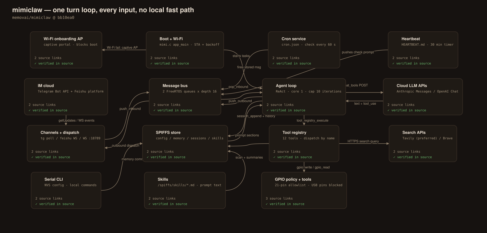
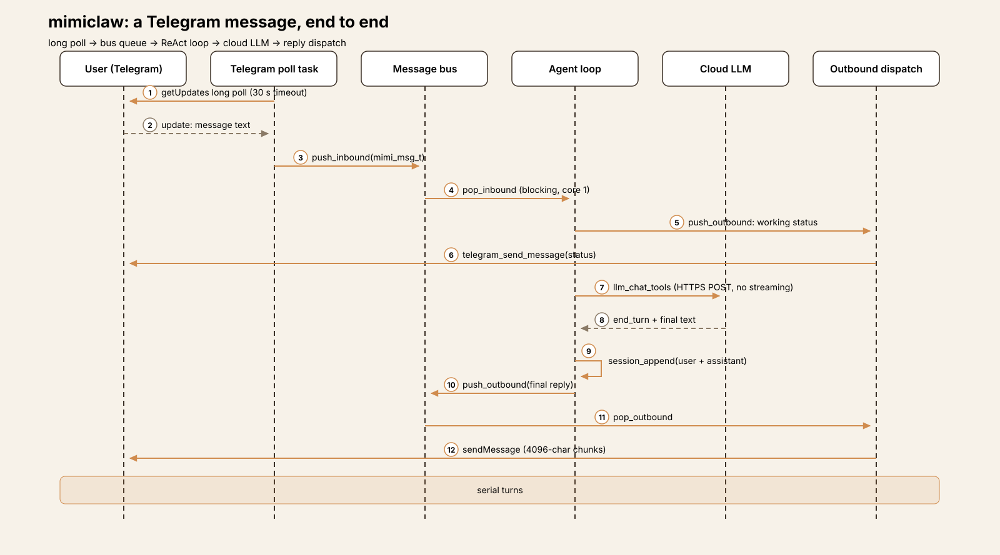
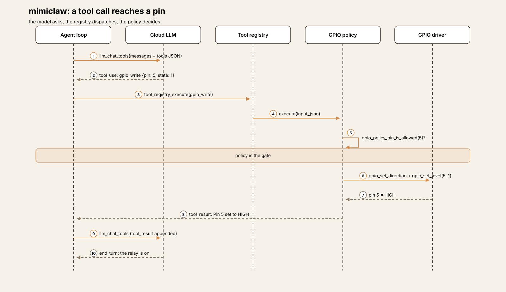
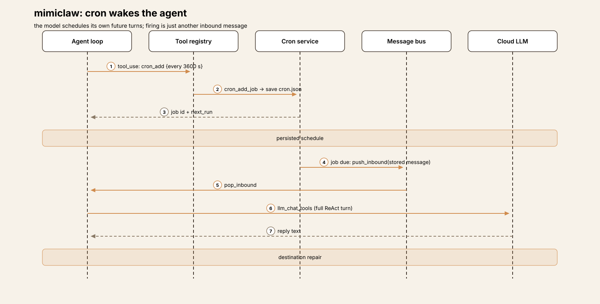
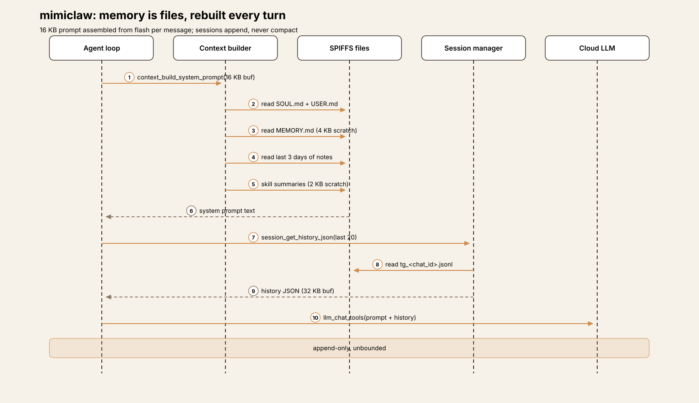
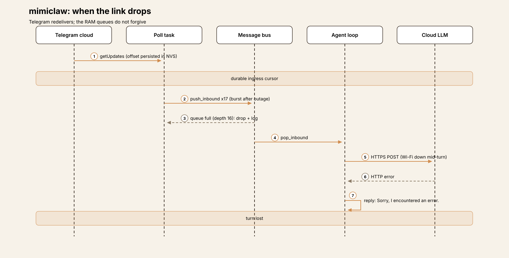

# Embedded Harness Anatomy E2: MimiClaw — the turn loop that moved onto the chip

> **Series:** Embedded Harness Anatomy — top-down dissections of agent
> harnesses that run on microcontrollers, grounded in verifiable pinned
> firmware. Every behavioral claim below carries a footnote to a pinned
> GitHub permalink; the full evidence lives in the endnotes.

## Version block

- **Repo:** [memovai/mimiclaw](https://github.com/memovai/mimiclaw)
- **Pinned:** tag `v0.1.1` → `bb10ea0149080d506d920c09054f4c5b20409de2` (2026-03-17)[^1]
- **Language:** C, on ESP-IDF (Espressif's IoT Development Framework —
  the SDK and build system for ESP32 chips) with FreeRTOS tasks. The
  component manifest requires ESP-IDF `>=5.5.0,<5.6.0`[^2]
- **License:** MIT[^3]
- **Claim under test:** "The world's first AI assistant (OpenClaw) on a
  $5 chip. No Linux. No Node.js. Just pure C" — a personal assistant
  you message on Telegram, with an agent loop, tools, local memory,
  cron jobs, and heartbeats, all running on one ESP32-S3[^4]

One clarification before anything else, because the name invites the
wrong picture: **MimiClaw is not a client of an OpenClaw gateway.**
Nothing in the tree speaks an OpenClaw protocol, pairs with a host, or
offloads the loop. The README's own acknowledgment is the accurate
framing — "Inspired by OpenClaw and Nanobot. MimiClaw reimplements the
core AI agent architecture for embedded hardware"[^5]. The gateway,
the loop, the tools, and the memory all live on the microcontroller;
the only things in the cloud are the model API and the messaging
platforms. Where E1 (ESP-Claw) dissolved the turn loop into an event
bus, MimiClaw does the opposite: it takes the desktop turn loop —
the OpenClaw/Nanobot shape — and transplants it, intact, onto bare
metal.

Scale, for orientation: the tree is 96 files; the firmware is roughly
7,748 lines of C under `main/`. The big files are `serial_cli.c`
(1,083 lines), `feishu_bot.c` (991), and `llm_proxy.c` (811) — which
already tells you where the complexity lives: the operator console,
the second messaging channel, and the model client. The agent loop
itself is 362 lines[^6].

## Hardware block

MimiClaw targets exactly one SoC (system-on-chip — the microcontroller
plus radio plus memory interfaces on one die): the **ESP32-S3**. The
checked-in target config sets 16 MB QIO flash, 8 MB octal PSRAM
(pseudo-static RAM — an external RAM chip wired to the SoC, much
larger than the internal SRAM but slower) clocked at 80 MHz, and a
240 MHz CPU clock[^7]. The README's board requirement matches: an
ESP32-S3 dev board with 16 MB flash and 8 MB PSRAM[^8]. The GPIO
policy header adds a board-level detail — its pin allowlist is tuned
for the ESP32-S3-LCD-1.47B's safe user-accessible pins[^9].

Flash layout is a single partition table, `partitions.csv`:

| Offset | Size | Name | Purpose |
|--------|------|------|---------|
| 0x009000 | 24 KB | nvs | Settings (Wi-Fi, keys, config) |
| 0x00F000 | 8 KB | otadata | OTA boot state |
| 0x020000 | 2 MB | ota_0 | Firmware slot A |
| 0x220000 | 2 MB | ota_1 | Firmware slot B |
| 0x420000 | ~11.8 MB | spiffs | Memory, sessions, config, skills |
| 0xFF0000 | 64 KB | coredump | Crash dump storage |

[^10]

The SPIFFS image is not formatted on first boot in the normal path —
it is built from the `spiffs_data/` directory at build time and
flashed with the firmware, which is how the seed persona, memory, and
skill files arrive on the device[^11]. Internal SRAM size is not
stated as a budget number in the repo; the architecture doc instead
budgets task stacks (~40 KB), Wi-Fi buffers, and PSRAM allocations for
TLS, JSON, session, prompt, and response buffers[^12].

## Harness concepts

A five-line box for embedded readers — the harness ideas this teardown
uses, translated to this device:

- **Turn loop:** there is one, and it is the product. A single
  FreeRTOS task pops messages from a queue and runs the classic
  ReAct cycle — build prompt, call the model, execute tools, repeat —
  one message at a time.
- **Tool dispatch:** a static registry of 12 tools (name, description,
  JSON input schema, C execute function), dispatched by a linear name
  match. Every registered tool is visible to the model in every
  session.
- **Approvals:** there are none — no approve/deny step exists anywhere
  in the code. The bounds are per-tool input policies: a GPIO pin
  allowlist and a file-path fence.
- **Memory:** plain files on flash — `MEMORY.md`, daily notes,
  per-chat JSONL session files — read back into the prompt on every
  turn. No index, no compaction.
- **Tools that move hardware:** exactly three — `gpio_write`,
  `gpio_read`, `gpio_read_all` — and every actuation pays a full
  cloud round-trip first, because there is no local path around the
  loop.

## The mental model

MimiClaw is **a desktop-style agent that happens to run on a
microcontroller**. Channels produce text messages; a two-queue
message bus carries them; one agent task consumes them strictly in
order and runs each through a cloud LLM tool-call loop; replies ride
the bus back out to whichever channel sent them. Cron firings and
heartbeat ticks are not special machinery — they are just more
messages pushed into the same inbound queue, so the device's
proactive behavior is the loop talking to itself on a schedule[^13][^14].

The governing tradeoff is simplicity-shaped: with one consumer task,
there is no routing layer, no rule engine, no concurrency to reason
about — and also no fast path. E1's ESP-Claw can answer a sensor
event in milliseconds because most events never reach the model.
MimiClaw cannot: at this tag, **every** request, down to reading a
single GPIO pin, is a cloud conversation measured in seconds. What
that buys is fidelity to the desktop pattern — memory files, skills,
cron, and heartbeat all behave the way an OpenClaw user expects,
because the architecture is the same architecture, squeezed.

## Event model

The bus message is `mimi_msg_t`: a channel string (`telegram`,
`feishu`, `websocket`, `cli`, `system`), a `chat_id[96]`, and a
heap-allocated `content` pointer whose ownership transfers to the
receiver[^15]. Two FreeRTOS queues — inbound and outbound — each have
depth 16. A push waits up to one second for space and then **drops
the message and logs it**; there is no persistence, retry, or
dead-letter anywhere in the bus[^16].

Producers verified in code:

- **Telegram.** A poll task on Core 0 long-polls `getUpdates` with a
  30-second timeout and pushes each text message inbound. Non-text
  updates are ignored[^17].
- **Feishu.** A WebSocket long connection to Feishu's open platform
  (endpoint fetched from the platform's WS config URL) carries events
  inbound; replies go out over the REST `im/v1/messages` API with a
  tenant access token[^18].
- **The WebSocket gateway.** The device also *is* a server: an
  `esp_http_server` WebSocket endpoint on port 18789 (max 4 clients)
  accepts `{"type":"message","content":…}` frames and pushes them
  inbound under channel `websocket`[^19]. This is a local channel of
  MimiClaw's own design — not an OpenClaw gateway link.
- **Cron.** A check task wakes every 60 seconds; a due job pushes its
  stored message inbound with the job's target channel and
  chat_id[^13].
- **Heartbeat.** A FreeRTOS software timer fires every 30 minutes;
  if `HEARTBEAT.md` has actionable lines, it pushes a fixed "read the
  heartbeat file and follow it" prompt as a `system` message[^14].

The consumer is the agent loop task (§ below), blocked on
`message_bus_pop_inbound` with an infinite timeout[^20]. Two
consequences follow from the single-consumer shape. First, turns are
**strictly serial**: a slow turn — say, ten tool iterations against a
slow API — delays every message queued behind it, with no
prioritization. Second, there are **no mid-turn interrupts**: a
"stop" message waits in the queue like any other (contrast E1, where
user interrupts drain at four points inside an in-flight run).

The one surface that bypasses the loop is the serial CLI: its
commands — configuration, memory inspection, even a direct
`tool_exec` — run locally on the console without the agent[^21]. It
is the operator's path, not the user's, and it is also the only path
that works with the network down.

## One event, end to end

The representative path is a Telegram user typing "turn on the relay
on pin 5", assembled from the verified pieces — each hop is pinned,
but this is a reconstruction of the flow, not a recorded trace:

1. **Ingress.** The poll task's `getUpdates` returns the update;
   `process_updates` checks the persisted offset and a seen-message
   dedup ring, then pushes `mimi_msg_t{channel="telegram",
   chat_id=…, content="turn on the relay on pin 5"}` inbound[^17][^22].
2. **Prompt assembly.** The agent task pops the message and builds
   the system prompt from flash — persona, user profile, long-term
   memory, the last three days of notes, skill summaries — plus a
   per-turn appendix naming the source channel and chat_id, then
   loads the session's last 20 messages and appends the new
   one[^23][^24].
3. **Working status.** Before the first API call, the loop pushes a
   "mimi is working..." status message to the outbound queue, which
   the dispatch task sends to Telegram — the same latency UX as E1,
   for the same reason: the next step takes seconds[^25].
4. **LLM call.** `llm_chat_tools` POSTs the full JSON body to the
   configured provider in one blocking HTTPS call — no streaming;
   the whole response is buffered in PSRAM, then parsed[^26].
5. **Tool call.** The model answers with `gpio_write {pin: 5,
   state: 1}`.

   The registry dispatches by name; the GPIO tool checks the pin
   against the allowlist policy, configures the pin, and sets it
   HIGH. The result returns as a `tool_result` block and the loop
   iterates[^27][^28].
6. **Reply.** The next call returns plain text. The loop appends
   **only the user text and the final assistant text** to the
   session file — the tool rounds are not persisted — and pushes the
   reply outbound; the dispatch task routes it by channel string to
   `telegram_send_message`, which splits long replies into
   4096-character chunks[^29][^30].

If the LLM call fails at any point, the loop instead pushes "Sorry, I
encountered an error." and saves nothing — the turn leaves no trace
in memory[^29].
## Subsystem inventory

### LLM layer (cloud-only, Anthropic-shaped inside)

**Compute placement: the LLM never runs on the chip** — the same
placement as E1, with a different internal shape. Two providers are
supported: Anthropic's Messages API and OpenAI's Chat Completions,
selected by a single string comparison (`provider_is_openai()`); the
endpoint, host, and path all switch on that one check[^31]. The
internal canonical format is **Anthropic's** — messages carry text
and `tool_use`/`tool_result` blocks — and for OpenAI a conversion
layer translates in both directions (system prompt becomes a system
message, `tool_use` becomes `tool_calls`, `tool_result` becomes
`role: "tool"`, and `finish_reason: "tool_calls"` maps back to tool
use)[^32].

Transport is one blocking `esp_http_client_perform` POST of the full
body (or a CONNECT-tunnel + TLS path when an HTTP proxy is
configured, shared with the Telegram, search, and time tools) —
**no streaming**; the response accumulates in a PSRAM buffer that
doubles from 32 KB as needed[^33]. `max_tokens` is 4096 for both
providers; the response parser keeps at most **4 tool calls** per
response (`MIMI_MAX_TOOL_CALLS`)[^34]. With no API key configured,
`llm_chat_tools` returns `ESP_ERR_INVALID_STATE` immediately and the
turn becomes the generic error reply[^35].

Configuration is two-layer, and the priority is worth stating
precisely because the header comment in `mimi_config.h` reads the
other way: the code loads build-time `mimi_secrets.h` values first,
then **NVS values override them** (the init comment says so
explicitly) — so `set_api_key`, `set_model`, and
`set_model_provider` on the serial CLI change the live configuration
without a reflash[^36]. Defaults are provider `anthropic`, model
`claude-opus-4-5`[^37].

The loop's bounds are constants, not configuration: at most 10 tool
iterations per turn, after which the loop simply stops iterating and
— since no final text was produced — the user receives the generic
error message. There is no "iteration limit reached" explanation
sent to the user[^38].

### Tools: twelve, always visible, policy at the edges

The registry is a static array (max 16) with 12 tools registered at
boot; the tools JSON is built once, in Anthropic shape, and dispatch
is a linear scan for a name match[^39][^40]:

| Group | Tools | Notes |
|-------|-------|-------|
| Web | `web_search` | Tavily preferred, Brave fallback; both HTTPS, proxy-aware[^41] |
| Time | `get_current_time` | HEAD request to `api.telegram.org`, parses the `Date` header, **sets the system clock**[^42] |
| Files | `read_file`, `write_file`, `edit_file`, `list_dir` | Fenced to `/spiffs/` paths, no `..`, 32 KB read cap[^43] |
| Cron | `cron_add`, `cron_list`, `cron_remove` | The model schedules its own future turns[^13] |
| GPIO | `gpio_write`, `gpio_read`, `gpio_read_all` | Behind the pin allowlist (below)[^27] |

**There is no approval gate and no visibility gating.** Every tool is
offered to the model on every turn; there is nothing like E1's
six-check eligibility chain or per-session tool sets. Safety, such as
it is, lives inside two tools' input validation:

- **GPIO policy.** An explicit allowlist of 21 pins (1–18, 21, 38,
  46) governs all three GPIO tools; on ESP32-S3, pins 19/20 — the USB
  Serial/JTAG pair — are hard-blocked with a explanatory error, and
  on classic ESP32 the flash/PSRAM pins 6–11 are blocked[^9][^27].
  `gpio_write` then configures the pin `INPUT_OUTPUT` and sets the
  level[^28]. The allowlist is the complete actuation safety story:
  a compile-time list, checked per call.
- **File fence.** File tools require the path to start with
  `/spiffs/` and reject any path containing `..`[^43]. Inside that
  fence the model can overwrite anything — including `SOUL.md`,
  `MEMORY.md`, skill files, and `cron.json` — which is by design for
  memory and skills (§ below), and worth noticing for the rest.

**Ingress authentication is the open flank at this tag.** The
Telegram path applies no sender check at all: `process_updates`
accepts any chat that messages the bot, and the project's own TODO
file lists a Telegram user allowlist as an open item, noting that
anyone can message the bot and consume API credits[^44]. The
WebSocket gateway likewise accepts any LAN client that connects and
sends a well-formed frame — no credential of any kind[^19]. Feishu
events arrive over Feishu's authenticated platform connection, but
no sender filtering is applied in the device code. In practical
terms: at v0.1.1, reaching the bot or the LAN socket *is* the
authorization, and it includes GPIO writes and arbitrary file writes
inside the fence. (Post-tag commits on the upstream main branch add
group-chat mention filtering; that behavior is not in the pinned
tag and is not claimed here.)

### Cron and heartbeat: the loop talks to itself

Cron supports up to 16 jobs of two kinds — `every` (interval in
seconds) and `at` (a unix timestamp) — persisted as JSON in
`/spiffs/cron.json` and rewritten in full on every change; the check
task evaluates due jobs every 60 seconds[^13]. Destinations are
sanitized when jobs are created or loaded: a telegram job whose
chat_id is empty or literally `cron` falls back to `system:cron`[^45].

That fallback has a consequence worth following to the end. Outbound
dispatch routes by channel string, and for channel `system` the
dispatcher **only logs the message** (first 128 characters) — it is
delivered nowhere[^46]. The same is true of heartbeat turns: the
heartbeat prompt itself is a `system` message, so when the agent
finishes a heartbeat check, its text reply lands in the serial log.
The side effects of a proactive turn (file writes, new cron jobs,
GPIO actions) are real; its words are not delivered to any user
channel unless the agent arranged delivery as a tool call — for
example a cron job whose target is a real Telegram chat.

Heartbeat's trigger is deliberately simple: any line of
`HEARTBEAT.md` that is not blank, not a `#` header, and not a
completed `- [x]` checkbox makes the file "actionable", and the
30-minute timer pushes the check prompt[^14]. There is no boot-time
heartbeat; the first check happens one interval after start.

### Memory: plain files, rebuilt every turn

All durable state is files on the SPIFFS partition (a flat filesystem
— the "directories" are filename prefixes):

- `config/SOUL.md` and `config/USER.md` — persona and user profile.
- `memory/MEMORY.md` — long-term memory, read in full into every
  system prompt. The model maintains it with the generic file tools;
  the system prompt instructs it to save new facts about the user
  proactively, reading before editing so nothing is lost[^47].
- `memory/<YYYY-MM-DD>.md` — daily notes; the last three days are
  read into the prompt.
- `sessions/tg_<chat_id>.jsonl` — one append-only JSONL file per
  chat (`{"role","content","ts"}` per line). The `tg_` prefix is
  hard-coded for **every** channel, so WebSocket and Feishu sessions
  share the Telegram filename namespace[^48].
- `cron.json`, `HEARTBEAT.md`, `skills/*.md` (§ below).

Prompt assembly happens **from flash, on every message**, into a
fixed 16 KB PSRAM buffer: preamble and tool guidance, then SOUL and
USER, long-term memory (via a 4 KB scratch buffer), three days of
notes (4 KB), and skill summaries (2 KB). History rides in a separate
32 KB buffer; tool output gets 8 KB. The budgets are buffer sizes,
not token counts — there is no token accounting anywhere[^23].

Two details reward a close read. First, session reads ring-buffer
the last 20 messages, but **appends are never truncated**: the
session file grows for the life of the chat, and nothing compacts,
rotates, or caps any of these files. `cron.json` is rewritten whole
on each change and `MEMORY.md` is overwritten whole on each edit.
There is no app-level flash-wear strategy in the code — no compaction
threshold like E1's, no write batching; the design treats SPIFFS as
a small disk. Second, a path inconsistency: the system prompt tells
the model daily notes live at `/spiffs/memory/daily/<date>.md`, but
the memory store reads and writes them at `/spiffs/memory/<date>.md`
— a note the model files at the prompted path is one the
recent-notes reader never loads back[^49].

### When the link drops

The two directions fail differently. **Ingress is durable where the
platform makes it so:** Telegram's update offset is persisted to NVS
(throttled — every 32 updates or 30 seconds) and reloaded at boot,
and an in-RAM seen-message ring drops redelivered duplicates, so a
reboot or outage does not re-run old messages[^22]. The poll task
backs off three seconds on error and retries indefinitely, and the
Wi-Fi manager reconnects with exponential backoff (1 s doubling,
30 s cap, at most 10 retries)[^50].

**Inside the device, nothing is durable.** The queues are RAM-only:
a burst that fills the inbound queue loses messages at the producer,
and a reply that meets a full outbound queue is dropped and freed.
A turn whose HTTPS call fails mid-flight produces the generic error
reply and is gone — no retry, no queueing for later, no record in
memory[^16][^29]. And without Wi-Fi at boot there is no degraded
mode at all: the device blocks in the onboarding access point until
someone configures it (§ Extension points), which is a defensible
choice for a personal gadget and a sharp contrast with E1, whose
rules and Lua keep working offline.

### Skills: Markdown in the prompt, nothing more

Skills are Markdown files in `/spiffs/skills/` (seeds:
`daily-briefing`, `gpio-control`, `skill-creator`, `weather`). The
loader scans the directory and injects each skill's title and
first-paragraph description into the system prompt, with an
instruction to `read_file` the full text when a task matches; the
model can also **create new skills with `write_file`**[^51]. That is
the whole mechanism — skills carry no capability scoping, no
metadata contract, no gating (contrast E1, where a skill's
front-matter declares which capability groups it unlocks). A skill
is prompt text the model wrote for its future self, which is either
admirably simple or entirely dependent on the model's judgment,
depending on the reader's temperament. Both readings are fair; the
code supports each.

### Serial CLI and onboarding

The serial console is the operator's control plane: roughly thirty
commands covering runtime configuration (`set_wifi`, `set_tg_token`,
`set_feishu_creds`, `set_api_key`, `set_model`,
`set_model_provider`, `set_search_key`, `set_tavily_key`,
`set_proxy`/`clear_proxy`, `config_show`, `config_reset`),
maintenance (`memory_read`/`memory_write`, `session_list`/
`session_clear`, `skill_list`/`skill_show`/`skill_search`,
`heap_info`, `heartbeat_trigger`, `cron_start`, `restart`), and two
that reach past inspection — `tool_exec`, which runs any registered
tool directly, and a standalone `web_search`[^21]. It starts before
Wi-Fi and works with the network down[^11].

Wi-Fi onboarding is the same pattern at boot scale: if the STA
connection fails, `app_main` calls the captive onboarding mode,
which brings up an open `MimiClaw-XXXX` access point with a web
form and **blocks forever** — the only exits are a successful save
(which reboots the device) or power[^12]. After a successful
connection, a second, non-blocking admin portal in APSTA mode stays
available for reconfiguration[^11].

## Extension points and update mechanism

Layered, as in E1, by how hot the change is:

- **Skills and memory** (hot, model-writable): Markdown files on
  SPIFFS; the model itself can create and edit them through the file
  tools, and they take effect on the next turn's prompt rebuild[^51].
- **Cron jobs** (hot, model-writable): created through `cron_add`,
  persisted to flash, firing as future turns[^13].
- **Configuration** (warm): serial CLI writes to NVS — Wi-Fi
  credentials, bot tokens, API keys, provider, model, proxy, search
  keys — overriding the build-time `mimi_secrets.h` defaults with no
  reflash[^36]. The onboarding and admin portals offer the same for
  Wi-Fi specifically[^12].
- **Firmware** (cold): USB reflash with `idf.py flash`. The partition
  table carries dual OTA slots and `main/ota/ota_manager.c` wraps
  `esp_https_ota` — but that file is **not listed in
  `main/CMakeLists.txt`'s sources and its entry point has no
  caller**, so OTA is not compiled into the firmware at this tag.
  The README's "OTA updates — flash new firmware over WiFi, no USB
  needed" describes real code that ships unbuilt[^52][^53]. It is
  the same failure shape E1 exhibited with its MCP server docs: the
  claim is grounded in code a reader can open, and the wiring says
  otherwise. The teardown records what the build does, not what the
  README hopes.

## Tradeoffs

**No local fast path — simplicity is the bet.** Every actuation pays
a cloud round-trip, every message waits behind the turn in front of
it, and nothing at all works offline beyond the serial console. In
exchange, the firmware has exactly one execution model to get right:
~360 lines of agent loop, a 59-line bus, a 241-line registry. For a
personal assistant whose jobs are reminders, summaries, and the
occasional relay, that exchange is coherent. For anything with a
latency budget or a safety interlock, the architecture itself says
no — there is no mechanism to add one without growing a second,
local path beside the loop.

**No approval gate, and thinner architecture around the tools than
E1.** E1 also has no approvals, but it gates what the model can
*see*: an eligibility chain, per-session visibility, skill-scoped
groups. MimiClaw gates what tools can *do*: a pin allowlist and a
path fence, with everything visible always. Combined with unauthenticated
ingress at this tag (§ Tools), the honest summary is that v0.1.1's
security model is "the bot is obscure and the LAN is trusted" — the
project's own TODO file says as much about the Telegram side[^44].

**Anthropic inside, OpenAI by translation.** Making the Anthropic
block format the canonical internal shape keeps one code path for
the loop and one for parsing; the OpenAI converter is contained in
the LLM module. The cost is asymmetry: OpenAI behavior is bounded by
what the converter expresses (it caps at the same 4 tool calls, maps
the same block types), and a provider-specific feature has nowhere
to land. For two providers this is the right size of abstraction;
it would creak at five.

**Memory as files the user can read.** `MEMORY.md` you can open,
edit, or delete with a text editor is a genuinely friendly design —
the same files are the prompt, the backup, and the audit log. The
costs are the ones § Memory names: unbounded session growth, whole-file
rewrites, no wear awareness, and one path mismatch between what the
prompt tells the model and what the reader reads. None of these bite
on day one; all of them are the kind of thing that bites on day
three hundred, on a chip whose flash is the only disk it will ever
have.

**Docs drift is part of the artifact.** At this tag, both
`docs/ARCHITECTURE.md` and `docs/TODO.md` describe an earlier
firmware: the architecture doc's module map ends before cron,
heartbeat, skills, Feishu, and the second provider existed, and the
TODO file lists shipped features as missing. The code is ahead of
its documentation in every case checked — a good problem, but it
means the docs cannot be used as evidence for this version, which is
why every claim in this teardown pins to source.

## Comparison row

**1. Compute placement — cloud-only, two providers.** The LLM never
runs on the chip: Anthropic Messages natively, OpenAI Chat
Completions through a translation layer, both as single blocking
HTTPS POSTs with 4096 max tokens[^31][^32][^33]. Identical placement
to E1; the difference is E1's third, user-defined backend shape,
which MimiClaw does not offer.

**2. Power envelope — always-on, one brochure number.** No sleep API
appears anywhere in `main/` (tree-wide search, zero hits): the device
runs 24/7 with Wi-Fi associated and a 30-second long poll
outstanding[^54]. The only power figure in the repo is the README's
"USB power, 0.5 W, runs 24/7" — a claim with no measurement behind
it in the tree, recorded here as [UNVERIFIED] beyond the README
line itself[^55].

**3. Connectivity dependence — total, by design.** Offline, the agent
does nothing: channels, model, search, and even the clock
(`get_current_time` reads a `Date` header over HTTPS) are network
services[^42]. Boot without Wi-Fi blocks in a captive portal; runtime
loss degrades to the serial console. Telegram ingress alone is
durable, via the platform's redelivery plus a persisted offset[^22].

**4. Event model — a bus feeding a turn loop.** Two depth-16 queues
and one consumer: cron, heartbeat, and three channel types all
become `mimi_msg_t` in one inbound queue, and every one of them runs
the full ReAct loop[^15][^16][^20]. This is the exact inverse of E1,
where the bus is the architecture and the loop is an attachment;
here the loop is the architecture and the bus is plumbing.

**5. Sensor/actuator interface — three GPIO tools, one allowlist.**
The physical world is digital pins: `gpio_write`, `gpio_read`,
`gpio_read_all` over a 21-pin allowlist with the USB pair
hard-blocked[^9][^27]. No I2C, ADC, PWM, camera, or display surface
exists at this tag — a much smaller hardware surface than E1's 36
Lua modules, and a much smaller policy problem as a result.

**6. Model footprint — the prompt is 16 KB.** No model on device, so
the footprint question is again the prompt: a 16 KB system-prompt
buffer assembled per turn from flash, 32 KB of history, 8 KB of tool
output, 20 messages of session context, no token counting[^23][^24].

**7. Memory architecture — plain files, no wear story.** Persona,
long-term memory, daily notes, and JSONL sessions as directly
readable files on an ~11.8 MB SPIFFS partition; reads are bounded
(ring buffer, scratch buffers), writes are not (append-only sessions,
whole-file rewrites, no compaction)[^47][^48][^10].

**8. Update mechanism — reflash for firmware, everything else hot.**
Config via CLI→NVS, behavior via files and cron the model can edit,
skills via Markdown — all without a build. Firmware is USB-only in
practice: dual OTA partitions and an OTA wrapper exist, but the OTA
module is not in the build[^52][^53].

**9. Real-time constraints — seconds, with one status message.**
There is no millisecond path through the agent; the local paths are
the serial CLI's own commands. The latency UX is a single "working"
status per turn[^25]. Internal deadlines are queue-shaped instead:
1-second push timeouts, a 60-second cron check, a 30-minute
heartbeat timer[^16][^13][^14].

**10. Failure & safety — policy at the edges, openness at the door.**
Failures are simple and final: a failed turn yields one generic
error message and no memory trace[^29]. Safety is two input policies
(GPIO allowlist, file fence) around an always-visible tool set, with
no approvals — and, at this tag, no sender authentication on any
channel, which the project's TODO file itself flags[^43][^27][^44].
API keys and tokens live in NVS flash or the build-time secrets
header[^36].

## What transfers

**What embedded teaches harness design.** The single-consumer queue
is a discipline desktop harnesses could borrow more often: when
every stimulus — chat, schedule, self-check — must become the same
message shape and wait its turn, whole categories of race and
reentrancy design simply never arise, and proactive behavior (cron,
heartbeat) stops being a subsystem and becomes a special case of
ordinary input. The destination-sanitizing for cron jobs is a small
gem in the same spirit: the system repairs an invalid delivery
address at write time instead of failing at fire time. And
memory-as-plain-files — prompt, backup, and audit log in one
artifact the user can open — is a standing rebuke to opaque memory
stores.

**What harness design teaches embedded.** The gaps here are the
desktop series' solved problems wearing embedded clothes. Session
files that grow forever are a log-rotation problem; whole-file
rewrites on a wear-limited medium are a compaction problem (E1's
memory subsystem is the worked example); an always-visible tool set
with unauthenticated ingress is the approvals/visibility problem
that both E1 and the desktop harnesses answer in their different
ways. None of these require new ideas — they require porting old
ones, which is precisely the work this series exists to track. The
most instructive single line in the tree may be the TODO entry for
the allowlist: the authors know exactly which harness idea comes
next. Watching whether it arrives — and what it costs on a $5 chip —
is what E3 and beyond are for.

## Endnotes

[^1]: Pinned tag `v0.1.1` (2026-03-17), commit
`bb10ea0149080d506d920c09054f4c5b20409de2`:
<https://github.com/memovai/mimiclaw/tree/bb10ea0149080d506d920c09054f4c5b20409de2>
[^2]: ESP-IDF version range in the component manifest:
<https://github.com/memovai/mimiclaw/blob/bb10ea0149080d506d920c09054f4c5b20409de2/main/idf_component.yml>;
README quick start requires ESP-IDF v5.5+:
<https://github.com/memovai/mimiclaw/blob/bb10ea0149080d506d920c09054f4c5b20409de2/README.md>
[^3]: License (MIT, Copyright (c) 2026 Ziboyan Wang):
<https://github.com/memovai/mimiclaw/blob/bb10ea0149080d506d920c09054f4c5b20409de2/LICENSE>
[^4]: "The world's first AI assistant (OpenClaw) on a $5 chip. No
Linux. No Node.js. Just pure C"; Telegram flow and dual providers:
<https://github.com/memovai/mimiclaw/blob/bb10ea0149080d506d920c09054f4c5b20409de2/README.md#L18>,
<https://github.com/memovai/mimiclaw/blob/bb10ea0149080d506d920c09054f4c5b20409de2/README.md#L34>
[^5]: "Inspired by OpenClaw and Nanobot. MimiClaw reimplements the
core AI agent architecture for embedded hardware":
<https://github.com/memovai/mimiclaw/blob/bb10ea0149080d506d920c09054f4c5b20409de2/README.md#L315>
[^6]: Firmware tree under `main/` (file sizes per the pinned tree;
`serial_cli.c` 1,083 lines, `feishu_bot.c` 991, `llm_proxy.c` 811,
`agent_loop.c` 362):
<https://github.com/memovai/mimiclaw/tree/bb10ea0149080d506d920c09054f4c5b20409de2/main>
[^7]: ESP32-S3 target: 16 MB QIO flash, 8 MB octal PSRAM at 80 MHz,
240 MHz CPU:
<https://github.com/memovai/mimiclaw/blob/bb10ea0149080d506d920c09054f4c5b20409de2/sdkconfig.defaults.esp32s3>
[^8]: Board requirement (ESP32-S3, 16 MB flash, 8 MB PSRAM):
<https://github.com/memovai/mimiclaw/blob/bb10ea0149080d506d920c09054f4c5b20409de2/README.md#L40>
[^9]: GPIO defaults "for ESP32-S3-LCD-1.47B safe user-accessible
pins"; allowlist CSV (21 pins: 1–18, 21, 38, 46):
<https://github.com/memovai/mimiclaw/blob/bb10ea0149080d506d920c09054f4c5b20409de2/main/tools/gpio_policy.h#L6-L9>
[^10]: Partition table `partitions.csv` (nvs 24 KB, ota_0/ota_1
2 MB each, spiffs 0xBD0000, coredump 64 KB):
<https://github.com/memovai/mimiclaw/blob/bb10ea0149080d506d920c09054f4c5b20409de2/partitions.csv>
[^11]: SPIFFS image built from `spiffs_data/` at build time
(`spiffs_create_partition_image`); CLI starts before Wi-Fi; admin
portal after connect:
<https://github.com/memovai/mimiclaw/blob/bb10ea0149080d506d920c09054f4c5b20409de2/CMakeLists.txt#L9>,
<https://github.com/memovai/mimiclaw/blob/bb10ea0149080d506d920c09054f4c5b20409de2/main/mimi.c#L140-L141>,
<https://github.com/memovai/mimiclaw/blob/bb10ea0149080d506d920c09054f4c5b20409de2/main/mimi.c#L166-L187>
[^12]: Captive onboarding blocks (`mimi.c` calls it when Wi-Fi
fails; the portal "blocks forever" until a save reboots the device);
architecture-doc memory budget table:
<https://github.com/memovai/mimiclaw/blob/bb10ea0149080d506d920c09054f4c5b20409de2/main/mimi.c#L160-L164>,
<https://github.com/memovai/mimiclaw/blob/bb10ea0149080d506d920c09054f4c5b20409de2/main/onboard/wifi_onboard.c#L519>,
<https://github.com/memovai/mimiclaw/blob/bb10ea0149080d506d920c09054f4c5b20409de2/docs/ARCHITECTURE.md#L171-L180>
[^13]: Cron: max 16 jobs, 60-second check interval, due jobs push
their stored message to the inbound queue; model-facing tools
`cron_add`/`cron_list`/`cron_remove`:
<https://github.com/memovai/mimiclaw/blob/bb10ea0149080d506d920c09054f4c5b20409de2/main/cron/cron_service.c#L241-L269>,
<https://github.com/memovai/mimiclaw/blob/bb10ea0149080d506d920c09054f4c5b20409de2/main/cron/cron_service.c#L301-L309>,
<https://github.com/memovai/mimiclaw/blob/bb10ea0149080d506d920c09054f4c5b20409de2/main/mimi_config.h#L114-L116>,
<https://github.com/memovai/mimiclaw/blob/bb10ea0149080d506d920c09054f4c5b20409de2/main/tools/tool_registry.c#L136-L178>
[^14]: Heartbeat: fixed prompt, actionable-line check, 30-minute
FreeRTOS timer, push to inbound as a `system` message:
<https://github.com/memovai/mimiclaw/blob/bb10ea0149080d506d920c09054f4c5b20409de2/main/heartbeat/heartbeat.c#L16-L18>,
<https://github.com/memovai/mimiclaw/blob/bb10ea0149080d506d920c09054f4c5b20409de2/main/heartbeat/heartbeat.c#L31-L73>,
<https://github.com/memovai/mimiclaw/blob/bb10ea0149080d506d920c09054f4c5b20409de2/main/heartbeat/heartbeat.c#L84-L100>,
<https://github.com/memovai/mimiclaw/blob/bb10ea0149080d506d920c09054f4c5b20409de2/main/heartbeat/heartbeat.c#L123-L150>
[^15]: `mimi_msg_t` (channel[16], chat_id[96], heap content) and
channel identifiers:
<https://github.com/memovai/mimiclaw/blob/bb10ea0149080d506d920c09054f4c5b20409de2/main/bus/message_bus.h#L7-L19>
[^16]: Two queues of depth 16 (`MIMI_BUS_QUEUE_LEN`); push waits
1 s then drops with a log line:
<https://github.com/memovai/mimiclaw/blob/bb10ea0149080d506d920c09054f4c5b20409de2/main/bus/message_bus.c#L11-L32>,
<https://github.com/memovai/mimiclaw/blob/bb10ea0149080d506d920c09054f4c5b20409de2/main/bus/message_bus.c#L43-L50>,
<https://github.com/memovai/mimiclaw/blob/bb10ea0149080d506d920c09054f4c5b20409de2/main/mimi_config.h#L97>
[^17]: Telegram long polling (`getUpdates` with offset and 30 s
timeout) and inbound push on text messages:
<https://github.com/memovai/mimiclaw/blob/bb10ea0149080d506d920c09054f4c5b20409de2/main/channels/telegram/telegram_bot.c#L375-L389>,
<https://github.com/memovai/mimiclaw/blob/bb10ea0149080d506d920c09054f4c5b20409de2/main/channels/telegram/telegram_bot.c#L356-L372>
[^18]: Feishu: WS endpoint config URL, tenant access token, REST
send URL; the WS client start:
<https://github.com/memovai/mimiclaw/blob/bb10ea0149080d506d920c09054f4c5b20409de2/main/channels/feishu/feishu_bot.c#L23-L27>,
<https://github.com/memovai/mimiclaw/blob/bb10ea0149080d506d920c09054f4c5b20409de2/main/channels/feishu/feishu_bot.c#L616-L632>
[^19]: WebSocket gateway: port 18789, max 4 clients; the handler
parses `{"type":"message",…}` frames and pushes them inbound with
no credential check:
<https://github.com/memovai/mimiclaw/blob/bb10ea0149080d506d920c09054f4c5b20409de2/main/mimi_config.h#L127-L128>,
<https://github.com/memovai/mimiclaw/blob/bb10ea0149080d506d920c09054f4c5b20409de2/main/gateway/ws_server.c#L70-L141>
[^20]: Agent loop task blocks on the inbound queue
(`message_bus_pop_inbound(..., UINT32_MAX)`), Core 1, priority 6:
<https://github.com/memovai/mimiclaw/blob/bb10ea0149080d506d920c09054f4c5b20409de2/main/agent/agent_loop.c#L188-L193>,
<https://github.com/memovai/mimiclaw/blob/bb10ea0149080d506d920c09054f4c5b20409de2/main/mimi_config.h#L74-L76>
[^21]: Serial CLI command table (runtime config, maintenance,
`tool_exec`, `web_search`):
<https://github.com/memovai/mimiclaw/blob/bb10ea0149080d506d920c09054f4c5b20409de2/main/cli/serial_cli.c#L809-L1076>
[^22]: Telegram offset persisted to NVS (throttled saves) and
seen-message dedup; offset tracking in `process_updates`:
<https://github.com/memovai/mimiclaw/blob/bb10ea0149080d506d920c09054f4c5b20409de2/main/channels/telegram/telegram_bot.c#L73-L103>,
<https://github.com/memovai/mimiclaw/blob/bb10ea0149080d506d920c09054f4c5b20409de2/main/channels/telegram/telegram_bot.c#L303-L314>
[^23]: Prompt assembly into the 16 KB buffer (preamble, tool
guidance, SOUL/USER, long-term memory, 3 days of notes, skill
summaries); buffer constants:
<https://github.com/memovai/mimiclaw/blob/bb10ea0149080d506d920c09054f4c5b20409de2/main/agent/context_builder.c#L28-L103>,
<https://github.com/memovai/mimiclaw/blob/bb10ea0149080d506d920c09054f4c5b20409de2/main/mimi_config.h#L110-L111>
[^24]: Session history load (last 20) and current-message append;
per-turn context appendix with source channel/chat_id:
<https://github.com/memovai/mimiclaw/blob/bb10ea0149080d506d920c09054f4c5b20409de2/main/agent/agent_loop.c#L65-L89>,
<https://github.com/memovai/mimiclaw/blob/bb10ea0149080d506d920c09054f4c5b20409de2/main/agent/agent_loop.c#L195-L211>
[^25]: One-shot "working" status pushed outbound before the first
API call of a turn (skipped for `system` messages):
<https://github.com/memovai/mimiclaw/blob/bb10ea0149080d506d920c09054f4c5b20409de2/main/agent/agent_loop.c#L218-L235>
[^26]: `llm_chat_tools`: full-body blocking POST, response parsed
whole (see also the transport note):
<https://github.com/memovai/mimiclaw/blob/bb10ea0149080d506d920c09054f4c5b20409de2/main/llm/llm_proxy.c#L550-L601>
[^27]: GPIO policy check (allowlist + reserved-pin blocks) inside
the GPIO tools:
<https://github.com/memovai/mimiclaw/blob/bb10ea0149080d506d920c09054f4c5b20409de2/main/tools/gpio_policy.c#L50-L98>,
<https://github.com/memovai/mimiclaw/blob/bb10ea0149080d506d920c09054f4c5b20409de2/main/tools/tool_gpio.c#L43-L59>
[^28]: `gpio_write` configures the pin and sets the level:
<https://github.com/memovai/mimiclaw/blob/bb10ea0149080d506d920c09054f4c5b20409de2/main/tools/tool_gpio.c#L61-L66>
[^29]: Only user text + final assistant text are saved; on error or
empty text the loop sends "Sorry, I encountered an error." and
saves nothing:
<https://github.com/memovai/mimiclaw/blob/bb10ea0149080d506d920c09054f4c5b20409de2/main/agent/agent_loop.c#L275-L315>
[^30]: Outbound dispatch routes by channel string; Telegram sends
split at the 4096-char message limit:
<https://github.com/memovai/mimiclaw/blob/bb10ea0149080d506d920c09054f4c5b20409de2/main/mimi.c#L66-L103>,
<https://github.com/memovai/mimiclaw/blob/bb10ea0149080d506d920c09054f4c5b20409de2/main/mimi_config.h#L57>
[^31]: Provider switch (endpoint, host, path all keyed on
`provider_is_openai()`):
<https://github.com/memovai/mimiclaw/blob/bb10ea0149080d506d920c09054f4c5b20409de2/main/llm/llm_proxy.c#L185-L202>
[^32]: OpenAI translation layer (tools and messages, both
directions):
<https://github.com/memovai/mimiclaw/blob/bb10ea0149080d506d920c09054f4c5b20409de2/main/llm/llm_proxy.c#L366-L400>,
<https://github.com/memovai/mimiclaw/blob/bb10ea0149080d506d920c09054f4c5b20409de2/main/llm/llm_proxy.c#L436-L530>
[^33]: Blocking `esp_http_client_perform` transport; PSRAM response
buffer doubling from 32 KB:
<https://github.com/memovai/mimiclaw/blob/bb10ea0149080d506d920c09054f4c5b20409de2/main/llm/llm_proxy.c#L249-L282>,
<https://github.com/memovai/mimiclaw/blob/bb10ea0149080d506d920c09054f4c5b20409de2/main/llm/llm_proxy.c#L99-L130>
[^34]: `max_tokens` 4096; at most 4 tool calls parsed per response
(`llm_tool_call_t calls[MIMI_MAX_TOOL_CALLS]`):
<https://github.com/memovai/mimiclaw/blob/bb10ea0149080d506d920c09054f4c5b20409de2/main/mimi_config.h#L79-L88>,
<https://github.com/memovai/mimiclaw/blob/bb10ea0149080d506d920c09054f4c5b20409de2/main/llm/llm_proxy.h#L39-L45>
[^35]: No API key → `ESP_ERR_INVALID_STATE` before any request:
<https://github.com/memovai/mimiclaw/blob/bb10ea0149080d506d920c09054f4c5b20409de2/main/llm/llm_proxy.c#L550-L558>
[^36]: Two-layer config: build-time secrets loaded first, then
"NVS overrides take highest priority (set via CLI)":
<https://github.com/memovai/mimiclaw/blob/bb10ea0149080d506d920c09054f4c5b20409de2/main/llm/llm_proxy.c#L208-L243>
[^37]: Defaults: provider `anthropic`, model `claude-opus-4-5`:
<https://github.com/memovai/mimiclaw/blob/bb10ea0149080d506d920c09054f4c5b20409de2/main/mimi_config.h#L86-L91>
[^38]: ReAct loop bound (`MIMI_AGENT_MAX_TOOL_ITER` = 10) and the
tool-execution path inside it; exhausting iterations leaves no
final text, which the error path in [^29] turns into the generic
reply:
<https://github.com/memovai/mimiclaw/blob/bb10ea0149080d506d920c09054f4c5b20409de2/main/agent/agent_loop.c#L213-L271>,
<https://github.com/memovai/mimiclaw/blob/bb10ea0149080d506d920c09054f4c5b20409de2/main/mimi_config.h#L78>
[^39]: Registry capacity (16) and static registration of the 12
tools at init:
<https://github.com/memovai/mimiclaw/blob/bb10ea0149080d506d920c09054f4c5b20409de2/main/tools/tool_registry.c#L15-L19>,
<https://github.com/memovai/mimiclaw/blob/bb10ea0149080d506d920c09054f4c5b20409de2/main/tools/tool_registry.c#L55-L221>
[^40]: Dispatch by linear name match; unknown names return an
error string:
<https://github.com/memovai/mimiclaw/blob/bb10ea0149080d506d920c09054f4c5b20409de2/main/tools/tool_registry.c#L228-L241>
[^41]: Web search: Tavily endpoint preferred, Brave via its API
host (both proxy-aware):
<https://github.com/memovai/mimiclaw/blob/bb10ea0149080d506d920c09054f4c5b20409de2/main/tools/tool_web_search.c#L312>,
<https://github.com/memovai/mimiclaw/blob/bb10ea0149080d506d920c09054f4c5b20409de2/main/tools/tool_web_search.c#L249-L255>
[^42]: `get_current_time`: HEAD request to
`https://api.telegram.org/`, `Date` header parsed, system clock
set:
<https://github.com/memovai/mimiclaw/blob/bb10ea0149080d506d920c09054f4c5b20409de2/main/tools/tool_get_time.c#L120-L179>
[^43]: File-tool fence: path must start with `/spiffs/`, no `..`;
32 KB read cap:
<https://github.com/memovai/mimiclaw/blob/bb10ea0149080d506d920c09054f4c5b20409de2/main/tools/tool_files.c#L15-L31>
[^44]: No sender authentication at this tag; the project's TODO
file lists a Telegram allowlist as an open item ("No
authentication; anyone can message the bot and consume API
credits"):
<https://github.com/memovai/mimiclaw/blob/bb10ea0149080d506d920c09054f4c5b20409de2/docs/TODO.md#L36-L38>
[^45]: Cron destination sanitizing (invalid telegram chat_id
falls back to `system:cron`):
<https://github.com/memovai/mimiclaw/blob/bb10ea0149080d506d920c09054f4c5b20409de2/main/cron/cron_service.c#L25-L51>
[^46]: Outbound dispatch: channel `system` is logged (first 128
chars), not delivered:
<https://github.com/memovai/mimiclaw/blob/bb10ea0149080d506d920c09054f4c5b20409de2/main/mimi.c#L95-L96>
[^47]: Long-term memory read/write as plain file operations; the
system prompt's instruction to save user facts proactively:
<https://github.com/memovai/mimiclaw/blob/bb10ea0149080d506d920c09054f4c5b20409de2/main/memory/memory_store.c#L30-L55>,
<https://github.com/memovai/mimiclaw/blob/bb10ea0149080d506d920c09054f4c5b20409de2/main/agent/context_builder.c#L59-L69>
[^48]: Session files: hard-coded `tg_<chat_id>.jsonl` path for
every channel; append-only writes; last-20 ring buffer on read:
<https://github.com/memovai/mimiclaw/blob/bb10ea0149080d506d920c09054f4c5b20409de2/main/memory/session_mgr.c#L14-L17>,
<https://github.com/memovai/mimiclaw/blob/bb10ea0149080d506d920c09054f4c5b20409de2/main/memory/session_mgr.c#L25-L51>,
<https://github.com/memovai/mimiclaw/blob/bb10ea0149080d506d920c09054f4c5b20409de2/main/memory/session_mgr.c#L65-L88>
[^49]: Daily-notes path mismatch: prompt says
`/spiffs/memory/daily/<YYYY-MM-DD>.md`; the store uses
`/spiffs/memory/<YYYY-MM-DD>.md`:
<https://github.com/memovai/mimiclaw/blob/bb10ea0149080d506d920c09054f4c5b20409de2/main/agent/context_builder.c#L62>,
<https://github.com/memovai/mimiclaw/blob/bb10ea0149080d506d920c09054f4c5b20409de2/main/memory/memory_store.c#L57-L63>
[^50]: Wi-Fi reconnect: exponential backoff 1 s → 30 s cap, max
10 retries:
<https://github.com/memovai/mimiclaw/blob/bb10ea0149080d506d920c09054f4c5b20409de2/main/wifi/wifi_manager.c#L42-L67>,
<https://github.com/memovai/mimiclaw/blob/bb10ea0149080d506d920c09054f4c5b20409de2/main/mimi_config.h#L51-L53>
[^51]: Skills: directory scan + title/description summary for the
prompt; the model loads full text with `read_file` and can create
skills with `write_file`:
<https://github.com/memovai/mimiclaw/blob/bb10ea0149080d506d920c09054f4c5b20409de2/main/skills/skill_loader.c#L101-L160>,
<https://github.com/memovai/mimiclaw/blob/bb10ea0149080d506d920c09054f4c5b20409de2/main/agent/context_builder.c#L70-L73>
[^52]: OTA wrapper exists (`ota_update_from_url` over
`esp_https_ota`) but `ota/ota_manager.c` is absent from the
`main/CMakeLists.txt` source list, and the function has no caller
in the tree:
<https://github.com/memovai/mimiclaw/blob/bb10ea0149080d506d920c09054f4c5b20409de2/main/ota/ota_manager.c#L11-L35>,
<https://github.com/memovai/mimiclaw/blob/bb10ea0149080d506d920c09054f4c5b20409de2/main/CMakeLists.txt#L2-L31>
[^53]: README claim: "OTA updates — flash new firmware over WiFi,
no USB needed":
<https://github.com/memovai/mimiclaw/blob/bb10ea0149080d506d920c09054f4c5b20409de2/README.md#L280>
[^54]: No `esp_sleep`, deep-sleep, light-sleep, or power-management
API usage found in a tree-wide search of `main/` at the pinned
tag — the design is always-on.
[^55]: "USB power, 0.5 W, runs 24/7" (README feature list). No
measurement or current figure appears anywhere else in the repo —
the number itself is [UNVERIFIED] beyond this line:
<https://github.com/memovai/mimiclaw/blob/bb10ea0149080d506d920c09054f4c5b20409de2/README.md#L27>
