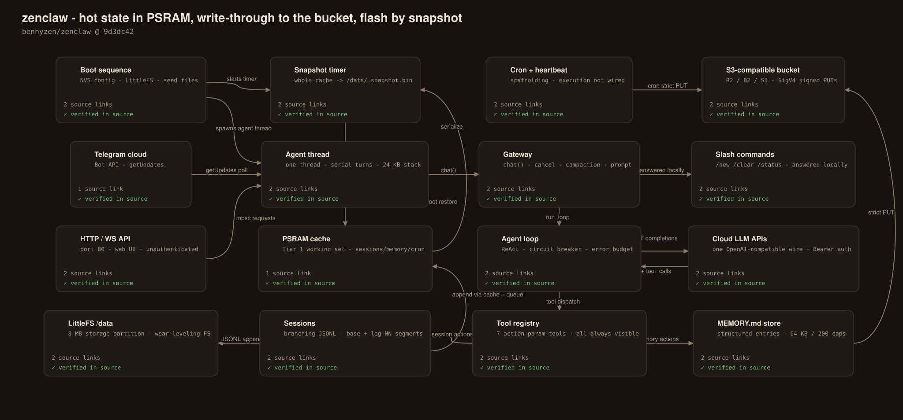
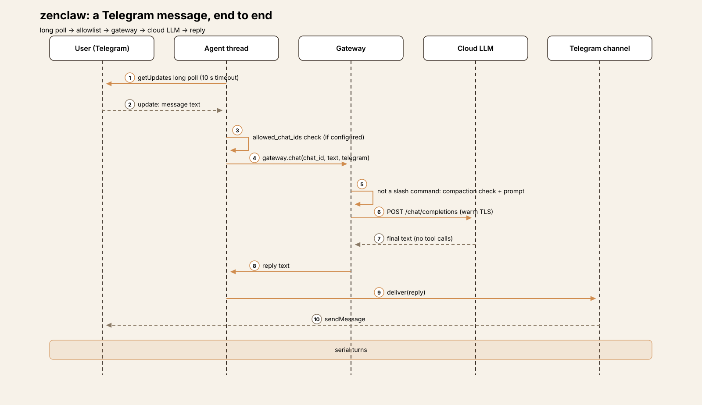
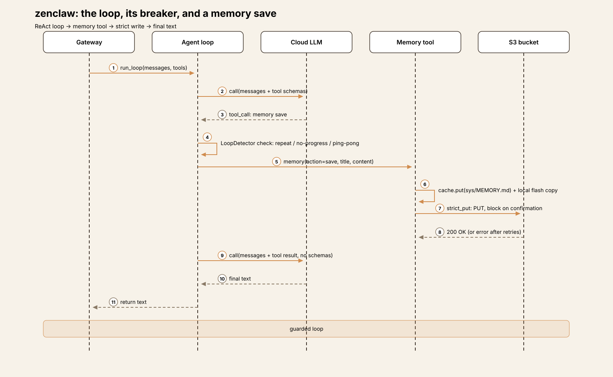
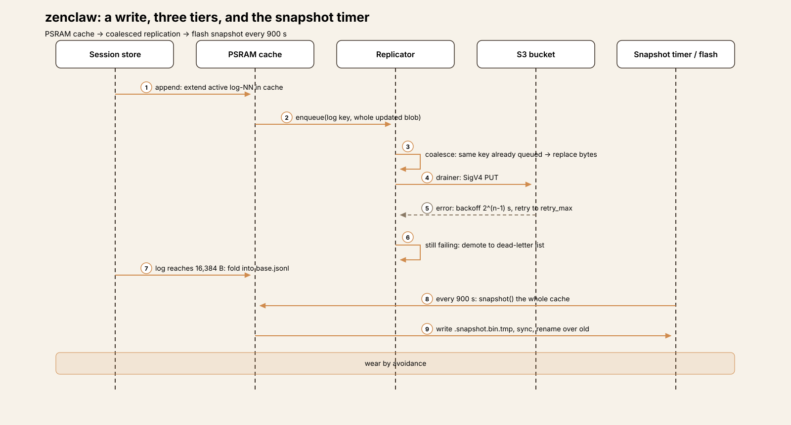
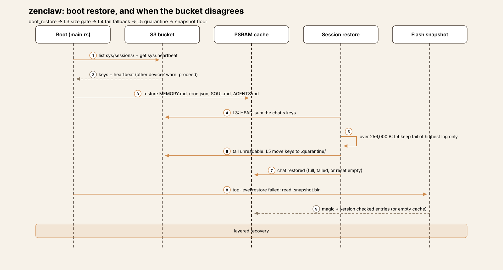
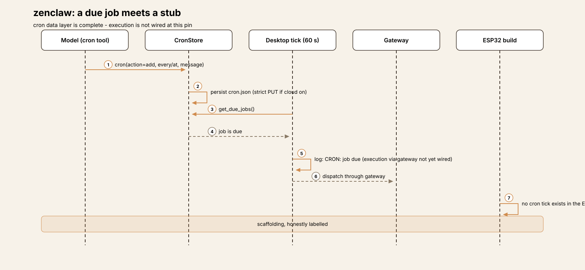

# Embedded Harness Anatomy E3: ZenClaw — persistence that routes around the flash

> **Series:** Embedded Harness Anatomy — top-down dissections of agent
> harnesses that run on microcontrollers, grounded in verifiable pinned
> firmware. Every behavioral claim below carries a footnote to a pinned
> GitHub permalink; the full evidence lives in the endnotes.

## Version block

- **Repo:** [bennyzen/zenclaw](https://github.com/bennyzen/zenclaw)
- **Pinned:** tag `v0.2.1-zai-tls-fix` → `9d3dc42480b24463969c00034f060ab3db2b8fca` (2026-06-07)[^1]
- **Language:** Rust, on `esp-idf-svc` 0.52 (Espressif's Rust bindings
  over ESP-IDF — the SDK and build system for ESP32 chips). The crate
  version at the pin is 0.2.0[^2]
- **License:** MIT[^3]
- **Claim under test:** "A fully autonomous AI agent that runs on a
  low-cost ESP32-S3 board (8 MB PSRAM) — tool use, persistent memory,
  multi-channel messaging, all on-device", with "cloud-backed
  persistence (S3-compatible)" that "protects your data from flash wear
  and reflashes via transparent write-through replication"[^4]

ZenClaw is the third claw in this series, and it is the first one
written in Rust — E1 (ESP-Claw) and E2 (MimiClaw) are both C on
ESP-IDF. The language is not the headline, though. The headline is
the answer ZenClaw gives to the question E2 set aside: flash memory
wears out, so what does an always-on agent do about the storage it
writes every turn? E1's answer was to manage the wear — a structured
store with compaction. E2's answer was to not think about it — plain
files, appended and rewritten whole. ZenClaw's answer is different
in kind: **route around the flash.** Hot state lives in PSRAM, every
write replicates write-through to an S3-compatible bucket, and the
flash itself receives one periodic, atomic snapshot. The sections
below take that design apart piece by piece, including the places
where its own configuration promises slightly more than the wiring
delivers.

Scale, for orientation: the tree is 176 files; the agent crate is
roughly 19,500 lines of Rust under `agent/src/`. The big files are
`main.rs` (2,184 lines), `core/sessions/mod.rs` (1,879), and
`core/tools/memory_tools.rs` (1,124) — the entry point and wiring,
the session store, and the memory store. The persistence machinery
this teardown is mostly about — cache, replicator, strict writes,
snapshots, boot restore — is five small modules under
`core/cloud/`[^5].

## Hardware block

ZenClaw targets two boards through per-board manifests: the
**ESP32-S3 DevKitC** (internal Wi-Fi) and the **Guition P4** (an
ESP32-P4 board with Ethernet and a microSD slot)[^6]. Both boards
carry 16 MB of flash. PSRAM differs: 8 MB octal on the S3 board,
32 MB hex-mode clocked at 200 MHz on the P4[^7]. That PSRAM is not
headroom in the usual sense — in cloud mode it *is* the storage
tier the agent reads and writes (§ Persistence).

Flash layout is a single partition table, `agent/partitions.csv`:

| Offset | Size | Name | Purpose |
|--------|------|------|---------|
| 0x009000 | 24 KB | nvs | Wi-Fi credentials, config JSON, settings |
| 0x00F000 | 4 KB | phy_init | RF calibration |
| 0x010000 | 4 MB | factory | Firmware (single slot — no OTA partitions) |
| — | 8 MB | storage | LittleFS: sessions, memory, data files |

[^8]

The storage partition is mounted at `/data` as **LittleFS** (via the
`joltwallet/littlefs` ESP-IDF component), with format-on-mount-failure
enabled; the boot code creates the `sessions` and `memory`
directories and seeds default persona files there[^9][^10]. The P4's
microSD card, where present, is a second mount (`/sdcard`, FATFS) for
large files — a capacity tier, not part of the persistence design.

## Harness concepts

A five-line box for embedded readers — the harness ideas this teardown
uses, translated to this device:

- **Turn loop:** a ReAct loop (call the model, execute tools, repeat)
  running on one agent thread. A new message on a chat cancels the
  turn already running on that chat.
- **Tool dispatch:** 7 tools, each taking an `action` parameter that
  selects among several operations — 7 schemas covering a much wider
  operation set.
- **Approvals:** none, in code. The one approval rule — ask the user
  before deleting memory on the agent's own initiative — is text in a
  tool description, not an enforced gate.
- **Memory:** a structured `MEMORY.md` of titled, tagged entries with
  hard caps (64 KB, 200 entries) and keyword search.
- **Persistence:** the subject of this teardown — a PSRAM working set,
  write-through replication to cloud object storage, and a timed
  snapshot as the only routine flash write for hot state.

## The mental model

ZenClaw is **a gateway in front of one serial agent thread, with a
three-tier storage system underneath**. Channels (Telegram, the
device's own HTTP/WebSocket API, its web UI) produce chat requests; a
single agent thread works through them one at a time; the gateway
either answers a request locally (slash commands), or runs it through
the cloud LLM tool loop. Everything the loop produces — session
entries, memory edits, cron changes — lands in a storage layer whose
first tier is volatile memory and whose durable tier is somebody
else's disk.

The governing tradeoff is durability-shaped. E2 kept state in the
simplest place possible (files on the device's flash) and paid for
it in unbounded growth and unconsidered wear. ZenClaw pays the
opposite price: a second storage system to configure (a bucket, two
keys, a region), a boot sequence that must reconcile three copies of
the truth, and a device whose freshest state can live only in RAM
and in a cloud account. What that buys is real: state that survives
not just flash wear but a reflash, a corrupted filesystem, or a
replacement board — because on boot, the device downloads its own
past.

## Event model

There is no event bus. Two producers feed one consumer:

- **HTTP/WebSocket chat.** The device's HTTP server hands chat
  requests to the agent thread over a standard-library `mpsc`
  channel; the agent thread drains it non-blockingly on each pass
  of its loop[^11].
- **Telegram.** The same agent thread long-polls `getUpdates`
  (10-second timeout) between channel drains — one thread services
  both channels, so turns are strictly serial across all of
  them[^11]. The poll offset is an in-RAM field that starts at 0 on
  every boot, so a reboot can see Telegram redeliver recent updates
  (contrast E2, which persists its offset to NVS and deduplicates
  redeliveries)[^12].

The consumer path is `Gateway::chat`[^13]. Two things can happen to
a message before any model call:

1. **Slash commands are a local fast path.** A recognized command
   (`/new`, `/clear`, `/status`, `/help`, and peers) is parsed and
   executed locally and returns without an LLM call — and without
   the pre-turn compaction check. An unrecognized `/foo` falls
   through to the normal model path[^14][^15].
2. **A new message cancels the running turn on that chat.** The
   gateway keeps a per-chat cancellation flag; starting a turn sets
   the previous turn's flag, and the loop checks it before each
   model call[^16]. E2 had no mid-turn interrupt at all; E1 drained
   interrupts inside its run machinery. ZenClaw's version is the
   simplest of the three: same-chat preemption, nothing finer.

Everything else — every ordinary message, on every channel — runs
the full ReAct loop against a cloud model. There is no local rule
engine and no sensor path; the fast path answers operator commands,
not the physical world. Placed against its predecessors: wider than
E2's (which had no in-band local path), narrower than E1's (whose
rules and Lua scripts act on events in milliseconds without a model).

## One event, end to end

The representative path is a Telegram user typing "remember that I
prefer short answers", assembled from the verified pieces — each hop
is pinned, but this is a reconstruction of the flow, not a recorded
trace:

1. **Ingress.** The agent thread's poll returns the message. If an
   `allowed_chat_ids` list is configured and this chat is not on
   it, the message is logged and skipped; otherwise a typing
   indicator is sent and the gateway is called[^17].
2. **Fast-path check.** The text is not a slash command, so the
   gateway checks whether the session branch needs compaction,
   builds the system prompt from the on-device bootstrap files, and
   loads the branch history[^18][^19].
3. **Session append.** The user entry is appended to the session —
   in cloud mode, into the PSRAM cache's active log segment, with
   the updated segment enqueued for replication[^20].
4. **LLM call.** The ESP32 runner POSTs the conversation to the
   configured provider's `/chat/completions` endpoint with Bearer
   auth, over a reused warm TLS connection[^21].

5. **Tool call.** The model answers with a `memory` tool call
   (`action: "save"`). The memory tool parses the store, appends the
   entry, and writes it back — in cloud mode through the strict
   path (§ Persistence), which does not return until the bucket
   confirms[^22].
6. **Reply.** The model produces final text; the assistant entry is
   appended to the session the same way, and the reply is delivered
   to Telegram.

If the model instead starts repeating itself — the same tool call
with the same result — the loop's circuit breaker intervenes
(§ Agent loop); if the provider call fails three times in a row, the
turn aborts with an error.

## Subsystem inventory

### LLM layer (cloud-only, one wire for every provider)

**Compute placement: the LLM never runs on the chip** — the same
placement as E1 and E2. What differs is the provider surface. Where
E2 keeps Anthropic's message shape internally and translates for
OpenAI, ZenClaw speaks **one OpenAI-compatible wire to everyone**:
the ESP32 runner builds `{base_url}/chat/completions`, sends Bearer
auth, and relies on each provider's OpenAI-compatible endpoint
(Gemini's included)[^21]. Provider choice is configuration — a
`providers` map with a `default` key, per-provider `api_key`,
`model`, and `base_url` — held as one JSON blob in NVS and editable
through the web UI[^23].

The pinned tag is itself the TLS fix its name advertises: the runner
keeps a warm connection to the provider and reuses it across calls,
retrying resets, rather than paying a fresh mbedTLS handshake per
turn[^1]. Errors are classified before the loop sees them:
authentication and balance failures are fatal, rate limits and 5xx
are retryable[^24].

### Agent loop: a ReAct loop with a circuit breaker and a conscience

`run_loop` calls the runner, executes any tool calls, appends the
results, and repeats until the model returns plain text[^25]. Three
guards bound it, and together they are the most distinctive loop
design in the embedded series so far:

- **A circuit breaker** (`LoopDetector`) watches the tool-call
  stream for three stuck patterns — the same call repeated, calls
  that make no progress, and two calls ping-ponging — and blocks
  execution when a pattern trips[^26].
- **An error budget:** three consecutive provider errors abort the
  turn (`MAX_CONSECUTIVE_ERRORS`)[^25].
- **Continuation nudges:** if the model narrates an intention
  ("I'll save that now:") without emitting a tool call, the loop
  reminds it and re-calls, up to four times — a guard aimed at a
  failure mode the other two claws handle by not noticing it[^25].

There is no fixed iteration cap in the code; the breaker and the
error budget are the bounds. A single tool result is capped at
256 KB on ESP32 before it is refused back to the model with an
instruction to narrow its scope[^27]. After the first call of a
turn, tool schemas are dropped from subsequent requests to shrink
the payload — the model is expected to work from the schemas it
already saw[^25].

### Persistence: the headline

This is the design the series has been waiting two entries for, so
it gets a full section. The README states the problem plainly: "The
ESP32 has limited, wear-prone flash storage. Filesystem corruption
from power loss, firmware reflashes, or flash wear is a real risk",
and names the mitigation — automatic write-through replication to
S3-compatible storage[^28]. The implementation is three tiers:

**Tier 1 — a PSRAM cache is the working set.** When cloud storage is
configured, sessions, `MEMORY.md`, `cron.json`, and the identity
files live in an in-memory hash map in PSRAM. All reads come from
the cache; all writes update the cache first[^29]. The flash is not
in the read or write path for hot state at all.

**Tier 2 — the bucket is the durable copy, written through on every
change, in two strengths:**

- *Eager (sessions).* An append updates the cached segment and
  enqueues the whole updated blob to the replicator. Enqueue
  **coalesces by key**: if that key is already waiting, its bytes
  are replaced in place, so a burst of appends becomes one PUT of
  the latest state[^30]. A drainer thread performs the PUTs —
  requests are SigV4-signed on device, with a hand-rolled signer
  (sha2 + hmac, no AWS SDK) — retrying failures with exponential
  backoff (2^(n−1) seconds, capped; defaults: queue depth 32, 5
  retries, 60-second cap) and then demoting the entry to a
  **dead-letter list** instead of retrying forever[^31][^32]. A
  full queue blocks the writer until it drains below half —
  backpressure reaches all the way into the agent thread.
- *Strict (memory, cron, config).* Writes that cannot tolerate
  eventual consistency block on a confirmed PUT, retrying inline,
  and return the error to the caller when retries run out — a
  memory save fails visibly, a cron change rolls back, and a config
  write (which reboots the device) does not proceed on an
  unconfirmed copy[^33]. Memory and cron additionally write a local
  flash copy after the strict PUT succeeds, so the file is on the
  device even if the cloud machinery is later removed[^22].

**Tier 3 — flash receives a snapshot, on a timer.** A dedicated
thread serializes the entire cache to `/data/.snapshot.bin` every
`snapshot.interval_secs` — **900 seconds by default** — in a compact
length-prefixed binary format, writing to a `.tmp` file, syncing,
and renaming it over the previous snapshot[^34][^35]. The rename is
the crash story for this tier: a power cut mid-snapshot leaves the
previous good snapshot in place. The configuration comment is the
one place in the tree where wear is named as a design input: the
15-minute cadence "keeps wear low while bounding RPO when the
network drops"[^36]. (RPO — recovery point objective — is how much
recent work a failure can cost; here, at most one interval of
bucket-unreachable writes.)

Two honest qualifications. First, **the snapshot's stale-queue
trigger is not wired**: the configuration also defines
`stale_queue_threshold_secs` (default 300 — force an early snapshot
if the replicator's oldest entry has waited longer than that), and
it is parsed and unit-tested, but nothing reads it; the snapshot
thread only sleeps for the interval[^36][^35]. Second, **the design
only engages when cloud storage is configured.** With no `storage`
block, boot skips the whole machinery and the device runs on plain
LittleFS files — sessions appended per chat, memory written whole —
which is E2's model with better-behaved filesystems underneath.
LittleFS is itself a wear-leveling filesystem, but that is the
component's property; ZenClaw's own contribution is the tiering
above it, and it is opt-in.

### Sessions: branching trees, log-structured in the cloud

A session is a tree, not a transcript. Entries are messages with
`id` and `parent` pointers (plus compaction summaries and leaf
markers); loading a session walks parent pointers from the leaf to
reconstruct the active branch[^37]. In local mode the tree is one
append-only JSONL file per chat, appended with a flush per entry —
malformed lines are skipped with a warning on load, so a torn final
write costs at most its own line[^38].

Cloud mode gives the tree a log-structured layout: `base.jsonl`
plus numbered `log-NN.jsonl` segments per chat. An append extends
the active segment in the cache and enqueues the updated segment;
when a segment reaches `log_compaction_bytes` (16,384 by default),
it is **folded into `base.jsonl`**, a sidecar records the highest
absorbed segment, and the next append starts a fresh segment[^20][^39].
The absorbed segments are kept in the cache, the code notes, for
boot-time crash recovery. Note what this compaction is and is not:
it bounds the size of each replicated blob and the work per PUT;
it does not summarize anything. The summarizing compaction is a
separate, LLM-level step (§ Memory).

### Crash recovery: a boot sequence with safety layers

Recovery is where the tiering pays off — and where the code is most
careful. On a cloud-enabled boot, `boot_restore` lists the bucket's
session keys, checks the bucket heartbeat (a *different* device's
heartbeat fresher than an hour surfaces a conflict warning; boot
proceeds either way), and restores memory, cron, and identity files
into the cache[^40]. Each chat then passes three safety layers:

- **L3, the size gate:** the chat's keys are HEAD-summed; a total
  above `session_max_bytes` (256,000 by default) trips the gate.
- **L4, the tail fallback:** an oversized (or partially unreadable)
  chat keeps only the last `log_compaction_bytes` of its highest
  log segment — recent context survives, bulk does not.
- **L5, quarantine:** if the tail cannot be read either, the chat's
  keys are moved to a `.quarantine/` prefix and the session starts
  empty — explicitly so a corrupt chat cannot cycle through
  L3→L4→L5 on every reboot[^41].

If the bucket is unreachable at the top level, boot falls back to
the on-flash snapshot (magic- and version-checked; a bad magic is
treated as corruption); with no snapshot, the device boots with an
empty cache. Every failure path ends in a running device — degraded
history, never a refused boot[^40]. Warnings from the restore
surface on `/api/status` for the web UI to show.

### Memory: structured, capped, searchable

`MEMORY.md` looks like a file and behaves like a small database.
Entries are titled Markdown blocks with an `[id] timestamp (tags:
…)` metadata line, managed through one `memory` tool with save,
search, list, get, edit, and delete actions; search is keyword
scoring (title matches rank above tag matches above body), with no
embeddings[^42]. The store has the first hard bounds in the series:
**64 KB total and 200 entries**, enforced on write — a save at the
cap fails with an error, and from 70% of either cap, tool results
carry a capacity footer telling the agent to surface the state to
the user and propose a compaction plan rather than deleting
silently[^43].

The approval-shaped rule lives here, and its exact nature matters:
the tool description instructs the model that agent-initiated
memory deletion or compaction "must be approved by the user first",
while user-initiated deletes run directly[^42]. No code enforces
that distinction — it is a prompt-level convention the model is
trusted to follow. It is more than E1 or E2 attempt in-band, and
less than a gate; the teardown records it as both.

Above the store, prompt assembly reads bootstrap files from the
data directory — `SOUL.md`, `AGENTS.md`, `TOOLS.md`, and peers —
into the system prompt each turn[^19]. Sessions get the LLM-level
compaction E2 lacked: before a turn, if the active branch exceeds
50,000 estimated tokens or 200 KB of JSONL, older entries are
summarized into a compaction entry and the six most recent are
kept[^44].

### Tools: seven schemas, no GPIO, no approvals

The device registry registers exactly **7 tools**, each an
action-parameter dispatch[^45]:

| Tool | Actions (abridged) | Notes |
|------|--------------------|-------|
| `files` | read, write, edit, list | Rejects paths containing `..`[^46] |
| `memory` | save, search, list, get, edit, delete | § Memory |
| `sessions` | status, list, history, … | Branch-aware session access |
| `gateway` | status, reload | Device/runtime introspection |
| `storage` | read, write, delete, list, info, grep | Direct bucket access; `analyze` returns "not yet implemented"[^47] |
| `cron` | add, list, remove, run, update | § Cron — data complete, execution unwired |
| `web` | fetch, request, search | Outbound HTTP(S) |

Two absences define the surface. First, **there is no hardware
tool**: no GPIO, no I2C, no pin policy — the physical world at this
pin is the filesystem, the SD card, and the network. E2's three
GPIO tools behind a 21-pin allowlist, and E1's 36 Lua hardware
modules, have no counterpart here. Second, **there is no approval
gate and no per-session visibility**: all 7 tools are offered on
every turn, with safety living in per-tool input checks (the `..`
fence is the clearest example), exactly E2's model. The code is
explicit about one more omission: `message_send` and sub-agents are
left out of the ESP32 registry as "not viable on ESP32 hardware" —
the sub-agent implementation exists and runs in the desktop
build[^45].

### Channels and sender authentication

Channels are Telegram and the device itself: an HTTP/WebSocket API
(port 80) serving the web UI and programmatic chat. Authentication
splits sharply between them:

- **Telegram has an optional allowlist.** When `allowed_chat_ids`
  is configured, the agent thread checks each incoming chat against
  it and skips non-listed chats with a log line — the first sender
  check on any channel in this series (E2 had none at its tag). The
  check lives in the agent thread, not the poller, and when the
  list is absent, any chat that finds the bot can use it[^17].
- **The HTTP API has none, by design, and the project documents it
  as the trust model.** `SECURITY.md` states that anyone who can
  reach the device can read every stored secret in cleartext via
  `GET /api/config` (LLM keys, the Telegram token, the S3 secret
  key — unredacted), read and write the filesystem within its jail,
  reboot the device, and mint presigned bucket URLs; responses send
  `Access-Control-Allow-Origin: *`. The documented boundary is the
  network: run it only on a trusted segment, never port-forwarded[^48].

The honest summary mirrors E2's, shifted: on Telegram, authorization
can now exist; on the LAN, reachability still *is* authorization —
but here that is a stated, documented design decision with a
dedicated security file, not an open TODO item.

### Cron and heartbeat: complete scaffolding, unwired execution

The cron data layer is finished: jobs (`at` and `every` kinds)
persist to `cron.json` through the strict cloud path when enabled,
due-job detection works, and the model-facing tool manages jobs.
**Execution is not wired on either target at this pin.** The
desktop background runner ticks every 60 seconds, detects due jobs,
logs "CRON: job due (execution via gateway not yet wired)", and
stops at a TODO on the dispatch line; the ESP32 build has no cron
tick at all. Heartbeat is the same shape: configuration parsed
(default every 300 seconds, disabled by default), a desktop tick
that logs "Heartbeat tick (stub)" beside its own TODO, and nothing
on ESP32[^49]. A job the model creates at this pin is a well-kept
record of an intention, not a future turn.

This deserves a precise comparison with E2, because the failure
shape is inverted. E2's README advertised OTA updates as shipped
while the module sat outside the build — the claim ran ahead of
the wiring. ZenClaw's README carries a Roadmap section that lists
cron execution, heartbeat, ESP32 sub-agents, and the MCP client as
**not yet shipping**, with per-item definitions of what "shipped"
would mean — and in every case checked, the code agrees with the
roadmap[^50]. The teardown records what the build does in both
series entries; here, unusually, so does the README.

## Extension points and update mechanism

- **Persona and behavior** (hot): `SOUL.md` / `AGENTS.md` on the
  device, editable through the web UI file manager or the `files`
  tool, effective on the next turn's prompt rebuild[^19].
- **Memory and sessions** (hot, model-writable): through the
  `memory` and `sessions` tools, bounded by the caps in § Memory.
- **Configuration** (warm): web UI or `POST /api/config` — in cloud
  mode a strict PUT first, then the NVS write, then a reboot[^33][^23].
- **Data migration** (the design's own answer to reflashing): point
  a freshly flashed device at the same bucket and boot restore
  rebuilds its sessions, memory, and cron jobs (§ Crash
  recovery)[^40].
- **Firmware** (cold): browser Web Serial flashing or `espflash`
  from source. **There is no OTA**: the partition table has a
  single 4 MB factory slot and no OTA code exists in the tree[^8].
  Firmware updates replace the device; the bucket is what makes
  that survivable.

## Tradeoffs

**Durability by delegation.** The persistence design is genuinely
strong — coalesced write-through, a strict path for the writes that
matter most, dead-lettering instead of silent loss, an atomic
snapshot, a three-layer restore. Its cost is that the device's
memory now depends on a network service and a pair of bucket
credentials: with the bucket down, sessions still replicate when it
returns (the queue holds), but strict writes fail to the user, and
with cloud never configured, the whole apparatus — and the wear
story with it — is absent. E2's files-on-flash design works in a
cabin with no account anywhere. ZenClaw's best mode does not.

**The snapshot is the only routine flash write for hot state — and
it is a whole-state rewrite.** Every 15 minutes, the full cache is
serialized and renamed over the last snapshot. That is a bounded,
predictable wear budget — the point of the design — but the write
size grows with total state, not with what changed, and the one
mechanism that would have tightened it (the stale-queue early
snapshot) sits parsed and untested-in-production, read by no
code[^36][^35]. No erase-count or endurance figures appear anywhere
in the repo, so the budget's adequacy rests on the cadence argument
alone — the repo states no flash endurance numbers, and none are
claimed here.

**Serial turns, again.** One agent thread for two channels means a
long tool loop delays Telegram and web users alike, with same-chat
cancellation as the only relief. The design spends its complexity
budget on storage rather than concurrency — a defensible allocation
for a personal device, and a real limit for a shared one.

**A candid roadmap is part of the artifact.** Cron, heartbeat,
sub-agents, and MCP are all visibly unfinished, and the README says
so with acceptance criteria. A reader evaluating ZenClaw gets an
accurate map of what runs today. That is rarer in this series than
it should be, and worth naming as a strength of the project rather
than only a list of gaps.

## Comparison row

**1. Compute placement — cloud-only, one wire.** The LLM never runs
on the chip: every provider is reached over a single
OpenAI-compatible `/chat/completions` POST with Bearer auth[^21].
Same placement as E1 and E2; the difference is shape — E1 offered
three backend forms, E2 two with an internal translation layer,
ZenClaw one wire for all.

**2. Power envelope — always-on, one brochure number.** No sleep
path was found in the ESP32 build; the device polls, serves, and
replicates around the clock. The only power figure in the repo is
the README's "Runs on 0.5 watts. Always on" — recorded here as
[UNVERIFIED] beyond the README line itself[^4].

**3. Connectivity dependence — high, but layered.** The model,
Telegram, and the bucket are all network services; boot without a
bucket still works (snapshot or empty cache), and boot without
Wi-Fi leaves the serial console and a device waiting to be
configured. Offline, stored state is readable locally, but no turn
can run — the same dependence as E2, softened at the storage layer
only[^40].

**4. Event model — serial gateway turns, plus a command fast path.**
One agent thread drains an mpsc channel and a Telegram poll loop;
recognized slash commands execute locally, everything else runs the
full loop, and a new message cancels the running turn on its
chat[^11][^14][^16]. Between E1's bus and E2's single queue in
spirit — closest to E2, with the fast path E2 lacked.

**5. Sensor/actuator interface — none.** No GPIO or hardware tool
exists at this pin; the tool surface is files, memory, sessions,
cron data, web, gateway status, and the bucket itself[^45]. The
smallest physical surface in the series — smaller even than E2's
three pin tools.

**6. Model footprint — the prompt is files.** No on-device model;
the footprint is the bootstrap files plus branch history, with
LLM compaction at 50,000 estimated tokens or 200 KB keeping the
branch bounded[^19][^44].

**7. Memory architecture — the series' first wear design.** A PSRAM
working set; write-through S3 replication (coalesced eager path for
sessions, blocking strict path for memory/cron/config); flash
receives a 15-minute atomic whole-cache snapshot and local copies
of memory/cron. Structured `MEMORY.md` capped at 64 KB / 200
entries; sessions as branching JSONL, log-structured into
base + segments in cloud mode[^29][^30][^34][^43][^39]. E1 managed
wear on-device; E2 did not address it; ZenClaw routes around the
medium.

**8. Update mechanism — reflash, restore from bucket.** Single-slot
firmware, no OTA; behavior and config update hot; the data survives
a reflash by restore from the bucket on boot[^8][^40].

**9. Real-time constraints — seconds, except commands.** Slash
commands answer locally at once; all other interactions pay a cloud
round-trip. Internal deadlines are storage-shaped: a 900-second
snapshot cadence, replicator backoff capped at 60 seconds, a
256 KB tool-result ceiling[^14][^32][^36][^27].

**10. Failure & safety — layered recovery, open LAN.** Failures are
absorbed in layers: malformed session lines skipped, torn snapshots
prevented by rename, corrupt chats quarantined, failed replications
dead-lettered, strict failures surfaced[^38][^34][^41][^31][^33].
Safety is per-tool input checks and an optional Telegram allowlist
around an always-visible tool set — with an unauthenticated HTTP
API whose exposure the project documents as its trust model[^46][^17][^48].

## What transfers

**What embedded teaches harness design.** Write coalescing by key
is a small idea with wide application: any system that persists
conversational state by rewriting blobs — session files, memory
stores, checkpoint writers — can collapse a burst of writes into
one durable write of the latest state, and most currently do not.
The strict/eager split is the companion lesson: durability is not
one property. Session appends can be eventual; the write that a
reboot depends on cannot — and the code should say which is which,
per call site, the way `strict_put` and the replicator do. Desktop
harnesses that treat every save as equally synchronous, or equally
casual, are leaving a design decision unmade.

**What harness design teaches embedded.** The unwired
stale-queue threshold is the desktop series' familiar lesson in
embedded clothes: a configuration value that nothing reads is a
promise the system does not keep, and the only reliable detector is
reading the wiring, not the config schema — the same discipline
that caught E2's unbuilt OTA module. ZenClaw mostly passes that
audit (its roadmap is accurate), which is exactly why the one
missed wire stands out. And the prompt-level memory-approval rule
shows a harness convention arriving on embedded hardware before
the enforcement mechanism does; whether a future version grows a
real gate — and what it costs on this hardware — is a question
E4 and beyond can keep asking.

## Endnotes

[^1]: Pinned tag `v0.2.1-zai-tls-fix` (2026-06-07), commit
`9d3dc42480b24463969c00034f060ab3db2b8fca` ("reuse warm TLS
connection + retry resets, surface API errors"):
<https://github.com/bennyzen/zenclaw/tree/9d3dc42480b24463969c00034f060ab3db2b8fca>
[^2]: Crate version 0.2.0; `esp-idf-svc` 0.52:
<https://github.com/bennyzen/zenclaw/blob/9d3dc42480b24463969c00034f060ab3db2b8fca/agent/Cargo.toml#L3>,
<https://github.com/bennyzen/zenclaw/blob/9d3dc42480b24463969c00034f060ab3db2b8fca/agent/Cargo.toml#L50>
[^3]: License (MIT, Copyright (c) 2026 bennyzen):
<https://github.com/bennyzen/zenclaw/blob/9d3dc42480b24463969c00034f060ab3db2b8fca/LICENSE>
[^4]: "A fully autonomous AI agent that runs on a low-cost
ESP32-S3 board (8 MB PSRAM)…"; "Runs on 0.5 watts. Always on.
Always yours.":
<https://github.com/bennyzen/zenclaw/blob/9d3dc42480b24463969c00034f060ab3db2b8fca/README.md#L18-L20>
[^5]: Agent crate tree under `agent/src/` (file sizes per the
pinned tree; `main.rs` 2,184 lines, `sessions/mod.rs` 1,879,
`memory_tools.rs` 1,124, cloud modules under `core/cloud/`):
<https://github.com/bennyzen/zenclaw/tree/9d3dc42480b24463969c00034f060ab3db2b8fca/agent/src>
[^6]: Board manifests (DevKitC: esp32s3, Wi-Fi features; Guition
P4: esp32p4, Ethernet + sdcard features):
<https://github.com/bennyzen/zenclaw/blob/9d3dc42480b24463969c00034f060ab3db2b8fca/agent/boards/devkitc.toml>,
<https://github.com/bennyzen/zenclaw/blob/9d3dc42480b24463969c00034f060ab3db2b8fca/agent/boards/guition-p4.toml>
[^7]: 16 MB flash; S3 8 MB octal PSRAM; P4 32 MB hex PSRAM at
200 MHz:
<https://github.com/bennyzen/zenclaw/blob/9d3dc42480b24463969c00034f060ab3db2b8fca/agent/sdkconfig.defaults>,
<https://github.com/bennyzen/zenclaw/blob/9d3dc42480b24463969c00034f060ab3db2b8fca/agent/sdkconfig.board.devkitc>,
<https://github.com/bennyzen/zenclaw/blob/9d3dc42480b24463969c00034f060ab3db2b8fca/agent/sdkconfig.board.guition-p4>
[^8]: Partition table `partitions.csv` (nvs 24 KB, phy_init 4 KB,
factory 4 MB, storage 8 MB LittleFS; no OTA partitions):
<https://github.com/bennyzen/zenclaw/blob/9d3dc42480b24463969c00034f060ab3db2b8fca/agent/partitions.csv>
[^9]: LittleFS component (`joltwallet/littlefs` 1.21.1):
<https://github.com/bennyzen/zenclaw/blob/9d3dc42480b24463969c00034f060ab3db2b8fca/agent/Cargo.toml#L97>
[^10]: LittleFS mounted at `/data` with
`format_if_mount_failed`; sessions/memory directories created;
workspace defaults seeded:
<https://github.com/bennyzen/zenclaw/blob/9d3dc42480b24463969c00034f060ab3db2b8fca/agent/src/main.rs#L232-L275>
[^11]: Agent thread: drains the HTTP chat mpsc channel
non-blockingly, then long-polls Telegram, in one loop:
<https://github.com/bennyzen/zenclaw/blob/9d3dc42480b24463969c00034f060ab3db2b8fca/agent/src/main.rs#L2040-L2083>
[^12]: Telegram poller: `getUpdates` with an in-RAM `offset`
field initialized to 0:
<https://github.com/bennyzen/zenclaw/blob/9d3dc42480b24463969c00034f060ab3db2b8fca/agent/src/core/channels/telegram.rs#L29-L56>
[^13]: `Gateway::chat` entry point:
<https://github.com/bennyzen/zenclaw/blob/9d3dc42480b24463969c00034f060ab3db2b8fca/agent/src/core/gateway.rs#L133-L146>
[^14]: Slash-command interception: recognized commands skip the
LLM entirely (and the auto-compaction step):
<https://github.com/bennyzen/zenclaw/blob/9d3dc42480b24463969c00034f060ab3db2b8fca/agent/src/core/gateway.rs#L164-L197>
[^15]: Command set and parser (`/new`, `/clear`, `/status`,
`/help`, …; unknown commands return `None`):
<https://github.com/bennyzen/zenclaw/blob/9d3dc42480b24463969c00034f060ab3db2b8fca/agent/src/core/commands.rs#L95>,
<https://github.com/bennyzen/zenclaw/blob/9d3dc42480b24463969c00034f060ab3db2b8fca/agent/src/core/commands.rs#L200-L215>
[^16]: Per-chat cancellation: a new turn sets the previous
turn's flag before starting:
<https://github.com/bennyzen/zenclaw/blob/9d3dc42480b24463969c00034f060ab3db2b8fca/agent/src/core/gateway.rs#L153-L162>
[^17]: Telegram allowlist enforced in the agent thread
(non-listed chats logged and skipped):
<https://github.com/bennyzen/zenclaw/blob/9d3dc42480b24463969c00034f060ab3db2b8fca/agent/src/main.rs#L2085-L2094>
[^18]: Auto-compaction check before history load in
`chat_with_events`:
<https://github.com/bennyzen/zenclaw/blob/9d3dc42480b24463969c00034f060ab3db2b8fca/agent/src/core/gateway.rs#L199-L215>
[^19]: Bootstrap context files (SOUL/AGENTS/TOOLS/USER and peers)
loaded from the data directory for the prompt:
<https://github.com/bennyzen/zenclaw/blob/9d3dc42480b24463969c00034f060ab3db2b8fca/agent/src/core/workspace.rs#L13-L58>
[^20]: Cloud append: extend the active log segment in cache,
enqueue the updated blob, compact at the threshold:
<https://github.com/bennyzen/zenclaw/blob/9d3dc42480b24463969c00034f060ab3db2b8fca/agent/src/core/sessions/mod.rs#L617-L636>
[^21]: ESP32 runner: `{base_url}/chat/completions` with Bearer
auth; every provider exposes `/chat/completions`:
<https://github.com/bennyzen/zenclaw/blob/9d3dc42480b24463969c00034f060ab3db2b8fca/agent/src/esp32/runner.rs#L13-L16>,
<https://github.com/bennyzen/zenclaw/blob/9d3dc42480b24463969c00034f060ab3db2b8fca/agent/src/esp32/runner.rs#L38-L66>
[^22]: Memory write: cache update, then `strict_put`, then the
local flash copy:
<https://github.com/bennyzen/zenclaw/blob/9d3dc42480b24463969c00034f060ab3db2b8fca/agent/src/core/tools/memory_tools.rs#L385-L410>
[^23]: Config JSON loaded from NVS (namespace `config`, key
`json`), defaults otherwise:
<https://github.com/bennyzen/zenclaw/blob/9d3dc42480b24463969c00034f060ab3db2b8fca/agent/src/main.rs#L401-L430>
[^24]: Provider error classification (auth/balance fatal;
rate-limit and server errors retryable):
<https://github.com/bennyzen/zenclaw/blob/9d3dc42480b24463969c00034f060ab3db2b8fca/agent/src/core/runner.rs#L37-L95>
[^25]: `run_loop`: LLM/tool cycle, 3-consecutive-error abort,
continuation nudges, tool schemas dropped after the first call:
<https://github.com/bennyzen/zenclaw/blob/9d3dc42480b24463969c00034f060ab3db2b8fca/agent/src/core/agent_loop.rs#L10>,
<https://github.com/bennyzen/zenclaw/blob/9d3dc42480b24463969c00034f060ab3db2b8fca/agent/src/core/agent_loop.rs#L29-L140>
[^26]: LoopDetector circuit breaker (repeat, no-progress,
ping-pong detection):
<https://github.com/bennyzen/zenclaw/blob/9d3dc42480b24463969c00034f060ab3db2b8fca/agent/src/core/tool_loop.rs#L32-L70>
[^27]: Tool-result cap on ESP32 (`MAX_TOOL_RESULT_BYTES` =
256 KB):
<https://github.com/bennyzen/zenclaw/blob/9d3dc42480b24463969c00034f060ab3db2b8fca/agent/src/core/agent_loop.rs#L13-L19>
[^28]: "The ESP32 has limited, wear-prone flash storage…
ZenClaw mitigates this with automatic write-through replication
to S3-compatible cloud storage":
<https://github.com/bennyzen/zenclaw/blob/9d3dc42480b24463969c00034f060ab3db2b8fca/README.md#L151-L160>
[^29]: CloudCache: PSRAM-backed working set; "all Tier 1 reads
come from here; writes update here first":
<https://github.com/bennyzen/zenclaw/blob/9d3dc42480b24463969c00034f060ab3db2b8fca/agent/src/core/cloud/cache.rs#L1-L30>
[^30]: Replicator enqueue coalesces by key; a full queue blocks
until depth drops below half-cap:
<https://github.com/bennyzen/zenclaw/blob/9d3dc42480b24463969c00034f060ab3db2b8fca/agent/src/core/cloud/replicator.rs#L77-L97>
[^31]: Drainer: PUT with exponential backoff, retry_max, then
dead-letter:
<https://github.com/bennyzen/zenclaw/blob/9d3dc42480b24463969c00034f060ab3db2b8fca/agent/src/core/cloud/replicator.rs#L1-L7>,
<https://github.com/bennyzen/zenclaw/blob/9d3dc42480b24463969c00034f060ab3db2b8fca/agent/src/core/cloud/replicator.rs#L133-L185>
[^32]: Storage defaults (queue_max 32, retry_max 5, backoff cap
60 s; session_max 256,000; log_compaction 16,384):
<https://github.com/bennyzen/zenclaw/blob/9d3dc42480b24463969c00034f060ab3db2b8fca/agent/src/config.rs#L190-L208>,
<https://github.com/bennyzen/zenclaw/blob/9d3dc42480b24463969c00034f060ab3db2b8fca/agent/src/config.rs#L344-L360>
[^33]: Strict path: block on S3 confirmation, retry inline,
return the error after exhaustion; used by memory saves, cron
updates, and config writes:
<https://github.com/bennyzen/zenclaw/blob/9d3dc42480b24463969c00034f060ab3db2b8fca/agent/src/core/cloud/strict.rs#L1-L44>
[^34]: Snapshot write: tmp file, `sync_all`, atomic rename;
length-prefixed binary format:
<https://github.com/bennyzen/zenclaw/blob/9d3dc42480b24463969c00034f060ab3db2b8fca/agent/src/core/cloud/snapshots.rs#L1-L17>,
<https://github.com/bennyzen/zenclaw/blob/9d3dc42480b24463969c00034f060ab3db2b8fca/agent/src/core/cloud/snapshots.rs#L41-L53>
[^35]: Snapshot timer thread: sleeps for the configured
interval, writes the snapshot, logs failures:
<https://github.com/bennyzen/zenclaw/blob/9d3dc42480b24463969c00034f060ab3db2b8fca/agent/src/main.rs#L553-L571>
[^36]: Snapshot config: "Default 15 min keeps wear low while
bounding RPO when the network drops"; the stale-queue threshold
field (default 300 s) is defined alongside:
<https://github.com/bennyzen/zenclaw/blob/9d3dc42480b24463969c00034f060ab3db2b8fca/agent/src/config.rs#L291-L308>
[^37]: Session entry types (Message with parent pointer,
Compaction, session_info leaf markers):
<https://github.com/bennyzen/zenclaw/blob/9d3dc42480b24463969c00034f060ab3db2b8fca/agent/src/core/sessions/mod.rs#L14-L41>
[^38]: Local append (entry + session_info lines, flush) and
malformed-line skipping on load:
<https://github.com/bennyzen/zenclaw/blob/9d3dc42480b24463969c00034f060ab3db2b8fca/agent/src/core/sessions/mod.rs#L443-L470>,
<https://github.com/bennyzen/zenclaw/blob/9d3dc42480b24463969c00034f060ab3db2b8fca/agent/src/core/sessions/mod.rs#L740-L753>
[^39]: `compact_log`: fold the active log into `base.jsonl`,
record `highest_absorbed_log`, keep the absorbed log for
crash recovery:
<https://github.com/bennyzen/zenclaw/blob/9d3dc42480b24463969c00034f060ab3db2b8fca/agent/src/core/sessions/mod.rs#L638-L668>
[^40]: `boot_restore`: heartbeat check, memory/cron/identity
restore, per-chat safety layers, snapshot fallback on top-level
failure (fallback wiring in `main.rs`):
<https://github.com/bennyzen/zenclaw/blob/9d3dc42480b24463969c00034f060ab3db2b8fca/agent/src/core/cloud/boot.rs#L88-L171>,
<https://github.com/bennyzen/zenclaw/blob/9d3dc42480b24463969c00034f060ab3db2b8fca/agent/src/main.rs#L505-L545>
[^41]: L4 tail-fallback and L5 quarantine (move keys to
`.quarantine/`, reset the session):
<https://github.com/bennyzen/zenclaw/blob/9d3dc42480b24463969c00034f060ab3db2b8fca/agent/src/core/cloud/boot.rs#L230-L360>
[^42]: Memory tool: entry format, save/search/list/get/edit/
delete actions, keyword search, and the tool-description rule
that agent-initiated compaction/deletion needs user approval:
<https://github.com/bennyzen/zenclaw/blob/9d3dc42480b24463969c00034f060ab3db2b8fca/agent/src/core/tools/memory_tools.rs#L1-L26>,
<https://github.com/bennyzen/zenclaw/blob/9d3dc42480b24463969c00034f060ab3db2b8fca/agent/src/core/tools/memory_tools.rs#L62-L97>
[^43]: Memory caps: 64 KB total, 200 entries, 70% warning
threshold:
<https://github.com/bennyzen/zenclaw/blob/9d3dc42480b24463969c00034f060ab3db2b8fca/agent/src/core/tools/memory_tools.rs#L45-L58>
[^44]: LLM compaction trigger (token or byte threshold) and
defaults (50,000 tokens, 200 KB, keep 6 recent):
<https://github.com/bennyzen/zenclaw/blob/9d3dc42480b24463969c00034f060ab3db2b8fca/agent/src/core/compaction.rs#L20-L45>,
<https://github.com/bennyzen/zenclaw/blob/9d3dc42480b24463969c00034f060ab3db2b8fca/agent/src/config.rs#L34-L56>
[^45]: `register_defaults`: 7 tools; "message_send and
subagent omitted — not viable on ESP32 hardware":
<https://github.com/bennyzen/zenclaw/blob/9d3dc42480b24463969c00034f060ab3db2b8fca/agent/src/core/tools/mod.rs#L82-L91>
[^46]: File tool rejects paths containing `..`:
<https://github.com/bennyzen/zenclaw/blob/9d3dc42480b24463969c00034f060ab3db2b8fca/agent/src/core/tools/file_tools.rs#L46-L56>
[^47]: Storage tool `analyze`: "Storage analyze not yet
implemented.":
<https://github.com/bennyzen/zenclaw/blob/9d3dc42480b24463969c00034f060ab3db2b8fca/agent/src/core/tools/storage_tools.rs#L152>
[^48]: Trust model: unauthenticated HTTP/WebSocket API,
cleartext secrets via `GET /api/config`, presigned-URL minting,
`Access-Control-Allow-Origin: *`; trusted-network-only guidance:
<https://github.com/bennyzen/zenclaw/blob/9d3dc42480b24463969c00034f060ab3db2b8fca/SECURITY.md>
[^49]: Cron detection without execution (desktop runner log +
TODO); heartbeat tick stub; neither target runs a reflection or
cron turn:
<https://github.com/bennyzen/zenclaw/blob/9d3dc42480b24463969c00034f060ab3db2b8fca/agent/src/desktop/background/mod.rs#L25-L40>,
<https://github.com/bennyzen/zenclaw/blob/9d3dc42480b24463969c00034f060ab3db2b8fca/agent/src/desktop/background/mod.rs#L44-L80>
[^50]: README Roadmap: sub-agents, heartbeat, and cron
execution each listed as not yet shipping, with "shipped when"
criteria; cron entry: "no job has ever actually run. ESP32 has
no cron tick at all":
<https://github.com/bennyzen/zenclaw/blob/9d3dc42480b24463969c00034f060ab3db2b8fca/README.md#L205-L232>
