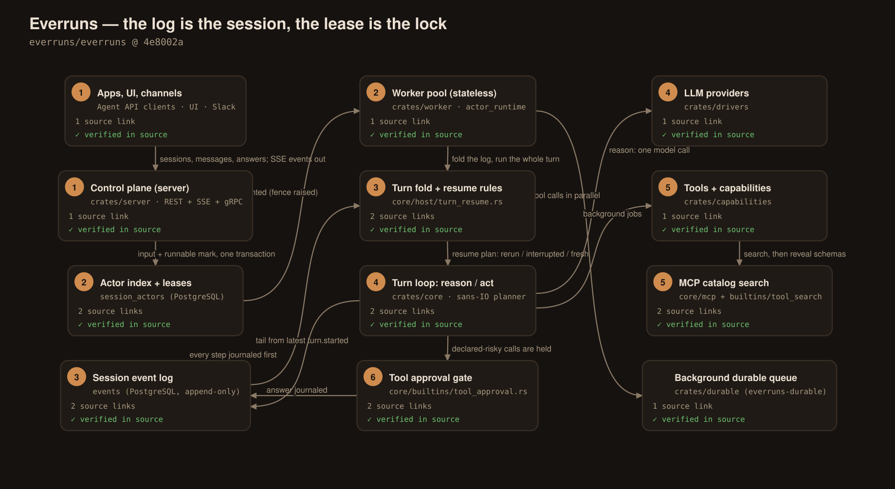
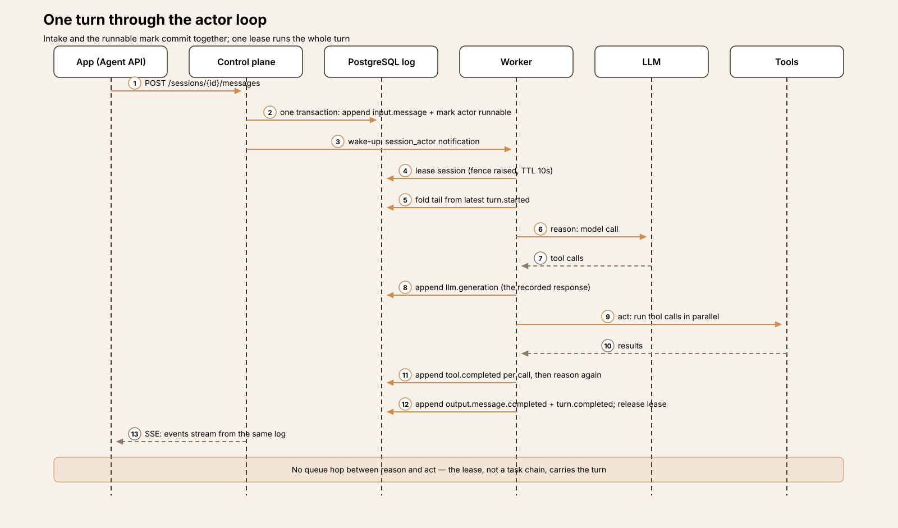
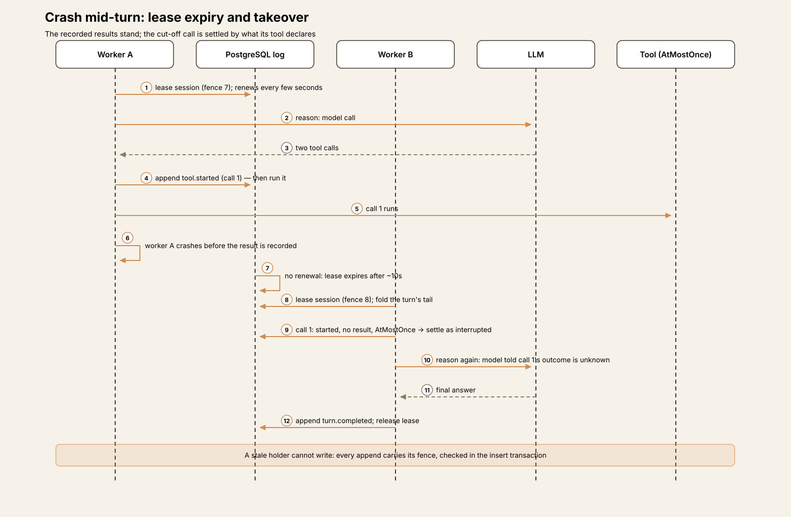
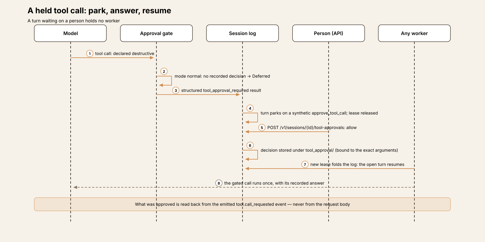
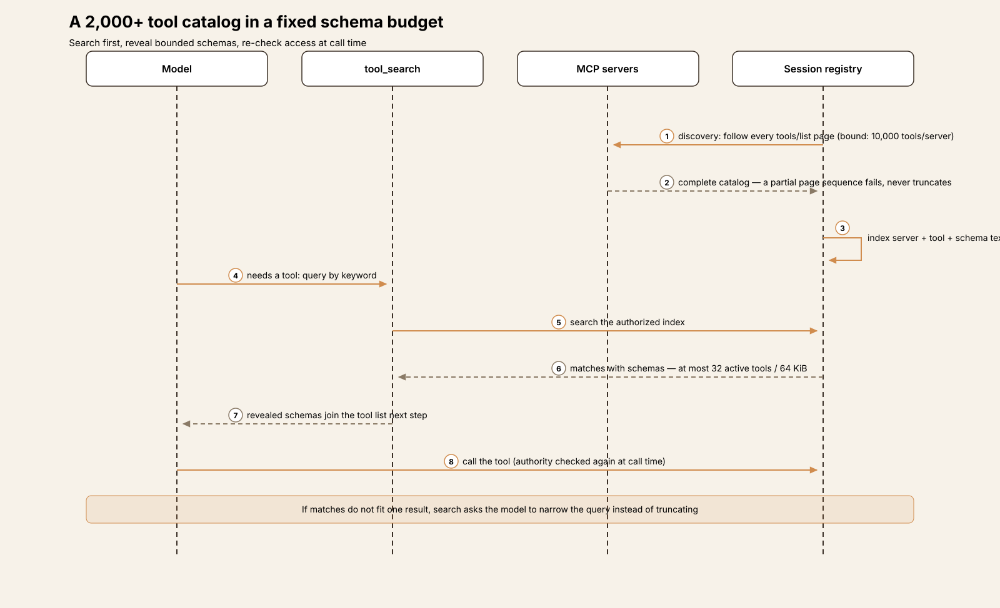
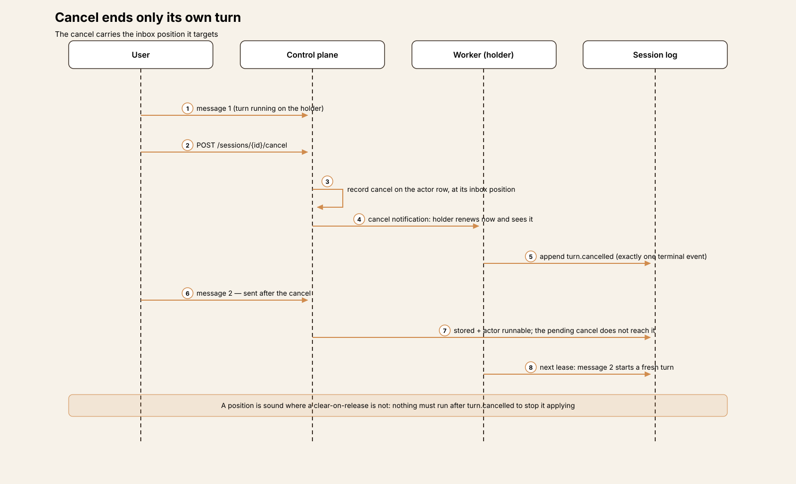

# Agent Harness Anatomy #22: Everruns — the session survives its workers

> **Series:** Agent Harness Anatomy — top-down dissections of real agent harnesses, grounded in verifiable source code. Every behavioral claim below carries a footnote to a pinned GitHub permalink; the full evidence lives in the endnotes.

## Version block

- **Repo:** [everruns/everruns](https://github.com/everruns/everruns)
- **Pinned:** tag `v0.49.0`, commit `4e8002acce3f567c99ae18c9aceea0c32634ecbd` (2026-10-25) — the release commit for 0.49.0, dated 2026-10-26 in the changelog. The tag exists and resolves exactly to this commit, so the pin is the tag.
- **Language:** Rust throughout — a Cargo workspace of 3,226 Rust source files (7,559 tracked files in total): a control plane (`crates/server`), a worker (`crates/worker`), a host-generic turn engine (`crates/core`), contracts, capabilities, LLM drivers, a CLI, an embeddable framework crate (`crates/everruns`), and a generic durable-execution crate (`crates/durable`). Every published crate ships at the single workspace version.
- **License:** MIT
- **Claim under test:** a durable-execution harness engine in which every LLM response, tool call and state transition is journaled to PostgreSQL, so a session resumes mid-turn after a crash instead of restarting. Two recent releases frame the test. In 0.48.0 (2026-10-13) the project replaced its per-step workflow model with a **durable actor model** — a worker leases a session and runs the whole turn from its journal — and shipped a **stable Agent API** for calling one agent from code.[^1][^2] In 0.49.0 (2026-10-26) it added search over MCP catalogs of 2,000+ tools within a fixed schema budget, and one-command self-hosting.[^3][^4]

Two framing notes. First, this teardown was read-only: the source was cloned and read, never built or executed, so every claim is about what the code at this tag does. Second, a correction to a common summary of the project: Everruns is sometimes described as shipping as one binary. At this pin the platform is two long-running binaries — `everruns-server` and `everruns-worker` — plus the `everruns` CLI. A single-process shape does exist, in development mode, where the worker runs in-process with the control plane; the article describes the deployment as pinned, in the storage and operations section below.

## The mental model

Hold three ideas apart, because every mechanism in this codebase is one of them, applied carefully.

**The log is the session.** Everruns inverts the usual chat-system design: instead of a messages table with events as a side-channel, the append-only event log is the source of truth and messages are derived from it.[^5] Every input message, model response, tool call, tool result and state transition is a typed, sequenced row in one PostgreSQL `events` table,[^6] appended before anything acts on it.[^7] Conversation history, the live SSE stream and the audit trail are three reads of the same rows, so they cannot disagree.

**The lease is the lock.** A session is an *actor*. Storing a message marks its actor runnable in the same transaction;[^8] a worker then leases the session — one row in a `session_actors` table carrying a holder, an expiry and a **fence** that rises with every lease[^9] — and runs the whole turn. At most one worker ever runs a session's turn, and the fence is what keeps a displaced worker from writing into a turn it no longer owns: every event the turn appends carries its holder and fence, checked in the insert's transaction.[^10]

**Results are persisted, never replayed.** A language model is not deterministic, so re-running a step after a crash could produce different tool calls than the ones whose results are already recorded. Everruns therefore journals the *outcome* of each step — the model response as an `llm.generation` event, each tool result as a `tool.completed` — and resume reads those outcomes back instead of re-asking the questions.[^11] What resume does with a call that has no recorded outcome is the most carefully specified part of the design, and it is decided by what the tool itself declares about its side effects.[^12]

Everything else — the Agent API, the approval gate, the 2,000-tool catalog search — is built on top of those three ideas, and each inherits their guarantees.

## Component map

The repo carries two products over one core.

**The framework** (`crates/everruns`) is an embeddable Rust library: the README describes "an open-source framework for building AI agents directly in Rust applications" — define an agent, attach a model and typed tools, run multi-turn sessions, and observe execution through one application-facing API.[^13] Its own crate keeps "the application-facing agent loop explicit and embeddable": agents and sessions, providers, typed tools and capabilities, events and cancellation, and a ladder of persistence choices from engine-lifetime memory to local crash-durable state to a distributed host.[^14]

**The platform** is the distributed host. A running deployment is two kinds of process plus PostgreSQL: the control plane exposes the REST API, owns auth, serves SSE event streams and persists all state; workers execute the agentic loop, hold no long-lived state, and can be restarted at any time without breaking anything.[^15] The split is strict — workers never talk to PostgreSQL, NATS or Valkey directly; every read and write goes through the control plane's gRPC service, which is what lets workers run with no database credentials and no encryption keys.[^16]

**The core** (`crates/core`) is shared by both: a host-generic turn engine whose planner is deliberately sans-IO — pure functions that read a folded log and return a plan plus the lifecycle effects the host must perform.[^17] The framework's in-process host and the platform's leased-worker host are two drivers of the same brain, which is why the framework gets the same crash-resume semantics as the platform (see the journal section).

**The background crate** (`crates/durable`, published as `everruns-durable`) is the generic remainder of the retired workflow engine: a PostgreSQL task queue, event log, schedules, retries, a dead letter queue and circuit breakers, with no agent concepts. Its own README is explicit that agent turns do not run there any more — the worker's background activities and the server's cluster jobs do.[^18]

## The core loop

A turn is a reason–act cycle. Reason: the full conversation history goes to the model, which either produces text or requests tool calls. Act: the requested calls execute in parallel. Loop: if there were tool calls, reason again with their results; a response with no tool calls is the final answer and completes the turn.[^19] Each assistant message is labeled with an execution phase — `Commentary` or `FinalAnswer` — derived from whether it carries tool calls.[^20]

The cycle is bounded by an iteration cap of **500 by default**, set on the agent as `max_iterations` and overridable per session; when the cap is reached the engine stops scheduling tool calls and the turn ends as `turn.completed` with the count recorded, not as a failure.[^21] The cap is a turn bound, not a session bound — sessions themselves have no wall-clock ceiling (see the lifecycle section).

What distinguishes this loop from every previous harness in the series is not its shape but its *substrate*: the loop does not hold its state in the worker running it. Between and within its steps, everything the loop knows is in the session's log, and the loop's driver — the lease holder — is replaceable mid-turn. The next two sections take that apart.

## One session, end to end

The companion trace walks one session through eight steps; the short version:

1. **A message arrives** — through the Agent API, the UI, or a channel — and intake stores it.
2. **The actor is marked runnable in the same transaction**, and a worker leases the session, raising its fence.
3. **The lease folds the log tail** from the latest `turn.started`: resume the open turn, complete an already-answered one, or start fresh from the first unconsumed input.
4. **Reason** — one model call; its response is journaled as `llm.generation` before anything acts on it.
5. **Act** — tool calls run in parallel; each stores `tool.started` before it runs and `tool.completed` with its result.
6. **A declared-risky call parks the turn** on the approval gate; the lease is released while a person decides.
7. **A crash changes the holder, not the turn** — the lease expires, the next worker folds the same tail, and unfinished calls are settled by their tools' declarations.
8. **The turn completes** — `output.message.completed` and `turn.completed` are appended, the lease is released, and the session goes idle, ready to be woken by a timer or a message days later.

## The journal, closely

The `events` table is the whole design in one schema: a UUIDv7 id, the session id, a **per-session monotonic `sequence`**, an `event_type` in dot notation, the payload as JSONB, a `context` JSONB carrying correlation (turn id, input message id, execution id), metadata, tags, and a generated full-text search vector over the canonical text fields.[^6] A database trigger enforces the append-only contract — updates are refused, and deletes are permitted only under the retention-archival or session-purge settings.[^22] Ordering is by sequence number, not timestamp; two events at the same wall-clock instant still have a strict order, and SSE resumption by `since_id` is a primary-key scan against the same table.[^23]

The event vocabulary is a set of string constants in the contracts crate, and it reads like a table of contents for the whole system: `input.message`; `output.message.started/delta/completed`; `turn.started/completed/failed/sealed/cancelled`; `reason.*` (including `reason.item`, a durable record of opaque provider reasoning artifacts that deliberately does not persist plaintext hidden chain-of-thought); `act.started/completed`; `tool.started/completed/progress/call_requested`; `llm.generation`; `session.started/activated/idled`; `timer.set/fired/cancelled`; `task.*`; `context.compacting/compacted`; `budget.warning/paused/exhausted/resumed`.[^24] Timers deserve a note: the log is the source of truth for when a session wakes, and the schedule tables are indexes rebuilt from those entries — the index can be discarded, the log cannot.

One exception is carved out, in a single shared function so the input and persisted forms cannot drift: the streaming delta types (`output.message.delta`, thinking deltas, tool-output deltas, voice transcript deltas) are **ephemeral**.[^25] With NATS configured they skip PostgreSQL entirely and flow only through JetStream; without it they persist like everything else. The reasoning is sound either way — a missed delta is harmless because the corresponding `*.completed` event carries the full content — and delta events are batched at roughly 100 ms so token-rate writes do not dominate.[^26]

Because events are the API contract, the project treats them as a public protocol: new types and optional fields may be added; fields may not be removed or retyped; sequence numbers may never be reused; consumers must ignore what they do not recognize.[^27] That discipline is what the durability claims stand on — a fold written today must be able to read a log written by an older worker during a rolling upgrade.

### Reconstruction: the fold

Resume is a fold, and the fold is small on purpose. `TurnLogFold` consumes the log tail from the last `turn.started` — events before it never affect the result — and reconstructs the open turn: its id and input, the count of reasons, the summed usage, the latest agent message's tool calls, which of those calls have a `tool.started`, which have a `tool.completed`, whether steering arrived after the latest reason started, and whether the turn is *already answered* (its latest message made no tool calls and no steering arrived after its reason began).[^28] An already-answered turn is completed, not re-answered — resume must never let a model answer twice.

For each unfinished call, the fold's verdict follows the tool's declared `SideEffectClass` — `Pure` (no side effects), `Idempotent` (safe to repeat with the same arguments), or `AtMostOnce` (exactly-once semantics required), with `AtMostOnce` as the default when a tool declares nothing:[^12]

- **Rerun** when the tool is `Pure` or `Idempotent`; or when the log has no `tool.started` for the call — an at-most-once call is not run until its `tool.started` event is stored, so the absence of that event proves the call never ran; or when the call waits on a person (an approval, a client-side tool, a question), since nothing has executed yet.
- **Settle as `interrupted`** in every other case: the result is recorded as interrupted, the model is told the outcome is unknown, and nothing that must run at most once runs twice.[^11]

A turn cut off outside its act — mid-reason, or between steps — simply reasons again from the log. And each call carries a stable **idempotency key** across reruns, forwarded to MCP servers in the request's `_meta` as `io.everruns/idempotency-key`, so a server or gateway that honors it can drop a repeat the declarations could not rule out.[^11]

## The durable actor model

Release 0.48.0 is the architectural event of this codebase's year. Before it, every step of a turn was its own task on a durable queue, checkpointed after each step, with steering sent as signals; the 0.48.0 cycle retired the workflow engine and its `DurableBackend` outright — the migration series drops the turn-workflow signal tables — and replaced all of it with the actor: "a worker leases the session and runs the whole turn from its journal instead of per-step durable workflows."[^1][^29] The project's own changelog page for the change adds the operational summary: a cancel ends only its own turn, and a brief database error no longer fails a turn.[^30] (It also reports that turns ran exactly once in chaos runs with two servers, three workers and repeated kills; this teardown verifies the mechanism in code and treats the runs as the project's own test report, not as a reproduced result.)

**Leasing.** The control plane's runnable index is the only queue for turns. The lease query locks candidate actor rows `FOR UPDATE SKIP LOCKED`, so concurrent lease calls take disjoint sets without waiting on each other, and every lease raises the fence, so an expired holder can neither renew nor release the lease that replaced it.[^8] The default lease TTL is ten seconds[^31] — the repository clamps requests to 1–300 seconds — a batch takes at most 100 actors, and a per-organization cap (32 held leases by default) *orders* a batch rather than limiting it, because admission control lives where input is accepted, not where turns are picked up.[^8] Pickup is push-based — notifications wake the lease loop the moment a transaction that marked an actor runnable commits — and polling exists only as the fallback that finds expired leases, with its backoff bounded at one second; an expired lease sends no wake-up, so the poll is what bounds how long past its TTL a turn waits for another worker.[^32]

**While leased.** The worker runs the whole turn — reason, act, reason again — with no step handed back to a queue between reason and act.[^32] A renewer renews the lease every few seconds and commits the **inbox cursor** on renew and release: the highest event sequence the holder has examined for input, so a holder that dies mid-turn leaves the next one a cursor that delivers only input the model never saw. One detail shows the level of care here: a fresh turn's own input is *not* committed as consumed until `turn.started` is actually stored, because setup before that point reads the control plane and can fail — otherwise a holder dying in setup would leave a consumed message that no turn ever answered.[^33]

**Fencing.** Lease loss is observed, never assumed away: a renew that finds another holder's fence, a whole TTL without a successful renew, or an append the control plane refused for its fence all flip the holder's lost signal, and the turn stops without writing anything more. A write still in flight when the lease was lost cannot land after another holder took the session, because the fence check happens in the append's own transaction.[^10]

**When holders keep dying.** Two guards bound the damage. The **poison guard** counts leases since the last release (`attempts` on the actor row); past a threshold, the next lease *seals* the turn — `turn.sealed`, reason `no_progress` — instead of running it, so a turn that kills its worker cannot loop forever.[^34] Retryable control-plane failures are retried on the same lease with doubling backoff and are deliberately kept off that count: the code comments record that a database blip spanning three leases once sealed healthy turns, and the retry waits the blip out instead. The **stall watchdog** bounds the phases that write nothing — setup before the drive, flush and checkpoint after it — because the renewer extends the lease whatever the turn does; past `stall_timeout` the renewer stops, the lease expires, and the next holder resumes from the log. The driven turn itself is not bounded there: a long tool call or model stream is legitimate progress, with its own timeouts.[^32]

**Cancel.** A cancel is recorded on the actor row together with the **inbox position** it targets, and it ends only the turn whose input is at or before that position. A position, the code notes, is sound where clearing the flag on release is not: a holder that recorded a cancel and then died before releasing would otherwise leave it pending for the *next* message's turn. Nothing needs to run after `turn.cancelled` for the cancel to stop applying.[^35] The live holder learns of a cancel immediately — cancel notifications poke every running lease to renew now, which is how the holder sees it — and while a live holder runs the actor, the holder is the single writer of cancel events; when no holder runs it, intake withdraws the actor and records the cancel itself.

**Waiting.** A turn that waits on a person — an approval, a question, a client-side tool — holds no worker: the lease is released, the answer is recorded in the log when it arrives, the actor becomes runnable again, and whichever worker is free picks the turn up. The parked turn needs no separate store; once its results land as `tool.completed`, the fold sees an open turn with nothing left in its act and moves it to its next reason.[^28]

### Session lifecycle

Sessions are rows, not processes, and they are long-lived by design. The status set is small — `started`, `active`, `idle`, `waiting_for_tool_results`, `resolving_tool_results`, `paused`[^36] — and there is no expiry column, no maximum lifetime, no wall-clock ceiling anywhere in the schema: a session ends by archival or deletion, not by age. Going idle emits a `session.idled` event and releases everything except the log itself; timers and schedules recorded in that log can wake the same actor long afterwards. Steering fits the same shape: a message arriving mid-turn is inbox input the running turn reads before its next model call, while one arriving just as the turn ends starts the next turn on the next lease.[^7] The bounds live one level down, on turns (the iteration cap) and on calls (tool timeouts, the approval deadline), which is the right place for them: the expensive, risky unit is the turn, and the durable unit is the session.

## Tools, permissions, and the human gate

The tool surface is capability-shaped: some sixty documented capabilities add file-system and shell tools, sandboxes (container, Daytona, E2B, Sprites, Modal, desktop), browser and computer use, web search and fetch, sub-agents and session tasks, schedules, a per-session SQL database, knowledge and memory mounts, guardrails, loop detection, tool-call repair, and MCP in several forms. Tools declare their behavior in metadata that follows the MCP annotation convention — read-only, destructive, idempotent, open-world hints, plus the `SideEffectClass` — and consumers are told to treat an undeclared hint conservatively.[^12] Those declarations are load-bearing twice over: the resume rules above read them after a crash, and the approval gate reads them before a call runs. Policy never guesses from a tool's name.

**There is a hard human gate, and it is a capability, not a loop invariant.** The `tool_approval` capability installs a pre-tool-use hook that classifies each call by the risk the tool *declares*. It has three modes: `normal` (the default) asks before tools that declare themselves destructive or outward-facing, and tools that declare they require approval; `protective` asks before anything not declared read-only, counting an undeclared tool as one that changes state; `off` asks about nothing.[^37] A tool cannot slip the gate by declaring itself read-only and outward-facing at the same time.

On a hosted runtime the gate cannot block a process on a person — the worker running the act may be gone by the time anyone answers — so its approver is durable: it answers from decisions already recorded in session storage, and otherwise returns *Deferred*, which the hook turns into a structured `tool_approval_required` result; the engine parks the turn on a synthetic `approve_tool_call` call and the lease is released.[^38] Decisions live in session storage under a reserved `tool_approval/` prefix that model-facing key-value tools cannot reach.[^39] The four answers are `allow` (this exact call, once), `allow_always` (this tool, in this session), `reject`, and `reject_always`;[^40] an `allow` binds the exact arguments shown, via a fingerprint — different arguments are asked about again — and an unanswered request counts as rejected after its deadline (900 seconds by default).[^41]

The answer surface is built with the same care as the lease protocol. `POST /v1/sessions/{session_id}/tool-approvals` reads *what was approved* — tool, fingerprint, deadline — back out of the emitted `tool.call_requested` event, never from the request body: the browser posting the decision does not get to say what it approved.[^42] Beside the hard gate sits a soft one, the `ask_user` question tool, which the documentation is careful to distinguish: asking is a model behavior, while the hard gate does not depend on the model — a call nobody approved does not run. And beside both sit code-level guardrails (policy decided in code, including output guardrails that can replace a streamed answer) and the tenant egress policy covered below. In the framework, a host that has nowhere to ask a human simply does not register the gate — the capability's own comments call out that a registered gate with nowhere to ask would be "either a deadlock or a silent allow, and neither is a good default."

## The 0.49.0 catalog problem: 2,000 tools, one fixed budget

A model-facing tool list is a per-request cost: every parameter schema is sent on every call. An MCP estate with thousands of operations makes the naive version of that untenable, and 0.49.0 is the release that answers it. The changelog states the tested scale plainly — agents work with MCP servers of 2,000+ tools, with schemas revealed within a fixed budget, through native calls, the session's `tools` CLI, or both[^3] — and the code supplies the mechanism and the bounds, which are the parts a teardown can verify.

**Discovery is complete or it fails.** The MCP client follows every `tools/list` cursor page under the negotiated connection and authorization, and accepts a catalog only when the server reports no more pages. Per-server discovery is bounded to 10,000 tools, 256 pages, 16 MiB each for cumulative response bodies and serialized definitions, and 60 seconds in total; repeated or empty cursors, duplicate names within a server, and any incomplete page sequence fail explicitly — a partial catalog is never published as a complete one.[^43] The combined session catalog is bounded the same way (10,000 tools, 32 MiB of serialized definitions) and fails closed rather than truncating.[^43] The 10,000 figure is a constant in the discovery code, not a deployment setting.[^44]

**Search first, reveal within a budget.** In bounded mode (`tool_search` with `bounded: true`), the model does not receive schemas up front. A shared, authorized index covers server names and descriptions, tool names and descriptions, and parameter-schema text; the model searches it, and matching schemas are disclosed within three limits — by default at most **32 active tools**, **65,536 active bytes**, and **32,768 result bytes** per search response, all adjustable within hard ranges in the capability's own schema.[^45] If only a server's description matches, the result is a *server refinement* pointing at that server, not its operations dressed up as matches; if matching schemas do not fit one result, search asks the model to narrow the query instead of presenting omitted schemas as available.[^46] Revealed tools join the tool list on the next reasoning step with their registered schemas, so calling one is the ordinary tool path, not a second execution route.

**Disclosure is not access.** Search and invocation both check the agent's *current* authorization, and authority is checked again when an operation is called — removing a server or revoking its connection makes its operations unavailable even if an earlier turn disclosed their schemas.[^47] The same registered operation can be exposed as a native call, through the `tools` CLI, or both; CLI search loads at most eight matching deferred servers per query, and help, search and calls all stay within the current turn's visible scope.

The bounded mode sits inside a wider tool-search family. Above a threshold of 15 tools by default,[^48] deferral activates; where the provider offers hosted search (recent OpenAI and Anthropic models), the driver uses it and no extra tool is added; everywhere else a client-side `tool_search` tool ranks with field-weighted keyword overlap — an exact tool-name query receives a large bonus, only the top scoring band is returned, and at most 8 tools come back per call, each of them also revealed for the rest of the session.[^49] The project's own benchmark for the deferral (a 19-tool surface, ~67% smaller serialized tool list on the first turn, ~86% on parameter-schema bytes alone) is its own measurement, cited here as such. The 0.49.0 additions also include MCP Tasks — long MCP calls polled as tasks, one per agent turn, instead of blocking to a request timeout — and a per-server tool-call timeout.[^3]

## The Agent API

The second 0.48.0 headline is the stable surface for calling one agent from code.[^2] An Agent API **channel** gives one agent its own base URL, and callers authenticate with an **agent key** (`evr_ak_…`) that reaches only that channel's routes: "It cannot read or change agents, harnesses, other sessions or anything else in the management API, so you can hand it to an application without handing over your account."[^50] Keys are shown once and stored hashed; they rotate with an overlap window, can be revoked (revocation also kills a previous secret still inside its overlap), and a channel holds at most 50 live keys.

The route set is deliberately narrow: create, list and read sessions; send a message (which starts a turn when the session is idle, or steers the running one); read events paged by `after_sequence`; follow a session live over SSE; answer the agent's questions; allow or reject held-back tool calls; and cancel the running turn.[^51] Reading one session returns `pending_questions` and `pending_approvals` — what the session is waiting on from this caller — which makes the wait states first-class API concepts rather than UI decorations. `POST /sessions` and message sends accept an `Idempotency-Key`: a retry with the same key and the same request within 24 hours returns the first response, marked replayed, instead of starting a second session or sending the message twice.[^52]

Caller scoping is the security model. A credential decides who the caller is, and **a caller sees only its own sessions**;[^53] a key with the `end_user` permission partitions sessions per end user via an `End-User` header (one application serving many customers without their sessions colliding), browsers receive short-lived runtime tokens exchanged from the key rather than the key itself, channel settings add browser origins and a **per-caller daily spending limit**,[^2] and errors are explicit about which limit answered (a 429 names the rate limit, the daily spending limit, or the stream cap).[^54]

Two design choices around the API deserve note. First, the transport split: **REST for writes, SSE for reads**, chosen because events the client sends (cancel, a new message) are infrequent enough to be posts, SSE works through ordinary proxies, and resumption against the log makes reconnects routine rather than exceptional.[^55] Second, the same routes and shapes are served by the framework's `serve` hosting under `/v1/channels/{agent}`, so one client works against the cloud, a self-hosted platform, and a local serve app — the stable surface is a property of the agent, not of the deployment.

The wider management API — agents, harnesses, providers, the MCP catalog, knowledge, schedules, and the other channels (Slack, webhook, AG-UI, A2A) — is a separate, larger surface. The Agent API is the narrow slice of it that an embedding application is meant to depend on, and the 0.48.0 "stable" label applies to that slice.

## Memory and context

The log is the memory of a session; cross-session memory is file-shaped. Organization **Memories** — named, durable file stores — mount into a session's `/workspace` and are read and written with the ordinary file tools; agent memory (`/memory/agent`) and user memory (`/memory/user`) are mounted by the server at their own scopes. Knowledge, unified in 0.49.0 (notes, source trees and binary originals through one feature, with text extraction and optional keyword or hybrid search), mounts through the same file surface. Nothing here invents a second memory mechanism: if it outlives a session, it is a file in a mounted store; if it happened in a session, it is in the log.

Context management respects the same split. Compaction reduces the *prompt*, never the log: checkpoints are stored as their own rows, keyed by the source sequence they summarize (payloads encrypted), and the full history stays available through the event API. Conversations can branch — a fork records the session it forked from and the sequence it forked at — which is the log equivalent of a checkpoint copy, except that nothing is copied.

## Storage and operations

**PostgreSQL is the only required stateful component.** The project's reasoning for building its own minimal durable engine rather than adopting Temporal is recorded in its documentation and holds up as a coherent position: a single dependency (no second cluster with its own operations story), workflow-grade records co-located with the platform's data in the same database and, where needed, the same transaction, and a tight scope — agentic turns with limited fan-out and well-understood failure modes — that does not need a general workflow platform's full surface.[^56] The accepted trade-offs are stated just as plainly: no multi-region replication beyond what PostgreSQL offers, no language-agnostic SDK, no visual workflow designer.

Around that core, everything else is optional and fail-graceful. NATS JetStream, when configured, carries push wake-ups and the ephemeral delta stream, materially reducing PostgreSQL write pressure; without it, PostgreSQL `LISTEN/NOTIFY` does the same jobs at higher cost. Valkey does exactly one thing — distributed sliding-window rate limiting across control-plane instances — and the limiter fails open if Valkey is unreachable. Neither holds authoritative state.[^57]

Workers are the most operationally plain component in the deployment: no database connection, no encryption key, no NATS or Valkey access, no durable local state.[^58] The honest footnote to "stateless" is per-turn and disposable: a phase-read cache, write-behind event buffering, and model-wait bookkeeping, all rebuilt from the log by the next holder if the worker dies. The other honest footnote is external: tools act on the world — sandboxes, files, third-party APIs — and while the session's *record* of those actions is durable, the world's state is each tool's own concern; the declaration-driven rerun rules and the stable idempotency keys are exactly the mechanism that keeps the two from diverging silently.

Migrations are embedded sqlx migrations, auto-applied on server startup under a PostgreSQL advisory lock so several control-plane instances can boot together without racing.[^59] At this pin there are 31 of them, the first a squashed baseline that the 0.48.0 cycle substituted for the previous 222.[^29] Self-hosting shapes: `everruns docker up` starts the API, a worker, PostgreSQL and the UI in Docker with one command, asking how people sign in and which provider to use, with `upgrade`, `reset`, `status`, `logs` and `doctor` beside it;[^4] Docker Compose offers a lean default stack with scale and metrics profiles; a Helm chart installs the platform on Kubernetes; and development mode collapses server and worker into one process. Secrets at rest use envelope encryption with a rotatable deployment key, and 0.49.0 made session secrets write-only to agents — `secret_store` can set, list and delete, but `get` no longer returns a value.

One documentation observation, made in a constructive spirit: at this pin the in-repo *Agentic loop* page still describes the retired model in its durability section — each step as a separate durable task, re-queued by heartbeat — while the *Durable execution* page, the changelog and the code all describe the actor model. Readers of the docs site may meet the old model first; the code at `v0.49.0` is unambiguous about which one runs.

## Observations

- **The journal is an ownership protocol, not a transcript.** Earlier event-sourced harnesses in this series (pi, OpenHands) keep a log inside one process. Everruns' log is shared state that competing processes must write safely, and the lease/fence row is the protocol that makes that sharing sound. The transcript quality is a side effect.
- **Declarations are the policy substrate.** One metadata family — side-effect class and risk hints — drives the approval gate before execution, the rerun verdict after a crash, and the conservative defaults when a tool declares nothing. Systems that keep these as separate, per-feature annotations re-derive them inconsistently; here they cannot drift apart, because there is only one declaration.
- **The budget is the interface.** The MCP catalog work treats schema disclosure the way a memory hierarchy treats cache: a fixed budget, an index, explicit misses that ask for a narrower query. "2,000+ tools" is the headline, but the transferable idea is refusing to truncate silently — every bound in the discovery and search path either fits or fails out loud.
- **Waiting is a first-class state.** Parked turns hold no worker, pending questions and approvals are fields on the session read, and the approval answer is validated against the emitted event rather than the request. Long human latencies — the normal case for real approvals — cost the platform nothing but rows.

## Tradeoffs

- **A database write per step.** Persisting every event costs a few milliseconds per write; the project argues, credibly for agent workloads, that LLM latency makes it invisible. The cost is real in aggregate, though: write-heavy session loads concentrate on a single PostgreSQL primary, read replicas help only reporting, and the mitigations (delta ephemerality, compact payloads, NATS offload) are all ways of spending less of that one budget.
- **At-most-once means *maybe never*, visibly.** The design refuses to rerun a call whose outcome is unknown, and tells the model so. That is the honest choice — the alternative is silent double effects — but it pushes a real burden onto tool authors: declare `Idempotent` where it is true, and forward the idempotency key where it is not, or accept interrupted calls as a normal outcome.
- **One database is also one failure domain.** The single-dependency argument cuts both ways: PostgreSQL availability is the platform's availability, mitigated by the platform's own finding that provider rate limits tend to cap throughput before the database does — an operational claim this teardown did not test.
- **Two binaries, one process model to learn.** The platform's shape (control plane, worker pool, gRPC between them, optional NATS/Valkey) is more moving parts than a single-process harness, and the actor model's correctness arguments — fences, cursors, poison guards, stall watchdogs — are genuinely subtle. The payoff is proportional: sessions that outlive every process serving them.
- **Breadth is a standing risk.** Sixty capabilities, many channels, sandboxes, knowledge, dreaming, schedules: the surface around the core is large and moving quickly, and this teardown already caught one in-repo page describing the retired execution model. The core's discipline is high; keeping every surrounding surface at the same standard is the harder, continuing job.

## Comparison matrix row

| # | Dimension | Everruns (v0.49.0 @ 4e8002a) |
|---|---|---|
| 1 | Agent loop | Reason–act cycle over a journaled log: a worker leases the session (durable actor model, 0.48.0) and runs the whole turn — reason, parallel act, reason again — with no queue hop between steps; turns capped at 500 iterations by default (`max_iterations`, agent-level, session-overridable); the planner is a sans-IO pure core shared by the framework and platform hosts |
| 2 | Tool system | Capability-provided tools (~60 documented capabilities: files, shell, sandboxes, browser, web, sub-agents/tasks, schedules, per-session SQL, knowledge, MCP); every tool declares MCP-style hints plus a `SideEffectClass` (`Pure`/`Idempotent`/`AtMostOnce`) that drives both approvals and crash-rerun decisions; MCP catalogs paged in full and searched with bounded schema reveal (32 tools / 64 KiB defaults) |
| 3 | Model providers | Provider-neutral driver layer (`crates/drivers`): OpenAI, Anthropic, Gemini, Bedrock, Azure OpenAI, Mistral, Fireworks, Cloudflare, Meta, MAI and others; agents name a model and switching provider does not change the agent definition; hosted (provider-side) tools and hosted tool search negotiated per driver |
| 4 | Prompt construction | Folded from the session log each reason step: system prompt + journaled history (messages are a projection of `input.*`/`output.*` events) + tool schemas as disclosed by tool search; compaction checkpoints shrink the prompt without touching the log; execution phases (`Commentary`/`FinalAnswer`) annotated for providers that accept them |
| 5 | Memory/session | The append-only PostgreSQL event log *is* the session: per-session sequence, typed events, messages as projections; resume is a fold of the tail from the latest `turn.started`; cross-session memory is file-shaped (organization Memories mounted into `/workspace`, agent/user memory scopes, unified Knowledge mounts); no wall-clock session ceiling |
| 6 | Reasoning/planning | No separate planner: the reason–act loop plus session tasks/sub-agents, schedules and timers journaled in the log; long-horizon work is expressed as long-lived sessions woken by timers, triggers and channels rather than as a planning layer |
| 7 | Extensibility | Capabilities are the extension unit (config-selected, composable, ~60 built in); MCP servers (user/platform/hosted) with live authorization; agent packages and GitHub-synced agent sources (two-way in 0.49.0); channels (Agent API, Slack, webhook, AG-UI, A2A); the framework crate for embedding the same loop in a Rust application |
| 8 | Interfaces | API-first and headless: management REST API + the stable Agent API (one agent per channel, agent keys, SSE streaming, question/approval answers, per-caller spend limits); the same Agent API shapes served by framework `serve` hosting; management UI, CLI and channels are clients of the same API; REST for writes, SSE for reads |
| 9 | Failure handling | The series' most specified: lease expiry (~10s TTL) and takeover by fold; fenced appends refuse stale holders in-transaction; unfinished calls rerun only when declared safe, else settle `interrupted` with a stable idempotency key forwarded to MCP servers; poison guard seals turns whose workers keep dying; stall watchdog for write-less phases; cancel targets one turn by inbox position; control-plane retries kept off the poison count |
| 10 | Security model | Organization-scoped multitenancy at the API layer; agent keys scoped to one channel and its own sessions; a hard, capability-installed approval gate keyed on declared tool risk (normal/protective/off), with fingerprint-bound one-off approvals answered against the emitted event; scoped write-only credentials; envelope-encrypted secrets; tenant egress policy (open/curated modes, deny list) and sandbox network policies; workers hold no database credentials at all |

## Endnotes

[^1]: [`CHANGELOG.md#L276`](https://github.com/everruns/everruns/blob/4e8002acce3f567c99ae18c9aceea0c32634ecbd/CHANGELOG.md#L276) — 0.48.0 highlight: "Durable actor model replaces the workflow model — Each session runs as a durable actor: a worker leases the session and runs the whole turn from its journal instead of per-step durable workflows, so turns survive worker and control-plane failures and a cancel ends only its own turn."
[^2]: [`CHANGELOG.md#L277`](https://github.com/everruns/everruns/blob/4e8002acce3f567c99ae18c9aceea0c32634ecbd/CHANGELOG.md#L277) — 0.48.0 highlight: "Stable Agent API — Call one agent from code with an Agent API key: create sessions, stream replies, answer its questions and approve its tools, with end users, browser origins and per-caller daily spending limits."
[^3]: [`CHANGELOG.md#L16`](https://github.com/everruns/everruns/blob/4e8002acce3f567c99ae18c9aceea0c32634ecbd/CHANGELOG.md#L16) — 0.49.0 highlight: "Thousands of MCP tools and MCP Tasks — Agents work with MCP servers of 2,000+ tools: catalogs load across pages, tools are found by search and their schemas revealed within a fixed budget, through native calls, the CLI or both."
[^4]: [`CHANGELOG.md#L21`](https://github.com/everruns/everruns/blob/4e8002acce3f567c99ae18c9aceea0c32634ecbd/CHANGELOG.md#L21) — 0.49.0 highlight: "Helm chart and `everruns docker up` — `everruns docker up` runs the self-hosted Platform on your machine with Docker in one command"; also [`run-locally.md#L9`](https://github.com/everruns/everruns/blob/4e8002acce3f567c99ae18c9aceea0c32634ecbd/docs/getting-started/run-locally.md#L9).
[^5]: [`events.md#L8`](https://github.com/everruns/everruns/blob/4e8002acce3f567c99ae18c9aceea0c32634ecbd/docs/explanation/events.md#L8) — "Most chat systems store messages in a `messages` table and emit events as a side-channel. Everruns inverts this: the **event log is the source of truth**, and messages are derived from events."
[^6]: [`20261011000000_baseline.sql#L1521-L1535`](https://github.com/everruns/everruns/blob/4e8002acce3f567c99ae18c9aceea0c32634ecbd/crates/server/migrations/20261011000000_baseline.sql#L1521-L1535) — the `events` table definition: UUIDv7 id, session_id, sequence, event_type, data JSONB, context JSONB, metadata, tags, generated search_vector.
[^7]: [`durable-execution.md#L24-L28`](https://github.com/everruns/everruns/blob/4e8002acce3f567c99ae18c9aceea0c32634ecbd/docs/explanation/durable-execution.md#L24-L28) — "Every message, model response, tool call and tool result is appended to the session's log in PostgreSQL before anything acts on it. A turn is never held anywhere else"; sending a message stores it and marks the session runnable in one transaction; a message arriving just as a turn ends starts the next turn.
[^8]: [`session_actors/mod.rs#L1-L60`](https://github.com/everruns/everruns/blob/4e8002acce3f567c99ae18c9aceea0c32634ecbd/crates/server/src/storage/repositories/session_actors/mod.rs#L1-L60) — the repository's own decision notes: runnable marking commits in the input's transaction; leasing locks candidates `FOR UPDATE SKIP LOCKED` and every lease raises the fence; the per-org cap orders rather than limits; `attempts` counts leases since the last release.
[^9]: [`20261011000000_baseline.sql#L2986-L3000`](https://github.com/everruns/everruns/blob/4e8002acce3f567c99ae18c9aceea0c32634ecbd/crates/server/migrations/20261011000000_baseline.sql#L2986-L3000) — the `session_actors` table: runnable_since, inbox_seq, lease_holder, lease_fence, lease_expires_at, cancel_requested_at.
[^10]: [`store.rs#L20-L40`](https://github.com/everruns/everruns/blob/4e8002acce3f567c99ae18c9aceea0c32634ecbd/crates/core/src/host/session_actor/store.rs#L20-L40) — `ActorFence`: every event a leased turn writes carries its holder and fence, stored only while that is still the holder's unexpired lease, checked in the insert's transaction; a refusal flips the lease-lost signal.
[^11]: [`durable-execution.md#L55`](https://github.com/everruns/everruns/blob/4e8002acce3f567c99ae18c9aceea0c32634ecbd/docs/explanation/durable-execution.md#L55) — "Tool calls are persisted by their result, not their attempt… A call that must run at most once does not start until its `tool.started` event is stored… Any other unfinished call is recorded as interrupted and the model is told its outcome is unknown. Each call also carries an idempotency key that stays the same when it runs again, sent to MCP servers in `_meta` as `io.everruns/idempotency-key`."
[^12]: [`tool_types.rs#L452-L462`](https://github.com/everruns/everruns/blob/4e8002acce3f567c99ae18c9aceea0c32634ecbd/crates/contracts/src/tool_types.rs#L452-L462) — `SideEffectClass`: `Pure` ("always safe to re-execute"), `Idempotent` ("safe to re-execute with the same arguments"), `AtMostOnce` (the default; "must not be re-executed from a stale running claim").
[^13]: [`README.md#L11-L15`](https://github.com/everruns/everruns/blob/4e8002acce3f567c99ae18c9aceea0c32634ecbd/README.md#L11-L15) — "Everruns is an open-source framework for building AI agents directly in Rust applications. Define agents, attach models and typed tools, run multi-turn sessions, and observe execution through one application-facing API."
[^14]: [`README.md#L72-L84`](https://github.com/everruns/everruns/blob/4e8002acce3f567c99ae18c9aceea0c32634ecbd/README.md#L72-L84) — the `everruns` crate "keeps the application-facing agent loop explicit and embeddable": agents and sessions, models and providers, typed tools and capabilities, events/cancellation/lifecycle hooks, and persistence and execution choices from engine-lifetime memory to a distributed host.
[^15]: [`architecture.md#L10-L16`](https://github.com/everruns/everruns/blob/4e8002acce3f567c99ae18c9aceea0c32634ecbd/docs/explanation/architecture.md#L10-L16) — "Two processes, one database": the control plane exposes the REST API, owns auth, serves SSE and persists all state; workers execute the agentic loop and "hold no long-lived state, restart any worker at any time and nothing breaks."
[^16]: [`physical-architecture.md#L25`](https://github.com/everruns/everruns/blob/4e8002acce3f567c99ae18c9aceea0c32634ecbd/docs/advanced/physical-architecture.md#L25) — "Workers never talk to PostgreSQL, NATS, or Valkey directly. Every read and write goes through the control plane's gRPC service on port 9001… workers run with no database credentials, no encryption keys, and no awareness of the data tier."
[^17]: [`turn.rs#L1-L10`](https://github.com/everruns/everruns/blob/4e8002acce3f567c99ae18c9aceea0c32634ecbd/crates/core/src/engine/turn.rs#L1-L10) — "The sans-IO turn planner… Every function here is pure and deterministic: it reads only its arguments and returns a `TurnPlan`… the host resolves those facts, passes `now` in, and performs the returned effects."
[^18]: [`durable/README.md#L41-L46`](https://github.com/everruns/everruns/blob/4e8002acce3f567c99ae18c9aceea0c32634ecbd/crates/durable/README.md#L41-L46) — "Agent turns do not run here: the Everruns platform runs each session's turns on a leased session actor. The Everruns worker claims its remaining activity tasks… from this queue, and the server runs its cluster-once maintenance jobs on `WorkerPool` and `DurableScheduler`."
[^19]: [`agentic-loop.md#L14-L20`](https://github.com/everruns/everruns/blob/4e8002acce3f567c99ae18c9aceea0c32634ecbd/docs/explanation/agentic-loop.md#L14-L20) — Reason, Act, Loop: tool calls from one reason step execute in parallel and the loop re-enters reason only once every call has completed or failed.
[^20]: [`agentic-loop.md#L24-L34`](https://github.com/everruns/everruns/blob/4e8002acce3f567c99ae18c9aceea0c32634ecbd/docs/explanation/agentic-loop.md#L24-L34) — execution phases: `Commentary` vs `FinalAnswer`, derived from message state (presence of tool calls) and stored on the message.
[^21]: [`agentic-loop.md#L20`](https://github.com/everruns/everruns/blob/4e8002acce3f567c99ae18c9aceea0c32634ecbd/docs/explanation/agentic-loop.md#L20) — "A turn is capped at **500 iterations** by default… The cap is `max_iterations`, set on the agent and overridable per session"; the same page records that reaching the cap ends the turn as `turn.completed` with the iterations count, and the 500 default is also asserted in code at [`runtime_agent.rs#L1198`](https://github.com/everruns/everruns/blob/4e8002acce3f567c99ae18c9aceea0c32634ecbd/crates/contracts/src/runtime/runtime_agent.rs#L1198).
[^22]: [`20261011000000_baseline.sql#L248-L262`](https://github.com/everruns/everruns/blob/4e8002acce3f567c99ae18c9aceea0c32634ecbd/crates/server/migrations/20261011000000_baseline.sql#L248-L262) — `prevent_event_mutation()`: "Enforces append-only semantics. On events, DELETE is permitted under app.archival_bypass (retention archival) or app.session_purge (session deletion)"; the trigger is attached to `events` at line 5354 of the same file.
[^23]: [`events.md#L40-L52`](https://github.com/everruns/everruns/blob/4e8002acce3f567c99ae18c9aceea0c32634ecbd/docs/explanation/events.md#L40-L52) — consequences of the log design: ordering by sequence number rather than timestamp; resumption via `since_id` as a primary-key scan; audit from the same table.
[^24]: [`events/mod.rs#L39-L91`](https://github.com/everruns/everruns/blob/4e8002acce3f567c99ae18c9aceea0c32634ecbd/crates/contracts/src/runtime/events/mod.rs#L39-L91) — the event-type constants, from `INPUT_MESSAGE` through `TURN_SEALED` (a turn "deliberately sealed… no forward progress across repeated crash-reclaims, or work budget exhausted") to `LLM_GENERATION`; `REASON_ITEM` is documented in the same file as capturing opaque/encrypted reasoning artifacts "without persisting plaintext hidden chain-of-thought."
[^25]: [`events/mod.rs#L96-L105`](https://github.com/everruns/everruns/blob/4e8002acce3f567c99ae18c9aceea0c32634ecbd/crates/contracts/src/runtime/events/mod.rs#L96-L105) — `is_ephemeral_event_type`: "Single source of truth for which event types are ephemeral. Both `EventRequest::is_ephemeral` and `Event::is_ephemeral` delegate here so the match set cannot drift."
[^26]: [`events.md#L68-L72`](https://github.com/everruns/everruns/blob/4e8002acce3f567c99ae18c9aceea0c32634ecbd/docs/explanation/events.md#L68-L72) — "Delta events are batched at ~100ms… Sessions are bounded by intent, not duration"; and [`physical-architecture.md` (NATS section)](https://github.com/everruns/everruns/blob/4e8002acce3f567c99ae18c9aceea0c32634ecbd/docs/advanced/physical-architecture.md) — with JetStream enabled, ephemeral events skip PostgreSQL and durable events still persist, so `since_id` reconnection keeps working.
[^27]: [`events.md#L54-L66`](https://github.com/everruns/everruns/blob/4e8002acce3f567c99ae18c9aceea0c32634ecbd/docs/explanation/events.md#L54-L66) — the compatibility table for event changes: adding types/optional fields is allowed; removing a field, changing a type, or reusing a sequence number is breaking.
[^28]: [`turn_resume.rs#L1-L40`](https://github.com/everruns/everruns/blob/4e8002acce3f567c99ae18c9aceea0c32634ecbd/crates/core/src/host/turn_resume.rs#L1-L40) — the fold's decision notes: resume from the log alone; only the tail from the last `turn.started` matters; a parked turn is not special; unfinished calls rerun by declaration and by whether the log shows them started; a missing `tool.started` proves a call never ran.
[^29]: [`CHANGELOG.md#L388`](https://github.com/everruns/everruns/blob/4e8002acce3f567c99ae18c9aceea0c32634ecbd/CHANGELOG.md#L388) — 0.48.0 cycle: "squash 001..222 into one baseline, adopt existing databases"; the same cycle's entries record removing the unused workflow engine and `DurableBackend` and dropping the turn-workflow signal tables (baseline + `20261012061054_drop_turn_workflow_signals.sql`).
[^30]: [`2026-10-12-sessions-run-as-actors/index.md`](https://github.com/everruns/everruns/blob/4e8002acce3f567c99ae18c9aceea0c32634ecbd/docs/changelog/2026-10-12-sessions-run-as-actors/index.md) — "Each agent session is now an actor. Storing a message marks the session runnable in the same transaction, one worker leases it and runs the whole turn… A cancel ends only its own turn, a message sent after it always gets an answer, and a brief database error no longer fails a turn. Turns ran exactly once in chaos runs with 2 servers, 3 workers and repeated kills." (The chaos-run sentence is the project's own test report.)
[^31]: [`actor.rs#L47`](https://github.com/everruns/everruns/blob/4e8002acce3f567c99ae18c9aceea0c32634ecbd/crates/core/src/host/actor.rs#L47) — `pub const DEFAULT_SESSION_LEASE_TTL: Duration = Duration::from_secs(10);` and [`durable-execution.md#L34`](https://github.com/everruns/everruns/blob/4e8002acce3f567c99ae18c9aceea0c32634ecbd/docs/explanation/durable-execution.md#L34) — "its lease stops being renewed and expires after about ten seconds. Another worker leases the session, reads the turn's part of the log and continues."
[^32]: [`actor_runtime/mod.rs#L1-L30`](https://github.com/everruns/everruns/blob/4e8002acce3f567c99ae18c9aceea0c32634ecbd/crates/worker/src/actor_runtime/mod.rs#L1-L30) — the worker-side decision notes: the runnable index is the only queue; each lease runs one turn to its end with no step handed back; polling is the fallback, bounded by `ACTOR_POLL_BACKOFF_MAX` (1s, defined in the same file); cancel notifications poke running leases to renew now; the stall watchdog bounds setup and post-turn flush phases.
[^33]: [`lease.rs#L1-L40`](https://github.com/everruns/everruns/blob/4e8002acce3f567c99ae18c9aceea0c32634ecbd/crates/core/src/host/session_actor/lease.rs#L1-L40) — the cursor's decision notes: renew and release commit the inbox cursor, but below a fresh turn's input until `turn.started` is stored, so a holder failing in setup cannot leave a consumed, unanswered message; lease loss is observed via renew, TTL lapse, or a refused append.
[^34]: [`turn.rs#L1-L60`](https://github.com/everruns/everruns/blob/4e8002acce3f567c99ae18c9aceea0c32634ecbd/crates/core/src/host/session_actor/turn.rs#L1-L60) — one leased actor's decision notes: the log decides (resume / complete / fresh); lease loss drops the drive and its queued events; the poison guard seals a turn whose holders keep dying; control-plane retries stay off the attempts count (EVE-1301).
[^35]: [`session_actors/mod.rs#L1-L60`](https://github.com/everruns/everruns/blob/4e8002acce3f567c99ae18c9aceea0c32634ecbd/crates/server/src/storage/repositories/session_actors/mod.rs#L1-L60) — the cancel's decision notes: the request records its inbox position (`cancel_inbox_seq`); clearing on release alone was not enough (a holder that recorded the cancel and died left it to kill the follow-up turn); one writer decides under the row lock.
[^36]: [`20261011000000_baseline.sql#L3320`](https://github.com/everruns/everruns/blob/4e8002acce3f567c99ae18c9aceea0c32634ecbd/crates/server/migrations/20261011000000_baseline.sql#L3320) — `sessions_status_check`: status is one of `started`, `active`, `idle`, `waiting_for_tool_results`, `resolving_tool_results`, `paused`.
[^37]: [`tool-approval.md#L20-L34`](https://github.com/everruns/everruns/blob/4e8002acce3f567c99ae18c9aceea0c32634ecbd/docs/capabilities/tool-approval.md#L20-L34) — the gate's modes table: `normal` (destructive, outward-facing, or approval-declaring tools), `protective` (anything not declared read-only; undeclared counts as state-changing), `off`; "A tool cannot avoid the gate by declaring itself read-only and outward-facing at the same time."
[^38]: [`tool_approval.rs#L1-L25`](https://github.com/everruns/everruns/blob/4e8002acce3f567c99ae18c9aceea0c32634ecbd/crates/core/src/builtins/tool_approval.rs#L1-L25) — the capability's header: a `PreToolUseHook` classifying by declared hints; "Hosted runtimes cannot block a turn on a human… `DurableToolApprover` is their approver. It answers from decisions recorded in session storage and otherwise returns `Deferred`… the engine parks the turn on it."
[^39]: [`tool_approval_types.rs#L199-L202`](https://github.com/everruns/everruns/blob/4e8002acce3f567c99ae18c9aceea0c32634ecbd/crates/contracts/src/tool_approval_types.rs#L199-L202) — "Reserved durable approval records, unavailable to model-facing KV tools"; `TOOL_APPROVAL_KV_PREFIX = "tool_approval/"`; a one-off approval's maximum lifetime is defined in the same file.
[^40]: [`tool-approval.md#L66-L72`](https://github.com/everruns/everruns/blob/4e8002acce3f567c99ae18c9aceea0c32634ecbd/docs/capabilities/tool-approval.md#L66-L72) — the decisions table: `allow` (this exact call, once), `allow_always` (every call of this tool in this session), `reject`, `reject_always`; "An `allow` covers only the call with exactly the arguments that were shown; different arguments are asked about again."
[^41]: [`tool-approval.md#L40-L47`](https://github.com/everruns/everruns/blob/4e8002acce3f567c99ae18c9aceea0c32634ecbd/docs/capabilities/tool-approval.md#L40-L47) — configuration: `mode` default `normal`; `timeout_seconds` default 900, "How long a request waits for an answer before it counts as rejected (60 to 86400)."
[^42]: [`tool_approvals.rs#L1-L25`](https://github.com/everruns/everruns/blob/4e8002acce3f567c99ae18c9aceea0c32634ecbd/crates/server/src/api/tool_approvals.rs#L1-L25) — the endpoint's header: "Everything that says *what* was approved — tool, fingerprint, deadline — is read back out of the emitted `tool.call_requested` event, never taken from the request body: the browser posting the decision does not get to say what it approved."
[^43]: [`large-mcp-catalogs.md#L20-L40`](https://github.com/everruns/everruns/blob/4e8002acce3f567c99ae18c9aceea0c32634ecbd/docs/features/large-mcp-catalogs.md#L20-L40) — complete catalog discovery: every `tools/list` page followed; per-server bounds of 10,000 tools, 16 MiB bodies and definitions, 256 pages, 60 seconds; incomplete sequences fail explicitly; the combined session catalog bound (10,000 tools, 32 MiB) fails closed.
[^44]: [`discovery.rs#L9`](https://github.com/everruns/everruns/blob/4e8002acce3f567c99ae18c9aceea0c32634ecbd/crates/core/src/mcp/discovery.rs#L9) — `pub const MCP_DISCOVERY_MAX_TOOLS: usize = 10_000;` (with the session-wide constant on the following lines).
[^45]: [`tool_search.rs#L443-L444`](https://github.com/everruns/everruns/blob/4e8002acce3f567c99ae18c9aceea0c32634ecbd/crates/core/src/builtins/tool_search.rs#L443-L444) — the bounded-mode schema in code: `"max_active_tools"` default 32 (range 1–128), `"max_active_bytes"` default 65536 (range 1024–1048576); the result-byte limit sits in the same schema; also [`large-mcp-catalogs.md#L56-L72`](https://github.com/everruns/everruns/blob/4e8002acce3f567c99ae18c9aceea0c32634ecbd/docs/features/large-mcp-catalogs.md#L56-L72).
[^46]: [`large-mcp-catalogs.md#L42-L54`](https://github.com/everruns/everruns/blob/4e8002acce3f567c99ae18c9aceea0c32634ecbd/docs/features/large-mcp-catalogs.md#L42-L54) — the authorized index over server/tool/schema text; a server-only match returns a server refinement; "If matching schemas do not fit in one result, search asks the model to narrow the query instead of presenting omitted schemas as available."
[^47]: [`large-mcp-catalogs.md#L88-L94`](https://github.com/everruns/everruns/blob/4e8002acce3f567c99ae18c9aceea0c32634ecbd/docs/features/large-mcp-catalogs.md#L88-L94) — "The runtime checks authority again when an operation is called. Removing a server or revoking its connection therefore makes its operations unavailable even if a prior turn disclosed their names or schemas"; and the 0.49.0 changelog note — "Search and invocation both check current authorization, so a disclosed schema does not preserve access after a server is removed."
[^48]: [`tool-search.md#L59`](https://github.com/everruns/everruns/blob/4e8002acce3f567c99ae18c9aceea0c32634ecbd/docs/capabilities/tool-search.md#L59) — "The default threshold is 15 tools."
[^49]: [`tool-search.md#L205-L220`](https://github.com/everruns/everruns/blob/4e8002acce3f567c99ae18c9aceea0c32634ecbd/docs/capabilities/tool-search.md#L205-L220) — the client-side ranking: field-weighted keyword overlap (name 3, description 1), exact-name bonus +100, top-band cutoff at half the top score, result cap 8 with reveal, visible-tool scoping, no-match fallback to the catalog of names.
[^50]: [`agent-api.md#L7`](https://github.com/everruns/everruns/blob/4e8002acce3f567c99ae18c9aceea0c32634ecbd/docs/features/agent-api.md#L7) — "An Agent API channel (`channel_type: \"api\"`) gives the Agent its own base URL, and callers use an agent key (`evr_ak_…`) to start sessions, send messages, follow events, answer questions and approve tool calls on that Agent. A key reaches only this one channel's routes."
[^51]: [`agent-api.md#L200-L215`](https://github.com/everruns/everruns/blob/4e8002acce3f567c99ae18c9aceea0c32634ecbd/docs/features/agent-api.md#L200-L215) — the route table: `POST/GET /sessions`, `GET /sessions/{id}`, `POST …/messages`, `GET …/events`, `GET …/sse`, `POST …/question-answers`, `POST …/tool-approvals`, `POST …/cancel`.
[^52]: [`agent-api.md#L442`](https://github.com/everruns/everruns/blob/4e8002acce3f567c99ae18c9aceea0c32634ecbd/docs/features/agent-api.md#L442) — "`POST /sessions` and `POST /sessions/{session_id}/messages` accept an `Idempotency-Key`… A retry with the same key and the same request within 24 hours returns the first response with `Idempotent-Replayed: true`."
[^53]: [`agent-api.md#L106`](https://github.com/everruns/everruns/blob/4e8002acce3f567c99ae18c9aceea0c32634ecbd/docs/features/agent-api.md#L106) — "Every request to the Agent API sends `Authorization: Bearer <credential>`. The credential decides who the **caller** is, and a caller sees only its own sessions."
[^54]: [`agent-api.md#L461`](https://github.com/everruns/everruns/blob/4e8002acce3f567c99ae18c9aceea0c32634ecbd/docs/features/agent-api.md#L461) — the 429 row: "The channel's rate limit, the caller's daily spending limit, or too many open streams."
[^55]: [`architecture.md#L45-L52`](https://github.com/everruns/everruns/blob/4e8002acce3f567c99ae18c9aceea0c32634ecbd/docs/explanation/architecture.md#L45-L52) — "Everruns uses **REST for writes and SSE for reads**": REST is cacheable and debuggable; SSE works through HTTP/1.1–3 with no special infrastructure; server-bound events are infrequent enough for POSTs; combined with `since_id` resumption and connection cycling.
[^56]: [`durable-execution.md#L40-L52`](https://github.com/everruns/everruns/blob/4e8002acce3f567c99ae18c9aceea0c32634ecbd/docs/explanation/durable-execution.md#L40-L52) — "Why a custom engine": single dependency (PostgreSQL only; Valkey and NATS optional), co-location with the platform's data in the same transactions, tight scope; trade-offs stated: no multi-region replication beyond PostgreSQL, no language-agnostic SDK, no visual workflow designer.
[^57]: [`physical-architecture.md#L27-L80`](https://github.com/everruns/everruns/blob/4e8002acce3f567c99ae18c9aceea0c32634ecbd/docs/advanced/physical-architecture.md#L27-L80) — the physical components: PostgreSQL the only required stateful component; NATS JetStream optional for push delivery and ephemeral events (fail-graceful fallback to PostgreSQL paths); Valkey optional for distributed rate limiting, fail-open.
[^58]: [`physical-architecture.md#L73-L80`](https://github.com/everruns/everruns/blob/4e8002acce3f567c99ae18c9aceea0c32634ecbd/docs/advanced/physical-architecture.md#L73-L80) — the worker pool: "No database connection, no encryption key, no NATS or Valkey access, no durable local state." (The same doc's older heartbeat/reclaim wording elsewhere is superseded by the actor lease protocol verified in code for this teardown.)
[^59]: [`physical-architecture.md#L43`](https://github.com/everruns/everruns/blob/4e8002acce3f567c99ae18c9aceea0c32634ecbd/docs/advanced/physical-architecture.md#L43) — "Migrations. Auto-applied on server startup via embedded sqlx migrations, protected by a PostgreSQL advisory lock so multiple control-plane instances can boot together without racing."
