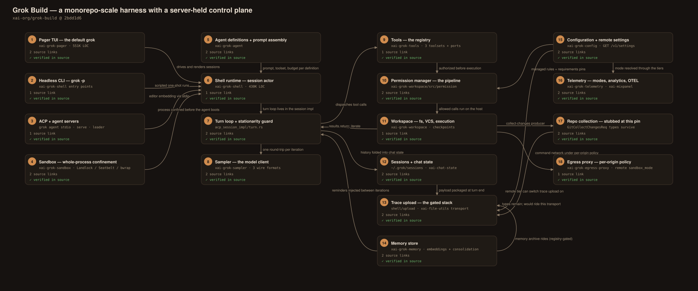
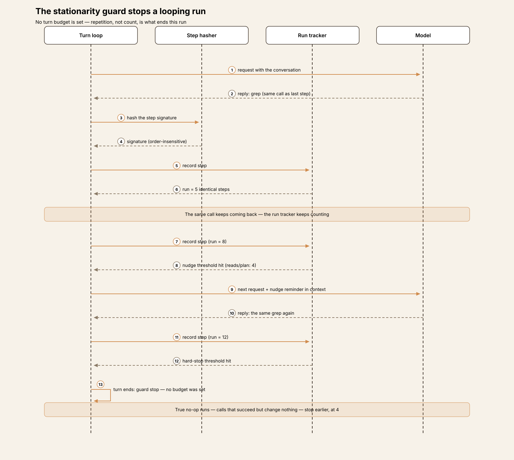
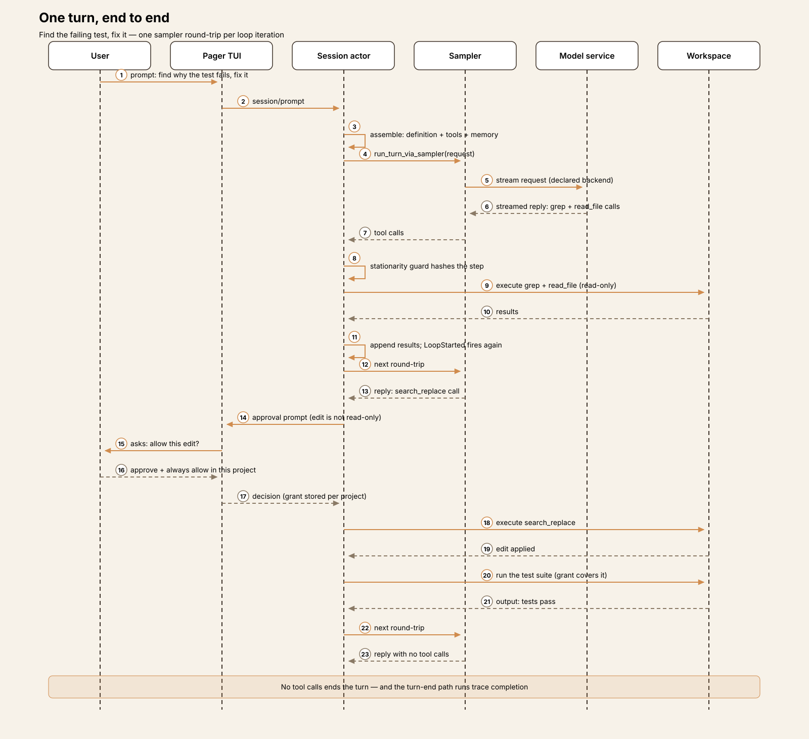
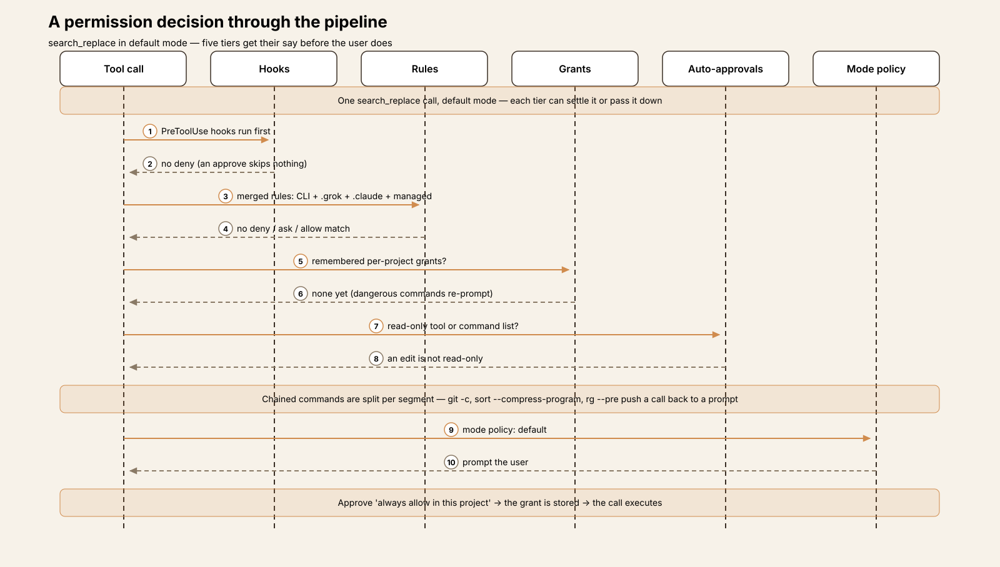
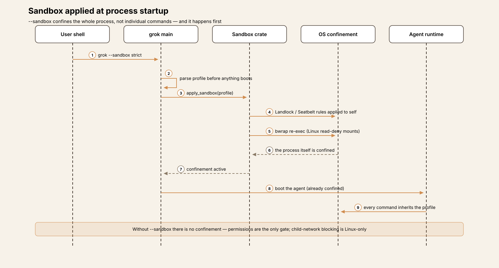
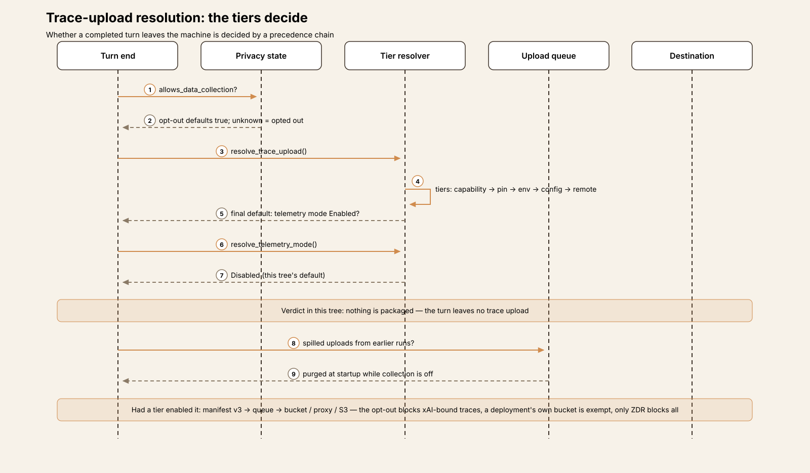

# Agent Harness Anatomy #17: Grok Build — a monorepo-scale harness with a server-held control plane

> **Series:** Agent Harness Anatomy — top-down dissections of real agent harnesses, grounded in verifiable source code. Every behavioral claim below carries a footnote to a pinned GitHub permalink; the full evidence lives in the endnotes.

## Version block

- **Repo:** [xai-org/grok-build](https://github.com/xai-org/grok-build)
- **Pinned:** commit `2bdd1d6a6369de0e8c68132ea4539e9abd9e14a8` (2026-09-29) — **by commit, because there is nothing else to pin to.** This repository has no tags and no releases; it is a one-way sync from an internal monorepo, every commit squashed to "Synced from monorepo." The repo's own provenance file, `SOURCE_REV`, records the internal revision the sync was generated from: `559751fdcec02d413e4c57c8832ab275e4f44980`.[^1]
- **Language:** Rust (toolchain pinned to 1.94.0) — 103 crates, 3,689 `.rs` files, ≈820,000 lines of Rust counted at the pin.[^2]
- **License:** Apache-2.0
- **Claim under test:** a terminal AI coding agent that runs interactively as a full-screen TUI, headlessly for scripting and CI, or embedded in editors over ACP.

Two framing notes before the dissection. First, the sync model means this tree is a snapshot of a much larger internal codebase at one revision; some subsystems arrive as complete implementations, others as wire types whose producers live elsewhere — a distinction that matters a great deal in the data-egress section below. Second, this teardown was read-only: the source was cloned and read, never built or executed, so every claim is about what the code at this commit does, not about what any shipped binary or server does today.

## The mental model

Grok Build is three programs wearing one binary. The **pager** (`xai-grok-pager`, the largest crate at ~551K lines) is the full-screen terminal interface. The **shell** (`xai-grok-shell`, ~430K lines) is the agent runtime: session actor, turn loop, model wiring, permissions glue, uploads. The **workspace** (`xai-grok-workspace`, ~125K lines) is the host side: file system, version control, command execution, checkpoints, and the permission manager. Around them sit focused crates for the agent definitions and prompt assembly (`xai-grok-agent`), the tools (`xai-grok-tools`), the model client (`xai-grok-sampler`), configuration (`xai-grok-config`), sandboxing, memory, and telemetry.

The second thing to hold in mind is *where decisions live*. Most harnesses in this series resolve their behavior locally: a config file, an environment variable, a default in code. Grok Build has all of those — and one more tier above them in practice: at startup the client fetches **remote settings** from its service (`GET /v1/settings` on the cli-chat-proxy), and that payload can enable features, set the telemetry mode, turn trace upload on, enable the session registry, and even carry a server-decided consent notice.[^3] The recurring precedence shape is: an administrator's requirements pin first, then environment, then local config, then the remote settings, then the built-in default. The defaults in this source tree are mostly conservative; the remote tier is the one a local reader cannot see the value of, and this teardown flags every place where that tier is load-bearing rather than guessing at what the server sends.

## Crate map

| Crate | Lines | Role |
|---|---|---|
| `xai-grok-pager` | 551,396 | TUI; also ships the user guide (`docs/user-guide/`, 27 documents) |
| `xai-grok-shell` | 430,485 | Agent runtime: session actor, turn loop, entry points (leader / stdio / headless), upload stack |
| `xai-grok-tools` | 165,257 | Tool implementations in three toolsets, plus in-tree ports from Codex and OpenCode |
| `xai-grok-workspace` | 124,763 | Host file system, VCS, execution, permission manager, checkpoints |
| `xai-grok-sandbox` | 31,270 | OS confinement profiles (Landlock / Seatbelt / bubblewrap) |
| `xai-grok-memory` | 29,784 | File-based memory store, embeddings, background consolidation |
| `xai-grok-config` | 28,414 | Config loading, endpoints, remote settings |
| `xai-grok-telemetry` | 27,058 | Telemetry modes, event taxonomy, internal OTEL, Sentry |
| `xai-grok-agent` | 23,744 | Agent definitions, prompt assembly, tool filtering |
| `xai-grok-sampler` | 17,947 | Model client: three wire formats, retries, doom-loop policy |
| `xai-chat-state` | 15,690 | Conversation state and compaction modes |
| `xai-grok-cloud-config` | 5,584 | Managed (enterprise) configuration |
| `xai-grok-egress-proxy` | 4,593 | Local HTTP/CONNECT proxy for per-origin network policy |

The root `Cargo.toml` is generated — the README directs readers to treat it as read-only — and the build expects DotSlash and protoc. External contributions are not accepted; this is a published mirror, not a community project layout.

## The core loop

The turn loop is an explicit `loop {}` inside `process_conversation_turn_inner` in the shell's ACP session implementation, emitting a `LoopStarted` event with the loop index on every iteration.[^4] Each iteration makes exactly one model round-trip: the loop hands the conversation to the sampler actor through `run_turn_via_sampler`, streams the response, and then dispatches any tool calls the response carried.[^5]

The stop rule is the familiar one — **a response with no tool calls ends the turn** — but it sits behind an unusual amount of machinery:[^6]

- **No default turn budget.** `max_turns` is an optional field on the agent definition (and a headless-only CLI flag); when set, the loop returns `MaxTurnsReached` once the next tool turn would exceed it. When unset — the default — no count-based cap binds the loop.[^7]
- **A stationarity guard is the real brake.** Each sampling step's tool calls are hashed into a signature that ignores argument key order and call order within the step. Eight consecutive identical steps (four for read and plan/todo calls, which the code treats as "problematic" repeats) earn the model a nudge; twelve (eight problematic) end the turn outright. A separate counter stops runs of "true no-op" steps — calls that succeed without changing anything, like a polling command — at four.[^8][^9]
- **Length salvage.** A response cut off at the output limit can be continued a budgeted number of times instead of ending the turn truncated.
- **Compaction with a prefire.** Auto-compaction triggers at 85% of the model's context window by default (the threshold itself resolves through the usual tiers, remote settings included), and a first-pass summary is prepared in the background while the turn is still running so the second pass is cheap when the threshold hits.[^10]

Interjections — messages the user sends mid-turn — are drained at safe points in the loop, and memory reminders are injected between iterations.

### The model client

The sampler speaks three wire formats — Chat Completions, Messages, and Responses — as separate stream modules, and each model catalog entry declares which backend it uses.[^11] Where requests go depends on the credential: with OAuth or session auth, inference is proxied through `https://cli-chat-proxy.grok.com/v1`; with an API key, it goes to `https://api.x.ai/v1`, and the auxiliary services (settings, feedback, trace upload, managed config, telemetry) resolve to the proxy either way.[^12][^13]

Custom models are first-class rather than an afterthought: a catalog entry carries its own base URL, API key or environment-variable key, extra headers, and a context-window size the user must supply (auto-compaction depends on it).[^14] The sampler also applies a server-delivered doom-loop policy: a response header (`x-grok-doom-loop-check`) carries the policy, and the sampler performs trigger parsing and confident-signal resampling client-side — a second, server-tuned loop guard layered over the local stationarity check.[^15]

## One turn, end to end

A concrete pass: the user asks Grok to find why a test fails and fix it.

1. **Prompt assembly.** The session actor builds the request from the agent definition: system prompt, project instructions, the tool schemas for the agent's toolset (filtered by its allowlist/denylist), memory reminders, and the conversation state held in `xai-chat-state`.
2. **Sampling.** `run_turn_via_sampler` submits the request to the sampler actor, which opens the stream on the model's declared backend — through the cli-chat-proxy for a signed-in user — and streams tokens back to the TUI.
3. **Tool calls arrive.** The response carries a `grep` call and a `read_file` call. The stationarity guard hashes the step's signature and starts a run count.
4. **Authorization.** Both calls are read-only tools, so they pass the permission pipeline without a prompt (a matching `ask` rule or hook could still intervene). The calls execute in the workspace crate against the host file system.
5. **Results return.** Tool results are appended to the conversation; the loop iterates, `LoopStarted` fires again, and the model — now holding the failing test's source — proposes an edit.
6. **The edit prompts.** In the default mode, `search_replace` is not on the read-only list, so the permission manager evaluates rules and remembered grants, finds none, and prompts. The user approves with "always allow in this project," and the decision is stored as a per-project grant outside the repository.
7. **Verification.** The model runs the test suite through the terminal tool. The chained command is split into segments and each is checked; the test runner is not a read-only command, but the earlier grant covers the prompt. Output streams back as the next tool result.
8. **The turn ends.** The model's next response contains no tool calls. The optional todo gate stays quiet (it is remote-gated and off by default), the turn completes, and — this matters for the egress section — the turn-end path runs trace completion: *if* trace upload is enabled, the turn's messages, permission events, and session state are packaged for upload; if it is not, nothing leaves.

## Tools

The native toolset covers the expected ground: a terminal, file read/edit (`search_replace`), content search, directory listing, todos, web search and fetch, plan mode entry/exit, an ask-the-user tool, LSP queries, scheduling, background-task control, image and video generation, and the `task` tool for subagents. Two alternate toolsets ship alongside it — a concise variant and a hashline variant — and the crate also carries in-tree ports of tool implementations from openai/codex and sst/opencode, disclosed in `THIRD-PARTY-NOTICES`.[^16]

Registration is declarative: tools are rows in a registry, and an agent definition's `tools` allowlist and `disallowed_tools` denylist filter them, with a compatibility mapping so vendor tool names in imported agent definitions still resolve to the corresponding Grok tool kinds.[^17] MCP tools join the same registry and pass through the same permission pipeline as built-ins. Subagents spawned through `task` can be isolated in a fresh git worktree, inherit or override the parent's turn budget, and be messaged, waited on, and killed through companion tools.

## Approvals and the sandbox

Six permission modes span the usual range — `default` (ask), `acceptEdits`, `auto`, `dontAsk`, `bypassPermissions` (always-approve), and `plan`.[^18] Within any mode, a tool call is authorized in a fixed order, as the shipped user guide describes it and the workspace permission code implements it:[^19]

1. **`PreToolUse` hooks** may deny the call outright (an approving hook does not skip the remaining checks).
2. **Permission rules** — `deny` wins over `ask` wins over `allow` — merged from CLI flags, global and per-directory `.grok/config.toml` files, Claude-compatible `.claude/settings.json` files, and managed configuration.
3. **Remembered grants** from earlier prompts, scoped per project; commands on a dangerous list re-prompt instead of reusing a grant.
4. **Built-in auto-approvals** for read-only tools and a fixed list of read-only shell commands, evaluated per segment after splitting chained commands — with deliberate exceptions: constructs that can smuggle execution (`git -c` config overrides, `sort --compress-program`, `rg --pre`) push the call back to a prompt.
5. **The mode's policy.** Always-approve short-circuits after step 2; deny rules, hooks, and shell `ask` rules still apply inside it.

The `auto` mode replaces the step-5 prompt with a background **LLM transcript classifier** (with safe fast paths for clearly routine calls): what the classifier allows proceeds, what it does not is escalated to a prompt interactively or refused in non-interactive runs.[^20] Administrators can lock always-approve off entirely through a requirements file, including a system-level copy users cannot remove.

Sandboxing is a separate, opt-in layer with an unusual property: it confines the **whole agent process**, not individual commands. Passing `--sandbox <profile>` makes the binary apply OS confinement to itself at startup, before the agent boots — Landlock on Linux, Seatbelt on macOS, with a bubblewrap re-exec providing read-deny mounts on Linux.[^21][^22] Profiles run from `workspace` (read anywhere, write to the working directory and temp) through `read-only` to `strict` (read only the working directory plus system paths; child network blocked on Linux). Custom profiles can add kernel-enforced deny globs — the guide's example is `**/.env` — and under the stricter profiles Grok's own global configuration, hooks, and trust files are write-denied, so a running session cannot rewrite the policy that governs it. Child-process network blocking is seccomp-based and, as the guide states plainly, a no-op on macOS. A second, per-command sandbox layer exists in the code — gated by a remote `sandbox_mode` of off/observe/enforce and paired with a local egress proxy that enforces per-origin website policies — but the whole-process profile is the mechanism a user can switch on today. Without `--sandbox`, commands run unconfined and the permission system is the only gate.

### What leaves the machine

This product was open-sourced days after a disclosure that earlier CLI versions had uploaded users' entire repositories — including `.env` files — to a cloud storage bucket. The right question for this tree is narrow and checkable: at this commit, what upload code exists, what does it send, what gates it, and is the repository-upload path reachable? The answers below are from the code at the pin, not from coverage of the disclosure.

**The upload stack is real and substantial.** A dedicated upload module in the shell (trace assembly, a manifest at schema v3, a drain pass at exit) sits on a transport crate with a durable, disk-spilling upload queue and three destination shapes: direct-to-bucket with a service-account key, through the cli-chat-proxy with the user's bearer token, or direct to S3. Destination resolution prefers a deployment's own configured bucket, then the proxy, then a configured service-account key; there is no compiled-in default bucket in this source tree (the default is read from a build-time environment variable that is unset here).[^23][^24][^25]

**What a session trace contains.** When trace upload is on, each completed turn packages the turn's messages and full prompt text, the session's chat history (the session-state archive's payload is `chat_history.jsonl` — session files, not workspace files), the turn's permission events, trace metadata enriched with the git repository root and remote URL, and — under a separate gate described below — the memory directory as a tar archive.[^26][^27]

**The repository-upload path is stubbed out at this pin.** The wire types for collecting a repository survive intact: a request type that asks for commits ahead of a base *with patches*, uncommitted changes, and untracked files with base64 content (capped at 1 MiB per file, larger files excluded rather than truncated), including a `force_include_paths` field documented as capturing paths "even when gitignored"; the server still advertises upload limits for it; the restore-side dedup types remain.[^28] But both producer entry points — the workspace operation and the ACP extension method `x.ai/git/serialize_changes` — return an error at this commit: "git collect changes is unavailable in this build."[^29] The exclusion lists that would have governed collection remain in the transport crate; read closely, they skip a directory *named* `.env` but include no `.env` file pattern — a detail that is moot while the producer is stubbed, and worth recording precisely because it is the list a re-enabled producer would use.[^30]

**The gates on what does upload are layered, and the defaults in this tree are closed.**

- The privacy state arrives with the auth profile: a team-level zero-data-retention flag, or the user's coding-data-retention opt-out. The opt-out's default — the value used when the state is unknown — is `true`: unknown means opted out, until the server's profile response says otherwise.[^31] Collection paths consult a fail-closed check on this state.[^32]
- Trace upload resolves through the standard tiers — distribution capability, requirements pin, environment, config, then a remote `trace_upload_enabled` flag — and its final default is "the telemetry mode is Enabled." The telemetry mode's own final default, in this source, is Disabled. So a build of this tree uploads no traces unless some tier turns telemetry on; the remote tier is one of the tiers that can, and what xAI's production settings endpoint returns for a given account is not determinable from this repository.[^33][^34]
- Where the traces go changes the privacy rule: when the destination is xAI (proxy mode), the coding-data opt-out blocks the upload; when a deployment configures its *own* bucket, the opt-out does not apply — only zero-data-retention blocks every destination. The code states this distinction in a comment, deliberately.[^35]
- Uploads that spill to the local queue are reconciled at startup against the current verdict: if data collection is disabled, spilled uploads from a previous run are purged rather than sent.[^36]
- The memory archive has its own gate: it uploads only when the session registry is enabled (by local config or the remote `session_registry_enabled` setting), and the skip is recorded in the turn's manifest when it is not.[^37]

**Feedback is the consent on-ramp.** The one path designed to turn sharing on is a feedback card: remote-gated, never offered to zero-retention teams, never with a deployment key or a custom trace destination. Accepting it issues a one-shot upload configuration that deliberately ignores the cached opt-out and the live trace flag — fresh consent supersedes both — and fails closed when the privacy state cannot be established.[^38][^39]

**The remaining streams are separate and narrower.** Product analytics (Mixpanel events) require telemetry enabled and a non-ZDR team.[^40] Internal tracing spans go to the proxy by default and can be disabled with `OTEL_TRACES_EXPORTER=none`. The external OTEL stream the user guide describes — exports to the user's *own* collector, off by default, double opt-in, with prompt and tool-content gates defaulting off — is kept structurally separate from the xAI-side streams in the endpoint code, and `/privacy` governs the xAI-side retention settings, not that stream.

The precise summary for this commit: the machinery to upload conversations exists and is carefully gated, with defaults in the source tree set to closed and an unknown privacy state treated as opted out; the machinery to upload a repository exists only as types and server limits, with its producers disabled in this build. Both halves of that sentence are properties of this snapshot — the gates are tiered, and the tiers above the local ones are held server-side.

## Memory and sessions

Sessions persist under `~/.grok/sessions/`, one directory per working directory and one subdirectory per session, holding an append-only `updates.jsonl`, a `summary.json`, the `chat_history.jsonl`, and per-prompt files.[^41] Resume is by session id or title, with forking supported; file-state checkpoints (`rewind_points.jsonl`) let a session rewind its workspace edits. Cross-session memory is a real subsystem rather than a transcript search: a file-based store (default root `~/.grok/memory`) with chunking, embeddings, and a background consolidation pass, whose reminders the turn loop injects. Session search across past sessions is a separate small crate.

## Extensions

Hooks follow the familiar event model (PreToolUse, PostToolUse, UserPromptSubmit, SessionStart, Stop, SubagentStop) with command hooks and matchers, and project hooks are gated by folder trust. MCP is client-side, with elicitation support, and MCP tools pass through the same rules system (`MCPTool(...)` patterns). Custom agents are definitions — tools, model, turn budget, permission mode — loaded from `.grok/agents` and from Claude-compatible settings, which this codebase reads natively in several places (settings, agents, permission rules). Skills are invocable through the tool surface, and a plugin marketplace crate handles plugin distribution.

## Interfaces

- **TUI:** the default `grok` — full-screen, with a session picker, mode cycling, and a `/privacy` command that opens the coding-data and retention settings.
- **Headless:** `grok -p "<prompt>"`, with plain/JSON/streaming output formats, `--max-turns`, tool allow/deny lists, permission rules on the command line, and resume flags — the scripting and CI surface.
- **ACP and agent servers:** `grok agent stdio` for editor embedding, and `grok agent serve` for a token-guarded local server; ACP clients can request always-approve per session via `_meta`.
- **Leader mode:** one leader process can host sessions that other `grok` processes attach to, with a relay channel for remote control.

## Observations

- **Scale is the first fact.** At ~820K lines of Rust this is the largest tree in the series by a wide margin, and the size is not accidental bloat: much of it is the surface area of a product that must be a TUI, a headless CLI, an editor backend, and an enterprise-managed deployment at once. The crate boundaries are correspondingly fine — 103 crates — and the load-bearing logic concentrates in three of them.
- **The control plane is a feature, treated as such.** Remote settings, managed config, requirements pins, server-delivered feature flags, and even a server-carried doom-loop policy are not scaffolding around the harness; they are how the harness is operated. Reading this codebase well means tracking, for every behavior, which tier decides it.
- **The loop's safety story is about repetition, not just budgets.** There is no default turn cap; there is a precise, order-insensitive stationarity guard with different thresholds for reads and plan writes than for other tools — a design that encodes production experience with how agents actually loop.
- **The permission system is the deepest subsystem relative to its visibility.** Segment-wise shell analysis, execution-smuggling exceptions, per-project grants, a classifier-backed auto mode, and administrator locks make it closer to a policy engine than a prompt dialog.
- **The egress code reads as post-incident engineering.** Fail-closed defaults, consent that supersedes caches, purge-on-disable for queued uploads, manifest-recorded skips: whether or not one credits the intent, the mechanisms are specific and checkable, and the repository-collection producer is disabled in this build while its types remain — a combination a reader can verify rather than trust.

## Tradeoffs

- **Server-held tiers buy operability and cost local legibility.** A behavior can be changed for every user without a release — and a user (or an auditor) reading the source cannot determine the production value of the switches that matter most. The code is unusually transparent about the mechanism; the mechanism's inputs are not in the repo.
- **Whole-process sandboxing is strong and blunt.** Confining the agent process itself closes the gaps per-command wrappers leave, at the price of an all-or-nothing profile chosen at launch, platform asymmetry (child-network blocking is Linux-only), and policy files that must be write-protected against the process they govern.
- **Compatibility is a strategy with a maintenance tail.** Reading Claude-format settings, agents, and rules natively — plus tool implementations ported from two other harnesses — lowers switching costs and multiplies the surfaces that must stay correct.
- **A stubbed producer with live types is a snapshot, not a settlement.** Disabling repository collection in this build is verifiable; the retained types, limits, and restore code mean the capability's shape remains in the tree, and a future sync could change the verdict. Teardowns pin a commit for exactly this reason.

## Comparison matrix row

| # | Dimension | Grok Build (grok) (`2bdd1d6`) |
|---|---|---|
| 1 | Agent loop | Explicit `loop {}` in the shell session actor; one sampler round-trip per iteration; turn ends on a response with no tool calls; **no default turn cap** (`max_turns` is per-agent-definition / CLI); stationarity guard nudges at 8 identical steps (4 for reads/plan) and hard-stops at 12 (8); length-salvage continuations; two-pass compaction prefired at 85% of window |
| 2 | Tool system | Registry-declared tools in three toolsets (native, concise, hashline) plus in-tree Codex/OpenCode ports; per-agent allowlist/denylist with vendor-name compatibility mapping; MCP tools join the same registry and permission pipeline; subagents via `task` with optional worktree isolation |
| 3 | Model providers | First-party via cli-chat-proxy (session/OAuth) or api.x.ai (API key); three wire backends (chat completions, messages, responses) chosen per catalog entry; BYOK custom models with own base URL/key/headers/context window |
| 4 | Prompt construction | Agent definition + project instructions + filtered tool schemas + memory reminders assembled per turn; interjections drained at safe points; compaction summaries replace history at threshold |
| 5 | Memory/session | Per-cwd session dirs under `~/.grok/sessions` (updates.jsonl, summary, chat_history.jsonl); resume/fork; file-state rewind points; separate file-based memory store with embeddings and background consolidation; session search crate |
| 6 | Reasoning/planning | Todo tool + plan mode (enter/exit tools); TodoGate nudge (remote-gated, default off); subagent delegation with message/wait/kill controls; goals and workflows tooling |
| 7 | Extensibility | Hooks (Claude-style events, folder-trust gated); MCP client with elicitation; custom agent definitions incl. Claude-compatible formats; skills; plugin marketplace; feature registry resolved pin → env → config → remote → default |
| 8 | Interfaces | Full-screen TUI; headless `-p` with JSON/streaming output; ACP over stdio and a token-guarded local server; leader mode with relay for remote control |
| 9 | Failure handling | Sampler retries with wait budgets and parked turns on uncharged 401s; server doom-loop header policy with resampling; upload queue spills to disk with startup reconcile (re-enqueue or purge by current privacy verdict); torn-state recovery for sessions |
| 10 | Security model | Six permission modes; hooks → rules (deny>ask>allow) → per-project grants → read-only auto-approvals → mode policy; LLM-classifier auto mode; admin requirements locks; opt-in whole-process OS sandbox (Landlock/Seatbelt, off by default); trace upload off by default in-tree with fail-closed privacy defaults; whole-repo collection stubbed out at this pin |

## Endnotes

All notes are VERIFIED against `2bdd1d6a6369de0e8c68132ea4539e9abd9e14a8` unless marked otherwise. `GH` = `https://github.com/xai-org/grok-build/blob/2bdd1d6a6369de0e8c68132ea4539e9abd9e14a8/`.

[^1]: Provenance: [GH…/SOURCE_REV](https://github.com/xai-org/grok-build/blob/2bdd1d6a6369de0e8c68132ea4539e9abd9e14a8/SOURCE_REV) contains the single line `559751fdcec02d413e4c57c8832ab275e4f44980`. No tags or releases exist (GitHub API, checked 2026-10-14); the pinned commit's message is "Synced from monorepo" (2026-09-29).

[^2]: Counts at the pin: 4,487 tracked files, 3,689 `.rs` files, 819,658 lines of Rust, 103 crates with a `Cargo.toml` across `crates/build/`, `crates/codegen/`, and `crates/common/`. Toolchain pin: [GH…/rust-toolchain.toml](https://github.com/xai-org/grok-build/blob/2bdd1d6a6369de0e8c68132ea4539e9abd9e14a8/rust-toolchain.toml) (1.94.0).

[^3]: Remote settings: [GH…/crates/codegen/xai-grok-config/src/remote_settings.rs#L1](https://github.com/xai-org/grok-build/blob/2bdd1d6a6369de0e8c68132ea4539e9abd9e14a8/crates/codegen/xai-grok-config/src/remote_settings.rs#L1) — "Remote settings fetched from cli-chat-proxy `GET /v1/settings`". The payload includes a server-decided consent-gate notice and a remote sandbox kill switch (same file).

[^4]: The turn loop: [GH…/crates/codegen/xai-grok-shell/src/session/acp_session_impl/turn.rs#L2747](https://github.com/xai-org/grok-build/blob/2bdd1d6a6369de0e8c68132ea4539e9abd9e14a8/crates/codegen/xai-grok-shell/src/session/acp_session_impl/turn.rs#L2747) (`loop {}` in `process_conversation_turn_inner`, emitting `Event::LoopStarted { loop_index }`).

[^5]: One round-trip per iteration: [GH…/crates/codegen/xai-grok-shell/src/session/acp_session_impl/sampler_turn.rs#L1716](https://github.com/xai-org/grok-build/blob/2bdd1d6a6369de0e8c68132ea4539e9abd9e14a8/crates/codegen/xai-grok-shell/src/session/acp_session_impl/sampler_turn.rs#L1716) (`run_turn_via_sampler`).

[^6]: Turn ends on an empty tool-call set: [GH…/crates/codegen/xai-grok-shell/src/session/acp_session_impl/turn.rs#L3623](https://github.com/xai-org/grok-build/blob/2bdd1d6a6369de0e8c68132ea4539e9abd9e14a8/crates/codegen/xai-grok-shell/src/session/acp_session_impl/turn.rs#L3623) (`if tool_calls.is_empty()`, after the length-salvage handling above it).

[^7]: `max_turns` is an agent-definition field: [GH…/crates/codegen/xai-grok-agent/src/config.rs#L740](https://github.com/xai-org/grok-build/blob/2bdd1d6a6369de0e8c68132ea4539e9abd9e14a8/crates/codegen/xai-grok-agent/src/config.rs#L740) (`pub max_turns: Option<u32>`, default `None` in the definition defaults); enforcement inside the loop: [GH…/crates/codegen/xai-grok-shell/src/session/acp_session_impl/turn.rs#L3853](https://github.com/xai-org/grok-build/blob/2bdd1d6a6369de0e8c68132ea4539e9abd9e14a8/crates/codegen/xai-grok-shell/src/session/acp_session_impl/turn.rs#L3853).

[^8]: Stationarity thresholds: [GH…/crates/codegen/xai-grok-shell/src/session/acp_session_impl/turn.rs#L3896-L3900](https://github.com/xai-org/grok-build/blob/2bdd1d6a6369de0e8c68132ea4539e9abd9e14a8/crates/codegen/xai-grok-shell/src/session/acp_session_impl/turn.rs#L3896-L3900) — `NUDGE_AFTER_IDENTICAL_PROBLEMATIC_TOOL_CALLS = 4`, `NUDGE_AFTER_IDENTICAL_TOOL_CALLS = 8`, `MAX_CONSECUTIVE_IDENTICAL_PROBLEMATIC_TOOL_CALLS = 8`, `MAX_CONSECUTIVE_IDENTICAL_TOOL_CALLS = 12`, `MAX_CONSECUTIVE_TRUE_NOOPS = 4`.

[^9]: The run tracker and its order-insensitive step signature: [GH…/crates/codegen/xai-grok-shell/src/session/acp_session_impl/turn.rs#L3960](https://github.com/xai-org/grok-build/blob/2bdd1d6a6369de0e8c68132ea4539e9abd9e14a8/crates/codegen/xai-grok-shell/src/session/acp_session_impl/turn.rs#L3960) (`struct IdenticalToolCallRun`); reads and plan writes are the "problematic" kinds (`is_problematically_repeating_kind`, same file).

[^10]: Auto-compact threshold: [GH…/crates/codegen/xai-grok-shell/src/agent/config.rs#L1083-L1086](https://github.com/xai-org/grok-build/blob/2bdd1d6a6369de0e8c68132ea4539e9abd9e14a8/crates/codegen/xai-grok-shell/src/agent/config.rs#L1083-L1086) — the resolver "falls through to remote tiers and then the hardcoded default 85".

[^11]: Three sampler wire formats: `crates/codegen/xai-grok-sampler/src/stream/{chat_completions,messages,responses}.rs`; per-model backend selection (`api_backend`: `"chat_completions"` default, `"responses"`) on the catalog entry at [GH…/crates/codegen/xai-grok-shell/src/agent/config.rs#L3279](https://github.com/xai-org/grok-build/blob/2bdd1d6a6369de0e8c68132ea4539e9abd9e14a8/crates/codegen/xai-grok-shell/src/agent/config.rs#L3279).

[^12]: Production endpoints: [GH…/crates/codegen/xai-grok-env/src/lib.rs#L20-L26](https://github.com/xai-org/grok-build/blob/2bdd1d6a6369de0e8c68132ea4539e9abd9e14a8/crates/codegen/xai-grok-env/src/lib.rs#L20-L26) — `cli_chat_proxy_base_url: "https://cli-chat-proxy.grok.com/v1"`, plus the relay and gateway WebSocket URLs.

[^13]: Auxiliary services resolve to the proxy; only API-key inference uses the xAI API base: [GH…/crates/codegen/xai-grok-config/src/endpoints.rs#L1-L4](https://github.com/xai-org/grok-build/blob/2bdd1d6a6369de0e8c68132ea4539e9abd9e14a8/crates/codegen/xai-grok-config/src/endpoints.rs#L1-L4); `XAI_API_BASE_URL_DEFAULT = "https://api.x.ai/v1"` at [GH…/crates/codegen/xai-grok-config/src/endpoints.rs#L270](https://github.com/xai-org/grok-build/blob/2bdd1d6a6369de0e8c68132ea4539e9abd9e14a8/crates/codegen/xai-grok-config/src/endpoints.rs#L270).

[^14]: Custom model entries carry `base_url`, `api_key` / `env_key`, extra headers for BYOK, and a required context-window field: the `ModelEntryConfig` struct at [GH…/crates/codegen/xai-grok-shell/src/agent/config.rs#L3266](https://github.com/xai-org/grok-build/blob/2bdd1d6a6369de0e8c68132ea4539e9abd9e14a8/crates/codegen/xai-grok-shell/src/agent/config.rs#L3266).

[^15]: Server-side doom-loop policy: [GH…/crates/codegen/xai-grok-shell/src/agent/config.rs#L1960](https://github.com/xai-org/grok-build/blob/2bdd1d6a6369de0e8c68132ea4539e9abd9e14a8/crates/codegen/xai-grok-shell/src/agent/config.rs#L1960) — "It covers the `x-grok-doom-loop-check` header, trigger parsing, and confident-signal resampling, all applied by the sampler."

[^16]: Toolset layout and third-party ports: `crates/codegen/xai-grok-tools/src/implementations/` holds `grok_build/`, `grok_build_concise/`, `grok_build_hashline/`, `codex/`, and `opencode/`; the ports are disclosed in [GH…/THIRD-PARTY-NOTICES](https://github.com/xai-org/grok-build/blob/2bdd1d6a6369de0e8c68132ea4539e9abd9e14a8/THIRD-PARTY-NOTICES).

[^17]: Allowlist/denylist filtering with vendor-name compatibility: [GH…/crates/codegen/xai-grok-agent/src/tool_list.rs#L1](https://github.com/xai-org/grok-build/blob/2bdd1d6a6369de0e8c68132ea4539e9abd9e14a8/crates/codegen/xai-grok-agent/src/tool_list.rs#L1) — "Which toolset tools an agent's `tools` allowlist keeps and its `disallowed_tools` denylist removes", backed by the shared vendor-to-Grok tool registry in `xai-grok-tools`.

[^18]: Permission modes: [GH…/crates/codegen/xai-grok-agent/src/config.rs#L921-L931](https://github.com/xai-org/grok-build/blob/2bdd1d6a6369de0e8c68132ea4539e9abd9e14a8/crates/codegen/xai-grok-agent/src/config.rs#L921-L931) — `Default`, `AcceptEdits`, `Auto`, `DontAsk`, `BypassPermissions`, `Plan`.

[^19]: The authorization pipeline as documented by the project: [GH…/crates/codegen/xai-grok-pager/docs/user-guide/22-permissions-and-safety.md](https://github.com/xai-org/grok-build/blob/2bdd1d6a6369de0e8c68132ea4539e9abd9e14a8/crates/codegen/xai-grok-pager/docs/user-guide/22-permissions-and-safety.md) ("How a tool call is authorized", steps 1–5, including the always-approve short-circuit and the read-only command list with its execution-smuggling exceptions); implemented across `xai-grok-workspace/src/permission/` and `xai-grok-permission-rules`.

[^20]: Auto mode: [GH…/crates/codegen/xai-grok-workspace/src/permission/auto_mode/mod.rs#L1-L3](https://github.com/xai-org/grok-build/blob/2bdd1d6a6369de0e8c68132ea4539e9abd9e14a8/crates/codegen/xai-grok-workspace/src/permission/auto_mode/mod.rs#L1-L3) — "Auto permission mode: LLM transcript classifier with safe fast-paths."

[^21]: Sandbox applied to the process at startup: [GH…/crates/codegen/xai-grok-pager-bin/src/main.rs#L2202](https://github.com/xai-org/grok-build/blob/2bdd1d6a6369de0e8c68132ea4539e9abd9e14a8/crates/codegen/xai-grok-pager-bin/src/main.rs#L2202) (`xai_grok_shell::config::apply_sandbox(...)` before the agent boots); profiles and platform notes in the shipped guide, [GH…/crates/codegen/xai-grok-pager/docs/user-guide/18-sandbox.md](https://github.com/xai-org/grok-build/blob/2bdd1d6a6369de0e8c68132ea4539e9abd9e14a8/crates/codegen/xai-grok-pager/docs/user-guide/18-sandbox.md).

[^22]: Bubblewrap re-exec for read-deny/read-only mounts on Linux: [GH…/crates/codegen/xai-grok-sandbox/src/lib.rs#L292](https://github.com/xai-org/grok-build/blob/2bdd1d6a6369de0e8c68132ea4539e9abd9e14a8/crates/codegen/xai-grok-sandbox/src/lib.rs#L292) (`bwrap_reexec_command`).

[^23]: Upload destinations: [GH…/crates/codegen/xai-file-utils/src/upload_config.rs#L10](https://github.com/xai-org/grok-build/blob/2bdd1d6a6369de0e8c68132ea4539e9abd9e14a8/crates/codegen/xai-file-utils/src/upload_config.rs#L10) (`pub enum UploadMethod` — `Direct`, `Proxy`, `S3`).

[^24]: Destination resolution order (deployment bucket → proxy → configured service-account key → none): `crates/codegen/xai-grok-shell/src/agent/config.rs` L206–227 (`resolve` on the trace-upload endpoints), read at the pin.

[^25]: No compiled-in default bucket in this tree: [GH…/crates/codegen/xai-grok-shell/src/upload/gcs.rs#L93-L94](https://github.com/xai-org/grok-build/blob/2bdd1d6a6369de0e8c68132ea4539e9abd9e14a8/crates/codegen/xai-grok-shell/src/upload/gcs.rs#L93-L94) — `SESSION_TRACES_BUCKET: Option<&str> = option_env!("GROK_SESSION_TRACES_BUCKET_DEFAULT")`, unset when building from this source. Whether the shipped release build sets it is an open item (see RECON).

[^26]: Per-turn trace assembly: [GH…/crates/codegen/xai-grok-shell/src/upload/turn.rs#L253](https://github.com/xai-org/grok-build/blob/2bdd1d6a6369de0e8c68132ea4539e9abd9e14a8/crates/codegen/xai-grok-shell/src/upload/turn.rs#L253) (`complete_prompt_trace`).

[^27]: Session-state archive payload is the chat history only (`build_chat_history_session_state` / `compress_chat_history_archive`), and trace metadata is enriched with the git root and remote URL: `crates/codegen/xai-grok-shell/src/upload/trace.rs`, read at the pin. The harness-session-archive uploader in the same file is a stub returning `false`.

[^28]: Repository-collection wire type: [GH…/crates/codegen/xai-grok-workspace-types/src/rpc/git.rs#L799](https://github.com/xai-org/grok-build/blob/2bdd1d6a6369de0e8c68132ea4539e9abd9e14a8/crates/codegen/xai-grok-workspace-types/src/rpc/git.rs#L799) (`pub struct GitCollectChangesReq`); `force_include_paths` ("captured even when gitignored") at [GH…/crates/codegen/xai-grok-workspace-types/src/rpc/git.rs#L824](https://github.com/xai-org/grok-build/blob/2bdd1d6a6369de0e8c68132ea4539e9abd9e14a8/crates/codegen/xai-grok-workspace-types/src/rpc/git.rs#L824); the 1 MiB untracked-content cap at [GH…/crates/codegen/xai-grok-workspace-types/src/rpc/git.rs#L1027](https://github.com/xai-org/grok-build/blob/2bdd1d6a6369de0e8c68132ea4539e9abd9e14a8/crates/codegen/xai-grok-workspace-types/src/rpc/git.rs#L1027). Server-advertised limits: `UploadLimits` at [GH…/crates/codegen/xai-file-utils/src/storage_client.rs#L296](https://github.com/xai-org/grok-build/blob/2bdd1d6a6369de0e8c68132ea4539e9abd9e14a8/crates/codegen/xai-file-utils/src/storage_client.rs#L296).

[^29]: Both producers stubbed: [GH…/crates/codegen/xai-grok-workspace/src/workspace_ops.rs#L615](https://github.com/xai-org/grok-build/blob/2bdd1d6a6369de0e8c68132ea4539e9abd9e14a8/crates/codegen/xai-grok-workspace/src/workspace_ops.rs#L615) ("git collect changes is unavailable in this build") and [GH…/crates/codegen/xai-grok-shell/src/extensions/git.rs#L306](https://github.com/xai-org/grok-build/blob/2bdd1d6a6369de0e8c68132ea4539e9abd9e14a8/crates/codegen/xai-grok-shell/src/extensions/git.rs#L306) ("git serialize_changes is unavailable in this build").

[^30]: Exclusion lists: [GH…/crates/codegen/xai-file-utils/src/upload_config.rs#L49](https://github.com/xai-org/grok-build/blob/2bdd1d6a6369de0e8c68132ea4539e9abd9e14a8/crates/codegen/xai-file-utils/src/upload_config.rs#L49) (`SKIP_DIR_NAMES`, includes a `.env` directory name) and [GH…/crates/codegen/xai-file-utils/src/upload_config.rs#L91](https://github.com/xai-org/grok-build/blob/2bdd1d6a6369de0e8c68132ea4539e9abd9e14a8/crates/codegen/xai-file-utils/src/upload_config.rs#L91) (`SKIP_FILE_PATTERNS` — build artifacts and swap files; no `.env` file pattern as read at the pin).

[^31]: Privacy defaults: [GH…/crates/codegen/xai-grok-login/src/model.rs#L22](https://github.com/xai-org/grok-build/blob/2bdd1d6a6369de0e8c68132ea4539e9abd9e14a8/crates/codegen/xai-grok-login/src/model.rs#L22) (`default_coding_data_retention_opt_out()` returns `true`) and [GH…/crates/codegen/xai-grok-login/src/model.rs#L194](https://github.com/xai-org/grok-build/blob/2bdd1d6a6369de0e8c68132ea4539e9abd9e14a8/crates/codegen/xai-grok-login/src/model.rs#L194) (`is_data_collection_disabled()` = ZDR team or retention opt-out).

[^32]: Fail-closed collection check: [GH…/crates/codegen/xai-grok-login/src/manager.rs#L800](https://github.com/xai-org/grok-build/blob/2bdd1d6a6369de0e8c68132ea4539e9abd9e14a8/crates/codegen/xai-grok-login/src/manager.rs#L800) (`AuthManager::allows_data_collection`).

[^33]: Trace-upload resolution: [GH…/crates/codegen/xai-grok-shell/src/agent/config.rs#L1883](https://github.com/xai-org/grok-build/blob/2bdd1d6a6369de0e8c68132ea4539e9abd9e14a8/crates/codegen/xai-grok-shell/src/agent/config.rs#L1883) (`resolve_trace_upload`; the remote tier is the `trace_upload_enabled` field at [GH…/crates/codegen/xai-grok-config/src/remote_settings.rs#L562](https://github.com/xai-org/grok-build/blob/2bdd1d6a6369de0e8c68132ea4539e9abd9e14a8/crates/codegen/xai-grok-config/src/remote_settings.rs#L562)).

[^34]: Telemetry-mode default: [GH…/crates/codegen/xai-grok-telemetry/src/config.rs#L10-L15](https://github.com/xai-org/grok-build/blob/2bdd1d6a6369de0e8c68132ea4539e9abd9e14a8/crates/codegen/xai-grok-telemetry/src/config.rs#L10-L15) — `TelemetryMode` defaults to `Disabled`; the mode resolver is `resolve_telemetry_mode` at [GH…/crates/codegen/xai-grok-shell/src/agent/config.rs#L1855](https://github.com/xai-org/grok-build/blob/2bdd1d6a6369de0e8c68132ea4539e9abd9e14a8/crates/codegen/xai-grok-shell/src/agent/config.rs#L1855).

[^35]: Destination-dependent privacy rule: [GH…/crates/codegen/xai-grok-shell/src/agent/config.rs#L239](https://github.com/xai-org/grok-build/blob/2bdd1d6a6369de0e8c68132ea4539e9abd9e14a8/crates/codegen/xai-grok-shell/src/agent/config.rs#L239) (`is_trace_upload_blocked_for`); the trait comment at L164–165 of the same file states that a deployment's own bucket is exempt from the opt-out while ZDR blocks all destinations.

[^36]: Startup reconcile purges spilled uploads when collection is disabled: [GH…/crates/codegen/xai-grok-shell/src/upload/trace.rs#L1113](https://github.com/xai-org/grok-build/blob/2bdd1d6a6369de0e8c68132ea4539e9abd9e14a8/crates/codegen/xai-grok-shell/src/upload/trace.rs#L1113) (`spawn_startup_spill_reconcile` — "purge them when data collection is disabled").

[^37]: Memory-upload gate: [GH…/crates/codegen/xai-grok-shell/src/upload/memory.rs#L103-L104](https://github.com/xai-org/grok-build/blob/2bdd1d6a6369de0e8c68132ea4539e9abd9e14a8/crates/codegen/xai-grok-shell/src/upload/memory.rs#L103-L104) — skipped when `session_registry_enabled=false`, with the skip recorded in the manifest; the registry itself is enabled by local config or the remote setting (`build_registry_config`, `crates/codegen/xai-grok-shell/src/agent/mvp_agent/agent_ops.rs`).

[^38]: Feedback offer conditions: [GH…/crates/codegen/xai-grok-shell/src/agent/mvp_agent/agent_ops.rs#L3583](https://github.com/xai-org/grok-build/blob/2bdd1d6a6369de0e8c68132ea4539e9abd9e14a8/crates/codegen/xai-grok-shell/src/agent/mvp_agent/agent_ops.rs#L3583) (`feedback_trace_offer`); the feature's default is `false` with a remote tier: [GH…/crates/codegen/xai-grok-config-types/src/registry.rs#L221](https://github.com/xai-org/grok-build/blob/2bdd1d6a6369de0e8c68132ea4539e9abd9e14a8/crates/codegen/xai-grok-config-types/src/registry.rs#L221) (`Feature::FeedbackTraceCard`).

[^39]: One-shot consent upload: [GH…/crates/codegen/xai-grok-shell/src/agent/mvp_agent/agent_ops.rs#L3621](https://github.com/xai-org/grok-build/blob/2bdd1d6a6369de0e8c68132ea4539e9abd9e14a8/crates/codegen/xai-grok-shell/src/agent/mvp_agent/agent_ops.rs#L3621) (`one_shot_feedback_gcs_config` — proxy-only, ZDR-blocked, ignores the cached opt-out and live trace flag, fails closed on unknown privacy state).

[^40]: Product analytics gate: [GH…/crates/codegen/xai-grok-shell/src/agent/config.rs#L1831](https://github.com/xai-org/grok-build/blob/2bdd1d6a6369de0e8c68132ea4539e9abd9e14a8/crates/codegen/xai-grok-shell/src/agent/config.rs#L1831) — `product_analytics_enabled` = telemetry enabled and not a ZDR team; the client posts to Mixpanel (`crates/codegen/xai-mixpanel`).

[^41]: Session directory layout: [GH…/crates/codegen/xai-grok-shell/src/session/persistence.rs#L966-L968](https://github.com/xai-org/grok-build/blob/2bdd1d6a6369de0e8c68132ea4539e9abd9e14a8/crates/codegen/xai-grok-shell/src/session/persistence.rs#L966-L968) (`session_dir_in` — per-cwd sessions directory joined with the session id).
