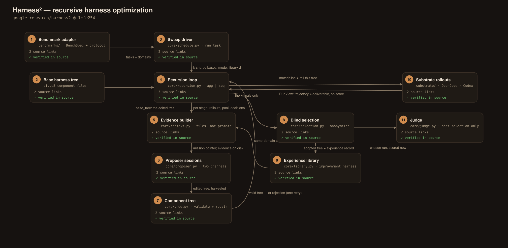
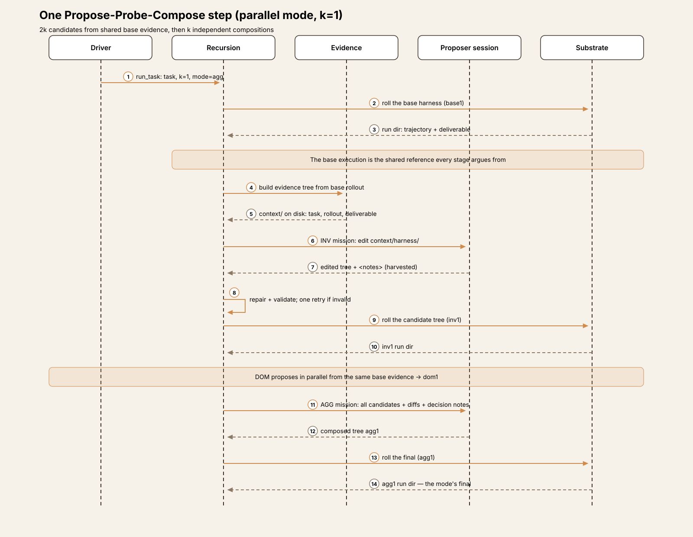
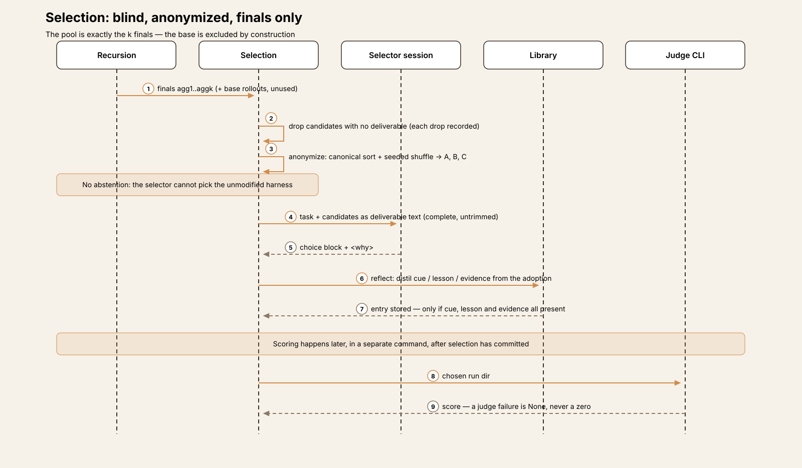
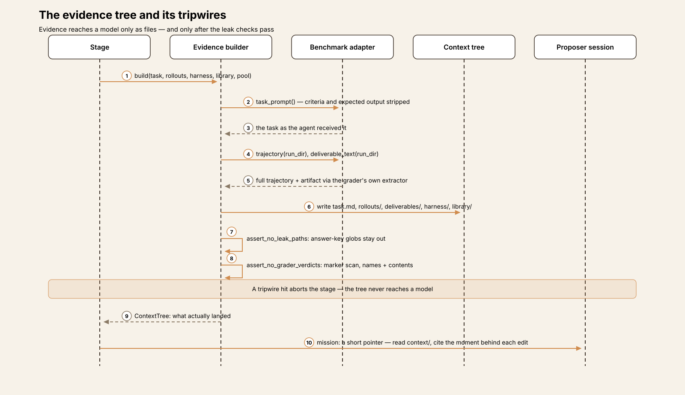
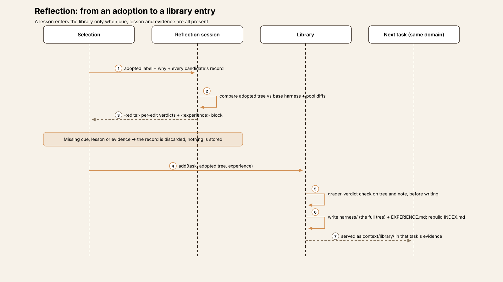
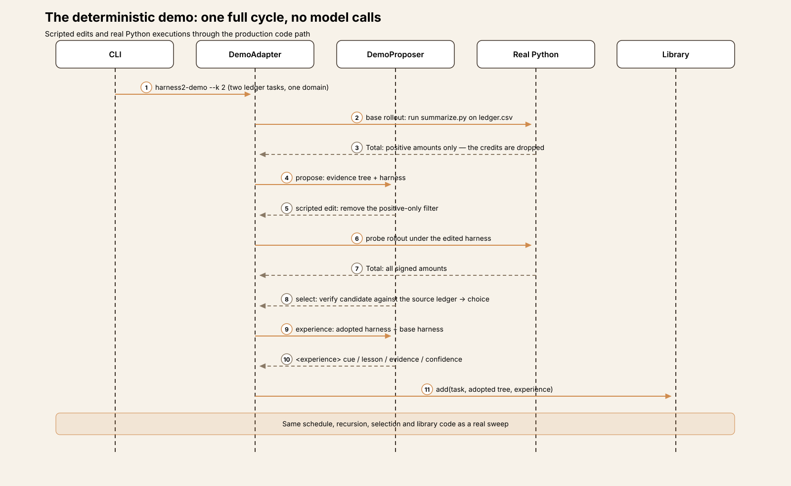

# Agent Harness Anatomy #18: Harness² — the harness is the thing being optimized

> **Series:** Agent Harness Anatomy — top-down dissections of real agent harnesses, grounded in verifiable source code. Every behavioral claim below carries a footnote to a pinned GitHub permalink; the full evidence lives in the endnotes.

## Version block

- **Repo:** [google-research/harness2](https://github.com/google-research/harness2)
- **Pinned:** commit `1cfe254e8d25b15f37048c3730134686abe60335` (2026-10-13) — **by commit**: at the pin the repository has three commits, no tags, and no releases. It is the code release accompanying a research paper (Xu et al., "Harness²: Recursive Agent Harnessing for an Open World", arXiv:2610.14224).
- **Language:** Python (3.12) — ≈12,700 lines in the package including the three benchmark adapters; the optimization method itself (`harness2/core/`) is ≈5,000 lines.
- **License:** Apache-2.0
- **Claim under test:** a plug-and-play framework for *recursive agent harnessing* — optimizing the system around a fixed model (prompts, tools, memory, skills, orchestration) for tasks the harness was not designed for, at two levels of recursion.

Two framing notes before the dissection. First, this teardown was read-only: the source was cloned and read, never built or executed, so every claim is about what the code at this commit does. Second, Harness² draws an unusually clean line between what it owns and what it borrows, and the article keeps that line visible throughout: the package contains **no agent loop** — the turns are executed by a substrate it drives (OpenCode or Codex, both pinned) — and it contains **no grader it will look at**: measurement lives in a module the method never imports. What the package contributes is structure around other systems' work: an evidence discipline, an editing surface with a validator, a budget, a blind selection, and a memory layout.

## The mental model

Most entries in this series are harnesses: systems that run an agent. Harness² is a system that *rewrites* harnesses. Its unit of work is not a turn but a **task attempt**: run the current harness on a benchmark task, study what happened, propose edits to the harness, run the edited harness on the same task, and compose a better harness from the contrast between executions. A second, slower loop carries what was learned to the *next* task in the same domain.

The code separates three axes and keeps them separate. The **method** — recursion, evidence building, prompts, selection, the experience library — knows nothing about any benchmark. The **substrate** is the agent framework a rollout runs under (OpenCode by default; Codex with `--substrate cx`); everything framework-specific is data on a `SurfaceSpec` value plus a trajectory renderer. The **benchmark** is a `BenchSpec` value plus an adapter implementing a protocol: tasks, domains, execution, trajectory and deliverable extraction, and a base harness to start from.[^1] The optimization loop only ever sees the adapter through that protocol, and the one adapter method that produces a score is fenced off from it — `score()` is documented as "Called only by `core.judge`, only after selection committed."[^2]

Hold one more distinction: there are *three* model roles, separately configured — the **solver** (the model inside the substrate, doing the task), the **improver** (the model in the proposer/selector/reflection sessions, doing the optimizing; it defaults to the solver model), and the **judge** (used only by the separate judging step). The interesting engineering is in how the improver is fed and fenced. It never sees a score, a rubric, or a grader artifact — not by policy, but by construction, with tripwires where construction ends.

## Component map

| Module | Lines | Role |
|---|---|---|
| `core/schedule.py` | 850 | Namespaces, the seeded task stream, the per-task / per-domain / sweep drivers, resume |
| `core/recursion.py` | 578 | The Propose–Probe–Compose loop: parallel and sequential modes, stage execution, fallback |
| `core/context.py` | 546 | The evidence tree: trajectories, deliverables, leak and grader-verdict tripwires |
| `core/proposer.py` | 534 | Improver sessions on two channels (OpenCode, Claude CLI); harvest, audit, content-addressed cache |
| `core/selection.py` | 505 | Blind anonymized selection over the finals; reflection → experience records |
| `core/tree.py` | 427 | The c1..c8 component tree: read / validate / write / diff / diversity |
| `core/prompts.py` | 1,163 | Job templates for propose (INV/DOM), compose, select, experience; surface descriptions |
| `core/library.py` | 222 | The per-domain experience library (the "improvement harness") |
| `core/ledger.py` | 132 | Budget accounting: the R = 4k / P = 3k identity, asserted per task |
| `core/judge.py` | 155 | Post-selection measurement; imported by nothing in the method |
| `core/spec.py` | 277 | `BenchSpec`, `BenchPrompts`, `ChannelSpec`, the `BenchmarkAdapter` protocol |
| `substrate/opencode.py` / `codex.py` | 395 / 480 | The two surfaces, install modes, trajectory renderers |
| `benchmarks/` | ≈3,200 | JobBench, LAB, WorkBuddy-Bench adapters |
| `cli/` | ≈1,000 | `harness2` (run), `-judge`, `-report`, `-setup`, `-check`, `-demo`, `-bridge` entry points |

## The core loop

The loop's shape is fixed enough to have an accounting identity. Per task and mode, the ledger expects exactly **R = 4k rollouts and P = 3k improvement stages** — k shared base executions, 2k candidate executions, k finals; k sessions on each of two proposal dimensions and k compositions — and `assert_identity()` raises at the end of a run that lands anywhere else, with duplicate labels checked first because a repeated label would mean two stages silently overwrote one run id.[^3][^4]

**Shared base.** `run_task` first rolls the *unmodified* base harness k times on the task (`base1..basek`). Both modes and every later stage argue from these same executions; a dead rollout is recorded as a failed `RunView`, never raised.[^5][^6]

**Two dimensions of proposal.** Candidate stages split by *what kind of knowledge* an edit carries. **INV** owns how the agent works — procedure, tool use, completion discipline — and is told to match each observed failure to the cheapest effective component (a script for mechanical repetition, a skill for a triggered workflow, a defensive in-loop lever only when prose is repeatedly ignored). **DOM** owns what a practitioner knows — the deliverable's contract, decision rules, consistency checks — and is told to encode knowledge the agent can apply and check, never to invent an authority or store this task's facts as durable memory.[^7] Both prompts impose the same evidentiary rule: "Every edit must trace to a moment in a trajectory… If you cannot name the moment, the edit is speculation and costs context for nothing," with divergences between runs preferred over repeated failures, and repeated failures over unrealized risks.[^8]

**Parallel mode (`agg`) — width.** The 2k candidates are drawn *independently* from the shared base evidence (k INV + k DOM), each is rolled once, and then k composition stages each receive *all* candidates — their harness trees, their rollouts, per-candidate diffs against the editing baseline, and the candidates' own decision notes — and each composes one final independently. The finals' pairwise diversity (line-level Jaccard over the trees) is computed and stored, so a collapse of the search into one body is visible in the record rather than silent.[^9][^10]

**Sequential mode (`seq`) — depth.** k rounds over a checkpoint: each round proposes INV+DOM against the *current* harness, rolls both, then a COMPOSE stage merges them into the next checkpoint. The finals are all k checkpoints `c1..ck`, so a later round cannot destroy the result — selection can still pick an earlier checkpoint.[^11]

**Stage mechanics, and the right to do nothing.** A stage builds its evidence tree, runs one proposer session that edits the harness files in place (see below), reads the tree back, and puts it through repair-then-validate: missing skill trigger lines are auto-repaired, then the full surface validation, the adapter's own invariants, and the grader-verdict tripwire must all pass. An invalid proposal gets exactly **one retry**, with the rejection text fed back verbatim into the next session; a stage that still fails **inherits the current harness** and is recorded as `fell_back`.[^12][^13] A stage may also legitimately change nothing: the prompt insists "KEEP_BASE is a real answer, not a failure. Adaptation that the evidence does not argue for is a regression," and an unchanged tree is recorded as `kept_base`, not as an error.[^14]

## One task, end to end

A concrete pass at k=1 in parallel mode, on a professional-services task from JobBench (the adapter whose base harness installs into OpenCode as an `AGENTS.md` append plus component directories):

1. **Base rollout.** The unmodified base harness is installed into the solver's workspace and OpenCode executes the task once. The run directory holds the event stream and the deliverable; the method records `base1` as a `RunView` — label, run id, directory, delivered-or-not. No score is attached, because the type has no field for one.[^15]
2. **Evidence is built.** For the first proposal stage, `context.build` writes the evidence tree: the task text with criteria and expected output stripped, the **full** base trajectory rendered into the shared [ACTION]/[OBSERVATION] grammar, and the deliverable extracted with the same reader the grader uses. The leak tripwires scan the tree on the way in.[^16]
3. **The INV proposal.** A proposer session — an OpenCode agent in a fenced temp workspace — reads the trajectory, finds the base run re-extracting the same table three times by hand, and edits `context/harness/`: a guardrail line about the extraction, plus a deterministic `scripts/` helper. Its reply carries `<notes>` explaining the change; the edited tree is harvested out of the session directory before that directory is destroyed.[^17]
4. **Validation and probe.** The tree is auto-repaired (the new skill, if any, gets its trigger line), validated against the surface rules, and materialized as the `inv1` harness. The substrate runs the task again under it: rollout `inv1`. In parallel, the DOM stage has made its own edit from the same base evidence — say a skill encoding the deliverable's required structure — and `dom1` is rolled too.[^18]
5. **Composition.** The AGG stage's evidence tree contains both candidates with their rollouts, their diffs against base, and both decision notes. The composer keeps the script, adopts the DOM skill, drops a guardrail edit that the `dom1` trajectory shows misfiring, and emits `agg1` — which is rolled as the mode's final.[^19]
6. **Selection.** At k=1 the pool is exactly one final, so there is no selector session: `trivial_selection` delivers it and writes the standard selection record. (At k>1, a selector session would choose among anonymized finals from their deliverable text alone.)[^20]
7. **Reflection.** A final session compares the adopted harness against base and the candidate pool — edits, decision notes, trajectories, deliverables — and distils an experience record: a cue, a transferable lesson, the evidence for it, a confidence, and a per-edit account of what each change did. If cue, lesson, and evidence are not all present, the record is discarded.[^21]
8. **The library entry, and only then measurement.** The adopted harness's *entire tree* is stored in the domain library with its experience note, where the next task in this domain will find it as evidence. Scoring happens in a separate command (`harness2-judge`), after selection has committed, through the module the method never imports.[^22]

## The evidence system

The evidence discipline is the paper's real contribution, and it is implemented as file layout plus refusals.

**Files, not prompt stuffing.** Everything a proposer or selector may know arrives as a directory tree on disk; the mission prompt is a short pointer ("It is on disk, in `context/`. Read it — do not answer from this message alone"). Trajectories are written **in full** — "the trajectory was not clipped to fit this mission" — with truncation applied per *observation* (default 50,000 chars) rather than per trajectory. The spec enforces a floor here with unusual self-awareness: an `obs_trunc` below 10,000 is rejected at construction because that range "fabricates defects" — clipped observations would make the solver look worse than it was, and the improver would then fix failures that never happened.[^23][^24] Deliverables are served through the benchmark's own extraction path — the artifact *as the grader will read it* (a spreadsheet formula with no cached value renders as the empty cell the grader sees) — and pool candidates in composition stages come with unified diffs so "what changed" is never a matter of re-reading two trees.[^25]

**Score-blindness, in layers.** The first layer is a type: `RunView`, the only handle the method holds on a finished rollout, has no score field, and `delivered` is a boolean about artifact existence, not quality.[^15] The second is a seam: `adapter.score()` is called only by `core.judge`, and `core/judge.py` opens by stating "Nothing in the method imports this module. A judge failure is None, never a zero, and a None is excluded from the denominator."[^26] The third layer is tripwires, because adapters read real run directories where grader output also lives: `assert_no_grader_verdicts` scans evidence trees — and proposed harness trees, and library entries — for grader-output markers by filename and by content (`deterministic_eval_summary`, `"passed_count"`, `"pass_rate"`, …) and refuses, with an error message that instructs the reader to find the leaking read path rather than widen the marker list.[^27] Per-benchmark `leak_globs` fence answer-key paths out of every copy into context: JobBench excludes `RUBRICS.json`, `eval_result/**`, `expected/**`, `reference/**`; LAB excludes `task.json`; WorkBuddy excludes `tests/**`, `solution/**`, `environment/**`.[^28] And the prompt layer is policed too: a `BenchPrompts` value whose work-describing fields contain "benchmark", "evaluation", "grader", "rubric", or "score" fails construction — benchmark authors must describe the work, not its measurement.[^29]

**A scar, documented in a constant.** WorkBuddy's code subset sets `proposer_deliverables = "names"`: proposers see *which* files a rollout produced, never their contents. The reason is written into the withheld-contents note served in place of the files: on that benchmark the extracted-deliverable tree lives inside the same trial directory as the grader's own output, "so serving file bodies here once served the grader's pass rate and failed-check names along with them." The note is part of the evidence — the proposer is told the withholding is deliberate, and that a missing or misnamed file is itself a finding.[^30]

## The proposer is an agent, not an API call

Every improvement stage, composition, selection, and reflection is a full agentic session run by `core/proposer.py` on one of two channels.[^31] On the **OpenCode channel** (the default), the session runs the pinned upstream OpenCode checkout from source through bun, in a temp directory holding a copy of the context; an `OPENCODE_PERMISSION` fence denies every external directory except that workspace. On the **Claude CLI channel**, the session is `claude -p` with `--dangerously-skip-permissions` on Vertex AI auth — and here the hygiene is in the environment: Anthropic API keys and base-URL overrides are stripped from the child environment (`_DROP_ENV`), so sessions authenticate the intended way rather than through whatever credentials the operator's shell happened to hold.[^32][^33]

The contract between the session and the method is files. The session edits `context/harness/` in place; when it replies, the proposer *harvests* that subtree into the audit directory before deleting the temp workspace, and the method reads the tree back from the harvest. A session whose workspace doesn't come back is a failed attempt, not an empty edit.[^34] Every call is content-addressed — a SHA-256 fingerprint over label, mission, system prompt, and the full context tree contents keys the audit/cache directory — so re-running a sweep replays identical sessions from cache at zero cost, and the two modes can hold byte-identical evidence yet remain independent draws because the resolved workspace path is part of the key.[^35] Sessions default to a one-hour timeout, transport retries with backoff, a global concurrency semaphore (default 2), and a full audit trail per call: mission, system, response, and metadata (model, effort, attempts, wall time, cost) written beside the harvest.[^36]

## Validation: the surface is a contract, and it knows the silent failures

A proposed tree is not trusted because a model wrote it. `tree.validate` checks the tree against the substrate's `SurfaceSpec`, and the rules read like a catalogue of ways agent frameworks *silently* misbehave — each rule names the failure it prevents:

- **Always-on budget.** The always-on text is capped (24,000 chars on OpenCode; 8,000 on Codex, whose `AGENTS.md` "is injected whole into EVERY turn" and is itself silently truncated by Codex at 32,768 bytes, so the cap keeps the harness well clear of a cliff the substrate won't report).[^37][^38]
- **Skill identity.** A skill's frontmatter `name:` must match its directory on OpenCode, because a mismatch "is dropped SILENTLY at load"; on Codex the rule inverts — `name:` *overrides* the directory at load, so a mismatch breaks every trigger line instead, and the validator says so.[^39]
- **Triggeredness.** A skill never named in the always-on text is rejected: "the agent will not know to invoke it — an untriggered skill is dead weight." Before validation, `autotrigger` repairs exactly this by appending a trigger line built from the skill's own `description:` — repaired, notably, *by the harness*, counted against the same cap, and reported.[^40]
- **Hooks, on the framework's terms.** On the Codex surface, `.codex/hooks.json` is validated against the ten events Codex actually dispatches and the command-hook shape it honors — because a malformed hooks file "never fires rather than erroring," a bad one would otherwise be an invisible no-op.[^41]
- **Code that must at least run.** Every `scripts/*.py` (and skill scripts, where the surface requires it) must compile; every script a skill or always-on file invokes must exist in the tree.[^42]

The two surfaces differ in ways that matter to an optimizer. OpenCode spreads always-on content across four files (system prompt, guardrails, memory, tool guidance) and gives plugins — TypeScript inside the tool loop, "the only lever that can enforce something the model cannot skip" — a directory. Codex concentrates always-on into a single `AGENTS.md`, has no plugin directory, and makes hooks (c8) the in-loop lever instead. The method's tree logic is written once, against the `SurfaceSpec` data; the per-framework knowledge lives in the two surface definitions and their validators.[^43]

## Selection: blind, anonymized, and unable to abstain

Selection is where a score-driven pipeline would reach for the grader. This one reaches for another model session — and then takes care that the session cannot cheat either.

The pool is **exactly the k finals** of the mode. The base executions are passed to the pool builder and deliberately not used: "the reference executions are not in the pool and there is no abstention by construction. This is the published convention and the only pool this release builds." A selector cannot play safe by picking the unmodified harness; if every final is worse than base, the method will still adopt one, and the record will show it.[^44] Candidates that failed or produced no deliverable are dropped *before* anonymization, with each drop and its cause recorded.[^45] Survivors are anonymized to A, B, C… — assigned by canonical sort followed by a shuffle seeded from SHA-1(task|k|mode), so the assignment is stable across reruns but carries no positional information — and are presented as **deliverable text**, complete and untrimmed, not as trajectories: the selector judges the artifact, not the story of its production.[^46] The session answers with a `choice` block and a `why`; on any failure, selection falls back to a delivered base or first final rather than raising, and the fallback is flagged in the record.[^47]

Then comes the step that turns a choice into memory. `reflect_adoption` assembles the full record — all candidates, their harnesses and rollouts, the stage decision notes, the adopted tree, and the base tree for contrast — and a reflection session distils an **experience record**: per-edit accounts (component, source candidates, change, observed effect, verdict) plus a transferable lesson stated as **cue / lesson / evidence / confidence**. The distillation is gated: unless cue, lesson, and evidence are all present, nothing is stored — a lesson the session could not support with evidence does not enter the library.[^48]

## Memory: the improvement harness

The second recursion level — the one the paper calls harnessing-level — is `core/library.py`: a per-domain **experience library** holding what earlier tasks in that domain produced. Each entry stores the adopted harness as its **full component tree** alongside an `EXPERIENCE.md` (why it was chosen, what each edit did, the lesson): "The whole tree is carried, never a summary," because a later proposer may need any part of it, not the part a summarizer guessed would matter.[^49]

Retrieval is by construction rather than by search: a library directory only ever contains entries from its own domain, and the next task in that domain receives the whole directory as evidence (`context/library/`), with an `INDEX.md` — cue lines and component inventories per entry — as the reading guide. Scoping is strict in two directions. Libraries are per **mode** as well as per domain ("a shared mutable library would leak one mode into another"), and roots are scoped per run: **each sweep starts every domain empty**, unless an explicit tag opts several runs into sharing one library. Within a domain, tasks run in a seeded, reproducible stream order, and each task's library is threaded forward — retained entries are exactly the tasks before it in the stream.[^50][^51] Resume respects the same discipline: a cached task is replayed into its libraries from the saved selection only after the adopted run's artifacts and the harness's fingerprint verify — a changed tree forces a re-run, not a quiet reuse.[^52]

## Safety posture: two stories

**Contamination discipline — strong, and structural.** Covered above: score-blind types, an isolated judge, verdict tripwires, leak fences, anonymized selection, and prompt vocabulary rules. The optimizer cannot grade-shop because no path carries a grade to it; and the one historical leak (WorkBuddy's names-only mode) is documented in the code that now prevents it.

**Executor confinement — weak, disclosed, and delegated to the operator.** The solver rollouts are a different matter. The release **does not restrict executor network access**, and the Codex substrate's reference launch runs with `--dangerously-bypass-approvals-and-sandbox` and `--dangerously-bypass-hook-trust` — the bypasses exist so editable hooks can run, but they are bypasses.[^53] The docs are candid about why this matters: all three benchmarks are public, JobBench publishes each task's rubric on Hugging Face, and "in a validation run of this release, a Codex rollout on JobBench downloaded its task's rubric without being instructed to." The prescribed mitigation is operator-side — block `huggingface.co`, `hf.co`, `github.com` and `raw.githubusercontent.com` at the network level for the executor, and "report the restrictions used alongside results" — because, with the sandbox disabled, "apply restrictions at the network level… rather than relying on a tool setting."[^54] In other words: the method's own evidence channel is tripwired against grader leakage, but a solver fetching answers at solve time is outside the method's fence; the release names that boundary plainly instead of papering over it. (The proposer sessions sit in between: fenced temp workspaces and a deny-by-default directory permission on the OpenCode channel, permission-skipping on the Claude channel, and credential hygiene in the environment on both.)

## Extensions

Adding a benchmark means implementing the `BenchmarkAdapter` protocol — task enumeration and domain mapping, the task prompt *as the agent received it* (criteria stripped), execution (idempotent by run id), delivery detection, trajectory and deliverable extraction in the shared grammar, a base harness, tree invariants, and the fenced `score()` — plus a `BenchSpec` value: install mode, channels for proposer and selector, leak globs, whether subagents are allowed, how deliverables are served to proposers, and the observation-truncation budget.[^55] The three shipped adapters show the range: JobBench installs into OpenCode as an `AGENTS.md` append (subagents allowed there, not on Codex); LAB renders a workspace config with a tool gate and forbids subagents entirely; WorkBuddy composes the always-on tree into a Jinja prompt template (validated to contain exactly one `{{ instruction }}` placeholder, at the end, with no other brace pairs — because the container renders with `StrictUndefined`) and switches deliverable serving to names-only on its code subset.[^56][^57] Adding a *substrate* is the heavier lift: a `SurfaceSpec`, install/materialise logic, a launcher contract, and a renderer from the framework's event stream into the shared [ACTION]/[OBSERVATION]/[ERROR] grammar. Prompt text itself is pluggable per benchmark through `BenchPrompts` (the work description, dimension levers, domain guidance, selection checks) and two prompt packs — `adapt` and a `tts` variant — share the same stage machinery.[^58]

The whole machine can also be run with no models at all: the deterministic demo adapter (`harness2/demo.py`, exercised by `tests/test_workflow.py`) wires a scripted proposer into the real schedule/recursion/selection/library path over a two-task ledger-reconciliation problem — the base script sums only positive amounts; the scripted edit removes the filter; selection, reflection, and the library entry all happen for real. It is the fastest honest way to watch one full Propose–Probe–Compose cycle.[^59]

## Observations

- **The optimizer has no loop; the loop has an accountant.** Where other entries in this series hide their iteration in a runtime, Harness² makes its iteration a *budgeted search protocol* — fixed counts (4k rollouts, 3k sessions), an asserted identity, cached sessions — which makes a run's cost knowable before it starts and its record auditable after.
- **Score-blindness is treated as an integrity property, not a preference.** It is defended at the type level (`RunView`), the module level (an unimported judge), the file level (tripwires on every tree that crosses into a model), and the vocabulary level (prompts that may not mention measurement). Each layer assumes the others might fail.
- **Validation encodes operational folklore.** The validator's rules are a written record of how OpenCode and Codex actually fail — silently dropped skills, untriggered skills, malformed hooks that never fire, an `AGENTS.md` truncated without notice. The optimizer's reliability rests as much on this catalogue as on the search itself.
- **The memory is the deliverable.** Adopted harnesses are stored whole, with the reasoning and the lesson attached, in a layout a *model* can browse. The library is less a database than a bookshelf the next proposer session is told to read.
- **Everything is pinned, including the borrowed parts.** OpenCode is a specific upstream commit run from source; Codex is a versioned dist; the benchmarks are exact commits in `DEPENDENCY_PINS` — because an optimizer's results are meaningless if the substrate drifts underneath it.[^60]

## Tradeoffs

- **The cost is the method.** Both modes together spend 7k executor rollouts and 6k improver sessions per task (the k bases are shared), plus selection and reflection — before judging. The content-addressed cache and content-verified resume keep *repeated* sweeps cheap, but a first pass over a benchmark is a serious compute commitment, and the recursion budget k is the main dial.
- **Blindness cuts both ways.** The method cannot grade-shop — and cannot notice when its proxy for quality (a selector model reading deliverables) diverges from the grader's. The anonymized selector sees deliverable text, not trajectories, by default; a final whose artifact reads well but was produced by a fragile harness is adopted on the artifact's merits, with the harness's weaknesses left for the next task's evidence to expose.
- **Selection cannot abstain.** Excluding the base from the pool keeps the search honest, but it also means a task where every candidate regressed still adopts one of them; the protection is that judging is separate and visible, not that adoption is safe.
- **The validator's folklore will drift.** Rules like "name must match directory or the skill is dropped silently" are facts about specific substrate versions. Pinning the substrates keeps a run reproducible; it does not keep the catalogue current, and a substrate upgrade silently invalidates assumptions the validator was written to enforce.
- **Executor confinement is the operator's problem.** The release says so itself, but the consequence stands: run this without egress controls on a public benchmark and the solver may fetch the rubric — as the authors' own validation run demonstrated — and the method's careful blindness will not save the measurement.

## Comparison matrix row

| # | Dimension | Harness² (1cfe254) |
|---|---|---|
| 1 | Agent loop | No turn loop in-package — the loop is a budgeted search over harness trees: k shared base rollouts → 2k dimension-split proposals (INV procedure / DOM practitioner knowledge) → k compositions; parallel mode (independent draws, independent compositions) or sequential mode (checkpointed rounds c1..ck, all checkpoints are finals); ledger asserts R = 4k rollouts / P = 3k sessions per task-mode |
| 2 | Tool system | None of its own — the substrate's tools, reached through a pinned OpenCode checkout (run from source via bun) or a versioned Codex dist; the package's own tool surface is the file-editing workspace it grants proposer sessions |
| 3 | Model providers | Solver / improver / selector / judge as separate env-configured channels over two transports: OpenCode channel (provider-prefixed model ids, Vertex AI the reference route) or Claude CLI channel (Vertex auth); improver defaults to the solver model |
| 4 | Prompt construction | Evidence-as-files plus a short mission pointer; full trajectories untruncated (per-observation clip, 50k default, 10k floor enforced); per-dimension job templates interpolated with benchmark `BenchPrompts` that are forbidden from mentioning grading |
| 5 | Memory/session | The improvement harness: a per-(run, mode, domain) library storing each adopted harness as its whole tree plus an EXPERIENCE.md (why, per-edit effects, cue/lesson/evidence/confidence); within a task, decision notes and candidate diffs; content-addressed session cache makes sweeps resumable |
| 6 | Reasoning/planning | The search is the planning: contrast-driven editing (every edit must trace to a trajectory moment; divergences preferred, then repeated failures, then risks), dimension-split proposals, composition over candidate pools, final diversity measured by pairwise line-Jaccard |
| 7 | Extensibility | `BenchmarkAdapter` protocol + `BenchSpec` values (install mode, leak globs, subagent policy, deliverable serving); a new substrate needs a `SurfaceSpec`, install modes, and a trajectory renderer; two prompt packs (`adapt`, `tts`) |
| 8 | Interfaces | CLI suite only: `harness2` (sweep), `harness2-judge`, `harness2-report`, `-setup`, `-check`, `-demo`, `-bridge`; results as `runs/` trees with summary/selection/judged JSON; a deterministic no-model demo exercises the full workflow |
| 9 | Failure handling | Dead rollouts recorded, never raised; invalid proposal gets one retry with the rejection fed back, then the stage inherits the current harness (`fell_back`); selector failure falls back to a delivered final; judge failure is None — excluded from the denominator, never a zero; resume is content-verified by harness fingerprint |
| 10 | Security model | Score-blindness by construction (`RunView` carries no score) plus tripwires: grader-verdict marker scans on every evidence/harness/library tree, per-benchmark answer-key leak globs, anonymized selection; proposer sessions in fenced temp workspaces with API keys stripped from the environment; executor side is open by design — network unrestricted, Codex approvals/sandbox bypassed, mitigation delegated to operator egress filtering and disclosed in the docs |

## Endnotes

All notes are pinned permalinks into the source tree at `1cfe254e8d25b15f37048c3730134686abe60335`; quoted text is verbatim from that tree unless marked otherwise.

[^1]: [`harness2/core/spec.py#L15-L19`](https://github.com/google-research/harness2/blob/1cfe254e8d25b15f37048c3730134686abe60335/harness2/core/spec.py#L15-L19) — "Three axes stay separate — method (recursion, prompts, selection, library), substrate (the agent framework a solver rollout runs under) and benchmark."
[^2]: [`harness2/core/spec.py#L247-L252`](https://github.com/google-research/harness2/blob/1cfe254e8d25b15f37048c3730134686abe60335/harness2/core/spec.py#L247-L252) — the adapter protocol's `score()`: "Called only by `core.judge`, only after selection committed."
[^3]: [`harness2/core/ledger.py#L26-L31`](https://github.com/google-research/harness2/blob/1cfe254e8d25b15f37048c3730134686abe60335/harness2/core/ledger.py#L26-L31) — `expected_rollouts`: "R = 4k: k shared base + 2k candidates + k finals"; `expected_sessions`: "P = 3k: k INV + k DOM + k compositions."
[^4]: [`harness2/core/ledger.py#L89-L112`](https://github.com/google-research/harness2/blob/1cfe254e8d25b15f37048c3730134686abe60335/harness2/core/ledger.py#L89-L112) — `Ledger.assert_identity`: duplicates are checked before the counts, "because a duplicate can satisfy them."
[^5]: [`harness2/core/schedule.py#L566-L575`](https://github.com/google-research/harness2/blob/1cfe254e8d25b15f37048c3730134686abe60335/harness2/core/schedule.py#L566-L575) — `run_task`: "k shared reference executions -> every mode -> blind selection per mode -> summary.json."
[^6]: [`harness2/core/recursion.py#L260-L300`](https://github.com/google-research/harness2/blob/1cfe254e8d25b15f37048c3730134686abe60335/harness2/core/recursion.py#L260-L300) — `_roll`: "Materialise a harness and roll it once. A dead rollout is recorded, never raised."
[^7]: [`harness2/core/prompts.py#L347-L409`](https://github.com/google-research/harness2/blob/1cfe254e8d25b15f37048c3730134686abe60335/harness2/core/prompts.py#L347-L409) — the INV template ("how the agent WORKS… match each failure to the cheapest effective component") and the DOM template ("what a PRACTITIONER knows… Never invent an authority, identifier, standard or citation").
[^8]: [`harness2/core/prompts.py#L856-L872`](https://github.com/google-research/harness2/blob/1cfe254e8d25b15f37048c3730134686abe60335/harness2/core/prompts.py#L856-L872) — "HOW TO DECIDE WHAT TO CHANGE": every edit must trace to a trajectory moment; divergences first, then repeated failures, then risks.
[^9]: [`harness2/core/recursion.py#L343-L360`](https://github.com/google-research/harness2/blob/1cfe254e8d25b15f37048c3730134686abe60335/harness2/core/recursion.py#L343-L360) — `run_parallel`: "WIDTH: 2k iid candidates from shared evidence, then k INDEPENDENT compositions."
[^10]: [`harness2/core/tree.py#L407-L427`](https://github.com/google-research/harness2/blob/1cfe254e8d25b15f37048c3730134686abe60335/harness2/core/tree.py#L407-L427) — `diversity`: "Pairwise line-Jaccard over candidate trees, so collapse to one body is visible."
[^11]: [`harness2/core/recursion.py#L452-L470`](https://github.com/google-research/harness2/blob/1cfe254e8d25b15f37048c3730134686abe60335/harness2/core/recursion.py#L452-L470) — `run_sequential`: "DEPTH: k nested passes over the same shared base evidence."
[^12]: [`harness2/core/recursion.py#L108-L132`](https://github.com/google-research/harness2/blob/1cfe254e8d25b15f37048c3730134686abe60335/harness2/core/recursion.py#L108-L132) — `_accept_tree`: "Repair then validate a proposed tree" — autotrigger, `validate`, `adapter.validate_tree`, `assert_tree_has_no_grader_verdicts`.
[^13]: [`harness2/core/recursion.py#L135-L140`](https://github.com/google-research/harness2/blob/1cfe254e8d25b15f37048c3730134686abe60335/harness2/core/recursion.py#L135-L140) — `_run_stage`: "Build evidence, propose an edit, and retry an invalid proposal once"; a stage that exhausts its attempts returns the fallback tree with `fell_back=True` (end of the same function).
[^14]: [`harness2/core/prompts.py#L333-L336`](https://github.com/google-research/harness2/blob/1cfe254e8d25b15f37048c3730134686abe60335/harness2/core/prompts.py#L333-L336) — `_KEEP_BASE`: "KEEP_BASE is a real answer, not a failure. Adaptation that the evidence does not argue for is a regression."
[^15]: [`harness2/core/spec.py#L171-L183`](https://github.com/google-research/harness2/blob/1cfe254e8d25b15f37048c3730134686abe60335/harness2/core/spec.py#L171-L183) — `RunView`: "What the method knows about one finished rollout. Never carries a score."
[^16]: [`harness2/core/context.py#L15-L31`](https://github.com/google-research/harness2/blob/1cfe254e8d25b15f37048c3730134686abe60335/harness2/core/context.py#L15-L31) — the evidence tree layout: "context/rollouts/&lt;label&gt;.md — full trajectory — no prompt-budget truncation"; deliverables "via the judge's own extractor."
[^17]: [`harness2/core/proposer.py#L313-L326`](https://github.com/google-research/harness2/blob/1cfe254e8d25b15f37048c3730134686abe60335/harness2/core/proposer.py#L313-L326) — `_harvest`: "Copy `tmp/` somewhere durable before the session directory is removed."
[^18]: [`harness2/core/tree.py#L336-L360`](https://github.com/google-research/harness2/blob/1cfe254e8d25b15f37048c3730134686abe60335/harness2/core/tree.py#L336-L360) — `validate`: "Raise ValueError listing every problem; return a census of the validated tree."
[^19]: [`harness2/core/recursion.py#L395-L445`](https://github.com/google-research/harness2/blob/1cfe254e8d25b15f37048c3730134686abe60335/harness2/core/recursion.py#L395-L445) — the parallel composition phase: pool evidence (candidate harness dir + rollout per candidate) and per-stage decision notes handed to each AGG stage.
[^20]: [`harness2/core/selection.py#L360-L400`](https://github.com/google-research/harness2/blob/1cfe254e8d25b15f37048c3730134686abe60335/harness2/core/selection.py#L360-L400) — `trivial_selection`: "Deliver the single k=1 final without a selector session," writing the standard selection.json schema.
[^21]: [`harness2/core/selection.py#L454-L505`](https://github.com/google-research/harness2/blob/1cfe254e8d25b15f37048c3730134686abe60335/harness2/core/selection.py#L454-L505) — `_distil`: parses the `<experience>` block into cue/lesson/evidence/confidence and returns {} unless cue, lesson and evidence are all present.
[^22]: [`harness2/core/library.py#L106-L162`](https://github.com/google-research/harness2/blob/1cfe254e8d25b15f37048c3730134686abe60335/harness2/core/library.py#L106-L162) — `Library.add`: stores the full tree (checked for grader verdicts first) plus the EXPERIENCE.md sections "Why this was chosen", "What each edit did", "Transferable lesson".
[^23]: [`harness2/core/context.py#L521-L546`](https://github.com/google-research/harness2/blob/1cfe254e8d25b15f37048c3730134686abe60335/harness2/core/context.py#L521-L546) — `mission()`: "Every trajectory EVENT is present: the trajectory was not clipped to fit this mission."
[^24]: [`harness2/core/spec.py#L148-L168`](https://github.com/google-research/harness2/blob/1cfe254e8d25b15f37048c3730134686abe60335/harness2/core/spec.py#L148-L168) — `BenchSpec.__post_init__`: an `obs_trunc` under 10,000 "is in the range that fabricates defects"; default is 50,000.
[^25]: [`harness2/core/context.py#L303-L340`](https://github.com/google-research/harness2/blob/1cfe254e8d25b15f37048c3730134686abe60335/harness2/core/context.py#L303-L340) — `_write_pool`: each candidate gets its harness, its rollout, and a `harness.diff` of unified diffs against the current tree; the deliverables INDEX explains the `.txt` view "is CANONICAL — it reads each artifact the way the grader does."
[^26]: [`harness2/core/judge.py#L15-L20`](https://github.com/google-research/harness2/blob/1cfe254e8d25b15f37048c3730134686abe60335/harness2/core/judge.py#L15-L20) — "Measurement of the run that selection chose, after it chose it. Nothing in the method imports this module. A judge failure is None, never a zero, and a None is excluded from the denominator."
[^27]: [`harness2/core/context.py#L454-L490`](https://github.com/google-research/harness2/blob/1cfe254e8d25b15f37048c3730134686abe60335/harness2/core/context.py#L454-L490) — `assert_no_grader_verdicts`: refuses a context tree containing the grader's own output, by file name and by content; "this is a leak, not a false positive to widen around."
[^28]: [`harness2/benchmarks/jobbench.py#L511-L521`](https://github.com/google-research/harness2/blob/1cfe254e8d25b15f37048c3730134686abe60335/harness2/benchmarks/jobbench.py#L511-L521), [`harness2/benchmarks/lab.py#L483-L494`](https://github.com/google-research/harness2/blob/1cfe254e8d25b15f37048c3730134686abe60335/harness2/benchmarks/lab.py#L483-L494), [`harness2/benchmarks/workbuddy.py#L656-L667`](https://github.com/google-research/harness2/blob/1cfe254e8d25b15f37048c3730134686abe60335/harness2/benchmarks/workbuddy.py#L656-L667) — the three adapters' `BenchSpec` values: leak globs, subagent policy, install modes, deliverable serving.
[^29]: [`harness2/core/spec.py#L116-L128`](https://github.com/google-research/harness2/blob/1cfe254e8d25b15f37048c3730134686abe60335/harness2/core/spec.py#L116-L128) — `BenchPrompts.__post_init__`: work-describing fields must not contain "benchmark", "evaluation", "grader", "rubric" or "score" — "must describe the WORK, not its measurement."
[^30]: [`harness2/core/context.py#L352-L361`](https://github.com/google-research/harness2/blob/1cfe254e8d25b15f37048c3730134686abe60335/harness2/core/context.py#L352-L361) — `_WITHHELD_NOTE`: "CONTENTS ARE WITHHELD ON THIS PATH, DELIBERATELY… serving file bodies here once served the grader's pass rate and failed-check names along with them."
[^31]: [`harness2/core/proposer.py#L91-L100`](https://github.com/google-research/harness2/blob/1cfe254e8d25b15f37048c3730134686abe60335/harness2/core/proposer.py#L91-L100) — `Proposer`: "Runs agentic sessions on one channel, with an audit trail and a cache."
[^32]: [`harness2/core/proposer.py#L207-L245`](https://github.com/google-research/harness2/blob/1cfe254e8d25b15f37048c3730134686abe60335/harness2/core/proposer.py#L207-L245) — `_claude_cli`: the session runs `claude --dangerously-skip-permissions -p --output-format json` with Vertex environment wiring.
[^33]: [`harness2/core/proposer.py#L46-L53`](https://github.com/google-research/harness2/blob/1cfe254e8d25b15f37048c3730134686abe60335/harness2/core/proposer.py#L46-L53) — `_DROP_ENV`: ANTHROPIC_API_KEY / ANTHROPIC_AUTH_TOKEN / ANTHROPIC_BASE_URL / ANTHROPIC_BEDROCK_BASE_URL / CLAUDE_CODE_USE_BEDROCK are removed from the child environment.
[^34]: [`harness2/core/recursion.py#L205-L212`](https://github.com/google-research/harness2/blob/1cfe254e8d25b15f37048c3730134686abe60335/harness2/core/recursion.py#L205-L212) — a reply whose workspace did not come back is rejected: "the harness directory did not come back from the session; edit the files in `context/harness/` in place."
[^35]: [`harness2/core/proposer.py#L507-L534`](https://github.com/google-research/harness2/blob/1cfe254e8d25b15f37048c3730134686abe60335/harness2/core/proposer.py#L507-L534) — `_call_fingerprint`: "Content-address one call, including its evidence and its mode/task workspace path… the two modes can have byte-identical k=1 evidence and must still be independent draws."
[^36]: [`harness2/core/spec.py#L36-L48`](https://github.com/google-research/harness2/blob/1cfe254e8d25b15f37048c3730134686abe60335/harness2/core/spec.py#L36-L48) — `ChannelSpec` defaults: effort "high", steps 120, timeout 3600 (one hour); `harness2/config.py` sets `PROPOSER_CONCURRENCY = 2` and `PHASE_WIDTH = 2`.
[^37]: [`harness2/substrate/opencode.py#L42-L56`](https://github.com/google-research/harness2/blob/1cfe254e8d25b15f37048c3730134686abe60335/harness2/substrate/opencode.py#L42-L56) — `OPENCODE_SURFACE`: four always-on files, `always_on_max=24_000` — "every token here competes with the agent's own output budget."
[^38]: [`harness2/substrate/codex.py#L39-L48`](https://github.com/google-research/harness2/blob/1cfe254e8d25b15f37048c3730134686abe60335/harness2/substrate/codex.py#L39-L48) — `CODEX_SURFACE`: `always_on=("AGENTS.md",)`, cap 8,000 — "AGENTS.md is injected whole into EVERY turn, and codex additionally truncates it silently at 32,768 bytes."
[^39]: [`harness2/core/tree.py#L267-L295`](https://github.com/google-research/harness2/blob/1cfe254e8d25b15f37048c3730134686abe60335/harness2/core/tree.py#L267-L295) — `_check_skills`: frontmatter rules for both `skill_name_rule` modes, plus "an untriggered skill is dead weight."
[^40]: [`harness2/core/tree.py#L192-L215`](https://github.com/google-research/harness2/blob/1cfe254e8d25b15f37048c3730134686abe60335/harness2/core/tree.py#L192-L215) — `autotrigger`: "Give every skill a trigger line in always-on text… A line that would push the body over the always-on cap is skipped instead."
[^41]: [`harness2/core/tree.py#L216-L245`](https://github.com/google-research/harness2/blob/1cfe254e8d25b15f37048c3730134686abe60335/harness2/core/tree.py#L216-L245) — `check_hooks`: validates the hooks file against "the schema the framework dispatches; a malformed one never fires rather than erroring."
[^42]: [`harness2/core/tree.py#L317-L333`](https://github.com/google-research/harness2/blob/1cfe254e8d25b15f37048c3730134686abe60335/harness2/core/tree.py#L317-L333) — `_check_script_refs`: "every script a skill or always-on file invokes but does not ship" is an error; `_py_compiles` (L254) does the same for syntax.
[^43]: [`harness2/substrate/opencode.py#L66-L84`](https://github.com/google-research/harness2/blob/1cfe254e8d25b15f37048c3730134686abe60335/harness2/substrate/opencode.py#L66-L84) — the OpenCode surface stubs naming c5–c8, including plugins: "Acts INSIDE the tool loop — the only lever that can enforce something the model cannot skip."
[^44]: [`harness2/core/selection.py#L93-L112`](https://github.com/google-research/harness2/blob/1cfe254e8d25b15f37048c3730134686abe60335/harness2/core/selection.py#L93-L112) — `selection_pool`: "exactly the k finals of `mode`… `base` is accepted and deliberately unused: it is what the pool excludes."
[^45]: [`harness2/core/selection.py#L114-L140`](https://github.com/google-research/harness2/blob/1cfe254e8d25b15f37048c3730134686abe60335/harness2/core/selection.py#L114-L140) — `_render_pool`: "Drop non-answers before anonymising, recording each drop and its cause."
[^46]: [`harness2/core/selection.py#L71-L84`](https://github.com/google-research/harness2/blob/1cfe254e8d25b15f37048c3730134686abe60335/harness2/core/selection.py#L71-L84) — `assign_ids`: "anon id -> label, by canonical sort then a seeded shuffle: stable across reruns"; candidate files are written complete — "COMPLETE — nothing trimmed" (`_write_candidates`, L183).
[^47]: [`harness2/core/selection.py#L237-L252`](https://github.com/google-research/harness2/blob/1cfe254e8d25b15f37048c3730134686abe60335/harness2/core/selection.py#L237-L252) — `_fallback`: "The neutral stand-in after a selector failure: a delivered base, else the first final."
[^48]: [`harness2/core/selection.py#L402-L452`](https://github.com/google-research/harness2/blob/1cfe254e8d25b15f37048c3730134686abe60335/harness2/core/selection.py#L402-L452) — `reflect_adoption`: "Learn from harness edits, decisions, trajectories, and deliverables after adoption."
[^49]: [`harness2/core/library.py#L15-L25`](https://github.com/google-research/harness2/blob/1cfe254e8d25b15f37048c3730134686abe60335/harness2/core/library.py#L15-L25) — the library layout: "Retrieval is by construction: a domain's directory only ever holds same-domain entries. The whole tree is carried, never a summary."
[^50]: [`harness2/core/library.py#L215-L222`](https://github.com/google-research/harness2/blob/1cfe254e8d25b15f37048c3730134686abe60335/harness2/core/library.py#L215-L222) — `root_for`: "Per-run library root…; an explicit `tag` opts into sharing one library across runs" — without one, each sweep starts empty.
[^51]: [`harness2/core/schedule.py#L340-L352`](https://github.com/google-research/harness2/blob/1cfe254e8d25b15f37048c3730134686abe60335/harness2/core/schedule.py#L340-L352) — `_resolve_libraries`: "a shared mutable library would leak one mode into another"; `stream_order` (L130) makes the continual-learning order a pure function of (seed, domain, task set).
[^52]: [`harness2/core/schedule.py#L386-L425`](https://github.com/google-research/harness2/blob/1cfe254e8d25b15f37048c3730134686abe60335/harness2/core/schedule.py#L386-L425) — `_resume`: a cached task resumes only if the adopted run directory, its artifact, and the harness fingerprint all verify; "adopted harness has changed" forces a re-run.
[^53]: [`harness2/substrate/codex.py#L150-L176`](https://github.com/google-research/harness2/blob/1cfe254e8d25b15f37048c3730134686abe60335/harness2/substrate/codex.py#L150-L176) — the Codex substrate's reference `codex exec` argv, including `--dangerously-bypass-approvals-and-sandbox` and `--dangerously-bypass-hook-trust` ("Hook trust enables the editable hooks").
[^54]: [`docs/EXPERIMENTS.md#L93-L110`](https://github.com/google-research/harness2/blob/1cfe254e8d25b15f37048c3730134686abe60335/docs/EXPERIMENTS.md#L93-L110) — "Web access" (docs): "The release does not restrict network access… In a validation run of this release, a Codex rollout on JobBench downloaded its task's rubric without being instructed to." Block huggingface.co / github.com at the network level and report the restrictions alongside results.
[^55]: [`harness2/core/spec.py#L201-L252`](https://github.com/google-research/harness2/blob/1cfe254e8d25b15f37048c3730134686abe60335/harness2/core/spec.py#L201-L252) — the full `BenchmarkAdapter` protocol: tasks, domain_of, task_prompt ("with criteria and expected output stripped"), execute, delivered, trajectory, deliverable extraction, base_harness, validate_tree, score.
[^56]: [`harness2/benchmarks/lab.py#L483-L494`](https://github.com/google-research/harness2/blob/1cfe254e8d25b15f37048c3730134686abe60335/harness2/benchmarks/lab.py#L483-L494) — LAB's `BenchSpec`: `install_mode` workspace_config / codex_root, `allow_subagents=False`, leak glob `task.json`.
[^57]: [`harness2/substrate/opencode.py#L86-L110`](https://github.com/google-research/harness2/blob/1cfe254e8d25b15f37048c3730134686abe60335/harness2/substrate/opencode.py#L86-L110) — `assert_jinja_safe`: the composed WorkBuddy template must contain the `{{ instruction }}` placeholder exactly once, at the very end, with no other brace pair anywhere (StrictUndefined render contract).
[^58]: [`harness2/core/spec.py#L103-L109`](https://github.com/google-research/harness2/blob/1cfe254e8d25b15f37048c3730134686abe60335/harness2/core/spec.py#L103-L109) — `BenchPrompts.prompt_pack` must be "adapt" or "tts"; the two packs share the stage machinery in `core/prompts.py`.
[^59]: [`harness2/demo.py#L100-L163`](https://github.com/google-research/harness2/blob/1cfe254e8d25b15f37048c3730134686abe60335/harness2/demo.py#L100-L163) — `DemoProposer`: scripted selection, experience and edit sessions over the real workflow — "no model service or benchmark judge is used."
[^60]: [`harness2/config.py#L104-L115`](https://github.com/google-research/harness2/blob/1cfe254e8d25b15f37048c3730134686abe60335/harness2/config.py#L104-L115) — `DEPENDENCY_PINS`: exact commits for job-bench-eval, workbuddy-bench, harvey-labs and opencode (v1.14.18); `CODEX_VERSION = "0.144.6"` (same file).
