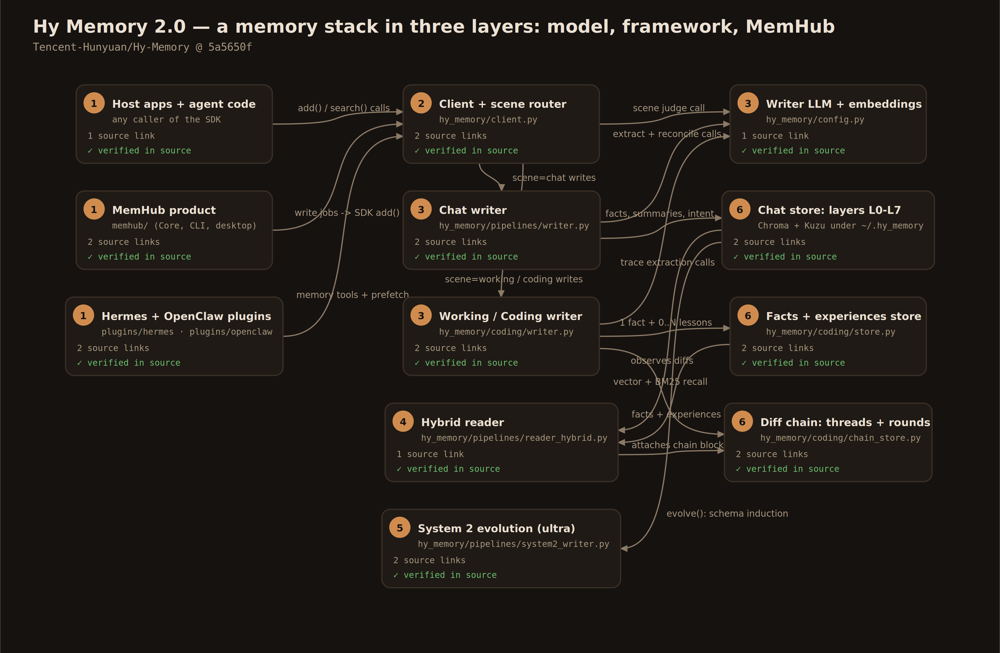
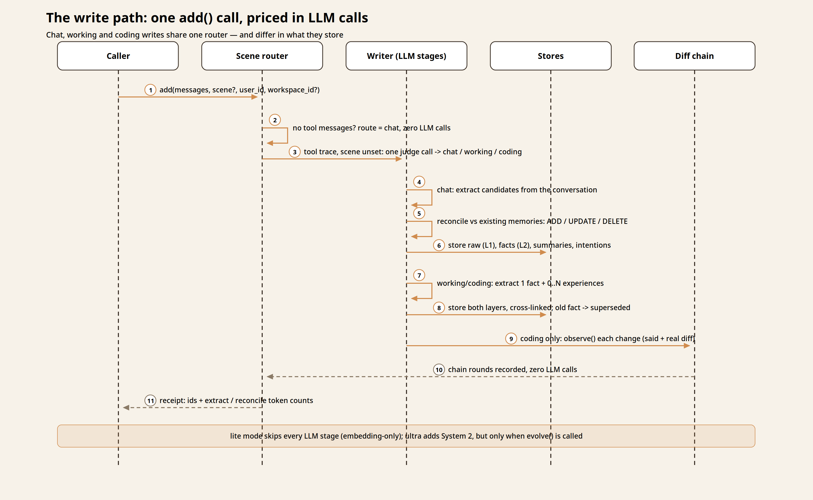
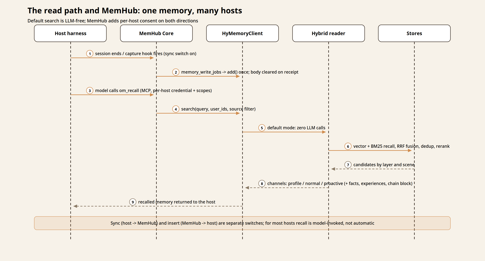

# Field Notes: The memory is not the harness — Hy Memory 2.0 and the writer-model idea

**Series framing.** This is a Field Notes piece, not a numbered teardown.
Every teardown in this series dissects a system that runs an agent: a loop,
tools, approvals, a session lifecycle. Tencent Hunyuan's Hy Memory 2.0 runs
none of those. It is a *memory stack* — a dedicated writer model, a Python
framework (`hy-memory`), and a local product (MemHub) that negotiates one
shared memory across ten coding tools. There is no turn to trace because
there is no turn: the loops that consume this memory belong to other
harnesses, several of which this series has already taken apart. What Hy
Memory offers instead is a complete, source-readable answer to a question
every teardown has touched and none has centred: **what should writing to
long-term memory actually look like, as engineering?** That is a Field
Notes question, and it is the one this piece answers.

> **Pin:** `Tencent-Hunyuan/Hy-Memory` @ `5a5650fc946621759a55eb8f1a7eafa7354d7c4f`
> (2026-10-27), Apache-2.0. Framework package `hy-memory` v2.0.5 in-tree;
> MemHub v1.0.5 in-tree. Cloned and read, never executed. The writer model
> (Hy-Memory-30B-A3B) is weights on Hugging Face, not code in this repo;
> its benchmark results are the authors' own and are flagged as vendor
> claims wherever they appear.

## Three layers, three different kinds of thing

Hy Memory 2.0 is easiest to hold as three layers that are often conflated
in coverage of the release:

1. **A model.** Hy-Memory-30B-A3B is a mixture-of-experts model (30B total
   parameters, roughly 3B active) trained, per its technical report, for
   one job: executing the *write path* of a long-term memory system —
   deciding what to retain, how precisely to represent it, and how new
   evidence should update what is already stored.[^1] It does not chat.
   In this repository it appears only as a name a configuration can
   point at.
2. **A framework.** The `hy_memory` Python SDK is the memory engine:
   scene routing, extraction, reconciliation, three kinds of storage,
   hybrid retrieval, and an optional slower "System 2" that induces
   schemas over accumulated facts. It is model-agnostic — any
   OpenAI-compatible LLM and embedding endpoint can fill the writer
   slot, and the defaults are ordinary general models.[^2]
3. **A product.** MemHub is a local-first desktop and CLI application
   that builds one governed memory out of the session stores of ten
   coding tools, using the SDK as its only data plane, and offers that
   memory back to the same tools as recall.[^3]

The separation matters because the claims attach to different layers.
The framework's mechanisms can be verified in source, and this piece
verifies them. The model's quality claims can only be reported. MemHub's
consent model sits in between: implemented in source, expressed as a
product contract.

## The mental model: memory quality is a writing problem

Most memory systems are described from the read side — embeddings,
ranking, injection. Hy Memory's design centre is the opposite end. Its
paper's framing is that a memory bank's quality is decided at write time:
what is kept, how exactly it is stated, and what happens when July's
evidence contradicts March's.[^1] The framework is built around that
conviction in concrete ways: writes are multi-stage LLM pipelines with
an explicit reconciliation step; reads, by default, spend no LLM calls
at all. The budget flows toward writing. That asymmetry — expensive,
judged writes; cheap, deterministic reads — is the single most portable
idea in the release.

## One entry point, three scenes

Everything enters through `HyMemoryClient.add()` — text, or OpenAI-format
messages, scoped by `user_id`, `agent_id`, and `session_id`, which are
isolation keys the caller supplies; the SDK owns no session lifecycle.[^4]
The first thing `add()` does is route by *scene*, and the router is a
small lesson in cost discipline:

- Input with **no tool messages** goes to the `chat` scene immediately,
  with zero LLM calls.[^5]
- Input **with tool messages** and no explicit scene costs exactly one
  LLM classification call, which sorts it into `chat`, `working`, or
  `coding`; if the judge fails, the input falls back to chat and the
  tool messages are stripped.[^6]
- An explicit scene skips the judge but not the shape check: forcing
  `coding` on input without tool messages falls back to chat, because
  there is no trace to extract from.[^5]

The three scenes are three memory shapes. Chat gets a hierarchy.
Working and coding share a two-layer design; coding adds a third
component, the diff chain.[^7]

| Scene | Input shape | Memory shape |
|---|---|---|
| `chat` | Conversation | Hierarchy L0–L7 (below) |
| `working` | Tool-call trace from productivity work | One fact + reusable experiences |
| `coding` | Tool-call trace from software work | The same two layers, plus a version-evolution diff chain |

Modes scale the spend. `lite` is embedding-only — no LLM calls, scene
ignored, effectively disciplined vector RAG. `pro` adds extraction and
reconciliation. `ultra` adds System 2 and turns the graph store on.
Nothing about the mode is ambient: System 2 runs when the caller invokes
`evolve()`, not on a schedule the SDK invents.[^8]

## Chat memory: a hierarchy with a reconcile step

Chat memory is organised in eight layers: L0 basic information (the
assembled profile), L1 raw conversation (append-only), L2 atomic facts
(versioned, immutable records), L3 session summaries, L4 identity and
L5 knowledge (both marked reserved in the current design), L6 schemas —
abstract narrative templates, held in the graph layer — and L7
prospective intentions, which carry an expiry and demote to ordinary
facts when it passes.[^9]

A `pro`-mode write runs as a pipeline. The raw input lands at L1. An
extraction stage — an internal coordinator over an extractor and
reflector, driven by long, Chinese-first prompt files — proposes
candidate facts, entities, and intentions.[^10] Candidates are
deduplicated, and then the step that distinguishes this design from
"extract and append" runs: a **reconciler** compares the candidates
against existing memories and emits operations — ADD for genuinely new
information, UPDATE to merge same-topic, non-contradictory nodes into a
denser one, DELETE as a logical delete (the node is shadowed, not
erased), and contradictions expressed as an ADD that names the nodes it
supersedes.[^11] A write's receipt itemises its own cost: input tokens,
extraction tokens, and reconciliation tokens are reported as separate
counters, so the price of remembering is visible per call.[^4]

Two side effects are deliberately kept off the critical path: episode
summaries and graph projection are scheduled in the background, while
every *judgement* — extraction, reconciliation — stays synchronous and
priced. The design consistently prefers explicit steps a caller can see
over ambient background cognition.

## Working and coding: one fact, some lessons, no threshold games

The working/coding writer takes a whole traced session and produces two
layers in one pass.[^12]

The **fact** layer records what this session did: exactly one
`WorkingFact` per trace, with no value threshold — work that was done is
remembered, full stop. Its fields repay attention: a `statement` (the
searchable summary), a `subject` (the person, file, service, or
component the session operated on), the `files` touched, and `details` —
the session's addressable output kept *verbatim* and deliberately kept
*out* of the embedding, so the summary does the finding and the details
hold the values a summary would inevitably drop.[^13]

The **experience** layer records what can be reused: zero to N
`CodingMemory` records per session, each gated by a value judgement in
extraction. An experience carries a `task`, `search_keys`, a `solution`,
`boundary_envs` — the environment the lesson depends on, so a future
reader can judge whether it still applies — and a `confidence`.[^14]
The layers cross-link in both directions, so a recalled lesson can be
traced to the sessions that produced it and a fact can name the lessons
it derived.

Updates respect the same asymmetry. When a newer fact continues the same
task, the older fact is not deleted: it is marked `superseded`, linked
to its successor, and an LLM rewrites a one-sentence progress summary
of how the task evolved — a summary that is itself excluded from the
vector index, so superseded wording loses its power to be recalled as
current.[^13] A subject gate can forbid supersession across different
subjects entirely; it ships **off** by default, and the long comment
explaining why — in both directions — is preserved in the type
definitions, a candid record of the authors reasoning about a real
failure mode: parallel subjects with similar wording overwriting each
other.[^13]

## The diff chain: storing what summarisation is told to throw away

Coding extraction is instructed to record exact coordinates — file,
function, branch — and *not* to paste code; a record that quotes thirty
lines of diff but omits the branch is, in the prompt's own terms, a bad
trade.[^15] That is a sound budget rule with one structural hole: the
version of the code that was tried and reverted exists neither in the
working tree nor at HEAD, so no later reader can recover it — including
the reason it was abandoned, which often lives in the user's words at
the moment of the change.

The diff chain exists to fill exactly that hole, and it fills it with
**zero LLM calls**. As a coding write completes, the chain store's
`observe()` records each change — sourced from a local Git repository's
diffs when one is configured, or from deterministic replace actions in
the tool trace — as a *round*: the user's own words for that revision
plus the real diff. Rounds accumulate on *threads* keyed by owner,
branch, file, symbol, and line range, in a dedicated SQLite store.[^16]

At read time the chain is, in its own header's words, "a decorator, not
a retriever": vector retrieval decides which facts return, and
`decorate()` attaches under each fact the full revision history of the
code it touches — every version, in order, with what was said about
each — ranked by overlap with the instruction and capped by explicit
character budgets.[^17] The chain pointedly does not choose a winning
version. The consuming model sees the sequence, including the reverted
attempt, and judges with the evidence the fact layer was designed to
omit. As a pattern, this is the piece's most quotable mechanism: a
deterministic, model-free store for exactly the class of information
that LLM summarisation is instructed to discard, composed with — not
competing against — the summarised layer.

## The read path: deliberately boring, deliberately cheap

`search()` in its default mode makes zero LLM calls. The hybrid reader
recalls by vector similarity and BM25 together, then applies a shared
post-processing chain — reciprocal-rank fusion, deduplication,
diversity, temporal and entity handling, and an optional local
cross-encoder rerank — and returns results in channels rather than a
flat list: `profile`, `normal`, and `proactive`, the last carrying
intentions and schemas that are due to surface rather than merely
similar.[^18][^19] Working and coding searches return `facts` and
`experiences` separately, and a coding search adds the chain block when
the operator has enabled it. The priced alternative exists and is
labelled as such: `search_mode="agentic"` spends one LLM call on scene
classification, query rewriting, and time-range parsing before
retrieval.[^20] A separate `get_user_profile()` assembles the L0 profile
directly instead of searching for it.

Storage is local files by default, under `~/.hy_memory/data/`: Chroma
for vectors (Qdrant and FAISS are options), Kuzu for the graph (Neo4j
optional), SQLite for cache, history, and both coding databases, with
working and coding kept fully isolated from each other.[^21] The
privacy shape follows from the architecture rather than from a promise:
the store never leaves the machine; what transits a network is the
content being written or embedded, sent to whichever model endpoints
the operator configured — a hosted frontier API in the documented
defaults, or a local OpenAI-compatible server, which is also how the
dedicated writer model would typically be served.[^2][^21]

## The writer model: a specialist for a protocol-bound job

Nothing in the framework requires Tencent's model. The extraction and
reconciliation prompts are written for a general LLM, the configured
default is `gpt-4.1-nano`, and the documentation's example is
`deepseek-chat`; a repo-wide search finds Hy-Memory-30B-A3B only in
README prose and badges.[^2] The model is a separate artefact — weights
on Hugging Face in BF16, FP8, and GGUF forms — trained, per its
technical report, in two stages: on-policy distillation that teaches it
the write protocols of several memory frameworks (Mem0, MemOS, and
Hy-Memory) on states it generated itself, then attributed reinforcement
learning that scores the resulting memory banks by downstream
answerability, assigning credit per chunk of input.[^1]

The report's headline result — that on fixed 20% benchmark subsamples
the specialist ranks first on all four evaluated frameworks, including
one held out from training, with a 55.49% macro average against 54.62%
for the frontier model it names — is the authors' own evaluation of
their own model, on subsamples, and has not been reproduced here or
independently verified. It should be read as a vendor claim.[^1]

What can be said without the numbers is the shape of the bet, because
the framework makes it testable: memory writing is a narrow,
protocol-bound, judgeable job — the same prompts, the same operation
vocabulary, the same reconciliation contract, applied millions of
times. If a small specialist can be trained to do that job as well as
a large generalist following the same prompts, then the write path's
running cost drops by an order of magnitude and "use the big model to
remember" stops being the default. The framework being model-agnostic
is what makes the claim falsifiable by anyone with two endpoints: the
writer is a configuration value, `MEMORY_LLM_MODEL`, not a
dependency.[^2]

## MemHub: one memory, ten front doors, two switches

MemHub, the product layer, answers the question the framework leaves
open: whose conversations become the memory, and who may read it back?
Its Core owns authorization, model profiles, and a job queue; the SDK
remains the only authority over memory content — MemHub's own store may
hold `memory_id` receipts, never memory bodies, and its formal write
path is a queue: `memory_write_jobs` → one SDK `add()` → receipt, after
which the queued body is cleared.[^3][^22] Under MemHub's policy the
SDK's raw layer is a rolling three days, one record per complete turn,
human and assistant turns only.[^23]

Per harness, MemHub keeps two switches rigorously apart:

- **Sync** (harness → MemHub): Core scans the tool's own session store
  — `.claude/projects`, `.codex/sessions`, `$QWEN_HOME/projects`,
  OpenCode's database, Pi's sessions — and, where the host supports it,
  capture hooks or plugins stream new sessions in as they happen.
- **Insert** (MemHub → harness): a one-click install writes the host's
  native recall surface — an MCP server entry exposing `om_recall`,
  `om_conversations`, and `om_diagnostic_trace` under a per-host
  credential and explicit scopes; a recall Skill that tells the model
  when to use it; and the capture hooks. Uninstall revokes the
  credential first, then restores or removes exactly what it
  installed, leaving user-modified files alone.[^24]

The support matrix lists ten harnesses — Hermes, Cursor, Claude Code,
Codex, WorkBuddy, OpenCode, Qwen Code, and Pi open; OpenClaw frozen in
the product (its standalone plugin is the live route); DeepSeek Harness
integrated per profile — and it is unusually candid about depth.[^24]
For most hosts, recall is **model-invoked**: the tools exist and the
Skill argues for them, but nothing enters a Cursor or Codex prompt
unless the model decides to ask. Automatic prefetch exists only where
the host offers a memory slot to fill. Source reading, model
processing, and host recall are three separate grants, so "MemHub may
keep learning from Claude Code" and "Claude Code may read the shared
memory" are independent decisions, each reversible on its own.

The two adapters in `plugins/` show the same care at the boundary of
someone else's loop. The Hermes provider, in its MemHub-managed mode,
is read-only by design: Hermes warms recall at the end of one turn and
injects it at the start of the next, deduplicated per session by opaque
memory ID, and the provider exposes no write tool at all — specifically
so that recalled memory, injected into a conversation and perhaps
paraphrased by the assistant, cannot be written back as a new
memory.[^25] The OpenClaw plugin takes the opposite host's shape: five
memory tools plus auto-recall and auto-capture, both off by default in
the documented configuration, served by the SDK's small local HTTP
server, which exists for exactly this purpose.[^26][^27]

## What to take from it

Hy Memory 2.0 will not replace anything in the teardown series, because
it does not compete with anything in it. Its contribution is to treat
memory as a designed subsystem with its own economics: a router that
spends LLM calls only where judgement is needed, a reconciliation step
that treats contradiction as a first-class operation rather than an
overwrite, a fact layer that keeps the verbatim details beside the
summary that finds them, a deterministic chain that stores what the
summary is told to drop, and — at the product layer — a consent model
that separates learning-from from reading-by, per tool. Above all of
it sits the release's organising idea: that writing memory is a job
specific enough to train a model for. Whether the specialist's numbers
hold up under independent evaluation is an open question, and this
piece has treated them as such. The architecture that makes the
question worth asking is in the source, and it holds up fine.

---

## Endnotes

[^1]: Fei et al., "Hy-Memory-30B-A3B: Attributed Reinforcement Learning
    for Long-Term Memory Writing," arXiv:2610.22196 (2026) — abstract
    and training description; benchmark figures are the authors' own,
    unreproduced: https://arxiv.org/abs/2610.22196. Model weights:
    https://huggingface.co/tencent/Hy-Memory-30B-A3B
[^2]: LLM/embedder defaults are general models and no code path names
    the specialist model:
    https://github.com/Tencent-Hunyuan/Hy-Memory/blob/5a5650fc946621759a55eb8f1a7eafa7354d7c4f/hy_memory/config.py#L179-L181
    and https://github.com/Tencent-Hunyuan/Hy-Memory/blob/5a5650fc946621759a55eb8f1a7eafa7354d7c4f/.env.example#L22
[^3]: MemHub's product contract — one Runtime, one data directory, the
    SDK as sole data-plane authority, the queued write path:
    https://github.com/Tencent-Hunyuan/Hy-Memory/blob/5a5650fc946621759a55eb8f1a7eafa7354d7c4f/memhub/README.md#L41-L46
[^4]: `add()` — signature, isolation keys, scene contract, and the
    token-accounted receipt:
    https://github.com/Tencent-Hunyuan/Hy-Memory/blob/5a5650fc946621759a55eb8f1a7eafa7354d7c4f/hy_memory/client.py#L1655
[^5]: The scene router in `_async_add_impl` — no-tool short-circuit,
    forced-scene fallbacks:
    https://github.com/Tencent-Hunyuan/Hy-Memory/blob/5a5650fc946621759a55eb8f1a7eafa7354d7c4f/hy_memory/client.py#L2690-L2830
[^6]: The one-call scene judge and its chat fallback:
    https://github.com/Tencent-Hunyuan/Hy-Memory/blob/5a5650fc946621759a55eb8f1a7eafa7354d7c4f/hy_memory/client.py#L2779
[^7]: The three scenes and their memory shapes (README architecture
    table):
    https://github.com/Tencent-Hunyuan/Hy-Memory/blob/5a5650fc946621759a55eb8f1a7eafa7354d7c4f/README.md#L178-L184
[^8]: Modes and the explicit `evolve()` trigger for System 2:
    https://github.com/Tencent-Hunyuan/Hy-Memory/blob/5a5650fc946621759a55eb8f1a7eafa7354d7c4f/hy_memory/client.py#L2096
    and https://github.com/Tencent-Hunyuan/Hy-Memory/blob/5a5650fc946621759a55eb8f1a7eafa7354d7c4f/hy_memory/pipelines/system2_writer.py#L1152
[^9]: `MemoryLayer` — the L0–L7 hierarchy and its storage split:
    https://github.com/Tencent-Hunyuan/Hy-Memory/blob/5a5650fc946621759a55eb8f1a7eafa7354d7c4f/hy_memory/models/memory.py#L25-L48
[^10]: `MemoryWriter` and the extraction-stage coordinator:
    https://github.com/Tencent-Hunyuan/Hy-Memory/blob/5a5650fc946621759a55eb8f1a7eafa7354d7c4f/hy_memory/pipelines/writer.py#L110
    and https://github.com/Tencent-Hunyuan/Hy-Memory/blob/5a5650fc946621759a55eb8f1a7eafa7354d7c4f/hy_memory/agent/mem_agent.py#L105
[^11]: The reconcile contract — ADD / UPDATE / DELETE, supersedes,
    logical delete:
    https://github.com/Tencent-Hunyuan/Hy-Memory/blob/5a5650fc946621759a55eb8f1a7eafa7354d7c4f/hy_memory/agent/reconciler.py#L13-L26
    and https://github.com/Tencent-Hunyuan/Hy-Memory/blob/5a5650fc946621759a55eb8f1a7eafa7354d7c4f/hy_memory/agent/reconciler.py#L86-L101
[^12]: `CodingWriter` — one pass producing both layers:
    https://github.com/Tencent-Hunyuan/Hy-Memory/blob/5a5650fc946621759a55eb8f1a7eafa7354d7c4f/hy_memory/coding/writer.py#L37
[^13]: `WorkingFact` — statement, subject, verbatim details, supersede
    chain, and the subject-gate rationale in the module comments:
    https://github.com/Tencent-Hunyuan/Hy-Memory/blob/5a5650fc946621759a55eb8f1a7eafa7354d7c4f/hy_memory/coding/types.py#L148-L296
[^14]: `CodingMemory` — the persisted experience record:
    https://github.com/Tencent-Hunyuan/Hy-Memory/blob/5a5650fc946621759a55eb8f1a7eafa7354d7c4f/hy_memory/coding/types.py#L83-L146
[^15]: The chain store's header on why extraction omits code — and what
    that omission loses:
    https://github.com/Tencent-Hunyuan/Hy-Memory/blob/5a5650fc946621759a55eb8f1a7eafa7354d7c4f/hy_memory/coding/chain_store.py#L14-L60
[^16]: `HyCodeMem.observe()` — one round per change, words plus diff:
    https://github.com/Tencent-Hunyuan/Hy-Memory/blob/5a5650fc946621759a55eb8f1a7eafa7354d7c4f/hy_memory/coding/chain_store.py#L182
    and https://github.com/Tencent-Hunyuan/Hy-Memory/blob/5a5650fc946621759a55eb8f1a7eafa7354d7c4f/hy_memory/coding/chain_store.py#L227
[^17]: `decorate()` — the chain as a decorator over retrieved facts,
    with budgeted rendering:
    https://github.com/Tencent-Hunyuan/Hy-Memory/blob/5a5650fc946621759a55eb8f1a7eafa7354d7c4f/hy_memory/coding/chain_store.py#L635
[^18]: `HybridReadPipeline` — vector + BM25, shared post-processing:
    https://github.com/Tencent-Hunyuan/Hy-Memory/blob/5a5650fc946621759a55eb8f1a7eafa7354d7c4f/hy_memory/pipelines/reader_hybrid.py#L6-L11
[^19]: The three search channels — profile / normal / proactive:
    https://github.com/Tencent-Hunyuan/Hy-Memory/blob/5a5650fc946621759a55eb8f1a7eafa7354d7c4f/hy_memory/client.py#L112-L127
[^20]: Default search is LLM-free; `agentic` search spends one call on
    classification, rewrite, and time parsing:
    https://github.com/Tencent-Hunyuan/Hy-Memory/blob/5a5650fc946621759a55eb8f1a7eafa7354d7c4f/hy_memory/client.py#L3565-L3676
[^21]: The data directory and per-store paths, all local by default:
    https://github.com/Tencent-Hunyuan/Hy-Memory/blob/5a5650fc946621759a55eb8f1a7eafa7354d7c4f/hy_memory/config.py#L74-L85
[^22]: MemHub's write contract — queue, one `add()`, body cleared on
    receipt:
    https://github.com/Tencent-Hunyuan/Hy-Memory/blob/5a5650fc946621759a55eb8f1a7eafa7354d7c4f/memhub/MEMORY.md#L136
[^23]: Raw retention under MemHub policy — rolling three days, complete
    turns, human + assistant only:
    https://github.com/Tencent-Hunyuan/Hy-Memory/blob/5a5650fc946621759a55eb8f1a7eafa7354d7c4f/memhub/MEMORY.md#L16-L18
[^24]: The harness support matrix — the two switches, the recall tools
    and scopes, per-host depth:
    https://github.com/Tencent-Hunyuan/Hy-Memory/blob/5a5650fc946621759a55eb8f1a7eafa7354d7c4f/memhub/docs/harness-support/README.md#L1-L40
[^25]: The Hermes provider — prefetch lifecycle and the read-only,
    anti-recursion boundary:
    https://github.com/Tencent-Hunyuan/Hy-Memory/blob/5a5650fc946621759a55eb8f1a7eafa7354d7c4f/plugins/hermes/README.md#L54-L58
    and https://github.com/Tencent-Hunyuan/Hy-Memory/blob/5a5650fc946621759a55eb8f1a7eafa7354d7c4f/plugins/hermes/README.md#L84-L100
[^26]: The OpenClaw plugin — five tools, auto-recall, auto-capture:
    https://github.com/Tencent-Hunyuan/Hy-Memory/blob/5a5650fc946621759a55eb8f1a7eafa7354d7c4f/plugins/openclaw/README.md#L7-L11
[^27]: The stdlib-only local HTTP server the plugin runs against:
    https://github.com/Tencent-Hunyuan/Hy-Memory/blob/5a5650fc946621759a55eb8f1a7eafa7354d7c4f/hy_memory/server.py#L1-L25

*Read at a pinned commit: Tencent-Hunyuan/Hy-Memory @ 5a5650f
(Apache-2.0), cloned and read, never executed. Independent personal
project. Views are my own.*
