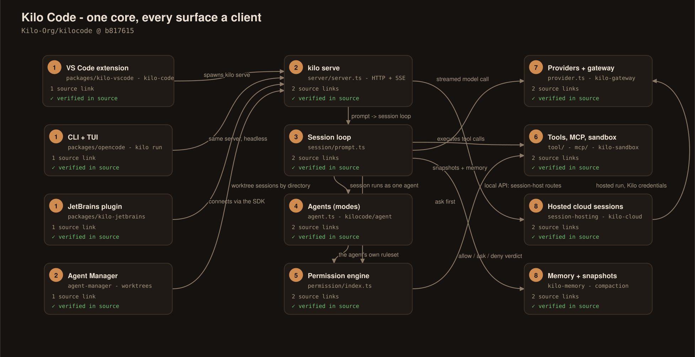
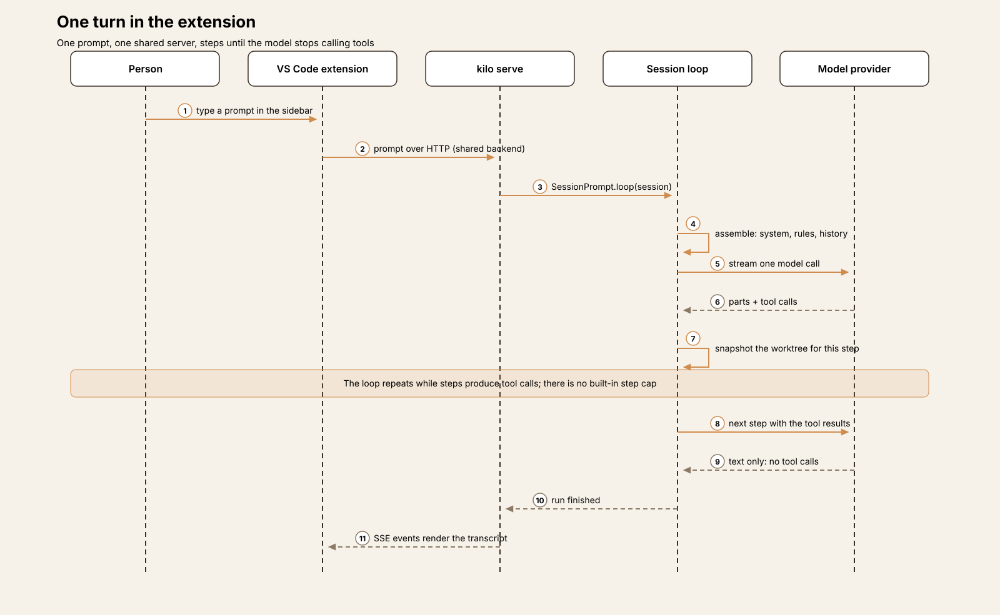
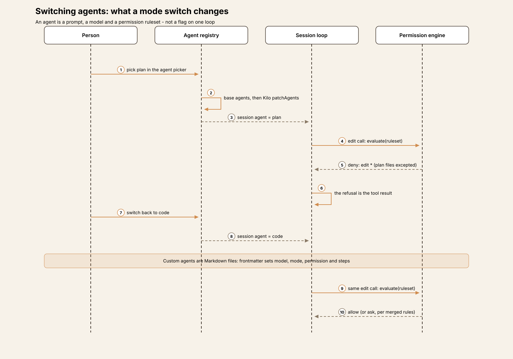
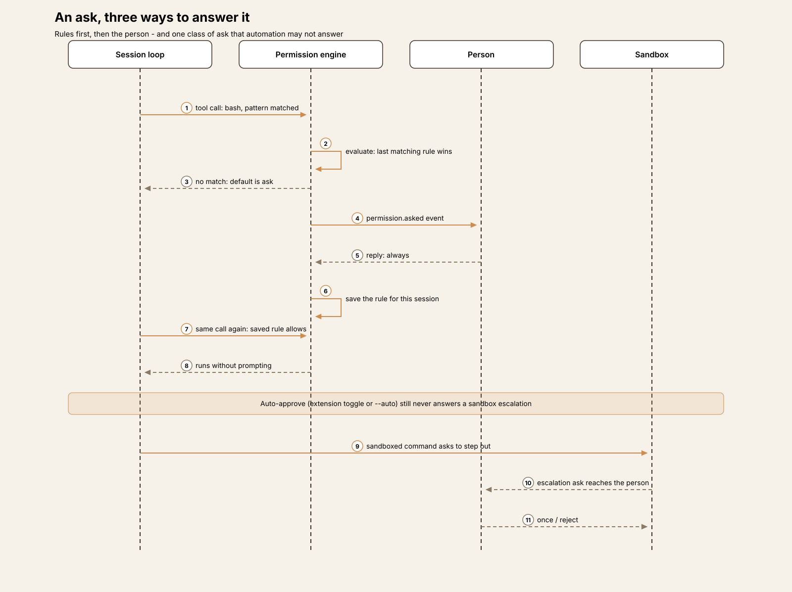
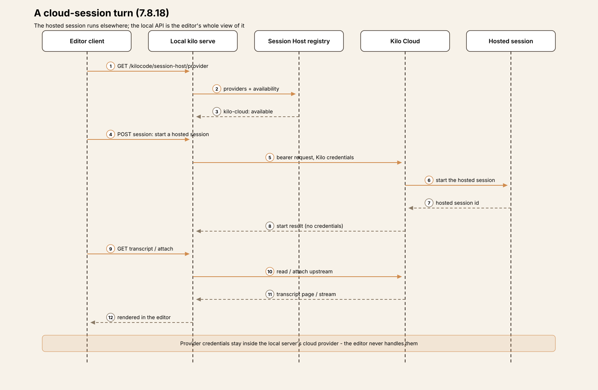
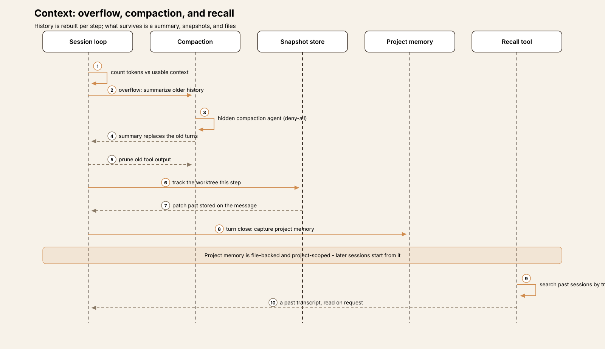

# Agent Harness Anatomy #25: Kilo Code — one core, every surface a client

> **Series:** Agent Harness Anatomy — top-down dissections of real agent harnesses, grounded in verifiable source code. Every behavioral claim below carries a footnote to a pinned GitHub permalink; the full evidence lives in the endnotes.

## Version block

- **Repo:** [Kilo-Org/kilocode](https://github.com/Kilo-Org/kilocode)
- **Pinned:** tag `v7.8.18`, commit `b81761530650f8ec7b071441f4f54d2514f1a244` (2026-10-26) — a lightweight tag resolving exactly to this commit; both published packages (`kilo-code` for VS Code, `@kilocode/cli`) carry version `7.8.18` in the pinned tree.
- **Language:** TypeScript (Bun workspaces + Turborepo) — 11,027 tracked files; the core read for this teardown is `packages/opencode/` (the CLI: runtime, server, sessions), `packages/kilo-vscode/` (the extension) and the Kilo-owned packages around them (`kilo-gateway`, `kilo-memory`, `kilo-sandbox`, `core`, `sdk`).
- **License:** MIT[^1]
- **Claim under test:** "The open source coding agent for building with AI in VS Code, JetBrains, or the CLI" — one agent you meet everywhere you work, with "500+ models" you can "switch between mid-task", at provider pricing with "zero markup", and "no API keys required to start".[^2] The model count, the pricing and the key-free start are vendor claims; the sections below verify the machinery underneath them and flag what code cannot settle.

Two framing notes. First, this teardown was read-only: the source was cloned and read, never built or executed. Second, a lineage note, because it changes what there is to describe: Kilo Code the product descends from the Cline/Roo Code line of VS Code agents, but the code at this pin is explicit about its own ancestry — the CLI at its center is a fork of OpenCode, kept deliberately close to upstream, with Kilo's changes living in `kilocode/` directories or marked `kilocode_change` in shared files.[^3] This teardown therefore describes Kilo's own code at the pin, and reaches for the series' Cline teardown (#3) and OpenCode teardown (#7) only where the mechanism itself invites the comparison.

## The mental model

Hold three ideas apart, because most of Kilo follows from them.

**The loop lives in a server; every surface is a client.** The agent runtime, the session store, the permission engine and the provider layer all live in one package — the CLI — which runs as a headless server, `kilo serve`. The VS Code extension, the JetBrains plugin, the TUI and the headless `kilo run` are clients of that server over HTTP + SSE. The extension does not contain a second agent: it bundles the CLI binary, spawns the server, and renders what the server streams.[^3]

**A "mode" is an agent, and an agent is mostly a permission profile.** The older Kilo vocabulary of modes survives as a system of named agents — code, plan, debug, ask, orchestrator, plus delegation-only subagents. Switching modes changes the system prompt and (optionally) the model, but the load-bearing change is the agent's own permission ruleset: plan is the agent whose ruleset denies edits, ask is the one whose ruleset denies mutation, explore is the subagent whose ruleset denies everything except reading and searching.[^4][^5]

**Approvals are data before they are dialogs.** A permission is a list of `(permission, pattern, action)` rules — allow, ask, deny — merged from defaults, the agent, and the user's config, and evaluated by one function whose default answer is *ask*. The chat prompt, the extension's Auto-Approve toggle and the CLI's `--auto` flag are three different front-ends over that single evaluation, and each of them preserves one exception: a request to escape the sandbox always reaches a person.[^6][^7][^8]

## Component map

- **The core** (`packages/opencode/`, `@kilocode/cli`) — the agent runtime: `SessionPrompt`'s loop, the session/message store, the permission engine, the provider layer, the MCP client, tools, snapshots and compaction, plus the HTTP + SSE server and the TUI/`kilo run` entry points.
- **The extension** (`packages/kilo-vscode/`, `kilo-code`) — the VS Code surface: sidebar chat, editor tabs, settings, the Marketplace panel, and the Agent Manager (multi-session orchestration over git worktrees). One shared connection service serves all of them against one backend.[^9]
- **The JetBrains plugin** (`packages/kilo-jetbrains/`) — a third client of the same server.
- **Kilo-owned packages** — `kilo-gateway` (Kilo-account auth and provider routing), `kilo-memory` (project memory), `kilo-sandbox` (the bubblewrap sandbox backend), `kilo-telemetry`, `kilo-ui`, `kilo-i18n`, and the generated `@kilocode/sdk` every client speaks.
- **The fork discipline** — shared upstream files are a last resort for Kilo changes; new Kilo code goes in `kilocode/` paths, and shared-file edits carry `kilocode_change` markers so upstream merges stay tractable.[^3] Much of what is distinctive about Kilo at this pin can be found by reading only the marked and Kilo-named code — which is also how this teardown weighted its reading.

## The core loop

The loop is `SessionPrompt`'s retained loop in `packages/opencode/src/session/prompt.ts` (2,679 lines), and its construct is a plain `while (true)`.[^10] Each iteration is one step: assemble the messages (the agent's system prompt, the project's instruction files, the stored history), stream one provider response through the session processor, execute the tool calls that step produced — each one through the permission gate — append the results, and loop. A step that produces no tool calls ends the run; so does an abort.

There is no built-in iteration cap. The step budget is per-agent — `maxSteps = agent.steps ?? Infinity` — and on the last allowed step the loop injects a text-only instruction so the run ends with an answer instead of another tool call.[^11] Built-in agents set no `steps`, so a default run is bounded by the model choosing to stop, the user aborting, or context handling (below) — a deliberate contrast with harnesses that treat a step limit as a safety property. Here the safety properties live elsewhere: in the permission ruleset and in the fact that every step's filesystem state is snapshotted (see Memory).

Two surfaces drive this same loop differently. In the extension, a prompt typed in the sidebar travels over HTTP to the shared backend and the transcript renders from the server's SSE event stream.[^9] In the CLI, `kilo run` drives the server in-process and prints the same events as terminal output; `kilo serve` on its own is the headless form, warning when no server password is set.[^12]

## Agents: what a mode switch actually changes

Kilo's patch layer, `patchAgents`, runs over the base agent map at startup and is where Kilo's agent system takes its final shape: it renames the upstream `build` agent to **code** ("for backward compatibility"), patches plan and explore, and adds three primaries of its own.[^4]

- **code** (primary, the default) — full tool access under the merged ruleset, plus Kilo's `semantic_search` allowance.
- **plan** (primary) — the base agent already denies `edit: "*"` with a carve-out for plan files; Kilo's patch adds a read-only-bash guard, MCP rules and a plan-edit guard around it, so the plan can be written and nothing else can.[^5]
- **debug** (primary) — code-like permissions with a systematic-debugging prompt.
- **ask** (primary) — read-only questions and explanations; an edit guard denies mutation.
- **orchestrator** (primary, marked deprecated in code) — deny-all except reading, searching, questions, todos and delegation; its `bash: deny` is merged *after* user config, so a user's allow cannot re-enable its shell.[^13]
- **general** and **explore** (subagents, delegation-only) — general runs multi-step delegated work; explore denies everything (`"*": deny`) and then re-allows read, grep, glob, list, web and a bash restricted to a read-only allowlist. An opt-in **scout** subagent researches documentation and dependency source, cloning repositories into a managed cache.
- **compaction, title, summary** (hidden primaries) — utility agents that deny all tools, so the loop's own housekeeping calls run inside the same machinery with no tool access at all.

A mode switch, then, is an agent switch: new prompt, possibly a new model, and a new ruleset for the next step of the same loop — the loop itself does not change shape.[^13]

Custom agents are Markdown files — the filename is the agent's name, YAML frontmatter carries description, model, mode (`primary` / `subagent` / `all`), permission overrides, a `steps` budget and sampling options, and the body is the prompt — or equivalent entries in config, at global, project, or organization scope. Organization-managed agents can shadow a built-in name and cannot be removed locally; legacy mode files from earlier Kilo generations (`.kilocodemodes`, `custom_modes.yaml`) are migrated forward.[^14]

## Approvals: one engine, three front-ends

The engine's whole contract fits in two functions. `evaluate(permission, pattern, ...rulesets)` returns the **last** rule whose permission and pattern both wildcard-match the call; when nothing matches, the answer is `ask`.[^6] `resolve()` — Kilo's layer — consults saved "always" rules and a set of hardeners (for reads, external directories and Agent Manager sessions) on top, with a `deny` in any layer standing.[^15] An agent's effective ruleset is a merge in a fixed order — base defaults, the agent's own rules, the user's config — with specific Kilo hardeners merged last where the design intends them to be non-overridable, as with orchestrator's shell.

The base defaults show the intended posture: reads are allowed, except `*.env` and `*.env.*`, which ask; `*.env.example` is allowed.[^16] An `ask` verdict raises a `permission.asked` event and blocks the tool call until a reply — once, always, or reject. "Always" is not a mood; it is saved as a session rule and re-evaluated like any other rule on later calls.[^15]

The three front-ends differ in how they answer asks, and the differences are the interesting part:

- **The extension prompt** is the baseline: the person answers in the chat. **Auto-Approve**, the extension's headline convenience, is a *runtime toggle*, not a config write: while it is on, a controller auto-replies "once" to `permission.asked` events and drains already-pending requests when switched on — but it categorically skips any request marked as a sandbox escalation, and its own enable message says so.[^7]
- **The CLI** names its posture in its flags: `--auto` "auto-approve permissions that are not explicitly denied (dangerous!)", and `--dangerously-skip-permissions` (also `--yolo`) to skip wholesale. Even in auto mode, the run loop auto-**rejects** — never approves — skill-shell and sandbox-escalation requests.[^8]
- **What remains gated, on every surface,** is therefore consistent: anything the ruleset denies stays denied; anything unmatched asks a person unless an automation front-end answers it; and a sandboxed command asking to step outside the sandbox reaches a person under every automation setting the code provides. Shell execution itself can run under the dedicated sandbox package's bubblewrap backend, which mediates filesystem writes and network destinations — the escalation ask is how a command requests an exception to that mediation.[^17]

Set against Cline (#3): both harnesses snapshot every step and treat approvals as the product. The difference is where policy lives. Cline's policy is layered through its IDE host and SDK hosts, with the CLI host inverting the extension's defaults; Kilo's policy is a data structure — one ruleset per agent, merged in one order, evaluated by one function — and its surfaces differ only in who answers an *ask*, never in what the rules mean.

## Cloud sessions: the 7.8.18 surface

Version 7.8.18's headline change exposes **hosted cloud sessions through the local API** — the release note's own summary is that editors can "discover, read, and interact with a hosted session without ever handling its provider credentials".[^18] The groundwork landed in 7.8.16 (a Session Host registry and the built-in Kilo Cloud provider), and both halves are in the pinned tree, so the local side of the claim can be checked in code.

The design is a provider-neutral registry plus one adapter. The registry holds session-host providers behind a shared vocabulary — provider ids, remote session ids, availability, transport state, hosted sessions, transcript pages, attachments, typed failures. The one built-in provider is `kilo-cloud`, and its module states its boundary in its own header comment: every provider-private detail the IDE-facing boundary must not see — cloud control ids, the target origin, the bearer, the directory selector, the SSE fence — stays inside the module.[^19] It resolves the user's Kilo credentials locally and spends them upstream itself, over a bearer HTTP client; failures are mapped into a small typed vocabulary (`signed_out`, `unavailable`, `rejected`, `payment_required`, and friends) rather than leaking upstream errors.

The local API surface is a route group rooted at `/kilocode/session-host`: list providers (with availability and transport), list hosted sessions, start one, fetch one, read its transcript, attach to one, fetch an attachment, detach. The group's own comment records a deliberate classification choice: these endpoints carry only the Authorization middleware and must never be treated as a routed attachment, even when the client is globally attached elsewhere.[^20] The handlers probe availability by checking credentials and remote state, and report an unavailable state instead of failing discovery.[^21]

What runs where follows from the boundary. The hosted session's agent loop, model calls and tool execution run on Kilo's hosted side — that half is not in this repository, and this teardown attributes it to the release notes rather than presenting it as code-verified. The local machine runs discovery, transcript reads and the attach stream (attachments are short-lived: the attach TTL constant is 60 seconds).[^19] What leaves the machine, compared with a local session, is also a property of the boundary: a local session sends model traffic only to the provider the user picked, while a cloud session's prompts and start context go to Kilo's hosted service by design — and, in exchange, the editor client that displays the session never touches a credential at all. The credential handling is the feature; the code structure is what makes the release claim checkable.

## MCP: marketplace in, and a redirect that no longer connects

MCP servers are configuration: local (stdio) and remote (HTTP) servers declared in config are connected by the core's MCP client, their tools join the session's tool set beside the built-ins, and remote servers that need OAuth authenticate through Kilo's OAuth provider with a loopback callback.[^22] Discovery and installation are productized through the Marketplace — an extension panel backed by an installer package in the core that handles MCP entries, skills and plugins.[^23]

The 7.8.18 MCP change is a security bump with a precise behavioral edge, and it deserves precise attribution: Kilo updated its MCP TypeScript SDK dependency to 1.32.1 — the version is pinned in the tree — because the SDK's HTTP and OAuth requests were following cross-origin redirects. After the bump, a remote MCP server whose URL redirects to another origin, or that answers a `POST` with a 301, 302 or 303 redirect, no longer connects; the changelog instructs users to configure the server's final URL instead.[^24] The refusal itself is implemented inside that SDK dependency, not in Kilo's own MCP code — the honest citation is the pinned version plus the release note, and the article makes it that way because "we bumped the dependency that fixed it" and "we wrote a redirect check" are different claims with different maintenance futures.

## Memory and context

Kilo's memory story has four layers, each with a different lifetime:

- **The session history** is the working memory: persisted messages, rebuilt per step. When counted tokens reach the model's usable context — the limit minus a reserved output allowance whose buffer is capped at 20,000 tokens — compaction summarizes older history with the hidden compaction agent and prunes old tool output, and the loop continues.[^25][^26]
- **Snapshots** are the episodic safety net: the Snapshot service tracks the worktree per step in a shadow git store, message parts carry the patches, and revert walks those parts to restore both conversation and files to an earlier message. Kilo's revert code is explicit about the limit: file restoration is possible only when the historical turn retained checkpoint data.[^27] This is the Cline inheritance in recognizable form — checkpoints as the safety model — re-implemented on the fork's session machinery.
- **Project memory** (`packages/kilo-memory`) is the cross-session layer: file-backed project blocks, captured at turn close or on explicit save, indexed and injected into later turns for the same project — inspectable as files, scoped to the project.[^28]
- **Recall** is memory the model invokes: the `kilo_local_recall` tool searches past session titles and transcripts and reads a chosen transcript, so an agent can pull a previous session's content into the current one on demand rather than by automatic injection.[^29]

Instructions ride along with every layer: the system prompt for each step includes the instruction chain — the global `AGENTS.md`, a `CLAUDE.md` compatibility entry, and project instruction files walking up from the working directory, where **the first project-level match wins** rather than stacking every ancestor's file — plus any files named by the `instructions` config key, which is how project rules are declared.[^30]

## Providers and routing

The provider layer is catalog-driven: providers and models are data (the models.dev catalog), transformed per provider before each call, which is the machinery underneath the "switch models mid-task" claim — model choice is per-step session state, not a property of the session's construction.[^31] Kilo's own routing sits in `kilo-gateway`: Kilo-account authentication and a gateway endpoint (default `https://ai-gateway.kilo.ai/api/v1`, environment-overridable) that carries chat, models, embeddings, autocomplete and transcription for signed-in users, alongside direct provider keys for everyone else.[^31] The catalog's size and the gateway are verifiable in the tree; the "500+" count and the zero-markup pricing are vendor claims about a catalog and a business, and are reported here as such.[^2]

## Extension points

- **Custom agents** — Markdown agent files or config entries at global, project or organization scope, each with its own prompt, model and permission ruleset (see Agents).[^14]
- **Workflows** — slash commands: Markdown files in `~/.config/kilo/commands/` (global) or `<project>/.kilo/commands/` (project), invoked as `/name`, with optional frontmatter selecting an agent. External command files are treated as untrusted: environment substitutions are blocked in them and file substitutions stay inside the project unless a global permission allows the source.[^32]
- **Rules** — the instruction chain and the `instructions` config key (see Memory).[^30]
- **Skills and plugins** — skill discovery with a `skill` tool, and the `@kilocode/plugin` interfaces; the Marketplace installs skills, plugins and MCP servers through one surface.[^23]
- **Agent Manager** — the extension's orchestration layer: parallel sessions, each in its own git worktree managed by the extension's `WorktreeManager`, all sharing the one backend with per-directory state — parallelism by worktree isolation rather than by multiple agents in one tree.[^33]

## Observations

- **The fork discipline is an architectural feature.** Keeping Kilo's diff small and marked — dedicated `kilocode/` directories, `kilocode_change` markers, upstream files touched as a last resort — is usually discussed as merge hygiene. Its second effect is legibility: a reader can find Kilo's own decisions (the agent patches, the permission hardeners, the cloud-session boundary) without excavating them from a rewritten codebase, and can tell Kilo's choices apart from its upstream's. Several other harnesses in this series are also forks or descendants; few make the boundary this explicit in the tree itself.
- **The most security-relevant code in 7.8.18 is a boundary, not a check.** The cloud-session work is mostly vocabulary and placement: a registry, a neutral type system, one adapter module that holds credentials and never lets them cross the local API. The MCP fix is a dependency version chosen deliberately, with the behavioral consequence spelled out in the changelog. Both are cases of a security property being carried by *where code sits* — and both are stated that way here because the code states them that way.
- **Unbounded by default is a posture, not an oversight.** No step cap unless an agent sets one; an approval default of *ask* unless a rule or a front-end answers; auto-approve modes that still refuse to answer the sandbox's question. The through-line is that limits are expressed as *policy owned by someone* — the agent author sets `steps`, the user sets rules, the person answers escalations — rather than as constants inside the loop.

## Tradeoffs

- **One core, several clients — and one core's complexity everywhere.** The server-first shape means the extension, the plugin and the CLI can never drift in behavior, and it also means every surface inherits the whole monorepo's weight: 11,027 files at this pin, a generated SDK to keep in step, and a fork to keep merging.
- **The ruleset is only as safe as its merges.** Last-match-wins with user config merged late is expressive, and the same property makes an overly broad user allow quiet and durable. The code mitigates the sharpest cases with hardeners merged after user config — but only for the cases the authors enumerated (orchestrator's shell, explore's bash, sandbox escalations).
- **Cloud sessions trade locality for reach.** A hosted session can be discovered, read and driven from any editor that speaks to the local API, with credentials neatly confined — and its prompts and repository context necessarily live, for the session's duration, on the vendor's side of the boundary. The local session remains the option where only the chosen model provider sees the work.
- **A fast-moving tree.** This pin is a snapshot of a repository releasing patch versions several times a month; the extension changelog for 7.8.18 is two dependency bumps, and the cloud surface's groundwork landed one patch earlier. The mechanisms described here are the ones at this commit; the surface most likely to have moved by the time of reading is the newest one.

## Comparison matrix row

| # | Dimension | Kilo Code (v7.8.18 @ b817615) |
|---|---|---|
| 1 | Agent loop | One retained loop in the CLI core (`SessionPrompt`, `while (true)`): assemble messages, stream one provider response per step, execute its tool calls through the permission gate, append results, repeat until a step calls no tools; no built-in step cap (`agent.steps ?? Infinity`, last step forced text-only); the same loop serves extension, TUI, CLI and JetBrains via the `kilo serve` HTTP + SSE server |
| 2 | Tool system | Built-in file/shell/search/LSP/web tools plus config-declared MCP servers (local stdio + remote HTTP/OAuth; SDK 1.32.1 at this pin, which refuses cross-origin-redirecting remote servers) and Marketplace-installed tools/skills/plugins; shell can run under a bubblewrap sandbox backend with mediated writes/network |
| 3 | Model providers | Catalog-driven provider layer (models.dev) with per-step model choice, direct provider keys, and Kilo Gateway routing for Kilo accounts (chat, models, embeddings, autocomplete, transcription via `ai-gateway.kilo.ai` by default); "500+ models / zero markup" are vendor claims over that machinery |
| 4 | Prompt construction | Per step: the running agent's system prompt + the instruction chain (global `AGENTS.md`, `CLAUDE.md` compatibility, first project-level match wins, plus `instructions` config files) + persisted history, compacted on overflow; custom agents contribute their Markdown body as prompt |
| 5 | Memory/session | Persisted session messages rebuilt per step; per-step shadow-git snapshots make every message a revert point (files + conversation); compaction summarizes history at the usable-context limit (reserved buffer capped at 20,000 tokens) and prunes old tool output; cross-session: file-backed project memory injected per project, plus an explicit `kilo_local_recall` tool over past transcripts |
| 6 | Reasoning/planning | Planning is an agent, not a loop phase: the plan agent's ruleset denies edits except plan files (with read-only-bash and MCP guards), and plan-exit returns to a coding agent; decomposition is delegation to subagents (general, explore, scout) under their own deny-first rulesets; custom agents set their own `steps` budgets |
| 7 | Extensibility | Custom agents (Markdown/config; global, project, organization scopes; organization agents can shadow built-ins), workflows as slash-command Markdown (external files untrusted: env substitution blocked, file substitution confined), rules via instructions, skills, `@kilocode/plugin` plugins, MCP, and the Marketplace as the shared install surface |
| 8 | Interfaces | All clients of one server: VS Code extension (sidebar, editor tabs, Agent Manager with git-worktree parallel sessions on the shared backend), JetBrains plugin, TUI, headless `kilo run` / `kilo serve`, the generated SDK — and, new at this pin, hosted cloud sessions exposed to editors through the local `/kilocode/session-host` API |
| 9 | Failure handling | Permission denials return as tool results the model can react to; provider/step failures surface as message error parts; compaction attempts per turn are capped against compact-looping; cloud-provider failures map to a typed vocabulary (signed_out / unavailable / rejected / payment_required) and availability probes report state instead of failing discovery; pairing of cloud sessions keeps credentials inside the provider module |
| 10 | Security model | Data-first approvals: per-agent rulesets of allow/ask/deny (wildcard, last match wins, unmatched = ask) merged defaults -> agent -> user, with Kilo hardeners merged last where non-overridable; reads allow except `.env` files, which ask; saved "always" rules are session rules; extension Auto-Approve is a runtime toggle and CLI `--auto` still auto-rejects skill-shell and sandbox-escalation asks, so escalations always reach a person; bubblewrap sandbox mediates shell; cloud sessions confine credentials to the local server's provider module |

## Endnotes

[^1]: [`LICENSE#L1`](https://github.com/Kilo-Org/kilocode/blob/b81761530650f8ec7b071441f4f54d2514f1a244/LICENSE#L1) — the repo root `LICENSE` is the MIT License text, "Copyright (c) 2026 Kilo Code / Copyright (c) 2025 opencode" (1,094 bytes).
[^2]: [`README.md#L9`](https://github.com/Kilo-Org/kilocode/blob/b81761530650f8ec7b071441f4f54d2514f1a244/README.md#L9) — the project's own one-line description; the "500+ models", mid-task switching, provider-pricing and no-key claims are in the paragraphs that follow it in the same file. The count and pricing are vendor claims, not code-verifiable facts.
[^3]: [`AGENTS.md#L1`](https://github.com/Kilo-Org/kilocode/blob/b81761530650f8ec7b071441f4f54d2514f1a244/AGENTS.md#L1) — the repo's own guide: the Products table ("All products are clients of the **CLI** (`packages/opencode/`), which contains the AI agent runtime, HTTP server, and session management"; the extension "Bundles the CLI binary, spawns `kilo serve` as a child process") and the Fork Merge Process section ("Kilo CLI is a fork of opencode"; Kilo-specific code in `kilocode/` directories; `kilocode_change` markers in shared files).
[^4]: [`packages/opencode/src/kilocode/agent/index.ts#L485`](https://github.com/Kilo-Org/kilocode/blob/b81761530650f8ec7b071441f4f54d2514f1a244/packages/opencode/src/kilocode/agent/index.ts#L485) — `patchAgents`, whose header comment lists its work: rename build -> code (the rename itself is at L515-L519), patch plan with readOnlyBash/MCP rules/`.kilo` paths, patch explore, add debug/orchestrator/ask.
[^5]: [`packages/opencode/src/agent/agent.ts#L185`](https://github.com/Kilo-Org/kilocode/blob/b81761530650f8ec7b071441f4f54d2514f1a244/packages/opencode/src/agent/agent.ts#L185) — the `plan` agent: "Plan mode. Disallows all edit tools", with `edit: { "*": "deny", …plan files…: "allow" }` in its permission merge; the `build` agent it contrasts with is at L169.
[^6]: [`packages/opencode/src/permission/index.ts#L102`](https://github.com/Kilo-Org/kilocode/blob/b81761530650f8ec7b071441f4f54d2514f1a244/packages/opencode/src/permission/index.ts#L102) — `evaluate(permission, pattern, ...rulesets)`: `findLast` over the flattened rulesets with wildcard matching on both fields, falling back to `{ action: "ask", pattern: "*" }` when no rule matches.
[^7]: [`packages/kilo-vscode/src/commands/toggle-auto-approve.ts#L27`](https://github.com/Kilo-Org/kilocode/blob/b81761530650f8ec7b071441f4f54d2514f1a244/packages/kilo-vscode/src/commands/toggle-auto-approve.ts#L27) — the Auto-Approve controller (`kilo-code.new.autoApprove`): its header comment states it auto-replies "once" at runtime instead of writing CLI config; the sandbox-escalation exclusions are at L78 (drain) and L93 (approve), and the enable toast reads "Auto-approve enabled. Sandbox escalation prompts are excluded."
[^8]: [`packages/opencode/src/cli/cmd/run.ts#L258`](https://github.com/Kilo-Org/kilocode/blob/b81761530650f8ec7b071441f4f54d2514f1a244/packages/opencode/src/cli/cmd/run.ts#L258) — the `--auto` option ("auto-approve permissions that are not explicitly denied (dangerous!)"); `--dangerously-skip-permissions` is defined at L266 and combined with `--yolo` into `skipPermissions` at L298; the `permission.asked` handler (~L945-L960) auto-rejects requests whose metadata marks them skill-shell or sandbox-escalation.
[^9]: [`packages/kilo-vscode/src/extension.ts#L90`](https://github.com/Kilo-Org/kilocode/blob/b81761530650f8ec7b071441f4f54d2514f1a244/packages/kilo-vscode/src/extension.ts#L90) — "Create shared connection service (one server for all webviews)": one `KiloConnectionService` for the sidebar, editor tabs and Agent Manager.
[^10]: [`packages/opencode/src/session/prompt.ts#L1555`](https://github.com/Kilo-Org/kilocode/blob/b81761530650f8ec7b071441f4f54d2514f1a244/packages/opencode/src/session/prompt.ts#L1555) — the retained loop's `while (true)`, inside `SessionPrompt`'s loop implementation; each iteration logs its step and either exits (no pending tool work) or continues with the tool results folded in.
[^11]: [`packages/opencode/src/session/prompt.ts#L1707`](https://github.com/Kilo-Org/kilocode/blob/b81761530650f8ec7b071441f4f54d2514f1a244/packages/opencode/src/session/prompt.ts#L1707) — `const maxSteps = agent.steps ?? Infinity` and `isLastStep`; the last-step text-only injection (`MAX_STEPS_PROMPT`) is at L1860 in the same file.
[^12]: [`packages/opencode/src/cli/cmd/serve.ts#L7`](https://github.com/Kilo-Org/kilocode/blob/b81761530650f8ec7b071441f4f54d2514f1a244/packages/opencode/src/cli/cmd/serve.ts#L7) — the `serve` command, "starts a headless kilo server", including the warning printed when `KILO_SERVER_PASSWORD` is not set.
[^13]: [`packages/opencode/src/kilocode/agent/index.ts#L586`](https://github.com/Kilo-Org/kilocode/blob/b81761530650f8ec7b071441f4f54d2514f1a244/packages/opencode/src/kilocode/agent/index.ts#L586) — the Kilo-added primaries in `patchAgents`: `debug` at L586, `orchestrator` at L606 (marked deprecated; its trailing merge enforces `bash: "deny"` after user config, per its own comment "Enforce bash deny after user so user config cannot re-enable shell"), and `ask` at L645.
[^14]: [`packages/kilo-docs/pages/customize/custom-modes.md#L1`](https://github.com/Kilo-Org/kilocode/blob/b81761530650f8ec7b071441f4f54d2514f1a244/packages/kilo-docs/pages/customize/custom-modes.md#L1) — the in-repo documentation for custom agents ("custom modes"): Markdown files with YAML frontmatter (name from filename; description, model, mode, permission, steps, temperature, hidden, disable) at global, project and organization scope, including that organization agents take precedence over same-named built-ins and cannot be removed by members.
[^15]: [`packages/opencode/src/permission/index.ts#L115`](https://github.com/Kilo-Org/kilocode/blob/b81761530650f8ec7b071441f4f54d2514f1a244/packages/opencode/src/permission/index.ts#L115) — Kilo's `resolve()`: the base verdict is hardened (read, external-directory, Agent Manager layers), saved rules are consulted in the override position, and a `deny` from either side stands; the same module defines `saveAlwaysRules` and the per-session saved-ruleset state.
[^16]: [`packages/opencode/src/agent/agent.ts#L154`](https://github.com/Kilo-Org/kilocode/blob/b81761530650f8ec7b071441f4f54d2514f1a244/packages/opencode/src/agent/agent.ts#L154) — the base defaults' read rules: `"*": "allow"`, `"*.env": "ask"`, `"*.env.*": "ask"`, `"*.env.example": "allow"`, immediately above Kilo's defaults patch (bash allowlist and the recall permission).
[^17]: [`packages/kilo-sandbox/src/bubblewrap.ts#L354`](https://github.com/Kilo-Org/kilocode/blob/b81761530650f8ec7b071441f4f54d2514f1a244/packages/kilo-sandbox/src/bubblewrap.ts#L354) — the bubblewrap backend of the dedicated `packages/kilo-sandbox` package (system `bwrap` at `/usr/bin/bwrap`, L15); the package's index re-exports the filesystem and network mediation (`assertWrite`, `assertNetwork`) the backend enforces.
[^18]: [`packages/opencode/CHANGELOG.md#L7`](https://github.com/Kilo-Org/kilocode/blob/b81761530650f8ec7b071441f4f54d2514f1a244/packages/opencode/CHANGELOG.md#L7) — the 7.8.18 minor change (PR #15358): "Expose hosted cloud sessions through the local Kilo API, so editors can discover, read, and interact with a hosted session without ever handling its provider credentials."
[^19]: [`packages/opencode/src/kilocode/session-hosting/kilo-cloud.ts#L33`](https://github.com/Kilo-Org/kilocode/blob/b81761530650f8ec7b071441f4f54d2514f1a244/packages/opencode/src/kilocode/session-hosting/kilo-cloud.ts#L33) — `PROVIDER = "kilo-cloud"`; `provider()` at L50 carries the boundary comment quoted in the article ("Every provider-private detail the future IDE-facing boundary must not see (Cloud control IDs, target origin, bearer, directory selector, SSE fence) stays inside this module"), and `ATTACHMENT_TTL_MS = 60_000` is defined in the same file.
[^20]: [`packages/opencode/src/kilocode/server/httpapi/groups/session-host.ts#L28`](https://github.com/Kilo-Org/kilocode/blob/b81761530650f8ec7b071441f4f54d2514f1a244/packages/opencode/src/kilocode/server/httpapi/groups/session-host.ts#L28) — `SessionHostPaths` under the root `/kilocode/session-host` (provider, session, session detail, message/transcript, attach, attachment), with the group's comment: these endpoints "intentionally carry only the Authorization middleware" and "must never be classified as a routed attachment"; the endpoint definitions follow at L111-L190.
[^21]: [`packages/opencode/src/kilocode/server/httpapi/handlers/session-host.ts#L57`](https://github.com/Kilo-Org/kilocode/blob/b81761530650f8ec7b071441f4f54d2514f1a244/packages/opencode/src/kilocode/server/httpapi/handlers/session-host.ts#L57) — `sessionHostHandlers`: failure mapping into the local API's error vocabulary, and the providers handler's rule that an availability failure is reported as an unavailable state rather than failing discovery.
[^22]: [`packages/opencode/src/mcp/oauth-provider.ts#L169`](https://github.com/Kilo-Org/kilocode/blob/b81761530650f8ec7b071441f4f54d2514f1a244/packages/opencode/src/mcp/oauth-provider.ts#L169) — the MCP OAuth provider's `redirectToAuthorization`, part of the remote-server authentication flow whose loopback callback lives in `oauth-callback.ts`; server connection and tool wiring live in `packages/opencode/src/mcp/index.ts` (1,247 lines).
[^23]: [`packages/opencode/src/kilocode/marketplace/installer.ts#L32`](https://github.com/Kilo-Org/kilocode/blob/b81761530650f8ec7b071441f4f54d2514f1a244/packages/opencode/src/kilocode/marketplace/installer.ts#L32) — the marketplace installer package surface (MCP entry building in `mcp-entry.ts`, skill archives, plugin config) backing the extension's Marketplace panel.
[^24]: [`packages/opencode/package.json#L109`](https://github.com/Kilo-Org/kilocode/blob/b81761530650f8ec7b071441f4f54d2514f1a244/packages/opencode/package.json#L109) — `"@modelcontextprotocol/sdk": "1.32.1"` pinned in the tree; the behavioral statement is the 7.8.18 patch entry in `packages/opencode/CHANGELOG.md` (PR #15430): MCP HTTP and OAuth requests following cross-origin redirects are fixed by the SDK update, and remote servers redirecting cross-origin (or answering POST with 301/302/303) "no longer connect; use the server's final URL instead".
[^25]: [`packages/opencode/src/session/overflow.ts#L9`](https://github.com/Kilo-Org/kilocode/blob/b81761530650f8ec7b071441f4f54d2514f1a244/packages/opencode/src/session/overflow.ts#L9) — `COMPACTION_BUFFER = 20_000`; `usable()` (L11) computes the model's input/context limit minus the reserved allowance, and `isOverflow()` (L23) compares the counted tokens against it.
[^26]: [`packages/opencode/src/session/compaction.ts#L305`](https://github.com/Kilo-Org/kilocode/blob/b81761530650f8ec7b071441f4f54d2514f1a244/packages/opencode/src/session/compaction.ts#L305) — `SessionCompaction.prune`: old tool output is pruned once the prunable total passes the module's minimum; the same module creates the summary (via the hidden compaction agent) that replaces older history after overflow.
[^27]: [`packages/opencode/src/session/revert.ts#L1`](https://github.com/Kilo-Org/kilocode/blob/b81761530650f8ec7b071441f4f54d2514f1a244/packages/opencode/src/session/revert.ts#L1) — session revert: it walks message parts collecting snapshot patches, with Kilo's comment in the revert path stating that a fresh snapshot preserves only redo state and "File restoration is possible only when the historical turn retained checkpoint data"; the Snapshot service itself is `packages/opencode/src/snapshot/index.ts` (Service at L79).
[^28]: [`packages/kilo-memory/src/memory.ts#L1`](https://github.com/Kilo-Org/kilocode/blob/b81761530650f8ec7b071441f4f54d2514f1a244/packages/kilo-memory/src/memory.ts#L1) — the `Memory` facade of `@kilocode/kilo-memory`: project-scoped memory blocks with file-backed state and index (`MemoryFiles`), capture operations and recall indexing; the CLI-side wiring lives in `packages/opencode/src/kilocode/memory/`.
[^29]: [`packages/opencode/src/tool/recall.ts#L32`](https://github.com/Kilo-Org/kilocode/blob/b81761530650f8ec7b071441f4f54d2514f1a244/packages/opencode/src/tool/recall.ts#L32) — the `kilo_local_recall` tool: `search` finds sessions by title and transcript content, `read` returns a chosen session's transcript (default limit 20, max 50).
[^30]: [`packages/opencode/src/session/instruction.ts#L65`](https://github.com/Kilo-Org/kilocode/blob/b81761530650f8ec7b071441f4f54d2514f1a244/packages/opencode/src/session/instruction.ts#L65) — instruction resolution: the global config `AGENTS.md`, `~/.claude/CLAUDE.md` (unless disabled), then project `AGENTS.md` / `CLAUDE.md`; the comment at L152 states "The first project-level match wins so we don't stack AGENTS.md/CLAUDE.md from every ancestor."
[^31]: [`packages/kilo-gateway/src/types.ts#L88`](https://github.com/Kilo-Org/kilocode/blob/b81761530650f8ec7b071441f4f54d2514f1a244/packages/kilo-gateway/src/types.ts#L88) — the gateway default, documented in the type: `@default "https://ai-gateway.kilo.ai/api/v1"`; the catalog-driven provider layer it complements is `packages/opencode/src/provider/provider.ts` (2,226 lines), which Kilo patches for privacy and auth at its head.
[^32]: [`packages/kilo-docs/pages/customize/workflows.md#L1`](https://github.com/Kilo-Org/kilocode/blob/b81761530650f8ec7b071441f4f54d2514f1a244/packages/kilo-docs/pages/customize/workflows.md#L1) — the in-repo Workflows documentation: workflows are slash commands stored as Markdown in `~/.config/kilo/commands/` (global) or `<project>/.kilo/commands/` (project), with optional frontmatter; external command files "remain untrusted: `{env:...}` substitutions are blocked and `{file:...}` substitutions remain confined to the project" unless a global `markdown_source` permission allows the source.
[^33]: [`packages/kilo-vscode/src/agent-manager/WorktreeManager.ts#L131`](https://github.com/Kilo-Org/kilocode/blob/b81761530650f8ec7b071441f4f54d2514f1a244/packages/kilo-vscode/src/agent-manager/WorktreeManager.ts#L131) — the Agent Manager's `WorktreeManager`; the repo's `AGENTS.md` adds that Agent Manager worktree sessions pass a directory context to the shared backend rather than starting one server per worktree.
