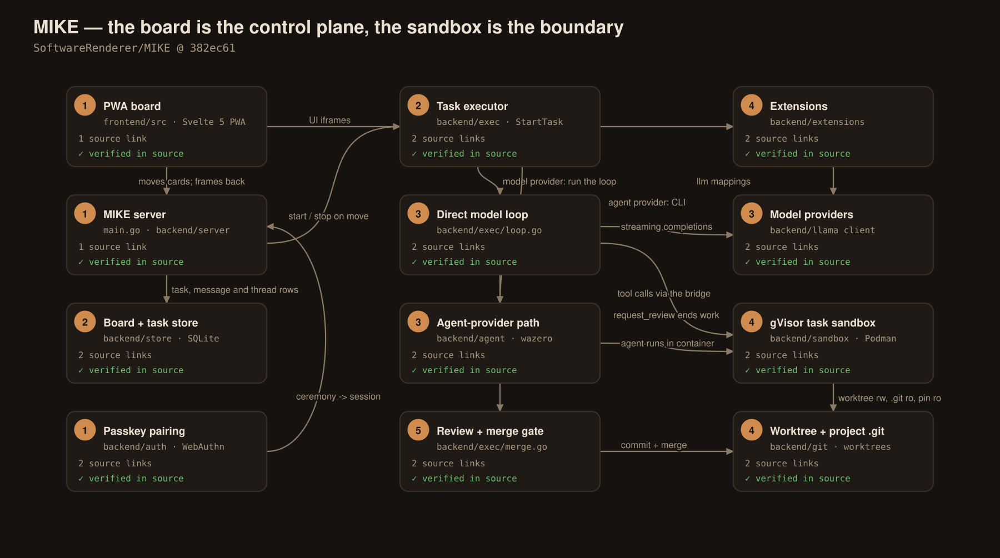
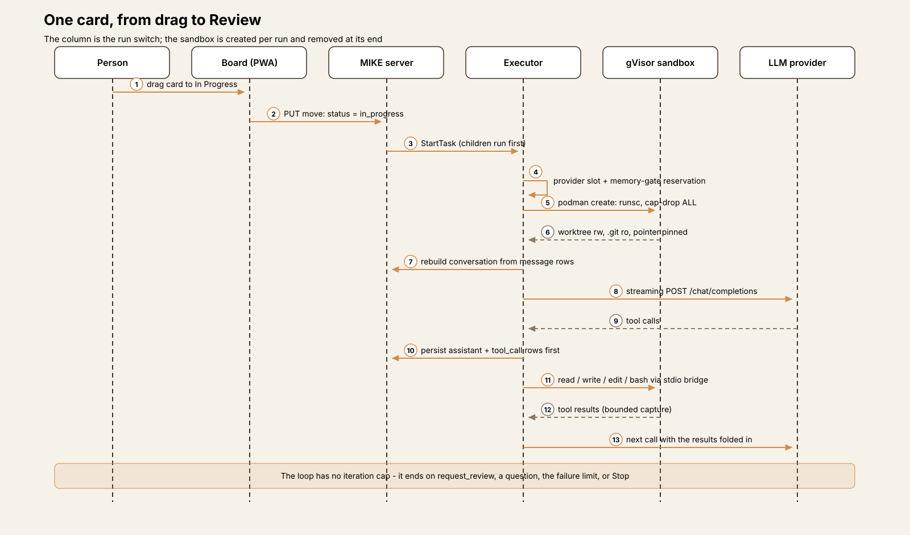
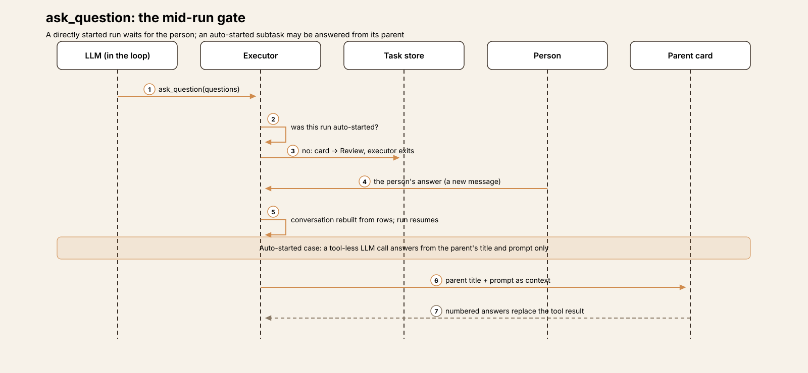
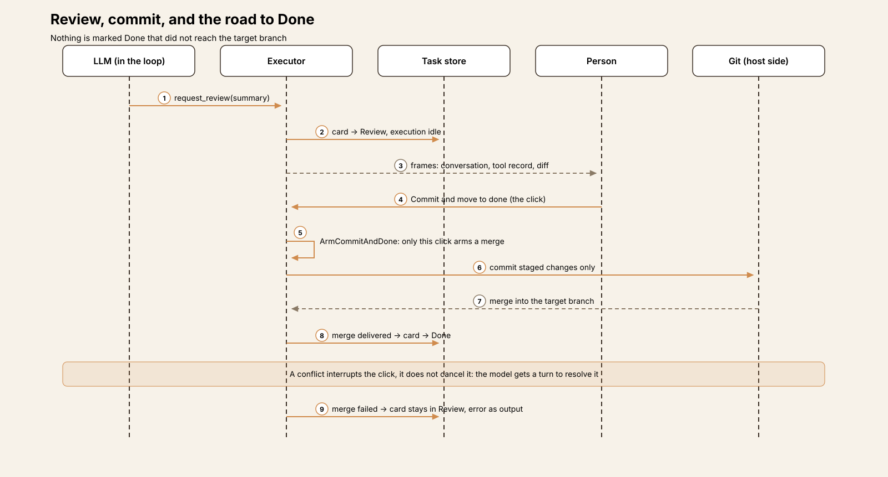
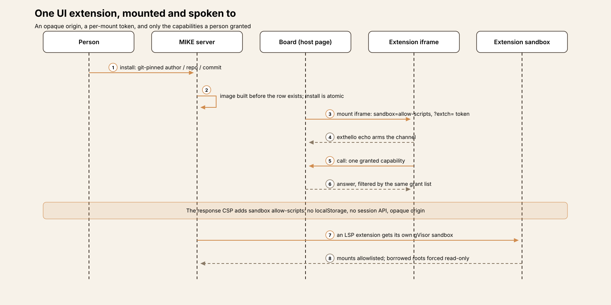
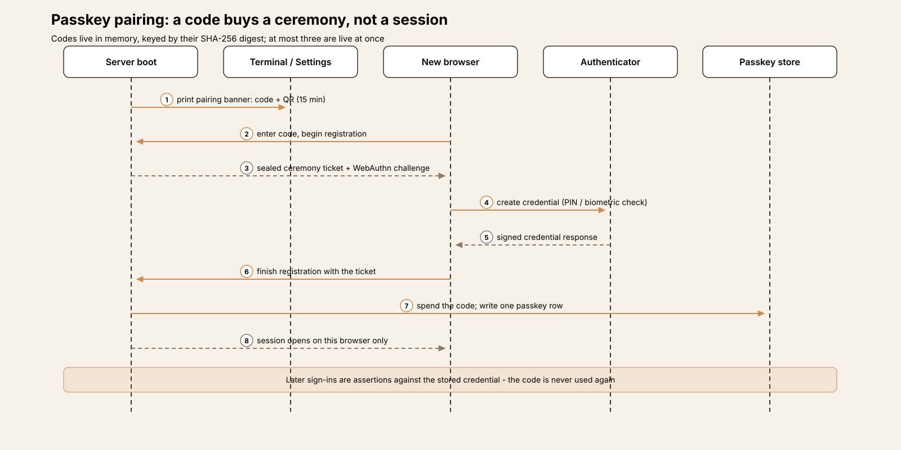
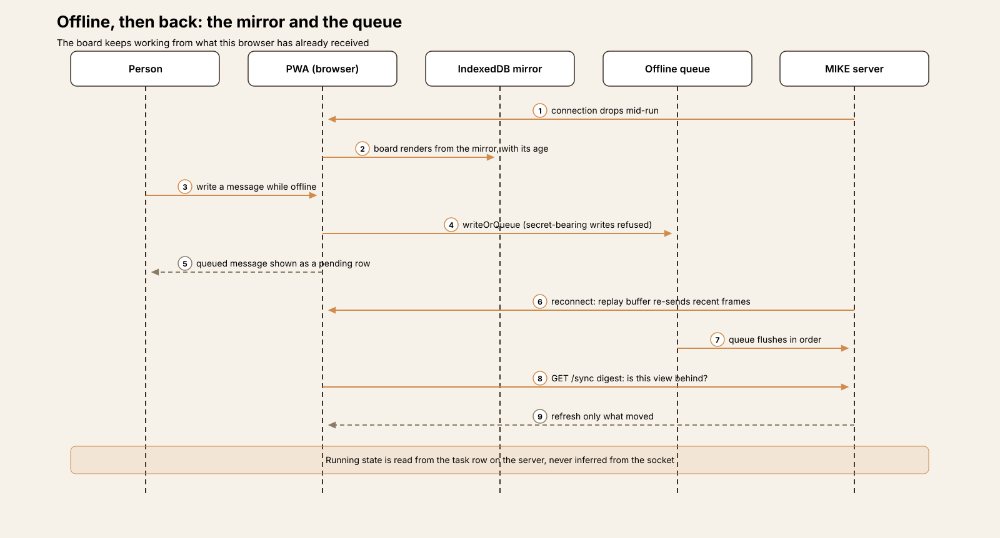

# Agent Harness Anatomy #24: MIKE — the board is the control plane

> **Series:** Agent Harness Anatomy — top-down dissections of real agent harnesses, grounded in verifiable source code. Every behavioral claim below carries a footnote to a pinned GitHub permalink; the full evidence lives in the endnotes.

## Version block

- **Repo:** [SoftwareRenderer/MIKE](https://github.com/SoftwareRenderer/MIKE)
- **Pinned:** tag `v0.1.0`, commit `382ec61bbf89d08ac2b0c99d42f166e00ae4dd8c` (2026-10-15) — the project's first release ("v0.1.0 - Hello, world!"). The tag exists and resolves exactly to this commit, so the pin is the tag.
- **Language:** Go throughout the server (one module, 708 Go files), with a Svelte 5 / TypeScript frontend (678 `.ts` and 138 `.svelte` files) built into the binary. State is one SQLite database.
- **License:** Apache-2.0[^1]
- **Claim under test:** MIKE — the Integrated Kanban Environment — is "a LLM harness that streamlines software development work", in which tasks are kanban cards, each agent runs inside strong sandbox isolation via gVisor, custom extensions are supported securely via iframe sandboxing and wazero, the UI is a Progressive Web App built for spotty networks, and providers are llama.cpp plus any OpenAI Chat Completions-compatible endpoint.[^2]

Two framing notes. First, this teardown was read-only: the source was cloned and read, never built or executed, so every claim is about what the code at this tag does. Second, a precision note on the sandbox mounts, because the details matter here: the task's *worktree* is mounted read-write (read-only in plan mode), its `.git` *pointer file* is pinned read-only over it, and the project's `.git` *directory* is mounted read-only at its own absolute path. The project checkout itself is not mounted into the task container. The sandbox section below states the shape as pinned.

## The mental model

Hold three ideas apart, because most of MIKE follows from them.

**The board is the control plane.** A task is a card on a kanban board with exactly four columns — Backlog, In Progress, Review, Done.[^3] The card row carries everything a run needs: title and prompt, branch and pinned baseline, model choice, operating mode, the `auto_commit` / `auto_merge` flags, and its own execution state, kept separate from its column.[^4] Moving a card is not bookkeeping: the move handler starts the executor when a card enters In Progress and stops it when a card leaves.[^5] The workflow the person sees *is* the workflow the executor obeys.

**The container is the boundary, not a permission prompt.** For a sandboxed project — and creating an unsandboxed one requires the operator to set `DANGER_ZONE=1` first[^6] — every file, shell and language-server action the model takes runs inside one gVisor container built for that task. There is no per-action approval dialog in the loop. In its place are structural gates: a run starts only when a card is put In Progress, a question stops the run until a person answers, and a merge happens only through the card's own auto flags or a person's commit-and-done click.

**The store is the state.** Every assistant message, tool call and tool result is a row in SQLite, written before the thing it describes is acted on. A run's conversation is a rebuild from those rows, so a server restart is a non-event for a task in flight, and the board, the chat and the diff a person reviews are reads of the same record.

## Component map

- **The PWA board** (`frontend/src`) — the person's surface: boards, cards, chat, diff review, settings, the terminal. It is also an offline client, with an IndexedDB mirror and a write queue (below).
- **The server** (`main.go`, `backend/server`) — one Go binary serving the REST/WebSocket API, the embedded SPA and the executor, over TLS only. Its state is the single SQLite file (`backend/store`).
- **The executor** (`backend/exec`) — starts and stops runs, applies the subtask schedule, runs the direct model loop and the agent-provider path, and owns the merge machinery.
- **Providers** (`backend/llama`, `backend/config`) — named endpoints with a URL, a model and an optional key; agent extensions join the same list as `agent://` providers.
- **The sandbox** (`backend/sandbox`, `pkg/sandboxruntime`, `pkg/bridge`) — per-task gVisor containers through rootless Podman, and the stdio bridge that carries tool calls into them.
- **Git** (`backend/git`) — worktrees, branches, staging, commits and merges, all behind one command constructor with an execution fence.
- **Extensions** (`backend/extensions`, `backend/agent`) — the seven extension types and their three isolation mechanisms.
- **Auth** (`backend/auth`) — passkey pairing, sessions, and the narrower bearer-token surface.

## The core loop

A run begins in `StartTask`: the task and project rows are loaded, the baseline is pinned (the base ref and the commit it names at start), and the task's worktree and branch are ensured.[^7][^8] Then `executeTask` takes two gates, in a deliberate order — the per-provider running-task slot first, then a memory-gate reservation — so a queued task holds no container while it waits.[^9][^10][^11]

If the task's provider is a model endpoint, the direct loop runs. The conversation is rebuilt from the store and the first streaming call is made; each iteration streams one chat completion, folds the tool-call deltas, persists the turn, executes its tool calls, and folds the results into the next call.[^12] The loop is a plain `for {}` with **no iteration cap**. What bounds a run is behavioural: a consecutive-failed-turn limit (a per-task field, defaulting to 3), a repeated-call loop detector, provider retries (three attempts inside a three-minute window, with request rejections never retried), an optional loop breaker that cuts a failing call and everything after it out of the conversation and tells the model to proceed — and the person's Stop.[^13][^14]

## One card, end to end

A card is created in Backlog with a title and a prompt. Dragged into In Progress, it starts — unless it has unfinished children, in which case the schedule starts the deepest startable child instead: a parent with unfinished subtasks never runs its own turn, and children always run before their parent. The sandbox is created (next section), the prompt is assembled (below), and the loop runs. Tool calls stream back onto the card as they happen — each persisted before it executes — and the diff panel follows the worktree.

The run ends in one of the loop's three settlements. The model calls `request_review` with a summary, and the card lands in Review with its full record. The model calls `ask_question`, and the executor stops and waits (the gate is examined below). Or the failure limit trips, and the card lands in Review marked failed, with the reason as its output. In every case the container is stopped and removed, and the card — not a log file — is where the result lives.

## The sandbox, closely

This is the subsystem the project is built around, and it rewards a close read.

**Creation.** One container per task, named `kanban-sandbox-<taskID>`, created through rootless Podman from a single shared argument builder: `--runtime runsc` (gVisor), `--cap-drop ALL`, `--security-opt no-new-privileges`, `--pull never`, entrypoint cleared.[^15][^16] gVisor is a requirement, not a preference: the manager probes for `runsc` and Podman, and a sandboxed task whose host cannot run gVisor refuses to start — there is no fallback runtime and no host fallback behind it.

**Mounts.** The worktree bind-mounts read-write at `/home/sandbox/<project>` — read-only when the run is in plan mode, which is how plan mode's "never write code" rule is enforced: by the mount, not by a prompt-level allowlist. Two read-only mounts complete the git picture. The project's `.git` directory mounts read-only at its own absolute path, so git inside the container can resolve refs, objects and worktree metadata. And the worktree's `.git` *pointer file* — the small file that names the real gitdir — is pinned with a second read-only mount over the read-write worktree mount.[^17] That pin is the subtlest mechanism in the codebase: host-side git later reads the gitdir the pointer names, and git executes configuration from it, so a guest that could rewrite the pointer could choose code the host runs. A task container that cannot establish the pin is refused outright. Bundled and project skill packages mount read-only alongside, plus whatever extra mounts the project's sandbox configuration declares.

**Network.** Network isolation is a per-project setting with one careful property: creating a sandboxed project *requires the request to state it* — neither value is a silent default.[^18] With isolation on, the create adds `--network none`. The only published ports on a container are the project's configured forwarded ports, on ephemeral host ports.

**The bridge.** Tool calls do not go through the container's network at all. A small bridge binary is copied into the container and started with `podman exec -i`; it speaks a framed protocol over that one stdio connection — no listener, no port.[^19] Frames are capped at 64 MiB and reads at 16 MiB, on both sides. Interactive terminals are the exception: they bypass the bridge with a host-side PTY.

**Capabilities and environment.** A project may declare extra Linux capabilities, but they are validated by shape — a capability must be a single word, so a value like `--privileged` is refused as an argument, not weighed as a name — and the one code path that appends a `--cap-add` first checks that the command line already selects runsc and `--cap-drop ALL`, refusing the whole grant otherwise. The container's environment is only what was configured for it; the builder invents no `PATH` and no `TERM`, because an invented `-e` would override the image's own.

**Budgets and teardown.** Each container can carry a memory cap; above that sits a host-wide admission budget (by default 90 percent of installed RAM), and a supervisor that, under pressure, pauses the cheapest in-flight task first — and can release an idle task's container after a grace period, a setting that is off unless the operator turns it on.[^20] When a run ends, `Stop` records the run's final memory peak and OOM-kill count onto the task row, closes the bridge client, kills the agent process and removes the container.[^21] A boot sweep clears stale `kanban-sandbox-*` and `kanban-ext-*` containers — stopped ones only, never a running one.

## Prompt assembly

The prompt is a rebuild, assembled the same way on every run. `buildMessagesFromDB` reassembles the conversation from stored rows — assistant messages with their tool calls, tool results in place, advisories under their own role — and `composeSystemPrompt` puts the system prompt in front.[^22] The base template renders the available tools with their descriptions, the available skills by name, description and the exact location the container can open, the current-task summary when one exists, and the project's `AGENTS.md` inside `<instructions>` tags; plan and explore modes extend the template with their own rule sets.[^23] The system prompt closes with the current date and the working directory — the container's mount path for a sandboxed run, so the paths the model is told are the paths its tools will resolve.

## Tools, permissions, and the human gates

The core tool set is thirteen tools, one shared list that the provider definitions, the dispatch table and the frontend all read: `read_file`, `write_file`, `edit_file` and `bash`; `ask_question`, `request_review`, `create_task`, `view_tasks` and `edit_task`; and four LSP tools (`lsp_references`, `lsp_definition`, `lsp_hover`, `lsp_rename`) offered only when an LSP extension is installed and enables them.[^24][^25] Per project, two more families can join: MCP tools (below) and extension-contributed tools. Plan mode swaps `bash` for a read-only variant under the same name, so the model never sees two near-identical tools.

Where a tool executes is decided by one column, `project.sandbox_enabled`. Sandboxed: the call crosses the bridge into the task's container, and if the bridge is missing the tool environment refuses the call — a missing bridge is an outage, not a licence to work on the host.[^26] Unsandboxed: the same calls run on the host, which is why creating such a project is gated behind the operator's `DANGER_ZONE=1`.

There is no per-tool-call approval step. The gates are the workflow's own, and there are three:

- **Starting is a decision.** A run begins only when a person drags a card into In Progress, sends it a message, or starts a parent whose schedule reaches it.
- **`ask_question` is the mid-run gate.** The executor settles the turn, moves the card to Review and exits; the answer arrives as a later message and the run resumes from the rebuilt conversation.[^27] One exception, carefully scoped: a run the *system* auto-started (a subtask under a started parent) may have its question answered by a separate, tool-less LLM call that sees only the parent card's title and prompt; a run a person started directly is never auto-answered.[^28]
- **`request_review` is the completion gate.** The base prompt instructs the model to end its work with it, summary included.[^23] What happens next is governed by the card's flags, examined in the next section.

## Review, commit, and Done

`request_review` does not itself commit anything. It hands the card to the person — or, when the card's `auto_commit` flag is set, to the commit machinery: a commit message is generated, staged changes are committed, and when `auto_merge` is also set the branch is merged into its target (a subtask merges into its parent's branch; a root task into its base ref).[^29][^30] Two rules hold the line. Only *staged* changes are ever committed; untracked files stay in the worktree and are discarded with the task. And nothing is marked Done that did not reach the target branch — a failed merge leaves the card in Review with the error as its output.[^31]

The person's own path is a single click, Commit and move to done, which is also the only way to *arm* a merge outside the auto flags.[^32] If the merge conflicts, the click is interrupted, not cancelled: the task is armed, the model gets a turn with the review summaries as context to resolve the conflict, and the merge completes from there.

## The second agent path: agent providers

A provider in MIKE is usually a model endpoint, but it can also be *an agent*. An agent extension supplies a WASM adapter — loaded with wazero as a WASI reactor — that translates between MIKE's own event vocabulary (token, reasoning, tool call, tool result, status, stats, error, persist, turn complete) and one external agent CLI's wire protocol; the reference adapters, for Pi's RPC JSONL and Claude Code's stream-json, live in the separate MIKE-extensions repository.[^33] The adapter names the binary; the runner spawns it — inside the task's container when the project is sandboxed — and the executor's agent branch runs the turn from the adapter's events, of which only the `persist` events reach the database. That single seam is what keeps the backend ignorant of agent protocols.[^34]

An enabled agent extension appears in the provider list as `agent://<name>`, merged into the config response per request and never persisted, so installing an agent and "a new provider appears" are the same event.[^35] The adapter's subprocess environment is an explicit allowlist (`PATH`, `HOME`, user, terminal, locale, proxy and trust-store variables, plus the adapter's own extras) — never the server's whole environment, a rule the codebase states plainly: the server's environment contains the encryption key, and an extension-supplied binary must not inherit it.[^36]

## Memory and context

Per task, memory is the conversation itself: SQLite rows on a thread, rebuilt per run. Threads fork a conversation — with checkpoints that pin the git state at the fork point — so a card can explore two directions without losing either.[^37][^38]

Long conversations are compacted by rolling summarization: when usage crosses a threshold of the model's context window (90 percent by default), a summary is produced from the summarize templates and carried inside the next system prompt, while the older rows stay in the store.[^39] Session cost is accumulated on the card and survives provider switches, model switches and executor restarts.

Across tasks there is deliberately no shared episodic store. What carries over is file-shaped and inspectable: the project's `AGENTS.md` in every prompt, skill packages (bundled, plus the project's own `.agents/skills/`, mounted read-only and listed at the paths the container can open)[^40], the board itself — the agent can read and edit cards through `view_tasks` / `edit_task` — and, for subtasks, the parent-answer mechanism described above.

## Extensions: three kinds of isolation

Extensions come in seven types — `lsp`, `ui`, `css`, `i18n`, `agent`, `llm`, `tool` — installed from git, pinned to a commit, with the image built before the install row exists and the installed directory itself as the install record.[^41] Each executing kind gets an isolation mechanism matched to how it runs:

- **UI extensions** are plain JavaScript modules, not components of the host app. They are served under `/extensions/…` and mounted in iframes carrying `sandbox="allow-scripts"` without `allow-same-origin`; every response from that tree also carries a CSP `sandbox allow-scripts` directive, so the document gets an opaque origin — no `localStorage`, no access to the session API — even if it is opened outside a frame.[^42] The host page speaks to a frame only after it echoes a per-mount token (`?extch=`) back through an `exthello` handshake, and then only for capabilities the install classified and the person granted; pushed events are filtered by the same grant list.[^43]
- **LSP extensions** run as language servers in their own long-lived gVisor sandboxes (`kanban-ext-…`), under a mount allowlist in which the workspace directory and registered project checkouts are forced read-only whatever the manifest requests — a manifest is text from a registry, not a grant from a person.[^44] An extension sandbox's only network egress is the server's proxy route, which enforces the manifest's domain allowlist and refuses redirects.
- **Agent extensions** are the WASM adapters above. **`llm` extensions** are data: mapping files that reshape the OpenAI-shaped client's requests and responses per provider, consumed by a dedicated adapter layer.[^45] **`tool` extensions** are also data: a manifest declares a tool, templates a single HTTP request and names which fields of the answer to show; there is no contributed code in the server process. The one origin such a tool may contact is the one stored in its own configuration's `url` property — an address a person typed is treated as the grant, and even then the egress client widens only to loopback for that host, refuses redirects, and still refuses the link-local metadata address.[^46] `css` and `i18n` extensions are presentation overlays; the UI language is whichever i18n extension is enabled, falling back to the whole English catalog on any load failure.

## Auth: passkey pairing

MIKE has no passwords. At first boot the server prints a pairing banner with a code (and a QR form in Settings). A pairing code is eight characters from a 29-symbol alphabet chosen to avoid look-alike characters; codes live only in memory, keyed by their SHA-256 digest, at most three live at once, expiring after fifteen minutes for the boot code and five for one a signed-in device mints.[^47]

The code's semantics are the point: it *authorizes one registration and authenticates nothing*.[^48] The browser runs a WebAuthn ceremony; only a finished ceremony writes the passkey row and opens the session — on the browser that completed it.[^49] Credentials are bound to the relying-party ID and origin of the request, so one install holds a different credential set per hostname, and a bare IP address is refused as a relying party. Session tokens come from `crypto/rand` and are stored hashed. A lost device is handled by `--reset-passkeys`, a one-shot command that deletes passkeys and sessions and refuses to run against a data directory a live server holds.

A paired client is a full operator client — this is a single-operator tool, and there are no roles inside it. The deliberately narrower second credential is the bearer API token: it authenticates only the routes in an explicit scope list, never falls back to a session cookie, and cannot mint or revoke tokens or manage passkeys.[^50]

## The PWA: built for the network it will actually meet

The frontend is a Workbox PWA, and its offline design is a mechanism, not a fallback page. The browser keeps an IndexedDB mirror of the projects, board and config it has received; when the connection drops, the board renders from the mirror under a "Data from {age}" banner, and the offline screen answers entirely from the mirror with no request in front of it. Writes made offline — or that receive no answer — go through `writeOrQueue` into a persisted queue that flushes on reconnect; a write carrying a plaintext secret is refused rather than queued.[^51][^52]

Reconnection reconciles rather than reloads: the server keeps a per-task replay buffer of recent frames for a re-subscribing client, each view asks a sync digest whether it is behind, and chat and diff refresh only what moved. Whether a task is running is read from the task row on the server, never inferred from the socket's state. Signing out empties the queue and then the mirror, in that order, so a queued write cannot repopulate an emptied store.

## Providers and MCP

A provider is a named endpoint — URL, model, optional key, and per-provider settings such as a concurrency limit and a quiet-stream ceiling. The client is named for its home case, llama.cpp, and speaks the OpenAI Chat Completions shape to whatever is configured: it POSTs to `<baseURL>/chat/completions`, streams the response, accumulates tool calls, and understands llama.cpp's timing frames when they are present.[^53][^54] Context windows are read from configuration or discovered from the provider and saved.

MCP is supported with an unusually firm posture: the client pins exactly one protocol era (`2026-07-28`, over Streamable HTTP) and refuses a server answering another version by name, rather than negotiating down.[^55] A project opts in per server; the `mcp_` prefix is reserved; a stored header never leaves the process; and elicitation is declined outright — an MCP interaction never parks a turn on a person waiting for a socket.

## Observations

- **The approval model is the workflow.** Most harnesses in this series ask a person to approve individual tool calls. MIKE asks for three coarser decisions — start the card, answer its questions, let its work merge — and spends its engineering budget on making the space between those decisions safe to leave unattended: a kernel-level sandbox, a pinned git pointer, a memory budget. Whether that trade suits a team depends on how review-shaped their work already is; for a kanban-native workflow it is coherent end to end.
- **Small mechanisms carry the security story.** The headline is gVisor, but the careful parts are smaller: a `.git` pointer file treated as code execution, a capability field validated by shape because a name list cannot help, an environment builder that invents nothing, a pairing code that buys a ceremony rather than a session. Each is a one-paragraph rule with a test named after the failure it prevents.
- **Persistence precedes action, everywhere.** Tool calls are rows before they run; the conversation is a rebuild; uploads, checkpoints and diff snapshots are store-or-worktree state. The executor is close to disposable — which is exactly what a single-binary, self-hosted tool wants its executor to be.
- **The extension system isolates by kind, not by slogan.** Iframes and opaque origins for UI, gVisor for language servers, WASM for agent adapters, and for tools no code at all — a declaration, an address grant and a bounded answer. Four mechanisms, each proportionate to what the extension actually does.

## Tradeoffs

- **No iteration cap** is a deliberate-looking choice with a real cost: a run that keeps making progress-shaped tool calls is bounded only by failure detection, loop detection and the person noticing. The failure limit counts *consecutive failed turns*, not turns.
- **Single operator, single machine.** There are no roles and no multi-user story; the threat model is the operator's own host defended against the agent and against extensions. Teams needing shared boards or per-user permissions will not find them here.
- **The network decision is per project.** Isolation must be chosen explicitly at creation — a good property — but with isolation off, a task container's network is Podman's default, and the sandbox's hard guarantees are then its runtime, capability drop and mounts.
- **The agent ecosystem lives elsewhere.** The adapters that make agent providers interesting, and the extension registry's content, are in a separate repository; at this pin the core contains the loader, the protocol types, and tests that skip when no built WASM module is present. The seam is clean; the catalogue is not in this tree.
- **Unsandboxed mode is exactly what it says.** Turning a project's sandbox off runs the model's actions on the host with the server user's reach, by the operator's own decision. The `DANGER_ZONE=1` gate makes the decision explicit, but it remains a decision to take seriously.

## Comparison matrix row

| # | Dimension | MIKE (v0.1.0 @ 382ec61) |
|---|---|---|
| 1 | Agent loop | A per-task executor loop in the server: stream one chat completion, persist the turn, run its tool calls, repeat — a plain `for {}` with no iteration cap; bounds are a consecutive-failed-turn limit (per-task, default 3), repeated-call detection, an optional loop breaker, and the person's Stop. A second path runs external agent CLIs through WASM adapters as providers |
| 2 | Tool system | 13 core tools (files, bash, board/conversation, LSP) behind one dispatch table; plan mode swaps in a read-only bash under the same name; MCP tools per project opt-in and extension-contributed tools (data-declared HTTP calls) join the same dispatch |
| 3 | Model providers | Named OpenAI-compatible endpoints (llama.cpp is the home case) behind one streaming client; per-provider concurrency slots and quiet-stream ceilings; agent extensions appear in the same list as `agent://` providers; `llm` extensions reshape requests per provider |
| 4 | Prompt construction | Rebuilt per run from SQLite rows: base template with tool list, skills (at container-openable paths), latest summary, the project's `AGENTS.md` in `<instructions>`, mode templates, date and working directory |
| 5 | Memory/session | The SQLite store is the session: every message, tool call and result a row, persisted before execution; threads fork conversations with git checkpoints; rolling summarization at 90% of the context window by default; no cross-task episodic store — carry-over is files (AGENTS.md, skills) and the board itself |
| 6 | Reasoning/planning | Operating modes act / plan / explore: plan mounts the worktree read-only and its template forbids writing and requires approval before task creation; explore writes like act; subtask trees (children run before parents) are the decomposition mechanism; no separate planner |
| 7 | Extensibility | Seven extension types (lsp, ui, css, i18n, agent, llm, tool), git-pinned installs; isolation by kind — opaque-origin iframes for UI, per-extension gVisor sandboxes for LSP, wazero/WASM for agent adapters, pure data for llm/tool extensions; MCP pinned to one protocol era |
| 8 | Interfaces | One surface: the Svelte 5 PWA (boards, chat, diff review, terminal) over REST + WebSocket from the same binary; a narrower bearer-token API for automation; the PWA doubles as an offline client with an IndexedDB mirror and a write queue |
| 9 | Failure handling | Provider retry (3 attempts / 3-minute window, rejections never retried); consecutive-failure limit with optional loop-breaker rewind; crash recovery is structural — runs rebuild from rows; merge conflicts interrupt rather than cancel and are handed back to the model as a turn; the memory supervisor pauses the cheapest in-flight task under pressure |
| 10 | Security model | gVisor (runsc) per task via rootless Podman, `--cap-drop ALL`, no-new-privileges, worktree rw with its `.git` pointer pinned read-only and the project `.git` read-only, optional `--network none` (an explicit per-project choice); a missing bridge refuses tools rather than falling back to the host; unsandboxed projects require `DANGER_ZONE=1`; passkey-only auth with pairing codes that authorize registration, never a session |

## Endnotes

[^1]: [`AGENTS.md#L401`](https://github.com/SoftwareRenderer/MIKE/blob/382ec61bbf89d08ac2b0c99d42f166e00ae4dd8c/AGENTS.md#L401) — the Licensing section: "Apache-2.0, and a dependency's license is not changed by ours", with a project rule against GPL/AGPL dependencies. The repo root `LICENSE` is the Apache License, Version 2.0 text.
[^2]: [`README.md#L5`](https://github.com/SoftwareRenderer/MIKE/blob/382ec61bbf89d08ac2b0c99d42f166e00ae4dd8c/README.md#L5) — the project's own one-paragraph description, including the gVisor, iframe/wazero extension, PWA and llama.cpp/OpenAI-compatible claims this teardown tests.
[^3]: [`backend/types/status.go#L10-L13`](https://github.com/SoftwareRenderer/MIKE/blob/382ec61bbf89d08ac2b0c99d42f166e00ae4dd8c/backend/types/status.go#L10-L13) — `StatusBacklog`, `StatusInProgress`, `StatusReview`, `StatusDone` — the board column is its own type, distinct from execution state.
[^4]: [`backend/types/domain.go#L13-L55`](https://github.com/SoftwareRenderer/MIKE/blob/382ec61bbf89d08ac2b0c99d42f166e00ae4dd8c/backend/types/domain.go#L13-L55) — the `Task` row: prompt, status, branch, base ref and base commit, output, execution state, model fields, `MaxConsecutiveFailedTurns`, `AutoCommit` / `AutoMerge`, operating mode, parent, thread, session cost and sandbox memory figures.
[^5]: [`backend/api/task.go#L461-L514`](https://github.com/SoftwareRenderer/MIKE/blob/382ec61bbf89d08ac2b0c99d42f166e00ae4dd8c/backend/api/task.go#L461-L514) — `HandleMove`: moving out of In Progress stops the executor (L461-L463); moving into In Progress starts it under the subtask schedule; a failed auto-start reverts the move.
[^6]: [`backend/api/project.go#L252-L255`](https://github.com/SoftwareRenderer/MIKE/blob/382ec61bbf89d08ac2b0c99d42f166e00ae4dd8c/backend/api/project.go#L252-L255) — project creation refuses a sandbox-disabled project unless `DANGER_ZONE=1` is set: "cannot create project with sandbox disabled".
[^7]: [`backend/exec/executor.go#L1472`](https://github.com/SoftwareRenderer/MIKE/blob/382ec61bbf89d08ac2b0c99d42f166e00ae4dd8c/backend/exec/executor.go#L1472) — `StartTask(projectID, taskID, autostarted)` — the executor entry point every start route reaches.
[^8]: [`backend/git/worktree.go#L309`](https://github.com/SoftwareRenderer/MIKE/blob/382ec61bbf89d08ac2b0c99d42f166e00ae4dd8c/backend/git/worktree.go#L309) — `CreateWorktree(projectID, taskID, branchName, sourceBranch)` — one worktree and branch per task.
[^9]: [`backend/exec/loop.go#L418`](https://github.com/SoftwareRenderer/MIKE/blob/382ec61bbf89d08ac2b0c99d42f166e00ae4dd8c/backend/exec/loop.go#L418) — `executeTask`: the provider slot is acquired before sandbox setup "so a queued task doesn't hold a sandbox container while waiting", then the memory reservation, then sandbox creation (L448-L501).
[^10]: [`backend/exec/task_gate.go#L64-L68`](https://github.com/SoftwareRenderer/MIKE/blob/382ec61bbf89d08ac2b0c99d42f166e00ae4dd8c/backend/exec/task_gate.go#L64-L68) — `acquireTaskSlot` blocks until a running-task slot for the provider URL is granted; while waiting, the task reads as started-but-pending.
[^11]: [`backend/exec/memory_gate.go#L71`](https://github.com/SoftwareRenderer/MIKE/blob/382ec61bbf89d08ac2b0c99d42f166e00ae4dd8c/backend/exec/memory_gate.go#L71) — `roomLocked` — the admission rule's other half: capacity defaults to 90 percent of installed RAM (`MIKE_MEMORY_BUDGET_PCT`), computed once at startup.
[^12]: [`backend/exec/loop.go#L1063`](https://github.com/SoftwareRenderer/MIKE/blob/382ec61bbf89d08ac2b0c99d42f166e00ae4dd8c/backend/exec/loop.go#L1063) — `finalizeTurn`: persists the assistant row before running tool calls, persists each tool-call row before executing it, then settles the turn.
[^13]: [`backend/exec/loop.go#L1426-L1437`](https://github.com/SoftwareRenderer/MIKE/blob/382ec61bbf89d08ac2b0c99d42f166e00ae4dd8c/backend/exec/loop.go#L1426-L1437) — the consecutive-failure settlement: "Max consecutive failed turns (%d) reached"; the default of 3 is applied at L541-L543 when the task's field is 0.
[^14]: [`backend/exec/loop_breaker.go#L22`](https://github.com/SoftwareRenderer/MIKE/blob/382ec61bbf89d08ac2b0c99d42f166e00ae4dd8c/backend/exec/loop_breaker.go#L22) — `breakFailureLoop`: at the failed-turn limit, with the preference on, the failing call and every turn after it are cut from the conversation and "Proceed" is sent.
[^15]: [`pkg/sandboxruntime/podman_args.go#L158-L171`](https://github.com/SoftwareRenderer/MIKE/blob/382ec61bbf89d08ac2b0c99d42f166e00ae4dd8c/pkg/sandboxruntime/podman_args.go#L158-L171) — `GVisorCreateArgs` — the one argument preface both sandbox builders start from.
[^16]: [`backend/sandbox/sandbox.go#L400-L411`](https://github.com/SoftwareRenderer/MIKE/blob/382ec61bbf89d08ac2b0c99d42f166e00ae4dd8c/backend/sandbox/sandbox.go#L400-L411) — the `Create` doc comment is the mount contract: worktree, the git-pointer pin, the project's `.git`, agent mounts and skills, each as stated here.
[^17]: [`pkg/sandboxruntime/podman_args.go#L90`](https://github.com/SoftwareRenderer/MIKE/blob/382ec61bbf89d08ac2b0c99d42f166e00ae4dd8c/pkg/sandboxruntime/podman_args.go#L90) — `WorktreeGitPointerMount`; the reasoning — the pointer names the gitdir whose configuration host git executes — is spelled out in `docs/sandbox-runtime.md` ("A task worktree's git pointer is pinned read-only").
[^18]: [`backend/api/project.go#L255-L257`](https://github.com/SoftwareRenderer/MIKE/blob/382ec61bbf89d08ac2b0c99d42f166e00ae4dd8c/backend/api/project.go#L255-L257) — "When sandbox is enabled, network isolation must be explicitly specified" — creation is refused without the field.
[^19]: [`docs/sandbox-bridge.md#L7-L12`](https://github.com/SoftwareRenderer/MIKE/blob/382ec61bbf89d08ac2b0c99d42f166e00ae4dd8c/docs/sandbox-bridge.md#L7-L12) — "the bridge uses a single stdio connection per consumer. It is started via `podman exec -i`" — no network listener, no port; interactive terminals bypass it with a host-side PTY.
[^20]: [`docs/sandbox-runtime.md#L269`](https://github.com/SoftwareRenderer/MIKE/blob/382ec61bbf89d08ac2b0c99d42f166e00ae4dd8c/docs/sandbox-runtime.md#L269) — the memory budget section: admission is `mikeMB + reservations + candidate <= capacity`; pause is the last resort and picks the cheapest victim; idle-container reclaim is a separate, default-off preference with a five-minute grace.
[^21]: [`backend/sandbox/sandbox.go#L1076`](https://github.com/SoftwareRenderer/MIKE/blob/382ec61bbf89d08ac2b0c99d42f166e00ae4dd8c/backend/sandbox/sandbox.go#L1076) — `Stop`: records the final memory peak before removal (L1093-L1095), closes the bridge client, kills the agent process, removes the container (L1113-L1116).
[^22]: [`backend/exec/executor.go#L1960-L1980`](https://github.com/SoftwareRenderer/MIKE/blob/382ec61bbf89d08ac2b0c99d42f166e00ae4dd8c/backend/exec/executor.go#L1960-L1980) — `composeSystemPrompt` and `buildMessagesFromDB` — "One rebuild path for every consumer of persisted rows".
[^23]: [`prompts/base.tmpl#L1`](https://github.com/SoftwareRenderer/MIKE/blob/382ec61bbf89d08ac2b0c99d42f166e00ae4dd8c/prompts/base.tmpl#L1) — the base prompt template: tool list, skills block, the `request_review` instruction with its summary requirements, the current-task summary section, project `AGENTS.md` in `<instructions>`, mode templates, date and working directory.
[^24]: [`backend/types/tool_names.go#L12-L30`](https://github.com/SoftwareRenderer/MIKE/blob/382ec61bbf89d08ac2b0c99d42f166e00ae4dd8c/backend/types/tool_names.go#L12-L30) — the tool-name constants and `CoreToolNames` — one list read by the provider definitions, the dispatch table and the extension name reservation.
[^25]: [`backend/exec/tool_dispatch.go#L74`](https://github.com/SoftwareRenderer/MIKE/blob/382ec61bbf89d08ac2b0c99d42f166e00ae4dd8c/backend/exec/tool_dispatch.go#L74) — the `toolRunner` handler map: every core tool name to its handler, including `ToolRequestReview: r.runRequestReview`.
[^26]: [`backend/exec/tool_dispatch.go#L162-L166`](https://github.com/SoftwareRenderer/MIKE/blob/382ec61bbf89d08ac2b0c99d42f166e00ae4dd8c/backend/exec/tool_dispatch.go#L162-L166) — `hostGuard` — "a sandboxed task with a missing bridge gets an error, never a host fallback"; `docs/confinement.md` states the same rule for every host tool.
[^27]: [`backend/exec/loop.go#L1287-L1311`](https://github.com/SoftwareRenderer/MIKE/blob/382ec61bbf89d08ac2b0c99d42f166e00ae4dd8c/backend/exec/loop.go#L1287-L1311) — the not-auto-answered question path: execution state idle, status Review, a `complete` frame carrying the question, and the executor's setup is deleted so the next message starts a fresh run.
[^28]: [`backend/exec/executor.go#L478`](https://github.com/SoftwareRenderer/MIKE/blob/382ec61bbf89d08ac2b0c99d42f166e00ae4dd8c/backend/exec/executor.go#L478) — `automatedAnswers` — a non-streaming, tool-less call using the parent card's title and prompt (`prompts/answer_question.tmpl`); eligibility is the `Autostarted` flag, per `docs/auto-answer.md`.
[^29]: [`backend/exec/loop.go#L1314`](https://github.com/SoftwareRenderer/MIKE/blob/382ec61bbf89d08ac2b0c99d42f166e00ae4dd8c/backend/exec/loop.go#L1314) — "request_review: handle task completion (commit/merge)" — the settlement branch that reads `AutoCommit` / `AutoMerge` and calls into the merge machinery.
[^30]: [`backend/exec/merge.go#L468`](https://github.com/SoftwareRenderer/MIKE/blob/382ec61bbf89d08ac2b0c99d42f166e00ae4dd8c/backend/exec/merge.go#L468) — `CommitAndMerge(projectID, taskID, worktreePath, commitMsg, autoMerge)` on the merge orchestrator; commit messages are generated at `merge.go#L327`.
[^31]: [`docs/commit-and-done.md#L6-L11`](https://github.com/SoftwareRenderer/MIKE/blob/382ec61bbf89d08ac2b0c99d42f166e00ae4dd8c/docs/commit-and-done.md#L6-L11) — "Only staged changes are committed"; conflicts interrupt but do not cancel the click; "A task is marked Done only if it successfully reaches the target branch."
[^32]: [`backend/api/task.go#L832`](https://github.com/SoftwareRenderer/MIKE/blob/382ec61bbf89d08ac2b0c99d42f166e00ae4dd8c/backend/api/task.go#L832) — `HandleCommitAndDone` — the person's click; `ArmCommitAndDone` in `backend/exec/merge.go` is the only arming path for its merge.
[^33]: [`backend/agent/loader.go#L38`](https://github.com/SoftwareRenderer/MIKE/blob/382ec61bbf89d08ac2b0c99d42f166e00ae4dd8c/backend/agent/loader.go#L38) — "wasmAdapter wraps a wazero WASI reactor module" (wazero imports at L14-L16); adapter shape and the Pi / Claude Code reference adapters are described in `docs/agent-extensions.md`.
[^34]: [`backend/exec/loop_agent.go#L60`](https://github.com/SoftwareRenderer/MIKE/blob/382ec61bbf89d08ac2b0c99d42f166e00ae4dd8c/backend/exec/loop_agent.go#L60) — `executeTaskWithAgent` — the executor branch taken when the task's provider is an agent provider.
[^35]: [`backend/agent/registry.go#L53`](https://github.com/SoftwareRenderer/MIKE/blob/382ec61bbf89d08ac2b0c99d42f166e00ae4dd8c/backend/agent/registry.go#L53) — `AgentRegistry.ToProviders()` — an enabled agent extension becomes a provider with URL `agent://<name>`, merged per request and never persisted.
[^36]: [`backend/agent/env.go#L38`](https://github.com/SoftwareRenderer/MIKE/blob/382ec61bbf89d08ac2b0c99d42f166e00ae4dd8c/backend/agent/env.go#L38) — `SafeAgentEnv` — the only source of `cmd.Env` for an adapter's subprocess and its model probe; `docs/confinement.md` records why `os.Environ()` is never used here.
[^37]: [`backend/store/threads.go#L13`](https://github.com/SoftwareRenderer/MIKE/blob/382ec61bbf89d08ac2b0c99d42f166e00ae4dd8c/backend/store/threads.go#L13) — `CreateThread` and the thread store; the `TaskThread` row carries the checkpoint message, checkpoint commit hash and worktree stash hash that pin git state to a fork.
[^38]: [`backend/store/messages.go#L375`](https://github.com/SoftwareRenderer/MIKE/blob/382ec61bbf89d08ac2b0c99d42f166e00ae4dd8c/backend/store/messages.go#L375) — `CreateTaskMessage` — the write path for the rows every conversation is rebuilt from.
[^39]: [`backend/exec/summarize.go#L90-L103`](https://github.com/SoftwareRenderer/MIKE/blob/382ec61bbf89d08ac2b0c99d42f166e00ae4dd8c/backend/exec/summarize.go#L90-L103) — `shouldSummarize`: usage at or above the threshold percent of the context window; the default threshold is 90 (`backend/config/config.go#L843`).
[^40]: [`backend/exec/executor.go#L1938`](https://github.com/SoftwareRenderer/MIKE/blob/382ec61bbf89d08ac2b0c99d42f166e00ae4dd8c/backend/exec/executor.go#L1938) — `skillRoots` — bundled and project skill roots, given the container mount prefix only when sandboxed: "A Prefix the container did not mount is a file the agent cannot open."
[^41]: [`backend/extensions/extensions.go#L17-L31`](https://github.com/SoftwareRenderer/MIKE/blob/382ec61bbf89d08ac2b0c99d42f166e00ae4dd8c/backend/extensions/extensions.go#L17-L31) — the extension type constants: `lsp`, `ui`, `css`, `i18n`, `agent`, `llm`, `tool` — one block, one vocabulary for manifests, installs and grants.
[^42]: [`backend/server/middleware.go#L151`](https://github.com/SoftwareRenderer/MIKE/blob/382ec61bbf89d08ac2b0c99d42f166e00ae4dd8c/backend/server/middleware.go#L151) — the CORS middleware appends `sandbox allow-scripts` to the CSP of every `/extensions/` response; `docs/ui-extensions.md` explains the opaque-origin reasoning.
[^43]: [`docs/ui-extensions.md#L59`](https://github.com/SoftwareRenderer/MIKE/blob/382ec61bbf89d08ac2b0c99d42f166e00ae4dd8c/docs/ui-extensions.md#L59) — the channel handshake: the host mints a per-mount `?extch=` token and arms the channel only when the document echoes it back via `exthello`.
[^44]: [`backend/extensions/mount_policy.go#L82-L83`](https://github.com/SoftwareRenderer/MIKE/blob/382ec61bbf89d08ac2b0c99d42f166e00ae4dd8c/backend/extensions/mount_policy.go#L82-L83) — `MountPolicy.ForceReadOnly` — which roots are forced read-only; `docs/sandbox-runtime.md` ("Extension sandbox mounts") gives the full rule, including that grants, never manifests, decide an agent extension's mounts.
[^45]: [`backend/extensions/llm_mappings.go#L17`](https://github.com/SoftwareRenderer/MIKE/blob/382ec61bbf89d08ac2b0c99d42f166e00ae4dd8c/backend/extensions/llm_mappings.go#L17) — `CollectLLMMappings` flattens the mapping files of enabled `llm` extensions for `backend/llmadapter`.
[^46]: [`docs/extension-tools.md#L5`](https://github.com/SoftwareRenderer/MIKE/blob/382ec61bbf89d08ac2b0c99d42f166e00ae4dd8c/docs/extension-tools.md#L5) — "A contributed tool is data" — the manifest names the tool, templates its request and names the answer's fields; the address-as-grant rule is in `docs/confinement.md` ("The address a person typed is a network grant").
[^47]: [`backend/auth/pairing.go#L24-L33`](https://github.com/SoftwareRenderer/MIKE/blob/382ec61bbf89d08ac2b0c99d42f166e00ae4dd8c/backend/auth/pairing.go#L24-L33) — `BootPairingTTL` 15 minutes, `DevicePairingTTL` 5 minutes, `pairingCodeLength` 8 over a 29-symbol alphabet, `pairingMaxLive` 3.
[^48]: [`backend/auth/pairing.go#L14`](https://github.com/SoftwareRenderer/MIKE/blob/382ec61bbf89d08ac2b0c99d42f166e00ae4dd8c/backend/auth/pairing.go#L14) — "A pairing code allows a browser to register a passkey. It does not authenticate the user or create a session"; codes live in memory and a registration spends one.
[^49]: [`backend/auth/passkey.go#L210`](https://github.com/SoftwareRenderer/MIKE/blob/382ec61bbf89d08ac2b0c99d42f166e00ae4dd8c/backend/auth/passkey.go#L210) — `FinishRegistration`: the pairing code is spent beside the passkey row it pays for, and the session opens on the browser that completed the ceremony.
[^50]: [`backend/server/token_auth.go#L18`](https://github.com/SoftwareRenderer/MIKE/blob/382ec61bbf89d08ac2b0c99d42f166e00ae4dd8c/backend/server/token_auth.go#L18) — "tokenScope is everything a bearer token may reach" — an explicit route allowlist; passkey management is excluded from it.
[^51]: [`frontend/src/lib/api/queue.ts#L712`](https://github.com/SoftwareRenderer/MIKE/blob/382ec61bbf89d08ac2b0c99d42f166e00ae4dd8c/frontend/src/lib/api/queue.ts#L712) — `writeOrQueue` — a write that got no answer is queued and replayed; the queue is the client's one offline write path.
[^52]: [`docs/reconnection.md#L61`](https://github.com/SoftwareRenderer/MIKE/blob/382ec61bbf89d08ac2b0c99d42f166e00ae4dd8c/docs/reconnection.md#L61) — the offline queue and mirror sections: queued writes render as pending rows and flush on reconnect; a request carrying a plaintext secret is refused rather than queued, because the queue is persisted.
[^53]: [`backend/llama/client.go#L167`](https://github.com/SoftwareRenderer/MIKE/blob/382ec61bbf89d08ac2b0c99d42f166e00ae4dd8c/backend/llama/client.go#L167) — "LlamaClient handles communication with llama.cpp OpenAI-compatible API."
[^54]: [`backend/llama/client.go#L375`](https://github.com/SoftwareRenderer/MIKE/blob/382ec61bbf89d08ac2b0c99d42f166e00ae4dd8c/backend/llama/client.go#L375) — the streaming request is built against `baseURL + "/chat/completions"`.
[^55]: [`backend/mcp/client.go#L27`](https://github.com/SoftwareRenderer/MIKE/blob/382ec61bbf89d08ac2b0c99d42f166e00ae4dd8c/backend/mcp/client.go#L27) — `const Era = "2026-07-28"` — the one MCP protocol era the client speaks, over Streamable HTTP; other versions are refused by name (`docs/mcp.md`).
