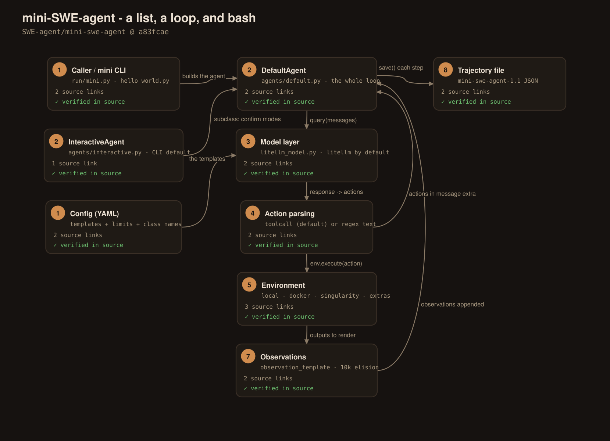
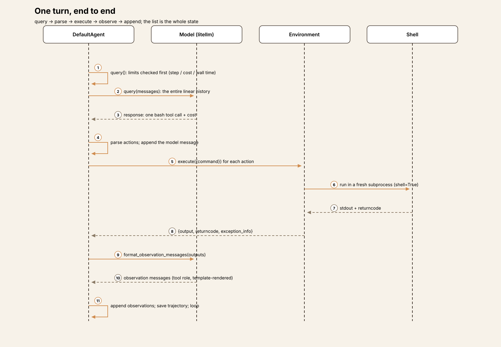
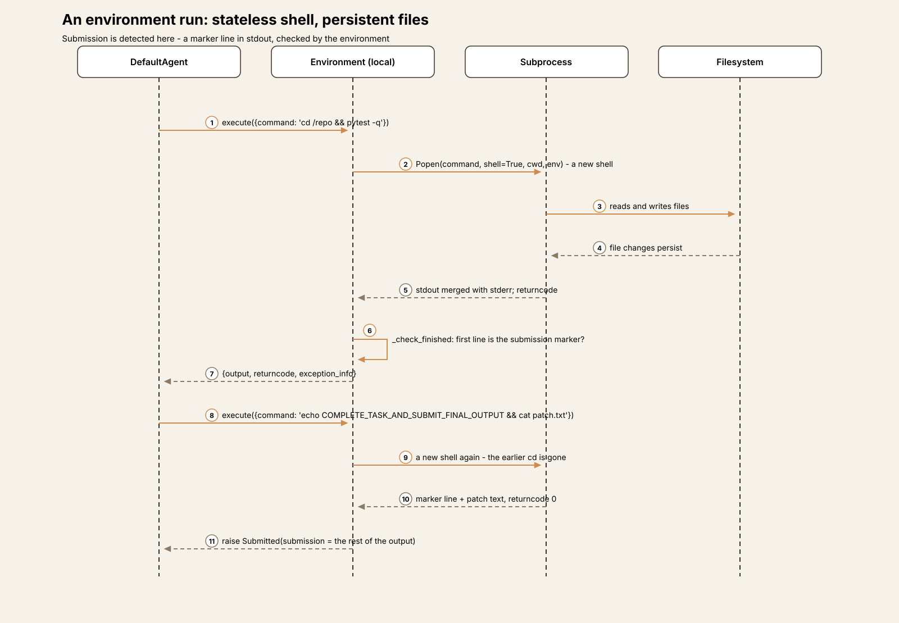
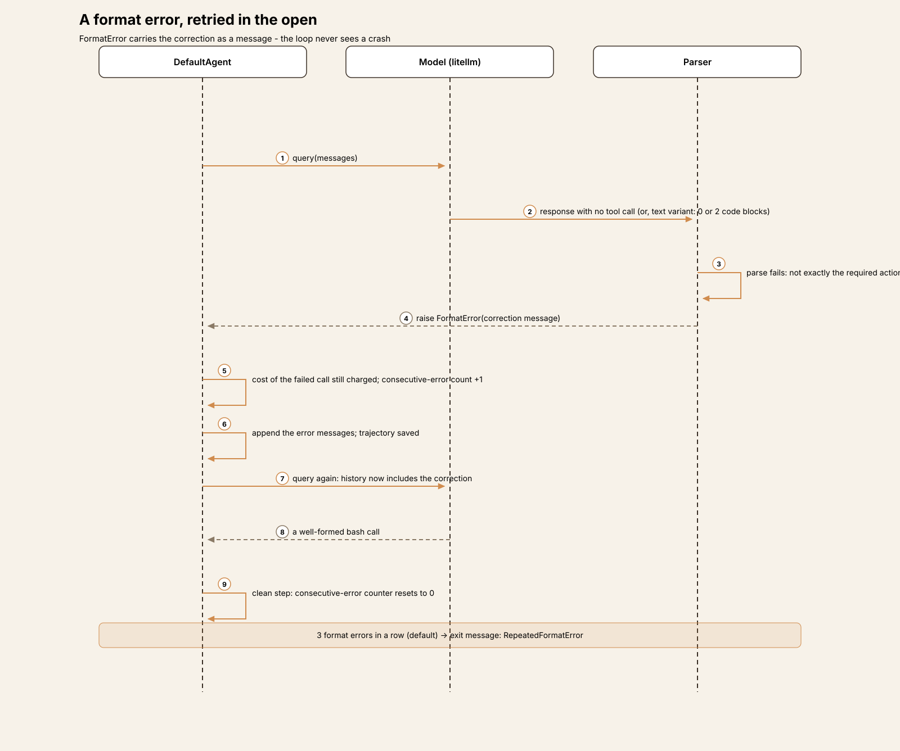
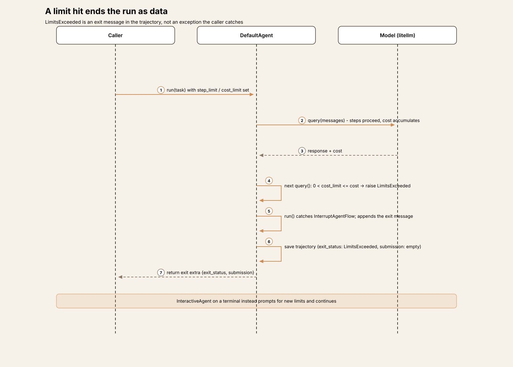

# Agent Harness Anatomy #28: mini-SWE-agent — what remains when almost everything is removed

> **Series:** Agent Harness Anatomy — top-down dissections of real agent harnesses, grounded in verifiable source code. Every behavioral claim below carries a footnote to a pinned GitHub permalink; the full evidence lives in the endnotes.

## Version block

- **Repo:** [SWE-agent/mini-swe-agent](https://github.com/SWE-agent/mini-swe-agent)
- **Pinned:** tag `v2.4.6`, commit `a83fcae82d2a08f0ee0c688f9d137b3566c097f8` (2026-07-22) — the newest release tag.
- **Language:** Python — the core agent class is one 190-line file, `src/minisweagent/agents/default.py`.
- **License:** MIT[^1]
- **Claim under test:** "Just some 100 lines of python for the agent class"[^2] — a complete coding agent with no tools other than bash[^3] and a completely linear history,[^4] built by the team behind SWE-agent (#11) as the deliberate minimal counterpart to it. The line count is the project's own phrasing (the pinned agent file is 190 lines including docstrings, the config class and trajectory serialization); the mechanisms below are verified from the code, and the comparison to #11 is the point of this teardown.

Two framing notes. First, this teardown was read-only: the source was cloned and read, never built or executed. Second, a version note that changes one well-known fact about this harness: the regex-extracted, plain-text action format that mini-SWE-agent v1 was known for is **no longer the default** at this pin. Since v2, the default model class uses the providers' native tool-calling interface — with exactly one tool. The text format survives as a shipped variant. Both are described below, pinned, because the contrast between them is itself a finding: the minimal agent kept its shape and quietly changed its wire format.



## The mental model

Hold three ideas, and the whole system follows.

**The agent is a list and a loop.** `DefaultAgent` holds a `messages` list, a model object, an environment object, a cost counter and a call counter. That is the complete state. A run appends a system message and a task message, then repeats one step — query the model, execute what it asked for, append the results — until an exit message appears at the end of the list.[^5] There is no second data structure for history to hide in: the trajectory the run saves is the same list the model was shown.[^4]

**Bash is the only tool.** Where SWE-agent (#11) built a designed agent-computer interface — YAML-defined tools with their own schemas, a file viewer, an editor — mini-SWE-agent defines a single action shape, a dict with one string: `{"command": ...}`. Reading files, editing files, searching, running tests: all of it is the model's job, expressed as shell commands. The harness's position, stated in its README, is that capable models no longer need the special interface.[^3]

**Control flow is exceptions.** Every way a run can pause or end — submission, a limit, a format error, a user interruption — is an exception class carrying the messages to append. The loop in `run()` is mostly a `try`/`except` that translates those exceptions into messages and checks whether the last one says `exit`.[^6]

## The core loop

`run(task)` renders two Jinja templates — `system_template` and `instance_template`, both required fields of `AgentConfig`, rendered with `StrictUndefined` so a missing variable is an error, not a blank — and appends them as the system and user messages. It then loops `step()` until the final message has role `exit`, and returns that message's `extra` dict: `exit_status` and `submission`.[^5][^7]

`step()` is two lines: `return self.execute_actions(self.query())`.[^8] `query()` checks the limits first, increments the call counter, sends the full message list to the model, adds the returned cost to the running total, and appends the model's message.[^9] `execute_actions()` runs each action in the message through the environment, in order, and appends the formatted observations.[^10]

The `except` structure around `step()` does real work. A `FormatError` appends the error messages the model layer prepared and lets the loop continue — with a counter for consecutive errors that ends the run as `RepeatedFormatError` (default cap: 3) if the model keeps missing the format. An `InterruptAgentFlow` (the base class for submission and limit exits) appends its messages, and since those include the `exit` message, the loop breaks. Any other exception is recorded as an `exit` message with its traceback and re-raised. A `finally` block saves the trajectory after **every** step, clean or not.[^5][^6]

## One turn, end to end

1. `run()` has appended the rendered system and instance templates. The instance template in the shipped configs states the task, a recommended workflow (reproduce, edit, verify, submit), and the execution rules — including the warning that directory and environment changes are not persistent.
2. `query()` checks step, cost and wall-time limits, then calls the model with the entire message list.[^9]
3. The model layer (litellm by default) makes the API call — with retries handled inside it — parses the response into actions, attaches the call's cost, and raises `FormatError` instead if the response does not parse.[^11][^12] Model selection itself is minimal: `get_model` defaults to the litellm class, and there is no built-in default model name — the caller supplies one via config, flag or environment variable, or resolution raises.[^13]
4. The agent appends the model's message and hands each action to the environment.
5. The environment runs the command in a fresh subprocess and returns `output`, `returncode` and `exception_info` — or raises `Submitted` if the output is the submission marker.[^14][^15]
6. The model layer renders the outputs through the observation template and the agent appends them as the next messages.
7. The trajectory is saved. The loop repeats from step 2, or ends if an exit message landed.



## Actions: one tool, two parsers

An action reaches the agent as `message["extra"]["actions"]`, a list of `{"command": str}` dicts. Two parsers can produce it, and which one runs is a property of the model class, not the agent.

**The v2 default: a single native tool call.** `LitellmModel._query` passes `tools=[BASH_TOOL]` to litellm — one function tool named `bash`, described as "Execute a bash command", with a single required string parameter, `command`.[^11][^16] `parse_toolcall_actions` validates each returned call: no tool calls at all, an unknown tool name, unparseable JSON arguments, or a missing `command` each raise `FormatError` with guidance rendered from the config's `format_error_template`.[^17] Multiple calls in one response are allowed and execute in order; the SWE-bench config enables parallel tool calls explicitly.

**The text variant: the v1 design, still shipped.** `LitellmTextbasedModel` keeps the same litellm call but parses the reply's text with the regex `` ```mswea_bash_command\s*\n(.*?)\n``` `` .[^18] `parse_regex_actions` requires **exactly one** match: zero matches or two both raise `FormatError` — the failure mode is a rendered message telling the model it must provide exactly one action in triple backticks, and the run's format-error counter starts counting.[^19] The source file for this path is explicit about its status: it "was the method used for mini-swe-agent v1.0 and the original SWE-agent", and as of v2 the project recommends tool calls instead.[^20] The plain-text path remains fully supported — a `litellm_textbased` model class, a dedicated `mini_textbased.yaml` config, and the `default.yaml` config (used by the `hello_world.py` example) whose templates are written in the text format.

The honest summary for the series record: "no tool-calling API" was the v1 headline and remains an available configuration, but at v2.4.6 the default wiring uses tool calling — reduced to its minimum, one tool with one string argument. What did not change is the part that matters more: there is still no tool *set*, no per-tool interface, and nothing between the model's command string and the shell.

## The environment: a fresh shell every time

The `Environment` side is a protocol with one essential method, `execute(action) -> {output, returncode, exception_info}`.[^21] The local implementation runs each command via `subprocess.Popen(..., shell=True)` with the configured working directory and environment, a 30-second default timeout, and — on timeout — a kill of the whole process group so no children are orphaned.[^14] Each action is a **new** shell: a `cd` or an `export` in one step has no effect on the next, a fact the shipped templates state to the model directly, along with the workaround (prefix `cd /path && ...`, or persist values in files). Only the filesystem carries state between steps.

The Docker environment keeps the same semantics behind a container boundary: one long-lived container is started up front, and each action is a separate `docker exec` into it with `bash -lc`, so the shell is fresh but the container's filesystem persists.[^22] The environment is selected by name from a small mapping — local, docker, singularity, and extras for SWE-ReX (Docker and Modal), bubblewrap and contree — which is the harness's whole sandboxing story: swap the class, keep the agent.[^21]

**Done detection lives here, not in the agent.** Both the local and Docker environments check every result: if the first line of the output is exactly `COMPLETE_TASK_AND_SUBMIT_FINAL_OUTPUT` and the return code is 0, they raise `Submitted`, and everything after that first line becomes the submission.[^15] The templates therefore tell the model to finish by echoing that marker — alone, in the text configs; in the SWE-bench config, combined with `cat patch.txt` so the patch itself is the submission. Submission is not a tool, a flag, or a special message type in the agent. It is a string in stdout that the environment recognizes.



## Limits and format errors

`AgentConfig` carries four bounds: `step_limit` (default 0, meaning unlimited), `cost_limit` (default $3.00), `wall_time_limit_seconds` (default 0, unlimited), and `max_consecutive_format_errors` (default 3).[^7] The first three are checked at the top of `query()`, **before** the model is called: exceeding the step or cost limit raises `LimitsExceeded`, exceeding the wall time raises `TimeExceeded` (a subclass), and each carries a ready-made `exit` message, so a limited run ends as data in the trajectory rather than as a crash.[^9][^23]

Shipped configs tune the defaults per use: the `mini` CLI's config keeps the $3 cost limit and no step limit; `default.yaml` disables both (0 and 0); the SWE-bench config sets a 250-step limit and the $3 cost limit.[^24][^25] Format errors have their own bound, described above: three in a row end the run as `RepeatedFormatError`, and any clean step resets the counter.[^5]





Inside the model layer, API failures are a separate concern from format failures: litellm calls are wrapped in a tenacity retry — up to 10 attempts, exponential backoff between 4 and 60 seconds — with a list of abort exceptions (authentication, not found, permission denied, context-window exceeded, unsupported parameters) that are never retried.[^12]

## Observations

Outputs come back to the model through the model layer's `observation_template`. The built-in default renders `<returncode>` and `<output>` blocks, preceded by an `<exception>` block when the environment reported one.[^26] The shipped configs use a fuller template with a size rule: output under 10,000 characters is shown whole; at or above it, the middle is elided — the first 5,000 and last 5,000 characters are kept, with an `<elided_chars>` count and a warning suggesting narrower commands.[^27] In the tool-call configuration the rendered text becomes a `role: "tool"` message carrying the call's `tool_call_id`; in the text configuration it is a plain user message. Either way, the internal `extra` fields (raw output, return code, timestamp) are stored in the trajectory but stripped before the messages are sent to the API.

## Memory: the trajectory is the history

There is no memory subsystem to inventory. No compaction, no summarization, no history processors, no cross-run store: the message list grows by appends only, and the context the model sees is the whole of it.[^4]

What the harness does keep is the trajectory file. `serialize()` emits the full message list plus an `info` block — instance cost, API call count, the agent/model/environment configs, the exit status and the submission — under the format name `mini-swe-agent-1.1`, and `save()` writes it as JSON to the configured output path.[^28] Because `run()` saves in a `finally` after every step, the file on disk is current even when a run dies mid-step.[^5] For the `mini` CLI the default output is a `last_mini_run.traj.json` in the user's config directory.[^29]

## Approvals: none in the agent, one mode in the CLI

`DefaultAgent` has no approval step: a parsed action executes. The interactive subclass used by the `mini` CLI is where confirmation lives. `InteractiveAgent` adds a `mode` setting — `human` (the user types the commands), `confirm` (the default: each model-issued command waits for an Enter at a prompt, unless it matches a `whitelist_actions` regex), and `yolo` (no confirmation) — switchable mid-run with slash commands, plus an optional confirmation before accepting a submission, at which point the user can instead hand the agent a new task.[^30] It also catches `LimitsExceeded` and, when a real terminal is attached, offers to raise the limits and continue; unattended, the exception simply ends the run.[^30]

## Subsystem inventory

The brevity of this table is the finding.

| Subsystem | Where | What it is |
|---|---|---|
| Agent loop | `agents/default.py` | `DefaultAgent`: run/step/query/execute_actions over a message list (190-line file) |
| Interactive agent | `agents/interactive.py` | `DefaultAgent` + confirm/human/yolo modes, limit prompts, user task injection |
| Model layer | `models/litellm_model.py` (+ variants) | litellm completion, one bash tool, cost accounting, retry; OpenRouter/Portkey/Requesty and Responses-API variants in-tree |
| Action parsing | `models/utils/actions_toolcall.py`, `actions_text.py` | Tool-call validation, or the regex text parser (exactly one block) |
| Environments | `environments/local.py`, `docker.py`, `singularity.py`, `extra/` | Fresh-subprocess execution; submission detection; seven named classes |
| Exceptions | `exceptions.py` | `InterruptAgentFlow` family: Submitted, LimitsExceeded, TimeExceeded, FormatError, UserInterruption |
| Configuration | `config/*.yaml` | Jinja templates + limits + class names, recursively merged; resolved by `run/mini.py` and the benchmark runners |
| Trajectory | `agents/default.py` (`serialize`/`save`) | The message list as JSON, `mini-swe-agent-1.1` format, saved every step |

## Extension points

Subclassing is the extension API: the docstrings on `query()` and its neighbours say "Override to add hooks" — there is no hook registry, no plugin loader, and no event bus in the agent package. The model and environment are Python `Protocol`s (structural duck typing) declared in the package root, so a new model or environment is any object with the right methods, named in config by class path or shortcut.[^21] The other extension surface is configuration itself: every template (system, instance, observation, format error) and every limit is a YAML value that callers override, and configs merge recursively — the `mini` CLI builds its effective config from the chosen YAML files plus command-line key-value pairs.

## Tradeoffs, and what was deleted relative to SWE-agent

The project's own guidance draws the line plainly: choose SWE-agent "if you want to experiment with different sets of tools, each with their own interface" or "with different history processors" — the two things mini-SWE-agent does not have.[^31] Verified against this tree, the deletions are: the ACI tool bundles (no file viewer, no editor tool, no search tool — the model uses `cat`, `sed` and `grep` like anyone at a terminal), history processors of every kind, the reviewer and trajectory-replay machinery of #11, and any per-tool configuration. What remains in exchange is a loop a reader can hold in one view, an action space with exactly one member, and an environment seam where sandboxing is a class swap.

The costs are the mirror image. A fresh shell per action means the model re-establishes its context constantly (`cd` prefixes, re-sourced files) and pays for it in tokens. A linear, never-compacted history means long runs grow the prompt until the model's window or the cost limit ends them. Observations are truncated by characters, not understood. And with the default agent there is no approval gate at all: the safety story is the environment you choose (a container, a sandbox) and the limits you set, not a checkpoint in the loop. These are stated as tradeoffs, not oversights — the design position is that the model, given bash and a clear template, supplies the rest.

## Vendor claims (flagged, not code-verified)

- The README reports scores of ">74% on the SWE-bench verified benchmark" and lists adoption by named organizations.[^32] These are the project's claims about benchmark runs with specific models; this teardown verifies the mechanisms (the SWE-bench runner and config are in-tree, with the 250-step / $3 limits above) and does not reproduce the evaluations.
- The "~100 lines" figure for the agent class is the project's phrasing; the pinned file is 190 lines in full, of which the loop, config and serialization are the bulk.[^2]

## Comparison matrix row

| # | Dimension | mini-SWE-agent (v2.4.6) |
|---|---|---|
| 1 | Agent loop | One synchronous loop in `DefaultAgent.run`: `step()` = `execute_actions(query())`, appends only, ends when an `exit` message lands; control flow via exceptions (Submitted / LimitsExceeded / FormatError); limits checked before each model call |
| 2 | Tool system | None as a set: a single bash action (`{"command": str}`); at v2 the default parser reads one native `bash` tool call, the shipped text variant regex-extracts exactly one fenced block; no per-tool schemas beyond that, no ACI |
| 3 | Model providers | litellm by default (any litellm model name; caller must supply one — no built-in default); OpenRouter, Portkey, Requesty and Responses-API model classes in-tree; tenacity retry (10 attempts, 4–60s backoff, abort list); cost via litellm's calculator |
| 4 | Prompt construction | Two Jinja templates (system + instance) rendered once at run start with StrictUndefined; observation and format-error templates render per step; shipped templates carry the workflow, the non-persistence warning and the submission marker instruction |
| 5 | Memory/session | None: a strictly linear message list, appended only, never compacted; the saved trajectory (`mini-swe-agent-1.1` JSON: info + messages) is the same list, rewritten after every step |
| 6 | Reasoning/planning | The model's reasoning text in its replies; no planner, no todo structure, no sub-agents; the instance template's recommended workflow (reproduce → edit → verify → submit) is the only scaffold |
| 7 | Extensibility | Subclassing (`query`/`step`/`execute_actions` overrides — "override to add hooks"); Model/Environment as duck-typed Protocols selected by name in config; every template and limit is YAML-overridable with recursive config merging; no plugin API, hooks registry, MCP or skills |
| 8 | Interfaces | Python library (`DefaultAgent(model, env, **config)`) plus the `mini` CLI (interactive agent, confirm/human/yolo modes), benchmark runners (SWE-bench, ProgramBench) and a trajectory inspector; no server, no TUI framework beyond terminal prompts |
| 9 | Failure handling | FormatError appends corrective guidance and continues (3 consecutive = RepeatedFormatError exit); uncaught exceptions recorded as an exit message with traceback, then re-raised; trajectory saved in a `finally` after every step; API errors retried with backoff except an abort list |
| 10 | Security model | No approvals in `DefaultAgent` — every parsed action runs; the CLI's InteractiveAgent adds confirm mode with regex whitelists (yolo turns it off); isolation is the environment choice (local host by default; Docker/Singularity/bubblewrap/SWE-ReX classes available); bounds are the step/cost/wall-time limits |

## Endnotes

[^1]: [`LICENSE.md#L1`](https://github.com/SWE-agent/mini-swe-agent/blob/a83fcae82d2a08f0ee0c688f9d137b3566c097f8/LICENSE.md#L1) — "MIT License — Copyright (c) 2025 Kilian A. Lieret and Carlos E. Jimenez", the full MIT text in the repo root.
[^2]: [`README.md#L26`](https://github.com/SWE-agent/mini-swe-agent/blob/a83fcae82d2a08f0ee0c688f9d137b3566c097f8/README.md#L26) — "Minimal: Just some 100 lines of python for the agent class (and a bit more for the environment, model, and run script) — no fancy dependencies!" At the pin, `src/minisweagent/agents/default.py` is 190 lines total (measured on the pinned checkout).
[^3]: [`README.md#L42`](https://github.com/SWE-agent/mini-swe-agent/blob/a83fcae82d2a08f0ee0c688f9d137b3566c097f8/README.md#L42) — "Does not have any tools other than bash — it doesn't even need to use the tool-calling interface of the LMs. This means that you can run it with literally any model." (Repeated at `README.md#L71`.) The v2 default wiring qualifies the second sentence — see the "Actions: one tool, two parsers" section and its endnotes.
[^4]: [`README.md#L45`](https://github.com/SWE-agent/mini-swe-agent/blob/a83fcae82d2a08f0ee0c688f9d137b3566c097f8/README.md#L45) — "Has a completely linear history — every step of the agent just appends to the messages and that's it. So there's no difference between the trajectory and the messages that you pass on to the LM."
[^5]: [`src/minisweagent/agents/default.py#L88`](https://github.com/SWE-agent/mini-swe-agent/blob/a83fcae82d2a08f0ee0c688f9d137b3566c097f8/src/minisweagent/agents/default.py#L88) — `run()`: seeds the two template messages, loops `step()` with the FormatError / InterruptAgentFlow handlers, saves in `finally` (L120–121), and breaks when the last message's role is `exit`, returning its `extra`.
[^6]: [`src/minisweagent/exceptions.py#L1`](https://github.com/SWE-agent/mini-swe-agent/blob/a83fcae82d2a08f0ee0c688f9d137b3566c097f8/src/minisweagent/exceptions.py#L1) — `InterruptAgentFlow(Exception)`: "Raised to interrupt the agent flow and add messages", carrying `self.messages`; subclasses `Submitted` (L9), `LimitsExceeded` (L13), `TimeExceeded` (L17), `UserInterruption` (L21), `FormatError` (L25).
[^7]: [`src/minisweagent/agents/default.py#L19`](https://github.com/SWE-agent/mini-swe-agent/blob/a83fcae82d2a08f0ee0c688f9d137b3566c097f8/src/minisweagent/agents/default.py#L19) — `AgentConfig`: `system_template` and `instance_template` (required), `step_limit: int = 0`, `cost_limit: float = 3.0`, `wall_time_limit_seconds: int = 0`, `max_consecutive_format_errors: int = 3`, `output_path`.
[^8]: [`src/minisweagent/agents/default.py#L126`](https://github.com/SWE-agent/mini-swe-agent/blob/a83fcae82d2a08f0ee0c688f9d137b3566c097f8/src/minisweagent/agents/default.py#L126) — `step()`: "Query the LM, execute actions." — `return self.execute_actions(self.query())`.
[^9]: [`src/minisweagent/agents/default.py#L130`](https://github.com/SWE-agent/mini-swe-agent/blob/a83fcae82d2a08f0ee0c688f9d137b3566c097f8/src/minisweagent/agents/default.py#L130) — `query()`: limit checks raise `LimitsExceeded` / `TimeExceeded` before the call; then `n_calls += 1`, `model.query(self.messages)`, cost accumulated from the message's `extra`.
[^10]: [`src/minisweagent/agents/default.py#L154`](https://github.com/SWE-agent/mini-swe-agent/blob/a83fcae82d2a08f0ee0c688f9d137b3566c097f8/src/minisweagent/agents/default.py#L154) — `execute_actions()`: `outputs = [self.env.execute(action) for action in message.get("extra", {}).get("actions", [])]`, then appends `model.format_observation_messages(...)`.
[^11]: [`src/minisweagent/models/litellm_model.py#L69`](https://github.com/SWE-agent/mini-swe-agent/blob/a83fcae82d2a08f0ee0c688f9d137b3566c097f8/src/minisweagent/models/litellm_model.py#L69) — `LitellmModel._query`: `litellm.completion(model=..., messages=messages, tools=[BASH_TOOL], ...)`; `query()` at L81 wraps it in the retry loop, calculates cost, and `_parse_actions` at L128 reads the tool calls.
[^12]: [`src/minisweagent/models/utils/retry.py#L21`](https://github.com/SWE-agent/mini-swe-agent/blob/a83fcae82d2a08f0ee0c688f9d137b3566c097f8/src/minisweagent/models/utils/retry.py#L21) — tenacity `Retrying(stop=stop_after_attempt(MSWEA_MODEL_RETRY_STOP_AFTER_ATTEMPT, default 10), wait=wait_exponential(multiplier=1, min=4, max=60), retry=retry_if_not_exception_type(abort_exceptions))`; the abort list is `LitellmModel.abort_exceptions` in `litellm_model.py` (L53–60).
[^13]: [`src/minisweagent/models/__init__.py#L110`](https://github.com/SWE-agent/mini-swe-agent/blob/a83fcae82d2a08f0ee0c688f9d137b3566c097f8/src/minisweagent/models/__init__.py#L110) — `get_model_class`: "# Default to LitellmModel"; and `get_model_name` (L65) raises `ValueError("No default model set...")` at L75 when no name comes from the argument, config, or `MSWEA_MODEL_NAME`. The class mapping (L91–102) names `litellm`, `litellm_textbased`, `litellm_response`, `openrouter`, `openrouter_textbased`, `openrouter_response`, `portkey`, `portkey_response`, `requesty`, `deterministic`.
[^14]: [`src/minisweagent/environments/local.py#L72`](https://github.com/SWE-agent/mini-swe-agent/blob/a83fcae82d2a08f0ee0c688f9d137b3566c097f8/src/minisweagent/environments/local.py#L72) — `_run()`: `subprocess.Popen(command, shell=True, text=True, cwd=cwd, env=env, ..., start_new_session=True)`; on `TimeoutExpired` it kills the process group (`killpg`, L89). `LocalEnvironment.execute` (L24) uses `timeout: int = 30` from `LocalEnvironmentConfig` (L17) and `os.environ | self.config.env`.
[^15]: [`src/minisweagent/environments/local.py#L45`](https://github.com/SWE-agent/mini-swe-agent/blob/a83fcae82d2a08f0ee0c688f9d137b3566c097f8/src/minisweagent/environments/local.py#L45) — `_check_finished`: if the first output line is `COMPLETE_TASK_AND_SUBMIT_FINAL_OUTPUT` and returncode is 0, raise `Submitted` with the remaining lines as the submission; the identical check is in `environments/docker.py#L140`.
[^16]: [`src/minisweagent/models/utils/actions_toolcall.py#L11`](https://github.com/SWE-agent/mini-swe-agent/blob/a83fcae82d2a08f0ee0c688f9d137b3566c097f8/src/minisweagent/models/utils/actions_toolcall.py#L11) — `BASH_TOOL`: a function tool named `bash`, "Execute a bash command", parameters = one required string `command`.
[^17]: [`src/minisweagent/models/utils/actions_toolcall.py#L30`](https://github.com/SWE-agent/mini-swe-agent/blob/a83fcae82d2a08f0ee0c688f9d137b3566c097f8/src/minisweagent/models/utils/actions_toolcall.py#L30) — `parse_toolcall_actions`: raises `FormatError` when there are no tool calls ("No tool calls found in the response. Every response MUST include at least one tool call.", L45), on an unknown tool name, bad JSON arguments, or a missing `command`.
[^18]: [`src/minisweagent/models/litellm_textbased_model.py#L8`](https://github.com/SWE-agent/mini-swe-agent/blob/a83fcae82d2a08f0ee0c688f9d137b3566c097f8/src/minisweagent/models/litellm_textbased_model.py#L8) — `LitellmTextbasedModelConfig.action_regex = r"```mswea_bash_command\s*\n(.*?)\n```"`, with `format_error_template` "Please always provide EXACTLY ONE action in triple backticks, found {{actions|length}} actions."
[^19]: [`src/minisweagent/models/utils/actions_text.py#L24`](https://github.com/SWE-agent/mini-swe-agent/blob/a83fcae82d2a08f0ee0c688f9d137b3566c097f8/src/minisweagent/models/utils/actions_text.py#L24) — `actions = [a.strip() for a in re.findall(action_regex, content, re.DOTALL)]`; L25: `if len(actions) != 1: raise FormatError(...)` ("Expected exactly 1 action, found {len}").
[^20]: [`src/minisweagent/models/utils/actions_text.py#L1`](https://github.com/SWE-agent/mini-swe-agent/blob/a83fcae82d2a08f0ee0c688f9d137b3566c097f8/src/minisweagent/models/utils/actions_text.py#L1) — module docstring: "Parse actions & format observations without toolcalls. This was the method used for mini-swe-agent v1.0 and the original SWE-agent. As of mini-swe-agent v2.0, we strongly recommend to use toolcalls instead."
[^21]: [`src/minisweagent/environments/__init__.py#L8`](https://github.com/SWE-agent/mini-swe-agent/blob/a83fcae82d2a08f0ee0c688f9d137b3566c097f8/src/minisweagent/environments/__init__.py#L8) — `_ENVIRONMENT_MAPPING`: docker, singularity, local, swerex_docker, swerex_modal, bubblewrap, contree. The `Model` / `Environment` / `Agent` protocols themselves are declared in `src/minisweagent/__init__.py` ("By the magic of protocols & duck typing, you can pretty much ignore them").
[^22]: [`src/minisweagent/environments/docker.py#L101`](https://github.com/SWE-agent/mini-swe-agent/blob/a83fcae82d2a08f0ee0c688f9d137b3566c097f8/src/minisweagent/environments/docker.py#L101) — `DockerEnvironment.execute`: builds `docker exec -w <cwd> [-e ...] <container_id> bash -lc <command>` (interpreter default at L38, exec assembly at L113) against the container started once in `_start_container`; default timeout 30s.
[^23]: [`src/minisweagent/exceptions.py#L13`](https://github.com/SWE-agent/mini-swe-agent/blob/a83fcae82d2a08f0ee0c688f9d137b3566c097f8/src/minisweagent/exceptions.py#L13) — `LimitsExceeded(InterruptAgentFlow)`: "Raised when the agent has exceeded its cost or step limit"; `TimeExceeded(LimitsExceeded)` at L17.
[^24]: [`src/minisweagent/config/mini.yaml#L101`](https://github.com/SWE-agent/mini-swe-agent/blob/a83fcae82d2a08f0ee0c688f9d137b3566c097f8/src/minisweagent/config/mini.yaml#L101) — the `mini` CLI config: `step_limit: 0`, `cost_limit: 3.`, `mode: confirm` (L103). `config/default.yaml` sets `step_limit: 0` and `cost_limit: 0.` (both unlimited).
[^25]: [`src/minisweagent/config/benchmarks/swebench.yaml#L112`](https://github.com/SWE-agent/mini-swe-agent/blob/a83fcae82d2a08f0ee0c688f9d137b3566c097f8/src/minisweagent/config/benchmarks/swebench.yaml#L112) — the SWE-bench config: `step_limit: 250`, `cost_limit: 3.`, Docker environment with `cwd: "/testbed"`, model `anthropic/claude-sonnet-4-5-20250929` with `parallel_tool_calls: true`.
[^26]: [`src/minisweagent/models/litellm_model.py#L40`](https://github.com/SWE-agent/mini-swe-agent/blob/a83fcae82d2a08f0ee0c688f9d137b3566c097f8/src/minisweagent/models/litellm_model.py#L40) — the default `observation_template`: optional `<exception>{{output.exception_info}}</exception>`, then `<returncode>{{output.returncode}}</returncode>` and `<output>\n{{output.output}}</output>`.
[^27]: [`src/minisweagent/config/default.yaml#L119`](https://github.com/SWE-agent/mini-swe-agent/blob/a83fcae82d2a08f0ee0c688f9d137b3566c097f8/src/minisweagent/config/default.yaml#L119) — the shipped observation template: `` full output, else head `output.output[:5000]` (L133), `<elided_chars>` count, and tail `output.output[-5000:]`; the same template ships in `config/benchmarks/swebench.yaml` (L136).
[^28]: [`src/minisweagent/agents/default.py#L159`](https://github.com/SWE-agent/mini-swe-agent/blob/a83fcae82d2a08f0ee0c688f9d137b3566c097f8/src/minisweagent/agents/default.py#L159) — `serialize()`: `info.model_stats` (instance_cost, api_calls), config, `mini_version`, exit_status, submission, the full `messages` list, and `"trajectory_format": "mini-swe-agent-1.1"` (L178); `save()` at L182 writes it as JSON.
[^29]: [`src/minisweagent/run/mini.py#L24`](https://github.com/SWE-agent/mini-swe-agent/blob/a83fcae82d2a08f0ee0c688f9d137b3566c097f8/src/minisweagent/run/mini.py#L24) — the `mini` CLI: `DEFAULT_CONFIG_FILE` is the builtin `mini.yaml` (overridable via `MSWEA_MINI_CONFIG_PATH`), `DEFAULT_OUTPUT_FILE = global_config_dir / "last_mini_run.traj.json"`; the agent is built with `default_type="interactive"` and the environment with `default_type="local"`.
[^30]: [`src/minisweagent/agents/interactive.py#L25`](https://github.com/SWE-agent/mini-swe-agent/blob/a83fcae82d2a08f0ee0c688f9d137b3566c097f8/src/minisweagent/agents/interactive.py#L25) — `InteractiveAgentConfig.mode: Literal["human", "confirm", "yolo"] = "confirm"`, `whitelist_actions: list[str] = []` (L27, regex-matched at L163), `confirm_exit: bool = True`; `query()` catches `LimitsExceeded` and prompts for new limits only when stdin is a terminal.
[^31]: [`README.md#L95`](https://github.com/SWE-agent/mini-swe-agent/blob/a83fcae82d2a08f0ee0c688f9d137b3566c097f8/README.md#L95) — "Should I use SWE-agent or mini-SWE-agent? … You should use swe-agent if — You want to experiment with different sets of tools, each with their own interface — You want to experiment with different history processors."
[^32]: [`README.md#L28`](https://github.com/SWE-agent/mini-swe-agent/blob/a83fcae82d2a08f0ee0c688f9d137b3566c097f8/README.md#L28) — "Performant: Scores >74% on the SWE-bench verified benchmark; starts much faster than Claude Code" — a project claim about benchmark runs; the adoption list is at `README.md#L25`. Not reproduced or verified by this teardown.
