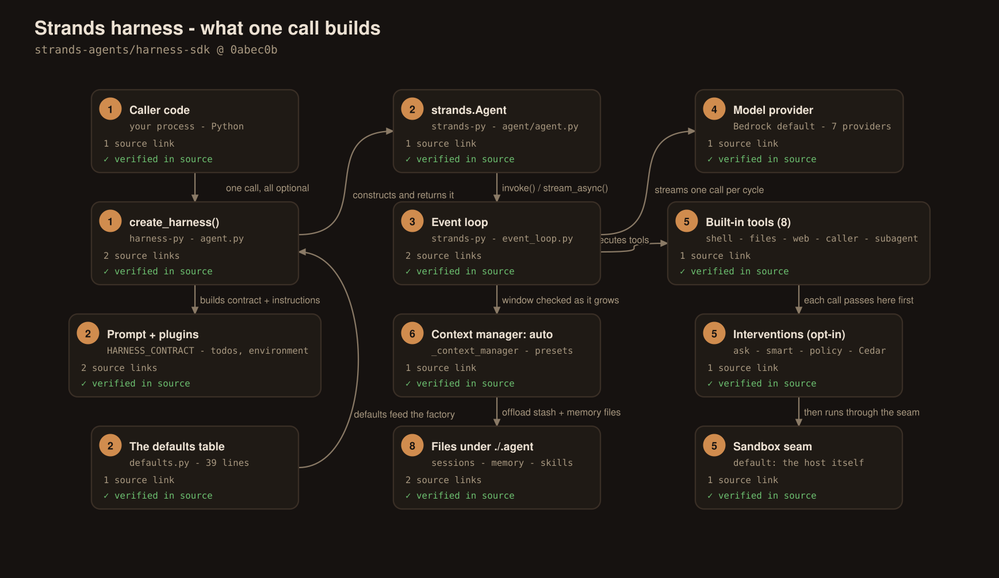
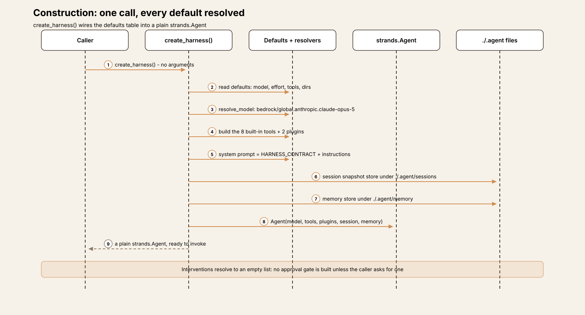
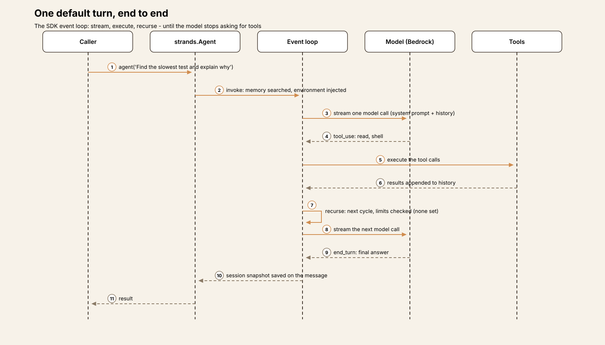
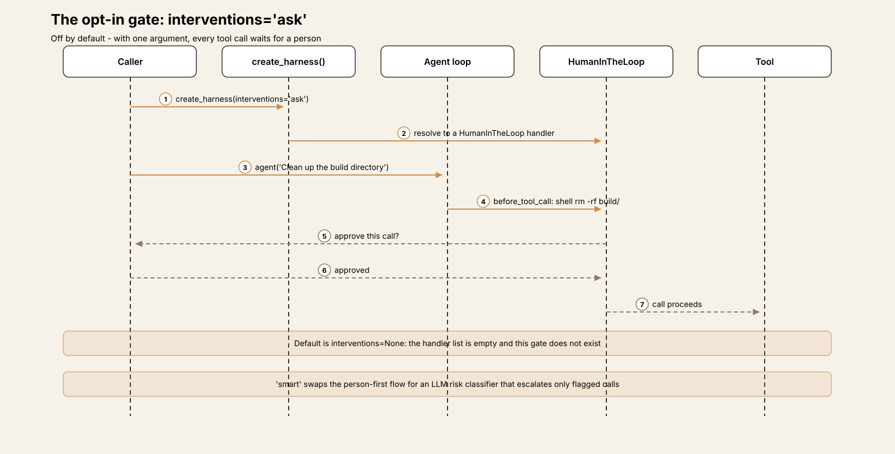
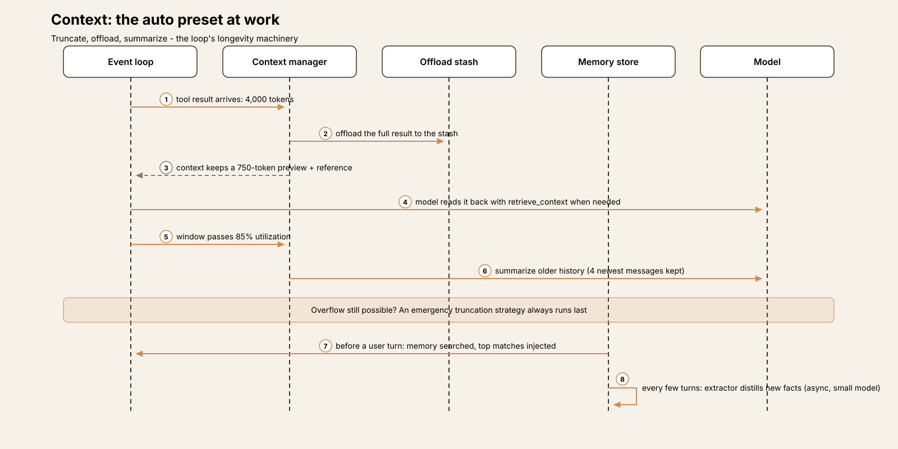
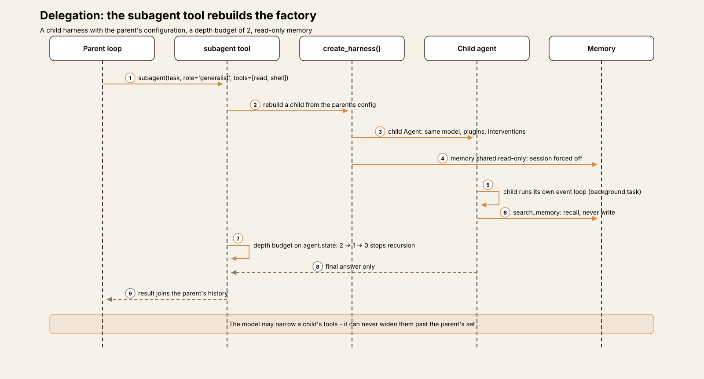

# Agent Harness Anatomy #27: Strands harness — the agent one call builds

> **Series:** Agent Harness Anatomy — top-down dissections of real agent harnesses, grounded in verifiable source code. Every behavioral claim below carries a footnote to a pinned GitHub permalink; the full evidence lives in the endnotes.

## Version block

- **Repo:** [strands-agents/harness-sdk](https://github.com/strands-agents/harness-sdk)
- **Pinned:** tag `harness-python/v0.3.2`, commit `0abec0bca2ce86d3a3d2147b0dfffbc008654ae6` (2026-10-22) — the newest release tag for the harness package, whose version is derived from git tags in its own `pyproject.toml`. This monorepo carries several tag trains; the numerically largest, `v1.41.0`, is a Python SDK tag from May 2026, months before the harness existed, and was rejected as the pin for that reason.
- **Language:** Python (with TypeScript twins) — 3,382 tracked files; the core read for this teardown is `harness-py/` (the Python harness, 4,669 lines) plus the parts of `strands-py/` (the Python SDK) the harness composes: the event loop, the context manager, the vended shell, the sandbox seam, the interventions and the session/memory machinery.
- **License:** Apache-2.0[^1]
- **Claim under test:** "A single `create_harness()` call gives you an optimized agent with benchmarked defaults for the model, tools, memory, sessions, and context management."[^2] The defaults are verified below, one by one, from the code; the benchmark results and the word "optimized" are vendor claims about evaluations, not properties of this tree, and are reported as such.

Two framing notes. First, this teardown was read-only: the source was cloned and read, never built or executed. Second, a lineage note, because it defines what there is to describe: this repository is the Strands Agents SDK codebase, continued — the SDK packages live here as `strands-py/` and `strands-ts/`, and the harness packages were added beside them in September 2026 as a layer on top. The harness package's own guide describes it as "a thin composition layer over the `strands-agents` SDK" that "wires a resolved model, the vended system prompt, built-in tools, context management, and optional session persistence into a plain `strands.Agent`".[^3] Thin in code, as it turns out — and thick in defaults. The opinion is the product, so this teardown reads the defaults the way other teardowns read a loop.

## The mental model

Hold three ideas apart, because most of Strands harness follows from them.

**The harness is a factory, not a framework.** `create_harness()` is a function that resolves a table of defaults and constructs a plain `strands.Agent` — the SDK's own class, unmodified and unwrapped.[^4] What the caller holds afterwards is the SDK object itself, with everything the SDK offers (hooks, streaming, structured output, its own further configuration) still available. The harness's contribution is entirely in what it chose for you before you got the object.

**The defaults are the design.** One small file, `defaults.py`, names nearly all of them: a Bedrock-first default model, eight built-in tools, two feature plugins, a context-management preset, snapshot sessions, file memory, prompt caching.[^5] Reading a Strands harness means reading that table and the resolvers that interpret it — there is no separate application whose behavior needs reconstructing.

**Safety is a parameter, not a default.** The factory's one security-shaped option, `interventions`, defaults to `None` — which resolves to an empty handler list, so every tool call runs — and the SDK's default sandbox is the host process's own environment, with no isolation.[^6][^7] The harness is candid about both in its own docstrings, but they are the two facts a caller most needs to know: the one-call agent is capable first and gated only if you ask.

## Component map

- **The factory** (`harness-py/src/strands_harness/agent.py`) — `create_harness()` and its private resolvers: built-in tool assembly, web-search mode selection, skills and plugin selection, tool-name collision checking, background-task policy, and the final `Agent` construction.
- **The defaults and types** (`defaults.py`, `types/agent.py`, `options.py`, `config.py`) — the defaults table, the option types (`BuiltinToolsConfig`, `SessionConfig`, `MemoryConfig`, `Effort`, …), the normalization of the sugar forms into concrete values, and a serializable camelCase config form of the same defaults, shared with the TypeScript package.
- **The model resolver** (`models.py`) — `provider/name` strings to provider model objects, per-provider reasoning (`effort`) mapping and validation, prompt-caching configuration, and the small auxiliary model used for summarization and memory extraction.
- **The prompt** (`prompt.py`) — the vended `HARNESS_CONTRACT` system prompt, with the caller's `instructions` appended after it.
- **Harness-authored tools** (`tools/`) — `read` / `write` / `edit`, `web_fetch`, the Exa `web_search` tool, `programmatic_tool_caller`, and the `subagent` delegation tool (the `shell` comes from the SDK's vended set).
- **Built-in plugins** (`plugins/`) — `Todos` (a `todo_write` tool plus ephemeral re-surfacing) and `EnvironmentContext` (per-turn environment and project-doc injection).
- **The SDK underneath** (`strands-py/`) — the recursive event loop, the context manager and its presets, the sandbox seam and its implementations, interventions (`HumanInTheLoop`, `CedarAuthorization`), snapshot sessions, the memory manager, hooks, MCP, and the provider implementations. The harness composes this layer; it does not reimplement it.

## Construction: what the one call resolves

`create_harness()` takes sixteen named options plus `**agent_kwargs`, and every one of them is optional.[^4] The signature is the quickest honest summary of the product:

- `model=None` → the default model; `effort="auto"`; `instructions=None` → the contract alone.
- `tools=None`, `plugins=None`, `mcp_servers=None` → nothing added beyond the built-ins.
- `builtin_tools=None` → the full default set of eight; `builtin_plugins=None` → `todos` and `environment`.
- `background_tasks=None` → the SDK background-tasks policy described below; `caching` unset → `"auto"` (on).
- `context_manager="auto"`; `session=True`; `skills=True`; `memory=True`.
- `interventions=None` → off.
- Anything else — `system_prompt`, `session_manager`, `memory_manager`, `sandbox`, `hooks`, any other `Agent` keyword — passes through in `agent_kwargs`, and an explicit SDK value always beats the harness sugar it corresponds to.[^4]

Construction then runs as a fixed pipeline: normalize the tool selection, resolve the session and memory options, decide the web-search mode for the chosen model, resolve the model itself (validating `effort` against the provider), build the system prompt, load any MCP servers as additional tools, assemble the built-in tools and plugins, build the session and memory managers, run the tool-name collision check across *all* sources (built-ins, caller tools, plugin-vended tools, memory tools), resolve the background-task policy, and construct the `Agent`.[^4][^8] A name collision raises at construction rather than letting one tool silently shadow another — a small, telling choice: the factory would rather fail before the loop starts than misbehave inside it.

Telemetry deserves its own sentence because it is the one side effect: `create_harness()` first calls `setup_telemetry()`, which wires an OpenTelemetry exporter *only* when the `OTEL_TRACES_EXPORTER` environment variable is set — unset means off, deliberately not honoring the OTEL spec default.[^9]

## The core loop

The loop the caller gets is the SDK's event loop, and its shape is recursion. One cycle (`event_loop_cycle`) checks the invocation's limits, streams one model call, and dispatches on the stop reason: `tool_use` executes the requested tools and recurses into the next cycle with the results appended; `end_turn` stops; `max_tokens` raises `MaxTokensReachedException` with the partial message kept in history, so the caller can continue by invoking again.[^10] Streaming is the native form — `stream_async()` yields the loop's typed events as they happen — and the synchronous `agent("...")` call is the same loop consumed to completion.

The limits deserve precision, because they are easy to overstate. The SDK has a real `Limits` type — `turns`, `output_tokens`, `total_tokens`, checked at the top of each cycle, with dedicated stop reasons (`limit_turns`, `limit_total_tokens`, `limit_output_tokens`).[^11] But `Limits` is a **per-invocation argument** to `invoke_async()` / `stream_async()`, and `create_harness()` sets no default for it. A harness run therefore ends when the model decides to stop, an error interrupts it, the caller cancels it, or context handling can no longer recover the window — not when a budget runs out. A caller who wants a cap can pass one on every invocation; the factory will not remember it for them. The one recursion the factory *does* bound is delegation: the `subagent` depth budget, held on agent state, defaults to 2.[^12]

## The built-in tools

Eight tools are built by `_builtin_tools()` and registered in a fixed order.[^13]

- **`shell`** — the SDK's vended shell tool, executing commands through the agent's sandbox seam (below).[^14]
- **`read`, `write`, `edit`** — harness-authored file tools, also routed through the sandbox seam. Paths must be absolute and `..` traversal is rejected. `read` returns `cat -n`-style numbered lines (a 2,000-line default window) for text, and viewable media for images and binary documents when the resolved model accepts media — the factory asks the model layer whether it does and degrades `read` to text descriptions when it does not. `edit` is an exact-string replacement that must match exactly once.[^15]
- **`web_fetch`** — fetches a URL and returns a small model's *answer about* the page rather than the page itself, so raw pages never enter the main context. By default the fetch runs as `curl` **inside the agent's sandbox**, so any sandbox egress rules cover it; `transport="direct"` opts back into a plain request from the harness process. The summarizer is a small, fast model chosen for the main model's provider, so its credentials align with the agent's.[^16]
- **`web_search`** — one name, two mechanisms, and the teardown's most instructive default. Where the provider offers native search (OpenAI, Anthropic, Google, and Mantle's GPT-5/GPT-6 models), the tool is a *model flag*, not a tool at all. Elsewhere it is off — and on the **default** model (Bedrock Converse) it is therefore off, quietly, at info log level. Naming it explicitly on an unsupported model raises at construction, and the third option, `{"web_search": "exa"}`, builds a real tool backed by Exa's hosted search — a third party that receives the queries, with a warning logged to say so.[^17] The default harness, exactly as shipped, cannot search the web.
- **`programmatic_tool_caller`** — the model writes Python that orchestrates its other tools (chaining, looping, filtering in one turn instead of one tool call per round trip). The code runs in a Monty sandbox: no filesystem, network or process access exists in the guest; only the agent's tools are reachable, inner calls go through the normal executor (so interventions still apply), and the VM enforces 60 seconds of interpreter time, 256 MiB of memory and a suspension budget, with at most 10 inner calls in flight. Only what the code prints returns to the model.[^18]
- **`subagent`** — delegation as a tool, covered in its own section below.

Around the eight sit the plugin- and manager-vended tools: `todo_write` from the todos plugin, `search_memory` from the memory manager, and `retrieve_context` from the context manager. Adding and removing is configuration, not subclassing: a `builtin_tools` *list* pins exactly the names given (`[]` turns them all off), a *mapping* edits the default set (`False` removes, `True` adds, a dict adds and configures; the `"*"` key picks the starting set).[^19] Caller tools arrive via `tools=` — functions, decorated tools, modules, even another `Agent` wrapped with `Agent.as_tool()` — and MCP servers via `mcp_servers=`, as the standard `mcpServers` JSON given as a path or a mapping; servers load leniently (one that fails to start yields no tools rather than failing construction, unless it sets `continue_on_error: false`) and their tools are prefixed `<server>_<tool>` by default.[^20]

## The sandbox seam — and what sits in it by default

Every file and shell operation the built-ins perform goes through one seam: `agent.sandbox`. That is a clean design with a consequential default. The SDK's `Agent` falls back, when no sandbox is configured, to `NotASandboxLocalEnvironment` — described in its own docstring as running "on the host with no isolation" — and `create_harness()` passes no sandbox of its own, so **the default harness reads, writes, edits and executes directly on the caller's machine**.[^7] The SDK does ship real implementations (Docker and SSH sandboxes live beside the local one in `strands-py/src/strands/sandbox/`), and a caller can pass one through `agent_kwargs` — at which point the file tools, the shell and even `web_fetch`'s curl all honor it, because they were built against the seam. The isolation story is therefore "available, one argument away, and off in the box" — the same shape as the approval story, and for the same reason: the factory optimizes for the agent working immediately, and treats confinement as the deployer's decision.

## Approvals: the gate is a parameter

The factory's approval option is `interventions`, and its default is `None`. Resolved, `None` becomes an empty list of handlers: no human is asked, no policy is evaluated, every tool call the model requests simply runs.[^6] The system prompt does tell the model to confirm before hard-to-reverse actions — but that is a prompt instruction to the model, not a mechanism between the model and the tool.

What the caller can switch on is genuinely layered, and worth listing because it is more than a yes/no prompt:

- **`"ask"`** — the SDK's `HumanInTheLoop` handler approves every tool call (over stdio by default, or a caller-supplied callback, or interrupt/resume).
- **`"smart"`** — the same handler with an LLM risk classifier in front: the classifier judges calls and escalates only the ones it flags.
- **Any other string** — treated as a natural-language policy and used as that classifier's prompt, so the rubric is the caller's own.
- **A `.cedar` path** — a `CedarAuthorization` policy (with the optional `strands-agents[cedar]` extra), for deterministic policy evaluation.
- **Handler instances, or a list** — a Cedar policy and one human gate can be layered; two handlers of the same kind collide by name and raise.[^21]

Two properties complete the picture. A delegate cannot bypass the gate: `subagent` children inherit the parent's interventions.[^22] And inside `programmatic_tool_caller`, policy interventions still apply to inner calls, while interrupt-based human approval cannot prompt from inside the sandbox and instead surfaces as a catchable error.[^18] The machinery, in other words, is well built — it is simply not in the default path.

## Context management: the auto preset

If the loop has a longevity mechanism, this is it. The default `context_manager="auto"` selects the SDK's `auto` preset, whose constants are concrete enough to quote: a tool result over **1,500 tokens** is truncated to a **750-token preview**, with the full result offloaded to a stash the model can read back via `retrieve_context`; when utilization passes **85%**, older history is summarized with the 4 most recent messages preserved; and an emergency truncation strategy is always appended as the pipeline's last step, so overflow recovery runs inside the loop rather than ending it.[^23] These are the same mechanisms the launch materials credit for the harness's token efficiency — the vendor's benchmark numbers are theirs to support, but the machinery attributed with the effect is verifiably here, with its thresholds in one file.

The alternative preset, `"agentic"`, moves the decisions to the model (injected context tools, an 8,000-token truncation threshold, summarization only on overflow); a caller can also pass a full `ContextManagerConfig`, an instance, or `False` to disable context management entirely.[^23]

## Memory and sessions: persistence on, resumption manual

Two different stores, with two different lifetimes, both on by default and both made of plain files under `./.agent/`.

**Sessions** are snapshots. With `session=True` the factory builds a `SnapshotSessionManager` over local file storage in `./.agent/sessions`, saving the latest snapshot on every message — under a **fresh random id** (8 hex characters) minted at construction.[^24] That choice splits persistence from resumption: the run is recorded, but the *next* `create_harness()` starts a new session unless the caller reads `agent.session_id` and passes it back as `session={"id": ...}`. The factory's docstring states this plainly; it is a reasonable default for a library (a silent resume would surprise embedders), and it means "keeps long-term memory across runs, and resumes an earlier conversation when you give it a session ID" — the marketing sentence — is accurate in both halves, including the conditional.

**Memory** is independent of sessions and survives them. The factory builds a `MemoryManager` over a file store of markdown under `./.agent/memory`, with a deliberate policy: matches are searched and injected before each user turn, the model gets a `search_memory` tool, and there is **no `add_memory` tool** — the model cannot write memory directly. The only write path is extraction: a model extractor distills durable facts every few turns, asynchronously, using the same small provider-matched model as the web_fetch summarizer.[^25] Two consequences follow. A delegate shares the parent's stores **read-only** — it can recall but never promote its subtask's facts into the store. And because extraction is asynchronous and turn-triggered, a short run can end before the first extraction fires; the factory's documentation tells library callers to scope the agent (`async with agent:`) or call `agent.shutdown()` at their shutdown boundary to flush what is pending. Persistence, here too, has a manual step at the end.

## The two built-in plugins

**`Todos`** gives the agent a `todo_write` tool for multi-step work and re-surfaces the current list before *every* model call. The re-surfacing is the elegant part: it goes through an ephemeral `ContextInjector`, so the list augments one call and is never written into durable history — no stale reminders accumulate, and nothing needs removing.[^26]

**`EnvironmentContext`** injects, before each user turn, the platform, the current date (injected per turn rather than baked into the prompt, specifically so the cached system-prompt prefix stays warm), the working directory, the project's `AGENTS.md` in full up to 16,000 characters, and links — not contents — to nearby `AGENTS.md` / `README.md` files found within two directory levels. Everything is read through the sandbox seam, so the plugin describes the environment the agent actually runs in, including a remote one.[^27]

## Models: Bedrock-first, provider-portable

`resolve_model()` accepts a `Model` or `ModelRouter` instance (used verbatim; `effort` and `caching` then belong to the instance, with warnings if the caller tried to set them through the harness), a `"provider/name"` string, a bare Bedrock id (no `/` means Bedrock), or `None` for the default.[^28] Seven provider builders sit behind the strings — `bedrock`, `bedrock-mantle`, `anthropic`, `openai`, `google`, `ollama`, `litellm` — and an unknown prefix raises with the supported list and a pointer to passing a `Model` instance instead.[^28]

The `effort` option is a small translation layer: one vocabulary (`auto`, `off`, `minimal` … `max`) mapped onto each provider's own reasoning fields, validated against that provider's (and, on Bedrock, that model family's) supported levels, so an unsupported combination fails at construction rather than as a downstream request error; `auto` resolves to each provider's recommended level, `high` where the provider has one.[^28] Prompt caching, default `"auto"`, is configured by the harness where the provider needs it (cache points plus cached tool definitions on Bedrock and Anthropic direct) and is automatic server-side on OpenAI, Gemini, Mantle and LiteLLM; on Ollama it warns and proceeds without. Credentials are never the harness's business: each provider's own SDK chain resolves them (the AWS chain for Bedrock, environment variables for the Ollama host and LiteLLM key/base). The auxiliary models — web_fetch summarizer, memory extractor — are chosen per provider so a side call shares the main model's credentials rather than demanding a second provider's.[^29]

## Delegation: the factory, recursively

The `subagent` tool is where the factory's design closes its own loop: children are built by calling `create_harness` itself with the parent's captured configuration.[^22] A child therefore is not a reduced agent — it inherits the parent's model, built-in tools, built-in plugins, skills and interventions, plus the caller's `tools`, `plugins` and `hooks`. Three things are deliberately not inherited whole: its session is forced off (a throwaway delegate never persists session state), its memory is the parent's store shared read-only, and its tool set can be narrowed by the model at call time but never widened past the parent's. The delegation runs as a background task — the factory forces `subagent` into the background-policy's `always` list, while the default policy otherwise lets the model choose background execution for any compatible tool (`{"agentic": ["*"]}`) — and the depth budget (default 2, tracked on agent state) is what eventually stops the recursion.[^12][^30] For callers who want fixed roles, model tiers or pinned prompts instead of the model's choices, `make_subagent` builds a fully configured delegation tool to pass in `tools=` with the built-in dropped.

## Extension points

- **Your tools** — `tools=` (functions, decorated tools, modules, `Agent.as_tool()` specialists); name collisions with any other source raise at construction.[^8]
- **MCP** — `mcp_servers=` as `mcpServers` JSON (path or mapping), prefixed per server, lenient on failure.[^20]
- **Skills** — `skills=True` loads `./.agent/skills` through the SDK's `AgentSkills` plugin when the directory exists and is otherwise a no-op; directories, `SKILL.md` files, URLs or an `AgentSkills` instance pass through untouched.[^31]
- **Plugins and hooks** — caller plugins run alongside (and before) the built-ins; `hooks=` and every other `Agent` keyword pass through `agent_kwargs`, and hooks are forwarded to subagent children too.[^4]
- **Swappable managers** — a `SessionManager`, `MemoryManager` or `ContextManager` instance replaces the corresponding default wholesale; custom memory `stores` keep the harness's injection/tool policy over your backend.[^25]
- **A portable config form** — `define_harness_agent_config()` and `DEFAULT_HARNESS_AGENT_CONFIG` express the same defaults as a serializable camelCase dict, shared with the TypeScript package and used by the CLI's export path, so a harness configuration can travel as data.[^32]
- **The SDK itself** — because the return value is a plain `Agent`, everything underneath (structured output, steering, guardrails integrations, multi-agent patterns) remains reachable without the harness's permission.

## Observations

- **The most important file in the package is 39 lines long.** `defaults.py` is where the product's opinions live, and it can be read in one sitting. Several harnesses in this series distribute their defaults across configuration layers, agent definitions and host settings; Strands puts the table of contents of its own opinion in a single module, and the factory is mostly the machinery that honors it.
- **Defaults that fail loudly vs. defaults that degrade quietly are chosen deliberately.** An unknown built-in tool name, an unsupported `effort`, a tool-name collision, an explicit `web_search` on a model without one: construction raises. But the *default* `web_search` on the default model degrades to off with an info log, and caching on Ollama degrades to off with a warning. The pattern is consistent — what you asked for by name is enforced; what you merely inherited is negotiable — and it is the kind of consistency that only shows up when someone designed the failure modes as a set.
- **`web_fetch` is the built-in that best shows the house style.** The page is fetched inside the sandbox (so egress policy applies), reduced by a small model on the same provider (so credentials align), and only the answer enters the main context (so the window stays lean). Three separate defaults — seam, auxiliary model, context hygiene — compose into one tool's behavior.
- **The contract prompt is honest about its own limits.** It instructs the model to confirm before irreversible actions in the same product whose enforcement of that instruction is opt-in. Read together, the prompt and `interventions` describe a considered position — the prompt shapes judgment, the handler enforces it — but only one of the two is in the box by default, and a reader should know which.

## Tradeoffs

- **Immediate capability vs. a gated first run.** The one-call agent can read, write, execute and fetch on the host with no approval step. That is what makes the quickstart feel like magic, and it places the entire burden of confinement on the caller noticing two defaults (`interventions=None`, the host sandbox) and changing them. Harnesses that gate by default pay for it in first-run friction; Strands pays for it here, in how much its safety story depends on the caller reading the docstrings.
- **Persistence without resumption.** Snapshot-by-default sessions and extraction-based memory are both real, and both have a manual final step (pass the id back; flush at shutdown). For a library embedded in someone else's lifecycle that is arguably the only defensible shape — but it means two of the headline features do less, out of the box, than their one-line summaries suggest.
- **A thin layer over a large SDK.** The harness package is 4,669 lines, and nearly everything it composes — the loop, the context manager, the interventions, the sandboxes — is SDK surface that evolves on the SDK's own train (the pinned tree's SDK dependency is `strands-agents>=1.57.2,<2.0.0`).[^33] The factory's defaults are pinned by this teardown; the machinery under them moves at SDK speed, and a default's *meaning* (what the `auto` preset expands to, for instance) is explicitly documented in the SDK as subject to tuning between releases.
- **Two languages, one defaults table.** The TypeScript harness mirrors the Python one, with shared constants kept byte-identical by convention (the web-fetch model table says so in its comment). Parity that is maintained by discipline rather than by generation is a real ongoing cost, visible right in the source comments.

## Comparison matrix row

| # | Dimension | Strands harness (harness-python/v0.3.2 @ 0abec0b) |
|---|---|---|
| 1 | Agent loop | The SDK's recursive event loop, composed (not reimplemented) by the factory: one streamed model call per cycle, tool calls executed, recurse on `tool_use`, stop on `end_turn`; `max_tokens` raises with history kept. No default cap — the SDK's `Limits` (turns / output_tokens / total_tokens) are per-invocation and opt-in; the only factory-set bound is subagent depth (2) |
| 2 | Tool system | Eight built-ins (shell, read, write, edit, web_fetch, web_search, programmatic_tool_caller, subagent) plus plugin/manager tools (todo_write, search_memory, retrieve_context); list pins or mapping edits the set; caller tools and MCP servers (mcpServers JSON, per-server prefix, lenient load) join by name with collisions raising at construction; all file/shell work routes through the sandbox seam |
| 3 | Model providers | Bedrock-first (default `bedrock/global.anthropic.claude-opus-5`); seven string providers (bedrock, bedrock-mantle, anthropic, openai, google, ollama, litellm) or a `Model`/`ModelRouter` instance verbatim; one `effort` vocabulary validated and mapped per provider/family; prompt caching on by default (configured for Bedrock/Anthropic, server-side elsewhere); credentials via each provider's own chain |
| 4 | Prompt construction | The vended `HARNESS_CONTRACT` behavioral contract + caller's `instructions`; per-turn ephemeral injections on top: environment context (platform, date, cwd, project AGENTS.md) before each user turn, the todo list before each model call, and memory matches before each user turn — injections never enter durable history |
| 5 | Memory/session | Snapshot sessions to `./.agent/sessions` under a fresh random id per construction (`save_latest_on="message"`); resumption is manual (pass the id back). Memory is separate and survives sessions: markdown files under `./.agent/memory`, searched and injected per user turn, written only by an async model extractor every few turns (no `add_memory` tool); delegates share it read-only; shutdown flush is the caller's step |
| 6 | Reasoning/planning | Reasoning is the model's, with `effort` mapped per provider; planning support is the todos plugin (a `todo_write` list re-surfaced every turn). Decomposition is delegation: the `subagent` tool rebuilds a child through the same factory (depth budget 2, tools narrowable never widenable, always backgrounded) |
| 7 | Extensibility | `tools=`, `plugins=`, `mcp_servers=`, `skills=` (dir/SKILL.md/URL/instance), custom memory stores or whole manager swaps, `hooks=` and any other `Agent` keyword via `**agent_kwargs` (explicit always wins), `make_subagent` for configured delegation, and a serializable camelCase config form shared with TypeScript |
| 8 | Interfaces | A library, Python (and a TypeScript twin): the returned `strands.Agent` is invoked synchronously, asynchronously, or streamed (`stream_async` yields the loop's typed events); a separate `strands` CLI in the same monorepo prototypes with the same harness. No hosted control plane; OTEL tracing wires only when `OTEL_TRACES_EXPORTER` is set |
| 9 | Failure handling | Construction fails loudly on unknown tool/provider names, unsupported effort, caching on an incapable provider when explicit, and tool-name collisions; MCP servers fail soft (no tools) unless marked fatal; model throttling retries inside the loop; context overflow is recovered in-loop (offload, summarize, emergency truncate); `max_tokens` raises with the partial message preserved for continuation |
| 10 | Security model | Off by default, layered when asked: `interventions=None` → no handler, every call runs; opt-ins are `"ask"` (approve every call), `"smart"` (LLM risk classifier escalates), a natural-language policy as the classifier's rubric, or a Cedar policy file — inherited by delegates. The default sandbox is the host itself (`NotASandboxLocalEnvironment`, no isolation); Docker/SSH sandboxes exist in the SDK but must be passed in. File tools require absolute paths and reject `..`; `programmatic_tool_caller`'s Monty guest has no filesystem/network/process access; Exa web search is opt-in with a logged third-party warning |

## Endnotes

[^1]: [`LICENSE.APACHE#L1`](https://github.com/strands-agents/harness-sdk/blob/0abec0bca2ce86d3a3d2147b0dfffbc008654ae6/LICENSE.APACHE#L1) — the repo root `LICENSE.APACHE` is the Apache License 2.0 text; `harness-py/LICENSE` is byte-identical to it, and `harness-py/pyproject.toml#L11` declares `license = { text = "Apache-2.0" }`.
[^2]: [`README.md#L74`](https://github.com/strands-agents/harness-sdk/blob/0abec0bca2ce86d3a3d2147b0dfffbc008654ae6/README.md#L74) — the README's Quick Start: "A single `create_harness()` (Python) or `createHarness()` (TypeScript) call gives you an optimized agent with benchmarked defaults for the model, tools, memory, sessions, and context management". The monorepo table at `README.md#L51` describes `harness-py/` as "Python Strands harness: fully assembled agent via `create_harness()`" and `strands-py/` as the "Python SDK: agent loop, model providers, tools".
[^3]: [`harness-py/AGENTS.md#L9`](https://github.com/strands-agents/harness-sdk/blob/0abec0bca2ce86d3a3d2147b0dfffbc008654ae6/harness-py/AGENTS.md#L9) — the package's own guide: "`strands-harness` (import name `strands_harness`) is a preconfigured Strands agent in one call. It is a thin composition layer over the `strands-agents` SDK… Every default is overridable and the return value is a regular `Agent`".
[^4]: [`harness-py/src/strands_harness/agent.py#L238`](https://github.com/strands-agents/harness-sdk/blob/0abec0bca2ce86d3a3d2147b0dfffbc008654ae6/harness-py/src/strands_harness/agent.py#L238) — `create_harness(...)`: the full signature and docstring ("the return value is a plain `strands.Agent`… an explicit SDK value there (`session_manager`, `memory_manager`, `system_prompt`, …) always beats the harness sugar it corresponds to"); the `Agent` is constructed at `agent.py#L526` in the same file.
[^5]: [`harness-py/src/strands_harness/defaults.py#L5`](https://github.com/strands-agents/harness-sdk/blob/0abec0bca2ce86d3a3d2147b0dfffbc008654ae6/harness-py/src/strands_harness/defaults.py#L5) — `DEFAULT_MODEL = "bedrock/global.anthropic.claude-opus-5"`; the same file sets `DEFAULT_EFFORT` (L7), `DEFAULT_CONTEXT_MANAGER` (L9), `DEFAULT_CACHING` (L11), the eight `BUILTIN_TOOL_NAMES` (L13), `BUILTIN_PLUGIN_NAMES = ("todos", "environment")` (L28), and the `./.agent/sessions` / `./.agent/memory` directories (L35/L39).
[^6]: [`harness-py/src/strands_harness/interventions.py#L83`](https://github.com/strands-agents/harness-sdk/blob/0abec0bca2ce86d3a3d2147b0dfffbc008654ae6/harness-py/src/strands_harness/interventions.py#L83) — `resolve_interventions()`: "`None`/`"off"` yield `[]`"; the preset mapping (`ask` → `HumanInTheLoop`, `smart` → classifier, `.cedar` → `CedarAuthorization`, any other string → a natural-language classifier policy) is in `_resolve_one` in the same file.
[^7]: [`strands-py/src/strands/agent/agent.py#L391`](https://github.com/strands-agents/harness-sdk/blob/0abec0bca2ce86d3a3d2147b0dfffbc008654ae6/strands-py/src/strands/agent/agent.py#L391) — `self._sandbox: Sandbox = sandbox or NotASandboxLocalEnvironment()`; the constructor docstring (same file, ~L359) describes the fallback as a local environment "that runs on the host with no isolation", and the `sandbox` property (~L718) repeats it.
[^8]: [`harness-py/src/strands_harness/agent.py#L175`](https://github.com/strands-agents/harness-sdk/blob/0abec0bca2ce86d3a3d2147b0dfffbc008654ae6/harness-py/src/strands_harness/agent.py#L175) — `_check_name_collisions(...)`: raises if two tools would register under the same name (names differing only by `-`/`_` collide, matching the SDK registry), naming the losing source and the remedy.
[^9]: [`harness-py/src/strands_harness/telemetry.py#L53`](https://github.com/strands-agents/harness-sdk/blob/0abec0bca2ce86d3a3d2147b0dfffbc008654ae6/harness-py/src/strands_harness/telemetry.py#L53) — `setup_telemetry()`: wires OTLP/console exporters only when `OTEL_TRACES_EXPORTER` names them; the module docstring states the harness "does nothing unless it is set… the harness does not honor OTEL's spec default of `otlp`".
[^10]: [`strands-py/src/strands/event_loop/event_loop.py#L190`](https://github.com/strands-agents/harness-sdk/blob/0abec0bca2ce86d3a3d2147b0dfffbc008654ae6/strands-py/src/strands/event_loop/event_loop.py#L190) — `event_loop_cycle()`: limits check, model execution, `tool_use` → `_handle_tool_execution` → recursion via `recurse_event_loop` (same file, L428); `max_tokens` raises `MaxTokensReachedException` with "The partial message has been added to the conversation history."
[^11]: [`strands-py/src/strands/types/agent.py#L150`](https://github.com/strands-agents/harness-sdk/blob/0abec0bca2ce86d3a3d2147b0dfffbc008654ae6/strands-py/src/strands/types/agent.py#L150) — `class Limits`: "Per-invocation budget caps for the agent loop… Each cap, when set, bounds a single `invoke_async` / `stream_async` call only"; fields `turns`, `output_tokens`, `total_tokens` with stop reasons `limit_turns` / `limit_total_tokens` / `limit_output_tokens`.
[^12]: [`harness-py/src/strands_harness/defaults.py#L33`](https://github.com/strands-agents/harness-sdk/blob/0abec0bca2ce86d3a3d2147b0dfffbc008654ae6/harness-py/src/strands_harness/defaults.py#L33) — `DEFAULT_SUBAGENT_MAX_DEPTH = 2`; the budget itself is tracked on the child's `agent.state` by the subagent tool (`harness-py/src/strands_harness/tools/subagent.py`, `_DEPTH_STATE_KEY`).
[^13]: [`harness-py/src/strands_harness/agent.py#L79`](https://github.com/strands-agents/harness-sdk/blob/0abec0bca2ce86d3a3d2147b0dfffbc008654ae6/harness-py/src/strands_harness/agent.py#L79) — `_builtin_tools()`: builds `make_shell`, `make_read`, `write`, `edit`, `make_web_fetch`, the Exa `web_search` tool, `make_programmatic_tool_caller` and `build_default_subagent(create_harness, parent_config, ...)` and returns them keyed by tool name.
[^14]: [`strands-py/src/strands/vended_tools/shell/shell.py#L30`](https://github.com/strands-agents/harness-sdk/blob/0abec0bca2ce86d3a3d2147b0dfffbc008654ae6/strands-py/src/strands/vended_tools/shell/shell.py#L30) — `make_shell(...)`: "a stateless, sandbox-routed shell tool"; with no bound sandbox it reads the agent's sandbox from the tool context at call time.
[^15]: [`harness-py/src/strands_harness/tools/file_tools.py#L78`](https://github.com/strands-agents/harness-sdk/blob/0abec0bca2ce86d3a3d2147b0dfffbc008654ae6/harness-py/src/strands_harness/tools/file_tools.py#L78) — `make_read(media=True)`: numbered-line text reads (default limit 2,000 lines) and media returns for images/documents; `_validate_path` (L31, same file) requires an absolute path and rejects `..`; `write` (L153) and `edit` (L168; `old_str` "must appear exactly once") are in the same file, all routing through `tool_context.agent.sandbox`.
[^16]: [`harness-py/src/strands_harness/tools/web_fetch.py#L8`](https://github.com/strands-agents/harness-sdk/blob/0abec0bca2ce86d3a3d2147b0dfffbc008654ae6/harness-py/src/strands_harness/tools/web_fetch.py#L8) — the module docstring: "By default the HTTP request runs as `curl` inside the agent's `sandbox`… `transport="direct"` opts back into a plain standard-library request from the harness process"; the tool answers a prompt about the page via a small model so "large payloads never reach the main agent's context" (caps: 30 s, 5 MB, 50,000 chars).
[^17]: [`harness-py/src/strands_harness/agent.py#L108`](https://github.com/strands-agents/harness-sdk/blob/0abec0bca2ce86d3a3d2147b0dfffbc008654ae6/harness-py/src/strands_harness/agent.py#L108) — `_web_search_mode(...)`: `"exa"` (with the third-party warning log), `"native"` when `supports_web_search(model)`, otherwise `None` — an explicit request on an incapable model raises, a default-on one logs at info level that "the web_search tool is disabled". The Exa tool itself is `harness-py/src/strands_harness/tools/web_search.py#L24` (`_EXA_MCP_URL = "https://mcp.exa.ai/mcp"`).
[^18]: [`harness-py/src/strands_harness/tools/programmatic_tool_caller.py#L47`](https://github.com/strands-agents/harness-sdk/blob/0abec0bca2ce86d3a3d2147b0dfffbc008654ae6/harness-py/src/strands_harness/tools/programmatic_tool_caller.py#L47) — `_LIMITS = {"max_duration_secs": 60.0, "max_memory": 256 * 1024 * 1024, "max_suspensions": 1_000}` and `_MAX_CONCURRENT_TOOL_CALLS = 10` (L51); the module docstring states the Monty guest has "no filesystem, environment, network, FFI, or process access", that interventions apply to inner calls, and that interrupt-based human approval inside a direct call raises a catchable error instead of pausing.
[^19]: [`harness-py/src/strands_harness/options.py#L80`](https://github.com/strands-agents/harness-sdk/blob/0abec0bca2ce86d3a3d2147b0dfffbc008654ae6/harness-py/src/strands_harness/options.py#L80) — `_normalize_builtin_tools(...)`: a list pins exactly the named set; a mapping edits the defaults, where only `False` means off (an empty config dict still enables the tool, with defaults).
[^20]: [`harness-py/src/strands_harness/agent.py#L427`](https://github.com/strands-agents/harness-sdk/blob/0abec0bca2ce86d3a3d2147b0dfffbc008654ae6/harness-py/src/strands_harness/agent.py#L427) — in `create_harness`: `consumer += MCPClient.load_servers(mcp_servers, continue_on_error=True, prefix_with_server_name=True)`; the docstring adds that a server failing to start "yields no tools rather than failing construction" unless it sets `"continue_on_error": false`.
[^21]: [`strands-py/src/strands/vended_interventions/hitl/hitl.py#L87`](https://github.com/strands-agents/harness-sdk/blob/0abec0bca2ce86d3a3d2147b0dfffbc008654ae6/strands-py/src/strands/vended_interventions/hitl/hitl.py#L87) — `class HumanInTheLoop(InterventionHandler)`: the SDK handler the `ask`/`smart`/policy presets resolve to; the harness-side grammar that maps strings to it is `harness-py/src/strands_harness/interventions.py` (see [^6]).
[^22]: [`harness-py/src/strands_harness/tools/subagent.py#L696`](https://github.com/strands-agents/harness-sdk/blob/0abec0bca2ce86d3a3d2147b0dfffbc008654ae6/harness-py/src/strands_harness/tools/subagent.py#L696) — `build_default_subagent(...)`: children are rebuilt through `create_harness` from the parent's config — the parent's config dict (in `agent.py`) forwards model, tools, plugins, hooks and `interventions` with `session` forced to `False` and memory replaced by the read-only shared form; the tool axes (`Fixed` / `Inherit` / `Open` / `Choice`) at the top of the same file state that a picked tool set is re-validated so "a child can never gain a capability the parent lacked".
[^23]: [`strands-py/src/strands/_context_manager/context_manager.py#L31`](https://github.com/strands-agents/harness-sdk/blob/0abec0bca2ce86d3a3d2147b0dfffbc008654ae6/strands-py/src/strands/_context_manager/context_manager.py#L31) — `_AUTO_TRUNCATE_THRESHOLD = 1_500`, `_AGENTIC_TRUNCATE_THRESHOLD = 8_000`, `_TRUNCATE_PREVIEW_TOKENS = 750`, `_AUTO_SUMMARIZE_UTILIZATION = 0.85`; the preset docstring (L41) reads "`"auto"`: Proactive truncation of tool results + summarization at 85% utilization", and the constructor always appends an `EmergencyTruncateStrategy` as the final strategy.
[^24]: [`harness-py/src/strands_harness/agent.py#L475`](https://github.com/strands-agents/harness-sdk/blob/0abec0bca2ce86d3a3d2147b0dfffbc008654ae6/harness-py/src/strands_harness/agent.py#L475) — `SnapshotSessionManager(resolved_id, storage=session_storage, save_latest_on="message")`, where `resolved_id` is the caller's sanitized id or `uuid.uuid4().hex[:8]`; the `session` docstring in `create_harness` states "This does not auto-resume across runs: with no `id` a new run starts a new session."
[^25]: [`harness-py/src/strands_harness/memory.py#L38`](https://github.com/strands-agents/harness-sdk/blob/0abec0bca2ce86d3a3d2147b0dfffbc008654ae6/harness-py/src/strands_harness/memory.py#L38) — `resolve_memory(...)`: builds the `MemoryManager` over the default `FileMemoryStore` (or the caller's stores, wrapped read-only when `writable=False`, the delegate shape); the module docstring records the policy (injection on, `search_memory` on, no `add_memory` tool), the async turn-triggered extraction on the small model, and the shutdown-flush guidance.
[^26]: [`harness-py/src/strands_harness/plugins/todos.py#L53`](https://github.com/strands-agents/harness-sdk/blob/0abec0bca2ce86d3a3d2147b0dfffbc008654ae6/harness-py/src/strands_harness/plugins/todos.py#L53) — `class Todos(Plugin)`: the `todo_write` tool persists the list to agent state and a `ContextInjector` with trigger `everyTurn` re-surfaces it; the module docstring explains the injector choice — the list "augments one model call and never persists", so no stale reminders stack in history.
[^27]: [`harness-py/src/strands_harness/plugins/environment.py#L43`](https://github.com/strands-agents/harness-sdk/blob/0abec0bca2ce86d3a3d2147b0dfffbc008654ae6/harness-py/src/strands_harness/plugins/environment.py#L43) — `class EnvironmentContext(Plugin)`: a `userTurn` `ContextInjector` rendering platform, date, working directory, the project `AGENTS.md` (capped at 16,000 chars in the same file) and nearby-file links, all read through the agent's sandbox; the module docstring notes the date is injected per turn so it does not "bust the cached system-prompt prefix".
[^28]: [`harness-py/src/strands_harness/models.py#L311`](https://github.com/strands-agents/harness-sdk/blob/0abec0bca2ce86d3a3d2147b0dfffbc008654ae6/harness-py/src/strands_harness/models.py#L311) — `_PROVIDERS`: the seven provider builders (`bedrock`, `bedrock-mantle`, `anthropic`, `openai`, `google`, `ollama`, `litellm`) with each provider's recommended thinking level, levels, web-search and caching support; `resolve_model` and `_split_provider` in the same file implement the string grammar (a bare id is Bedrock) and the unknown-provider error.
[^29]: [`harness-py/src/strands_harness/models.py#L66`](https://github.com/strands-agents/harness-sdk/blob/0abec0bca2ce86d3a3d2147b0dfffbc008654ae6/harness-py/src/strands_harness/models.py#L66) — `_WEB_FETCH_MODELS`: the small summarizer per provider (Bedrock → `global.anthropic.claude-haiku-4-5-20251001-v1:0`, etc.), "Keyed by the main agent's provider so the summarizer shares its credentials"; `resolve_web_fetch_model` in the same file is also what memory extraction reuses.
[^30]: [`harness-py/src/strands_harness/agent.py#L210`](https://github.com/strands-agents/harness-sdk/blob/0abec0bca2ce86d3a3d2147b0dfffbc008654ae6/harness-py/src/strands_harness/agent.py#L210) — `_resolve_background_tasks(...)`: the default policy is `{"agentic": ["*"]}` when background tasks are unset/`True`, and tools in the forced set (the `subagent` tool, `_ALWAYS_BACKGROUND_TOOL_NAMES` in the same file) are moved into `always`.
[^31]: [`harness-py/src/strands_harness/agent.py#L143`](https://github.com/strands-agents/harness-sdk/blob/0abec0bca2ce86d3a3d2147b0dfffbc008654ae6/harness-py/src/strands_harness/agent.py#L143) — `_skills_plugin(...)`: `True` loads `AgentSkills(skills=[DEFAULT_SKILLS_DIR])` only if `./.agent/skills` exists ("otherwise a no-op" per the `skills` docstring); sources and instances pass through untouched.
[^32]: [`harness-py/src/strands_harness/config.py#L40`](https://github.com/strands-agents/harness-sdk/blob/0abec0bca2ce86d3a3d2147b0dfffbc008654ae6/harness-py/src/strands_harness/config.py#L40) — `DEFAULT_HARNESS_AGENT_CONFIG`: the defaults as a serializable dict (`"model": defaults.DEFAULT_MODEL`, `"builtinTools": …`, `"interventions": None`, `"sandbox": None`, …); the module docstring calls it "Serializable harness configuration shared with TypeScript and exported projects."
[^33]: [`harness-py/pyproject.toml#L33`](https://github.com/strands-agents/harness-sdk/blob/0abec0bca2ce86d3a3d2147b0dfffbc008654ae6/harness-py/pyproject.toml#L33) — the harness's dependency on the SDK: `"strands-agents[otel]>=1.57.2,<2.0.0"`; the same file (L7) derives the package version from git tags (`dynamic = ["version"]`).
