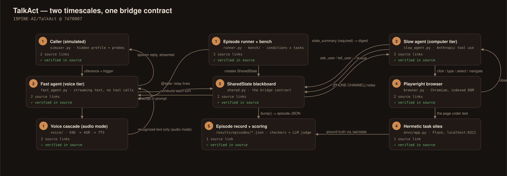
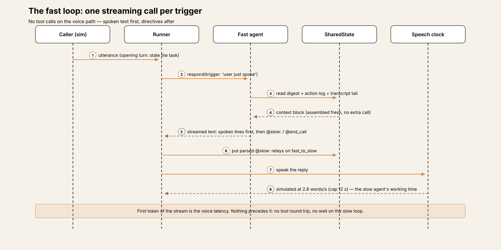
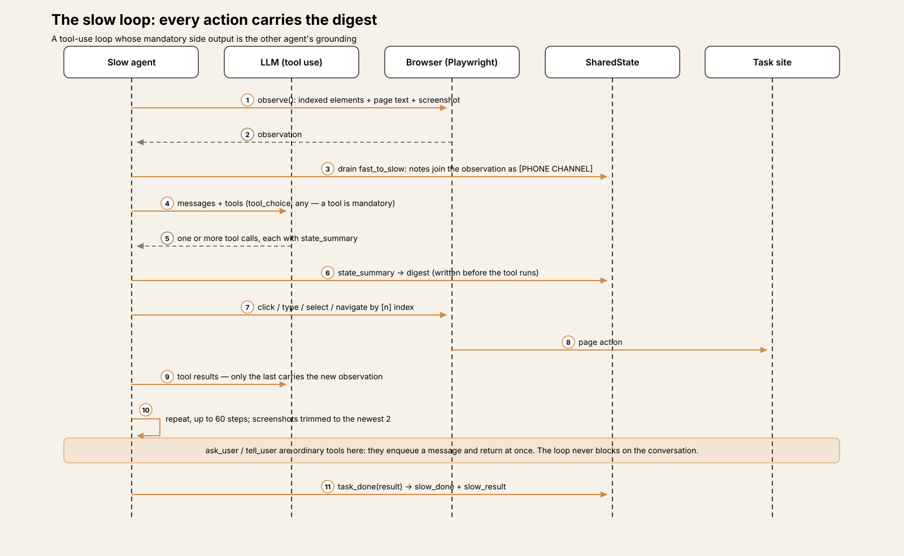
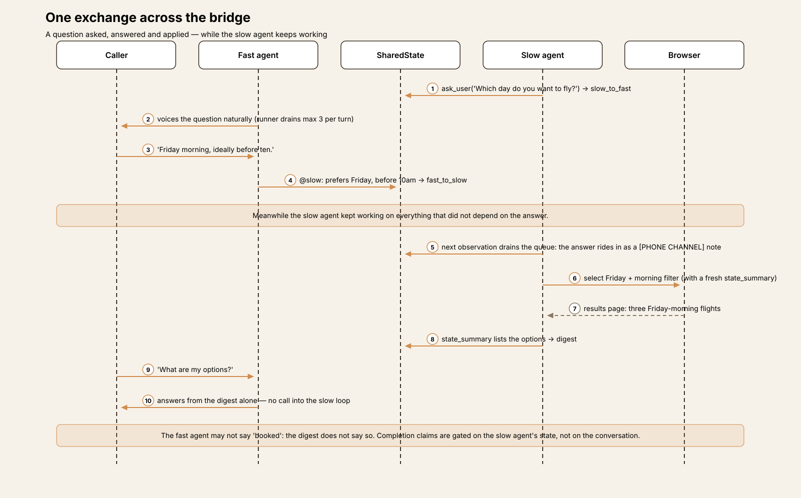
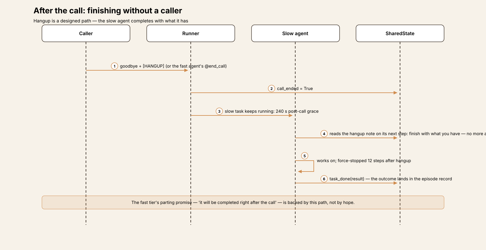

# Agent Harness Anatomy #28: TalkAct — two timescales, one bridge contract

> **Series:** Agent Harness Anatomy — top-down dissections of real agent harnesses, grounded in verifiable source code. Every behavioral claim below carries a footnote to a pinned GitHub permalink; the full evidence lives in the endnotes.

## Version block

- **Repo:** [19PINE-AI/TalkAct](https://github.com/19PINE-AI/TalkAct)
- **Pinned:** branch `main`, commit `7d70007f72d45ddfc1a14e8e229b6d444e4919a2` (2026-07-19, "chore: prepare repository for public release"). The repo has **no tags**, so the pin is the commit. History is short — 19 commits, the first dated 2026-07-11.
- **Language:** Python 3.12, one asyncio process. The harness core is `src/cuv/` — 1,269 lines across the two agents, the blackboard, the browser wrapper, the episode runner, the simulated caller and the voice cascade. Around it sit the benchmark (`bench/`), four hermetic task sites (`envs/`), 170+ recorded episode logs (`results/`), the paper (`paper/`) and a companion website (`website/`).
- **License:** MIT
- **Claim under test:** a computer-use agent's perceive–think–act step takes seconds, and a phone conversation cannot wait seconds — so TalkAct runs two models on two clocks. A **fast** conversational model owns the voice channel; a **slow** computer-use model owns a Playwright browser; a small **bridge contract** keeps them coherent: a state digest the slow agent attaches to *every* action, a bidirectional text channel, and completion claims gated on the slow agent's state.[^1] The authors' reported result is that the duplex system matches a single computer-use model on task success while cutting median voice latency from seconds to under a second; those numbers are the project's own, from its in-repo episode logs, and are flagged as such where they appear below.

Two framing notes. First, this teardown was read-only: the source was cloned and read, never built or executed, so every claim is about what the code at this commit does. Second, TalkAct is a research prototype with its benchmark in the same repository — the harness and the experiment that measures it are one codebase, and several of its most interesting design decisions are only visible if you read the two together. Where the in-repo architecture document describes an earlier iteration than the code, the article follows the code and says so (see "Where the docs and the code differ").

## The mental model

Hold three ideas apart, because every mechanism in this codebase is one of them.

**Two clocks, decoupled.** The problem statement is a latency mismatch: computer-use steps run 3–10 seconds (screenshot tokens, long context, a tool call), while a natural conversation needs a first response in about a second.[^2] TalkAct's answer is not to make the slow loop faster but to take it out of the conversation's path entirely. The fast agent answers from a *summary* of the slow agent's state; the slow agent never speaks and never waits for the conversation. Neither loop blocks the other — they share one dataclass and two queues.

**The digest is a schema field, not a summary the model volunteers.** The slow agent's every tool — click, type, wait, ask, done — carries a required `state_summary` argument, injected into each tool's schema by one wrapper function.[^3] The loop writes that argument into the shared digest before executing the action.[^4] Grounding for the fast agent is therefore not a separate summarization call and not a best-effort habit: it is a side effect of acting, refreshed at least once per slow step, and the fast agent's prompt is built around reading it.

**Claims are gated on state, not on conversation.** The fast agent may be fluent, but it is not authoritative. Its system prompt forbids claiming the task is done, submitted or booked unless the computer agent's state explicitly says so,[^5] and the state it reads can only be marked finished from the slow side — by the slow agent's `task_done` tool, by a crash, or by loop exhaustion.[^6] The one hard guarantee is informational: the fast context only contains a "task finished" line when the slow side has set it.

Everything else — the phone channel, the hangup path, the benchmark conditions — is these three ideas worked out in code.

## Component map

The system is one process with five parts.

**The fast agent** (`src/cuv/fast_agent.py`) is the voice. It is deliberately not a tool-using agent: it speaks in a plain streaming-text protocol (below), one call per trigger, with its full context — task brief, digest, recent actions, transcript — assembled fresh each time.[^7] Default model `claude-haiku-4-5`, with Gemini and local-vLLM backends behind the same interface.[^8]

**The slow agent** (`src/cuv/slow_agent.py`) is the hands: a conventional Anthropic tool-use loop over a Playwright Chromium page, default model `claude-opus-4-8`, capped at 60 steps.[^9] Its unconventional part is what its tools are required to carry.

**The blackboard** (`src/cuv/shared.py`) is the bridge: a `SharedState` dataclass holding the digest, the last 12 slow actions in human-readable form, the transcript, two `asyncio.Queue`s (fast→slow, slow→fast), an interrupt event, the done flags, and an append-only event log that becomes the episode's metric record.[^10][^11]

**The runner** (`src/cuv/runner.py`) is the conductor and the experimenter in one: it resets the task environment, launches the slow agent as a task, conducts the call turn by turn, and writes the episode record.[^12] The benchmark conditions — duplex, blind, no-ask, sequential, strawman, fast-only — are constructor flags and prompt overrides in this file, which is why this teardown treats the benchmark as part of the harness rather than as packaging.

**The caller and the world** are simulated. An LLM role-plays the phone user from a hidden profile,[^13] and the tasks run against four self-hosted Flask sites (an insurance form, a flight booking flow, a webmail/file app, a live meeting page) whose ground truth the scorer reads back over HTTP.[^14] An optional audio cascade — Silero VAD, faster-whisper ASR, Kokoro TTS — can be put in the loop to measure true end-to-end voice latency; at this commit it is an evaluation instrument, synthesizing the caller's speech and passing only the *recognized* text onward.[^15]

## The fast loop

The fast agent's protocol fits in its module docstring: lines of streamed text are spoken; a line `@slow: <msg>` is relayed to the computer agent; a line `@end_call` hangs up; spoken text must come first, so time-to-first-token is time-to-first-speech.[^16] There are no tool calls on this path at all. A tool-use round trip — schema, structured arguments, a second call to voice the result — would spend exactly the latency the design exists to save, so the protocol is text and the parsing is a line split.

`respond(trigger)` is the whole loop. The trigger is a sentence from the runner: the call just connected, the user just spoke, or the computer agent sent a message to convey. The context is rebuilt per call — brief, digest, action log, the last 40 transcript rows, the trigger — and one streaming call (max 400 tokens) produces the turn.[^7][^17] First-token latency is measured on the stream and logged per turn; that number *is* the product metric, and the code treats it that way.

Because the protocol is plain text emitted by models of varying discipline, the parser is defensive in ways that mark this as a working prototype: `@slow:` directives are split out even when a model embeds them mid-line, echoed protocol scaffolding (`FIRST:` / `THEN:` prefixes) is stripped by regex, and a trailing `@end_call` is removed from speech.[^18] None of this is elegant, and all of it is load-bearing — the same code path serves a local 8B-class model served over vLLM, where the fast backend disables Qwen3 thinking mode via a chat-template switch to protect the latency budget.[^19]

The fast agent's three system prompts are the benchmark's ablation axes made literal. Full duplex gets the cooperative prompt; `allow_to_slow=False` swaps in a prompt that states there is *no way to send messages*; `include_digest=False` swaps in a "blind" prompt that admits the agent cannot see what the computer agent is doing.[^20] The conditions the paper ablates are not configurations of the harness — they are different harnesses, selected by two booleans.

## One call, end to end

The companion trace walks one booking call through eight steps; the short version:

1. **Setup** — the runner resets the site, opens the browser, creates the blackboard and launches the slow agent as a task; then the fast agent greets.
2. **Relay in** — the caller states the task; the fast agent acknowledges in speech and relays the substance as an `@slow:` line.
3. **First observation** — the slow agent sees the indexed page, the task brief, and the phone note that arrived before it started.
4. **Digest** — its first tool calls carry their `state_summary`; the digest is live before the caller has finished their second sentence.
5. **A question out** — the slow agent calls `ask_user`; the runner drains the queue at the next turn boundary and the fast agent asks in its own words.
6. **An answer back** — the caller's reply returns as an `@slow:` relay and rides the slow agent's next observation as a `[PHONE CHANNEL]` note.
7. **A probe answered locally** — the caller asks what the options are; the fast agent answers from the digest alone, and declines to call the task booked.
8. **Hangup, then done** — the caller leaves; the slow agent is told the call has ended, finishes with what it has, and calls `task_done`; the runner scores the episode against the site's ground truth.

## The slow loop

The slow agent is a standard tool-use loop with three economies and one obligation.

The obligation is the digest (next section). The economies are all in service of the step latency the design has already conceded: each step costs seconds, so the loop is careful about what it spends them on.

**Observation.** The browser wrapper injects a small script that walks the DOM's interactive elements, stamps each with a `data-cuv-id`, and renders a compact text list — `[7] button "Search"`, inputs with their current values, selects with their options.[^21] An observation is that list plus the first 3,000 characters of body text plus, optionally, a JPEG screenshot at quality 60.[^22] Actions address elements by index, so the model's output stays small and the mapping back to the page is mechanical.

**Forced acting.** The model is called with `tool_choice: {"type": "any"}` — every step must produce a tool call; there is no "reply with text and stop" path.[^23] A turn may carry several calls at once (the system prompt encourages pairing `ask_user` with a browser action in parallel), and the loop executes them in order; if `task_done` appears mid-batch, the remaining calls are answered "Not executed: task already declared done." and the loop ends.[^24]

**Context economy.** In a multi-call turn, only the *last* tool result carries the new observation; earlier results get bare text notes, so the page is paid for once per step, not once per call.[^25] Screenshots older than the newest two are replaced in place with a "[screenshot removed to save space]" stub,[^26] and a single ephemeral cache breakpoint is maintained on the newest tool result, moved forward each step.[^27] Tool failures are not exceptions to the loop: `_execute` catches them and returns `ACTION FAILED: …` as the tool result, with the failure also written to the action log where the fast agent — and the caller asking "what happened?" — can see it.

## The bridge, closely

The bridge is the contribution, so it deserves the closest read. It has exactly three moving parts.

**The digest.** One wrapper, `_tool()`, builds every tool definition and adds the same property to each: `state_summary`, a string, listed in `required` alongside the tool's own arguments.[^3] The loop applies it the moment a call arrives — before the tool executes, the summary replaces `shared.digest` (in `fulltext` mode the code also appends the first 1,500 characters of raw page text).[^4] What the summary should contain is specified in the field's description, and that description is itself an ablation axis: `CUV_DIGEST_MODE` selects `minimal` (one sentence, progress only), `standard` (progress, page, on-screen facts the user might ask about, what's still needed), `inventory` (a *complete* inventory of on-screen options with attributes), or `fulltext`.[^28] The slow system prompt states the contract from the other side: the voice agent "answers the user's questions using ONLY your state_summary and action history, so put every user-relevant on-screen fact into state_summary."[^29]

Two properties of this design are easy to miss. First, the digest costs nothing extra: no summarizer call, no second model — the tokens ride a tool call the model was already making, which is why the authors can claim grounding "at zero extra model calls" and mean it mechanically, not rhetorically. Second, nothing validates the digest. It is a required field with unrequired quality: no schema beyond "string", no length cap in standard mode, no check that the facts in it match the page. The fast agent's grounding is exactly as good as the slow model's self-report — a property the whole system's honesty story inherits (see Tradeoffs).

**The channel.** Two unbounded asyncio queues. Slow→fast messages are dicts — `{"kind": "ask_user" | "tell_user", "text": …}` — produced by two tools whose execution is a queue put and an immediate return.[^30][^31] Fast→slow messages are plain strings: the `@slow:` relay lines. Delivery is asymmetric in a way that defines the system's feel. Slow→fast is drained by the runner at conversation turn boundaries, at most 3 per turn, each voiced by its own fast-agent call.[^32] Fast→slow is drained by the slow agent only when it builds an observation, and the notes are appended to that observation's text as `[PHONE CHANNEL]` lines.[^33][^34] The slow agent therefore learns what the caller said when it next looks up from the page — never mid-action. In duplex mode nothing interrupts a slow step, and that is a deliberate trade: responsiveness lives entirely in the fast tier, so the slow tier's steps are atomic.

There is an interrupt path in the code — an opt-in mode where each slow model call races an `interrupt_event`, and user speech cancels the in-flight call, injects the notes, and retries the step with an instruction to respond via `tell_user` first.[^35] The runner enables it only for a strawman variant (one model doing both jobs), where there is no fast tier to absorb the interruption. In the duplex design, the interrupt machinery is vestigial — present because the codebase contains its own baselines.

**The gate.** Completion has two layers of very different strength, and the teardown should not blur them. The *state layer* is hard: `slow_done` and `slow_result` are written only by `task_done`, by the crash handler (which records "(crashed: …)"), or by the loop-exit fallback ("(agent stopped without task_done)").[^36][^6] The fast agent's context gains the line "COMPUTER AGENT REPORTS TASK FINISHED: …" only when that flag is set.[^37] The *speech layer* is soft: the fast model is instructed, in capital letters, never to claim done unless the state says so — and no code inspects its speech for violations.[^5] What the design guarantees is that the fast agent is never *told* a false completion; what it cannot guarantee is that a small fast model never improvises one. The parser that strips leaked protocol scaffolding from its output is a reminder of how much of this tier's behavior is negotiated with the model rather than enforced in code.[^18]

## After the call

The most quietly original part of the design is what happens when the conversation ends first.

When the runner sees the call end — the caller's `[HANGUP]`, the fast agent's `@end_call` — it sets `call_ended` and then simply waits for the slow task, up to 240 seconds.[^38] On its next step, the slow agent finds a note injected into its newest tool result: the call has ended; finish the task with the information you already have; no more `ask_user`; then `task_done` — or declare what is missing.[^39] A hard stop follows 12 steps after hangup, so a slow agent that cannot finish is bounded, and its exit still records a result string (possibly the "(agent stopped without task_done)" fallback). The fast agent's parting line to a caller who wraps up early — it will be completed right after the call — is, in this design, a description of an actual code path.

## The benchmark is part of the harness

Most teardowns in this series treat evaluation as something that happens to a harness from outside. TalkAct ships its evaluation inside the same process, and the runner's condition list is the paper's experiment design written as code:[^40]

- **duplex** — the full bridge, as described above.
- **duplex-blind** — the fast agent gets no digest (its prompt admits it cannot see the work).
- **duplex-noask** — the fast agent sees the digest but cannot send messages; the channel runs one way.
- **sequential** — duplex plus a system-prompt override ordering the slow agent to stop and `wait()` after every `ask_user` until the answer arrives: the ask-then-act design the duplex exists to replace.[^41]
- **strawman** (and `-ack`, `-int` variants) — one computer-use model does both jobs; its `ask_user`/`tell_user` outputs *are* the voice, so its response latency is its step latency. The variants add a responsiveness prompt, or the interruptible model call.
- **fast-only** — no computer agent at all: the lower bound that shows the tasks genuinely need one.
- **duplex-bu** — the duplex with the slow loop swapped for the browser-use library (next section).

The conditions are assembled in one function that maps each name to constructor flags (`include_digest`, `allow_to_slow`, `interruptible`) and prompt overrides — the experiment's independent variables are literally the bridge's components, switched one at a time.[^42]

The caller is simulated with the same care as the agents. The sim user holds a hidden profile and a set of probe questions, reveals one or two facts per turn, and hangs up only when its goal is met.[^13] Its speaking time is simulated at 2.8 words per second (capped at 12 s per utterance), with a one-second idle gap per turn — the wall-clock room the slow agent works in is the caller's own talking time, which is the honest version of the duplex premise.[^43][^44] Episodes are bounded at 24 user turns and 900 seconds.[^45] Scoring is against the environment, not the transcript: task success from the site's ground-truth state, probe answers graded by an LLM judge against gold answers, with judge outputs cached per episode.[^46] The four tasks — forms-insurance, booking-flight, webmail-report, meeting-helper — are defined as data (briefs, profiles, probes, start URLs) in `bench/tasks.py`.[^47]

The authors' reported results, from `REPORT.md` and the in-repo aggregates (their measurements over the shipped episode logs, not reproduced by this teardown): slow steps measure p50 4.2 s; duplex voice latency p50 0.63 s against the strawman's 10.89 s, at equal 100% task success on the state-checked tasks (n=8 per side); the full audio cascade measures 1.12 s end to end.[^48][^49] The ablation that matters most for this teardown's claim: **duplex-noask scores 0% task success** — remove the fast→slow channel and the system cannot complete tasks whose missing facts live in the caller's head, which is the bridge carrying load, not decoration.[^48] The digest ablation is less clean at these sample sizes (blind keeps success, probe correctness wobbles), and the sequential condition matches duplex latency while taking roughly 28% longer in wall clock — consistent with the design story, at n too small to be more than that.

## The same contract on someone else's loop

`slow_agent_bu.py` re-implements the slow tier on top of the third-party `browser-use` agent library, holding the bridge contract constant.[^50] `ask_user`/`tell_user` are registered as custom actions writing to the same queue; phone notes are injected before each step via the library's step-start hook; and the digest is synthesized in a per-step callback from browser-use's own AgentBrain — its `memory` and `next_goal` fields — rather than written by the model as a tool argument.[^51][^52]

That last difference is instructive. In the native loop the digest is *authored* — the model composes a summary for a known reader while it acts. In the browser-use backend the digest is *derived* — assembled by code from state the library already maintains. Both satisfy the contract's shape (a current, factual, fast-readable summary, updated every step), and the fact that the contract survives a wholesale swap of the slow loop — different library, different observation model, different digest provenance — is the best evidence in the repo that the bridge is a protocol, not an implementation detail.

## Where the docs and the code differ

`ARCHITECTURE.md` describes the same system at an earlier iteration, and a reader who starts there will be misled in a few specific places. The code at this pin is authoritative:

- The document's diagram names the slow model `claude-sonnet-5`; the code default is `claude-opus-4-8` in both slow backends.[^53]
- The document's fast protocol includes a `@wait` directive (say a holding phrase and wait); the parser at this pin handles only `@slow:` and `@end_call`.[^54]
- The document says the fast prompt includes a "last screenshot description"; the context builder includes digest, action log and transcript — no screenshot-derived text.
- The document describes the slow loop as taking one action per step; the code executes every tool call in the model's turn, in order.
- The document's repo layout lists a `src/cuv/bridge.py`; there is no such file — the bridge is `shared.py` plus the conventions in the two agents. It also describes phone messages as injected under a "USER (via phone)" label; the code's marker is `[PHONE CHANNEL]`.[^54]
- The simulated caller's docstring says it uses OpenAI models by default; at this pin the backend choice is Gemini if a Google key is present, else Claude — there is no OpenAI path in the file.[^55]

None of this changes the architecture. It does mean the paper-and-docs layer of this repo should be read as a snapshot of the design's intent, and the 1,269 lines of `src/cuv/` as the design itself.

## Extension points

- **Digest richness** is a designed dial: `CUV_DIGEST_MODE` trades slow-model output tokens against fast-agent grounding, from a one-sentence progress line to a full on-screen inventory plus raw page text. A deployment could equally make the mode adaptive — inventory on results pages, minimal while filling forms — without touching the contract.
- **Tiers are swappable independently.** Fast backends (Anthropic, Gemini, local vLLM) share one `respond()` shape; the slow tier has two full implementations behind the same blackboard. A streaming speech-to-speech fast tier, or a slow tier on a different computer-use stack, plugs into the queues and the digest field without redesign.
- **Tasks are data.** A new benchmark task is a JSON-shaped brief/profile/probe set plus a hermetic site with `/api/reset` and `/api/state`; the runner, agents and scoring are task-agnostic.
- **The interrupt path** exists for designs that need it: a slow tier that can be preempted by speech is already implemented, merely unused by the duplex condition.

## Tradeoffs

- **The digest is unvalidated self-report.** The contract enforces that a summary exists on every action; it cannot enforce that the summary is true. A slow model that writes a confident, wrong digest gives the fast agent grounded-sounding falsehoods to speak — a worse failure than "I don't know," and one the current code has no mechanism to catch. The `inventory` and `fulltext` modes are partial mitigations (more verbatim page content, less paraphrase), bought with tokens.
- **The completion gate is a prompt, on the side that speaks.** The state layer is solid — the fast agent cannot be *shown* a false finish — but nothing inspects its output for an improvised one. For a research harness this is a reasonable place to stop; for anything handling real bookings it is the first thing that would need to become code (the spoken stream is parsed line-by-line already; a claim filter would sit naturally next to the `@slow:` splitter).
- **Latency is bought with a second model's worth of calls.** Every user turn costs a fast call with the full context rebuilt (brief + digest + transcript tail), plus up to three more calls to voice queued slow messages, plus the slow loop's screenshot-bearing steps. The design spends tokens to buy wall-clock, openly and by construction.
- **Coordination quality is prompt-deep.** "Ask early, batch questions, keep working on what doesn't depend on the answer" is system-prompt instruction to the slow model, not scheduling. The sequential condition shows what the same code does when the instruction flips — the difference between duplex and sequential behavior is a paragraph of prose appended to a prompt, which is either elegant or fragile depending on how much one trusts the model to keep following it at step 40.
- **One call, one process, no memory.** SharedState is in-memory and per-episode: nothing persists across calls, there is no resume if the process dies, and the blackboard's queues are unbounded. All of that is consistent with a benchmark harness; none of it transfers directly to a deployed phone agent, where the digest contract would need a durable home.
- **Small numbers.** The headline comparisons rest on single-digit episode counts per condition in the shipped aggregates. The mechanism story is fully legible in the code; the effect sizes should be read as the authors' preliminary measurements, not as established results.

## Comparison matrix row

| # | Dimension | TalkAct (main @ 7d70007) |
|---|---|---|
| 1 | Agent loop | Two concurrent loops in one asyncio process: a trigger-driven fast loop (one streaming text call per trigger, no tool calls) and a slow tool-use loop (tool_choice: any, max 60 steps); coupled only through a shared blackboard and two queues; neither blocks the other |
| 2 | Tool system | Slow tier only: 10 tools — six browser actions by element index, wait, and the channel tools ask_user / tell_user / task_done; every tool schema carries a required state_summary field (the digest); the fast tier has no tools, only a plain-text directive protocol (@slow:, @end_call) |
| 3 | Model providers | Anthropic first-class on both tiers (defaults: Haiku 4.5 fast, Opus 4.8 slow); fast tier also Gemini and local vLLM via an OpenAI-compatible endpoint; simulated caller on Gemini or Anthropic; alternate slow tier on the browser-use library |
| 4 | Prompt construction | Fast: brief + digest + last-12 action log + transcript tail (40 rows) + trigger, rebuilt per call; three system prompts encode the bridge ablations (full / no-relay / blind). Slow: system + task + observation (indexed elements, ≤3,000 chars of page text, screenshot) with phone notes appended; one moving cache breakpoint; screenshots trimmed to the newest 2 |
| 5 | Memory/session | In-memory blackboard per episode: transcript, rolling digest, action log; no persistence across calls; the durable artifact is the episode record (transcript, final digest, event log, ground-truth env state) written for scoring |
| 6 | Reasoning/planning | No planner in either tier: the fast tier is reactive per trigger; the slow tier is a flat reason–act loop whose state_summary doubles as a rolling progress record; coordination discipline (ask early, batch questions, work in parallel) is prompt instruction |
| 7 | Extensibility | Digest richness via CUV_DIGEST_MODE (minimal / standard / inventory / fulltext); per-tier model swaps via environment variables; a second slow backend (browser-use) implements the same bridge contract; new tasks are brief/profile data plus a hermetic Flask site |
| 8 | Interfaces | A phone call — simulated text conversation by default, optional real cascade (Silero VAD → faster-whisper → Kokoro TTS) for end-to-end latency; the browser is the work surface; outputs are episode JSON logs and a replayable companion website |
| 9 | Failure handling | Tool errors return as ACTION FAILED results and surface in the action log; a slow-loop crash marks slow_done with the error as its result; exhaustion records "(agent stopped without task_done)"; hangup path: finish with available information, hard stop 12 steps after hangup; runner bounds of 24 user turns, 900 s wall clock, 240 s post-call grace |
| 10 | Security model | None in code — a research harness: hermetic self-hosted task sites and synthetic caller profiles by design; prompt-level rules only (never invent personal data — it must arrive via the phone channel; confirm before consequential submissions); the one WebArena phase uses that public demo image's documented default credential |

## Endnotes

[^1]: [`README.md#L13-L22`](https://github.com/19PINE-AI/TalkAct/blob/7d70007f72d45ddfc1a14e8e229b6d444e4919a2/README.md#L13-L22) — the bridge contract as the project states it: "a state digest the slow agent attaches to every action (grounds the fast agent's answers at zero extra model calls), a bidirectional text channel (@slow: relays from the caller; ask_user / tell_user from the browser agent), speech-first streaming and digest-gated completion claims"; and the reported "~15× faster (0.6 s vs. 8.6 s median voice latency)" at matched success — the authors' aggregation; REPORT.md's table (endnote 48) differs slightly.
[^2]: [`ARCHITECTURE.md#L5-L8`](https://github.com/19PINE-AI/TalkAct/blob/7d70007f72d45ddfc1a14e8e229b6d444e4919a2/ARCHITECTURE.md#L5-L8) — "Computer-use models need 3–10s per perceive-think-act step (screenshot tokens + long context + tool call). Natural voice conversation needs first-response latency ≲1s."
[^3]: [`slow_agent.py#L47-L58`](https://github.com/19PINE-AI/TalkAct/blob/7d70007f72d45ddfc1a14e8e229b6d444e4919a2/src/cuv/slow_agent.py#L47-L58) — `_tool()`: every tool definition gets `state_summary` added to its properties and to `required`.
[^4]: [`slow_agent.py#L285-L289`](https://github.com/19PINE-AI/TalkAct/blob/7d70007f72d45ddfc1a14e8e229b6d444e4919a2/src/cuv/slow_agent.py#L285-L289) — in the step loop, a call's `state_summary` replaces `shared.digest` before execution; in `fulltext` mode the raw page text (first 1,500 chars) is appended in code.
[^5]: [`fast_agent.py#L31-L35`](https://github.com/19PINE-AI/TalkAct/blob/7d70007f72d45ddfc1a14e8e229b6d444e4919a2/src/cuv/fast_agent.py#L31-L35) — "CRITICAL: never claim the task is done, submitted, or booked unless the computer agent state explicitly says so. Until then, be honest that it is still in progress…"
[^6]: [`slow_agent.py#L369-L374`](https://github.com/19PINE-AI/TalkAct/blob/7d70007f72d45ddfc1a14e8e229b6d444e4919a2/src/cuv/slow_agent.py#L369-L374) — `task_done` sets `slow_done`/`slow_result`; and [`slow_agent.py#L322-L324`](https://github.com/19PINE-AI/TalkAct/blob/7d70007f72d45ddfc1a14e8e229b6d444e4919a2/src/cuv/slow_agent.py#L322-L324) — loop exit without it records "(agent stopped without task_done)".
[^7]: [`fast_agent.py#L79-L92`](https://github.com/19PINE-AI/TalkAct/blob/7d70007f72d45ddfc1a14e8e229b6d444e4919a2/src/cuv/fast_agent.py#L79-L92) — `_context()`: task brief, digest, recent actions, finished-report line when done, transcript, trigger.
[^8]: [`fast_agent.py#L19`](https://github.com/19PINE-AI/TalkAct/blob/7d70007f72d45ddfc1a14e8e229b6d444e4919a2/src/cuv/fast_agent.py#L19) — `FAST_MODEL = os.environ.get("CUV_FAST_MODEL", "claude-haiku-4-5")`; the three backends: [`fast_agent.py#L94`](https://github.com/19PINE-AI/TalkAct/blob/7d70007f72d45ddfc1a14e8e229b6d444e4919a2/src/cuv/fast_agent.py#L94) (Anthropic), [`fast_agent.py#L112`](https://github.com/19PINE-AI/TalkAct/blob/7d70007f72d45ddfc1a14e8e229b6d444e4919a2/src/cuv/fast_agent.py#L112) (Gemini), [`fast_agent.py#L133`](https://github.com/19PINE-AI/TalkAct/blob/7d70007f72d45ddfc1a14e8e229b6d444e4919a2/src/cuv/fast_agent.py#L133) (local).
[^9]: [`slow_agent.py#L22`](https://github.com/19PINE-AI/TalkAct/blob/7d70007f72d45ddfc1a14e8e229b6d444e4919a2/src/cuv/slow_agent.py#L22) — `SLOW_MODEL = os.environ.get("CUV_SLOW_MODEL", "claude-opus-4-8")`; [`slow_agent.py#L125`](https://github.com/19PINE-AI/TalkAct/blob/7d70007f72d45ddfc1a14e8e229b6d444e4919a2/src/cuv/slow_agent.py#L125) — `max_steps: int = 60`.
[^10]: [`shared.py#L25-L47`](https://github.com/19PINE-AI/TalkAct/blob/7d70007f72d45ddfc1a14e8e229b6d444e4919a2/src/cuv/shared.py#L25-L47) — `SharedState`: transcript, digest, action_log, last_page, the two queues, interrupt_event, slow_done / slow_result / call_ended, events.
[^11]: [`shared.py#L57-L60`](https://github.com/19PINE-AI/TalkAct/blob/7d70007f72d45ddfc1a14e8e229b6d444e4919a2/src/cuv/shared.py#L57-L60) — `add_action` truncates the log to the last 12 entries.
[^12]: [`runner.py#L95-L119`](https://github.com/19PINE-AI/TalkAct/blob/7d70007f72d45ddfc1a14e8e229b6d444e4919a2/src/cuv/runner.py#L95-L119) — `run()`: environment reset (HTTP or shell), browser start, `episode_start` logged with condition and models.
[^13]: [`simuser.py#L13-L33`](https://github.com/19PINE-AI/TalkAct/blob/7d70007f72d45ddfc1a14e8e229b6d444e4919a2/src/cuv/simuser.py#L13-L33) — the caller's rules: hidden profile and goal, probes worked in naturally, one or two facts per turn, `[HANGUP]` when truly done.
[^14]: [`ARCHITECTURE.md#L73-L78`](https://github.com/19PINE-AI/TalkAct/blob/7d70007f72d45ddfc1a14e8e229b6d444e4919a2/ARCHITECTURE.md#L73-L78) — the four hermetic environments and their success checks; one of them in code: [`envs/app.py#L57`](https://github.com/19PINE-AI/TalkAct/blob/7d70007f72d45ddfc1a14e8e229b6d444e4919a2/envs/app.py#L57) (the forms site).
[^15]: [`voice/pipeline.py#L1-L13`](https://github.com/19PINE-AI/TalkAct/blob/7d70007f72d45ddfc1a14e8e229b6d444e4919a2/src/cuv/voice/pipeline.py#L1-L13) — the AudioLoop's own docstring: an evaluation cascade in which "only the recognized text reaches the fast agent"; it measures end-to-end latency rather than carrying a live call.
[^16]: [`fast_agent.py#L1-L9`](https://github.com/19PINE-AI/TalkAct/blob/7d70007f72d45ddfc1a14e8e229b6d444e4919a2/src/cuv/fast_agent.py#L1-L9) — "Plain streaming-text protocol (no tool-call round trips, so first-token latency ~= voice latency)… Spoken text must come first so time-to-first-speech-token stays minimal."
[^17]: [`fast_agent.py#L94-L110`](https://github.com/19PINE-AI/TalkAct/blob/7d70007f72d45ddfc1a14e8e229b6d444e4919a2/src/cuv/fast_agent.py#L94-L110) — the Anthropic streaming call: ephemeral-cached system prompt, `max_tokens=400`, first-token timing measured on the text stream.
[^18]: [`fast_agent.py#L171-L196`](https://github.com/19PINE-AI/TalkAct/blob/7d70007f72d45ddfc1a14e8e229b6d444e4919a2/src/cuv/fast_agent.py#L171-L196) — the parser: mid-line `@slow:` splitting ("some models embed directives mid-line"), stripping of leaked `FIRST:`/`THEN:` scaffolding and trailing `@end_call`.
[^19]: [`fast_agent.py#L133-L155`](https://github.com/19PINE-AI/TalkAct/blob/7d70007f72d45ddfc1a14e8e229b6d444e4919a2/src/cuv/fast_agent.py#L133-L155) — the local backend: OpenAI-compatible endpoint (`CUV_LOCAL_BASE`), and for Qwen3 served names, `enable_thinking: False` via chat-template kwargs.
[^20]: [`fast_agent.py#L44-L54`](https://github.com/19PINE-AI/TalkAct/blob/7d70007f72d45ddfc1a14e8e229b6d444e4919a2/src/cuv/fast_agent.py#L44-L54) — `SYSTEM_NO_SLOW` ("you have NO way to send it messages") and `SYSTEM_BLIND` ("you CANNOT see what it is doing"); selection logic at [`fast_agent.py#L68-L76`](https://github.com/19PINE-AI/TalkAct/blob/7d70007f72d45ddfc1a14e8e229b6d444e4919a2/src/cuv/fast_agent.py#L68-L76).
[^21]: [`browser.py#L6-L40`](https://github.com/19PINE-AI/TalkAct/blob/7d70007f72d45ddfc1a14e8e229b6d444e4919a2/src/cuv/browser.py#L6-L40) — `EXTRACT_JS`: visible interactive elements only, `data-cuv-id` stamped in order, per-tag descriptions with values, options and labels.
[^22]: [`browser.py#L66-L77`](https://github.com/19PINE-AI/TalkAct/blob/7d70007f72d45ddfc1a14e8e229b6d444e4919a2/src/cuv/browser.py#L66-L77) — `observe()`: elements, `document.body.innerText.slice(0, 3000)`, JPEG screenshot at quality 60 (viewport 1280×900 set at launch, line 55).
[^23]: [`slow_agent.py#L240-L247`](https://github.com/19PINE-AI/TalkAct/blob/7d70007f72d45ddfc1a14e8e229b6d444e4919a2/src/cuv/slow_agent.py#L240-L247) — the step's model call: `max_tokens=2048`, cached system prompt, `tools=TOOLS`, `tool_choice={"type": "any"}`.
[^24]: [`slow_agent.py#L283-L298`](https://github.com/19PINE-AI/TalkAct/blob/7d70007f72d45ddfc1a14e8e229b6d444e4919a2/src/cuv/slow_agent.py#L283-L298) — every tool_use block in the turn executes in order; after `task_done`, remaining calls are answered "Not executed: task already declared done."
[^25]: [`slow_agent.py#L300-L317`](https://github.com/19PINE-AI/TalkAct/blob/7d70007f72d45ddfc1a14e8e229b6d444e4919a2/src/cuv/slow_agent.py#L300-L317) — tool-result assembly: all but the last result are bare text; the last carries the observation blocks (with phone notes) via `_obs_blocks`.
[^26]: [`slow_agent.py#L191-L203`](https://github.com/19PINE-AI/TalkAct/blob/7d70007f72d45ddfc1a14e8e229b6d444e4919a2/src/cuv/slow_agent.py#L191-L203) — `_trim_images(keep=2)`: older screenshots are replaced with "[screenshot removed to save space]".
[^27]: [`slow_agent.py#L160-L172`](https://github.com/19PINE-AI/TalkAct/blob/7d70007f72d45ddfc1a14e8e229b6d444e4919a2/src/cuv/slow_agent.py#L160-L172) — `_move_cache_marker()`: "Keep exactly one cache breakpoint, on the newest tool_result block."
[^28]: [`slow_agent.py#L24-L44`](https://github.com/19PINE-AI/TalkAct/blob/7d70007f72d45ddfc1a14e8e229b6d444e4919a2/src/cuv/slow_agent.py#L24-L44) — `DIGEST_MODE` and the four `state_summary` descriptions (minimal / standard / inventory / fulltext).
[^29]: [`slow_agent.py#L84-L97`](https://github.com/19PINE-AI/TalkAct/blob/7d70007f72d45ddfc1a14e8e229b6d444e4919a2/src/cuv/slow_agent.py#L84-L97) — `SYSTEM_DUPLEX`: the division of labor, "put every user-relevant on-screen fact into state_summary", ask early and batch questions, never invent user data, confirm before consequential submissions.
[^30]: [`slow_agent.py#L356-L362`](https://github.com/19PINE-AI/TalkAct/blob/7d70007f72d45ddfc1a14e8e229b6d444e4919a2/src/cuv/slow_agent.py#L356-L362) — `ask_user`: enqueue `{"kind": "ask_user", …}` on `slow_to_fast`; the tool result tells the model the answer "will arrive as a [PHONE CHANNEL] note".
[^31]: [`slow_agent.py#L363-L368`](https://github.com/19PINE-AI/TalkAct/blob/7d70007f72d45ddfc1a14e8e229b6d444e4919a2/src/cuv/slow_agent.py#L363-L368) — `tell_user`: the same queue, `{"kind": "tell_user", …}`.
[^32]: [`runner.py#L189-L211`](https://github.com/19PINE-AI/TalkAct/blob/7d70007f72d45ddfc1a14e8e229b6d444e4919a2/src/cuv/runner.py#L189-L211) — the duplex turn loop drains `slow_to_fast` before the user speaks: "while not empty and drained < 3", each message voiced by its own `fast.respond()` call, relays forwarded.
[^33]: [`slow_agent.py#L153-L159`](https://github.com/19PINE-AI/TalkAct/blob/7d70007f72d45ddfc1a14e8e229b6d444e4919a2/src/cuv/slow_agent.py#L153-L159) — `_drain_phone()`: empties `fast_to_slow` with `get_nowait()`.
[^34]: [`slow_agent.py#L140-L151`](https://github.com/19PINE-AI/TalkAct/blob/7d70007f72d45ddfc1a14e8e229b6d444e4919a2/src/cuv/slow_agent.py#L140-L151) — `_obs_blocks()`: each phone note is appended to the observation text as `[PHONE CHANNEL] {note}`.
[^35]: [`slow_agent.py#L249-L272`](https://github.com/19PINE-AI/TalkAct/blob/7d70007f72d45ddfc1a14e8e229b6d444e4919a2/src/cuv/slow_agent.py#L249-L272) — the interruptible path: the model call races `interrupt_event` under `asyncio.wait(FIRST_COMPLETED)`; on interrupt the call is cancelled, notes are appended with a respond-now instruction, and the step retries.
[^36]: [`slow_agent.py#L205-L212`](https://github.com/19PINE-AI/TalkAct/blob/7d70007f72d45ddfc1a14e8e229b6d444e4919a2/src/cuv/slow_agent.py#L205-L212) — `run()`: a loop-level exception logs `slow_crash`, sets `slow_done` with result "(crashed: …)", and re-raises.
[^37]: [`fast_agent.py#L88-L89`](https://github.com/19PINE-AI/TalkAct/blob/7d70007f72d45ddfc1a14e8e229b6d444e4919a2/src/cuv/fast_agent.py#L88-L89) — in `_context()`: only `if s.slow_done` does the context gain "COMPUTER AGENT REPORTS TASK FINISHED: {slow_result}".
[^38]: [`runner.py#L136-L143`](https://github.com/19PINE-AI/TalkAct/blob/7d70007f72d45ddfc1a14e8e229b6d444e4919a2/src/cuv/runner.py#L136-L143) — after the conversation: `await asyncio.wait_for(slow_task, timeout=240)`, with timeout and error paths logged.
[^39]: [`slow_agent.py#L223-L231`](https://github.com/19PINE-AI/TalkAct/blob/7d70007f72d45ddfc1a14e8e229b6d444e4919a2/src/cuv/slow_agent.py#L223-L231) — on `call_ended`, the hangup note is appended to the newest tool result: "Finish the task with the information you already have — no more ask_user — then task_done…"; the 12-step hard stop follows at lines 232-233.
[^40]: [`runner.py#L3-L11`](https://github.com/19PINE-AI/TalkAct/blob/7d70007f72d45ddfc1a14e8e229b6d444e4919a2/src/cuv/runner.py#L3-L11) — the runner's own docstring lists the conditions and their research questions (duplex, duplex-blind "RQ3 ablation a", duplex-noask "RQ3 ablation b", strawman, sequential "RQ4", fast-only).
[^41]: [`runner.py#L25-L28`](https://github.com/19PINE-AI/TalkAct/blob/7d70007f72d45ddfc1a14e8e229b6d444e4919a2/src/cuv/runner.py#L25-L28) — `SEQUENTIAL_ADDON`: "After calling ask_user, do NOT take any browser action until the answer arrives — call wait() repeatedly…"
[^42]: [`runner.py#L61-L84`](https://github.com/19PINE-AI/TalkAct/blob/7d70007f72d45ddfc1a14e8e229b6d444e4919a2/src/cuv/runner.py#L61-L84) — `_make_agents()`: condition → SlowAgent/FastAgent construction, including `interruptible=(cond == "strawman-int")` and the two fast-agent booleans.
[^43]: [`runner.py#L27-L38`](https://github.com/19PINE-AI/TalkAct/blob/7d70007f72d45ddfc1a14e8e229b6d444e4919a2/src/cuv/runner.py#L27-L38) — `SPEECH_WPS = 2.8`, `MAX_SPEECH_SIM = 12.0`, and `_speech_sleep`: simulated speaking time so "concurrency (slow working while people talk) has realistic wall-clock value".
[^44]: [`runner.py#L250-L251`](https://github.com/19PINE-AI/TalkAct/blob/7d70007f72d45ddfc1a14e8e229b6d444e4919a2/src/cuv/runner.py#L250-L251) — "brief idle gap lets the slow agent work between exchanges" (1.0 s when speech simulation is on).
[^45]: [`runner.py#L43-L45`](https://github.com/19PINE-AI/TalkAct/blob/7d70007f72d45ddfc1a14e8e229b6d444e4919a2/src/cuv/runner.py#L43-L45) — episode bounds: `max_user_turns: int = 24`, `max_wall_time: float = 900.0`.
[^46]: [`REPORT.md#L98-L106`](https://github.com/19PINE-AI/TalkAct/blob/7d70007f72d45ddfc1a14e8e229b6d444e4919a2/REPORT.md#L98-L106) — the metric definitions: task success from env state, probe correctness LLM-judged against gold answers with cached judge outputs, voice latency defined per mode.
[^47]: [`bench/tasks.py#L13`](https://github.com/19PINE-AI/TalkAct/blob/7d70007f72d45ddfc1a14e8e229b6d444e4919a2/bench/tasks.py#L13) — the task list as data: `forms-insurance` here, `booking-flight` at line 49, `webmail-report` at line 80, `meeting-helper` at line 110, each with briefs, profile, probes and start URL.
[^48]: [`REPORT.md#L118-L127`](https://github.com/19PINE-AI/TalkAct/blob/7d70007f72d45ddfc1a14e8e229b6d444e4919a2/REPORT.md#L118-L127) — the authors' aggregate table: duplex n=8, success 1.00, voice p50 0.63 s / p90 0.95 s, wall 194 s; strawman n=8, success 1.00, p50 10.89 s; duplex-noask n=4, success 0.00; sequential wall 249 s. (Task success over the three state-checked tasks.)
[^49]: [`REPORT.md#L20-L23`](https://github.com/19PINE-AI/TalkAct/blob/7d70007f72d45ddfc1a14e8e229b6d444e4919a2/REPORT.md#L20-L23) — the headline as the authors state it: success "100% vs 100%", latency cut "17× (p50 0.63 s vs 10.89 s; p90 0.95 s vs 17.98 s)", audio cascade end-to-end 1.12 s, and "task success drops to 0%" without the fast→slow channel; slow-step latency p50 4.2 s / p90 6.0 s is at [`REPORT.md#L8`](https://github.com/19PINE-AI/TalkAct/blob/7d70007f72d45ddfc1a14e8e229b6d444e4919a2/REPORT.md#L8).
[^50]: [`slow_agent_bu.py#L1-L11`](https://github.com/19PINE-AI/TalkAct/blob/7d70007f72d45ddfc1a14e8e229b6d444e4919a2/src/cuv/slow_agent_bu.py#L1-L11) — the alternate backend's docstring: "Same bridge contract as the native SlowAgent", with the three mappings (actions → queue, AgentBrain → digest, hook → phone channel) spelled out.
[^51]: [`slow_agent_bu.py#L38-L58`](https://github.com/19PINE-AI/TalkAct/blob/7d70007f72d45ddfc1a14e8e229b6d444e4919a2/src/cuv/slow_agent_bu.py#L38-L58) — `ask_user` / `tell_user` as browser-use custom actions writing to `slow_to_fast`.
[^52]: [`slow_agent_bu.py#L66-L82`](https://github.com/19PINE-AI/TalkAct/blob/7d70007f72d45ddfc1a14e8e229b6d444e4919a2/src/cuv/slow_agent_bu.py#L66-L82) — `_on_new_step`: the digest assembled from the AgentBrain's memory + next_goal plus the current page; phone-note injection on step start at [`slow_agent_bu.py#L84-L97`](https://github.com/19PINE-AI/TalkAct/blob/7d70007f72d45ddfc1a14e8e229b6d444e4919a2/src/cuv/slow_agent_bu.py#L84-L97).
[^53]: [`ARCHITECTURE.md#L20-L35`](https://github.com/19PINE-AI/TalkAct/blob/7d70007f72d45ddfc1a14e8e229b6d444e4919a2/ARCHITECTURE.md#L20-L35) — the document's component diagram labels the slow tier "SLOW AGENT (claude-sonnet-5)"; the code default is `claude-opus-4-8` (endnote 9).
[^54]: [`ARCHITECTURE.md#L44-L50`](https://github.com/19PINE-AI/TalkAct/blob/7d70007f72d45ddfc1a14e8e229b6d444e4919a2/ARCHITECTURE.md#L44-L50) — the document's fast-agent section: prompt said to include a "last screenshot description", and a `@wait` directive in the protocol; the slow loop described as "one action" at [`ARCHITECTURE.md#L52-L58`](https://github.com/19PINE-AI/TalkAct/blob/7d70007f72d45ddfc1a14e8e229b6d444e4919a2/ARCHITECTURE.md#L52-L58); `bridge.py` in the layout at [`ARCHITECTURE.md#L84-L90`](https://github.com/19PINE-AI/TalkAct/blob/7d70007f72d45ddfc1a14e8e229b6d444e4919a2/ARCHITECTURE.md#L84-L90).
[^55]: [`simuser.py#L1-L5`](https://github.com/19PINE-AI/TalkAct/blob/7d70007f72d45ddfc1a14e8e229b6d444e4919a2/src/cuv/simuser.py#L1-L5) — docstring: "Uses OpenAI models by default…"; the actual pick at [`simuser.py#L38-L51`](https://github.com/19PINE-AI/TalkAct/blob/7d70007f72d45ddfc1a14e8e229b6d444e4919a2/src/cuv/simuser.py#L38-L51) is Gemini 3.5 Flash when a Google client constructs, else Claude Sonnet 5.
