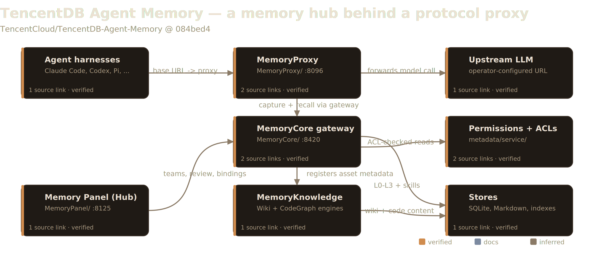
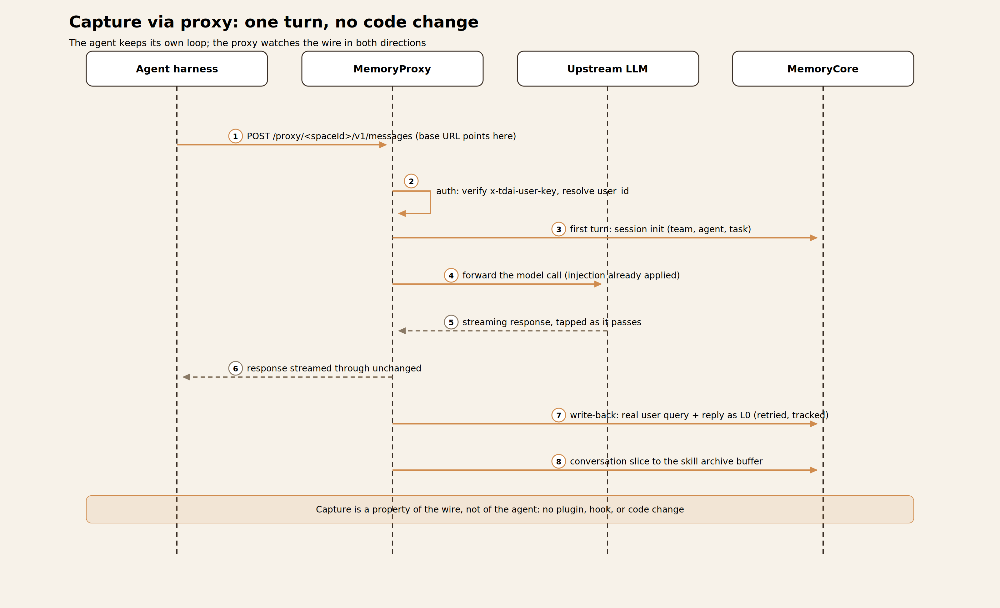
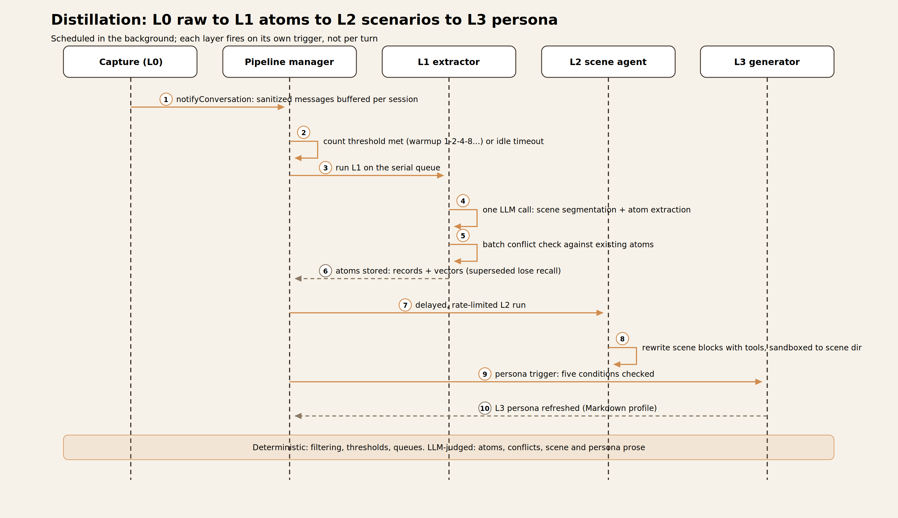
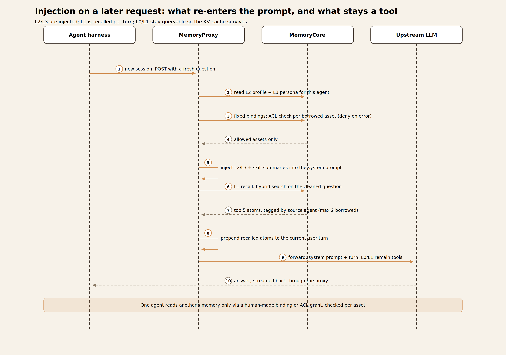

# Field Notes: Memory by proxy — TencentDB Agent Memory and the hub that joins by changing one URL

**Series framing.** This is a Field Notes piece, not a numbered teardown.
Every teardown in this series dissects a system that runs an agent: a loop,
tools, approvals, a session lifecycle. TencentDB Agent Memory runs none of
those — its own README says so in one sentence: "Memory doesn't run the
Agent loop; it ensures the next iteration inherits the previous one's
results." It is a *team memory hub*: a protocol proxy that captures
conversations from any agent pointed at it, a background pipeline that
distils them into layered memory, and a governed asset library — chat
memory, versioned Skills, an LLM-Wiki, and a CodeGraph — that teams share
under an explicit visibility model. The loops that consume this memory
belong to other harnesses, several of which this series has already taken
apart. What TencentDB Agent Memory offers instead is a complete,
source-readable answer to a question every teardown has touched from the
read side: **what happens if memory is a service on the wire, not a feature
inside the loop?** That is a Field Notes question, and it is the one this
piece answers.

> **Pin:** `TencentCloud/TencentDB-Agent-Memory` @ `v2.0.3`,
> commit `084bed45cad6bb7f877455082cee82835d65671a` (2026-10-26), MIT.
> Cloned and read, never executed. The vendor's benchmark figures are its
> own and are flagged as vendor claims wherever they appear.

## Four services, one idea

The system is easiest to hold as four services arranged around a single
idea — that experience should accumulate in one place and be *equipped* to
agents, rather than re-learned by each of them:

1. **MemoryProxy** (:8096) is a transparent proxy for the two protocols
   agents already speak — OpenAI's `/v1/chat/completions` and Anthropic's
   `/v1/messages`. It authenticates, initialises sessions, injects memory,
   forwards the call, writes the conversation back, and reports usage. It
   persists no memory itself.[^1]
2. **MemoryCore** (:8420) is the memory and metadata core: the L0–L3 chat
   memory pipeline, the Skill store, and the registry of users, teams,
   agents, tasks, and access-control lists, behind an HTTP gateway. Its
   README is explicit about the boundary: "An Agent is a caller and a
   managed metadata entity; MemoryCore does not host, schedule, or execute
   the Agent itself."[^2]
3. **MemoryKnowledge** builds and serves the two knowledge assets — the
   LLM-Wiki and the CodeGraph. Core registers only their metadata; the
   content lives here.
4. **MemoryPanel** (:8125) is the human surface: create teams and agents,
   review candidate Skills, bind assets to agents, manage visibility.

The separation matters for the same reason it did with Hy Memory: the
claims attach to different layers, and each layer can be checked in source
on its own.

## The proxy: capture as a property of the wire

The integration is a configuration change, not a project. Point the agent's
base URL at `http://<proxy>:8096/proxy/<spaceId>/v1/...` — `spaceId` names
the memory instance — and leave the model and key settings as they were.
The proxy runs both protocol pipelines from one set of stages: auth,
a short-circuit for internal service accounts, session initialisation,
injection, rate limiting, forwarding, asynchronous extraction, and
reporting.[^1][^3] Because it terminates the protocol rather than
sniffing it, it can act on the call in both directions.

Three details of the capture side repay attention.

**Session init is the one visible intrusion.** The first request in a new
session can be answered with an interactive form — pick a team, then an
agent, then a task — and the result is appended to the system prompt as a
session-context block on later turns. Headers (`x-team-id`, `x-agent-id`,
`x-task-id`) pre-select the answers and skip the form, which is how a
managed rollout avoids interrupting anyone. The hub, not the agent,
decides which team's memory a first request joins; the header path is the
mitigation, and it is worth knowing it exists before deploying the form to
a team.

**Write-back is selective about what a "conversation" is.** Coding agents
stuff their user messages with harness context — system reminders, runtime
snapshots, injected data blocks — that changes every turn and would poison
a memory store. So the recorder extracts only the *real user query* from
the last user message, using one shared extractor across adapters, and
writes that plus the assistant's reply to MemoryCore as L0.[^4] The same
care appears in Core's capture path, which sanitises messages to strip
injected tags — so memory recalled into a conversation cannot re-enter
later as fresh evidence of itself.

**The write is fire-and-forget, but not careless.** On a streaming call the
write-back cannot block the response, so it is tracked instead: each write
carries up to three retries with backoff, pending writes are drained on
shutdown, and the module's header reasons plainly about the trade-off — a
duplicate L0 is acceptable (the distillation below is idempotent per
content hash), a dropped one is a permanent hole.[^5] A second, separate
write-back accumulates conversation slices for Skill extraction, counted
by tool calls rather than turns.

Failure behaviour is layered and, with one exception, open. Telemetry and
billing channels are explicitly off the business path ("any one failing
does not affect" the call); the recall path degrades to the current
agent's own memory when the control plane is unreachable; proxy state
storage degrades Redis/COS → SQLite → filesystem → memory and reports the
effective backend on its health endpoint. A failed forward surfaces to
the agent as an ordinary upstream error. The exception is authorization,
which fails *closed* — see below.

## Distillation: L0 → L1 → L2 → L3, each on its own trigger

Raw conversations (L0) are appended as sanitised JSONL, one message per
line, and indexed for vector search when an embedding provider is
configured. Everything above L0 is scheduled by a pipeline manager, not
triggered by the capture hook — the hook's own header states the division:
"Extraction is NOT triggered here. The pipeline manager decides
when."[^6][^7]

- **L1 atoms** are extracted when a session's buffered conversations reach
  a count threshold — with a 1 → 2 → 4 → 8 warmup ramp so early
  conversations are processed sooner — or when the session goes idle,
  whichever comes first. The extraction itself is a single LLM call that
  performs scene segmentation and atom extraction together, followed by a
  batch conflict pass against existing atoms: a new atom can duplicate,
  supersede, or coexist with an old one, and superseded atoms lose their
  recall standing rather than being silently overwritten.[^8]
- **L2 scenarios** are Markdown blocks, one per project or scenario,
  rewritten by a tool-using LLM agent that is *sandboxed to the scene
  directory*: the checkpoint, the scene index, and the persona file are
  physically outside its workspace. The layer that summarises a team's
  work cannot wander into the system's own state.[^9]
- **L3, the persona**, is generated only when a five-condition trigger
  says so — an explicit request, a cold start, enough new memories,
  sufficient scene coverage, an interval elapsed. Long-term profile is
  threshold-driven, never per-turn.[^10]

What is deterministic here: filtering, buffering, thresholds, queues,
dedup bookkeeping, storage. What is LLM-judged: the atoms, their scene
assignment, the conflict outcomes, and the prose of scenes and persona.
And the economics are explicit in the deployment shape: the distillation
models are configured separately from the proxy's upstream, so an operator
prices *remembering* independently of *answering*.

Storage follows the same pragmatism. Chat memory defaults to a single
SQLite database — L0 and L1 rows beside `vec0` vector tables from
sqlite-vec, with FTS5 for keyword search — while L2 scenes and the L3
persona are Markdown files behind a storage adapter. Tencent Cloud
VectorDB and an experimental MongoDB backend are alternatives, not
requirements.[^11] Retrieval is hybrid throughout: keyword and embedding
results merged with reciprocal-rank fusion, BM25 available even with no
embedding provider, and results capped by count, character budget, and
timeout so memory cannot crowd out the work it is meant to help.[^12]

## Injection: what re-enters the prompt, and what stays a tool

The read side has the design's most considered decision in it, and it is a
decision about *other people's caches*. Injecting memory into a system
prompt is easy; doing it naively means the prompt changes whenever memory
changes, and every upstream KV cache downstream of the change is wasted.
So the layers are split by volatility:

- **L2 (agent profile) and L3 (team persona)** — slow-moving — are
  injected directly into the system prompt, along with summaries of
  relevant Skills and the tool blocks that describe the memory, skill,
  and knowledge tools.
- **L0 and L1** — fast-moving — are **not injected at all**. They are
  exposed as read-only tools the model can query, so a changing memory
  never invalidates a cached prompt.
- The one per-turn exception is a dedicated L1 recall step: it searches
  atoms with the cleaned current question, merges hits from the current
  agent and up to **two borrowed agents** whose assets a human has bound
  to it, keeps the global top five, and prepends them to the current
  *user* turn — the volatile tail of the prompt, not its cached head —
  each atom tagged with the agent it came from.[^13]

Wiki and CodeGraph content follow the "stays a tool" pattern all the way
down: agents discover knowledge resources through a two-step tool surface
(list, then call) and read pages, source, or impact paths only when the
task needs them. Documents and code are memory assets, but they enter
context on demand, not by injection.

## Four asset types, one ownership model

Chat Memory, Skills, LLM-Wiki, and CodeGraph are registered uniformly as
Memory Assets — each with an owner, a team, a status lifecycle, and a
visibility. Two of the four deserve a closer look.

**Skills are versioned like code, because they are.** A Skill is a
`SKILL.md` plus resource files, with trigger boundaries, execution steps,
and validation notes. Every change is an append-only version transaction:
copy the head version's resource tree, apply the change, write the new
version row, with content-hash checks that make replays no-ops.[^14]
Skills extracted from conversation traces enter as *candidates* and are
reviewed by a human in the Panel before they are shared with the team —
the one approval flow in the system, and it guards exactly the asset type
that can tell an agent what to *do*. The model's own write access to
Skills is off by default. Ownership is checked as a (team, agent) pair,
and a team mismatch is reported as "not found", so probing cannot even
confirm a Skill exists.[^15]

**Visibility is a small enum with a strict centre.** An asset is
`private`, `team`, `restricted` (precise User / Role / Agent ACLs),
`agent`, or `task`.[^16] One pure decision function resolves every read:
the asset must exist and not be archived; the **owner is always
allowed**; the caller must be an active team member; then the visibility
gate; then role defaults (team admins can read, write, assign, and share;
members can read); then ACL grants.[^17] Because the owner check runs
first, `private` means what it says — a non-owner is denied *including
team admins* — and the README states the same semantics as a product
promise: "Only the Owner can read — not even team admins." New chat
memory and Skills are private by default; sharing is an explicit
action.[^18]

Through the proxy, this is enforced at recall time rather than merely in
the Panel UI: identity comes from the verified per-user key, every
borrowed-asset context is ACL-checked individually before its atoms can
be recalled, and a check that *errors* returns deny.[^19] So one agent
reading another's private memory is not a configuration accident waiting
to happen; it requires a human-made binding or grant, is capped at two
borrowed agents per turn, and fails shut. The proxy also minds its own
credential hygiene: bridge calls to Core carry a service token the proxy
injects itself, so it never appears in a prompt, and a pipeline fix
specifically strips a client-supplied user-key header so it cannot be
passed through to the upstream model provider.

## The trust boundary is the deployment

The honest summary of the team shape is that whoever operates the hub
holds the keys: the upstream LLM credential (the proxy can replace the
client's key with its own, per agent if desired, or pass the client's
through),[^20] the service tokens, and the stores. Every prompt flowing
through the proxy — including the memory injected into it — goes to the
configured upstream, and captured content goes to the configured
distillation models. Nothing in the default self-hosted path requires a
vendor cloud account. Within the deployment, the controls are real:
per-user keys that can be revoked, scrypt-hashed passwords, two-layer
roles, private-by-default assets, fail-closed ACLs.

One default deserves plain statement, in the same spirit as the TeamAI
notes in this series: user-key authentication is **off in the code
defaults** and on in the example configuration. A proxy started casually
on a shared network accepts anonymous traffic and resolves identity to
`anonymous`. The vendor's own FAQ says to keep auth on when listening
beyond loopback; the finding here is only that the safe setting is a
choice the operator must make, not the one the code makes for them.[^1]

## The vendor's numbers, labelled as such

The README's benchmark section reports PersonaMem — a test of whether an
agent can correctly apply user information after extended interaction —
at 48% without the system and 76% with it, a +59% relative
improvement.[^21] Figures circulating in the vendor's materials outside
this repo cite up to 61% token savings and +51% pass rates. None of these
results were reproduced for this piece; the savings and pass-rate figures
do not appear in the pinned repository at all. They are the vendor's own
evaluations of its own system and should be read as vendor claims. The
mechanisms above — the cache-aware injection split, the capped recall,
the distillation triggers — are in the source and can be assessed
directly; whether they add up to those numbers on a given team's workload
is a question only that team's measurement can answer.

## What to take from it

TencentDB Agent Memory will not replace anything in the teardown series,
because — like Hy Memory before it — it does not compete with anything in
it. Its contribution is to treat team memory as infrastructure with its
own integration surface and its own governance: capture that costs the
agent nothing because it lives on the wire; a distillation pipeline whose
triggers, queues, and model budget are explicit; an injection design that
respects the upstream's cache as a first-class constraint; and a
permission model in which "private" excludes even the team's admins and
cross-agent recall is a granted, capped, fail-closed privilege. The
question it leaves open is the organisational one its design cannot
answer: a hub this central makes the team's memory legible and durable —
and makes whoever runs it the custodian of everything the team has ever
told its agents. That custodianship, more than any benchmark, is what a
team is really choosing when it changes one URL.

---

## Endnotes

[^1]: The proxy's positioning, pipeline, and auth defaults — it persists
    no memory, forwards both protocols, and `auth.enabled` is false in
    code but true in the example config:
    https://github.com/TencentCloud/TencentDB-Agent-Memory/blob/084bed45cad6bb7f877455082cee82835d65671a/MemoryProxy/README.md#L44-L55
[^2]: MemoryCore's boundary — the agent is a caller and a metadata entity,
    never hosted or executed by Core:
    https://github.com/TencentCloud/TencentDB-Agent-Memory/blob/084bed45cad6bb7f877455082cee82835d65671a/MemoryCore/README.md#L9
[^3]: The two protocol runners, OpenAI and Anthropic, in the proxy server:
    https://github.com/TencentCloud/TencentDB-Agent-Memory/blob/084bed45cad6bb7f877455082cee82835d65671a/MemoryProxy/src/server.ts#L25-L26
[^4]: `recordTdaiTurn` — only the extracted real user query, plus the
    reply, is written back as L0:
    https://github.com/TencentCloud/TencentDB-Agent-Memory/blob/084bed45cad6bb7f877455082cee82835d65671a/MemoryProxy/src/tdai/recorder.ts#L32
[^5]: Pending-write tracking — three retries, shutdown drain, and the
    duplicate-over-loss rationale:
    https://github.com/TencentCloud/TencentDB-Agent-Memory/blob/084bed45cad6bb7f877455082cee82835d65671a/MemoryProxy/src/tdai/pending-writes.ts#L12-L14
[^6]: `performAutoCapture` — L0 is written at capture; extraction is the
    pipeline manager's decision:
    https://github.com/TencentCloud/TencentDB-Agent-Memory/blob/084bed45cad6bb7f877455082cee82835d65671a/MemoryCore/src/core/hooks/auto-capture.ts#L46
[^7]: `MemoryPipelineManager` — serial L1/L2/L3 queues, count and idle
    triggers, warmup ramp:
    https://github.com/TencentCloud/TencentDB-Agent-Memory/blob/084bed45cad6bb7f877455082cee82835d65671a/MemoryCore/src/utils/pipeline-manager.ts#L212
[^8]: The L1 extractor — one LLM call for segmentation + extraction, then
    batch conflict detection:
    https://github.com/TencentCloud/TencentDB-Agent-Memory/blob/084bed45cad6bb7f877455082cee82835d65671a/MemoryCore/src/core/record/l1-extractor.ts#L1-L13
[^9]: The L2 `SceneExtractor` — a tool-using agent sandboxed to the scene
    directory:
    https://github.com/TencentCloud/TencentDB-Agent-Memory/blob/084bed45cad6bb7f877455082cee82835d65671a/MemoryCore/src/core/scene/scene-extractor.ts#L124
[^10]: `PersonaTrigger.shouldGenerate()` — the five gated conditions for
    L3 generation:
    https://github.com/TencentCloud/TencentDB-Agent-Memory/blob/084bed45cad6bb7f877455082cee82835d65671a/MemoryCore/src/core/persona/persona-trigger.ts#L35
[^11]: The SQLite store — L0/L1 rows plus sqlite-vec `vec0` tables in one
    database:
    https://github.com/TencentCloud/TencentDB-Agent-Memory/blob/084bed45cad6bb7f877455082cee82835d65671a/MemoryCore/src/core/store/sqlite/memory-store.ts#L1-L19
[^12]: Hybrid recall — keyword + embedding merged with RRF, BM25 available
    without an embedding provider:
    https://github.com/TencentCloud/TencentDB-Agent-Memory/blob/084bed45cad6bb7f877455082cee82835d65671a/MemoryCore/src/core/hooks/auto-recall.ts#L430
[^13]: `TdaiL1RecallInjector` — self + up to two borrowed agents, merged
    top-5, prepended to the user turn:
    https://github.com/TencentCloud/TencentDB-Agent-Memory/blob/084bed45cad6bb7f877455082cee82835d65671a/MemoryProxy/src/injection/injectors/tdai-l1-recall-injector.ts#L21
[^14]: Skill versioning — each change is an `appendVersion` transaction
    over a copied resource tree:
    https://github.com/TencentCloud/TencentDB-Agent-Memory/blob/084bed45cad6bb7f877455082cee82835d65671a/MemoryCore/src/core/skill/skill-versioning.ts#L1-L12
[^15]: Skill permissions — (team, agent) ownership; a team mismatch is
    reported as not-found:
    https://github.com/TencentCloud/TencentDB-Agent-Memory/blob/084bed45cad6bb7f877455082cee82835d65671a/MemoryCore/src/core/skill/skill-permission.ts#L1-L12
[^16]: `AssetVisibility` and the asset-type enum:
    https://github.com/TencentCloud/TencentDB-Agent-Memory/blob/084bed45cad6bb7f877455082cee82835d65671a/MemoryCore/src/metadata/types.ts#L36
[^17]: `checkPermission` — owner, membership, visibility, role defaults,
    ACLs, in that order; `private` excludes team admins:
    https://github.com/TencentCloud/TencentDB-Agent-Memory/blob/084bed45cad6bb7f877455082cee82835d65671a/MemoryCore/src/metadata/service/permission-checker.ts#L43
[^18]: The product statement of the visibility semantics — private is
    owner-only, "not even team admins":
    https://github.com/TencentCloud/TencentDB-Agent-Memory/blob/084bed45cad6bb7f877455082cee82835d65671a/README.md#L233
[^19]: `checkAclOrDeny` — an ACL check that errors returns deny:
    https://github.com/TencentCloud/TencentDB-Agent-Memory/blob/084bed45cad6bb7f877455082cee82835d65671a/MemoryProxy/src/tdai/client.ts#L438
[^20]: The upstream credential the proxy holds, and the per-agent
    override / client-key passthrough rules:
    https://github.com/TencentCloud/TencentDB-Agent-Memory/blob/084bed45cad6bb7f877455082cee82835d65671a/MemoryProxy/config.example.yaml#L34-L37
[^21]: The vendor's PersonaMem benchmark — 48% without, 76% with; the
    vendor's own evaluation, unreproduced:
    https://github.com/TencentCloud/TencentDB-Agent-Memory/blob/084bed45cad6bb7f877455082cee82835d65671a/README.md#L275-L277

*Read at a pinned commit: TencentCloud/TencentDB-Agent-Memory @ v2.0.3
(084bed4), MIT, cloned and read, never executed. Independent personal
project. Views are my own.*
