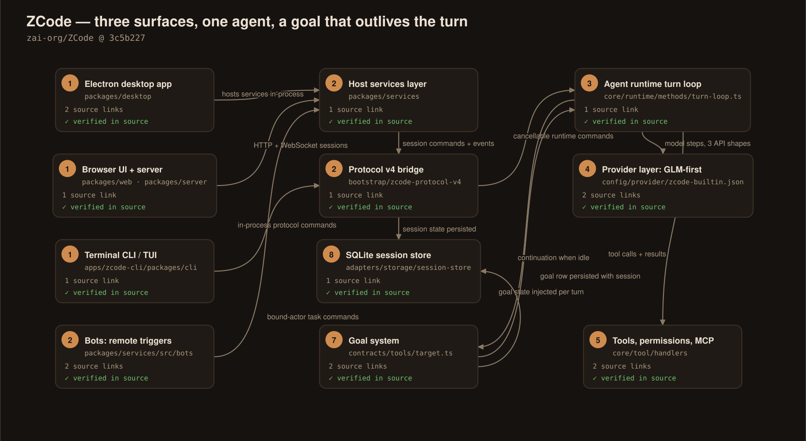
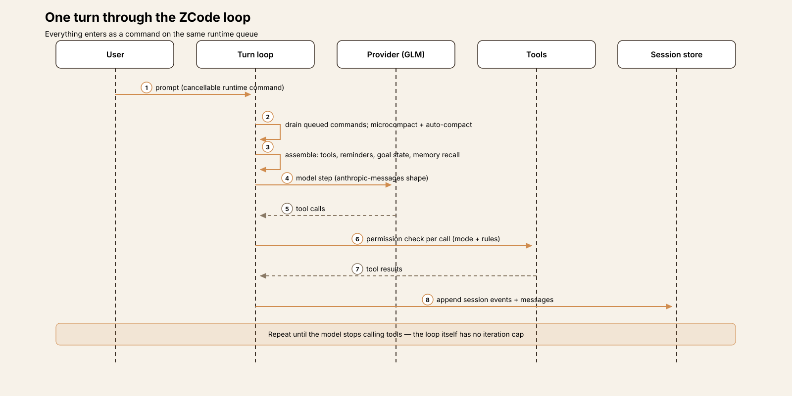
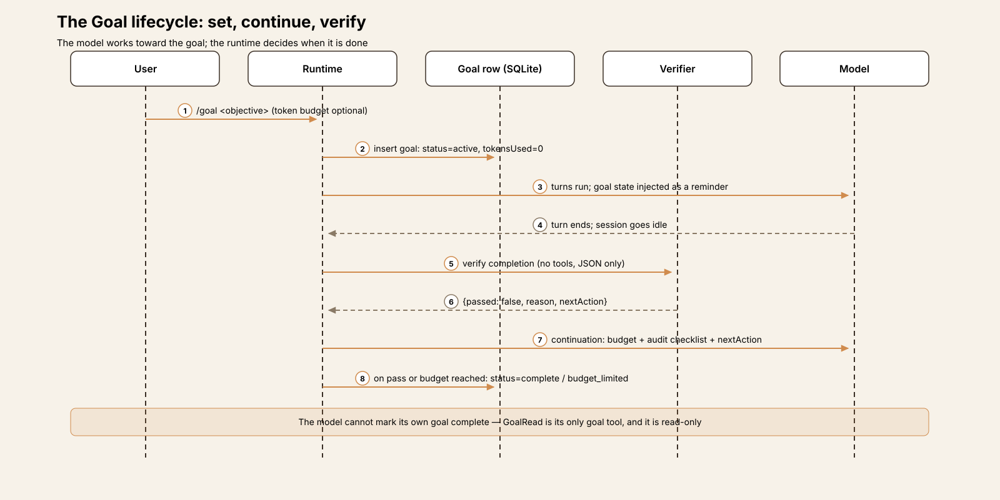
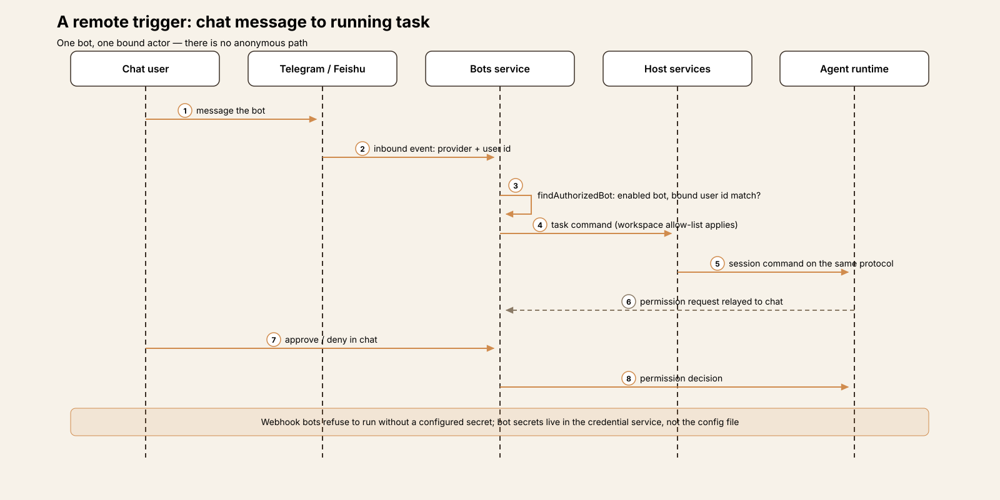
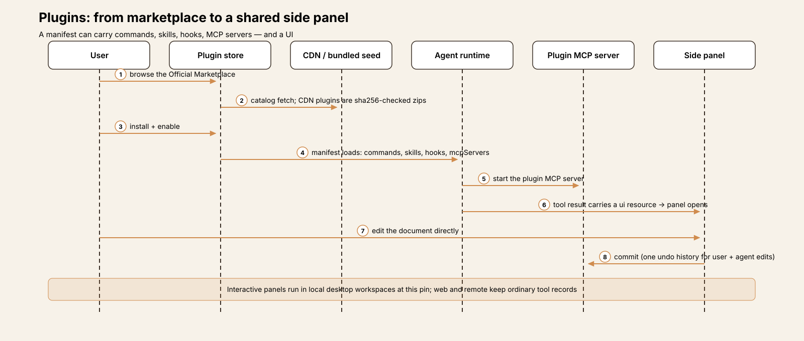
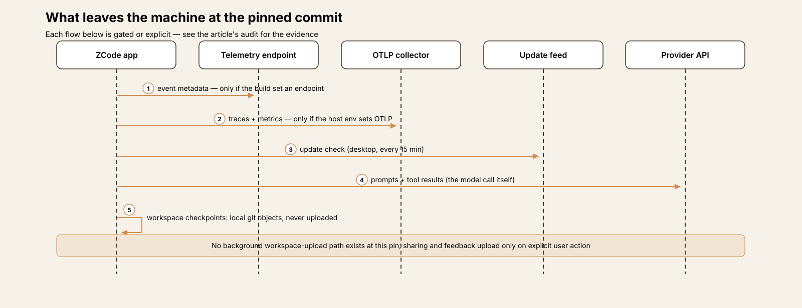

# Agent Harness Anatomy #20: ZCode — the goal outlives the turn

> **Series:** Agent Harness Anatomy — top-down dissections of real agent harnesses, grounded in verifiable source code. Every behavioral claim below carries a footnote to a pinned GitHub permalink; the full evidence lives in the endnotes.

## Version block

- **Repo:** [zai-org/ZCode](https://github.com/zai-org/ZCode)
- **Pinned:** commit `3c5b227649371507ddc4eb46ac5133afe6db1cab` (2026-10-20) — HEAD at the pin; the root package reports version 3.16.2, but there is no v3.16.2 tag (tags stop at v3.15.1), so the commit is the only exact pin. The history is a squashed code drop: seven commits in total, each a whole-tree sync of an internally developed codebase, beginning with an initial commit and a "feat: open source" commit in September 2026. There is no incremental history to bisect — the pin is a snapshot, and this teardown treats it as one.
- **Language:** TypeScript throughout — a pnpm monorepo of ~18,300 tracked files: the Electron desktop app, the web/server host and the shared UI at the root, and the agent itself (runtime, contracts, adapters, bootstrap, CLI, TUI, plus some twenty bundled plugin packages) in a nested workspace at `apps/zcode-cli`.
- **License:** Apache-2.0
- **Claim under test:** a first-party harness for GLM that ships three surfaces (desktop, browser, terminal) over one agent runtime, adds a "Goal" system in which long-horizon tasks persist in the session store and resume automatically — with completion decided by a verifier rather than by the model doing the work — and can be triggered remotely from WeChat, Feishu and Telegram. A second claim, examined in its own section below, concerns what the client sends off the machine: in September 2026 the then-closed client was reported to be uploading workspace snapshots (reported context, attributed as such where it appears); Z.ai's reported response was to delete the storage bucket and open-source the client. This teardown audits the pinned source for what leaves the machine now, and pins every audit statement to that source.

Two framing notes. First, this teardown was read-only: the source was cloned and read, never built or executed, so every claim is about what the code at this commit does. Second, scale: this is by a wide margin the largest codebase in the series — an entire product (marketplace, subscriptions, sharing, feedback, browser) wrapped around the agent. The dissection keeps its focus on the agent: the loop, the Goal system, tools and permissions, memory, providers, the remote-trigger surface, and the egress audit. Product machinery is covered where it touches one of those.

## The mental model

Hold three layers apart.

**Three surfaces, one agent.** The README's own summary is exact: "ZCode is an AI coding workspace with desktop, browser, and terminal interfaces. This repository contains the clients, backend services, shared UI, and Agent CLI and runtime source code."[^1] The desktop app is an Electron shell; the browser UI is the same shared UI package served by a local HTTP/WebSocket host; the terminal is a TUI. Even the distribution reflects the unification: one `zcode` command, where no arguments start the TUI, a leading `--web` starts Web mode, and anything else goes to the Agent CLI — both modes running locally without Electron.[^2] Under the surfaces sits a host services layer (`packages/services`: sessions, providers, bots, plugins, sharing, telemetry) and, under that, the agent proper in `apps/zcode-cli`, reached through the zcode-protocol (v4): session commands in, session events out.

**The loop is a command queue.** Nothing calls the model directly. User prompts, steering, background-subagent results, workflow results and goal continuations all enter the runtime as commands on one queue, and the turn loop drains them between model steps. That single decision explains much of the system's behavior — including how a goal can resume "by itself": a continuation is just another command.

**The Goal is a row, not a prompt trick.** A goal is a persisted record in the SQLite session store — objective, status, token budget, usage counters — that the runtime injects into turns as state, continues when the session goes idle, and closes only through a separate verification pass or by exhausting its budget. The model working toward the goal cannot mark it complete; it cannot even write to it. Its only goal tool is read-only.

## Component map

| Component | Where | Role |
|---|---|---|
| Desktop app | `packages/desktop` | Electron shell: updater, embedded browser (+ Chrome-data import), computer-use broker, packaged-build wiring |
| Web surface | `packages/web`, `packages/server`, `packages/ui` | The shared UI, served over HTTP/WebSocket by a local host |
| Host services | `packages/services` | Sessions, model providers/accounts, bots, plugins, conversation share, feedback, telemetry |
| Protocol bridge | `apps/zcode-cli/packages/bootstrap/src/zcode-protocol-v4` | Host <-> agent: session commands and events (v4), plus the host-side adapter in `packages/services/src/zcode-agent` |
| Agent runtime | `apps/zcode-cli/packages/core` | The turn loop, tools, permissions, memory, compaction, hooks, MCP, subagents, workflows |
| Contracts | `apps/zcode-cli/packages/contracts` | Ports, schemas and shared types — including the Goal contracts |
| Adapters | `apps/zcode-cli/packages/adapters` | Model transport (incl. the coding-plan gateway), the SQLite session store, MCP transports |
| CLI / TUI | `apps/zcode-cli/packages/cli`, `packages/tui` | The terminal surface, the command center (`/goal` lives here) |
| Bundled plugins | `apps/zcode-cli/packages/*-plugin` | Browser use, computer use, documents/PDF/spreadsheets/presentations, image search, simulators, creators |

## The core loop

`runRegularTurnLoop` is an unbounded `while (true)`.[^3] Each iteration, in order: drain any runtime commands that arrived during the previous model step (steering messages, background-subagent and workflow results are folded into the turn here); run microcompaction, then auto-compaction if the context needs it; initialize MCP and refresh MCP tools if their list changed; assemble the request — system sections, mode/todo/goal reminders, prefetched project-memory recall; and execute one model step. Tool results from that step feed the next iteration. The loop exits when the model stops calling tools, when the turn is aborted, or when a guard trips — the compaction guard is the visible one: if compaction refills the context too fast too often (three consecutive rapid refills), the loop throws a dedicated error rather than spinning.[^4]

Turns themselves are commands. `executeTurn` enqueues a prompt as a cancellable runtime command, which is why user input, goal continuations and protocol-level control all share one ordering and one cancellation model.[^5] MCP is not a side channel: servers are initialized and their tool lists refreshed inside the loop, at turn boundaries.[^6]

## One session, end to end

A concrete pass: a user sets a goal in the desktop app and asks for a change that takes several turns, closing the app mid-way and finishing from the terminal.

1. **The goal is set.** In the TUI this is `/goal <objective>`; the handler checks for an existing goal and asks for confirmation before replacing it, and `pause` / `resume` / `clear` are sub-commands of the same handler.[^7] The goal lands in the session store as a row: status `active`, `tokensUsed` 0, the objective capped at 4,000 characters.[^8]
2. **Turns run with the goal in view.** Each turn's request assembly includes the goal state block — status, tokens used, budget, elapsed time, and the objective wrapped as untrusted data.[^9] The model can also read the goal itself with `GoalRead`, the one goal tool it is given.[^10]
3. **Tool work proceeds normally.** The model edits and runs commands; each call passes the permission service under the session's collaboration mode, and results return to the loop.[^11]
4. **The user closes the desktop app.** Nothing about the goal lives in the window: the session — messages, todos, goal row — is in the SQLite store, so the state survives the surface.
5. **The session resumes in the terminal.** Resume reads the goal back from the store and injects its state into the restored history, so the model picks up the same objective with the same counters.[^12]
6. **The work finishes; the session goes idle.** The runtime does not take the model's word for completion. Before continuing — and to decide whether to continue at all — it runs the completion verifier: a separate, tool-less model request that must answer in JSON whether every requirement in the objective is evidenced as done.[^13]
7. **The verifier says not yet.** Its `nextAction` seeds a continuation command: a fresh turn whose prompt carries the budget accounting, the verifier's reason and next action, and the completion-audit checklist.[^14] The cycle repeats — work, idle, verify — until the verifier passes (status becomes `complete`) or the accounting stops it (`budget_limited`).

## The Goal system, closely

The Goal system is the part of ZCode with no close equivalent in the earlier entries of this series, and it rewards a close read. (Naming note: the product calls it Goal; the persisted row and the wire payload still call it a *target* — the goal's id field is `targetID`, with a comment in the contracts explaining the compatibility reason. The contracts file itself is headed "Goal Tools - session-local long-running goal".)[^15]

**Representation.** `SessionGoal` is a small, complete record: session id, goal id, objective, a UI summary title, status (`active | paused | budget_limited | complete`), an optional token budget, `tokensUsed`, `timeUsedSeconds`, and active-run timestamps.[^8][^16] One goal per session. It is stored with the session in SQLite — `readTarget` on the session store is how every surface reads the same goal.[^17]

**Authority.** Three actors can touch the goal, and the model is not one of them. The user sets, pauses, resumes and clears it (the CLI handler above; the desktop and web surfaces reach the same store through the protocol). The runtime changes its status — on verifier pass, on budget exhaustion, on pause/resume. The model's entire goal interface is `GoalRead`, whose tool entry is read-only, approval-free and explicitly scoped to "session-local goal state"; there is no goal-write tool in the registry.[^10] The continuation prompt states the rule to the model directly: "Do not mark the goal complete yourself. The runtime will run a completion verifier after this turn and update the goal status only if every requirement is complete."[^14]

**Continuation.** When a session with an active goal goes idle, `continueActiveTargetIfIdle` enqueues a target-continuation command on the same queue as user prompts, at "next" priority.[^18] Executing it is deliberately conservative: it defers while background tasks are running; it runs the verifier *first* and skips continuation if the verifier passes; if the verifier fails *without* a next action — the signature of a verifier malfunction rather than a model judgment — it also skips, so an internal error cannot turn into an infinite goal loop; and it re-reads the goal after verification, so a Stop the user pressed while the verifier was running is honored rather than overridden by a stale snapshot.[^19]

**Verification.** The verifier is a model request wearing a referee's constraints: the dedicated prompt forbids implementation work, file writes and tool calls, and demands a single JSON object — `{passed, reason, nextAction}` — judged against the conversation as the evidence source.[^13] The prompt is unusually explicit about what does not count: a completed plan, a todo update, elapsed effort, or proxy signals like passing tests that do not cover the objective's requirements. The continuation prompt carries the same doctrine as a checklist the working model must apply to itself before claiming completion.[^14] Two failure-handling details are worth naming. If the verifier returns malformed JSON, parsing fails *open* — the goal is treated as passed, with the reason recorded — on the stated reasoning that a formatting failure in the referee chain should not trap a finished goal in endless iteration.[^20] And a goal recorded in plan mode is never auto-continued: the CLI tells the user exactly that when they set one there.[^21]

**Budget as a stopping rule.** Because `tokensUsed` and `timeUsedSeconds` are accounted on the goal row itself, the budget needs no cooperation from the model: when the tokens run out, the status becomes `budget_limited` and continuation stops. Termination of a long-horizon task is thus decided by three non-model mechanisms — a verifier's pass, an accounting limit, or the user's pause/clear.

## Tools, permissions, modes

The built-in registry holds roughly forty-five tools. The file/shell core is familiar (`Bash`, `Read`, `Write`, `Edit`, `ApplyPatch`, `Glob`, `Grep`), with a notably large bash-analysis family behind the `Bash` tool (command parsing, read-only detection, cwd and git-safety policies). Around it: `WebFetch`/`WebSearch`; `TodoRead`/`TodoWrite`; plan-mode enter/exit; `AskUserQuestion`; subagents (`Agent`, `SendMessage`, `RespondToCoordinator`, `ReplyToChannel`); a dynamic-workflow family — authoring tools that create, amend, fill and evaluate multi-agent workflow programs, plus `Workflow` to run them; scheduling (`CronCreate/List/Update/Delete`, `OffPeak*`); a `js` node-repl; `Skill`; `ToolSearch` for deferred tool discovery; and `GoalRead`. Every tool entry carries the same metadata shape: JSON schemas, a result budget, a timeout, a trace policy, and a permission spec — risk level, side-effect scope, read-only/destructive flags, and whether approval is needed.[^10]

Approvals are modal. The session's collaboration mode is one of six — `plan | build | edit | yolo | guarded | auto` — and a permission service evaluates each call from the tool's capability metadata against the mode, the configured rulesets and plan-mode policy.[^11][^22] Hooks see the decision point as a `PermissionRequest` event, one of seven lifecycle hook events (`SessionStart`, `UserPromptSubmit`, `PreToolUse`, `PermissionRequest`, `PostToolUse`, `PostToolUseFailure`, `Stop`); workspace-defined hooks additionally pass through a trust/review flow before they run.[^23][^24] One containment note, stated plainly: in the core at this pin, containment is the permission layer, the modes and the bash analysis — there is no OS-level sandbox wrapper around tool execution comparable to a Seatbelt/bubblewrap layer in some earlier teardowns.

## Memory and context

Project memory is file-based and two-layered: a `MEMORY.md` index — one-line pointers, kept under 200 lines and ~25 KB by instruction — over topic files holding the detail.[^25] Extraction is delegated to a dedicated memory agent loop whose tool policy confines its writes to the memory directory, and a consolidation ("dream") pass maintains the index.[^26] Recall is selective rather than total: a prefetch runs during the turn and its result is consumed only after a real tool batch completes, so memory lands in context at a point where it can affect the next step. Session state is the SQLite event/message store; context size is managed by the micro/auto compaction pair described above, with summaries replacing history at the threshold.

## Providers: GLM first, abstraction intact

ZCode is Z.ai's first-party harness, and the provider layer shows both facts — the preference and the abstraction. The bundled built-in provider configuration (revision 33 at the pin) defines 21 provider templates over three API shapes (`anthropic-messages`, `openai-chat-completions`, `openai-responses`). The first four templates are Z.ai's: Z.ai Coding Plan and BigModel Coding Plan (Anthropic-messages shape, GLM-5.3 / GLM-5.3-Flash), and Z.ai API / BigModel API with a 24-model GLM list.[^27][^28] After them come Moonshot Kimi, MiniMax, DeepSeek, Qwen, Xiaomi MiMo, OpenAI, Anthropic, xAI, OpenRouter and OpenCode Go/Zen — a genuine multi-provider registry, ordered GLM-first. Personal providers can be added as config files alongside.

Three mechanisms deserve note. First, the built-in config is a *release*: bundled, active (last-known-good) and remote layers, with revision checks that reject stale or same-revision-different-content updates — the provider list itself is remotely refreshable configuration.[^29] Second, the official coding-plan path has a gateway rewrite: requests to the public Anthropic-shaped endpoints are rewritten to plan gateway paths for both the international (api.z.ai) and China (open.bigmodel.cn) services.[^30] Third, official MCP servers are credentialed from the host side under explicit rules: credentials are issued only for trusted origins, and with no auth resolver the request fails as `official_auth_unavailable` — the code comments state it never degrades to an anonymous request.[^31]

## Remote triggers: the bots

A ZCode task does not have to start at a keyboard. The bots subsystem lets a private chat — WeChat, Feishu/Lark, Telegram, or a generic webhook — "drive the same ZCode task flow as the UI input box": send a task, steer it, pick the model and mode, and answer permission prompts from the chat.[^32] Each bot is a complete access instance: provider credentials (by reference), one bound actor, an allow-list of workspaces, an allow-list of commands (`status`, `new`, `workspace`, `model`, `mode`, `thoughtLevel`, `sandboxMode`, `approvalPolicy`, `reply`), its own current options, and a reply mode. Group chats are supported on Feishu/Lark with owner-gated administration.

The authentication is binding-based and worth stating precisely, because it is the security boundary for a channel that can run code:

- **One bot, one actor.** An inbound message is authorized only when an enabled bot exists for that provider whose bound `providerUserId` equals the sender's provider user id — `findAuthorizedBot` is an exact match, and group contexts add owner checks on top.[^33]
- **Secrets stay in the credential service.** The persisted bot config stores only references (`credentialRef`, `webhookSecretRef`); the secrets themselves live in the CredentialService.[^34]
- **Webhooks refuse to run unsecreted.** A webhook bot without a configured secret fails its check with "Webhook secret is missing. Configure a secret before exposing the callback endpoint", and outbound posts carry the secret in a header (default `x-zcode-bot-secret`).[^35]
- **No silent workspace fallback.** A disconnected remote workspace never reconnects as a side effect of an ordinary message; only an explicit `/reconnect` command reconnects it, so a chat message cannot fall back to a local workspace that happens to share a path.[^32]

## Extensions: plugins, UI plugins, skills, workflows

The plugin system is a marketplace, not a folder. A plugin manifest (`plugin.json`) can declare commands, agents, skills, hooks, MCP servers and user configuration. Distribution runs through the Official Marketplace (`zcode-plugins-official`), which mixes builtin plugins seeded into it at startup with CDN plugins delivered as sha256-checked zip packages; users can add personal sources — git, GitHub, URL or local directory marketplaces — and compatibility layers accept Claude-ecosystem marketplace formats.[^36] Some twenty plugin packages ship inside this repo (browser-use, computer-use, documents, PDF, spreadsheets, presentations, image search, iOS/Android simulators, plugin/skill creators, visualize, and more).

UI plugins are the distinctive layer: a plugin can declare `ui.surfaces` and render an interactive page — via the MCP Apps protocol — in a side panel, where the agent's tools and the user's hands edit the same document (the bundled documentation walks through an Excalidraw canvas: the agent draws, the user adjusts, the agent revises a selection, one shared undo history).[^37] At this pin, interactive panels run in local desktop workspaces; web, mobile and remote workspaces keep ordinary MCP tool records instead.

Skills ride the same machinery (a `Skill` tool, bundled skills, a lockfile, host-side sync, skills delivered by plugins), and dynamic workflows — agent-authored multi-agent programs with run artifacts and resumable runs — are the deepest extension point: the harness lets the model write the orchestration, then runs it as a first-class object.

## The privacy audit: what leaves the machine at this pin

Context, attributed: in September 2026, third-party reporting described the then-closed ZCode client uploading workspace snapshots, with one captured payload consisting mostly of a workspace's `.git` directory; Z.ai's reported response was to delete the storage bucket and to open-source the client — the repository's second commit (2026-09-21) is the open-sourcing. This teardown does not re-verify those reports, and asserts nothing from them about the current code. What follows is only what the pinned source does, with the evidence in the endnotes.

**Workspace snapshots are local at this pin.** The checkpoint machinery — the code that snapshots a workspace, `.git` included, for restore and rewind — writes local git objects and refs through the local git CLI (`createCheckpoint` in the git checkpoint repository). There is no network call in that module.[^38] Searching the pinned tree for background upload paths over workspace content found none; the two flows that do upload workspace-derived content are explicit user actions: conversation sharing, whose public projection first drops subagent and hook-invocation rows, remaps every id into a closed public set, and verifies each artifact's size and SHA-256 as it uploads;[^39] and feedback submission, a ticket flow with user-attached files and a log archive.[^40]

**Product telemetry is build-gated event metadata.** Both client-reporting endpoints — the event telemetry endpoint and the ARMS RUM endpoint — are build-time defines that default to empty, and the code comments state the consequence: empty means the SDK initializes disabled and nothing is reported.[^41] When an endpoint *is* configured, the event payload is metadata-shaped: event name/region/type/text, extra detail passed through a sanitizer (error text scrubbed, login URLs reduced to hostnames), the account's user id, timezone and language, screen resolution, app version, OS category and version, marketing attribution parameters, optional conversation/message ids, and a `device_mid` — a locally generated UUID persisted in a telemetry state file, not a hardware identifier; the `mac_id` field is sent as an empty string.[^42][^43][^44]

**Agent traces are endpoint-from-environment.** The CLI's OpenTelemetry pipeline samples traces at 10% and exports metrics every five minutes — but only when an OTLP endpoint is present in the host environment; with none configured, the telemetry runtime is a no-op and reports itself disabled.[^45][^46] In packaged desktop builds, an endpoint can be compiled in at build time — validated, and required to be HTTPS in production builds — which makes the endpoint a property of the build, not a constant in this repository.[^47] The spans record model-call structure and statuses (the recorder is a status sink: attempts, status codes, failures), not prompt or response bodies.

**The remaining flows are the ordinary ones.** The desktop auto-updater checks its feed on a fifteen-minute poll (two minutes while the update UI is visible), with the feed URL overridable and a force-update guard that can require an update before use.[^48] The built-in provider configuration can be remotely refreshed under the revision checks described above — a download of configuration.[^29] Model traffic itself goes to whichever provider endpoint the session is configured for — Z.ai/BigModel by default — which is inherent to a hosted-model harness, and which the provider layer keeps visible and changeable. And one *inbound* local flow deserves a precise mention because it touches sensitive data: the desktop's embedded browser can import the user's Chrome data, copying the local Chrome cookie database and decrypting it locally (including the macOS Safe Storage and Windows App-Bound key paths) into ZCode's own browser session.[^49] The movement is Chrome -> ZCode on the same machine, initiated from the browser-data import flow; no upload path is attached to that module.

**Headline.** At this pin, there is no code path that uploads workspace contents in the background. What leaves the machine is: model traffic to the configured provider; event telemetry and OTLP traces when (and only when) an endpoint has been configured by the build or the host environment; update and provider-config checks; and content the user explicitly shares or attaches to feedback.

## Observations

- **The Goal system separates working from judging — structurally.** The model doing the work holds no write access to the goal, cannot declare completion, and is told so in its own continuation prompt. Completion is a runtime status change driven by a constrained verifier (no tools, JSON only) or by accounting. Most long-horizon mechanisms in this series let the worker grade its own homework; this one builds the proctor into the loop.
- **The verifier's failure modes were designed, not discovered.** Fail-without-next-action stops instead of looping; malformed referee JSON fails open with the reason recorded; a Stop pressed mid-verification wins over the stale snapshot. These are small decisions, but they are exactly the decisions a naive implementation gets wrong, and they are commented as deliberate in the source.
- **One queue explains the product.** Prompts, steering, background results, workflow completions and goal continuations are all runtime commands; surfaces, bots and the goal system differ only in who enqueues. The architecture's uniformity is why a chat message, a desktop window and an idle timer can all drive the same session coherently.
- **GLM-first is an ordering, not a lock-in.** The first four provider templates are Z.ai's and the default experience is built around the coding plan and its gateway — but the registry, the API-shape abstraction and personal providers are real. The first-party preference lives in defaults and ordering, where it is visible, rather than in a hard-coded endpoint.
- **The auditability is the story of the open-sourcing.** Whatever happened in September (reported, not re-verified here), the code at this pin answers the audit questions in the open: the snapshot path is local, the reporting paths are build- or environment-gated, and the payload shapes are readable in one file each. A reader does not have to trust a statement about this; they can read the modules named in the endnotes.

## Tradeoffs

- **Auto-continuation spends money while you are away.** A goal that keeps failing verification keeps consuming turns and tokens until its budget or the user stops it. The budget cap and the verifier gates bound the spend, but the default posture — resume work when idle — is an autonomy/cost tradeoff the user opts into per goal.
- **The verifier is a model.** Its pass/fail is a judgment over the transcript, not an executed test suite; the prompts work hard to make it strict (evidence per requirement, no proxy signals), and fail-open parsing means a malformed verdict can end a goal early. The design prefers a goal that stops over one that spins forever — a defensible choice, and a real one.
- **Permission modes carry the containment.** With no OS sandbox in the core loop at this pin, the quality of the bash analysis and the mode rules is the containment story. Six modes give finer control than a single approve-all switch, and they also give the user more ways to configure their way into a permissive posture — `yolo` is a mode, not a hack.
- **One goal per session is a real limit.** Long-horizon work that branches into independent objectives must be split across sessions (or carried by todos and workflows inside one objective). The single-goal record keeps the state machine — and the verifier's job — tractable.
- **The web surface's default is local trust.** `zcode --web` binds 127.0.0.1 without token authentication by default (a token is generated for non-local binds, and can be set or disabled explicitly).[^50] Reasonable for a developer tool on a personal machine; worth knowing before binding it anywhere else.
- **The codebase's size is a cost as well as a capability.** Three surfaces, a marketplace, subscriptions, sharing and a product backend make for a very large tree around a comparatively compact runtime; auditing any single property (as the privacy section does) means tracing across the services/protocol/runtime seam rather than reading one package.

## Comparison matrix row

| # | Dimension | ZCode (3.16.2 @ 3c5b227) |
|---|---|---|
| 1 | Agent loop | An unbounded model/tool loop (`runRegularTurnLoop`) fed by a single runtime command queue: prompts, steering, background-subagent and workflow results, and goal continuations are all commands; per iteration it drains the queue, micro/auto-compacts (with a rapid-refill circuit breaker), refreshes MCP tools, assembles reminders (mode, todo, goal state, memory recall) and runs one model step; a session-level Goal layer continues the loop across turns when idle |
| 2 | Tool system | ~45 built-ins: Bash (with a deep command-analysis/policy family), Read/Write/Edit/ApplyPatch, Glob/Grep, WebFetch/WebSearch, TodoRead/Write, plan-mode, AskUserQuestion, Agent subagents + coordinator/channel messaging, a dynamic-workflow authoring family, Cron/OffPeak scheduling, a `js` node-repl, Skill, ToolSearch (deferred discovery), GoalRead; MCP servers as a second source, initialized and refreshed in-loop; every tool entry carries schema, result budget, timeout, trace policy and a permission spec |
| 3 | Model providers | A real registry: the bundled built-in config (revision 33) defines 21 provider templates over three API shapes (anthropic-messages, openai-chat-completions, openai-responses) — Z.ai Coding Plan / Z.ai API / BigModel (GLM-5.3 first) ahead of Kimi, MiniMax, DeepSeek, Qwen, MiMo, OpenAI, Anthropic, xAI, OpenRouter, OpenCode Go/Zen; built-in configs are revision-checked releases (bundled / last-known-good / remote-synced); personal providers via config files; an official coding-plan gateway rewrites plan endpoints |
| 4 | Prompt construction | Per-turn assembly in the loop: system sections plus injected reminders — collaboration-mode, todo, goal state (authoritative block, objective wrapped as `<untrusted_objective>`), prefetched memory recall, plan-mode; continuation turns get a generated prompt with budget accounting and a completion-audit checklist; verifier turns get a dedicated no-tools, JSON-only prompt |
| 5 | Memory/session | Sessions persist in a SQLite store (messages, events, todos, and the goal row) shared by all surfaces and by resume/fork; project memory is file-based — a `MEMORY.md` index (<200 lines) over topic files — written by a sandboxed memory agent loop, consolidated by a "dream" pass, recalled by prefetch mid-turn; context bounded by micro + auto compaction |
| 6 | Reasoning/planning | No separate planner: TodoRead/Write and plan mode structure the work; decomposition via subagents and agent-authored dynamic workflows; long-horizon planning is the Goal system — a persisted objective the runtime continues turn-over-turn, with completion judged by a separate verifier (evidence per requirement, no proxy signals) rather than by the working model |
| 7 | Extensibility | The largest extension surface in the series: a plugin marketplace (Official Marketplace `zcode-plugins-official` — builtin-seeded + sha256-checked CDN zips; personal git/GitHub/URL/local sources; Claude-marketplace compatibility) whose manifests carry commands/agents/skills/hooks/MCP servers/config; UI plugins render interactive MCP Apps panels the user and agent co-edit (desktop-local at this pin); skills via bundles, plugins and a lockfile; hooks on 7 lifecycle events behind a workspace trust/review flow |
| 8 | Interfaces | Three surfaces over one runtime: Electron desktop (updater, embedded browser, computer use), browser UI served by a local host (also `zcode --web`; token auth for non-local binds), terminal TUI/CLI (one `zcode` command, SEA-packaged); plus remote triggering from WeChat/Feishu/Telegram/webhook bots that drive the same task flow, and conversation sharing with a public-projection export |
| 9 | Failure handling | Goal continuation is conservative: defers to background tasks, verifies before continuing, stops on verifier failure without a next action, re-reads state after verification so a user Stop wins; verifier JSON parsing fails open (recorded) rather than trapping a goal; compaction has a rapid-refill circuit breaker; turns are cancellable commands; provider configs fall back to last-known-good; bot-triggered work cannot silently fall back to a local workspace |
| 10 | Security model | Six collaboration modes (plan/build/edit/yolo/guarded/auto) with a per-tool permission service (risk, side-effect scope, rulesets, plan-mode policy) and hook-visible PermissionRequest events; containment rests on that layer plus extensive bash command analysis — no OS sandbox in the core at this pin; bots are bound to a single provider user id with workspace/command allow-lists and credential-service secrets; at this pin the workspace checkpoint/snapshot machinery is local-only, telemetry endpoints are build-gated (empty = off) and OTLP traces are environment-gated |

## Endnotes

All notes are pinned permalinks into the source tree at `3c5b227649371507ddc4eb46ac5133afe6db1cab`; quoted text is verbatim from that tree unless marked otherwise. Paths under `apps/zcode-cli/` are the agent workspace inside the monorepo.

[^1]: [`README.en.md#L14`](https://github.com/zai-org/ZCode/blob/3c5b227649371507ddc4eb46ac5133afe6db1cab/README.en.md#L14) — "ZCode is an AI coding workspace with desktop, browser, and terminal interfaces. This repository contains the clients, backend services, shared UI, and Agent CLI and runtime source code."
[^2]: [`README.en.md#L83-L85`](https://github.com/zai-org/ZCode/blob/3c5b227649371507ddc4eb46ac5133afe6db1cab/README.en.md#L83-L85) — "The command-line distribution includes the TUI, Web client, and Agent behind one `zcode` command. With no arguments it starts the TUI; a leading `--web` starts Web mode; all other arguments go to the existing Agent CLI. Both modes run locally without Electron."
[^3]: [`turn-loop.ts#L49-L53`](https://github.com/zai-org/ZCode/blob/3c5b227649371507ddc4eb46ac5133afe6db1cab/apps/zcode-cli/packages/core/src/runtime/methods/turn-loop.ts#L49-L53) — `runRegularTurnLoop` and its `while (true)` body.
[^4]: [`turn-loop-state.ts#L24`](https://github.com/zai-org/ZCode/blob/3c5b227649371507ddc4eb46ac5133afe6db1cab/apps/zcode-cli/packages/core/src/runtime/methods/turn-loop-state.ts#L24) — `MAX_CONSECUTIVE_RAPID_REFILLS = 3`; a blocked rapid refill throws from the loop.
[^5]: [`turn.ts#L105`](https://github.com/zai-org/ZCode/blob/3c5b227649371507ddc4eb46ac5133afe6db1cab/apps/zcode-cli/packages/core/src/runtime/methods/turn.ts#L105) — `executeTurn` enqueues the prompt via `enqueueCancellableRuntimeCommand` as a `PromptRuntimeCommand`.
[^6]: [`turn-loop.ts#L124`](https://github.com/zai-org/ZCode/blob/3c5b227649371507ddc4eb46ac5133afe6db1cab/apps/zcode-cli/packages/core/src/runtime/methods/turn-loop.ts#L124) — inside the loop: `initializeMcp`, then `refreshMcpToolsIfChanged` before the model step.
[^7]: [`goal.ts#L15`](https://github.com/zai-org/ZCode/blob/3c5b227649371507ddc4eb46ac5133afe6db1cab/apps/zcode-cli/packages/cli/src/command-center/handlers/goal.ts#L15) — `handleTargetCommand`: show/set with replace confirmation, `pause`, `resume`, `clear`.
[^8]: [`target.ts#L46-L66`](https://github.com/zai-org/ZCode/blob/3c5b227649371507ddc4eb46ac5133afe6db1cab/apps/zcode-cli/packages/contracts/src/tools/target.ts#L46-L66) — the `SessionGoal` interface; the 4,000-character objective cap is `MAX_GOAL_OBJECTIVE_CHARS` at `target.ts#L18`.
[^9]: [`target.ts#L119-L135`](https://github.com/zai-org/ZCode/blob/3c5b227649371507ddc4eb46ac5133afe6db1cab/apps/zcode-cli/packages/contracts/src/tools/target.ts#L119-L135) — `formatGoalStateForModel`: "Current session goal state (authoritative)", with the objective inside `<untrusted_objective>` tags.
[^10]: [`tool/handlers/target.ts#L16-L60`](https://github.com/zai-org/ZCode/blob/3c5b227649371507ddc4eb46ac5133afe6db1cab/apps/zcode-cli/packages/core/src/tool/handlers/target.ts#L16-L60) — the `GoalRead` handler and tool entry: "Read the current session goal without modifying external state", `readOnly: true`, permission spec `target.read`, `needsApproval: false`. No goal-write tool exists in the registry.
[^11]: [`session.port.ts#L32`](https://github.com/zai-org/ZCode/blob/3c5b227649371507ddc4eb46ac5133afe6db1cab/apps/zcode-cli/packages/contracts/src/interfaces/session.port.ts#L32) — `CollaborationMode = "plan" | "build" | "edit" | "yolo" | "guarded" | "auto"`.
[^12]: [`resume.ts#L419-L443`](https://github.com/zai-org/ZCode/blob/3c5b227649371507ddc4eb46ac5133afe6db1cab/apps/zcode-cli/packages/core/src/runtime/methods/resume.ts#L419-L443) — `readSessionTargetForContext` and `injectTargetStateIntoMessageHistory` on resume.
[^13]: [`target.ts#L196-L245`](https://github.com/zai-org/ZCode/blob/3c5b227649371507ddc4eb46ac5133afe6db1cab/apps/zcode-cli/packages/contracts/src/tools/target.ts#L196-L245) — `formatGoalCompletionVerificationPrompt`: "This is a verification request only. Do not continue implementation work, do not write files, and do not call tools. Return only a JSON object…"
[^14]: [`target.ts#L137-L194`](https://github.com/zai-org/ZCode/blob/3c5b227649371507ddc4eb46ac5133afe6db1cab/apps/zcode-cli/packages/contracts/src/tools/target.ts#L137-L194) — `formatGoalContinuationPrompt`: budget block, the prompt-to-artifact completion audit, and "Do not mark the goal complete yourself. The runtime will run a completion verifier after this turn…"
[^15]: [`target.ts#L1-L2`](https://github.com/zai-org/ZCode/blob/3c5b227649371507ddc4eb46ac5133afe6db1cab/apps/zcode-cli/packages/contracts/src/tools/target.ts#L1-L2) — "Goal Tools - session-local long-running goal"; the compatibility comment on `targetID` is at `target.ts#L48`.
[^16]: [`target.ts#L8-L13`](https://github.com/zai-org/ZCode/blob/3c5b227649371507ddc4eb46ac5133afe6db1cab/apps/zcode-cli/packages/contracts/src/tools/target.ts#L8-L13) — `GoalStatus`: `active`, `paused`, `budget_limited`, `complete`.
[^17]: [`sqlite-session-store.ts#L733`](https://github.com/zai-org/ZCode/blob/3c5b227649371507ddc4eb46ac5133afe6db1cab/apps/zcode-cli/packages/adapters/src/storage/session-store/sqlite-session-store.ts#L733) — `readTarget` in the SQLite session store (the store opens a `node:sqlite` database; the goal is one of its rows).
[^18]: [`methods/target.ts#L36-L76`](https://github.com/zai-org/ZCode/blob/3c5b227649371507ddc4eb46ac5133afe6db1cab/apps/zcode-cli/packages/core/src/runtime/methods/target.ts#L36-L76) — `continueActiveTargetIfIdle` enqueues a `target-continuation` command at priority "next".
[^19]: [`methods/target.ts#L77-L140`](https://github.com/zai-org/ZCode/blob/3c5b227649371507ddc4eb46ac5133afe6db1cab/apps/zcode-cli/packages/core/src/runtime/methods/target.ts#L77-L140) — `executeTargetContinuationCommand`: background-task deferral, verifier-first, skip on pass or on failure without a next action, and the post-verification re-read of the goal; the verification itself is `verifyActiveTargetCompletionForContinuation` in [`target-completion-verification.ts#L40`](https://github.com/zai-org/ZCode/blob/3c5b227649371507ddc4eb46ac5133afe6db1cab/apps/zcode-cli/packages/core/src/runtime/methods/target-completion-verification.ts#L40).
[^20]: [`target.ts#L289-L340`](https://github.com/zai-org/ZCode/blob/3c5b227649371507ddc4eb46ac5133afe6db1cab/apps/zcode-cli/packages/contracts/src/tools/target.ts#L289-L340) — `parseGoalCompletionVerificationText` and `failOpenGoalCompletionVerification`, with the comment explaining the fail-open choice (a referee-chain format failure must not trap a delivered goal in infinite iteration).
[^21]: [`goal.ts#L11-L13`](https://github.com/zai-org/ZCode/blob/3c5b227649371507ddc4eb46ac5133afe6db1cab/apps/zcode-cli/packages/cli/src/command-center/handlers/goal.ts#L11-L13) — the plan-mode message: under plan mode a goal is recorded but not automatically continued.
[^22]: [`permission/service.ts#L87`](https://github.com/zai-org/ZCode/blob/3c5b227649371507ddc4eb46ac5133afe6db1cab/apps/zcode-cli/packages/core/src/permission/service.ts#L87) — the `PermissionService`; tool capability metadata (risk, side-effect scope, read-only/destructive, needsApproval) plus rulesets and plan-mode policy drive its decisions.
[^23]: [`hooks/index.ts#L7-L15`](https://github.com/zai-org/ZCode/blob/3c5b227649371507ddc4eb46ac5133afe6db1cab/apps/zcode-cli/packages/contracts/src/hooks/index.ts#L7-L15) — the seven `HookEventName` values.
[^24]: [`workspace-hook-trust.ts`](https://github.com/zai-org/ZCode/blob/3c5b227649371507ddc4eb46ac5133afe6db1cab/apps/zcode-cli/packages/contracts/src/hooks/workspace-hook-trust.ts) — the workspace hook trust contract; the review/trust/revoke flow is implemented across `core/src/hooks/workspace-hook-*.ts`.
[^25]: [`memory/dream.ts#L115-L141`](https://github.com/zai-org/ZCode/blob/3c5b227649371507ddc4eb46ac5133afe6db1cab/apps/zcode-cli/packages/core/src/memory/dream.ts#L115-L141) — "Update `MEMORY.md` so it stays under 200 lines AND under ~25KB. It's an **index**, not a dump"; the index discipline is also stated for the working model in [`context/sections/memory.ts#L55`](https://github.com/zai-org/ZCode/blob/3c5b227649371507ddc4eb46ac5133afe6db1cab/apps/zcode-cli/packages/core/src/context/sections/memory.ts#L55).
[^26]: [`memory/memory-agent-loop.ts#L1-L40`](https://github.com/zai-org/ZCode/blob/3c5b227649371507ddc4eb46ac5133afe6db1cab/apps/zcode-cli/packages/core/src/memory/memory-agent-loop.ts#L1-L40) — the memory agent loop and its tool-policy type; memory file paths are containment-checked in `memory-file-path.ts`.
[^27]: [`zcode-builtin.json#L3-L8`](https://github.com/zai-org/ZCode/blob/3c5b227649371507ddc4eb46ac5133afe6db1cab/config/provider/zcode-builtin.json#L3-L8) — `revision: 33`; the first template rule is `zai-api` (Z.ai Coding Plan, `anthropic-messages`, GLM-5.3 / GLM-5.3-Flash).
[^28]: [`zcode-builtin.json#L30`](https://github.com/zai-org/ZCode/blob/3c5b227649371507ddc4eb46ac5133afe6db1cab/config/provider/zcode-builtin.json#L30), [`zcode-builtin.json#L77`](https://github.com/zai-org/ZCode/blob/3c5b227649371507ddc4eb46ac5133afe6db1cab/config/provider/zcode-builtin.json#L77), [`zcode-builtin.json#L99`](https://github.com/zai-org/ZCode/blob/3c5b227649371507ddc4eb46ac5133afe6db1cab/config/provider/zcode-builtin.json#L99) — `zai-standard-api`, `bigmodel-api` and `bigmodel-standard-api` templates; 21 templates in total in the file at the pin.
[^29]: [`zcode-builtin-provider-config-source.ts#L23-L41`](https://github.com/zai-org/ZCode/blob/3c5b227649371507ddc4eb46ac5133afe6db1cab/packages/provider-node/src/zcode-builtin-provider-config-source.ts#L23-L41) — "Bundled, Active/LKG and Remote share one Release" — the layered built-in provider config source, with stale/same-revision rejection in `applyRemoteRelease`.
[^30]: [`official-coding-plan-gateway.ts#L9-L10`](https://github.com/zai-org/ZCode/blob/3c5b227649371507ddc4eb46ac5133afe6db1cab/apps/zcode-cli/packages/adapters/src/model/official-coding-plan-gateway.ts#L9-L10) — the gateway rewrite table: `open.bigmodel.cn … /api/anthropic/v1/messages` -> `/api/v1/ultra/…`; `api.z.ai …` -> `/api/v1/ultra-zai/…`.
[^31]: [`zcodeAgentService.ts#L1069-L1094`](https://github.com/zai-org/ZCode/blob/3c5b227649371507ddc4eb46ac5133afe6db1cab/packages/services/src/zcode-agent/zcodeAgentService.ts#L1069-L1094) — official MCP auth: trusted origins + a host auth-headers resolver; absent a resolver the request returns `official_auth_unavailable` and never degrades to an anonymous request.
[^32]: [`docs/bots.md#L3-L12`](https://github.com/zai-org/ZCode/blob/3c5b227649371507ddc4eb46ac5133afe6db1cab/docs/bots.md#L3-L12) — "Bots lets a private third-party chat drive the same ZCode task flow as the UI input box"; the bot model (bound actor, workspace scope, command policy) and the remote-workspace reconnect rule are in the same document.
[^33]: [`botConfigHelpers.ts#L39-L62`](https://github.com/zai-org/ZCode/blob/3c5b227649371507ddc4eb46ac5133afe6db1cab/packages/services/src/bots/botConfigHelpers.ts#L39-L62) — `findAuthorizedBot`: an enabled bot whose provider and bound `providerUserId` match the actor (Feishu/Lark group and Weixin resolve by bot id, with owner checks in `botsService.ts`, e.g. the group-owner comparison at `botsService.ts#L1582`).
[^34]: [`docs/bots.md#L12`](https://github.com/zai-org/ZCode/blob/3c5b227649371507ddc4eb46ac5133afe6db1cab/docs/bots.md#L12) — "Secrets still live in `CredentialService`; config files only store refs such as `credentialRef` and `webhookSecretRef`."
[^35]: [`webhookProvider.ts#L176-L200`](https://github.com/zai-org/ZCode/blob/3c5b227649371507ddc4eb46ac5133afe6db1cab/packages/services/src/bots/providers/webhookProvider.ts#L176-L200) — the webhook provider's test path refuses a missing secret ("Configure a secret before exposing the callback endpoint") and sends the secret in the configured header (default `x-zcode-bot-secret`).
[^36]: [`CONTEXT.md#L9-L30`](https://github.com/zai-org/ZCode/blob/3c5b227649371507ddc4eb46ac5133afe6db1cab/CONTEXT.md#L9-L30) — the plugin-store glossary: Official Marketplace (`zcode-plugins-official`) = builtin plugins + CDN plugins; builtin = shipped with the app and seeded at startup; CDN = distributed by official CDN as sha256-checked zips, installed on demand; personal sources are their own category.
[^37]: [`UI_PLUGIN.en.md#L18-L32`](https://github.com/zai-org/ZCode/blob/3c5b227649371507ddc4eb46ac5133afe6db1cab/UI_PLUGIN.en.md#L18-L32) — UI plugins: interactive pages over MCP Apps; agent and user edit the same content; "Interactive pages currently run in **local workspaces in ZCode Desktop**" at this pin.
[^38]: [`gitCheckpointRepo.ts#L32-L60`](https://github.com/zai-org/ZCode/blob/3c5b227649371507ddc4eb46ac5133afe6db1cab/packages/services/src/git/repo/gitCheckpointRepo.ts#L32-L60) and [`gitCheckpointRepo.ts#L255`](https://github.com/zai-org/ZCode/blob/3c5b227649371507ddc4eb46ac5133afe6db1cab/packages/services/src/git/repo/gitCheckpointRepo.ts#L255) — the checkpoint repository interface and `createCheckpoint`: local git objects/refs under the app's own directories via the local git CLI; no network code in the module.
[^39]: [`conversationSharePublicProjection.ts#L619-L660`](https://github.com/zai-org/ZCode/blob/3c5b227649371507ddc4eb46ac5133afe6db1cab/packages/services/src/conversation-share/conversationSharePublicProjection.ts#L619-L660) — `buildConversationSharePublicProjection`: asserts the selection is terminal and safe, drops `subagent` and `hookInvocation` rows, and remaps ids into a closed public set before upload.
[^40]: [`feedbackService.ts#L165-L240`](https://github.com/zai-org/ZCode/blob/3c5b227649371507ddc4eb46ac5133afe6db1cab/packages/services/src/feedback/feedbackService.ts#L165-L240) — the feedback service's explicit `uploadAttachment` / `uploadAttachmentWithProgress` calls (user-initiated ticket flow; the log archive is built by `feedbackLogArchive.ts` in the same package).
[^41]: [`env.ts#L53-L60`](https://github.com/zai-org/ZCode/blob/3c5b227649371507ddc4eb46ac5133afe6db1cab/packages/shared/src/env.ts#L53-L60) — `ZCODE_ARMS_RUM_ENDPOINT` ("when empty, the SDK initializes with enable=false and produces no reporting") and `ZCODE_TELEMETRY_REPORT_ENDPOINT` ("when empty, no reporting"), both build-time defines.
[^42]: [`telemetryCore.ts#L411-L460`](https://github.com/zai-org/ZCode/blob/3c5b227649371507ddc4eb46ac5133afe6db1cab/packages/services/src/telemetry/telemetryCore.ts#L411-L460) — `sendReport`: the exact request body — event fields, sanitized extra detail, `user_id`, timezone/language, screen resolution, app version, OS fields, `device_mid`, `mac_id: ""`, marketing params, optional talk/message ids; it returns without sending when no endpoint is configured.
[^43]: [`telemetryCore.ts#L285-L297`](https://github.com/zai-org/ZCode/blob/3c5b227649371507ddc4eb46ac5133afe6db1cab/packages/services/src/telemetry/telemetryCore.ts#L285-L297) — `deviceMid`: generated locally (UUID) only when the persisted telemetry state lacks one, and written back to that state file.
[^44]: [`telemetry.ts#L216-L241`](https://github.com/zai-org/ZCode/blob/3c5b227649371507ddc4eb46ac5133afe6db1cab/packages/shared/src/telemetry.ts#L216-L241) — `sanitizeTelemetryEventDetail`: `error_msg` values are sanitized and, for the login event, the URL is reduced to its hostname before anything is sent.
[^45]: [`telemetry/bootstrap.ts#L76-L98`](https://github.com/zai-org/ZCode/blob/3c5b227649371507ddc4eb46ac5133afe6db1cab/apps/zcode-cli/packages/telemetry/src/bootstrap.ts#L76-L98) and [`bootstrap.ts#L154-L185`](https://github.com/zai-org/ZCode/blob/3c5b227649371507ddc4eb46ac5133afe6db1cab/apps/zcode-cli/packages/telemetry/src/bootstrap.ts#L154-L185) — OTLP trace/metric endpoints resolve from `OTEL_EXPORTER_OTLP_*` environment variables; with no endpoint, no runtime is created and `createModelTelemetry` returns the no-op, `enabled: false` telemetry.
[^46]: [`otlp-exporter.ts#L31-L32`](https://github.com/zai-org/ZCode/blob/3c5b227649371507ddc4eb46ac5133afe6db1cab/apps/zcode-cli/packages/telemetry/src/otlp-exporter.ts#L31-L32) — `AGENT_METRIC_EXPORT_INTERVAL_MS = 300_000`, `AGENT_TRACE_SAMPLE_RATIO = 0.1`.
[^47]: [`tsup.config.ts#L120-L156`](https://github.com/zai-org/ZCode/blob/3c5b227649371507ddc4eb46ac5133afe6db1cab/packages/desktop/tsup.config.ts#L120-L156) — the packaged-agent OTLP endpoint is a build input (`ZCODE_PACKAGED_AGENT_OTEL_ENDPOINT`), validated (HTTPS required in production) and compiled in as `OTEL_EXPORTER_OTLP_ENDPOINT` + headers, marking the distribution "packaged".
[^48]: [`autoUpdater.ts#L34-L35`](https://github.com/zai-org/ZCode/blob/3c5b227649371507ddc4eb46ac5133afe6db1cab/packages/desktop/src/main/autoUpdater.ts#L34-L35) — `AUTO_UPDATE_POLL_INTERVAL_MS = 15 * 60 * 1000`, `AUTO_UPDATE_VISIBLE_POLL_INTERVAL_MS = 2 * 60 * 1000`; the feed URL is overridable via `ZCODE_UPDATE_FEED_URL` in the same file.
[^49]: [`chromeCookieManager.ts#L1-L50`](https://github.com/zai-org/ZCode/blob/3c5b227649371507ddc4eb46ac5133afe6db1cab/packages/desktop/src/main/chromeCookieManager.ts#L1-L50) — the Chrome cookie import: a snapshot copy of the local Chrome cookie database, local decryption (Safe Storage / App-Bound helpers in `chromeCredentialManager.ts`), and writes into ZCode's embedded-browser session — all on-device.
[^50]: [`README.en.md#L100`](https://github.com/zai-org/ZCode/blob/3c5b227649371507ddc4eb46ac5133afe6db1cab/README.en.md#L100) — Web mode: "listens on `127.0.0.1` without token authentication by default… For LAN access, use `--host 0.0.0.0`; listening on a non-local address generates an access token by default. Use `--token` to set one, or `--no-token` to disable token authentication."
